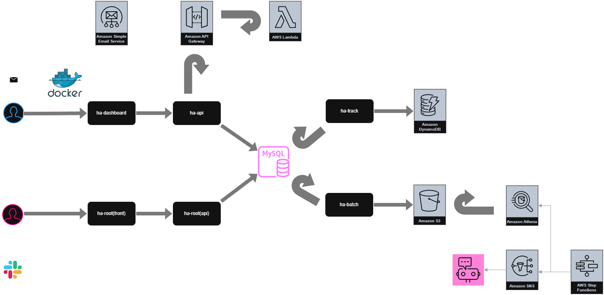

# work-3g
健康管理アプリ  

## 01_構成図

### 健康情報登録フロー

## 02_環境構築手順
[環境構築手順](http://healthinfo-app-docs.s3-website-ap-northeast-1.amazonaws.com/wiki/dockerEnv)を参考にローカル環境構築を行う

## 03_Project構成
### ha-api  
健康管理のAPI。  
  - Java25
  - SpringBoot

### ha-calc-api
健康情報計算APIの実装・CloudFormation定義・ビルド・デプロイ処理を管理。
  - Python3.14
  - AWS Lambda
  - Amazon API Gateway

### ha-dashboard  
健康管理のダッシュボード。   
  - Java25
  - SpringBoot
  - thymeleaf

### ha-batch  
健康管理のBatch処理。   
  - Java25
  - SpringBatch

### ha-root  
健康管理アプリの管理者用サイト。   
  - Java25
  - SpringBoot
  - Vue.js

### ha-business  
以下のプロジェクトで共通的に使うbusinessロジックを定義。  
| プロジェクト名 |
| :---- |
| ha-api |
| ha-batch |
| ha-dashboard |
| ha-root |

### ha-db  
以下のMavenプロジェクトで共通的に使うTableに対応したEntityとMapperのみを定義。  
環境へのDB反映は本プロジェクトよりFlywayで行う。  
| プロジェクト名 |
| :---- |
| ha-api |
| ha-batch |
| ha-business |
| ha-dashboard |
| ha-root |

### ha-common  
以下のMavenプロジェクトで共通的に使う共通処理を定義。  
| プロジェクト名 |
| :---- |
| ha-api |
| ha-batch |
| ha-business |
| ha-dashboard |
| ha-db |
| ha-root |

### ha-tools  
DB定義からのDDL/DML生成、API自動テスト、ローカル開発用の補助ツールを管理。

### ha-pom  
以下のプロジェクトで共通的に使う外部ライブラリを定義したpomプロジェクト。
| プロジェクト名 |
| :---- |
| ha-api |
| ha-batch |
| ha-business |
| ha-common |
| ha-dashboard |
| ha-db |
| ha-root |

### ha_track
健康情報蓄積用プロジェクト（サービス名：ha-track）。
  - Python3.14.8
  - Django rest framework

### ha-build  
Docker環境でのBuild用のスクリプトを定義。   
また、AWS CodeBuildによるCI/CD、TerraformによるIaCのファイルを定義。

### ha-docs  
API設計書・DB定義・AWSローカル検証資料とドキュメントサイトを管理。
