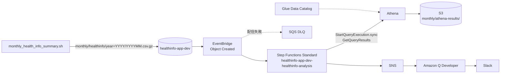

# Terraform構成・設定の補足

反映手順は [README](README.md) を参照。

## 作成する主なリソース

- ネットワーク
  - VPC / Internet Gateway
  - public app subnet / private DB subnet（それぞれ `az_count` 個、既定は2）
  - public app subnet / private DB subnet用のルートテーブルと関連付け
  - ECSタスク、RDS、踏み台EC2用のSecurity Groupと通信ルール
- コンテナ実行環境
  - ECS Cluster
  - `ha-dashboard` ECS Fargate service / task definition
  - `ha-api` ECS Fargate service / task definition
  - `ha-root` API ECS Fargate service / task definition
  - `ha-track` ECS Fargate service / task definition
  - `ha-batch` 単発実行用ECS Fargate task definition
  - 各ECSタスク用CloudWatch Logs log group
- サービスディスカバリ
  - Cloud Map private DNS namespace
  - `ha-api` / `ha-root` API / `ha-track` 用Cloud Map service
- コンテナイメージ
  - `ha-dashboard` / `ha-api` / `ha-root` API / `ha-track` / `ha-batch` 用ECR repository
  - 各ECR repositoryの未タグイメージをpushから1日後に削除するLifecycle Policy
- データストア・キュー
  - RDS MySQL（`db_engine_version` の既定値は `9.7.4` LTS）とDB subnet group
  - `health_info_<環境名>` DynamoDB table（On-demand / server-side encryption有効）
  - `healthinfo-app-<環境名>` アプリデータ用S3 bucket（ACL無効 / public access block / server-side encryption有効）
  - API通信ログ用SQS FIFO queue（SQS managed server-side encryption有効）
- 月次健康情報分析・通知
  - S3 Object Created eventを受け取るEventBridge ruleと配信失敗用SQS DLQ
  - `<プロジェクト名>-<環境名>-healthinfo-analysis` Step Functions Standard workflow
  - Glue Data CatalogのCSV tableとAthena workgroup
  - Athena query結果用S3 prefixと7日保持のLifecycle rule
  - SNSとAmazon Q Developer in chat applicationsを経由するSlack通知
- 運用・権限
  - RDS初期設定・接続用のEC2踏み台とIAM instance profile
  - 各ECSタスクのexecution role / task roleと必要なIAM policy

IAM権限はアプリケーションのAWS API呼び出しに合わせて定義する。
ECS execution roleは各タスクのECRリポジトリとCloudWatch Logsのログストリームだけを対象とし、
リソース指定に対応しない `ecr:GetAuthorizationToken` のみ `Resource = "*"` とする。
Parameter Storeはexecution roleが `ssm:GetParameters`、アプリのtask roleが `ssm:GetParameter` を使用し、
SQSのURL取得・送信はAPI通信ログ用キューに限定する。
`ha-batch` のS3権限は `analysis/` と `monthly/healthinfo/` へのアップロードだけとし、
`ha-batch` / `ha-root` APIのSES権限は実際に呼び出す `ses:SendEmail` だけを許可する。
S3の `s3:PutObjectAcl` は、現在の `AwsS3Component` がアップロード時に
`bucket-owner-full-control` ACLを指定するため保持する。
既存SecureStringがカスタマー管理KMSキーを使用する可能性があるため、SSM経由に限定した復号権限も保持する。
RDS用Security GroupはMySQLの接続元だけを許可し、送信ルールは持たない（応答はステートフル追跡で許可される）。

分析対象S3データはIAMで直接アクセスし、Lake Formationで管理しない前提とする。
`lakeformation:GetDataAccess` は付与しないため、手動設定や別のIaCでも対象S3データをLake Formationに登録しない。
Step Functionsの `.sync` 連携で使うAthenaの監視・停止権限、Glueカタログ参照、
S3のmultipart操作権限、CloudWatch Logsのログ配信権限は、サービス内部の処理に必要なため保持する。

`ha-dashboard` / `ha-api` / `ha-root` API / `ha-batch` は、同じRDS databaseを同じアプリ用DBユーザで参照する。
`ha-track` はRDSを使用せず、環境ごとのDynamoDB tableを使用する。

RDSのパスワードなどを保持するSSM Parameterと `ha-root/front` のS3 static websiteは既存リソースを参照し、このTerraformでは作成しない。
アプリデータ用S3 bucketは `healthinfo-app-<app_env>` という名前でこのTerraformが作成する。

## 月次健康情報CSVのAthena分析・Slack通知



Athena queryはEventBridgeが受け取った1ファイルだけを対象に `COUNT(*)` を実行する。空CSVは0件として処理し、Slackには健康情報の明細を送らず、件数・入力S3 key・Athena QueryExecutionId・結果prefixだけを通知する。

個人dev向けの既定値:

- Athena scan上限: 1 query当たり100 MiB
- Athena結果保持: 7日
- Step Functions log: `ERROR` のみ、実行データを含めず1日保持
- Amazon Q診断log: 無効
- customer managed KMS key、Glue Crawler、Lambda、Athena Provisioned Capacity: 作成しない

AWSコンソールでAmazon QとSlack workspaceを認可し、channelへAmazon Qを招待してから `02_analytics/environments/dev/terraform.tfvars` に次を設定する。この構成ではSlack通知リソースも作成するため、両IDを指定する。

```hcl
slack_team_id    = "T0123456789"
slack_channel_id = "C0123456789"
```

現在の `MonthlyHealthInfoSummaryWriter` はS3 upload後に `slack.sendFile(...)` でもCSV.gzを送信するため、新経路を有効にすると通知が二重になる。新経路へ完全移行する場合は、動作確認後に既存のファイル送信を無効化する。

## ha-batch起動

`ha-batch` は常駐サービスではなく、ECS Fargateの単発タスクとして起動する。
基本コマンドは次で確認できる。

```bash
export TF_DATA_DIR=/tmp/work/application
terraform -chdir=/home/cloudshell-user/01_applications/environments/dev output -raw batch_run_command
```

出力コマンドの `JOB_NAME` を実行対象のSpring Batch Job名へ変更する。
日付が必要なJobは、container overrideの `command` 配列へ `d=YYYYMMDD` または
`m=YYYYMM` を追加する。

主なJob名:

- `healthCheckBatchJob`
- `healthInfoFileRegistBatchJob`
- `monthlyHealthInfoSummaryBatchJob`
- `healthInfoMigrateBatchJob`
- `awsSqsImportBatchJob`
- `dataPurgeBatchJob`
- `dailyHealthInfoJob`
- `dailyUserJob`
- `dailyApiLogJob`
- `dailyBatchLogJob`

## RDS MySQL 9.7.4への移行

RDSの既定バージョンはMySQL `9.7.4` LTS。Git管理対象外の `01_applications/environments/dev/terraform.tfvars` などで `db_engine_version` を上書きしている場合も `"9.7.4"` に変更する。

既存RDSの8.4系から9.7系への更新はメジャーアップグレードとなる。新規作成と異なり、バージョンを書き換えるだけでは実行できない。事前にスナップショットまたはBlue/Green環境で復元・移行を検証し、アプリとFlywayの実行を確認してから `db_allow_major_version_upgrade = true` を明示して適用する。既定値は `false`。この構成は `apply_immediately = true` のため、既存DBへの適用時には更新と接続断が発生し得る。

RDSの更新経路は8.4→9.7。8.0以前は順番に更新する。RDSの事前チェックでは、`mysql_native_password` のアカウント、削除された関数や予約語、証明書の期限切れなどが更新を妨げる場合がある。既存アカウントの認証方式は `caching_sha2_password` を使用し、実DBの `PrePatchCompatibility.log` と更新先バージョン・インスタンスクラスの提供状況を確認する。カスタムDB parameter groupを使用する場合は `mysql9.7` familyが必要。この構成ではカスタムgroupを指定していない。

RDS 9.7ではTLS接続が既定で必須となるため、ECSへ渡す `DB_URL` は `sslMode=REQUIRED` を使用する。外部のDBクライアントやFlyway MavenコマンドからRDSへ接続するときも、TLS対応のURLを指定する。`REQUIRED` は暗号化を必須にするが、CAとホスト名の検証は行わない。サーバ証明書を検証する構成ではRDS CAをJava trust storeへ登録し、`sslMode=VERIFY_IDENTITY` と実際のRDSエンドポイントを使用する。

公式資料: [RDS MySQLのメジャーアップグレード](https://docs.aws.amazon.com/AmazonRDS/latest/UserGuide/USER_UpgradeDBInstance.MySQL.Major.html)、[RDSのTLS接続要件](https://docs.aws.amazon.com/AmazonRDS/latest/UserGuide/mysql-ssl-connections.require-ssl.html)、[Connector/JのSSL設定](https://dev.mysql.com/doc/connector-j/en/connector-j-connp-props-security.html)。
