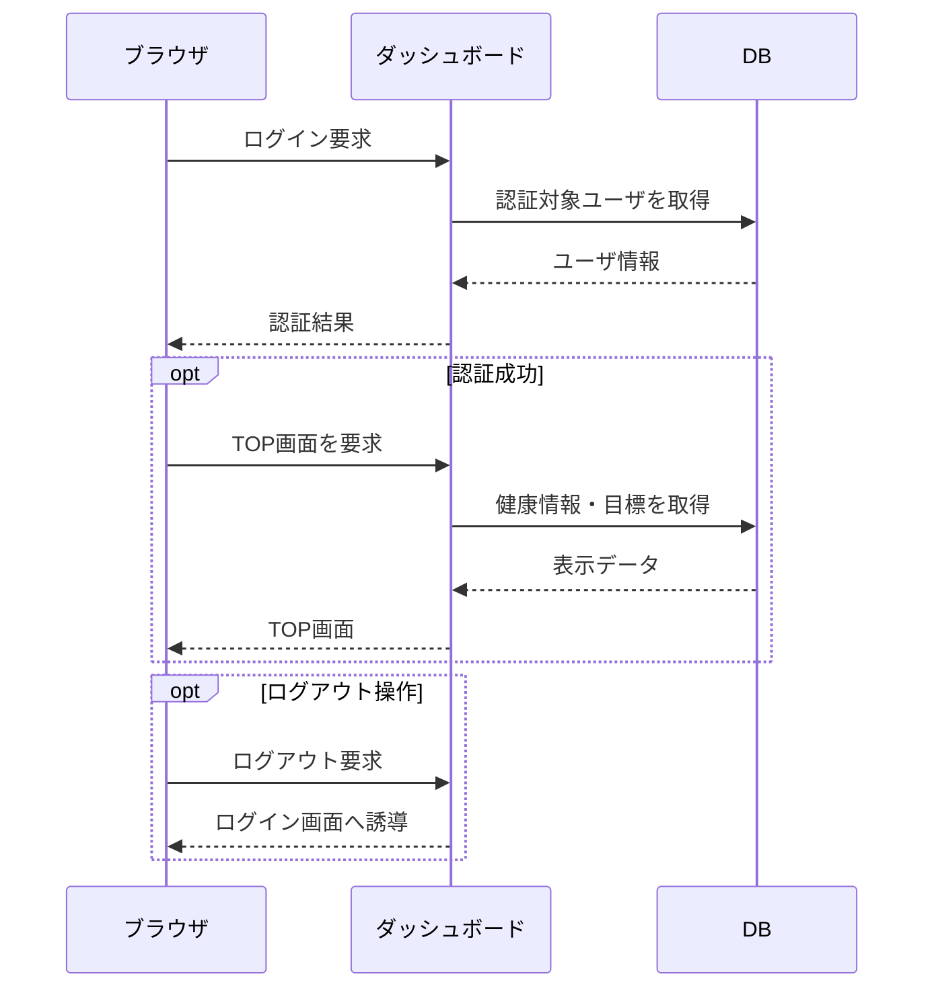
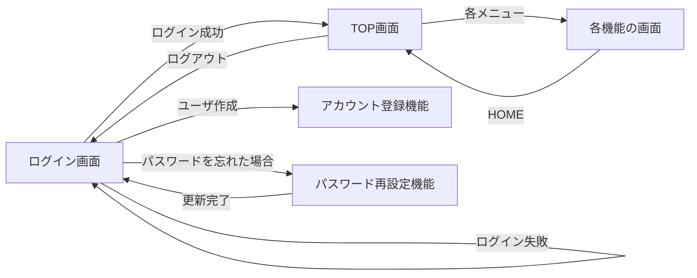
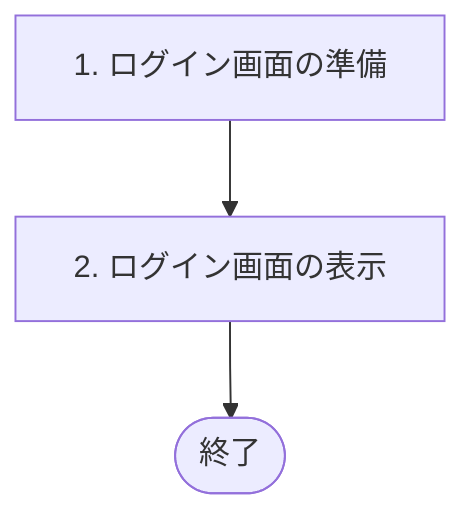
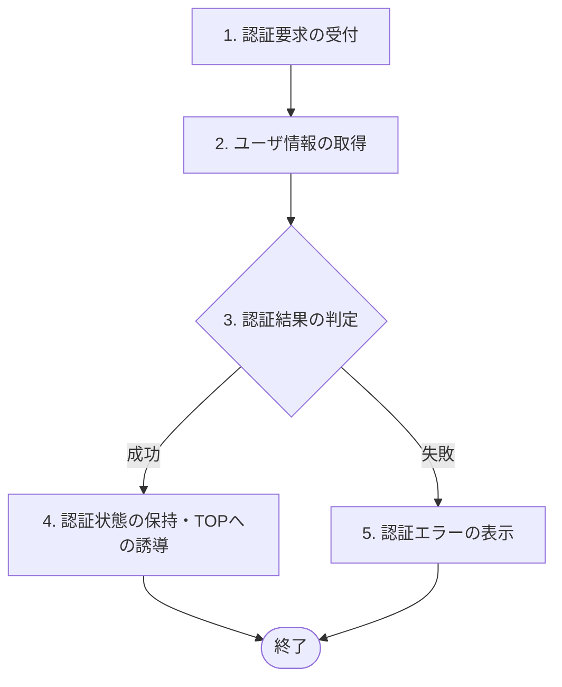
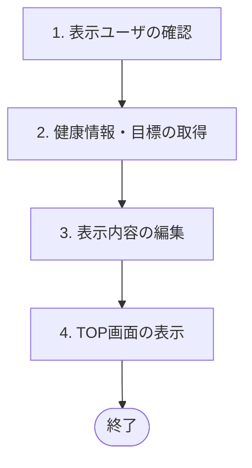
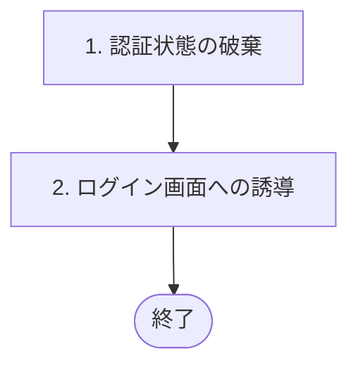

# 設計書 1.0. ログイン機能

## 1. 機能概要

- メールアドレスとパスワードで認証し、ログインしたユーザのTOP画面を表示する。
- TOP画面に有効な健康情報の最新の体重・BMI、前回との体重差、目標体重、直近10件のグラフ、当日の健康情報未登録通知を表示する。削除済みの健康情報は表示・件数判定の対象外とする。
- メニューから各機能へ遷移し、ログアウト時には認証情報とセッションを破棄する。
- 認証は[DashboardConfig](../../../ha-dashboard/src/main/java/jp/co/ha/dashboard/config/DashboardConfig.java)と[認証Provider](../../../ha-dashboard/src/main/java/jp/co/ha/dashboard/login/auth/DashboardAuthenticationProvider.java)、画面表示は[LoginController](../../../ha-dashboard/src/main/java/jp/co/ha/dashboard/login/controller/LoginController.java)が処理する。

## 2. 処理概要

### 2.1. 全体の処理概要



### 2.2. 画面一覧・画面遷移図

| 画面 | 画面識別子・ビュー | 表示契機 | 備考 |
| --- | --- | --- | --- |
| ログイン画面 | `login/index` | GET `/login` | 未認証で利用可能。認証失敗・ログアウト・回復完了のメッセージも同じ画面で表示する。 |
| TOP画面 | `login/top` | GET `/top` | ログイン後の遷移先。各機能への入口。 |



## 3. 画面仕様

### 3.1. ログイン画面

#### 3.1.1. 基本情報・表示条件

| 項目 | 内容 | 備考 |
| --- | --- | --- |
| 画面名・ビュー | ログイン画面・`login/index` | [テンプレート](../../../ha-dashboard/src/main/resources/templates/login/index.html)。 |
| 表示URL・メソッド | GET `/login` | URLのスキーム・ホスト・ポート・コンテキストパスは実行環境に従う。 |
| 表示条件 | 認証不要 | エラー後もログアウト後も同じ画面を使用する。 |
| 入力元 | クエリ`error`・`isLogout`、セッション`loginErrorMessage`、フラッシュ属性`isPasswordReset` | `error`はリダイレクト時の目印であり、エラーメッセージ本体を生成する入力ではない。 |

#### 3.1.2. レイアウト・画面項目

| 配置 | 要素 | 備考 |
| --- | --- | --- |
| フォーム上部 | エラー・ログアウト・パスワード更新完了メッセージ | 対応するモデル値がある場合に表示する。 |
| フォーム中央 | メールアドレス、パスワード | 縦に配置し、パスワードは伏字入力。 |
| フォーム下部 | ログイン、ユーザ作成、パスワード回復リンク | 回復リンクはフォーム外。 |

| 項目名 | 型 | 必須 | 備考 |
| --- | --- | --- | --- |
| `mailAddress` | `string` | 認証成功に必要 | メールアドレス。画面は`type=email`、`required`、最大64文字、jQueryのメール形式チェックを設定する。認証フィルター側では桁数・メール形式を検証しない。 |
| `password` | `string` | 認証成功に必要 | パスワード。画面は`type=password`、`required`、最大16文字。未指定の場合、認証Providerでは空文字として照合する。サーバで2〜16文字・半角英数のフォーム検証は実行しない。 |

| 画面・項目 | 内容・遷移先 | 備考 |
| --- | --- | --- |
| ログイン画面 | メールアドレス、パスワード、ログイン、ユーザ作成、パスワード回復リンク | [テンプレート](../../../ha-dashboard/src/main/resources/templates/login/index.html)。ユーザ作成は`/accountregist/input`、回復は`/accountrecovery/index`へGETする。 |
| 認証失敗表示 | モデル`errorMessage` | セッション`loginErrorMessage`を読み取り、表示用モデルへ移してセッションから削除する。再度GETした際には再表示しない。 |
| パスワード再設定完了表示 | モデル`isPasswordReset`が真の場合にメッセージ表示 | 回復機能がリダイレクト時のフラッシュ属性として設定する。`GET /login`でクエリから設定する項目ではない。 |

#### 3.1.3. 初期表示

| 項目 | 初期値・取得元 | 備考 |
| --- | --- | --- |
| `loginForm` | 新規フォーム | メールアドレス・パスワードは未設定。 |
| `isLogout` | 要求クエリ | ログアウト後の`true`でメッセージを表示する。 |
| `errorMessage` | 既存セッション`loginErrorMessage` | 取得したらセッションから削除する。再表示時には同じエラーを自動で再取得しない。 |
| `isPasswordReset` | 回復機能が設定するフラッシュ属性 | GETの独自クエリ項目として設定しない。 |
| 入力進捗 | メールアドレス・パスワードの入力済み数÷2 | 各項目のchangeでMprogressを更新する。入力妥当性とは別の表示。 |

#### 3.1.4. 操作・イベント処理

| 操作 | HTTPメソッド・URL | 送信する業務項目 | サーバが採用・参照するデータ | 結果・遷移 | 関連処理 | 備考 |
| --- | --- | --- | --- | --- | --- | --- |
| ログイン | POST `/login` | `mailAddress`・`password` | 要求値とDBのユーザ情報 | 成功時TOP、失敗時ログイン画面 | 5.2 | フォームはapplication/x-www-form-urlencoded。認証フィルターが処理する。 |
| ユーザ作成 | GET `/accountregist/input` | なし | 遷移先機能の初期値 | 登録入力画面 | 別機能 | JavaScriptがGETフォームを生成して送信する。 |
| パスワード回復 | GET `/accountrecovery/index` | なし | 遷移先機能の初期値 | メールアドレス入力画面 | 別機能 | 通常のリンク。 |

#### 3.1.5. 入力チェック・エラー表示

| 対象 | チェック内容 | エラー時の処理 | 備考 |
| --- | --- | --- | --- |
| メールアドレス | ブラウザの必須・メール形式・最大64文字、jQueryの必須・メール形式 | 画面側で送信を抑止する | 認証フィルターはメール形式・最大桁数を検証せずユーザ検索を行う。 |
| パスワード | ブラウザの必須・最大16文字、jQueryの必須 | 画面側で送信を抑止する | 認証フィルターではハッシュ照合を行う。`LoginForm`の半角英数・2〜16文字等の注釈はこのPOSTでは実行されない。 |
| サーバ認証 | ユーザ存在、パスワード一致、削除状態、有効期限 | 該当する`DW0023`・`DW0024`・`DW0022`・`DW0025`で認証失敗 | 判定順と表示は「5.2.3. ログイン認証」に記載する。 |

### 3.2. TOP画面

#### 3.2.1. 基本情報・表示条件

| 項目 | 内容 | 備考 |
| --- | --- | --- |
| 画面名・ビュー | TOP画面・`login/top` | [テンプレート](../../../ha-dashboard/src/main/resources/templates/login/top.html)。 |
| 表示URL・メソッド | GET `/top` | 認証成功時もこのURLへリダイレクトする。 |
| 表示条件 | 認証済み、セッション`seqUserId`を使用 | 認証状態があってもIDがない場合、コントローラはログインビューを直接返す。 |

#### 3.2.2. レイアウト・画面項目

| 配置 | 要素 | 備考 |
| --- | --- | --- |
| 上部 | 共通ヘッダー・メニュー・当日未登録通知 | 共通ヘッダーはセッションのユーザIDがある場合にメニューを表示する。 |
| 中央 | 最新の健康情報カード、目標体重カード | 最新体重・BMI・前回差、目標と差分を表示する。 |
| 下部 | 直近10件グラフ・HOME/NEWS | Chart.jsで体重・BMI・標準体重を描く。 |

| 画面・項目 | 内容・遷移先 | 備考 |
| --- | --- | --- |
| 最新の健康情報 | `latest.weight`、`latest.bmi`、`diff`、`status` | [TOPテンプレート](../../../ha-dashboard/src/main/resources/templates/login/top.html)。2件以上の場合、増加`30`は`+`、減少`10`は`-`、同値`20`は符号なし。1件だけの場合は前回差を設定しない。 |
| 有効な健康情報0件 | コントローラは`latestHealthInfoNotExistMessage`を設定する | 現在のテンプレートでは0件用の説明・登録リンクが`latest != null`の要素内にあるため、0件時にはその説明も表示されずカード本文が空になる。 |
| 目標体重 | `goalWeight`、`goalDiff` | 差は`目標体重 - 最新体重`。健康情報0件時は目標体重のみ。変更リンクは`/accountsetting/input`。 |
| 当日未登録通知 | `needNotice=Y`の場合に表示 | 登録リンクは`/healthinfo/input`。当日の有効な健康情報があれば、コントローラは`needNotice`を設定しない。削除済みの情報しかない場合は未登録として扱う。 |
| 直近10件グラフ | `label`、`weight`、`bmi`、`standardWeight` | Chart.jsの折れ線グラフ。登録日時降順で最大10件を取得後、健康情報ID昇順に並べる。画面幅767.98px以下ではX軸の日時目盛りを非表示にする。 |
| 健康情報メニュー | `/healthinfo/input`、`/healthinfofile/input`、`/healthinforeference/index` | 登録・一括・照会へGETする。一括は共通ヘッダーのモバイル用非表示対象。 |
| その他のメニュー | `/accountsetting/input`、`/caloriecalc/index`、`/breathingcapacity/index` | 設定変更・カロリー計算・肺活量計算。 |
| 共通ナビゲーション | HOME:`/top`、NEWS:`/news/list`、ログアウト:`/logout` | BMI・標準体重・基礎代謝量の説明は共通ヘッダーからモーダル表示する。 |

#### 3.2.3. 初期表示

| 対象 | 取得元・設定順 | 備考 |
| --- | --- | --- |
| 表示用データ | 有効な健康情報の最新2件→目標体重→有効なグラフ対象10件→当日の有効な健康情報件数の順にDB検索 | GETごとに再検索する。処理とSQLは5.3。 |
| 前回との差 | 最新と前回の体重 | 0件・1件時の表示条件は3.2.2を参照する。 |
| グラフ | 登録日時降順で取得後、ID昇順に並べ替え | 日時順への再ソートではない。 |

#### 3.2.4. 操作・イベント処理

| 操作 | HTTPメソッド・URL | 送信する業務項目 | サーバが採用・参照するデータ | 結果・遷移 | 関連処理 | 備考 |
| --- | --- | --- | --- | --- | --- | --- |
| 健康情報入力・未登録通知リンク | GET `/healthinfo/input` | なし | 遷移先機能のセッション | 登録入力画面 | 別機能 | 登録機能の設計に従う。 |
| 健康情報一括 | GET `/healthinfofile/input` | なし | 遷移先機能のセッション | 一括登録画面 | 別機能 | モバイル用非表示対象。 |
| 健康情報照会 | GET `/healthinforeference/index` | なし | 遷移先機能のセッション | 照会画面 | 別機能 | 検索は遷移先の操作で行う。 |
| 設定変更・目標変更 | GET `/accountsetting/input` | なし | 遷移先機能のユーザ情報 | 設定入力画面 | 別機能 | 目標変更リンクも同じ遷移先。 |
| カロリー計算 | GET `/caloriecalc/index` | なし | 遷移先機能のユーザ情報 | 計算画面 | 別機能 | — |
| 肺活量計算 | GET `/breathingcapacity/index` | なし | 遷移先機能のユーザ情報 | 計算画面 | 別機能 | — |
| HOME | GET `/top` | なし | セッションユーザID | TOP再表示 | 5.3 | 最新状態を再検索する。 |
| NEWS | GET `/news/list` | なし | 遷移先機能の検索結果 | お知らせ一覧 | 別機能 | — |
| BMI・標準体重・基礎代謝量 | HTTP要求なし | なし | 画面内の説明要素 | モーダル表示 | 3.2.2 | 共通テンプレート内の要素を開閉する。 |
| ログアウト | GET `/logout` | なし | 現在の認証セッション | ログイン画面 | 5.4 | Spring Securityが処理する。 |

#### 3.2.5. 入力チェック・エラー表示

| 対象 | 条件・表示 | 備考 |
| --- | --- | --- |
| 入力項目 | 特になし | TOPには業務値を入力するフォームがない。 |
| ユーザID不在 | ログインビューを直接返す | 認証切れによるフィルターの302とは区別する。 |
| 有効目標0件・DB例外等 | 共通エラー画面 | 発生条件・コード・SQLは5.3に記載する。 |

## 4. 画面間のデータ管理・共通制御

### 4.1. 引き継ぐデータと保持方法

| データ | 保持場所 | 使用画面・操作 | 備考 |
| --- | --- | --- | --- |
| 認証情報 | Spring Securityのセッション管理 | 認証後の画面要求 | PrincipalはDashboardAuthInfo。 |
| `seqUserId` | セッション | TOP・各機能 | 成功ハンドラーが保存する。 |
| `loginErrorMessage` | セッション | 認証失敗後のログイン表示 | 読取後に削除する一時メッセージ。 |
| `isPasswordReset` | フラッシュ属性 | 回復完了後のログイン表示 | 回復機能からのリダイレクトで引き継ぐ。 |
| `loginForm`・TOPの各モデル値 | 要求のモデル | 各画面の描画 | 画面入力や検索結果を独自にセッション保存する処理ではない。 |

### 4.2. データの生成・参照・更新・破棄

| 契機 | 生成・参照・更新・破棄 | 備考 |
| --- | --- | --- |
| 認証成功 | 認証情報とseqUserIdを保存 | 以後の画面が利用する。 |
| 認証失敗 | loginErrorMessageを保存 | 次のGET /loginで取得・削除する。 |
| GET /login | 新規フォーム・表示メッセージをモデルへ設定 | パスワードを業務用フォームとしてセッションへ保存しない。 |
| GET /top | DB値を毎回取得し、要求モデルに設定 | 本機能内の表示結果キャッシュはない。 |
| ログアウト | セッションを無効化しJSESSIONIDを削除 | 認証情報・ユーザIDを破棄する。 |

### 4.3. 戻る・再読込・直接アクセス時の動作

| 操作・状態 | 動作 | 備考 |
| --- | --- | --- |
| ログイン画面の再読込 | GETを再実行する | 取得済みの失敗メッセージは既に削除されている。 |
| 認証POST後の再読込 | リダイレクト先のGETを再実行する | 成功時TOP、失敗時ログイン表示。 |
| TOPの再読込・直接GET | 認証とセッションを前提に再検索 | データが変わっていれば新しい内容を表示する。 |
| ブラウザの戻る | 履歴・キャッシュ・再取得のブラウザ動作に従う | ログアウト後の新たな保護URL要求は未認証扱いとなる。過去HTMLの表示をアプリ側が個別に消去する実装はない。 |

### 4.4. 認証・セッション切れ・多重送信制御

| 対象 | 条件・動作 | 備考 |
| --- | --- | --- |
| Cookie | JSESSIONID等でセッションを継続する | ブラウザのHTTP前提であり、メールアドレス等の業務項目とは区別する。セッション作成・認証時はSet-Cookieを利用する。 |
| 認証不要URL | /login・/logout等 | 保護URLへ未認証でアクセスした場合はSpring Securityが/loginへ誘導する。 |
| 認証済みでもseqUserIdがない場合 | TOPはログインビューを直接返す | IDの不在をコントローラで別途判定する。 |
| CSRF | DashboardConfigで無効 | CSRF用の必須hidden・ヘッダは定義しない。 |
| 多重送信 | ログイン・TOP・ログアウトにMultiSubmitToken注釈なし | wizardの確定用トークンとは別の処理。 |
| HTML応答 | ビューとしてHTMLを返す | JSONのresult・エラー配列を生成しない。認証成功・失敗・ログアウトのLocationは各サーバ処理に記載する。 |

## 5. サーバ処理詳細

### 5.1. ログイン画面表示処理

#### 5.1.1. 処理フロー



| 処理順 | 処理概要 | 処理詳細 | 関連項番 |
| --- | --- | --- | --- |
| 1 | ログイン画面の準備 | 空のフォームを作成し、ログアウト状態とセッション内の認証エラーを表示用に取得する。取得したエラーメッセージはセッションから削除する。 | 5.1.2 |
| 2 | ログイン画面の表示 | 初期状態の画面を表示する。DB・外部APIへの接続は行わない。例外は4.4の共通処理に従う。 | 3.1、5.1.2 |

#### 5.1.2. 表示データの設定

| 処理 | 内容・異常時の扱い | 備考 |
| --- | --- | --- |
| 初期化 | loginFormを生成し、isLogoutを要求から取得する | 初期入力値とレイアウトは3.1。 |
| メッセージ | 既存セッションがあればloginErrorMessageを取得・削除し、errorMessageへ設定する | GET自体が認証判定やユーザ検索を行うわけではない。 |
| フラッシュ属性 | 回復機能のisPasswordResetを表示条件に使用する | 回復機能が完了時に設定する。 |
| DB操作・外部接続 | 特になし | この表示処理固有の業務エラーコードは定義しない。 |

### 5.2. ログイン認証処理

#### 5.2.1. 処理フロー



| 処理順 | 処理概要 | 処理詳細 | 関連項番 |
| --- | --- | --- | --- |
| 1 | 認証要求の受付 | メールアドレスとパスワードを受け付ける。画面フォームの入力検証とは別の認証処理で扱う。 | 5.2.3 |
| 2 | ユーザ情報の取得 | 暗号化メールアドレスと未削除の条件でユーザを検索する。複数件の場合は先頭を使用し、該当なしは認証失敗として扱う。 | 5.2.2 |
| 3 | 認証結果の判定 | ユーザの存在・パスワード・削除状態・有効期限を順に確認する。成功なら処理4、最初の失敗で処理5へ進む。 | 5.2.3 |
| 4 | 認証状態の保持・TOPへの誘導 | 認証情報とユーザIDをセッションに保持し、TOP画面へリダイレクトする。 | 4.4、5.2.3 |
| 5 | 認証エラーの表示 | 認証エラーのメッセージをセッションに保存し、ログイン画面へリダイレクトする。エラーコードと判定順は5.2.3に従う。 | 5.2.3 |

#### 5.2.2. ログインユーザ検索

```sql
SELECT
    SEQ_USER_ID
    , PASSWORD
    , MAIL_ADDRESS
    , DELETE_FLAG
    , PASSWORD_EXPIRE
    , REMARKS
    , API_KEY
    , REG_DATE
    , UPDATE_DATE
    , GENDER_TYPE
    , BIRTH_DATE
FROM
    USER
WHERE
    MAIL_ADDRESS = :encrypted_mail_address
    AND DELETE_FLAG = false;
```

| 項目 | 設定値 | 備考 |
| --- | --- | --- |
| `:encrypted_mail_address` | 入力メールアドレスをcrypter.encryptで暗号化した値 | [UserSearchServiceImpl](../../../ha-business/src/main/java/jp/co/ha/business/db/crud/read/impl/UserSearchServiceImpl.java)のfindByMailAddressへ渡す。 |

#### 5.2.3. ログイン認証

| 処理 | 内容 | エラー時の処理 | 備考 |
| --- | --- | --- | --- |
| 認証要求 | フィルターが`mailAddress`、`password`をProviderへ渡す | — | [LoginCheck](../../../ha-business/src/main/java/jp/co/ha/business/login/LoginCheck.java)を使用する。 |
| 存在チェック | ユーザが検索できること | `DW0023`：指定したアカウントは存在しません | `UsernameNotFoundException`。 |
| パスワードチェック | 入力パスワードをユーザのメールアドレスをソルトとしてSHA-256化し、保存済みハッシュと比較する | `DW0024`：パスワードが一致しません | `BadCredentialsException`。存在チェック成功後に行う。 |
| 削除状態チェック | `deleteFlag`が偽であること | `DW0022`：指定したアカウントは削除されています | `DisabledException`。通常の検索では削除済みを除外済み。 |
| 期限チェック | `passwordExpire`がシステム日付より前でないこと | `DW0025`：指定したアカウントは有効期限を超過しています | `CredentialsExpiredException`。期限当日は許可する。 |
| 認証処理の基底例外 | DB暗号化等で`BaseException`が発生した場合、`AuthenticationServiceException`へ変換する | 失敗ハンドラーはその他の認証例外を`DW0021`として扱う | MVC用例外ハンドラーではなく[認証失敗ハンドラー](../../../ha-dashboard/src/main/java/jp/co/ha/dashboard/login/auth/DashboardAuthenticationFailureHandler.java)で表示メッセージを保存する。 |
| 失敗応答 | 外部エラーコードで解決したメッセージを`loginErrorMessage`へ保存する | `/login?error=true`へHTTP302 | フィールドエラーのHTML再表示ではない。 |
| 成功応答 | `DashboardAuthInfo`で認証を成立させ、`seqUserId`をセッションへ保存する | — | [成功ハンドラー](../../../ha-dashboard/src/main/java/jp/co/ha/dashboard/login/auth/DashboardAuthenticationSuccessHandler.java)は常に`/top`へHTTP302する。 |

| 処理・条件 | 内容 | 備考 |
| --- | --- | --- |
| ログインユーザ取得 | 複数件なら先頭1件のPASSWORD等を認証判定へ渡す | [UserMapper](../../../ha-db/src/main/resources/jp/co/ha/db/mapper/UserMapper.xml)のselectByExampleを使用する。削除済みユーザは検索時点で除外され、通常は削除エラーではなく存在エラーになる。 |
| 認証後のDB反映 | ログイン日時・認証履歴の更新は行わない | 認証・セッション設定のみを行う。 |

### 5.3. TOP画面表示処理

#### 5.3.1. 処理フロー



| 処理順 | 処理概要 | 処理詳細 | 関連項番 |
| --- | --- | --- | --- |
| 1 | 表示ユーザの確認 | セッションからユーザIDを取得する。IDがない場合はログイン画面を直接返して終了する。 | 4.4 |
| 2 | 健康情報・目標の取得 | 削除されていない健康情報から最新・前回・グラフ対象・当日の登録件数を取得し、現在の目標も取得する。有効な健康情報は0件・1件も許容し、目標がない場合の扱いは5.3.3に従う。 | 5.3.2、5.3.3、5.3.4 |
| 3 | 表示内容の編集 | 前回・目標との差、グラフ用の値、当日未登録の通知を設定する。 | 5.3.5 |
| 4 | TOP画面の表示 | 編集した健康情報とメニューを表示する。 | 3.2、5.3.5 |

#### 5.3.2. 最新健康情報・グラフ対象検索

```sql
SELECT
    SEQ_HEALTH_INFO_ID
    , SEQ_USER_ID
    , HEIGHT
    , WEIGHT
    , BMI
    , STANDARD_WEIGHT
    , HEALTH_INFO_REG_DATE
    , SEQ_BMI_RANGE_MT_ID
    , DELETE_FLAG
    , REG_DATE
    , UPDATE_DATE
FROM
    HEALTH_INFO
WHERE
    SEQ_USER_ID = :seq_user_id
    AND DELETE_FLAG = false
ORDER BY
    HEALTH_INFO_REG_DATE DESC
LIMIT
    :limit;
```

| 項目 | 設定値 | 備考 |
| --- | --- | --- |
| `:seq_user_id` | セッションのseqUserId | [HealthInfoSearchServiceImpl](../../../ha-business/src/main/java/jp/co/ha/business/db/crud/read/impl/HealthInfoSearchServiceImpl.java)のfindBySeqUserIdへ渡す。 |
| `:limit` | 最新・前回表示は2、グラフは10 | 呼出しごとにSelectOptionのlimitへ設定する。 |

#### 5.3.3. 有効な目標体重検索

```sql
SELECT
    SEQ_HEALTH_GOAL_ID
    , SEQ_USER_ID
    , WEIGHT
    , DELETE_FLAG
    , REG_DATE
    , UPDATE_DATE
FROM
    USER_HEALTH_GOAL
WHERE
    SEQ_USER_ID = :seq_user_id
    AND DELETE_FLAG = false;
```

| 項目 | 設定値 | 備考 |
| --- | --- | --- |
| `:seq_user_id` | セッションのseqUserId | [UserHealthGoalSelectServiceImpl](../../../ha-business/src/main/java/jp/co/ha/business/db/crud/read/impl/UserHealthGoalSelectServiceImpl.java)のfindEnableByIdへ渡す。 |

#### 5.3.4. 当日の健康情報件数取得

```sql
SELECT
    COUNT(*)
FROM
    HEALTH_INFO
WHERE
    SEQ_USER_ID = :seq_user_id
    AND DELETE_FLAG = false
    AND HEALTH_INFO_REG_DATE BETWEEN :start_day AND :end_day;
```

| 項目 | 設定値 | 備考 |
| --- | --- | --- |
| `:seq_user_id` | セッションのseqUserId | countBySeqUserIdBetweenHealthInfoRegDateへ渡す。 |
| `:start_day` | システム日時の時分秒・ナノ秒を00:00:00.000000000へ変更した値 | DateTimeUtil.getStartDayで生成する。 |
| `:end_day` | システム日時の時分秒を23:59:59へ変更した値 | getEndDay(LocalDateTime)はナノ秒を明示変更しない。BETWEENは両端を含む。 |

#### 5.3.5. TOP画面の編集

| 処理 | 内容 | エラー時の処理 | 備考 |
| --- | --- | --- | --- |
| 認証・セッション | 認証必須。コントローラでセッション`seqUserId`を取得する | IDがない場合はログインビューを直接返す | リダイレクトではない。 |
| 最新値・前回差 | 有効な健康情報の最新2件のうち先頭を最新、2件目を前回とする。差の絶対値と増減区分をモデルへ設定する | — | 差の文字列は末尾の不要な0を除去する。健康情報0件・1件時の出力は3.2.2を参照。 |
| 目標との差 | 有効目標の`weight`を設定し、最新値があれば`目標 - 最新`を計算する | 有効目標0件は`NoSuchElementException`となり`CE0002` | [DashboardExceptionHandler](../../../ha-dashboard/src/main/java/jp/co/ha/dashboard/exception/DashboardExceptionHandler.java)がログ・Slack通知を行い、`error/index`へコード付きメッセージを設定する。ハンドラーでHTTPエラーステータスは明示設定しない。 |
| グラフ | 有効な健康情報の最大10件の登録日時・体重・BMI・標準体重を配列化し、モデルへ設定する | — | 日時は`yyyy/MM/dd HH:mm:ss`。日時降順検索後の表示順はID昇順であり、日時昇順への並べ替えではない。 |
| 当日通知 | 当日範囲内の有効な健康情報件数が0なら`needNotice=Y` | — | TOPを表示する都度検索する。 |

| 処理・条件 | 内容 | 備考 |
| --- | --- | --- |
| 最新情報・グラフ取得 | `DELETE_FLAG = false`を条件に、最新2件とグラフ10件を別々に検索する | [HealthInfoMapper](../../../ha-db/src/main/resources/jp/co/ha/db/mapper/HealthInfoMapper.xml)のselectByExampleを使用し、取得後にグラフをID昇順へ並べ替える。 |
| 目標体重の取得 | 有効目標が複数件なら先頭1件のWEIGHTを使用する | [UserHealthGoalMapper](../../../ha-db/src/main/resources/jp/co/ha/db/mapper/UserHealthGoalMapper.xml)のselectByExampleを使用する。0件時はOptional.get()で例外となる。 |
| 当日件数の利用 | 有効な健康情報の検索件数が0なら当日未登録通知を設定する | 件数はMapperのcountByExampleで取得する。 |

### 5.4. ログアウト処理

#### 5.4.1. 処理フロー



| 処理順 | 処理概要 | 処理詳細 | 関連項番 |
| --- | --- | --- | --- |
| 1 | 認証状態の破棄 | ログアウト要求を受け、認証情報・セッションを破棄してCookieを削除する。 | 5.4.2 |
| 2 | ログイン画面への誘導 | ログアウト完了を表示できるURLへリダイレクトする。 | 3.1、5.4.2 |

#### 5.4.2. ログアウト・画面遷移

| 処理 | 内容 | 備考 |
| --- | --- | --- |
| メニュー遷移 | 共通ヘッダー・フッターのリンク先をGETする | メニューとリンク先は3.2.2のとおり。各遷移先の入力チェック・業務処理は該当機能の設計に従う。 |
| ログアウト | Spring Securityがセッションを無効化し、`JSESSIONID`を削除する | `GET /logout`。`/login?isLogout=true`へリダイレクトし完了メッセージを表示する。 |
