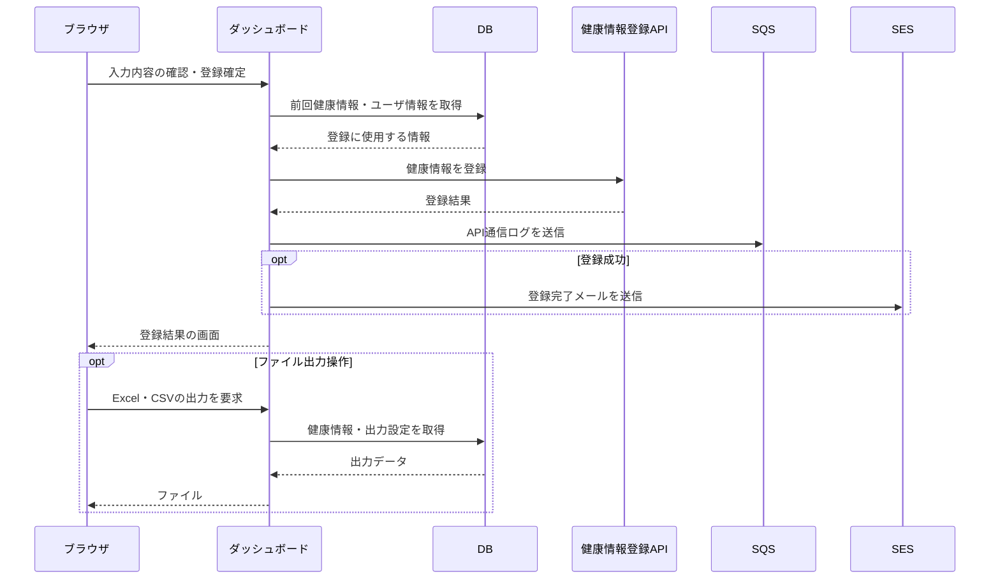
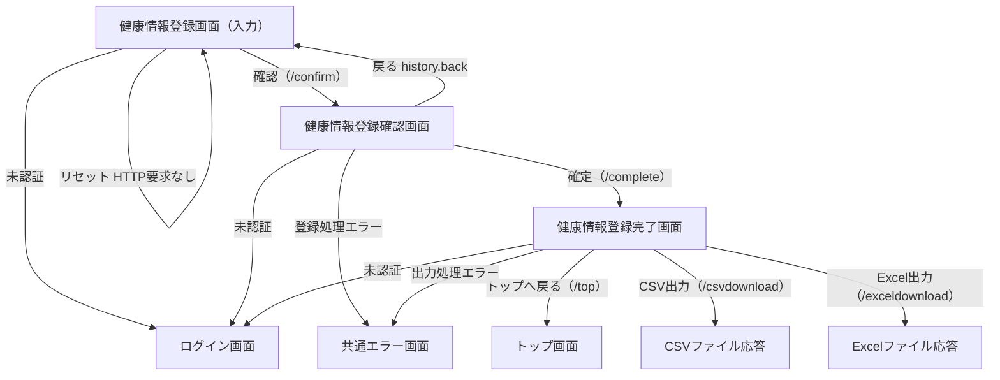
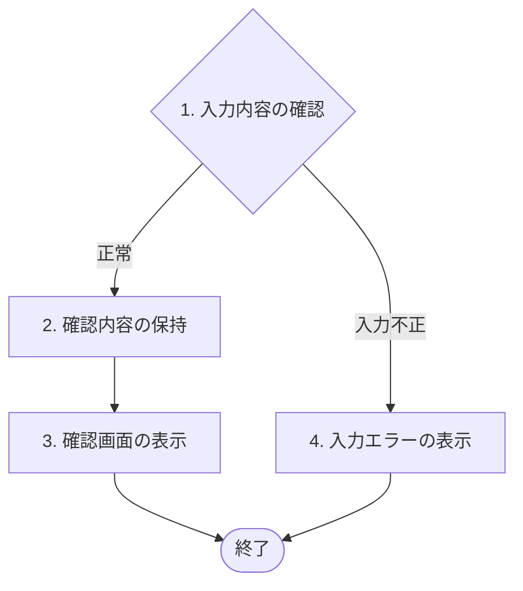
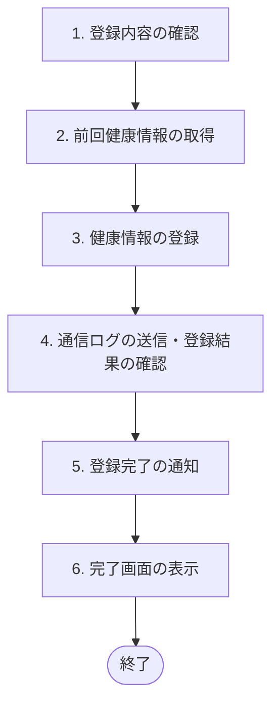
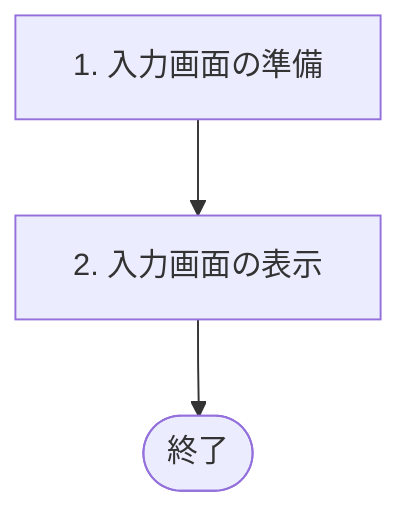
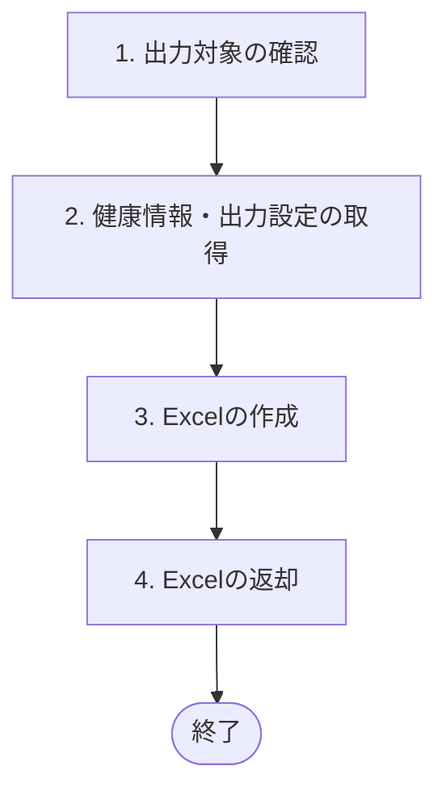

# 設計書 1.1. 健康情報登録機能

## 1. 機能概要

- ログイン中のユーザが身長・体重を入力し、確認画面を経由して健康情報を登録する。登録は健康情報登録APIが行い、BMI・標準体重を完了画面に表示する。
- 削除されていない前回の健康情報がある場合は、その体重との差を表示する。API通信ログをSQSに送信し、登録成功後にSESで登録完了メールを送信する。
- 完了した健康情報のうち、削除されていない1件をExcel・CSVでダウンロードする。
- 主な実装は[コントローラ](../../../ha-dashboard/src/main/java/jp/co/ha/dashboard/healthinfo/controller/HealthInfoRegistController.java)、[サービス](../../../ha-dashboard/src/main/java/jp/co/ha/dashboard/healthinfo/service/impl/HealthInfoServiceImpl.java)、[フォーム](../../../ha-dashboard/src/main/java/jp/co/ha/dashboard/healthinfo/form/HealthInfoForm.java)、[画面テンプレート](../../../ha-dashboard/src/main/resources/templates/healthinfo/)を参照する。

## 2. 処理概要

### 2.1. 全体の処理概要



### 2.2. 画面一覧・画面遷移図

| 画面 | テンプレート・表示状態 | 表示契機 | 備考 |
| --- | --- | --- | --- |
| 健康情報登録画面（入力） | `healthinfo/input.html` | `GET /healthinfo/input`、確認時の検証エラー | 入力欄・単位・確認・リセットを表示する。 |
| 健康情報登録確認画面 | `healthinfo/confirm.html` | `POST /healthinfo/confirm`正常時 | 身長・体重を表示し、確定またはブラウザ履歴で戻る。 |
| 健康情報登録完了画面 | `healthinfo/complete.html` | `POST /healthinfo/complete`正常時 | BMI・標準体重・前回比較とファイル出力を表示する。 |
| 共通エラー画面 | `error/index.html` | セッション不整合、API・DB・外部サービス等の例外 | 発生処理とコードは5章。通常HTTP 200で、明示的なエラーステータス設定はない。 |



## 3. 画面仕様

### 3.1. 健康情報登録画面（入力）

#### 3.1.1. 基本情報・表示条件

| 項目 | 内容 | 備考 |
| --- | --- | --- |
| URL・要求 | `GET /healthinfo/input`、`POST /healthinfo/confirm`の検証エラー時 | POSTフォームは`application/x-www-form-urlencoded`。 |
| テンプレート・タイトル | `healthinfo/input.html`、健康情報登録画面 | 画面見出しは「健康情報入力」。 |
| 表示条件・応答 | 認証済みユーザ、HTML・HTTP 200 | 認証とCookieは4.4、初期表示は5.3、確認は5.1。 |

#### 3.1.2. レイアウト・画面項目

| 画面項目 | 入力・表示内容 | 備考 |
| --- | --- | --- |
| 身長 `height` | 必須のテキスト入力、単位cm、プレースホルダ`170.00` | `BigDecimal`へバインドする。小数桁数・文字数の制限は設けない。 |
| 体重 `weight` | 必須のテキスト入力、単位kg、プレースホルダ`50.00` | `BigDecimal`へバインドする。 |
| 入力エラー | 項目直下に`BindingResult`のメッセージ、`errorMessage`があれば全体アラート | HTMLの`required`とvalidationEngineも設定する。サーバ側の検証は3.1.5。 |
| 入力進捗 | 身長・体重のchange時に入力済み項目数÷2をMprogressへ設定 | 値が空かどうかで判定する。HTTP要求は発生しない。 |
| 操作・共通表示 | 確認、リセット、パンくず`breadcrumbList` | パンくずは`getView(model, view)`が対象ビューから設定する。 |

#### 3.1.3. 初期表示

| 項目 | 内容 | 備考 |
| --- | --- | --- |
| 新規表示 | `@ModelAttribute`が新しい`healthInfoForm`を作成し各フィールドは`null` | 保存済みフォームをセッションから復元・消去しない。5.3。 |
| 検証エラー時 | バインド済みフォームと`BindingResult`を再表示 | 入力値と項目別メッセージを保持し、登録APIは呼び出さない。5.1。 |

#### 3.1.4. 操作・イベント処理

| 操作 | HTTPメソッド・URL | 送信する業務項目 | サーバが採用・参照するデータ | 結果・遷移 | 関連処理 | 備考 |
| --- | --- | --- | --- | --- | --- | --- |
| 確認 | `POST /healthinfo/confirm` | `height`、`weight` | 今回送信したフォームを検証し、正常時だけセッションへ保存 | 確認画面、検証エラーなら入力画面 | 5.1 | HTTP要求を伴う。 |
| リセット | HTTP要求なし | 送信なし | サーバ参照なし | ブラウザのフォーム初期値へ戻す | 4.3 | 検証エラーの再表示後は、そのHTMLに設定された初期値へ戻す。 |
| 身長・体重の変更 | HTTP要求なし | 送信なし | サーバ参照なし | 進捗表示を更新 | 3.1.2 | ブラウザ内のchangeイベント。 |

#### 3.1.5. 入力チェック・エラー表示

| 対象・処理 | チェック内容 | エラー・メッセージ | 備考 |
| --- | --- | --- | --- |
| 確認・`height` | 未入力でないこと | `身長が未入力です` | `@Required`。エラーはHTTP 200で入力画面のフィールドに表示する。 |
| 確認・`weight` | 未入力でないこと | `体重が未入力です` | `@Required`。 |
| 確認・`height` | 1以上300以下であること | `身長が不正な値です` | `@Decimal`。上下限を含む。小数桁数は制限しない。 |
| 確認・`weight` | 1以上300以下であること | `体重が不正な値です` | `@Decimal`。上下限を含む。 |
| 確認・数値変換 | `BigDecimal`に変換できること | Springのバインドエラー | `BindingResult`に保持し、入力画面を再表示する。 |
| 完了 | 保存済みフォームを使用する | 4.4のセッション検証 | 完了メソッドのフォーム引数には`@Valid`を付けず、身長・体重の再検証は行わない。 |

### 3.2. 健康情報登録確認画面

#### 3.2.1. 基本情報・表示条件

| 項目 | 内容 | 備考 |
| --- | --- | --- |
| URL・要求 | `POST /healthinfo/confirm`正常時 | リダイレクトせずHTMLをHTTP 200で描画する。 |
| テンプレート・タイトル | `healthinfo/confirm.html`、健康情報登録確認画面 | 画面見出しは「健康情報入力確認」。 |
| 表示条件 | 身長・体重の入力チェック成功後 | 正常フォームをセッションへ保存する。5.1。 |

#### 3.2.2. レイアウト・画面項目

| 画面項目 | 入力・表示内容 | 備考 |
| --- | --- | --- |
| 案内・確認表 | 「以下の情報で健康情報を登録します。」、身長cm、体重kg | `healthInfoForm`を表示専用で参照する。 |
| 操作・共通表示 | 確定、戻る、パンくず | 健康値のinput・hidden項目はない。トークン値もブラウザへ送らない。 |

#### 3.2.3. 初期表示

| 項目 | 内容 | 備考 |
| --- | --- | --- |
| 表示データ | 検証済みの`healthInfoForm` | 確認処理の正常終了時に同じ内容をセッションへ保存する。 |
| 多重送信制御 | 確認処理の`postHandle`で`multiSubmitToken`を生成 | 保存・更新とエラー時の扱いは4.4。 |

#### 3.2.4. 操作・イベント処理

| 操作 | HTTPメソッド・URL | 送信する業務項目 | サーバが採用・参照するデータ | 結果・遷移 | 関連処理 | 備考 |
| --- | --- | --- | --- | --- | --- | --- |
| 確定 | `POST /healthinfo/complete` | 業務入力項目は送信しない | セッションの`healthInfoForm.height`、`weight`、`seqUserId`とトークンの存在 | 完了画面、例外時は共通エラー画面 | 5.2 | フォームPOSTは発生する。健康値のhiddenはなく、追加送信した値も登録内容には採用しない。 |
| 戻る | `history.back()` | フォーム送信なし | サーバで値をコピーしない | ブラウザ履歴上の入力画面 | 4.3 | 履歴・キャッシュ次第で再取得や再送信確認が発生する。専用の戻るURLはない。 |

#### 3.2.5. 入力チェック・エラー表示

| 対象 | 確認・表示内容 | 備考 |
| --- | --- | --- |
| 業務入力 | 追加の業務入力欄はない | 完了メソッドのフォーム引数に`@Valid`はなく、身長・体重を再検証しない。 |
| 確定時のセッション・トークン | 不整合は`DW0026`、`DW0031`等で共通エラー画面 | 発生条件と詳細は4.4、5.2。 |
| API・DB・SQS・SES | 確定処理で失敗すれば共通エラー画面 | 5.2の各発生箇所に記載。 |

### 3.3. 健康情報登録完了画面

#### 3.3.1. 基本情報・表示条件

| 項目 | 内容 | 備考 |
| --- | --- | --- |
| URL・要求 | `POST /healthinfo/complete`正常時 | PRGによるリダイレクトは行わずHTML・HTTP 200。 |
| テンプレート・タイトル | `healthinfo/complete.html`、健康情報登録完了画面 | 登録API成功とメール処理の復帰後に表示する。 |
| 表示条件 | `healthInfo`、`isFirstReg`を設定済み | 新規モデル`healthInfoForm`と保存済みフォームを区別する。4.1。 |

#### 3.3.2. レイアウト・画面項目

| 画面項目 | 入力・表示内容 | 備考 |
| --- | --- | --- |
| 登録結果 | 身長・体重・標準体重・BMIの表 | `healthInfo`はAPI応答をコピーした保存済みフォーム。 |
| 標準体重メッセージ | 今回の身長cmに対応する標準体重kg | API応答の標準体重を使用する。 |
| 前回比較 | 前回体重、今回体重、差`diffWeight`、増減メッセージ | `isFirstReg=false`だけ表示する。差は絶対値、小数1桁・HALF_UP。 |
| 増減メッセージ | `resultMessage`が`10`減少、`20`変化なし、`30`増加 | `healthInfoStatus.{値}`を表示する。5.2.4。 |
| ファイル出力 | Excel・CSVの画像送信ボタンと`seqHealthInfoId`hidden | 出力用モデル`healthInfoForm`には登録結果を設定しない。hidden値に依存せずセッションIDで取得する。 |
| 共通表示・リンク | パンくず、トップへ戻る | トップへのリンクは`/top`。 |

#### 3.3.3. 初期表示

| 項目 | 内容 | 備考 |
| --- | --- | --- |
| 結果の反映 | メール処理後、API応答`health_info`を保存済みフォームへコピー | `healthInfo`とセッション`healthInfoForm`へ設定する。 |
| 出力フォーム | `@ModelAttribute`で新しく作られたモデル`healthInfoForm` | completeメソッドはこのモデル名へ登録結果を設定しない。セッションの同名フォームとは別。 |
| 初回登録 | 削除されていない前回情報がなければ`isFirstReg=true` | 削除済みの情報しかない場合も前回比較のモデルは設定しない。5.2.1、5.2.4。 |

#### 3.3.4. 操作・イベント処理

| 操作 | HTTPメソッド・URL | 送信する業務項目 | サーバが採用・参照するデータ | 結果・遷移 | 関連処理 | 備考 |
| --- | --- | --- | --- | --- | --- | --- |
| Excel出力 | `GET /healthinfo/exceldownload` | hiddenの`seqHealthInfoId`と画像ボタンの`x`、`y`が送信され得る | セッション`healthInfoForm.seqHealthInfoId`と`seqUserId` | Excelファイル応答 | 5.4、6.1 | クエリの健康情報ID・画像座標は参照しない。 |
| CSV出力 | `GET /healthinfo/csvdownload` | hiddenの`seqHealthInfoId`と画像ボタンの`x`、`y`が送信され得る | セッション`healthInfoForm.seqHealthInfoId`と`seqUserId` | CSVファイル応答 | 5.5、6.2 | クエリの健康情報ID・画像座標は参照しない。 |
| トップへ戻る | `GET /top` | 業務項目なし | トップ画面側の制御 | トップ画面 | 2.2 | 通常のリンク遷移。 |

#### 3.3.5. 入力チェック・エラー表示

| 対象 | チェック・表示 | 備考 |
| --- | --- | --- |
| 完了画面 | 追加の業務入力チェックはない | 表示値はAPI応答、出力対象はセッションとDBを使用する。 |
| 出力時 | フォーム不在・対象0件は`DW0026`、ユーザID不在等は`CE0002` | 詳細と発生箇所は5.4、5.5。 |
| ファイル応答開始後 | CSV失敗時は共通エラー処理へ渡る | 既に応答を開始していれば完全な画面応答へ置き換えられない場合がある。5.5。 |

## 4. 画面間のデータ管理・共通制御

### 4.1. 引き継ぐデータと保持方法

| データ | 保持方法・参照画面 | 備考 |
| --- | --- | --- |
| 入力中の`height`、`weight` | ブラウザフォーム→確認POST→モデル・セッション`healthInfoForm` | 確認画面では表示するだけで、確定時の業務値を送らない。 |
| 登録結果 | API応答→セッション`healthInfoForm`とモデル`healthInfo` | 健康情報ID・身長・体重・BMI・標準体重を保持する。完了後もフォームを削除しない。 |
| 出力用hidden | 完了画面のモデル`healthInfoForm.seqHealthInfoId` | モデルは新規フォームであり登録結果を設定しない。送信値はサーバが参照しない。 |
| `seqUserId` | ログイン済みセッション | APIキー検索・所有者条件・ファイル設定検索に使用する。 |
| `multiSubmitToken` | セッションのみ | ブラウザには送信せず、complete前に空でないことだけを確認する。 |
| 比較・パンくず | リクエストのモデル | `beforeWeight`、`diffWeight`、`resultMessage`、`isFirstReg`、`breadcrumbList`。 |

### 4.2. データの生成・参照・更新・破棄

| 契機 | 生成・参照・更新・破棄 | 備考 |
| --- | --- | --- |
| 入力画面GET | 新しいモデルフォームを生成する | 既存のセッションフォームとトークンを復元・消去しない。 |
| 確認正常 | 今回の検証済みフォームでセッションを更新する | 検証エラーならセッションフォームを更新しない。 |
| 確認postHandle | SHA-256の`multiSubmitToken`を生成・保存する | 入力エラーで入力画面を返す場合も生成対象。 |
| 確定前・API呼出 | フォーム・ユーザID・既存健康情報・ユーザAPIキーを参照しUUIDを生成する | UUIDはAPIとSQSログで共用する。5.2。 |
| 確定正常 | API応答でフォームと完了モデルを更新する | メール復帰後。postHandleでトークンを削除する。 |
| 確定例外 | 成功後のフォーム更新・postHandleによるトークン削除には進まない | 既にAPIで登録された健康情報は取り消さない。 |
| ダウンロード | 保持した健康情報IDとユーザIDで有効な健康情報を再検索しファイル設定を読む | 保持したフォームを削除せず、S3・ローカルファイルは作成しない。 |

### 4.3. 戻る・再読込・直接アクセス時の動作

| 操作・条件 | 動作 | 備考 |
| --- | --- | --- |
| 確認画面の戻る | `history.back()`でブラウザ履歴へ戻る | 復元・再取得・POSTの再送信確認は履歴とキャッシュに依存する。サーバの戻るアクションはない。 |
| 入力画面のリセット | 現在HTMLのフォーム初期値に戻る | HTTP要求とセッションの更新はない。 |
| 入力URLの直接GET | 空の新規フォームを表示する | 既存セッションフォームは保持する。 |
| 確認・完了URLの直接アクセス | GET用画面表示アクションはない | POSTを直接送信した場合、confirmは今回の入力検証、completeはトークン・保存フォームの検証を行う。 |
| 完了画面の再読込・再POST | 成功時に削除したトークンがなければ`DW0031` | PRGを使用しない。トークン検証は存在だけで、同時リクエストを排他しない。 |
| 出力URLの直接GET | ログインセッションと保存フォームの健康情報IDを使用して検索する | 保存フォームがあってもIDがnullなら、検索条件の生成時に例外となりSQL実行前に`CE0002`。フォーム不在・対象0件の扱いは5.4、5.5。 |
| 複数タブ | 同じセッションのフォームとトークンを共有する | 後に成功した確認のフォームが採用される。登録完了前のID未採番フォームで上書きされた場合、他タブのダウンロードもIDがnullとなり`CE0002`。 |

### 4.4. 認証・セッション切れ・多重送信制御

| 共通項目 | 制御 | 備考 |
| --- | --- | --- |
| Cookie | `JSESSIONID`等のサーブレットセッション識別情報 | 全画面・ファイル要求で認証と業務セッションを参照する。 |
| 認証切れ | Spring SecurityによりHTTP 302、`Location: /login` | 認証済みでも業務セッションキーが欠落すれば下表の例外処理。 |
| CSRF | Spring Securityで無効 | CSRFヘッダ・トークンは要求しない。 |
| 共通エラー表示 | ログ・Slack通知後、`error/index.html`へコード対応メッセージとコードを表示 | 一般例外は`CE0002`。HTTPステータスの明示設定はなく通常200。 |

| 処理 | 設定・取得内容 | 備考 |
| --- | --- | --- |
| 認証 | 全エンドポイントでSpring Securityの認証を要求 | 未認証ではHTTP 302で`/login`へ遷移する。CSRFは無効。 |
| 確認 | 正常入力を`healthInfoForm`へ保存 | 検証エラーの場合はフォームをセッションへ保存しない。入力画面の表示時に既存セッションを消去・復元する処理はない。 |
| 多重送信トークン生成 | `multiSubmitToken`へSHA-256値を保存 | `@MultiSubmitToken(factory=true)`により確認処理の`postHandle`で生成する。入力エラーで入力画面を返した場合も生成対象となる。ブラウザにはトークン値を送らない。 |
| 完了前のトークン確認 | セッションに空でない`multiSubmitToken`があること | 存在だけを検証し、リクエスト値との照合は行わない。不在・空は`DW0031`、詳細`不正リクエストエラーです`。共通例外処理でログ・Slack通知し、`error/index.html`にコード対応メッセージを表示する。HTTPステータスの明示設定はない。 |
| 完了 | `healthInfoForm`、`seqUserId`を取得 | フォーム不在は`DW0026`、詳細`不正リクエストエラーです`で同じエラー画面を返す。ユーザIDは`Optional.get()`で取得し、不在時は一般例外`CE0002`となる。 |
| 登録成功後 | API応答`health_info`を保存済みフォームへコピーし、モデル`healthInfo`とセッション`healthInfoForm`へ設定 | メール処理が戻った後に行う。ダウンロード用の健康情報IDも保存する。フォームは完了後も削除しない。 |
| 完了後 | `postHandle`で`multiSubmitToken`を削除 | コントローラ処理が例外終了した場合は`postHandle`による削除は行われない。 |
| ダウンロード | `seqUserId`、`healthInfoForm`を取得 | フォーム不在は`DW0026`、詳細`不正リクエストエラーです`。ユーザID不在は一般例外`CE0002`。いずれも共通例外処理でエラー画面、HTTPステータスの明示設定なし。 |

## 5. サーバ処理詳細

### 5.1. 入力内容の確認処理（POST /healthinfo/confirm）



| 処理順 | 処理概要 | 処理詳細 | 関連項番 |
| --- | --- | --- | --- |
| 1 | 入力内容の確認 | 身長・体重の必須・数値・範囲を確認する。正常なら処理2、不正なら処理4へ進む。 | 3.1.5 |
| 2 | 確認内容の保持 | 正常な入力をセッションに保存する。 | 4.2 |
| 3 | 確認画面の表示 | 保持した身長・体重を表示する。多重送信トークンは画面描画前に生成する。 | 3.2、4.4 |
| 4 | 入力エラーの表示 | セッションへのフォーム保存やDB・API処理を行わず、項目エラー付きで入力画面を表示する。正常に処理を戻した場合は多重送信トークンを生成する。 | 3.1.3、3.1.5、4.4 |

| 処理・発生条件 | 扱い | 備考 |
| --- | --- | --- |
| SQL・外部接続 | 実行しない | 確認はバインド・検証・セッション保存のみ。 |
| フィールド検証エラー | HTTP 200で入力画面に表示 | メッセージは3.1.5。 |
| その他の一般例外 | `CE0002`として共通エラー処理 | 4.4のログ・Slack通知と画面表示。 |

### 5.2. 登録確定処理（POST /healthinfo/complete）



| 処理順 | 処理概要 | 処理詳細 | 関連項番 |
| --- | --- | --- | --- |
| 1 | 登録内容の確認 | 多重送信トークン・保存フォーム・ユーザIDを確認し、セッションに保持した健康値を採用する。不足時は4.4のエラーで終了する。 | 4.2、4.4 |
| 2 | 前回健康情報の取得 | 削除されていない最新1件を検索し、存在する場合だけ前回体重との差を編集する。該当なしの場合は初回登録として比較を省略する。 | 5.2.1、5.2.2、5.2.4 |
| 3 | 健康情報の登録 | 有効なユーザのAPIキーを取得し、保存フォームの内容で健康情報登録APIを呼び出す。通信識別子などの要求編集は5.2.5に従う。 | 5.2.3、5.2.5 |
| 4 | 通信ログの送信・登録結果の確認 | API成否の判定前に通信ログをSQSへ送信する。送信失敗またはAPI失敗の場合は共通エラー処理へ進み、メールと完了処理を行わない。 | 5.2.5、5.2.6 |
| 5 | 登録完了の通知 | API応答のユーザIDで有効なユーザの宛先を取得し、登録完了メールを送信する。送信例外は共通エラー処理へ進む。スタブの戻り値は判定せず続行する。 | 5.2.3、5.2.7 |
| 6 | 完了画面の表示 | 登録結果をセッションのフォームへ反映し、多重送信トークンを削除して完了画面を表示する。後続処理が失敗してもAPI登録済みデータは取り消さない。 | 3.3、4.2、4.4 |

| DB処理の前提 | 内容 | 備考 |
| --- | --- | --- |
| SQL表記 | `:名前`はバインド値 | ダッシュボード自身は健康情報をINSERTしない。登録内部処理は[健康情報登録API](../02_api/設計書_2.1.健康情報登録API.md)に従う。 |

#### 5.2.1. 初回登録判定

| 処理・結果 | 扱い | 備考 |
| --- | --- | --- |
| 判定対象 | 5.2.2の前回健康情報検索結果 | `findLatestBySeqUserId(seqUserId)`をAPI登録前に1回実行する。件数検索は行わず、取得結果の有無で初回登録を判定する。 |
| 前回情報なし | `isFirstReg=true` | 削除済みの情報しかない場合を含む。体重比較を省略し、健康情報登録APIの呼び出しへ進む。 |
| 前回情報あり | `isFirstReg=false` | 削除されていない最新1件を使って前回比較モデルを設定する。 |
| 前回検索のDB例外 | 共通例外処理で`CE0002`のエラー画面を返す | ログ・Slack通知を行う。HTTPステータスの明示設定はない。 |

#### 5.2.2. 前回の健康情報

```sql
SELECT
    SEQ_HEALTH_INFO_ID
    , SEQ_USER_ID
    , HEIGHT
    , WEIGHT
    , BMI
    , STANDARD_WEIGHT
    , HEALTH_INFO_REG_DATE
    , SEQ_BMI_RANGE_MT_ID
    , DELETE_FLAG
    , REG_DATE
    , UPDATE_DATE
FROM
    HEALTH_INFO
WHERE
    SEQ_USER_ID = :seqUserId
    AND DELETE_FLAG = false
ORDER BY
    SEQ_HEALTH_INFO_ID DESC
LIMIT
    1;
```

| 項目 | 設定値 | 備考 |
| --- | --- | --- |
| `:seqUserId` | セッションの`seqUserId` | ログインユーザのID。 |

#### 5.2.3. ユーザ情報（APIキー取得・メール宛先取得で共用）

```sql
SELECT
    SEQ_USER_ID
    , PASSWORD
    , MAIL_ADDRESS
    , DELETE_FLAG
    , PASSWORD_EXPIRE
    , REMARKS
    , API_KEY
    , REG_DATE
    , UPDATE_DATE
    , GENDER_TYPE
    , BIRTH_DATE
FROM
    USER
WHERE
    SEQ_USER_ID = :seqUserId
    AND DELETE_FLAG = false;
```

| 項目 | 設定値 | 備考 |
| --- | --- | --- |
| `:seqUserId` | API送信前はセッションの`seqUserId` | APIキー取得時に渡すユーザID。 |
| `:seqUserId` | メール送信前はAPI応答の`account.seq_user_id` | メール宛先取得時に渡すユーザID。 |

#### 5.2.4. 初回登録判定と体重比較

| 処理 | 内容 | 備考 |
| --- | --- | --- |
| 初回登録 | 削除されていない前回情報の有無で`isFirstReg`を設定 | 該当なしなら前回比較モデルは設定しない。5.2.1。 |
| 前回体重 | 5.2.2で取得した`WEIGHT`を`beforeWeight`へ設定 | 現在の登録APIを呼び出す前に取得する。 |
| 体重差 | `abs(今回体重 - 前回体重)`を小数1桁、`HALF_UP`で設定 | モデル名`diffWeight`。 |
| 増減 | 今回と前回が同値なら`20`、今回が大きければ`30`、小さければ`10` | モデル名`resultMessage`。画面はメッセージキー`healthInfoStatus.{値}`で表示する。 |

#### 5.2.5. 健康情報登録API呼び出し

| 処理・結果 | 扱い | 備考 |
| --- | --- | --- |
| APIキー取得 | 5.2.3のUSER検索結果の`API_KEY`を要求ヘッダへ設定する | `DELETE_FLAG = false`のユーザ検索結果を使用する。該当なし・削除済みの`Optional.get()`・DB例外等は`CE0002`の共通エラー画面へ進む。 |

| 項目 | 設定内容 | 備考 |
| --- | --- | --- |
| HTTPメソッド・URL | `POST {healthinfo.api.url}{seqUserId}/healthinfo` | `healthinfo.api.url`は環境設定、ユーザIDはセッション。 |
| ヘッダ | `Content-Type: application/json`、`Accept: application/json`、`Api-Key: USER.API_KEY` | ブラウザからAPIキーを受け取らない。API接続情報の文字コードを`Accept-Charset`に設定する。 |
| `height` | セッションの身長 | JSONの数値。 |
| `weight` | セッションの体重 | JSONの数値。 |
| `transaction_id` | `UUID.randomUUID().toString()` | API呼び出しとAPIログで共用する。DB検索・連番採番は行わない。 |

| JSON例 | 内容 | 備考 |
| --- | --- | --- |
| 送信 | 以下のJSON | 身長・体重は数値、transaction_idはUUID文字列。 |

```json
{
  "height": 170.5,
  "weight": 65.2,
  "transaction_id": "28dd2466-89a8-4912-a7f4-b2ed22104552"
}
```

| JSON例 | 内容 | 備考 |
| --- | --- | --- |
| 受信 | 以下のJSON | result、account、health_infoを参照する。 |

```json
{
  "result": "0",
  "account": {
    "seq_user_id": 1
  },
  "health_info": {
    "seq_health_info_id": 100,
    "height": 170.5,
    "weight": 65.2,
    "bmi": 22.428,
    "standard_weight": 63.954,
    "reg_date": "20261114120000"
  }
}
```

| 応答・発生条件 | 処理 | 備考 |
| --- | --- | --- |
| `result="0"` | APIログを送信した後、SES送信へ進む | `health_info`のID・身長・体重・BMI・標準体重をフォームにコピーする。`reg_date`はAPIでは`yyyyMMddHHmmss`。メールには日付を整形して使用する。 |
| `result`が成功以外 | APIログ送信後、`BE0039`の`ApiException` | 詳細にはAPIの`error.detail`を設定する。共通例外処理でログ・Slack通知し、`error/index.html`にコード対応メッセージと`(BE0039)`を表示する。HTTPステータスの明示設定はない。 |
| 通信・HTTPエラーなどをAPIクライアントが捕捉 | 失敗応答、詳細`通信エラーです.`を設定 | 続けてAPIログを送信してから、同じ`BE0039`処理となる。API呼び出しが例外を捕捉した場合、HTTPステータスや応答日時が未設定の場合がある。 |

#### 5.2.6. APIログ用SQS送信

| 項目 | 内容 | 備考 |
| --- | --- | --- |
| 実行順序 | API呼び出し終了後、成功・失敗の判定前に同期実行 | ダッシュボードはAPIログをDBへ直接INSERT・UPDATEしない。 |
| キュー | `AwsProperties.apiLogQueueName()` | キュー名からURLを取得して`SendMessage`する。 |
| Payload | `transactionId`、`apiName`、`httpMethod`、`url`、`body`、`requestDate`、`httpStatus`、`detail`、`responseDate` | API名は健康情報登録API、HTTPメソッドは`POST`、bodyは送信リクエストのJSON文字列。detailはAPIのエラー詳細、各日時・ステータスは接続情報から設定する。 |
| FIFO情報 | `messageGroupId=transactionId`、`messageDeduplicationId=UUID` | PayloadをJSONにシリアライズして送信する。 |
| ログbody生成失敗 | `CW0011` | `JsonReader`がAPIリクエストをJSON文字列へ変換できない場合。SQS送信前に共通例外処理へ渡り、ログ・Slack通知後にエラー画面を返す。HTTPステータスの明示設定なし。 |
| 送信失敗 | `CE0041` | シリアライズ、クライアント生成、キューURL取得、送信の例外を`AWS_SQS_ENQUEUE_ERROR`へ変換する。共通例外処理でログ・Slack通知し、エラー画面を返す。HTTPステータスの明示設定なし。APIの登録が完了していても取り消さず、メール・完了画面処理へ進まない。 |

#### 5.2.7. SES登録完了メール

| 処理・結果 | 扱い | 備考 |
| --- | --- | --- |
| 宛先取得 | 5.2.3のUSER検索結果の`MAIL_ADDRESS`を使用する | ユーザなしの`Optional.get()`・DB例外等は`CE0002`の共通エラー画面へ進む。HTTPステータスの明示設定はない。 |

| 項目 | 内容 | 備考 |
| --- | --- | --- |
| 実行条件・順序 | API成功確認後、完了画面のモデル・セッション更新前 | APIログSQS送信より後。メール処理を非同期化しない。 |
| 宛先 | API応答ユーザIDで検索した`USER.MAIL_ADDRESS` | 送信元・BCCはSSMのシステムメールアドレス。 |
| 件名 | `健康情報登録完了メール{yyyyMMdd}` | メール生成時のシステム日付を付加する。 |
| テンプレート | `healthinfo-regist-template.ftl` | HTML本文、UTF-8。 |
| 置換値 | `userId`、`seqHealthInfoId`、`height`、`weight`、`bmi`、`standardWeight`、`healthInfoRegDate`、`url` | API応答から設定。身長に`cm`、体重・標準体重に`kg`を付加する。日時は`yyyy/MM/dd HH:mm:ss`、URLは`healthInfoDashboardUrl()`。 |
| SESスタブ | `sesStubFlag=true`なら送信せず`NOT_SEND`を返す | 呼出元は戻り値を判定せず完了画面へ進む。 |
| 送信元ドメイン未認証 | `CE0034`、詳細`メールアドレスがSESに認証されていません.管理画面から認証してください` | 共通例外処理でログ・Slack通知し、エラー画面を返す。HTTPステータスの明示設定なし。登録APIで作成した健康情報は取り消さない。 |
| SESクライアント生成失敗 | `CE0029` | 同じエラー画面を返す。その他SDK例外・本文生成失敗なども共通例外処理に渡る。一般例外は`CE0002`、コード付き例外はそのコードを表示する。 |

### 5.3. 入力画面の初期表示（GET /healthinfo/input）



| 処理順 | 処理概要 | 処理詳細 | 関連項番 |
| --- | --- | --- | --- |
| 1 | 入力画面の準備 | 空のフォームを作成する。セッションの既存フォームは復元・削除しない。認証条件は4.4に従う。 | 3.1.3、4.4 |
| 2 | 入力画面の表示 | 初期状態の画面を表示する。DB・外部APIへの接続は行わない。例外は4.4の共通処理に従う。 | 3.1 |

### 5.4. Excelダウンロード処理（GET /healthinfo/exceldownload）

| 処理・結果 | 扱い | 備考 |
| --- | --- | --- |
| 健康情報IDがnull | 検索条件生成時に`CE0002`となりSQLは実行しない | 登録完了前の保存フォーム等が該当する。 |
| 対象の有効な健康情報なし（削除済みを含む） | `DW0026`、詳細`session情報が不正です`で異常終了する | 共通例外処理でログ・Slack通知後、エラー画面にコード対応メッセージと`(DW0026)`を表示する。 |
| ファイル設定の取得結果 | 各フラグを6章の出力設定へ反映する | 設定なしの`Optional.get()`・DB例外等は`CE0002`の共通エラー画面へ進む。HTTPステータスの明示設定はない。 |
| 健康情報のDB検索例外 | 一般例外は`CE0002`の共通エラー画面へ進む | HTTPステータスの明示設定はない。 |



| 処理順 | 処理概要 | 処理詳細 | 関連項番 |
| --- | --- | --- | --- |
| 1 | 出力対象の確認 | セッションのユーザIDと登録済みフォームを取得する。フォーム不在はDW0026、ユーザID不在はCE0002として終了する。要求のID・画像座標は対象指定に使用しない。 | 4.4 |
| 2 | 健康情報・出力設定の取得 | セッションに保持した健康情報IDとユーザIDで削除されていない1件を検索し、ユーザの出力設定を取得する。対象なしはDW0026、設定なし・DB例外はCE0002となる。 | 5.4.1、5.4.2 |
| 3 | Excelの作成 | 取得した健康情報と設定に従いファイルを作成する。設定フラグや値の編集は6.1に従う。 | 6.1 |
| 4 | Excelの返却 | ブラウザへファイルを返す。S3保存やローカルファイル作成は行わない。例外は4.4の共通処理に従う。 | 6.1 |

#### 5.4.1. ダウンロード対象の健康情報（CSVと共用）

```sql
SELECT
    SEQ_HEALTH_INFO_ID
    , SEQ_USER_ID
    , HEIGHT
    , WEIGHT
    , BMI
    , STANDARD_WEIGHT
    , HEALTH_INFO_REG_DATE
    , SEQ_BMI_RANGE_MT_ID
    , DELETE_FLAG
    , REG_DATE
    , UPDATE_DATE
FROM
    HEALTH_INFO
WHERE
    SEQ_HEALTH_INFO_ID = :seqHealthInfoId
    AND DELETE_FLAG = false
    AND SEQ_USER_ID = :seqUserId;
```

| 項目 | 設定値 | 備考 |
| --- | --- | --- |
| `:seqHealthInfoId` | セッションの`healthInfoForm.seqHealthInfoId` | リクエストのクエリ値は使用しない。 |
| `:seqUserId` | セッションの`seqUserId` | ダウンロードを要求したユーザのID。 |

#### 5.4.2. 健康情報ファイル設定（CSVと共用）

```sql
SELECT
    SEQ_USER_ID
    , HEADER_FLAG
    , FOOTER_FLAG
    , MASK_FLAG
    , ENCLOSURE_CHAR_FLAG
    , REG_DATE
    , UPDATE_DATE
FROM
    HEALTH_INFO_FILE_SETTING
WHERE
    SEQ_USER_ID = :seqUserId;
```

| 項目 | 設定値 | 備考 |
| --- | --- | --- |
| `:seqUserId` | セッションの`seqUserId` | 健康情報ファイル設定を取得するユーザのID。 |

### 5.5. CSVダウンロード処理（GET /healthinfo/csvdownload）

| 処理・結果 | 扱い | 備考 |
| --- | --- | --- |
| 健康情報IDがnull | 検索条件生成時に`CE0002`となりSQLは実行しない | 登録完了前の保存フォーム等が該当する。 |
| 対象の有効な健康情報なし（削除済みを含む） | `DW0026`、詳細`session情報が不正です`で異常終了する | 共通例外処理でログ・Slack通知後、エラー画面にコード対応メッセージと`(DW0026)`を表示する。 |
| ファイル設定の取得結果 | 各フラグを6章の出力設定へ反映する | 設定なしの`Optional.get()`・DB例外等は`CE0002`の共通エラー画面へ進む。HTTPステータスの明示設定はない。 |
| 健康情報のDB検索例外 | 一般例外は`CE0002`の共通エラー画面へ進む | HTTPステータスの明示設定はない。 |


| 処理順 | 処理概要 | 処理詳細 | 関連項番 |
| --- | --- | --- | --- |
| 1 | 出力対象の確認 | セッションのユーザIDと登録済みフォームを取得する。フォーム不在はDW0026、ユーザID不在はCE0002として終了する。要求のID・画像座標は対象指定に使用しない。 | 4.4 |
| 2 | 健康情報・出力設定の取得 | セッションに保持した健康情報IDとユーザIDで削除されていない1件を検索し、ユーザの出力設定を取得する。対象なしはDW0026、設定なし・DB例外はCE0002となる。 | 5.4.1、5.4.2 |
| 3 | CSVの作成 | 取得した健康情報と設定に従いファイルを作成する。設定フラグや値の編集は6.2に従う。 | 6.2 |
| 4 | CSVの返却 | ブラウザへファイルを返す。S3保存やローカルファイル作成は行わない。CSV書き込みのIOExceptionはCW0015となる。 | 6.2 |

| 発生条件 | コード・詳細 | 備考 |
| --- | --- | --- |
| CSVの`response.getWriter()`取得等で`IOException` | `CW0015`、`ファイルの出力処理に失敗しました` | 共通例外処理でログ・Slack通知し、エラー画面を返す。HTTPステータスは明示設定しない。応答開始済みの場合は完全な画面応答に置き換えられない場合がある。 |
| その他の一般例外 | `CE0002` | 4.4の共通例外処理へ渡す。 |

## 6. ファイル出力仕様

### 6.1. Excel出力

| 項目 | 仕様 | 備考 |
| --- | --- | --- |
| 対象 | セッション内IDとユーザIDで検索した有効な健康情報の先頭1件 | 実行処理・SQL・例外は5.4。 |
| ファイル名 | `sample.xlsx` | 共通Excelビューが設定する。 |
| 形式 | XLSX、すべて文字列セル | 数値も文字列セル。日時は`yyyy/MM/dd HH:mm:ss`。 |
| ヘッダ | `HEADER_FLAG=true`なら先頭に項目名行 | ファイル設定を使用する。 |
| フッタ | `HEADER_FLAG=true`なら末尾に項目名行 | `hasFooter(fileSetting.getHeaderFlag())`でありFOOTER_FLAGは採用しない。 |
| マスク | `HEADER_FLAG=true`なら身長・体重・BMI・標準体重を`****` | `useMask(fileSetting.getHeaderFlag())`でありMASK_FLAGは採用しない。日時は対象外。 |
| 囲い文字・保存 | 囲い文字対象外、ブラウザ応答のみ | S3保存・ローカル一時ファイル作成は行わない。 |
| `Content-Type` | `application/vnd.openxmlformats-officedocument.spreadsheetml.sheet` | `AbstractXlsxView`が設定する。 |
| `Content-Disposition` | `attachment; filename=sample.xlsx` | 添付ファイル応答。 |

| 列順 | 出力項目・ヘッダ／フッタ名 | 値・形式 | 備考 |
| --- | --- | --- | --- |
| 1 | 身長 | `height`、cm値の文字列 | マスク対象。ユーザID列は出力しない。 |
| 2 | 体重 | `weight`、kg値の文字列 | マスク対象。 |
| 3 | BMI | `bmi`の文字列 | マスク対象。 |
| 4 | 標準体重 | `standardWeight`、kg値の文字列 | マスク対象。 |
| 5 | 健康情報登録日時 | `healthInfoRegDate`、`yyyy/MM/dd HH:mm:ss` | マスク対象外。 |

### 6.2. CSV出力

| 項目 | 仕様 | 備考 |
| --- | --- | --- |
| 対象 | セッション内IDとユーザIDで検索した有効な健康情報の先頭1件 | 実行処理・SQL・例外は5.5、共通SQLは5.4.1・5.4.2。 |
| ファイル名 | `healthInfoRegist_{yyyyMMddHHmmss}.csv` | ファイル作成時の14桁のシステム日時。 |
| 形式 | UTF-8、カンマ区切り、OSの行区切り | 日時は`yyyy/MM/dd HH:mm:ss`。 |
| ヘッダ・フッタ | `HEADER_FLAG`、`FOOTER_FLAG` | 真なら項目名行を先頭・末尾へ出力する。 |
| マスク | `MASK_FLAG=true`なら身長・体重・BMI・標準体重を`****` | ユーザID・日時はマスク対象外。 |
| 囲い文字 | `ENCLOSURE_CHAR_FLAG=true`なら各項目をダブルクオートで囲む | 設定をCSV出力サービスへ渡す。 |
| 保存 | ブラウザ応答のみ | S3保存・ローカル一時ファイル作成は行わない。 |
| `Content-Type` | `application/octet-stream;charset=UTF-8` | CSV設定の文字コード。 |
| `Content-Disposition` | `attachment; filename=healthInfoRegist_{yyyyMMddHHmmss}.csv` | 添付ファイル応答。 |

| 列順 | 出力項目・ヘッダ／フッタ名 | 値・形式 | 備考 |
| --- | --- | --- | --- |
| 1 | ユーザID | `seqUserId` | マスク対象外。 |
| 2 | 身長 | `height`、cm値 | マスク対象。 |
| 3 | 体重 | `weight`、kg値 | マスク対象。 |
| 4 | BMI | `bmi` | マスク対象。 |
| 5 | 標準体重 | `standardWeight`、kg値 | マスク対象。 |
| 6 | 健康情報作成日時 | `healthInfoRegDate`、`yyyy/MM/dd HH:mm:ss` | マスク対象外。 |
