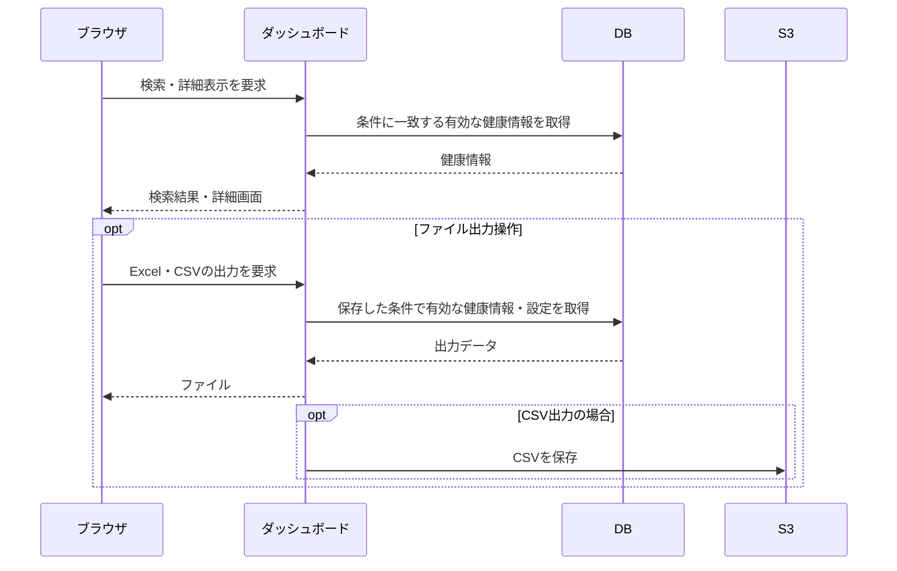
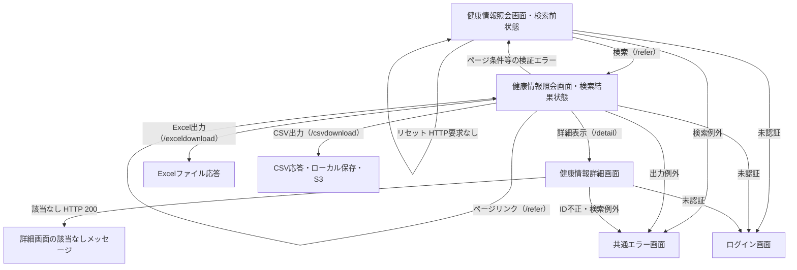
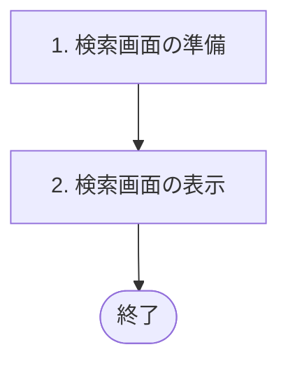
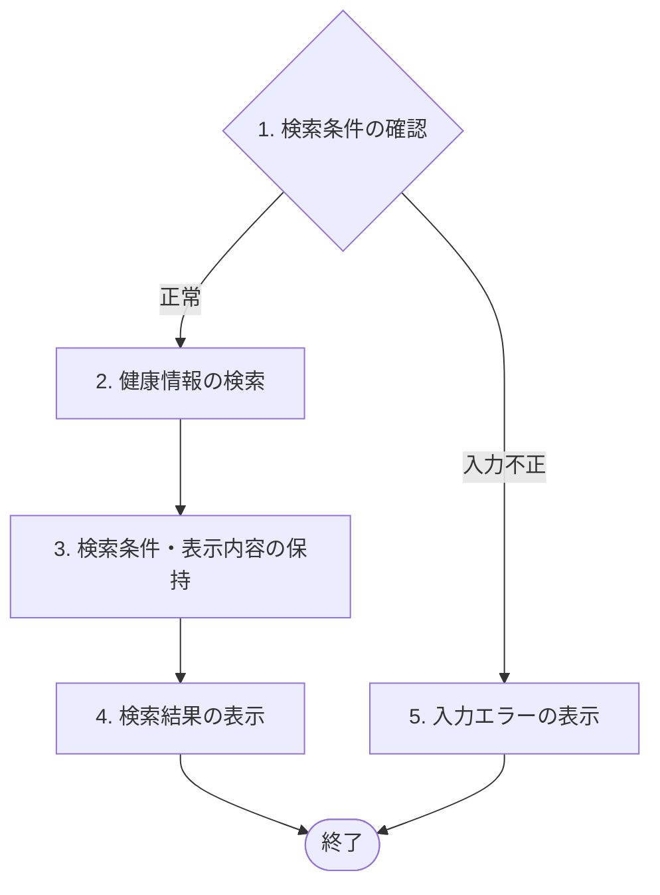
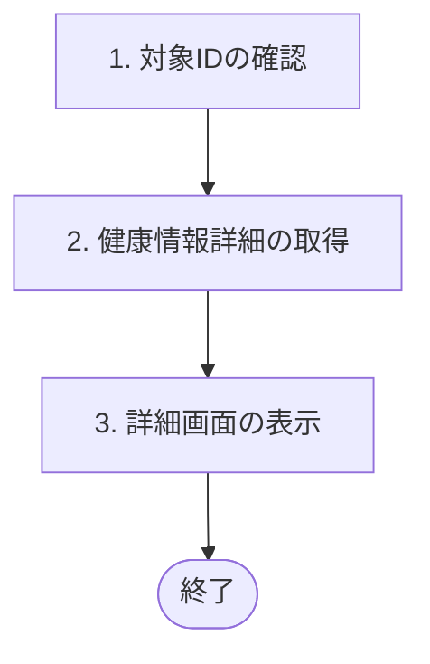
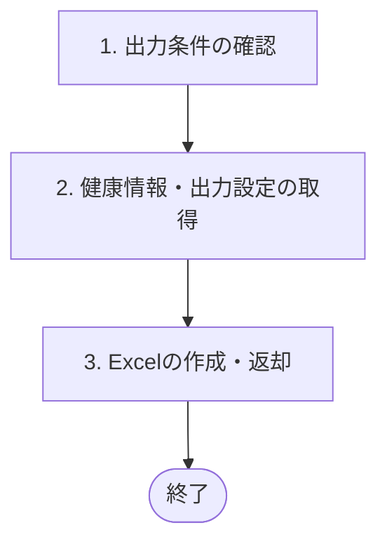
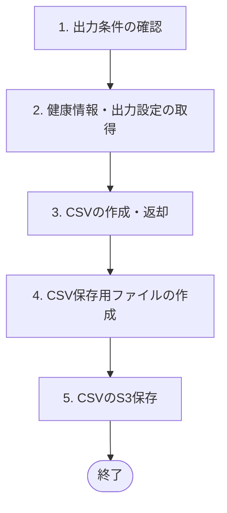

# 設計書 1.2. 健康情報照会機能

## 1. 機能概要

- ログイン中のユーザの有効な健康情報を、健康情報IDまたは作成日で検索し、一覧・ページング・体重等の折れ線グラフを表示する。
- 一覧から健康情報の詳細を表示し、BMI範囲に対応する肥満度を確認できる。
- 検索条件をセッションへ保持し、Excel・CSVダウンロード時に同じ条件で有効な健康情報を全件再検索する。CSVはブラウザ応答後にローカルファイルを作成し、S3へアップロードする。
- 主な実装は[一覧・出力コントローラ](../../../ha-dashboard/src/main/java/jp/co/ha/dashboard/healthinfo/controller/HealthInfoReferenceController.java)、[詳細コントローラ](../../../ha-dashboard/src/main/java/jp/co/ha/dashboard/healthinfo/controller/HeathInfoRefDetailController.java)、[一覧サービス](../../../ha-dashboard/src/main/java/jp/co/ha/dashboard/healthinfo/service/impl/HealthInfoReferServiceImpl.java)、[入力検証](../../../ha-dashboard/src/main/java/jp/co/ha/dashboard/healthinfo/validate/HealthInfoReferenceValidator.java)、[画面テンプレート](../../../ha-dashboard/src/main/resources/templates/healthinforeference/)を参照する。

## 2. 処理概要

### 2.1. 全体の処理概要



### 2.2. 画面一覧・画面遷移図

| 画面 | テンプレート・表示状態 | 表示契機 | 備考 |
| --- | --- | --- | --- |
| 健康情報照会画面・検索前状態 | `healthinforeference/index.html`、`isRefered=false`または入力エラー | `GET /healthinforeference/index`、`GET /healthinforeference/refer`検証エラー | 入力エラーでは一覧検索を実行しない。 |
| 健康情報照会画面・検索結果状態 | 同じ`index.html`に検索結果を表示、`isRefered=true` | `GET /healthinforeference/refer`正常時 | 別の画面URLではなく同一テンプレートの表示状態。`hasResult=true`なら`result.html`を組み込む。 |
| 健康情報詳細画面 | `healthinforeference/detail.html` | `GET /healthinforeference/detail` | 対象なしもHTTP 200の詳細画面として表示する。 |
| 共通エラー画面 | `error/index.html` | ID不正、セッション不整合、DB・ファイル・S3等の例外 | 発生処理とエラーコードは5章。HTTPステータスの明示設定はない。 |



## 3. 画面仕様

### 3.1. 健康情報照会画面（検索前・検索結果の表示状態）

#### 3.1.1. 基本情報・表示条件

| 項目 | 内容 | 備考 |
| --- | --- | --- |
| URL・要求 | `GET /healthinforeference/index`、`GET /healthinforeference/refer`検証エラー時 | すべてGETで、フォーム条件はクエリへ送信する。 |
| テンプレート・タイトル | `healthinforeference/index.html`、健康情報照会画面 | 画面見出しは「健康情報照会」。 |
| 表示条件・応答 | 認証済みユーザ、HTML・HTTP 200 | Cookieと認証切れは4.4。indexは5.1、referは5.2。 |

| 項目 | 内容 | 備考 |
| --- | --- | --- |
| URL・要求 | `GET /healthinforeference/refer`正常時 | 検索・ページ移動に共用する。 |
| テンプレート・表示状態 | `healthinforeference/index.html`、`isRefered=true` | 検索条件欄を残し、`hasResult=true`の場合に`healthinforeference/result.html`を組み込む。 |
| 応答・結果判定 | HTML・HTTP 200、`hasResult=!resultList.isEmpty()` | 総件数ではなく今回取得したリストで判定する。 |

#### 3.1.2. レイアウト・画面項目

| 画面項目 | 入力・表示内容 | 備考 |
| --- | --- | --- |
| 健康情報ID `seqHealthInfoId` | 任意のテキスト入力、半角数字1～8桁、プレースホルダ`1000` | 指定時はID検索を優先し、SQLに日付条件・ページングを付けない。開始日必須チェックは行う。 |
| 直接指定フラグ `healthInfoRegDateSelectFlag` | ラジオボタン。`0`直接指定しない（期間）、`1`直接指定する（開始日の1日） | 初期値は`0`。省略時もフォーム初期値を使用する。空・不正値はエラー。 |
| 開始日 `fromHealthInfoRegDate` | 日付入力、必須、`yyyy-MM-dd`で`LocalDate`へバインド | 健康情報ID指定時も`@Required`を適用する。 |
| 終了日 `toHealthInfoRegDate` | 日付入力、ID未指定かつフラグ`0`なら必須 | 直接指定`1`では終了日欄と「～」をJavaScriptで非表示にする。値は削除せず、検索では参照しない。 |
| エラー表示 | `BindingResult`の全フィールドエラーをアラート表示 | 入力エラー時は検索と検索条件セッションの更新を行わない。 |
| 操作・共通表示 | 検索、リセット、パンくず`breadcrumbList` | パンくずは`getView(model, view)`が対象ビューから設定する。validationEngineも初期化する。 |

| 画面項目 | 入力・表示内容 | 備考 |
| --- | --- | --- |
| 検索条件欄 | 3.1.2の健康情報ID・ラジオ・開始日・終了日・検索・リセット | バインド済み`healthInfoReferenceForm`を表示する。 |
| 一覧 | 各行の詳細リンク、身長、体重、BMI、標準体重、健康情報作成日時 | `resultList`。作成日時は`yyyy/MM/dd HH:mm:ss`。`hasResult=true`時に表示する。 |
| 件数・ページング | 総件数、表示開始～終了件数、先頭・前・次・最終リンク | `paging`。0始まりページ。可否に応じて`disabled`クラスを付加する。 |
| ダウンロード | Excel・CSVアイコン | `hasResult=true`時だけ表示する。JavaScriptが業務条件を持たないGETフォームを作成する。 |
| グラフ | 現在ページ分の作成日時ラベル・体重・BMI・標準体重の折れ線グラフ | `label`、`weight`、`bmi`、`standardWeight`をChart.jsへ渡す。日時文字列昇順。一覧の降順は維持する。 |
| 該当なし | 「健康情報の登録がありません」 | 0件・範囲外ページ等で`hasResult=false`のとき表示し、一覧・ページング・ダウンロード・グラフは表示しない。 |
| 共通表示 | パンくず`breadcrumbList` | 検索状態と同じレイアウト。 |

#### 3.1.3. 初期表示

| 項目 | 内容 | 備考 |
| --- | --- | --- |
| index表示 | 新規`healthInfoReferenceForm`と`isRefered=false` | フラグ`0`、ID・開始日・終了日は`null`。DB検索を行わない。 |
| 保存条件 | セッションの検索条件を復元・消去しない | 既存のダウンロード用条件があれば残る。 |
| 検証エラー表示 | 今回送信したバインド済みフォーム・エラーを表示 | 正常な一覧検索のセッション条件は更新しない。 |
| 日付欄の表示 | JavaScriptで初期状態とラジオ変更時に終了日欄の表示を切り替える | リセットボタンはブラウザの標準処理であり、専用HTTP要求はない。 |

| 項目 | 内容 | 備考 |
| --- | --- | --- |
| 検索条件・結果モデル | `form`は検索条件DTO、`resultList`は結果DTOリスト | フォーム文字列IDはLongへ変換し、結果DTOに条件と健康情報をコピーする。 |
| 件数・グラフモデル | COUNT結果から`paging`を計算し、今回取得したデータからグラフ系列を生成 | 検索優先順位とページ計算は5.2.5。 |
| セッション更新 | 正常検索の条件DTOを`healthInfoReferenceDto`へ保存 | 結果0件・範囲外ページでも保存する。検索結果リストとページ番号は保存しない。 |

#### 3.1.4. 操作・イベント処理

| 操作 | HTTPメソッド・URL | 送信する業務項目 | サーバが採用・参照するデータ | 結果・遷移 | 関連処理 | 備考 |
| --- | --- | --- | --- | --- | --- | --- |
| 検索 | `GET /healthinforeference/refer` | `seqHealthInfoId`、`healthInfoRegDateSelectFlag`、`fromHealthInfoRegDate`、`toHealthInfoRegDate` | 今回のクエリ条件を検証し、セッション`seqUserId`で検索 | 検索結果状態、検証エラーなら検索状態 | 5.2 | `page`は通常フォームにない。省略時は`0`。 |
| 直接指定の切替 | HTTP要求なし | 送信なし | サーバ参照なし | 終了日欄と「～」の表示・非表示 | 3.1.2 | 非表示にしても値を消去しない。 |
| リセット | HTTP要求なし | 送信なし | サーバ参照なし | 現在HTMLのフォーム初期値へ戻す | 4.3 | セッションに保存した検索条件は更新・消去しない。 |

| 操作 | HTTPメソッド・URL | 送信する業務項目 | サーバが採用・参照するデータ | 結果・遷移 | 関連処理 | 備考 |
| --- | --- | --- | --- | --- | --- | --- |
| 再検索 | `GET /healthinforeference/refer` | 3.1.4と同じ4条件 | 今回送信した条件とセッション`seqUserId` | 検索結果、入力エラーなら検索状態 | 5.2 | 画面上の未検索の変更内容は出力条件に採用しない。 |
| 先頭・前・次・最終 | `GET /healthinforeference/refer?...&page={番号}` | ID、直接指定フラグ、開始日、終了日、`page` | リンクに埋め込んだ検索条件とユーザID | 指定ページの結果、検証エラーなら検索状態 | 5.2、5.2.5 | 終了日未入力時も`toHealthInfoRegDate=null`を連結し、日付変換エラーになる。 |
| 詳細 | `GET /healthinforeference/detail?seqHealthInfoId={ID}` | 選択行の`seqHealthInfoId` | クエリの健康情報IDとセッション`seqUserId` | 健康情報詳細画面 | 5.3 | 保存した検索条件DTOは参照しない。 |
| Excel出力 | `GET /healthinforeference/exceldownload` | 業務項目の送信なし | セッションの`healthInfoReferenceDto`と`seqUserId` | 全件のExcelファイル応答 | 5.4、6.1 | JavaScriptで作るGETフォームには検索条件を付けない。 |
| CSV出力 | `GET /healthinforeference/csvdownload` | 業務項目の送信なし | セッションの`healthInfoReferenceDto`と`seqUserId` | 全件CSV応答後、ローカル保存・S3送信 | 5.5、6.2 | ブラウザ上の現在の入力値を直接送信しない。 |
| リセット | HTTP要求なし | 送信なし | サーバ参照なし | 現在HTMLのフォーム初期値に戻る | 4.3 | 表示済み結果・セッションの条件を更新する要求は行わない。 |

#### 3.1.5. 入力チェック・エラー表示

| 対象 | チェック内容 | エラー・コード | 備考 |
| --- | --- | --- | --- |
| 一覧の健康情報ID | 指定値が半角数字 | `健康情報IDは半角数字で入力してください` | 空は許容する。`@Pattern`。 |
| 一覧の健康情報ID | 指定値が1～8桁 | `健康情報IDは1桁以上で入力してください`、`健康情報IDは8桁以下で入力してください` | 空は長さチェック対象外。 |
| 直接指定フラグ | 空でない、`0`または`1` | `健康情報作成日直接指定フラグが未入力です`、`健康情報作成日直接指定フラグの値が不正です` | 初期値`0`。 |
| 作成日開始 | 空でない | `健康情報作成日が未入力です` | フォームに`@Required`を指定しているため、健康情報IDの指定有無にかかわらず検証する。 |
| 開始日・終了日 | `yyyy-MM-dd`として日付に変換できること | Springのバインドエラー | `@DateTimeFormat`で変換する。 |
| 日付相関チェックの実行 | アノテーション・バインドでエラーがないこと | ― | `BaseWebValidator`は既存エラーがあれば相関チェックを実行しない。健康情報ID指定時も相関チェックを終了する。 |
| ID未指定、直接指定`1` | 開始日があること | `validate.message.NotEmpty`、引数`健康情報作成日` | 同じ開始日必須はアノテーションでも検証する。 |
| ID未指定、期間指定`0` | 開始日、終了日があること | `validate.message.NotEmpty`、引数`健康情報作成日(開始)`または`健康情報作成日(終了)` | 開始日不足を先に判定する。 |
| ID未指定、期間指定`0` | 開始日が終了日を超えないこと | `validate.message.DateOver`、引数`健康情報作成日(終了)` | 終了日のフィールドエラー。開始日と終了日が同日でも許可する。 |
| 一覧の検証エラー | `BindingResult.hasErrors()` | 入力画面内にメッセージ表示 | HTTP 200で`healthinforeference/index.html`を返す。DB検索と検索条件のセッション更新を行わない。 |
| `page` | 整数変換でき、0以上であること | 不正値は一般例外`CE0002` | 独自のフィールド検証はなく、`Integer.parseInt`・`PageRequest.of`で例外となる。共通例外処理でログ・Slack通知後、`error/index.html`を返す。HTTPステータスの明示設定なし。 |

| 対象 | チェック・表示 | 備考 |
| --- | --- | --- |
| 再検索・ページ移動 | 3.1.5の一覧用入力チェックを適用 | 検証エラーなら同じindexテンプレートにアラートを表示し、DB検索・セッション条件更新を行わない。 |
| `page` | 整数変換・0以上が必要 | 独自のフィールド検証はない。不正値は`Integer.parseInt`・`PageRequest.of`で一般例外`CE0002`。5.2。 |
| 結果0件 | HTTP 200で該当なしメッセージ | エラーコードは発生しない。正常検索のセッション条件は更新する。 |
| 出力 | 条件セッション不在は`DW0026`、その他は発生箇所の例外 | 5.4、5.5。CSV flush後の失敗では完全な画面応答へ置換できない場合がある。 |

### 3.2. 健康情報詳細画面

#### 3.2.1. 基本情報・表示条件

| 項目 | 内容 | 備考 |
| --- | --- | --- |
| URL・要求 | `GET /healthinforeference/detail?seqHealthInfoId={ID}` | クエリの`seqHealthInfoId`は必須。 |
| テンプレート・タイトル | `healthinforeference/detail.html`、健康情報詳細画面 | 画面見出しは「健康情報詳細」。 |
| 表示条件・応答 | 認証済みユーザ、HTML・HTTP 200 | ID検証・結合検索は5.3。対象なしも例外にしない。 |

#### 3.2.2. レイアウト・画面項目

| 画面項目 | 入力・表示内容 | 備考 |
| --- | --- | --- |
| 健康情報ID・ユーザID | `detail.seqHealthInfoId`、`detail.seqUserId` | `detail`が存在する場合だけ詳細テーブルを表示する。 |
| 身長・体重・BMI・標準体重 | `detail.height`、`weight`、`bmi`、`standardWeight` | 数値の再計算を行わない。 |
| 健康情報作成日時・BMI範囲マスタID | `detail.healthInfoRegDate`、`seqBmiRangeMtId` | 日時は`yyyy/MM/dd HH:mm:ss`。 |
| 肥満度 | `detail.overWeightStatus`を`overWeightStatusMessage.{値}`で表示 | `10`低体重、`11`普通体重、`12`肥満(1)、`13`肥満(2)、`14`肥満(3)、`15`肥満(4)。範囲最小値・最大値は直接表示しない。 |
| 該当なしアラート | `errorMessage` | 「健康情報IDの指定が不正なため、健康情報がありません。」を表示する。 |
| 共通表示 | パンくず`breadcrumbList` | 詳細テンプレートに専用の戻るボタンはない。 |

#### 3.2.3. 初期表示

| 項目 | 内容 | 備考 |
| --- | --- | --- |
| 検索 | クエリIDをLongへ変換し、ユーザIDとともに結合検索する | 一覧の検索条件セッションを参照しない。他ユーザのIDは該当なしとなる。 |
| 取得成功 | 複合Entityを`HealthInfoRefDetailDto`へコピーして`detail`に設定 | 肥満度は結合した有効なマスタの`OVER_WEIGHT_STATUS`を使用する。マスタが削除済み・存在しない場合も健康情報本体は取得し、マスタ由来の項目はnullとなる。 |
| 該当なし | `errorMessage`だけを設定する | エラーコードは発生させず、HTTP 200の詳細画面を返す。 |

#### 3.2.4. 操作・イベント処理

| 操作 | HTTPメソッド・URL | 送信する業務項目 | サーバが採用・参照するデータ | 結果・遷移 | 関連処理 | 備考 |
| --- | --- | --- | --- | --- | --- | --- |
| 一覧リンク・URLから表示 | `GET /healthinforeference/detail` | `seqHealthInfoId` | クエリのIDとセッション`seqUserId` | 詳細または該当なしメッセージ | 5.3 | 詳細画面内に追加業務入力・確定操作はない。 |
| ブラウザで戻る | ブラウザ履歴操作 | フォーム送信なし | サーバで値をコピーしない | 履歴上の検索結果 | 4.3 | 専用ボタンはない。キャッシュ・履歴次第で検索GETを再取得する。 |

#### 3.2.5. 入力チェック・エラー表示

| 対象 | チェック内容 | エラー・コード | 備考 |
| --- | --- | --- | --- |
| 詳細の健康情報ID | パラメータが存在すること | `DW0026`、詳細`リクエスト情報が不正です. 健康情報ID={Optional値}` | `SystemException`。共通例外処理でログ・Slack通知後、エラー画面にコード対応メッセージと`(DW0026)`を表示する。HTTPステータスの明示設定なし。 |
| 詳細の健康情報ID | `^[0-9]*$`に一致すること | `DW0026`、詳細`健康情報IDが数字以外です. 健康情報ID={値}` | 空文字は正規表現上許容され、次のLong変換へ進む。上記と同じエラー画面。 |
| 詳細の健康情報ID | `Long.parseLong`で変換できること | 一般例外`CE0002` | 空文字、または数値でもLongの上限を超える場合は共通例外処理のエラー画面。HTTPステータスの明示設定なし。 |

| 対象 | 表示・扱い | 備考 |
| --- | --- | --- |
| 一覧との検証差 | 詳細は1～8桁の長さチェックを行わない | 存在・`^[0-9]*$`を検証し、ユーザID取得後にLong変換する。 |
| DB対象なし | 該当なしメッセージを表示 | HTTP 200。BMI範囲マスタが結合されなくてもLEFT OUTER JOINで健康情報を取得する。 |
| DB等の例外 | 一般例外は`CE0002` | 共通例外処理とエラー画面は4.4。 |

## 4. 画面間のデータ管理・共通制御

### 4.1. 引き継ぐデータと保持方法

| データ | 保持方法・参照先 | 備考 |
| --- | --- | --- |
| 検索前・再検索の入力 | ブラウザフォーム→referのクエリ→`healthInfoReferenceForm` | ID・フラグ・開始日・終了日。現在の入力と保存済み条件は別。 |
| 検索条件DTO | 正常検索後にセッション`healthInfoReferenceDto`へ保存 | Excel・CSV出力が採用する。結果リストとページ番号は保持しない。 |
| ページ移動 | 各リンクのクエリへ条件と0始まり`page`を埋め込む | セッションの条件を復元して検索する処理ではない。 |
| 詳細ID | 各行の詳細リンクの`seqHealthInfoId` | セッションの検索条件には依存しない。 |
| ユーザID | セッション`seqUserId` | 検索・詳細・ファイル出力で所有者条件にする。 |
| 結果・グラフ・件数 | リクエストのモデル`form`、`resultList`、`hasResult`、`isRefered`、`paging`、各系列 | 次の要求で再計算する。 |

### 4.2. データの生成・参照・更新・破棄

| 契機 | 生成・参照・更新・破棄 | 備考 |
| --- | --- | --- |
| 初期表示 | 新規フォームと初期フラグを生成する | 保存済み条件を読み戻さず、削除もしない。 |
| 検索入力検証失敗 | 今回のフォームとBindingResultを画面へ返す | 保存済み条件を更新しない。前回の正常条件が残る。 |
| 検索正常 | 今回条件をDTOへコピーし、一覧・COUNT・グラフ生成後に条件DTOを保存 | 0件・範囲外ページでも更新する。 |
| 詳細表示 | IDとユーザIDで新たにDB検索し、DTOまたはメッセージを生成する | 保存済み条件を参照・変更・消去しない。 |
| Excel出力 | 保存済み条件とユーザIDでページングなしに全件再検索する | その時点のDB変更を反映する。セッション条件は残る。 |
| CSV出力 | 同じ全件再検索後、応答・一時ファイル・S3オブジェクトを生成する | S3送信後もローカルファイルとセッション条件を保持する。5.5。 |

### 4.3. 戻る・再読込・直接アクセス時の動作

| 操作・条件 | 動作 | 備考 |
| --- | --- | --- |
| リセット | 現在HTMLのフォーム初期値に戻す | HTTP要求なし。セッション条件・検索結果の消去処理はない。 |
| 検索・詳細の再読込 | 同じGET条件でDBを再検索する | DB変更やページ範囲により結果が変わる。 |
| ブラウザで戻る | 履歴・キャッシュの状態に従い検索結果を復元またはGET再取得する | 専用の戻るボタンとサーバの戻る処理はない。 |
| index直接GET | 新規条件フォームだけを表示する | 保存済みダウンロード条件は残る。 |
| refer直接GET | 渡されたクエリを通常どおり検証・検索する | 開始日等の不足は画面エラー。page不正は一般例外。 |
| detail直接GET | ID存在・文字種・Long変換・所有者条件を適用する | 一覧から遷移済みであることは前提にしない。 |
| 出力URL直接GET | 保存済み条件があれば同じユーザで全件再検索する | 条件不在は`DW0026`。新しいクエリ条件は受け取らない。 |
| 複数タブ・未検索の編集 | 最後に正常検索した条件DTOをセッションで共有する | 出力元タブの表示条件や未検索の入力変更ではなく保存済み条件で出力する。 |

### 4.4. 認証・セッション切れ・多重送信制御

| 共通項目 | 制御 | 備考 |
| --- | --- | --- |
| Cookie | `JSESSIONID`等でサーブレットセッションを識別する | 全画面・ファイル要求で認証と業務セッションを参照する。 |
| 認証切れ | Spring SecurityによりHTTP 302、`Location: /login` | 認証済みでも業務セッションキー不在は下表の例外となる。 |
| 多重送信・CSRF | 多重送信トークンを生成・検証しない。CSRFは無効 | すべてGETであり、画面フォームもリクエストボディを使用しない。 |
| 共通エラー | ログ・Slack通知後、`error/index.html`にコード対応メッセージとコードを表示する | 一般例外は`CE0002`。HTTPステータスの明示設定はなく通常200。 |

| 処理 | セッション・制御 | 備考 |
| --- | --- | --- |
| 全エンドポイント | Spring Securityが認証を要求 | 未認証ではHTTP 302で`/login`へ遷移する。CSRFは無効。 |
| 検索・詳細・出力 | `seqUserId`をLongとして取得 | `Optional.get()`を使用する。キー不在等は一般例外`CE0002`として共通例外処理でエラー画面に遷移する。HTTPステータスの明示設定なし。 |
| 検索正常終了 | `healthInfoReferenceDto`を保存 | 検索条件DTOであり、取得したリストやページ番号は保存しない。0件や範囲外ページの場合も条件を更新する。 |
| 検証エラー | セッションの検索条件を更新しない | 直前に正常検索した条件が存在する場合は保持される。 |
| 初期画面・詳細 | 保存済み検索条件の取得・消去は行わない | 初期画面を表示してもダウンロード用の既存条件は残る。 |
| Excel・CSV | 保存済み`healthInfoReferenceDto`を取得し、同じユーザで再検索 | 新たなクエリ検索条件は受け取らない。条件不在は`DW0026`、詳細`session情報が不正です`の`SystemException`。共通例外処理でログ・Slack通知後、`error/index.html`にコード対応メッセージと`(DW0026)`を表示する。HTTPステータスの明示設定なし。 |

## 5. サーバ処理詳細

### 5.1. 検索画面の初期表示（GET /healthinforeference/index）



| 処理順 | 処理概要 | 処理詳細 | 関連項番 |
| --- | --- | --- | --- |
| 1 | 検索画面の準備 | 空の検索条件と検索前の状態を設定する。セッションの条件は復元・削除しない。 | 3.1.3、4.4 |
| 2 | 検索画面の表示 | 初期状態の画面を表示する。DB・外部APIへの接続は行わない。例外は4.4の共通処理に従う。 | 3.1 |

### 5.2. 健康情報の検索・ページ移動（GET /healthinforeference/refer）



| 処理順 | 処理概要 | 処理詳細 | 関連項番 |
| --- | --- | --- | --- |
| 1 | 検索条件の確認 | 項目と相関条件を検証する。正常なら処理2、不正なら処理5へ進む。ID指定時も開始日の必須チェックを行う。 | 3.1.5 |
| 2 | 健康情報の検索 | 認証ユーザの条件に一致する有効な健康情報の一覧と総件数を取得する。ID指定を優先し、日付検索時にページ分を取得する。ページ値・ユーザID・数値変換・DBの異常は共通エラー処理へ進む。 | 4.4、5.2.1、5.2.2、5.2.3、5.2.4、5.2.5 |
| 3 | 検索条件・表示内容の保持 | 一覧・ページング・グラフを編集して検索条件をセッションへ保存する。0件や範囲外ページでも条件を保持する。 | 4.2、5.2.5 |
| 4 | 検索結果の表示 | 同じ検索画面へ一覧とグラフを表示する。取得結果がない場合も正常な結果表示として扱う。 | 3.1.2、5.2.5 |
| 5 | 入力エラーの表示 | DB検索と検索条件のセッション更新を行わず、項目エラー付きで検索画面を表示する。 | 3.1.3、3.1.5 |

| DB処理の前提 | 内容 | 備考 |
| --- | --- | --- |
| SQL表記 | `:名前`はバインド値 | 健康情報の一覧・ID検索・件数取得は検索サービスで`DELETE_FLAG = false`を指定し、削除済みデータを除外する。 |

#### 5.2.1. 作成日の範囲による健康情報検索（Excel・CSVと共用）

```sql
SELECT
    SEQ_HEALTH_INFO_ID
    , SEQ_USER_ID
    , HEIGHT
    , WEIGHT
    , BMI
    , STANDARD_WEIGHT
    , HEALTH_INFO_REG_DATE
    , SEQ_BMI_RANGE_MT_ID
    , DELETE_FLAG
    , REG_DATE
    , UPDATE_DATE
FROM
    HEALTH_INFO
WHERE
    SEQ_USER_ID = :seqUserId
    AND DELETE_FLAG = false
    AND HEALTH_INFO_REG_DATE BETWEEN :fromHealthInfoRegDate AND :toHealthInfoRegDate
ORDER BY
    HEALTH_INFO_REG_DATE DESC
LIMIT
    :offset
    , :pageSize;
```

| 項目 | 設定値 | 備考 |
| --- | --- | --- |
| `:seqUserId` | セッションのユーザID | findBySeqUserIdBetweenHealthInfoRegDateへ渡す。 |
| `:fromHealthInfoRegDate` | 検索条件DTOの開始日の00:00:00 | ナノ秒0の日時を設定する。 |
| `:toHealthInfoRegDate` | 日付直接指定フラグが1なら開始日の23:59:59、0なら終了日の23:59:59 | BETWEENは両端を含む。 |
| `:offset` | 一覧のページ番号×表示件数 | Pageableのoffset。Excel・CSV再検索ではPageable=nullとしLIMIT句全体を省略する。 |
| `:pageSize` | 一覧の表示件数 | PageableのpageSize。Excel・CSV再検索ではLIMIT句全体を省略する。 |

#### 5.2.2. 健康情報IDによる検索（Excel・CSVと共用）

```sql
SELECT
    SEQ_HEALTH_INFO_ID
    , SEQ_USER_ID
    , HEIGHT
    , WEIGHT
    , BMI
    , STANDARD_WEIGHT
    , HEALTH_INFO_REG_DATE
    , SEQ_BMI_RANGE_MT_ID
    , DELETE_FLAG
    , REG_DATE
    , UPDATE_DATE
FROM
    HEALTH_INFO
WHERE
    SEQ_HEALTH_INFO_ID = :seqHealthInfoId
    AND DELETE_FLAG = false
    AND SEQ_USER_ID = :seqUserId;
```

| 項目 | 設定値 | 備考 |
| --- | --- | --- |
| `:seqHealthInfoId` | 検索条件DTOの健康情報ID | フォームの文字列をLongへ変換した値。 |
| `:seqUserId` | セッションのユーザID | ログインユーザのレコードに限定するための値。 |

#### 5.2.3. 日付指定時の件数検索

```sql
SELECT
    COUNT(*)
FROM
    HEALTH_INFO
WHERE
    SEQ_USER_ID = :seqUserId
    AND DELETE_FLAG = false
    AND HEALTH_INFO_REG_DATE BETWEEN :fromHealthInfoRegDate AND :toHealthInfoRegDate;
```

| 項目 | 設定値 | 備考 |
| --- | --- | --- |
| `:seqUserId` | セッションのユーザID | 一覧表示時の件数検索に渡す。 |
| `:fromHealthInfoRegDate` | 検索条件DTOの開始日の00:00:00 | 5.2.1と同じ日時を渡す。 |
| `:toHealthInfoRegDate` | 日付直接指定フラグが1なら開始日の23:59:59、0なら終了日の23:59:59 | 5.2.1と同じ日時を渡す。 |

#### 5.2.4. 健康情報ID指定時の件数検索

```sql
SELECT
    COUNT(*)
FROM
    HEALTH_INFO
WHERE
    SEQ_HEALTH_INFO_ID = :seqHealthInfoId
    AND DELETE_FLAG = false
    AND SEQ_USER_ID = :seqUserId;
```

| 項目 | 設定値 | 備考 |
| --- | --- | --- |
| `:seqHealthInfoId` | 検索条件DTOの健康情報ID | 5.2.2と同じLong変換済みIDを渡す。 |
| `:seqUserId` | セッションのユーザID | 一覧表示時の件数検索に渡す。 |

#### 5.2.5. 一覧検索・ページング・グラフの編集

| 処理 | 内容 | 備考 |
| --- | --- | --- |
| ページ情報生成 | `PagingViewFactory.getPageable(page, systemConfig.paging())` | ページ番号は0始まり。設定値のページ件数は現在10。引数が`null`の場合はページ0・10件を使用する。 |
| DTO編集 | フォームを`HealthInfoReferenceDto`へコピー | IDが空でなければLongへ変換する。 |
| 検索優先順位 | 健康情報ID指定時はID検索、未指定時は作成日検索 | 日付の直接指定`1`は開始日1日、`0`は開始日から終了日まで。境界時刻は5.2.1に従う。 |
| 検索結果編集 | 元の検索条件DTOと健康情報の値を結果DTOへコピー | 作成日時を`yyyy/MM/dd HH:mm:ss`へ変換する。 |
| 表示フラグ | `isRefered=true`、`hasResult=!resultList.isEmpty()` | 全体の件数ではなく今回の表示リストで結果の有無を決定する。 |
| ページ数 | `ceil(総件数 / pageSize)` | 最終ページ番号は`max(総ページ数-1, 0)`。先頭・前・次・最終リンクを生成する。 |
| ページ移動可否 | 前方向は件数が正かつページ番号が1以上、次方向は現在ページが最終ページ未満 | 一覧テンプレートが可否に応じて`disabled`クラスを付加する。 |
| ページURLの条件連結 | フォームのID・フラグ・開始日・終了日をそのまま文字列連結する | 終了日が`null`でも省略せず`toHealthInfoRegDate=null`になる。直接指定等で終了日を入力せず検索した場合、ページリンクの再要求は終了日のLocalDateバインドエラーとなり、HTTP 200で検索条件画面を再表示する。 |
| 表示件数範囲 | 通常は`offset+1`から`offset+min(pageSize, 総件数-offset)` | 0件・範囲外ページでは0～0。要求ページ番号自体は補正せず、前リンクは実在する最終ページまでに収める。 |
| ID検索のページ指定 | SQLに`LIMIT`を付けず結果を取得する | ページングモデルは指定pageとCOUNTで計算するため、ID検索では取得行とモデルの表示件数範囲が一致しないページ指定もあり得る。 |
| グラフ編集 | 今回取得したリストを作成日時の文字列昇順でソート | 同じリストを変更せずストリームでソートする。一覧の日付降順は維持する。 |
| グラフモデル | `label`は日時、`weight`は体重、`bmi`はBMI、`standardWeight`は標準体重 | 全検索結果ではなく、表示ページ分だけの系列。 |

| 処理・条件 | 内容 | 備考 |
| --- | --- | --- |
| 検索・件数取得の実行 | 一覧ではID有無に応じて、有効な健康情報を対象とする検索と件数取得を行う | 作成日・ID指定時の各件数をpaging.totalRecordNum等のページングモデルへ反映する。Excel・CSV再検索では件数検索を行わない。 |
| 検索・件数取得のDB例外 | 共通例外処理でログ・Slack通知後、CE0002のエラー画面を返す | 検索失敗を0件へ置換しない。HTTPステータスは明示設定しない。 |

### 5.3. 健康情報の詳細表示（GET /healthinforeference/detail）



| 処理順 | 処理概要 | 処理詳細 | 関連項番 |
| --- | --- | --- | --- |
| 1 | 対象IDの確認 | 健康情報IDの指定・形式とセッションのユーザIDを確認する。不正な指定はDW0026、数値変換やセッションの異常はCE0002として終了する。 | 3.2.5、4.4 |
| 2 | 健康情報詳細の取得 | ユーザIDと健康情報IDで削除されていない詳細を結合検索し、BMI範囲マスタは有効な行だけを結合する。削除済みを含む該当なしを専用エラーにせず、DB例外等は共通エラー処理へ進む。 | 5.3.1 |
| 3 | 詳細画面の表示 | 日時と肥満度メッセージを編集して詳細画面を表示する。対象がない場合もHTTP 200で応答する。 | 3.2、5.3.2 |

#### 5.3.1. 詳細の結合検索

```sql
SELECT
    HI.SEQ_HEALTH_INFO_ID
    , HI.SEQ_USER_ID
    , HI.HEIGHT
    , HI.WEIGHT
    , HI.BMI
    , HI.STANDARD_WEIGHT
    , HI.HEALTH_INFO_REG_DATE
    , HI.SEQ_BMI_RANGE_MT_ID
    , BRM.RANGE_MIN
    , BRM.RANGE_MAX
    , BRM.OVER_WEIGHT_STATUS
FROM
    HEALTH_INFO HI
    LEFT OUTER JOIN BMI_RANGE_MT BRM
        ON HI.SEQ_BMI_RANGE_MT_ID = BRM.SEQ_BMI_RANGE_MT_ID
        AND BRM.DELETE_FLAG = false
WHERE
    HI.SEQ_USER_ID = :seqUserId
    AND HI.DELETE_FLAG = false
    AND HI.SEQ_HEALTH_INFO_ID = :seqHealthInfoId;
```

| 項目 | 設定値 | 備考 |
| --- | --- | --- |
| `:seqUserId` | セッションのユーザID | [複合Mapper](../../../ha-db/src/main/resources/jp/co/ha/db/mapper/custom/CompositeHealthInfoMapper.xml)のselectByPrimaryKeyへ渡す。 |
| `:seqHealthInfoId` | 詳細パラメータをLongに変換した値 | 一覧の検索条件セッションは参照しない。 |

#### 5.3.2. 詳細表示の編集

| 処理 | 内容 | 備考 |
| --- | --- | --- |
| ID検証 | 3.2.5に従う | 一覧用フォームの1～8桁チェックは流用しない。 |
| 詳細取得 | IDとログインユーザIDで5.3.1を実行 | 他ユーザの健康情報ID、または削除済みの健康情報IDは該当なしとなる。 |
| 取得成功 | 複合Entityを`HealthInfoRefDetailDto`へコピーし、`detail`へ設定 | 作成日時を`yyyy/MM/dd HH:mm:ss`へ整形する。 |
| 取得失敗 | `errorMessage`を設定 | `健康情報IDの指定が不正なため、健康情報がありません。`を表示する。HTTP 200の詳細画面を返す。 |
| 肥満度 | 有効なBMI範囲マスタの`OVER_WEIGHT_STATUS`からメッセージを選択 | 数値の再計算・範囲の再判定は行わない。 |

| 処理・条件 | 内容 | 備考 |
| --- | --- | --- |
| 複合検索結果の利用 | BMI範囲マスタの範囲最小値・最大値も取得するが、画面項目には直接使用しない | 5.3.1の結合結果から表示用項目を編集する。 |
| 詳細が該当なし（削除済みを含む） | Optional.empty()を受け、既存のerrorMessage表示へ進む | DB例外とは区別し、該当なし自体を例外にしない。 |
| 詳細検索のDB例外 | 共通例外処理でログ・Slack通知後、CE0002のエラー画面を返す | HTTPステータスは明示設定しない。 |

### 5.4. Excelダウンロード処理（GET /healthinforeference/exceldownload）



| 処理順 | 処理概要 | 処理詳細 | 関連項番 |
| --- | --- | --- | --- |
| 1 | 出力条件の確認 | セッションからユーザIDと保存した検索条件を取得する。条件不在はDW0026、ユーザID不在等はCE0002として終了する。現在の画面入力や追加クエリは採用しない。 | 4.4 |
| 2 | 健康情報・出力設定の取得 | 保存した条件で有効な健康情報をページングせずに再検索し、ユーザのファイル設定を取得する。件数検索は行わず、0件も出力対象とする。設定なし・DB例外はCE0002となる。 | 5.2.1、5.2.2、5.4.1 |
| 3 | Excelの作成・返却 | ファイル設定に従ってExcelを作成し、ブラウザへ返す。S3保存・ローカルCSV作成は行わない。 | 6.1 |

| 処理・条件 | 内容 | 備考 |
| --- | --- | --- |
| 出力設定の適用 | 5.4.1のファイル設定の各フラグを6.1・6.2のExcel・CSV出力設定へ反映する | 一覧・詳細表示時は設定を検索しない。CSV処理も同じ設定検索を使用する。 |
| 出力設定の取得失敗 | Optional.get()で設定を取得し、0件・DB例外等はCE0002の共通エラー処理へ渡す | ログ・Slack通知後にエラー画面へ進む。HTTPステータスは明示設定しない。 |

#### 5.4.1. 健康情報ファイル設定検索（CSVと共用）

```sql
SELECT
    SEQ_USER_ID
    , HEADER_FLAG
    , FOOTER_FLAG
    , MASK_FLAG
    , ENCLOSURE_CHAR_FLAG
    , REG_DATE
    , UPDATE_DATE
FROM
    HEALTH_INFO_FILE_SETTING
WHERE
    SEQ_USER_ID = :seqUserId;
```

| 項目 | 設定値 | 備考 |
| --- | --- | --- |
| `:seqUserId` | セッションのユーザID | Excel・CSV出力時の健康情報ファイル設定の主キー検索に渡す。 |

### 5.5. CSVダウンロード・保存処理（GET /healthinforeference/csvdownload）



| 処理順 | 処理概要 | 処理詳細 | 関連項番 |
| --- | --- | --- | --- |
| 1 | 出力条件の確認 | セッションからユーザIDと保存した検索条件を取得する。条件不在はDW0026、ユーザID不在等はCE0002として終了する。現在の画面入力や追加クエリは採用しない。 | 4.4 |
| 2 | 健康情報・出力設定の取得 | 保存した条件で有効な健康情報をページングせずに再検索し、ユーザのファイル設定を取得する。件数検索は行わず、0件も出力対象とする。設定なし・DB例外はCE0002となる。 | 5.2.1、5.2.2、5.4.1 |
| 3 | CSVの作成・返却 | ファイル設定に従ってCSVを作成し、ブラウザへ返す。CSV書き込みのIOExceptionはCW0015となる。 | 6.2 |
| 4 | CSV保存用ファイルの作成 | ブラウザへの書き込み・flush後、同じ内容を一時ファイルへ保存する。作成失敗時はS3保存へ進まない。 | 5.5.1 |
| 5 | CSVのS3保存 | 作成したファイルをS3へアップロードする。保存後も一時ファイルは残す。後続の失敗時も、先に返したCSVの内容は取り消さない。 | 5.5.2、6.2 |

#### 5.5.1. CSV書き込み・ローカル保存と例外

| 処理 | 内容 | 備考 |
| --- | --- | --- |
| 出力サービス | CSVを`response.getWriter()`へ書き込み、flush後に一時ファイルへ保存 | [CSV出力サービス](../../../ha-business/src/main/java/jp/co/ha/business/healthInfo/service/impl/HealthInfoReferCsvDownloadServiceImpl.java)が同じWriterのデータ文字列を使用する。ファイル列・形式・保存先設定は6.2。 |
| 応答開始後の例外 | 共通例外処理でログ・Slack通知し、エラー画面へ渡す | HTTPステータスの明示設定はない。既にflushしたCSV応答を完全なエラー画面へ置き換えられない場合がある。 |

| 発生条件 | コード・詳細 | 備考 |
| --- | --- | --- |
| 応答Writer取得等で`IOException` | `CW0015`、`ファイルの出力処理に失敗しました` | コントローラが`SystemException`に変換する。共通例外処理でログ・Slack通知後、エラー画面へ渡す。HTTPステータスの明示設定なし。 |
| 一時ファイル書き込みで`IOException` | `CW0015`、`ファイルの書き込みに失敗しました` | 出力サービスが`BusinessException`に変換する。CSV応答が既にflushされており、完全なエラー画面に置き換えられない場合がある。S3には進まない。 |
| 一時ディレクトリ作成失敗 | `CW0040`、`ディレクトリの作成に失敗しました. path={パス}` | `FileUtil.mkdir`が`FILE_OR_DIR_ERROR`へ変換する。CSV応答のflush後に発生し、S3には進まない。 |
| その他の一般例外 | `CE0002` | 共通例外処理へ渡す。HTTPステータスの明示設定なし。 |

#### 5.5.2. CSVのS3アップロード

| 項目 | 内容 | 備考 |
| --- | --- | --- |
| 実行順序 | ブラウザCSV書き込み・flush、一時ファイル作成、Writerクローズの後 | コントローラが同期実行する。Excelにはこの処理はない。 |
| バケット | `AwsProperties.backet()` | 環境設定のバケットを使用する。 |
| キー | `healthinfo-file-reference/{seqUserId}/{ファイル名}` | `AwsS3Key.HEALTHINFO_FILE_REFERENCE`、ユーザID、ローカルファイル名を`/`で連結する。 |
| 内容 | 6.2のローカルCSVファイル | `FileInputStream`と実ファイル長で`PutObject`する。ACLは`BUCKET_OWNER_FULL_CONTROL`。 |
| 送信後 | 一時ファイル・検索条件セッションを保持 | S3削除、ローカル削除、メール送信、SQS送信は行わない。 |
| アップロード失敗 | `CE0028` | SDK呼び出し・クライアント生成などの例外を`AWS_S3_UPLOAD_ERROR`に変換する。共通例外処理でログ・Slack通知し、エラー画面へ渡す。HTTPステータスの明示設定なし。ブラウザCSVは既にflushされているため、ダウンロード済み内容を取り消さない。 |
| ローカルファイル読み込み失敗 | `CE0002` | `IOException`を汎用`SystemException`へ変換する。共通例外処理の対象であり、ブラウザCSV応答開始後の失敗となる。 |

## 6. ファイル出力仕様

### 6.1. Excel出力

| 項目 | 内容 | 備考 |
| --- | --- | --- |
| 対象データ | 保存済み条件とユーザIDで有効な健康情報を全件再検索 | `Pageable=null`。日付検索は作成日時降順、ID検索はID一致の結果。検索後にDBが変更されていれば出力へ反映する。再検索結果0件の専用エラーはない。 |
| ファイル名 | `sample.xlsx` | 共通Excelビューが`Content-Disposition`へ設定する。 |
| 形式 | XLSX、文字列セル | 数値項目も文字列として設定する。日時は`yyyy/MM/dd HH:mm:ss`。 |
| ヘッダ | `HEADER_FLAG=true`なら先頭に項目名行 | フッタと同じ5項目。 |
| フッタ | `FOOTER_FLAG=true`なら末尾に項目名行 | ヘッダの有無を考慮した末尾位置に書き込む。 |
| マスク | `MASK_FLAG=true`なら身長・体重・BMI・標準体重を`****` | 日時はマスクしない。 |
| 保存処理 | ブラウザ応答のみ | ExcelではローカルCSV・S3保存処理を行わない。 |

| レスポンスヘッダ | 値 | 備考 |
| --- | --- | --- |
| `Content-Type` | `application/vnd.openxmlformats-officedocument.spreadsheetml.sheet` | `AbstractXlsxView`が設定する。 |
| `Content-Disposition` | `attachment; filename=sample.xlsx` | 実行sequence・DB・例外は5.4。 |

| 列順 | 出力項目 | 値 | 備考 |
| --- | --- | --- | --- |
| 1 | 身長 | `height` | ヘッダ・フッタ名も`身長`。 |
| 2 | 体重 | `weight` | ヘッダ・フッタ名も`体重`。 |
| 3 | BMI | `bmi` | ヘッダ・フッタ名も`BMI`。 |
| 4 | 標準体重 | `standardWeight` | ヘッダ・フッタ名も`標準体重`。 |
| 5 | 健康情報登録日時 | `healthInfoRegDate` | 表示用日時文字列を`LocalDateTime`へ戻してから同じ形式で出力する。 |

### 6.2. CSV出力

| 項目 | 内容 | 備考 |
| --- | --- | --- |
| 対象データ | 保存済み条件とユーザIDで有効な健康情報を全件再検索 | `Pageable=null`。Excelと同じ検索条件・並び順。0件でもヘッダ・フッタ設定に従って出力する。 |
| 出力モデル | 各検索結果を`ReferenceCsvDownloadModel`へコピー | 作成日時を`LocalDateTime`へ戻し、ユーザIDはセッションの値を設定する。 |
| ファイル名 | `{uuuuMMddHHmmss}.csv` | 生成時の14桁のシステム日時。接頭辞なし。 |
| ブラウザ形式 | UTF-8、カンマ区切り | 行区切りはOS依存。日時は`yyyy/MM/dd HH:mm:ss`。 |
| ヘッダ・フッタ | `HEADER_FLAG`、`FOOTER_FLAG` | 真なら各項目名の行を先頭・末尾に出力する。 |
| マスク | `MASK_FLAG` | 真なら身長・体重・BMI・標準体重を`****`。ユーザID・日時は対象外。 |
| 囲い文字 | `ENCLOSURE_CHAR_FLAG` | 真なら各項目をダブルクオートで囲む。 |
| 一時ディレクトリ | `{reference.file.path}/{seqUserId}` | 未作成ならディレクトリを作る。区切り文字は実行OSに従う。 |
| 一時ファイル | `{一時ディレクトリ}/{ファイル名}` | `FileWriter`で書き込み、`println(writer.getData())`で末尾改行も追加する。文字コードを明示せず実行環境のデフォルトを使用する。後続のS3送信後もファイル削除は行わない。 |

| レスポンスヘッダ | 値 | 備考 |
| --- | --- | --- |
| `Content-Type` | `application/octet-stream;charset=UTF-8` | CSV設定の文字コード。 |
| `Content-Disposition` | `attachment; filename={uuuuMMddHHmmss}.csv` | 実行sequence・DB・S3・例外は5.5。 |

| 列順 | 出力項目 | 値 | 備考 |
| --- | --- | --- | --- |
| 1 | ユーザID | `seqUserId` | セッションのユーザID。ヘッダ・フッタ名も`ユーザID`。 |
| 2 | 身長 | `height` | マスク設定を適用する。 |
| 3 | 体重 | `weight` | マスク設定を適用する。 |
| 4 | BMI | `bmi` | マスク設定を適用する。 |
| 5 | 標準体重 | `standardWeight` | マスク設定を適用する。 |
| 6 | 健康情報作成日時 | `healthInfoRegDate` | ヘッダ・フッタ名も`健康情報作成日時`。 |
