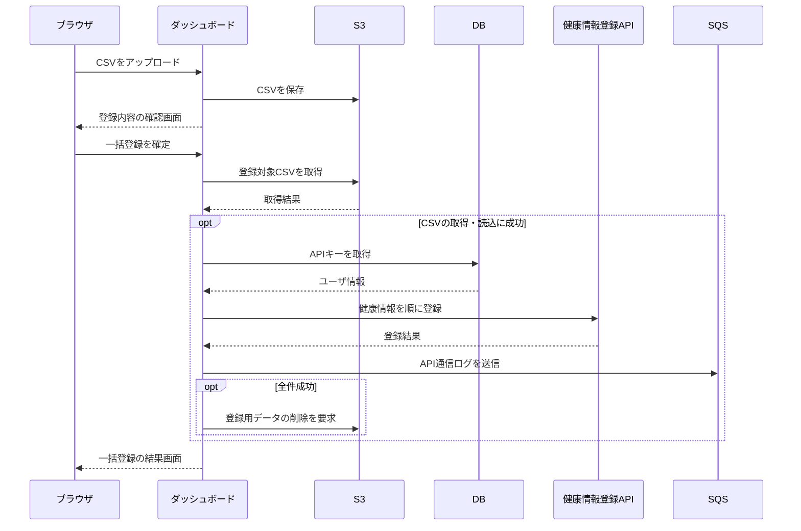
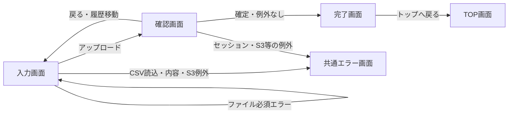
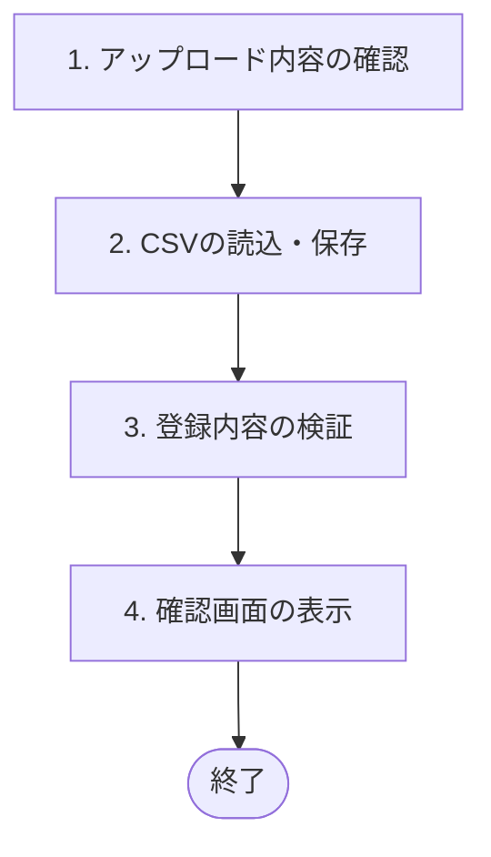
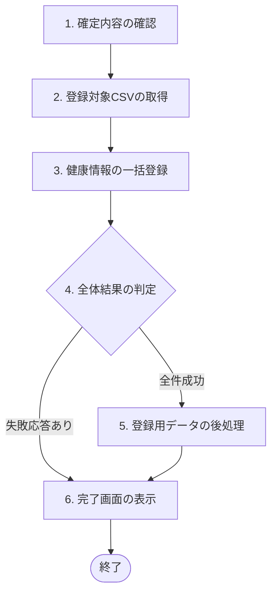
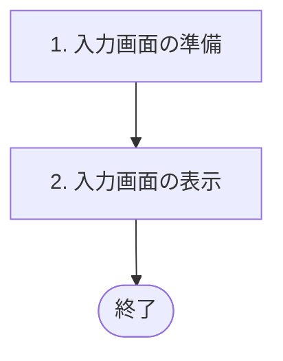

# 設計書 1.3. 健康情報一括登録機能

## 1. 機能概要

- ログインユーザの健康情報CSVを受け付け、登録件数と各行の身長・体重を確認画面へ表示する。
- 確定時にS3からCSVを読み直し、各行について健康情報登録APIを順番に呼び出す。
- API通信ログはSQSへ送信し、全行のAPI処理結果が成功ならアップロードファイル名のセッション情報を削除し、S3削除処理を呼ぶ。
- 画面処理は[HealthInfoFileRegistController](../../../ha-dashboard/src/main/java/jp/co/ha/dashboard/healthinfo/controller/HealthInfoFileRegistController.java)、形式検証とAPI連携は[HealthInfoFileRegistServiceImpl](../../../ha-dashboard/src/main/java/jp/co/ha/dashboard/healthinfo/service/impl/HealthInfoFileRegistServiceImpl.java)が担当する。S3の保存・取得・削除キーの差は「5.1.2. CSVの読込・S3保存」「5.2.3. 確定時のCSV再取得」「5.2.5. 完了処理」に記載する。

## 2. 処理概要

### 2.1. 全体の処理概要



### 2.2. 画面一覧・画面遷移図

| 画面 | 画面識別子・ビュー | 表示契機 | 備考 |
| --- | --- | --- | --- |
| 入力画面 | `healthinfofile/input` | GET `/healthinfofile/input` | アップロードファイルを選ぶ。 |
| 確認画面 | `healthinfofile/confirm` | 入力画面からPOST `/healthinfofile/confirm` | 検証後の件数・明細を表示する。 |
| 完了画面 | `healthinfofile/complete` | 確認画面からPOST `/healthinfofile/complete` | 同一POSTの応答として表示する。 |



## 3. 画面仕様

### 3.1. 入力画面

#### 3.1.1. 基本情報・表示条件

| 項目 | 内容 | 備考 |
| --- | --- | --- |
| 画面名・ビュー | 健康情報一括登録画面・`healthinfofile/input` | [入力テンプレート](../../../ha-dashboard/src/main/resources/templates/healthinfofile/input.html)。 |
| 表示URL・メソッド | GET `/healthinfofile/input` | URLのスキーム・ホスト・ポート・コンテキストパスは実行環境に従う。 |
| 表示条件 | Spring Securityの認証が必要 | 処理時にセッションseqUserIdを参照する。 |

#### 3.1.2. レイアウト・画面項目

| 配置・項目 | 区分・条件 | 備考 |
| --- | --- | --- |
| カード内のファイル選択 | 入力・必須 | multipartFileを選択する。選択欄ラベル「ファイルを選択」と項目エラーを表示する。 |
| カード下部のアップロード | ボタン | 確認処理へ送信する。 |

| 項目名 | 型 | 必須 | 備考 |
| --- | --- | --- | --- |
| `multipartFile` | `file` | 確認POSTで必須 | 健康情報CSV。ブラウザではファイル選択必須。サーバでは`null`を検査し、サイズ0・拡張子・MIMEタイプの個別検査は行わない。 |

| 画面・項目 | 内容・遷移先 | 備考 |
| --- | --- | --- |
| 入力画面 | `healthinfofile/input` | ファイル選択とアップロードボタン。`healthInfoFileForm.multipartFile`のフィールドエラーを表示する。[入力テンプレート](../../../ha-dashboard/src/main/resources/templates/healthinfofile/input.html)。 |

##### 3.1.2.1. 健康情報CSV

| 項目 | 仕様 | 備考 |
| --- | --- | --- |
| 文字コード | UTF-8 | [HealthInfoCsvReader](../../../ha-business/src/main/java/jp/co/ha/business/io/file/csv/reader/HealthInfoCsvReader.java)から共通`CsvReader`を使用する。 |
| ファイル構造 | ヘッダー・フッターなし、1行3列、カンマ区切り | 囲い文字・エスケープの解釈は行わず、`String.split(",")`で分割する。末尾空列は保持しない。空行も読み飛ばさない。 |
| ファイル名 | アップロード時の元名は任意 | S3保存時はサーバ日時の`yyyyMMddHHmmss.csv`へ変更する。 |

| 列順 | 項目名 | 型 | 必須 | 備考 |
| --- | --- | --- | --- | --- |
| 1 | `seqUserId` | `string` | 必須 | セッションのユーザIDを文字列化した値と完全一致すること。数値への変換や前後空白除去を行わない。 |
| 2 | `height` | `string` | 必須 | 身長。`RegexType.DECIMAL`による半角数値形式の検証後、API要求作成時に`BigDecimal`へ変換する。単位cm。 |
| 3 | `weight` | `string` | 必須 | 体重。身長と同じ形式検証・数値変換。単位kg。正数・範囲の判定は登録先API・calc APIで行う。 |

```csv
1,170.5,65.2
1,170.5,65.0
```

#### 3.1.3. 初期表示

| 対象 | 初期値・取得元 | 備考 |
| --- | --- | --- |
| healthInfoFileForm | 新規フォーム、multipartFile未設定 | 画面表示でS3ファイルを取得しない。 |
| 以前のアップロード状態 | 表示時に削除・復元しない | 新しい入力画面を開いただけではセッション・S3を清掃しない。 |

#### 3.1.4. 操作・イベント処理

| 操作 | HTTPメソッド・URL | 送信する業務項目 | サーバが採用・参照するデータ | 結果・遷移 | 関連処理 | 備考 |
| --- | --- | --- | --- | --- | --- | --- |
| ファイル選択 | HTTP要求なし | なし | ブラウザが選択ファイルを保持 | 入力画面のまま | 3.1.2 | 選択だけでS3へアップロードしない。 |
| アップロード | POST `/healthinfofile/confirm` | multipartFile | 要求ファイル・セッションseqUserId | 確認画面またはエラー | 5.1 | multipart/form-data; boundary=...。ブラウザとjQueryの必須検証を適用する。 |

#### 3.1.5. 入力チェック・エラー表示

| 対象 | チェック内容 | エラー時の処理・コード | 備考 |
| --- | --- | --- | --- |
| ファイル選択 | `multipartFile != null` | フィールドエラーとして入力画面を再表示 | `@Required`の「アップロードファイルが未入力です」と、[HealthInfoFileInputValidator](../../../ha-dashboard/src/main/java/jp/co/ha/dashboard/healthinfo/validate/HealthInfoFileInputValidator.java)の`validate.message.NotEmpty`による検証。`MultipartFile.isEmpty()`は使用しない。 |
| 列数 | 全行が3列であること | `CW0013`：ファイルアップロード例外 | 読込時点で検証する。カンマ分割後の末尾空列は落ちる。空行は分割結果がnullとなり、専用の空行エラーではなく例外となる。 |
| ユーザID | 必須、セッションユーザIDの文字列表現と完全一致すること | `DW0026`：`n行目のユーザIDが不正です` | BeanValidatorを実行後、結果の確認より先にユーザID一致を判定する。 |
| 身長・体重 | 必須、`RegexType.DECIMAL`の形式に一致すること | `DW0026`：`n行目のファイルフォーマットが不正です {最初の検証メッセージ}` | [HealthInfoCsvUploadModel](../../../ha-business/src/main/java/jp/co/ha/business/io/file/csv/model/HealthInfoCsvUploadModel.java)を検証。正数・上限・桁数の独自チェックはここでは行わない。 |
| 空ファイル | 確認時は0件のまま確認画面へ進める | 確定時に0件なら`DW0026` | ファイル読込・必須検証では空のMultipartFileを拒否しない。確定時の処理は5.2.3。 |

### 3.2. 確認画面

#### 3.2.1. 基本情報・表示条件

| 項目 | 内容 | 備考 |
| --- | --- | --- |
| 画面名・ビュー | 健康情報一括登録確認画面・`healthinfofile/confirm` | [確認テンプレート](../../../ha-dashboard/src/main/resources/templates/healthinfofile/confirm.html)。 |
| 表示要求 | POST `/healthinfofile/confirm` | 入力画面のアップロード操作が起点。GETの確認画面表示は定義しない。 |
| 表示条件 | ファイル必須・CSV読込・S3保存・内容検証が終了すること | 件数0でも確認表示まで進む。 |

#### 3.2.2. レイアウト・画面項目

| 配置・項目 | 区分・値の取得元 | 備考 |
| --- | --- | --- |
| 件数 | 表示・count | CSVの読込件数。 |
| 明細表 | 表示・modelList | 行数は1始まり、身長・体重。ユーザIDは表示しない。 |
| 確定・戻る | ボタン | 行データ・ファイル名・多重送信トークンのhidden項目はない。確定処理はセッションとS3を参照する。 |

| 画面・項目 | 内容・遷移先 | 備考 |
| --- | --- | --- |
| 確認画面 | `healthinfofile/confirm` | `count`に読込件数、`modelList`にCSV各行を設定する。[確認テンプレート](../../../ha-dashboard/src/main/resources/templates/healthinfofile/confirm.html)。 |
| 確認明細 | 行数、身長、体重 | 行数は1始まり。CSVのユーザIDは明細に表示しない。 |
| 確定ボタン | `POST /healthinfofile/complete` | サーバ側はアップロード済みデータを使用する。 |
| 戻るボタン | `history.back()` | 固定URLへのGETではない。S3オブジェクトやセッション情報を戻る操作で削除しない。 |

#### 3.2.3. 初期表示

| 対象 | 設定内容 | 備考 |
| --- | --- | --- |
| count・modelList | 確認POSTで読み取ったCSVの件数と行モデル | 画面表示用モデルであり、確定POSTからこれらを送り直さない。 |
| ファイル名 | セッションへ保存済み | 明細のブラウザ表示ではなくS3再取得に使用する。 |

#### 3.2.4. 操作・イベント処理

| 操作 | HTTPメソッド・URL | 送信する業務項目 | サーバが採用・参照するデータ | 結果・遷移 | 関連処理 | 備考 |
| --- | --- | --- | --- | --- | --- | --- |
| 確定 | POST `/healthinfofile/complete` | なし | セッションのファイル名・ユーザID・トークン、S3のCSV | 完了画面またはエラー | 5.2 | フォームのenctypeはmultipart/form-dataだが、ファイルや明細は再送しない。 |
| 戻る | ブラウザ履歴移動 | なし | ブラウザの履歴・キャッシュ | 直前の画面 | 4.3 | history.back()。固定URLのGET要求として実装されていない。 |

#### 3.2.5. 入力チェック・エラー表示

| 対象 | 条件・表示 | 備考 |
| --- | --- | --- |
| 利用者の入力項目 | 特になし | 確認画面は表示のみ。 |
| 確定要求の検査 | セッションのトークン・ファイル名と取得CSVを検査する | DW0031・DW0026・CE0027等の発生箇所は4.4・5.2。画面フォーム値の再検証ではない。 |

### 3.3. 完了画面

#### 3.3.1. 基本情報・表示条件

| 項目 | 内容 | 備考 |
| --- | --- | --- |
| 画面名・ビュー | 健康情報一括登録完了画面・`healthinfofile/complete` | [完了テンプレート](../../../ha-dashboard/src/main/resources/templates/healthinfofile/complete.html)。 |
| 表示要求 | POST `/healthinfofile/complete` | 登録確定処理がビューを直接返す。GETで完了画面を表示する処理はない。 |
| 表示条件 | 確定処理が例外なく戻ること | APIの失敗応答があっても表示するため、表示だけで全行成功を表すものではない。 |

#### 3.3.2. レイアウト・画面項目

| 画面・項目 | 内容・遷移先 | 備考 |
| --- | --- | --- |
| 完了画面 | `healthinfofile/complete` | 「健康情報作成完了しました」を表示し、`/top`へのリンクを表示する。[完了テンプレート](../../../ha-dashboard/src/main/resources/templates/healthinfofile/complete.html)。API応答の失敗があっても例外にならなければ同じ完了画面となる。 |
| 例外発生時 | `error/index` | MVC例外ハンドラーがエラーメッセージとコードを設定し、ログ・Slack通知を行う。HTTPエラーステータスはハンドラーで明示設定しない。 |

#### 3.3.3. 初期表示

| 対象 | 設定内容 | 備考 |
| --- | --- | --- |
| 完了メッセージ | 固定の「健康情報作成完了しました」 | 成功件数・失敗行・API詳細をモデルへ設定しない。 |
| ナビゲーション | TOPへのリンク | ファイルダウンロード機能はない。 |

#### 3.3.4. 操作・イベント処理

| 操作 | HTTPメソッド・URL | 送信する業務項目 | サーバが採用・参照するデータ | 結果・遷移 | 関連処理 | 備考 |
| --- | --- | --- | --- | --- | --- | --- |
| トップへ戻る | GET `/top` | なし | TOP機能のセッションユーザID | TOP画面 | 別機能 | 通常のリンク。 |

#### 3.3.5. 入力チェック・エラー表示

| 対象 | 条件・表示 | 備考 |
| --- | --- | --- |
| 入力項目 | 特になし | 完了画面に入力フォームはない。 |
| 再送信 | 通常の完了後はトークン不在でDW0031 | ブラウザ再読込によるPOST再送信の扱いは4.3・4.4。 |

## 4. 画面間のデータ管理・共通制御

### 4.1. 引き継ぐデータと保持方法

| データ | 保持場所 | 利用箇所 | 備考 |
| --- | --- | --- | --- |
| 認証情報・seqUserId | セッション | 各要求 | 本機能ではユーザIDを作成・更新しない。 |
| healthInfoFileForm.multipartFile | 確認POSTのフォーム | CSV読込・S3保存 | 確定時の業務データとしてセッションへ保存しない。 |
| modelList・count | 確認表示用モデル | 確認画面の明細 | 確定時にはS3からCSVを読み直す。 |
| healthinfo-file-regist/{seqUserId} | セッション | 確定処理 | 値はyyyyMMddHHmmss.csvのファイル名。 |
| multiSubmitToken | セッション | 確定処理の事前検証 | ブラウザのhidden値との照合は行わない。 |
| CSV本体 | S3 | 確認後・確定時 | 保存・取得・削除のキー文字列には実装上の差がある。5.1・5.2を参照。 |

### 4.2. データの生成・参照・更新・破棄

| 契機 | 生成・参照・更新・破棄 | 備考 |
| --- | --- | --- |
| 入力画面表示 | 新規フォームを作成 | 過去のセッションやS3ファイルを削除しない。 |
| 正常確認 | S3へ保存後に内容検証し、ファイル名をセッション保存 | 内容エラーでは保存済みS3ファイルを削除しない。 |
| 確認のpostHandle | multiSubmitTokenを生成 | 入力エラーでメソッドが正常に戻る場合も対象。 |
| 確定 | セッションのユーザID・ファイル名でCSV取得 | ブラウザの表示明細を入力として採用しない。 |
| 全行API成功 | ファイル名セッション情報を削除し、S3削除要求 | 削除要求は正確なファイルキーを指定していない。5.2.5。 |
| API失敗応答あり | ファイル名を保持しS3削除要求はしない | 例外がなければ同じ完了画面へ進む。 |
| 正常な確定のpostHandle | multiSubmitToken削除 | APIの失敗応答がある場合も、例外なく戻れば削除する。例外時の削除保証はない。 |

### 4.3. 戻る・再読込・直接アクセス時の動作

| 操作・状態 | 動作 | 備考 |
| --- | --- | --- |
| 入力画面へ戻る | history.back()で履歴移動 | ブラウザの再取得・ファイル選択の復元に依存する。S3・セッションの削除処理はない。 |
| 入力画面の再読込 | GETで新規フォームを生成 | 過去のファイル名セッションを復元して画面へ設定しない。 |
| 確認画面の再読込 | 確認POSTの再送信となり得る | 再送を実行すればCSV読込・S3保存・検証を再実行する。保存名は秒単位。 |
| 完了画面の再読込 | 確定POSTの再送信となり得る | 通常は完了時にトークン削除済みでDW0031。PRGは行わない。 |
| 確認・完了URLへの直接GET | 表示用GETマッピングなし | 確認・確定はPOSTを前提とする。 |
| 確定途中の例外後に再要求 | セッション状態と外部副作用に従う | 部分的なAPI登録の取り消し・一括再送の重複排除は独自に行わない。 |

### 4.4. 認証・セッション切れ・多重送信制御

| 項目 | 条件・動作 | 備考 |
| --- | --- | --- |
| 認証・Cookie | 各要求は認証済みJSESSIONIDセッションを使用 | CookieはHTTPの共通前提。認証が失われるとSpring Securityが`/login`へ誘導する。 |
| ユーザID不在 | Optional.getで取得し、専用補完しない | 認証済みでもIDだけ欠けている場合は一般例外CE0002。 |
| 多重送信 | confirmのfactory=true・completeのcheck=true | トークン生成・削除はInterceptorのpostHandle。 |
| CSRF | DashboardConfigで無効 | 多重送信制御はCSRFトークン照合ではない。 |
| HTML・例外応答 | 各ビューを直接返す | 共通例外ハンドラーはHTTPエラーステータスを明示設定せず、コード付きのerror/indexを返す。 |

| 対象 | チェック内容 | エラー時の処理・コード | 備考 |
| --- | --- | --- | --- |
| 多重送信トークン | 確定処理前にセッション`multiSubmitToken`が存在し空でないこと | `DW0031`：不正リクエストエラー | [DashboardAuthInterceptor](../../../ha-business/src/main/java/jp/co/ha/business/component/DashboardAuthInterceptor.java)。送信パラメータとの比較は行わない。 |
| セッションのファイル名 | `healthinfo-file-regist/{seqUserId}`が存在すること | `DW0026`：リクエスト情報が不正 | `orElseThrow`で業務例外にする。ユーザIDはOptionalの`get()`で取得しており、不在時には専用エラー判定がない。 |

## 5. サーバ処理詳細

### 5.1. 入力内容の確認処理

#### 5.1.1. 処理フロー



| 処理順 | 処理概要 | 処理詳細 | 関連項番 |
| --- | --- | --- | --- |
| 1 | アップロード内容の確認 | ファイルの有無と認証ユーザを確認する。ファイル未指定なら入力画面へ戻り、指定されていれば処理2へ進む。 | 3.1.5、4.4 |
| 2 | CSVの読込・保存 | CSVを読み込み、列構成を確認してS3へ保存する。各行の内容を検証する前に保存する。0件の場合も後続へ進む。 | 5.1.2 |
| 3 | 登録内容の検証 | 各行の形式とユーザIDの一致を確認する。不正行があればDW0026で中断する。 | 3.1.5 |
| 4 | 確認画面の表示 | 確認済みファイル名をセッションへ保持し、件数と明細を表示する。多重送信トークンの生成条件は4.4に従う。 | 3.2.3、4.2、4.4 |

#### 5.1.2. CSVの読込・S3保存

| 処理 | 内容 | エラー時の処理・コード | 備考 |
| --- | --- | --- | --- |
| CSV読込 | ファイルをUTF-8で行単位に読み、3列をユーザID・身長・体重に割り当てる | 列数不正`CW0013`、読込失敗`CW0014`、モデル生成失敗`CE0002` | [CsvReader](../../../ha-common/src/main/java/jp/co/ha/common/io/file/csv/reader/CsvReader.java)。空行等の未処理の例外はMVCハンドラーで`CE0002`となる。 |
| S3保存 | 元のアップロード内容を`healthinfo-file-regist/{seqUserId}/{yyyyMMddHHmmss}.csv`へ保存する | S3アップロード失敗`CE0028`、クライアント生成失敗`CE0029` | バケットはAWS設定に従う。ファイル名は秒単位であり、元の名前・UUIDを使用しない。 |
| 行の内容検証 | S3保存後に3.1.5の検証を行う | 不正行は`DW0026`で処理中断 | 保存後の検証に失敗してもS3オブジェクトを削除しない。 |
| セッション保存 | キー`healthinfo-file-regist/{seqUserId}`へファイル名のみ保存する | — | 確認画面の件数・明細はモデルに設定する。 |
| トークン生成 | 確認メソッドのpostHandleでセッション`multiSubmitToken`を生成する | — | `@MultiSubmitToken(factory=true)`。必須エラーで入力画面へ戻った場合も、正常にメソッドが戻れば生成する。 |
| 例外表示 | コードに対応したメッセージをエラー画面へ設定する | `error/index` | [DashboardExceptionHandler](../../../ha-dashboard/src/main/java/jp/co/ha/dashboard/exception/DashboardExceptionHandler.java)がログ・Slack通知を行う。個別の詳細はログ側に出力する。 |

| 項目 | 内容 | 備考 |
| --- | --- | --- |
| DB操作 | 特になし | この確認処理はユーザIDをセッションから取得する。 |

### 5.2. 登録確定処理

#### 5.2.1. 処理フロー



| 処理順 | 処理概要 | 処理詳細 | 関連項番 |
| --- | --- | --- | --- |
| 1 | 確定内容の確認 | 多重送信トークン・ユーザID・ファイル名をセッションから取得する。不足・不正は共通エラー処理へ進む。 | 4.4 |
| 2 | 登録対象CSVの取得 | S3からCSVを取得して再読込する。現実装では保存時と取得時のキーが一致せず、通常のアップロードからは取得エラーとなる。取得・読込失敗や空リストでは後続へ進まない。 | 5.2.3 |
| 3 | 健康情報の一括登録 | APIキーを取得し、全行を数値化してから順に登録APIを呼び出す。API応答ごとの通信ログをSQSへ送信する。失敗応答は全体結果に記録して後続行を続け、例外時は中断する。 | 5.2.2、5.2.4 |
| 4 | 全体結果の判定 | 全行のAPI結果を確認する。全件成功の場合だけ処理5を行い、失敗応答を含む場合は処理6へ進む。 | 5.2.5 |
| 5 | 登録用データの後処理 | セッションのファイル名を削除してからS3へ削除要求を送る。削除対象はファイル名を含まない単一キーであり、実際の対象は5.2.5に従う。 | 4.2、5.2.5 |
| 6 | 完了画面の表示 | 例外がなければAPIの全体結果によらず同じ完了画面を表示する。正常終了時に多重送信トークンを削除する。 | 3.3、4.4 |

#### 5.2.2. APIキー取得のDB検索

```sql
SELECT
    SEQ_USER_ID
    , PASSWORD
    , MAIL_ADDRESS
    , DELETE_FLAG
    , PASSWORD_EXPIRE
    , REMARKS
    , API_KEY
    , REG_DATE
    , UPDATE_DATE
    , GENDER_TYPE
    , BIRTH_DATE
FROM
    USER
WHERE
    SEQ_USER_ID = :seq_user_id;
```

| 項目 | 設定値 | 備考 |
| --- | --- | --- |
| `:seq_user_id` | セッションのseqUserId | [UserSearchServiceImpl](../../../ha-business/src/main/java/jp/co/ha/business/db/crud/read/impl/UserSearchServiceImpl.java)のfindById、[UserMapper](../../../ha-db/src/main/resources/jp/co/ha/db/mapper/UserMapper.xml)のselectByPrimaryKeyへ渡す。 |

#### 5.2.3. 確定時のCSV再取得

| 処理 | 内容 | エラー時の処理・コード | 備考 |
| --- | --- | --- | --- |
| 確定要求 | セッションの多重送信トークン・ユーザID・ファイル名を取得する | トークン不在`DW0031`、ファイル名不在`DW0026` | リクエストのCSV行データを使用しない。 |
| S3取得キー | `AwsS3Key.HEALTHINFO_FILE_REGIST.getValue() + seqUserId + "/" + fileName` | 対象キーがなければS3取得失敗`CE0027` | enum値は末尾スラッシュのない`healthinfo-file-regist`。そのため取得キーは`healthinfo-file-regist{seqUserId}/{fileName}`となり、5.1.2で保存したキーと一致しない。通常のアップロードからはこの箇所で取得に失敗し、API登録へ進まない。 |
| S3クライアント | AWS設定でクライアントを作成しオブジェクトを取得する | 作成失敗`CE0029`、取得失敗`CE0027` | [AwsS3Component](../../../ha-common/src/main/java/jp/co/ha/common/aws/AwsS3Component.java)。 |
| CSV再読込 | 取得できた場合にUTF-8で再読込する | 読込失敗`CW0014`、列数不正`CW0013`、空リスト`DW0026` | 確認時の`formatCheck`を再実行しない。ストリームを閉じる際の`IOException`は`CE0002`のシステム例外となる。 |
| エラー時 | MVCハンドラーでログ・Slack通知後エラー画面を返す | コード付きメッセージを表示 | 例外発生時は完了メソッドの正常終了後のpostHandleへ進まないため、トークン削除を保証しない。 |

#### 5.2.4. 健康情報登録API・APIログ送信

| 処理 | 内容 | エラー時の処理・コード | 備考 |
| --- | --- | --- | --- |
| 接続準備 | セッションユーザのAPIキーを取得し、接続URLを`healthinfo.api.url + seqUserId + "/healthinfo"`として設定する | ユーザ0件は`CE0002` | URL設定は環境に従う。API側のパスは`/api/{seq_user_id}/healthinfo`。 |
| 要求リスト作成 | `toRequestList(modelList)`で全行の身長・体重を`BigDecimal`へ変換してからAPI呼出しループへ入る | 数値変換等の未処理例外は`CE0002` | 後続行の変換に失敗した場合も、最初のAPI呼出し前に中断する。 |
| トランザクションID設定 | 各周回でUUIDを生成して要求の`transaction_id`へ設定する | — | `seq_user_id`はURL、`Api-Key`はヘッダー。APIのJSONボディは身長・体重・トランザクションIDであり、画面のリクエストIFとは別。 |
| API呼出し | 各行について健康情報登録APIへPOSTする | API通信エラーの応答化・詳細は登録APIクライアントの共通処理に従う | API側の計算・入力エラー・DB登録は[健康情報登録API](../02_api/設計書_2.1.健康情報登録API.md)を参照。ダッシュボードはcalc APIを直接呼ばない。 |
| 通信ログ | 応答取得後、結果判定より先に`ApiLogComponent.registQueue`でSQSへ送信する | SQS送信失敗`CE0041`で中断しエラー画面 | ログ送信時点で当該行のAPI登録が完了している場合がある。CSV全体を取り消す処理はない。 |
| 結果集計 | 1行でも`ResultType.FAILURE`なら全体結果を失敗とし、以後の行も処理する | APIの失敗応答だけでは例外を送出しない | `result`は成功へ戻さない。失敗行の詳細や成功件数を完了画面に設定しない。 |
| 通知 | この一括登録サービスからSESメールを送信しない | — | 健康情報登録画面のメール送信サービスは呼ばない。 |

| 処理・条件 | 内容 | 備考 |
| --- | --- | --- |
| APIキーの採用 | S3からCSVを再取得した後、ループ前に1回だけUSERを検索してAPI_KEYを採用する | ApiConnectInfo.X_API_KEYの実際のヘッダー名はApi-Key。ユーザ0件のOptional.get()はCE0002としてMVC例外ハンドラーへ渡る。 |
| DB操作の責務 | 健康情報INSERTは健康情報登録API、通信ログのDB反映はSQS後続処理に任せる | ダッシュボード自身はこれらのDB更新を行わず、CSV全体を囲むDBトランザクションはない。 |

#### 5.2.5. 完了処理

| 処理 | 内容 | エラー時の処理・コード | 備考 |
| --- | --- | --- | --- |
| 全行成功時のセッション整理 | ファイル名のキー`healthinfo-file-regist/{seqUserId}`を削除する | — | S3削除要求より先に行う。 |
| 全行成功時のS3削除 | `removeS3ObjectByKeys("healthinfo-file-regist/" + seqUserId)`を呼ぶ | S3削除失敗`CE0044`、クライアント生成失敗`CE0029` | 指定文字列を単一のオブジェクトキーとしてDeleteObjectsへ渡す。接頭辞一覧取得や配下の削除は行わず、`/{fileName}`もないためアップロード済みCSVは削除されない。 |
| API失敗応答がある場合 | ファイル名セッション情報とS3削除処理を実行しない | 例外がなければ完了画面へ進む | 全行成功時と同じ「健康情報作成完了しました」を表示する。 |
| 多重送信防止 | 正常にメソッドが戻った後、postHandleで`multiSubmitToken`を削除する | 再度の確定POSTは`DW0031` | API失敗応答を含む場合も、例外にならず戻った場合はトークンを削除する。 |
| 完了表示 | `healthinfofile/complete`を直接返す | — | POST後のGETリダイレクトは行わない。トップへのリンクは`GET /top`。 |

### 5.3. その他の処理

#### 5.3.1. 入力画面初期表示の処理フロー



| 処理順 | 処理概要 | 処理詳細 | 関連項番 |
| --- | --- | --- | --- |
| 1 | 入力画面の準備 | 新しいファイル選択フォームを作成する。セッションにあるファイル名は復元・削除しない。 | 5.3.2 |
| 2 | 入力画面の表示 | 初期状態の画面を表示する。DB・外部APIへの接続は行わない。例外は4.4の共通処理に従う。 | 3.1、5.3.2 |

#### 5.3.2. 入力画面初期表示の処理内容

| 処理 | 内容・異常時の扱い | 備考 |
| --- | --- | --- |
| フォーム生成 | ModelAttributeでhealthInfoFileFormを作成する | ファイル項目は未設定。 |
| 表示 | getViewで入力ビューを返す | 初期表示ではS3保存・CSV読込・DB操作を行わない。 |
| データの引継ぎ | 過去のS3ファイルやセッションを復元・清掃しない | 確認後の状態を消すキャンセル処理は定義していない。 |
