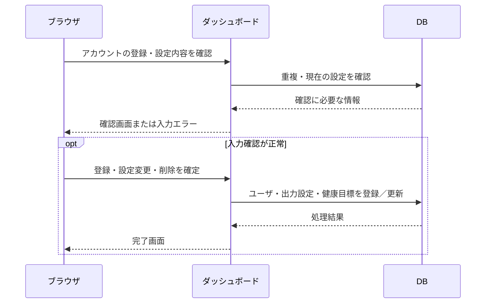
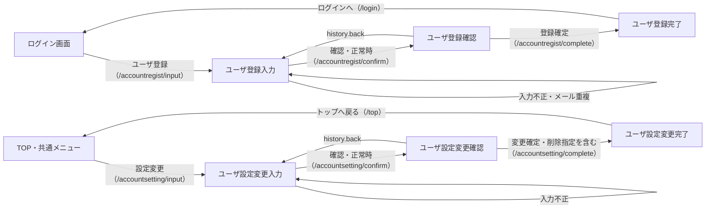
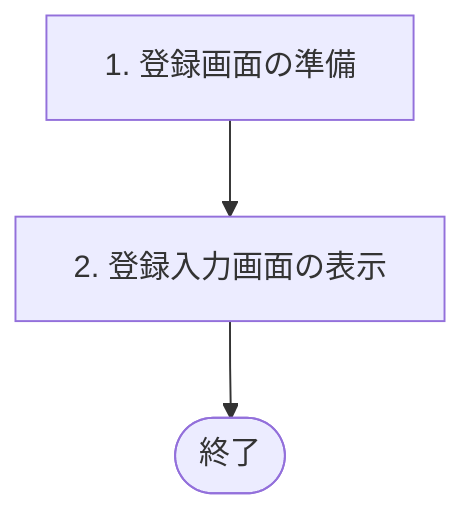
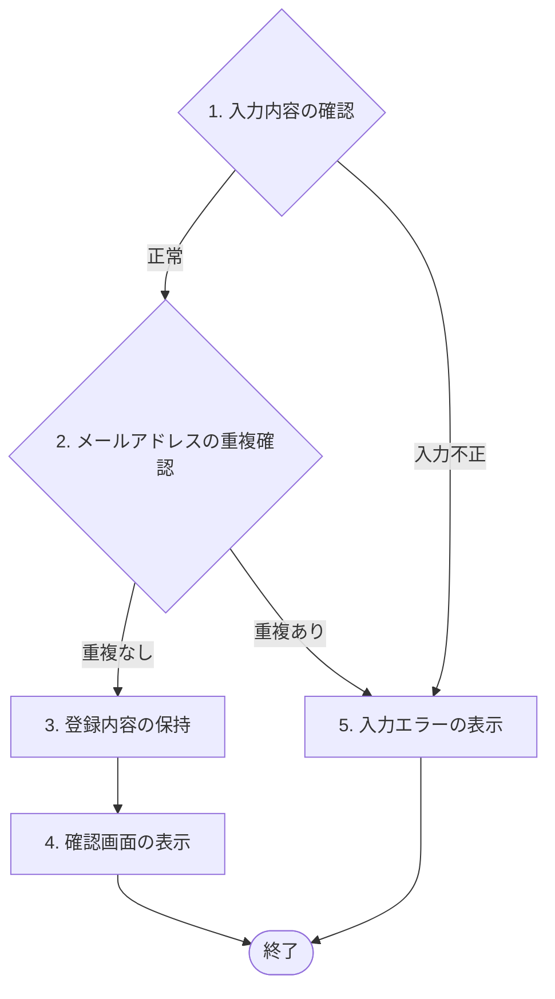
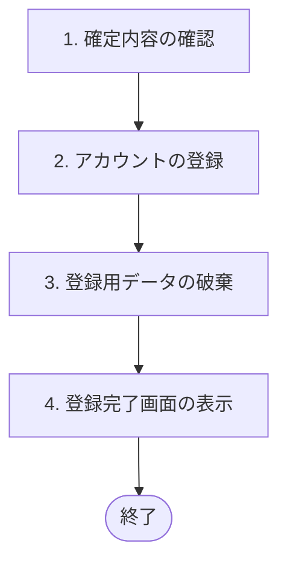
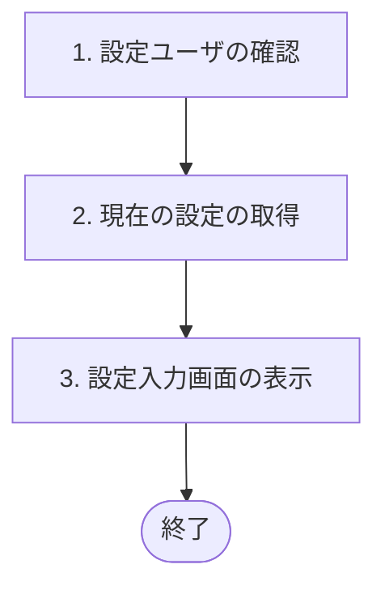
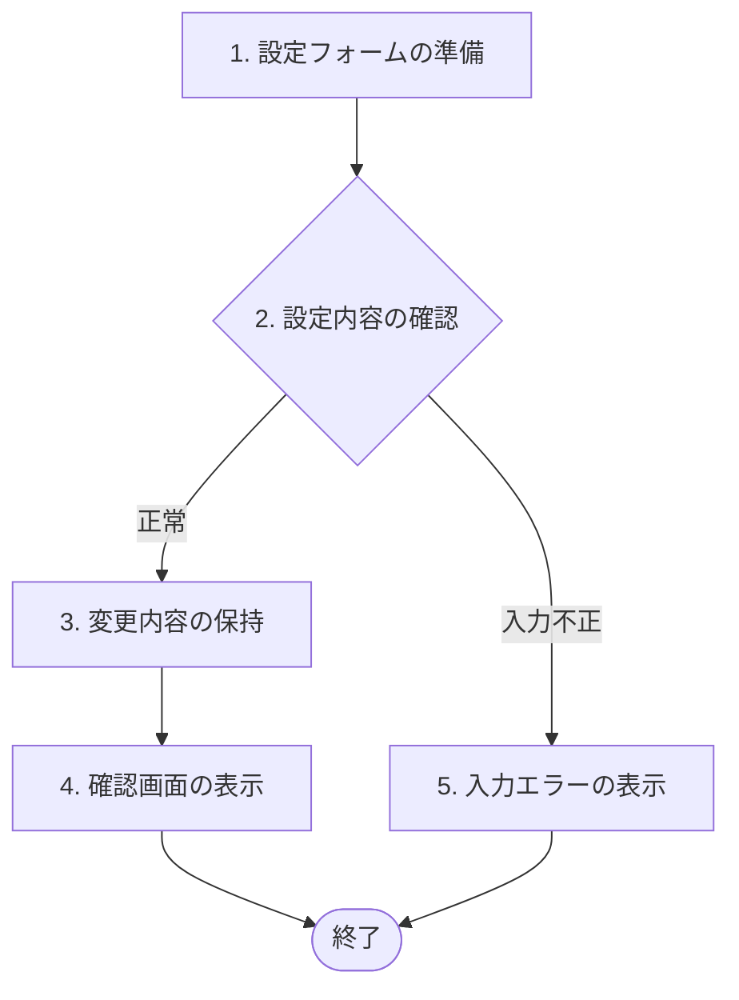
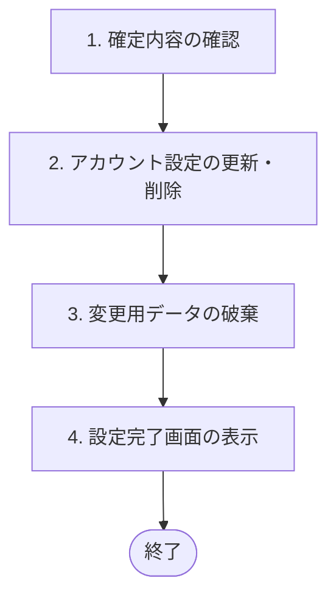

# 設計書 1.4. アカウント登録・変更機能

## 1. 機能概要

- 未認証の利用者がメールアドレス、パスワード、性別、誕生日、目標体重、備考を入力し、確認後にアカウントを登録する。
- 認証済み利用者がアカウント、健康情報ファイル設定、目標体重を変更する。削除指定時はアカウントと現在の健康目標を論理削除する。
- 入力・確認・完了画面をHTMLで返す。[登録コントローラ](../../../ha-dashboard/src/main/java/jp/co/ha/dashboard/user/controller/UserRegistController.java)、[設定コントローラ](../../../ha-dashboard/src/main/java/jp/co/ha/dashboard/user/controller/UserSettingController.java)、[ユーザ処理](../../../ha-business/src/main/java/jp/co/ha/business/component/UserComponent.java)で処理する。

## 2. 処理概要

### 2.1. 全体の処理概要



### 2.2. 画面一覧・画面遷移図

| 画面 | 表示要求・条件 | テンプレート | 備考 |
| --- | --- | --- | --- |
| ユーザ登録入力 | `GET /accountregist/input`、登録confirmの入力不正・メール重複時 | `accountregist/input` | 未認証で利用可能。3.1参照。 |
| ユーザ登録確認 | `POST /accountregist/confirm`が正常 | `accountregist/confirm` | 登録フォームをセッション保存する。3.2参照。 |
| ユーザ登録完了 | `POST /accountregist/complete`が正常 | `accountregist/complete` | 自動ログインしない。3.3参照。 |
| ユーザ設定変更入力 | `GET /accountsetting/input`、設定confirmの入力不正時 | `accountsetting/input` | 認証が必要。3.4参照。 |
| ユーザ設定変更確認 | `POST /accountsetting/confirm`が正常 | `accountsetting/confirm` | 設定フォームをセッション保存する。3.5参照。 |
| ユーザ設定変更完了 | `POST /accountsetting/complete`が正常 | `accountsetting/complete` | 削除指定時も同じ画面を返す。3.6参照。 |
| 共通エラー画面 | 業務例外・システム例外 | `error/index` | 共通例外ハンドラーが処理する。各5章参照。 |



## 3. 画面仕様

### 3.1. ユーザ登録入力画面

#### 3.1.1. 基本情報・表示条件

| 項目 | 内容 | 備考 |
| --- | --- | --- |
| 表示要求 | `GET /accountregist/input`。または`POST /accountregist/confirm`の検証エラー・メール重複時。 | URLのスキーム・ホスト・ポート・コンテキストパスは実行環境に従う。 |
| 表示条件 | 登録URLは未認証で利用可能。空の`userRegistForm`を要求ごとに生成する。 | 認証・セッション制御は4.4参照。 |


#### 3.1.2. レイアウト・画面項目

| 配置 | 項目 | 区分 | 内容・条件 | 備考 |
| --- | --- | --- | --- | --- |
| カード上部 | 画面見出し・エラー領域 | 表示 | 「ユーザ登録」。業務エラーと全フィールドエラーをフォーム上部に列挙する。 | [入力テンプレート](../../../ha-dashboard/src/main/resources/templates/accountregist/input.html)。 |
| フォーム1 | `mailAddress` | 入力 | 必須・メール形式・最大64文字。メール候補を直下へ表示する。 | メールアドレス。登録は64文字以下、設定はサーバ側の長さ検証なし。両画面の入力要素は`maxlength="64"`。 |
| フォーム2 | `password` | 入力 | 必須・半角英数字2～16文字。入力要素はpassword、最大16文字。 | 半角英数字2～16文字。設定画面では再入力を必要とする。 |
| フォーム3 | `confirmPassword` | 入力 | 必須・半角英数字2～16文字。入力要素はpassword、最大16文字。 | 半角英数字2～16文字。サーバ側に`password`との一致検証はない。 |
| 各パスワードの直下 | パスワードを表示 | 入力・画面内操作 | チェックによって対応パスワードの表示を切り替える。 | 業務項目として送信しない。 |
| フォーム4 | `genderType` | 入力 | 必須。男性`0`・女性`1`のラジオ。 | 画面の選択値は`0`（男性）・`1`（女性）。フォーム検証は半角数字のみで、列挙値への変換は確定時。 |
| フォーム5 | `birthDate` | 入力 | 必須。日付入力、`yyyy-MM-dd`。 | `yyyy-MM-dd`。当日を含まない過去日。 |
| フォーム6 | `goalWeight` | 入力 | 必須。テキスト入力、右にkgを表示。 | 目標体重kg。1～999の範囲。 |
| フォーム7 | `remarks` | 入力 | 任意。5行のテキストエリア、256文字以下。 | 256文字以下。 |
| フォーム下部 | 確認・リセット | 操作 | 確認はsubmit、リセットはHTML reset。 | 登録入力画面では共通タイトルのonclickを外す。 |


#### 3.1.3. 初期表示

| 契機・条件 | 表示・処理 | 備考 |
| --- | --- | --- |
| 登録input | `accountregist/input` | メールアドレス、パスワード2項目、性別、誕生日、目標体重、備考。リセットはブラウザのフォーム初期値へ戻す。 |
| 登録confirm入力不正・メール重複 | `accountregist/input` | フィールドエラーまたは「指定されたメールアドレスは既に登録されています」を表示する。 |
| 初回表示 | DB検索なしで空のフォームを表示する。 | 性別のHTML初期指定は男性。バインド後はフォーム値を表示する。 |


#### 3.1.4. 操作・イベント処理

| 操作 | HTTPメソッド・URL | 送信する業務項目 | サーバが採用・参照するデータ | 結果・遷移 | 関連処理 | 備考 |
| --- | --- | --- | --- | --- | --- | --- |
| 確認 | `POST /accountregist/confirm` | `mailAddress, password, confirmPassword, genderType, birthDate, goalWeight, remarks` | バインド・検証した要求フォーム。重複判定ではmailAddressをAES暗号化してDB検索。 | 正常は3.2。入力不正・重複は本画面。 | 5.2 | 標準フォーム送信はapplication/x-www-form-urlencoded。 |
| リセット | 通信なし | なし | 現在表示中のHTMLの初期値 | 同じ画面でフォームを初期値へ戻す。 | 4.3 | 新規GET・セッション削除は行わない。 |
| パスワード表示切替 | 通信なし | なし | 各表示チェック状態 | 対応入力を表示・非表示へ切り替える。 | 本画面 | 確認用パスワードにも個別チェックがある。 |
| メール候補選択 | 通信なし | なし | mailcheckの候補 | blur時に提示した候補をクリックするとmailAddressを置換する。 | 本画面 | 候補はgmail.com、yahoo.co.jp、ezweb.ne.jp、au.com、docomo.ne.jp、i.softbank.jp、softbank.ne.jp、outlook.com、outlook.jp。 |
| 入力進捗表示 | 通信なし | なし | メール、パスワード、確認パスワード、性別、誕生日の値 | 各changeで入力済み数÷5をMprogressへ設定する。 | 本画面 | 実装の性別セレクタは`#genderType`で、ラジオの実IDはmale/female。目標体重と備考は進捗の対象外。 |


#### 3.1.5. 入力チェック・エラー表示

| 対象・処理 | チェック内容 | 発生エラー・扱い | 備考 |
| --- | --- | --- | --- |
| 登録mailAddress | 必須・64文字以下・メール形式 | 「メールアドレスが未入力です」「メールアドレスは64桁以下で入力してください」「メールアドレス形式ではありません」 | [UserRegistForm](../../../ha-dashboard/src/main/java/jp/co/ha/dashboard/user/form/UserRegistForm.java)。 |
| 登録password | 必須・半角英数字・2～16文字 | 「パスワードが未入力です」「パスワードが半角英数で入力してください」「パスワードは2桁以上で入力してください」「パスワードは16桁以下で入力してください」 | — |
| 登録confirmPassword | 必須・半角英数字・2～16文字 | 「確認用パスワードが未入力です」「確認用パスワードが半角英数で入力してください」「確認用パスワードは2桁以上で入力してください」「確認用パスワードは16桁以下で入力してください」 | passwordとの一致は検証しない。 |
| 登録・設定genderType | 必須・半角数字 | 「性別が未入力です」。形式不正は登録「性別が半角数字でありません」、設定「削除フラグが半角数字でありません」 | `0`/`1`の列挙値検証はフォームにはない。設定のメッセージは実装値。 |
| 登録・設定birthDate | 必須・当日より前 | 「誕生日が未入力です」「誕生日は過去日を指定して下さい」 | 日付変換不正もBindingResultのエラーになる。 |
| 登録・設定goalWeight | 必須・1以上999以下 | 「目標体重が未入力です」「目標体重は1kg～999kgまでの範囲が指定可能です」 | BigDecimal変換不正もBindingResultのエラーになる。小数桁数の制限はない。 |
| 登録・設定remarks | 256文字以下 | 「備考は256桁以下で入力してください」 | 任意。 |
| 入力チェックの実行時点 | confirmに`@Valid`を適用 | エラー時は入力画面へ戻す | completeでは再検証しない。 |


### 3.2. ユーザ登録確認画面

#### 3.2.1. 基本情報・表示条件

| 項目 | 内容 | 備考 |
| --- | --- | --- |
| 表示要求 | `POST /accountregist/confirm`が入力検証・メール重複確認を通過した場合。 | 表示用GETルートはない。 |
| 表示条件 | 正常confirmで`userRegistForm`をセッション保存した後、同じ要求のモデルを表示する。 | [確認テンプレート](../../../ha-dashboard/src/main/resources/templates/accountregist/confirm.html)。 |


#### 3.2.2. レイアウト・画面項目

| 配置 | 項目 | 区分 | 内容・条件 | 備考 |
| --- | --- | --- | --- | --- |
| カード上部 | ユーザ登録確認 | 表示 | 画面見出し。 | ユーザの新規入力項目はない。 |
| 中央の確認表（上から） | メールアドレス・パスワード・性別・誕生日・目標体重・備考 | 表示 | passwordは`****`。性別は男性/女性、誕生日はyyyy/MM/dd、体重は値＋kg。 | confirmPasswordの表示行はない。業務項目のhiddenもない。 |
| 表下部 | 確定・戻る | 操作 | 確定submit、戻るはhistory.back()。 | 入力欄がなくても確定ボタンでPOSTする。 |


#### 3.2.3. 初期表示

| 契機・条件 | 表示・処理 | 備考 |
| --- | --- | --- |
| 登録confirm正常 | `accountregist/confirm` | 入力内容を表示し、パスワードは伏せる。戻る操作は`history.back()`。 |


#### 3.2.4. 操作・イベント処理

| 操作 | HTTPメソッド・URL | 送信する業務項目 | サーバが採用・参照するデータ | 結果・遷移 | 関連処理 | 備考 |
| --- | --- | --- | --- | --- | --- | --- |
| 確定 | `POST /accountregist/complete` | 業務項目の送信なし（業務hiddenなし） | セッション`userRegistForm`を採用。セッション`multiSubmitToken`の存在・非空を確認。 | 正常は3.3。フォーム不在・トークン不在・DB例外は共通エラー。 | 5.3、4.4 | 要求フォーム値は登録データに採用しない。多重送信トークンの要求値も不要。 |
| 戻る | 通信なし（history.back()） | なし | ブラウザ履歴 | 3.1へ戻る。 | 4.3 | サーバの保存フォーム・トークンを削除しない。 |


#### 3.2.5. 入力チェック・エラー表示

| 対象・処理 | チェック内容 | 発生エラー・扱い | 備考 |
| --- | --- | --- | --- |
| 確定時 | completeでフォームの再検証・メール重複の再検索は行わない。 | 保存フォームがなければDW0026。multiSubmitToken不在・空はDW0031。 | 登録confirmではpasswordとconfirmPasswordの一致を検証しない。5.3・4.4参照。 |


### 3.3. ユーザ登録完了画面

#### 3.3.1. 基本情報・表示条件

| 項目 | 内容 | 備考 |
| --- | --- | --- |
| 表示要求 | `POST /accountregist/complete`が登録トランザクションを完了した場合。 | 表示用GETルートはない。 |
| 表示条件 | 正常登録後にセッションの登録フォームを削除し、完了HTMLを返す。 | [完了テンプレート](../../../ha-dashboard/src/main/resources/templates/accountregist/complete.html)。自動ログインしない。 |


#### 3.3.2. レイアウト・画面項目

| 配置 | 項目 | 区分 | 内容・条件 | 備考 |
| --- | --- | --- | --- | --- |
| カード上部 | ユーザ登録完了 | 表示 | 完了見出し。 | HTML titleは「ユーザ登録確認画面」のまま。 |
| 中央 | 完了文言・案内 | 表示 | 「アカウント作成が完了しました。」と、登録したメールアドレス・パスワードでのログイン案内。 | 入力欄・hiddenはない。 |
| 下部 | ログイン画面 | 操作 | GETフォームのsubmit。 | ログイン処理そのものは実行しない。 |


#### 3.3.3. 初期表示

| 契機・条件 | 表示・処理 | 備考 |
| --- | --- | --- |
| 登録complete正常 | `accountregist/complete` | 完了メッセージとログイン画面へのボタンを表示する。自動ログインはしない。 |


#### 3.3.4. 操作・イベント処理

| 操作 | HTTPメソッド・URL | 送信する業務項目 | サーバが採用・参照するデータ | 結果・遷移 | 関連処理 | 備考 |
| --- | --- | --- | --- | --- | --- | --- |
| ログイン画面 | `GET /login` | なし | なし | ログイン画面へ遷移する。 | ログイン機能 | 登録完了画面の唯一の業務ナビゲーション。 |


#### 3.3.5. 入力チェック・エラー表示

| 対象・処理 | チェック内容 | 発生エラー・扱い | 備考 |
| --- | --- | --- | --- |
| 画面内入力 | 入力項目なし。 | 新たな入力チェック・エラー表示はない。 | この画面を生成するcompleteのエラーは5.3参照。 |


### 3.4. ユーザ設定変更入力画面

#### 3.4.1. 基本情報・表示条件

| 項目 | 内容 | 備考 |
| --- | --- | --- |
| 表示要求 | `GET /accountsetting/input`。または`POST /accountsetting/confirm`の検証エラー時。 | 認証・セッション条件は4.4参照。 |
| 表示条件 | セッション`seqUserId`で現在の複合ユーザ情報を取得しフォームを初期化する。 | この初期化は設定confirm・completeにも先行する。5.4参照。 |


#### 3.4.2. レイアウト・画面項目

| 配置 | 項目 | 区分 | 内容・条件 | 備考 |
| --- | --- | --- | --- | --- |
| カード上部 | ユーザ設定変更・全体エラー | 表示 | フィールドエラーがあれば「入力に誤りがあります。各項目を確認してください。」を表示。 | [入力テンプレート](../../../ha-dashboard/src/main/resources/templates/accountsetting/input.html)。 |
| フォーム1 | `deleteFlag` | 入力 | 必須。しない`0`・する`1`のラジオ。 | `0`（削除しない）・`1`（削除する）。 |
| フォーム2 | `seqUserId` | 表示・hidden | 現在のユーザIDを平文表示し、同じ値をhiddenで送信する。 | 入力画面のhidden。セッションのユーザIDとの一致検証は行わず、保存されたフォームのIDを更新対象にする。 |
| フォーム3 | `password` | 入力 | 必須・半角英数字2～16文字、最大16文字。表示切替チェックあり。 | 半角英数字2～16文字。設定画面では再入力を必要とする。 |
| フォーム4 | `mailAddress` | 入力 | 必須・メール形式、画面maxlength=64。 | メールアドレス。登録は64文字以下、設定はサーバ側の長さ検証なし。両画面の入力要素は`maxlength="64"`。 |
| フォーム5 | `genderType` | 入力 | 必須。男性`0`・女性`1`のラジオ。 | 画面の選択値は`0`（男性）・`1`（女性）。フォーム検証は半角数字のみで、列挙値への変換は確定時。 |
| フォーム6 | `birthDate` | 入力 | 必須。日付入力、yyyy-MM-dd。 | `yyyy-MM-dd`。当日を含まない過去日。 |
| フォーム7 | `goalWeight` | 入力 | 必須。テキスト入力、右にkg。 | 目標体重kg。1～999の範囲。 |
| フォーム8 | `headerFlag` | 入力 | 必須。しない`0`・する`1`のラジオ。 | `0`（ヘッダ利用なし）・`1`（利用あり）。 |
| フォーム9 | `footerFlag` | 入力 | 必須。しない`0`・する`1`のラジオ。 | `0`（フッタ利用なし）・`1`（利用あり）。 |
| フォーム10 | `maskFlag` | 入力 | 必須。しない`0`・する`1`のラジオ。 | `0`（マスク利用なし）・`1`（利用あり）。 |
| フォーム11 | `enclosureCharFlag` | 入力 | 必須。しない`0`・する`1`のラジオ。 | `0`（囲み文字利用なし）・`1`（利用あり）。 |
| フォーム12 | `remarks` | 入力 | 任意。10行・30列のテキストエリア。 | 256文字以下。 |
| 画面要素なし | `apiKey` | サーバ側フォーム保持 | フォーム検証上必須。現在値で初期化する。 | 現行入力画面に送信要素なし。各要求の`@ModelAttribute`で取得する現在値を保持する。任意のフォーム値を送信した場合はバインド対象になる。 |
| 画面要素なし | `passwordExpire` | サーバ側フォーム保持 | フォーム検証上必須。現在値で初期化する。 | 現行入力画面に送信要素なし。現在値を保持する。バインド時は`yyyy-MM-dd`、検証条件は当日を含まない未来日。 |
| フォーム下部 | 確認・リセット | 操作 | submitとHTML reset。 | 確認用パスワードの入力欄はない。 |


#### 3.4.3. 初期表示

| 契機・条件 | 表示・処理 | 備考 |
| --- | --- | --- |
| 設定input | `accountsetting/input` | ユーザID、削除指定、パスワード、メールアドレス、性別、誕生日、目標体重、ファイル設定4項目、備考。 |
| 設定confirm入力不正 | `accountsetting/input` | フィールドエラーを保持する。 |
| 初期化値 | パスワードハッシュを含む現在値をフォームへコピーするが、password入力は利用者が再入力する。フラグ・性別は文字列へ変換する。 | apiKey・passwordExpireには画面送信要素がなく、各要求の初期化値を使用。任意に送信すればバインド対象となる。 |


#### 3.4.4. 操作・イベント処理

| 操作 | HTTPメソッド・URL | 送信する業務項目 | サーバが採用・参照するデータ | 結果・遷移 | 関連処理 | 備考 |
| --- | --- | --- | --- | --- | --- | --- |
| 確認 | `POST /accountsetting/confirm` | `seqUserId(hidden), deleteFlag, password, mailAddress, genderType, birthDate, goalWeight, headerFlag, footerFlag, maskFlag, enclosureCharFlag, remarks` | セッションIDで初期化したフォームへ要求値を上書きして検証。画面未送信のapiKey・passwordExpireは初期化値。 | 正常は3.5、入力不正は本画面。 | 5.5 | hidden IDとセッションIDの一致確認はない。送信形式はapplication/x-www-form-urlencoded。 |
| リセット | 通信なし | なし | 現在表示中のHTMLの初期値 | 同じ画面で初期値に戻す。 | 4.3 | 現在値のDB再取得はしない。 |
| パスワード表示切替 | 通信なし | なし | 表示チェック状態 | passwordの表示・非表示を切り替える。 | 本画面 | 業務フォーム値として送らない。 |
| メール入力blur | 通信なし | なし | mailcheckの候補 | 候補生成・置換処理を設定している。 | 本画面 | 候補ドメインは3.1と同じ。現行設定テンプレートには候補の出力先`#suggest`要素がない。 |


#### 3.4.5. 入力チェック・エラー表示

| 対象・処理 | チェック内容 | 発生エラー・扱い | 備考 |
| --- | --- | --- | --- |
| 登録・設定genderType | 必須・半角数字 | 「性別が未入力です」。形式不正は登録「性別が半角数字でありません」、設定「削除フラグが半角数字でありません」 | `0`/`1`の列挙値検証はフォームにはない。設定のメッセージは実装値。 |
| 登録・設定birthDate | 必須・当日より前 | 「誕生日が未入力です」「誕生日は過去日を指定して下さい」 | 日付変換不正もBindingResultのエラーになる。 |
| 登録・設定goalWeight | 必須・1以上999以下 | 「目標体重が未入力です」「目標体重は1kg～999kgまでの範囲が指定可能です」 | BigDecimal変換不正もBindingResultのエラーになる。小数桁数の制限はない。 |
| 登録・設定remarks | 256文字以下 | 「備考は256桁以下で入力してください」 | 任意。 |
| 設定seqUserId | 必須・Longへのバインド | 「ユーザIDが未入力です」または型変換エラー | [UserSettingForm](../../../ha-dashboard/src/main/java/jp/co/ha/dashboard/user/form/UserSettingForm.java)。正数・セッションIDとの一致検証はない。 |
| 設定password | 必須・半角英数字・2～16文字 | 「パスワードが未入力です」「パスワードが半角英数でありません」「パスワードは2桁以上で入力してください」「パスワードは16桁以下で入力してください」 | 確認用パスワード項目なし。 |
| 設定mailAddress | 必須・メール形式 | 「メールアドレスが未入力です」「メールアドレス形式ではありません」 | サーバ側の最大長・既存メール重複検証はない。 |
| 設定deleteFlag | 必須・半角数字・0/1 | 「削除フラグが未入力です」「削除フラグが半角数字でありません」「削除フラグの値が不正です」 | — |
| 設定headerFlag/footerFlag/maskFlag/enclosureCharFlag | 必須・0/1 | 「ヘッダ利用有無フラグ」「フッタ利用有無フラグ」「マスク利用有無フラグ」「囲み文字利用有無フラグ」に、それぞれ「が未入力です」または「の値が不正です」を付した文言 | FlagValidatorで0/1を検証する。 |
| 設定apiKey | 必須 | 「APIキーが未入力です」 | 画面に送信要素はなく初期化値を使用。 |
| 設定passwordExpire | 必須・当日より後 | 「パスワード有効期限が未入力です」「パスワード有効期限は未来日を指定して下さい」 | 画面に送信要素はない。取得した期限が当日以前なら通常の確認操作も失敗する。 |
| 入力チェックの実行時点 | confirmに`@Valid`を適用 | エラー時は入力画面へ戻す | completeでは再検証しない。 |


### 3.5. ユーザ設定変更確認画面

#### 3.5.1. 基本情報・表示条件

| 項目 | 内容 | 備考 |
| --- | --- | --- |
| 表示要求 | `POST /accountsetting/confirm`が正常な場合。 | 表示用GETルートはない。 |
| 表示条件 | 正常confirmで`userSettingForm`をセッション保存した後に表示。 | [確認テンプレート](../../../ha-dashboard/src/main/resources/templates/accountsetting/confirm.html)。 |


#### 3.5.2. レイアウト・画面項目

| 配置 | 項目 | 区分 | 内容・条件 | 備考 |
| --- | --- | --- | --- | --- |
| カード上部 | ユーザ設定変更確認 | 表示 | 画面見出し。 | ユーザの新規入力項目はない。 |
| 中央の確認表（上から） | 削除・ユーザID・パスワード・パスワード有効期限・性別・誕生日・目標体重・ファイル設定4項目・備考 | 表示 | passwordは`****`、日付はyyyy/MM/dd、体重は値＋kg、各フラグはする/しない。 | 現行テンプレートにはmailAddress・apiKeyの表示要素がなく、業務項目のhiddenもない。 |
| 表下部 | 確定・戻る | 操作 | 確定submit、戻るhistory.back()。 | 入力欄がなくても確定でPOSTする。 |


#### 3.5.3. 初期表示

| 契機・条件 | 表示・処理 | 備考 |
| --- | --- | --- |
| 設定confirm正常 | `accountsetting/confirm` | パスワードを伏せ、入力内容とパスワード有効期限を表示する。APIキーの表示要素はない。戻る操作は`history.back()`。 |


#### 3.5.4. 操作・イベント処理

| 操作 | HTTPメソッド・URL | 送信する業務項目 | サーバが採用・参照するデータ | 結果・遷移 | 関連処理 | 備考 |
| --- | --- | --- | --- | --- | --- | --- |
| 確定 | `POST /accountsetting/complete` | 業務項目の送信なし（業務hiddenなし） | セッション`userSettingForm`を採用し、保存フォームのseqUserIdを更新対象にする。セッションmultiSubmitTokenを確認。 | 削除指定を含め正常は3.6。例外は共通エラー。 | 5.6、4.4 | complete要求時にもセッションIDによるフォーム初期化・DB検索が先行するが、更新データは確認時の保存フォームから取る。 |
| 戻る | 通信なし（history.back()） | なし | ブラウザ履歴 | 3.4へ戻る。 | 4.3 | セッションの保存フォーム・トークンを削除しない。 |


#### 3.5.5. 入力チェック・エラー表示

| 対象・処理 | チェック内容 | 発生エラー・扱い | 備考 |
| --- | --- | --- | --- |
| 確定時 | 保存フォームの再検証・メール重複確認・hidden IDとの認証ユーザ照合は行わない。 | フォーム不在DW0026、トークン不在・空DW0031。 | 初期化例外は5.4、更新例外は5.6参照。 |


### 3.6. ユーザ設定変更完了画面

#### 3.6.1. 基本情報・表示条件

| 項目 | 内容 | 備考 |
| --- | --- | --- |
| 表示要求 | `POST /accountsetting/complete`が正常完了した場合。 | 削除指定時も同じ完了画面を返す。表示用GETルートはない。 |
| 表示条件 | 更新・保存フォーム削除後に表示する。削除時はseqUserIdも削除する。 | [完了テンプレート](../../../ha-dashboard/src/main/resources/templates/accountsetting/complete.html)。 |


#### 3.6.2. レイアウト・画面項目

| 配置 | 項目 | 区分 | 内容・条件 | 備考 |
| --- | --- | --- | --- | --- |
| カード上部 | ユーザ設定変更完了 | 表示 | 緑色のカード見出し。 | 入力欄・hiddenはない。 |
| 中央 | 完了文言 | 表示 | 「ユーザの更新が正常に完了しました。」 | 削除時にも同じ文言。 |
| 下部 | トップへ戻る | 操作 | `/top`へのリンク。 | 削除時にも表示する。 |


#### 3.6.3. 初期表示

| 契機・条件 | 表示・処理 | 備考 |
| --- | --- | --- |
| 設定complete正常 | `accountsetting/complete` | 削除指定時もこの画面を返す。実装は`redirectView(LOGIN)`を呼ぶが戻り値を返却しないため、ログイン画面への転送は発生しない。 |


#### 3.6.4. 操作・イベント処理

| 操作 | HTTPメソッド・URL | 送信する業務項目 | サーバが採用・参照するデータ | 結果・遷移 | 関連処理 | 備考 |
| --- | --- | --- | --- | --- | --- | --- |
| トップへ戻る | `GET /top` | なし | 残存する認証状態・セッションの状態に従う。 | TOP表示要求。 | ログイン機能、4.4 | 削除時はseqUserIdを除去するがSecurityContextをクリアしない。 |


#### 3.6.5. 入力チェック・エラー表示

| 対象・処理 | チェック内容 | 発生エラー・扱い | 備考 |
| --- | --- | --- | --- |
| 画面内入力 | 入力項目なし。 | 画面内で新しい入力チェックを行わない。 | 削除時のredirectView(LOGIN)は戻り値を返さないためログインへの転送は発生しない。5.6参照。 |


## 4. 画面間のデータ管理・共通制御

### 4.1. 引き継ぐデータと保持方法

| データ | 保持先・引継ぎ | 備考 |
| --- | --- | --- |
| 登録入力・設定入力 | 各要求のフォーム・モデル | 入力項目と送信対象は3.1・3.4。設定のseqUserIdはhidden、apiKey・passwordExpireはサーバ初期化値であり画面から送信しない。 |
| 確認済み登録フォーム | セッション`userRegistForm` | passwordを含むフォーム全体。正常confirmで保存しcompleteで採用する。 |
| 確認済み設定フォーム | セッション`userSettingForm` | password・hiddenで受けたseqUserId・画面非表示のapiKey/passwordExpireも保持。completeは要求フォームでなくこの値を採用する。 |
| 確認画面→complete | 業務項目のhiddenなし | 新規入力項目がなくても確定POSTは発生する。要求された業務フォーム値は確定データへ採用しない。 |
| 現在の認証ユーザID | セッション`seqUserId` | 設定の全要求で初期化に使用する。更新対象IDは保存フォーム値でありセッションIDとは照合しない。 |
| 多重送信制御 | セッション`multiSubmitToken` | 生成・検証・削除は4.4。要求値やhidden値を照合しない。 |

### 4.2. データの生成・参照・更新・破棄

| 契機 | データの扱い | 備考 |
| --- | --- | --- |
| 登録の各要求 | 新しい空の登録フォームを生成し、要求値をバインドする。 | 確定時は新規フォームではなく保存済み登録フォームを読む。 |
| 設定の各GET・POST | seqUserIdで複合検索し現在値をフォームへコピーしてから要求値をバインドする。 | 5.4参照。confirmとcompleteにもDB検索が先行する。 |
| confirm正常 | 対応フォームをセッションに保存・上書きする。 | 入力不正時は保存しない。既存フォームの削除処理はない。 |
| 登録確定 | ユーザID、パスワードハッシュ、6か月後の有効期限、APIキーを生成し、ファイル設定・健康目標を登録する。 | 5.3参照。通知メール・自動ログインは行わない。 |
| 設定確定 | 保存フォームのIDでユーザ・ファイル設定を更新し、有効健康目標を論理削除する。削除指定falseでは新しい健康目標を登録する。 | 同じ目標体重でも新規行に作り直す。5.6参照。 |
| complete正常 | 対応する保存フォームを削除する。 | multiSubmitTokenはpostHandleで削除。例外時のフォーム削除処理はない。 |
| アカウント削除時 | 保存フォームに加えseqUserIdをセッションから削除する。 | セッション全体のinvalidate、JSESSIONID削除、SecurityContextクリアは行わない。 |

### 4.3. 戻る・再読込・直接アクセス時の動作

| 操作・条件 | 動作 | 備考 |
| --- | --- | --- |
| 確認画面の戻る | history.back()でブラウザ履歴へ戻る。 | 専用の戻る要求はなく、履歴・キャッシュに従って復元または再取得する。保存フォーム・トークンは削除しない。 |
| 入力画面のリセット | 表示中HTMLのフォーム初期値へ戻す。 | DB再検索・セッション破棄を行わない。 |
| 入力GETの再実行 | 登録は空フォーム、設定はDB現在値を表示する。 | 保存済み確認フォームを復元しない。既存の保存フォーム・トークンを明示削除しない。 |
| confirmの再読込・再送信 | confirmを再実行し正常なら保存フォームを上書きする。 | confirmの正常なハンドラー終了では入力エラー時も多重送信トークンを生成する。 |
| completeの直接POST | セッションmultiSubmitTokenを先に確認し、その後保存フォームを取得する。 | トークン不在・空はDW0031、保存フォーム不在はDW0026。設定はメソッド前のフォーム初期化にも依存する。 |
| completeの再読込・再POST | 正常完了で保存フォームとトークンを削除済みのため通常はDW0031。 | 同時要求をDBで直列化する制御ではない。別confirmで共通トークンが再生成された場合は残るフォームの状態に従う。 |
| confirm・completeへGET | GETマッピングなし。 | 直接画面表示用ルートはない。 |
| 削除後の次の設定操作 | 認証情報が残ってもseqUserId取得に失敗し得る。 | 削除確定時のredirectView(LOGIN)は返却していないため、完了画面が表示される。 |

### 4.4. 認証・セッション切れ・多重送信制御

| 対象 | 処理内容・発生エラー | 備考 |
| --- | --- | --- |
| 認証 | 登録URLは`permitAll`。設定URLはSpring Securityの`authenticated()`で保護 | 未認証時はログイン画面へ誘導する。設定フォーム初期化は別途セッション`seqUserId`を参照する。 |
| フォーム不在 | completeで`BusinessException(ILLEGAL_ACCESS_ERROR)`（DW0026） | 詳細「不正リクエストエラーです」。共通画面文言は「不正リクエストエラーが発生しました(DW0026)」。 |
| トークン生成 | confirmのpostHandleでランダム10文字を空saltのSHA-256に変換してセッション`multiSubmitToken`へ保存 | [DashboardAuthInterceptor](../../../ha-business/src/main/java/jp/co/ha/business/component/DashboardAuthInterceptor.java)。正常にメソッドが戻れば入力エラー時も生成する。各機能で同じキーを共有する。 |
| トークン検証 | completeのpreHandleでセッション値の存在・非空を確認 | hiddenやリクエスト値との一致は確認しない。不在・空は`SystemException(MULTI_SUBMIT_ERROR)`（DW0031）。 |
| トークン削除 | completeのpostHandleで削除 | 例外でpostHandleへ到達しない場合の削除処理はない。 |
| CSRF | 無効 | 多重送信制御はCSRFトークン照合ではない。 |

| 対象 | 処理内容 | 備考 |
| --- | --- | --- |
| Cookie・セッション | `JSESSIONID`で認証情報・保存フォーム・multiSubmitTokenを継続する。 | セッション生成時等に実行環境がCookieを設定する。設定操作はログイン成功時のseqUserIdも必要。 |
| セッション切れ | 設定URLは未認証なら/loginへ誘導。登録completeはmultiSubmitTokenまたは保存フォームの不在として扱う。 | 認証情報があってもseqUserIdや設定の検索結果がなければOptional.get()等の予期しない例外になる。 |
| DW0031の表示 | 「画面で複数回送信ボタンを押下したため、失敗しました(DW0031)」。 | SystemException(MULTI_SUBMIT_ERROR)。トークン値は確認済みフォームやユーザIDと対応付けていない。 |
| 共通設定 | [DashboardConfig](../../../ha-dashboard/src/main/java/jp/co/ha/dashboard/config/DashboardConfig.java)が認証範囲とCSRF無効を設定する。 | 機能固有の応答ヘッダ・HTTPステータスはコントローラで設定しない。 |


## 5. サーバ処理詳細

### 5.1. 登録入力初期表示（GET /accountregist/input）



| 処理順 | 処理概要 | 処理詳細 | 関連項番 |
| --- | --- | --- | --- |
| 1 | 登録画面の準備 | 認証を要求せず、新しい登録フォームを作成する。 | 3.1 |
| 2 | 登録入力画面の表示 | 初期状態の画面を表示する。DB・外部APIへの接続は行わない。例外は4.4の共通処理に従う。 | 3.1 |


### 5.2. 登録内容確認（POST /accountregist/confirm）



| 処理順 | 処理概要 | 処理詳細 | 関連項番 |
| --- | --- | --- | --- |
| 1 | 入力内容の確認 | 登録項目を検証する。正常なら処理2、不正なら処理5へ進む。パスワード一致の検証は行わない。 | 3.1.5 |
| 2 | メールアドレスの重複確認 | 未削除ユーザのメールアドレスを検索する。重複なしなら処理3、重複ありなら処理5へ進む。暗号化と外部設定の扱いは5.2.2に従う。 | 5.2.1、5.2.2 |
| 3 | 登録内容の保持 | 確認した登録フォームをセッションに保持する。 | 4.1 |
| 4 | 確認画面の表示 | 登録内容を確認画面に表示し、画面描画前に多重送信トークンを生成する。 | 3.2、4.4 |
| 5 | 入力エラーの表示 | 入力不正・メール重複を入力画面に表示する。保存フォームは更新せず、正常に処理を戻した場合は多重送信トークンを生成する。 | 3.1.5、4.4 |

#### 5.2.1. 登録メールアドレス重複検索

```sql
SELECT
    COUNT(*)
FROM
    USER
WHERE
    MAIL_ADDRESS = :encrypted_mail_address
    AND DELETE_FLAG = FALSE;
```

| 項目 | 設定値 | 備考 |
| --- | --- | --- |
| `:encrypted_mail_address` | 入力mailAddressをAES暗号化した値 | [UserSearchServiceImpl](../../../ha-business/src/main/java/jp/co/ha/business/db/crud/read/impl/UserSearchServiceImpl.java)・[UserMapper](../../../ha-db/src/main/resources/jp/co/ha/db/mapper/UserMapper.xml)へ渡す検索条件。 |

#### 5.2.2. 暗号化・外部接続・共通例外処理

| 対象 | 処理内容・異常時の扱い | 備考 |
| --- | --- | --- |
| SSM | メールのAES暗号化・復号時に`/{環境}/crypt_key`と`/{環境}/crypt_mode`を取得 | [AwsSystemsManagerComponent](../../../ha-common/src/main/java/jp/co/ha/common/aws/AwsSystemsManagerComponent.java)。値のキャッシュは行わない。SSM例外を含むAES内部例外はAesCrypterがログ出力してnullを返す。 |
| 登録・更新の通知メール | 特になし | 通常の登録・設定変更処理ではメールを送らない。 |
| 共通例外通知 | 共通ハンドラーからSlackのdashboard向けにエラーメッセージとスタックトレースを送信 | [SlackApiComponent](../../../ha-business/src/main/java/jp/co/ha/business/api/slack/SlackApiComponent.java)はSSMの`/{環境}/slack_token`を参照する。通知中の例外をこのハンドラー内で再捕捉しない。 |
| 業務API・業務データキャッシュ | 特になし | ユーザ関連テーブルへ直接CRUDを実行する。 |
| 処理・条件 | 内容・エラー | 備考 |
| --- | --- | --- |
| メール暗号化・復号 | [AesCrypter](../../../ha-common/src/main/java/jp/co/ha/common/crypt/AesCrypter.java)とDB共通処理を使用 | AES内部例外はログ出力後nullを返す。検索条件作成・DB制約等の後続結果に従う。 |
| 例外の表示 | DashboardExceptionHandlerがコード対応文言と`(コード)`を表示 | 直接の例外詳細をそのまま画面へ返さない。通常の入力エラーと重複エラーは共通例外画面へ移さない。 |

| 発生条件 | 表示・扱い | 備考 |
| --- | --- | --- |
| コントローラ・Interceptorの例外 | [DashboardExceptionHandler](../../../ha-dashboard/src/main/java/jp/co/ha/dashboard/exception/DashboardExceptionHandler.java)が共通エラー画面へコード対応メッセージを表示する。 | HTTPステータスを独自設定する処理はない。各アクションの例外条件は本章に記載する。 |

| 処理・条件 | 内容 | 備考 |
| --- | --- | --- |
| 登録メール重複の判定 | 有効ユーザ件数が1以上なら入力画面に「指定されたメールアドレスは既に登録されています」を設定する | 確認時のみ検索し、登録確定直前の再検証は行わない。 |

### 5.3. 登録確定（POST /accountregist/complete）



| 処理順 | 処理概要 | 処理詳細 | 関連項番 |
| --- | --- | --- | --- |
| 1 | 確定内容の確認 | 多重送信トークンとセッションの保存フォームを確認する。要求フォームは登録値に使わず、入力・重複の再検証は行わない。不足時のエラーは4章に従う。 | 4.1、4.4 |
| 2 | アカウントの登録 | ユーザ・ファイル設定・健康目標を同一トランザクションで登録する。生成処理やDB操作に失敗した場合はロールバックし、BE0030として終了する。 | 5.3.1、5.3.2、5.3.3、5.3.4 |
| 3 | 登録用データの破棄 | 正常登録後に保存フォームを破棄し、多重送信トークンを削除する。 | 4.2、4.4 |
| 4 | 登録完了画面の表示 | 登録完了画面を表示する。通知メールや自動ログインは実行しない。 | 3.3、5.3.4 |

#### 5.3.1. ユーザ登録

```sql
INSERT INTO
    USER (
        SEQ_USER_ID
        , PASSWORD
        , MAIL_ADDRESS
        , DELETE_FLAG
        , PASSWORD_EXPIRE
        , REMARKS
        , API_KEY
        , REG_DATE
        , UPDATE_DATE
        , GENDER_TYPE
        , BIRTH_DATE
    )
VALUES (
    :seq_user_id
    , :password
    , :mail_address
    , FALSE
    , :password_expire
    , :remarks
    , :api_key
    , :reg_date
    , :update_date
    , :gender_type
    , :birth_date
);
```

| 項目 | 設定値 | 備考 |
| --- | --- | --- |
| `:seq_user_id` | 未設定（null） | INSERT時のDB自動採番を使用する。 |
| `:password` | SHA-256（入力password＋入力mailAddress）の小文字16進文字列 | UTF-8でハッシュ化する。 |
| `:mail_address` | 入力mailAddressをAES暗号化した値 | DB共通処理で暗号化する。 |
| `:password_expire` | システム日付の6か月後 | パスワード有効期限へ設定する。 |
| `:remarks` | 保存フォームの備考 | ユーザEntityへコピーする。 |
| `:api_key` | SHA-256（入力password＋yyyyMMddHHmmss形式の処理日時） | 有効期限算出とは別の時刻取得で生成する。 |
| `:reg_date` | 登録直前のシステム日時 | [DataBaseCommonAspect](../../../ha-db/src/main/java/jp/co/ha/db/aspect/DataBaseCommonAspect.java)で設定する。 |
| `:update_date` | 登録直前のシステム日時 | DB共通処理で設定する。 |
| `:gender_type` | 保存フォームの性別をGenderTypeへ変換した整数値 | GenderType.of(value).getIntValue()を使用する。 |
| `:birth_date` | 保存フォームの誕生日 | ユーザEntityへコピーする。 |

#### 5.3.2. 健康情報ファイル設定登録

```sql
INSERT INTO
    HEALTH_INFO_FILE_SETTING (
        SEQ_USER_ID
        , HEADER_FLAG
        , FOOTER_FLAG
        , MASK_FLAG
        , ENCLOSURE_CHAR_FLAG
        , REG_DATE
        , UPDATE_DATE
    )
VALUES (
    :seq_user_id
    , FALSE
    , FALSE
    , FALSE
    , FALSE
    , :reg_date
    , :update_date
);
```

| 項目 | 設定値 | 備考 |
| --- | --- | --- |
| `:seq_user_id` | 直前に登録したユーザID | [HealthInfoFileSettingMapper](../../../ha-db/src/main/resources/jp/co/ha/db/mapper/HealthInfoFileSettingMapper.xml)へ渡す。 |
| `:reg_date` | 登録直前のシステム日時 | DB共通処理で設定する。 |
| `:update_date` | 登録直前のシステム日時 | DB共通処理で設定する。 |

#### 5.3.3. 健康目標登録

```sql
INSERT INTO
    USER_HEALTH_GOAL (
        SEQ_HEALTH_GOAL_ID
        , SEQ_USER_ID
        , WEIGHT
        , DELETE_FLAG
        , REG_DATE
        , UPDATE_DATE
    )
VALUES (
    :seq_health_goal_id
    , :seq_user_id
    , :weight
    , FALSE
    , :reg_date
    , :update_date
);
```

| 項目 | 設定値 | 備考 |
| --- | --- | --- |
| `:seq_health_goal_id` | 未設定（null） | [UserHealthGoalMapper](../../../ha-db/src/main/resources/jp/co/ha/db/mapper/UserHealthGoalMapper.xml)のINSERTでDB自動採番を使用する。 |
| `:seq_user_id` | 登録ユーザID、または設定フォームのユーザID | 登録処理と設定更新処理の各呼出し元が設定する。 |
| `:weight` | 登録・設定フォームのgoalWeight | 新しい健康目標へ設定する。 |
| `:reg_date` | 登録直前のシステム日時 | DB共通処理で設定する。 |
| `:update_date` | 登録直前のシステム日時 | DB共通処理で設定する。 |

#### 5.3.4. 生成・トランザクションと異常時の扱い

| 処理・条件 | 内容・エラー | 備考 |
| --- | --- | --- |
| パスワード・APIキー生成 | [HashEncoder](../../../ha-common/src/main/java/jp/co/ha/common/io/encodeanddecode/HashEncoder.java)で入力文字列とsaltを単純連結してSHA-256にかける | アルゴリズム取得失敗はCE0003だが、登録・更新のtry内ではそれぞれBE0030・BE0045に包む。 |
| 性別変換 | `GenderType.of(value).getIntValue()` | フォーム検証を通過する`0`/`1`以外の半角数字は確定時の変換で失敗し、登録BE0030または更新BE0045になる。 |
| 登録トランザクション | USER、HEALTH_INFO_FILE_SETTING、USER_HEALTH_GOALを同一トランザクションで登録 | 例外時ロールバックし`USER_REGIST_ERROR`（BE0030）。共通画面文言は「ユーザの作成に失敗しました(BE0030)」。 |

| 対象 | 扱い | 備考 |
| --- | --- | --- |
| 暗号化・例外通知 | メールはDB共通処理でAES暗号化し、SSM設定取得と共通例外通知は5.2.2に従う。 | フォーム不在DW0026・トークン不在DW0031は4.4。正常complete後に保存フォームを削除する。 |

| 処理・条件 | 内容 | 備考 |
| --- | --- | --- |
| ユーザ採番結果の利用 | UserMapper.insertのuseGeneratedKeys=trueでEntityへ返されたユーザIDを後続の設定・健康目標登録へ渡す | DBが採番した結果を使用する。 |
| 初期ファイル設定 | ファイル出力の各利用フラグをfalseで登録する | 初回登録ではファイル設定の入力を受けない。 |
| 健康目標の作成 | 登録時に健康目標を新規作成する | 設定更新の削除指定false時にも5.3.3を呼ぶ。体重が同じでも新しい行を作成する。 |

### 5.4. 設定フォーム初期化・入力初期表示（GET /accountsetting/input）



| 処理順 | 処理概要 | 処理詳細 | 関連項番 |
| --- | --- | --- | --- |
| 1 | 設定ユーザの確認 | 認証とセッションのユーザIDを確認する。未認証はログイン画面へ誘導する。 | 4.4 |
| 2 | 現在の設定の取得 | セッションのユーザIDと未削除条件で、設定フォーム用の情報を取得する。対象がない場合等は共通エラー処理に従う。設定の確認・確定要求でも同じ初期化を行う。 | 5.4.1 |
| 3 | 設定入力画面の表示 | 現在値をフォームへ設定して画面を表示する。POST要求の場合は、この初期化後に要求値をバインドする。 | 3.4.3 |

| 処理・条件 | 内容 | 備考 |
| --- | --- | --- |
| 複合検索結果の採用 | DBから取得したパスワードハッシュを含めてフォームへコピーし、利用フラグと性別を文字列化する | 設定のGET・POSTすべてでModelAttributeから実行する。パスワードは入力画面で再入力する。 |
| 設定フォーム初期化の失敗 | セッションID不在・検索結果なしのOptional.get()等は共通エラー画面へ渡す | 予期しない例外として扱う。 |

#### 5.4.1. 設定フォーム初期化の複合検索

```sql
SELECT
    U.SEQ_USER_ID
    , U.PASSWORD
    , U.DELETE_FLAG
    , U.PASSWORD_EXPIRE
    , U.REMARKS
    , U.API_KEY
    , U.MAIL_ADDRESS
    , U.REG_DATE
    , U.UPDATE_DATE
    , U.GENDER_TYPE
    , U.BIRTH_DATE
    , HF.HEADER_FLAG
    , HF.FOOTER_FLAG
    , HF.MASK_FLAG
    , HF.ENCLOSURE_CHAR_FLAG
    , HG.WEIGHT
FROM
    USER U
    LEFT OUTER JOIN HEALTH_INFO_FILE_SETTING HF
        ON U.SEQ_USER_ID = HF.SEQ_USER_ID
    LEFT OUTER JOIN USER_HEALTH_GOAL HG
        ON (
            HG.SEQ_USER_ID = U.SEQ_USER_ID
            AND HG.DELETE_FLAG = FALSE
        )
WHERE
    U.SEQ_USER_ID = :session_seq_user_id
    AND U.DELETE_FLAG = FALSE;
```

| 項目 | 設定値 | 備考 |
| --- | --- | --- |
| `:session_seq_user_id` | セッションのseqUserId | [CompositeUserMapper](../../../ha-db/src/main/resources/jp/co/ha/db/mapper/custom/CompositeUserMapper.xml)の複合検索へ渡す。 |

### 5.5. 設定内容確認（POST /accountsetting/confirm）



| 処理順 | 処理概要 | 処理詳細 | 関連項番 |
| --- | --- | --- | --- |
| 1 | 設定フォームの準備 | 認証ユーザの現在値でフォームを初期化し、要求値をバインドする。 | 4.4、5.4.1 |
| 2 | 設定内容の確認 | 入力内容を検証する。正常なら処理3、不正なら処理5へ進む。サーバ側のメール最大長・重複検証は行わない。 | 3.4.5 |
| 3 | 変更内容の保持 | 要求の対象ユーザIDを含む設定フォームをセッションへ保存する。 | 4.1 |
| 4 | 確認画面の表示 | 要求フォームの内容を確認画面に表示する。多重送信トークンを画面描画前に生成する。 | 3.5、4.4 |
| 5 | 入力エラーの表示 | 項目エラー付きで設定入力画面を表示する。正常に処理を戻した場合は多重送信トークンを生成する。 | 3.4、4.4 |

| 処理・条件 | 内容・エラー | 備考 |
| --- | --- | --- |
| バインドと更新対象 | seqUserIdの正数判定・セッションユーザIDとの一致確認はない。 | 後続completeは保存フォームIDで更新する。 |
| 非送信項目 | 画面送信要素のないapiKey・passwordExpireは各要求の初期化値を保持し検証する。 | 任意のフォーム値を送ればバインド対象。取得期限が当日以前なら通常の確認も失敗する。 |
| 初期化例外・入力不正 | 初期化の例外は5.4、フィールド検証は3.4.5。 | 入力不正は入力画面にBindingResultを保持する。共通例外画面には移さない。 |


### 5.6. 設定確定・削除（POST /accountsetting/complete）



| 処理順 | 処理概要 | 処理詳細 | 関連項番 |
| --- | --- | --- | --- |
| 1 | 確定内容の確認 | 多重送信トークンを確認し、現在値でのフォーム初期化後にセッションの保存フォームを取得する。更新対象IDを含め保存フォームを採用し、再検証は行わない。 | 4.1、4.4、5.4.1 |
| 2 | アカウント設定の更新・削除 | ユーザ・ファイル設定・現在の健康目標を同一トランザクションで更新する。アカウント削除指定がない場合だけ新しい目標を登録する。失敗時はロールバックしBE0045として終了する。 | 5.3.3、5.6.1、5.6.2、5.6.3、5.6.4、5.6.5 |
| 3 | 変更用データの破棄 | 保存フォームと多重送信トークンを破棄する。削除指定時の後処理は5.6.5に従い、認証状態・セッション全体は破棄しない。 | 4.2、4.4、5.6.5 |
| 4 | 設定完了画面の表示 | 削除指定時も同じ完了画面を表示する。通知メールは送信せず、削除時の戻り値によるリダイレクトも発生しない。 | 3.6、5.6.5 |

#### 5.6.1. 更新対象の再検索

```sql
SELECT
    SEQ_USER_ID
    , PASSWORD
    , MAIL_ADDRESS
    , DELETE_FLAG
    , PASSWORD_EXPIRE
    , REMARKS
    , API_KEY
    , REG_DATE
    , UPDATE_DATE
    , GENDER_TYPE
    , BIRTH_DATE
FROM
    USER
WHERE
    SEQ_USER_ID = :form_seq_user_id
    AND DELETE_FLAG = false;

SELECT
    SEQ_USER_ID
    , HEADER_FLAG
    , FOOTER_FLAG
    , MASK_FLAG
    , ENCLOSURE_CHAR_FLAG
    , REG_DATE
    , UPDATE_DATE
FROM
    HEALTH_INFO_FILE_SETTING
WHERE
    SEQ_USER_ID = :form_seq_user_id;

SELECT
    SEQ_HEALTH_GOAL_ID
    , SEQ_USER_ID
    , WEIGHT
    , DELETE_FLAG
    , REG_DATE
    , UPDATE_DATE
FROM
    USER_HEALTH_GOAL
WHERE
    SEQ_USER_ID = :form_seq_user_id
    AND DELETE_FLAG = FALSE;
```

| 項目 | 設定値 | 備考 |
| --- | --- | --- |
| `:form_seq_user_id` | セッションのuserSettingForm.seqUserId | USER・健康情報ファイル設定・有効健康目標の各検索へ渡す。 |

#### 5.6.2. ユーザ更新

```sql
UPDATE
    USER
SET
    PASSWORD = :password
    , MAIL_ADDRESS = :mail_address
    , DELETE_FLAG = :delete_flag
    , PASSWORD_EXPIRE = :password_expire
    , REMARKS = :remarks
    , API_KEY = :api_key
    , REG_DATE = :reg_date
    , UPDATE_DATE = :update_date
    , GENDER_TYPE = :gender_type
    , BIRTH_DATE = :birth_date
WHERE
    SEQ_USER_ID = :form_seq_user_id;
```

| 項目 | 設定値 | 備考 |
| --- | --- | --- |
| `:password` | 保存フォームのpasswordとmailAddressで再ハッシュ化した値 | 取得済みユーザEntityへコピーする。 |
| `:mail_address` | 保存フォームのmailAddressをAES暗号化した値 | DB共通処理で暗号化する。 |
| `:delete_flag` | 保存フォームのdeleteFlag | Booleanへ変換して設定する。 |
| `:password_expire` | 保存フォームのpasswordExpire | フォーム初期値またはバインド値を使用する。 |
| `:remarks` | 保存フォームのremarks | 取得済みユーザEntityへコピーする。 |
| `:api_key` | 保存フォームのapiKey | 再生成せず、フォーム初期値またはバインド値を使用する。 |
| `:reg_date` | 5.6.1で取得したユーザの登録日時 | DTOコピーでは主キーと登録日時を除き、取得値を維持する。 |
| `:update_date` | 更新直前のシステム日時 | DB共通処理で設定する。 |
| `:gender_type` | 保存フォームの性別をGenderTypeへ変換した整数値 | GenderType.of(value).getIntValue()を使用する。 |
| `:birth_date` | 保存フォームのbirthDate | 取得済みユーザEntityへコピーする。 |
| `:form_seq_user_id` | セッションのuserSettingForm.seqUserId | 更新対象の主キーへ設定する。 |

#### 5.6.3. 健康情報ファイル設定更新

```sql
UPDATE
    HEALTH_INFO_FILE_SETTING
SET
    HEADER_FLAG = :header_flag
    , FOOTER_FLAG = :footer_flag
    , MASK_FLAG = :mask_flag
    , ENCLOSURE_CHAR_FLAG = :enclosure_char_flag
    , REG_DATE = :reg_date
    , UPDATE_DATE = :update_date
WHERE
    SEQ_USER_ID = :form_seq_user_id;
```

| 項目 | 設定値 | 備考 |
| --- | --- | --- |
| `:header_flag` | 保存フォームのheaderFlagをBooleanへ変換した値 | フォームの0/1を使用する。 |
| `:footer_flag` | 保存フォームのfooterFlagをBooleanへ変換した値 | フォームの0/1を使用する。 |
| `:mask_flag` | 保存フォームのmaskFlagをBooleanへ変換した値 | フォームの0/1を使用する。 |
| `:enclosure_char_flag` | 保存フォームのenclosureCharFlagをBooleanへ変換した値 | フォームの0/1を使用する。 |
| `:reg_date` | 5.6.1で取得したファイル設定の登録日時 | 取得値を維持する。 |
| `:update_date` | 更新直前のシステム日時 | DB共通処理で設定する。 |
| `:form_seq_user_id` | セッションのuserSettingForm.seqUserId | 更新対象の主キーへ設定する。 |

#### 5.6.4. 現在の健康目標の論理削除

```sql
UPDATE
    USER_HEALTH_GOAL
SET
    SEQ_USER_ID = :seq_user_id
    , WEIGHT = :weight
    , DELETE_FLAG = TRUE
    , REG_DATE = :reg_date
    , UPDATE_DATE = :update_date
WHERE
    SEQ_HEALTH_GOAL_ID = :current_seq_health_goal_id;
```

| 項目 | 設定値 | 備考 |
| --- | --- | --- |
| `:seq_user_id` | 5.6.1で取得した現在の健康目標のユーザID | [UserHealthGoalUpdateServiceImpl](../../../ha-business/src/main/java/jp/co/ha/business/db/crud/update/impl/UserHealthGoalUpdateServiceImpl.java)へ渡す。 |
| `:weight` | 5.6.1で取得した現在の健康目標の体重 | 取得値を維持する。 |
| `:reg_date` | 5.6.1で取得した現在の健康目標の登録日時 | 取得値を維持する。 |
| `:update_date` | 更新直前のシステム日時 | DB共通処理で設定する。 |
| `:current_seq_health_goal_id` | 5.6.1で取得した現在の健康目標の主キー | 論理削除する行の識別値。 |

#### 5.6.5. トランザクション・生成処理と異常時の扱い

| 処理・条件 | 内容・エラー | 備考 |
| --- | --- | --- |
| パスワード・APIキー生成 | [HashEncoder](../../../ha-common/src/main/java/jp/co/ha/common/io/encodeanddecode/HashEncoder.java)で入力文字列とsaltを単純連結してSHA-256にかける | アルゴリズム取得失敗はCE0003だが、登録・更新のtry内ではそれぞれBE0030・BE0045に包む。 |
| 性別変換 | `GenderType.of(value).getIntValue()` | フォーム検証を通過する`0`/`1`以外の半角数字は確定時の変換で失敗し、登録BE0030または更新BE0045になる。 |
| 更新トランザクション | USER、HEALTH_INFO_FILE_SETTING、USER_HEALTH_GOALの変更を同一トランザクションで実行 | 例外時ロールバックし`USER_UPDATE_ERROR`（BE0045）。共通画面文言は「ユーザの更新に失敗しました(BE0045)」。 |

| 対象 | 処理・異常時の扱い | 備考 |
| --- | --- | --- |
| 健康目標の新規登録 | 削除指定false時のINSERTと値の定義は5.3.3を参照。 | 設定フォームのユーザID・goalWeightを使用する。 |
| 保存フォーム不在 | BusinessException(ILLEGAL_ACCESS_ERROR)（DW0026）。詳細「不正リクエストエラーです」。 | 画面文言と多重送信トークンのエラーは4.4。 |
| アカウント削除後 | seqUserIdを削除しredirectView(LOGIN)を呼ぶが、戻り値を返却しない。 | 実際の正常応答はaccountsetting/complete。認証状態・Cookie・セッション全体は削除しない。 |
| 暗号化・共通エラー | AES/SSMと共通例外ハンドラー・Slack通知は5.2.2参照。 | 入力・confirmの初期化例外と、更新トランザクション内でBE0045へ包む例外を区別する。 |

| 処理・条件 | 内容 | 備考 |
| --- | --- | --- |
| 更新対象の採用・実行順 | USER検索・更新、ファイル設定検索・更新、健康目標検索・更新の順に実行する | USERはユーザIDと未削除条件、設定は主キー、健康目標は有効行の先頭を採用する。各Optional.get()の不在は更新処理の例外となる。 |
| ユーザ更新 | 取得Entityへフォームをコピーして全列更新する | 主キーと登録日時は取得値を維持する。APIキーは再生成しない。 |
| ファイル設定更新 | アカウント削除指定時も各フラグを更新する | 設定行自体は削除しない。 |
| 健康目標の切替 | 現在の目標を論理削除し、削除指定false時だけ新しい目標を登録する | 削除指定true時は再登録しない。新規登録値は5.3.3に従う。 |
