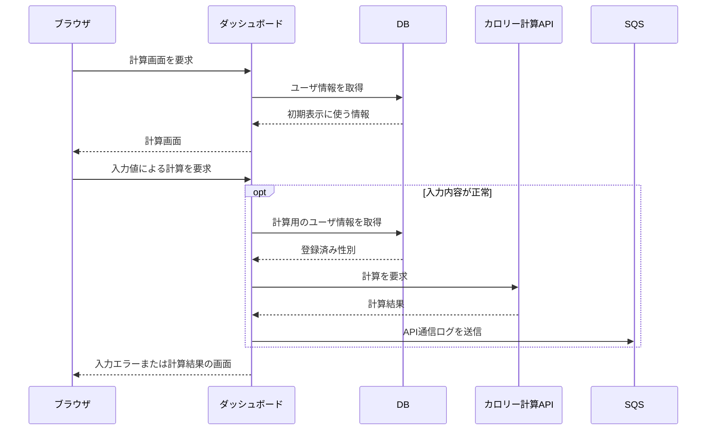
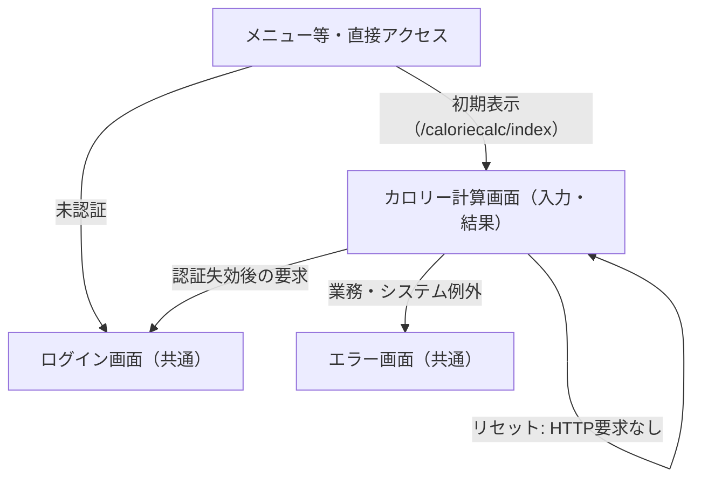
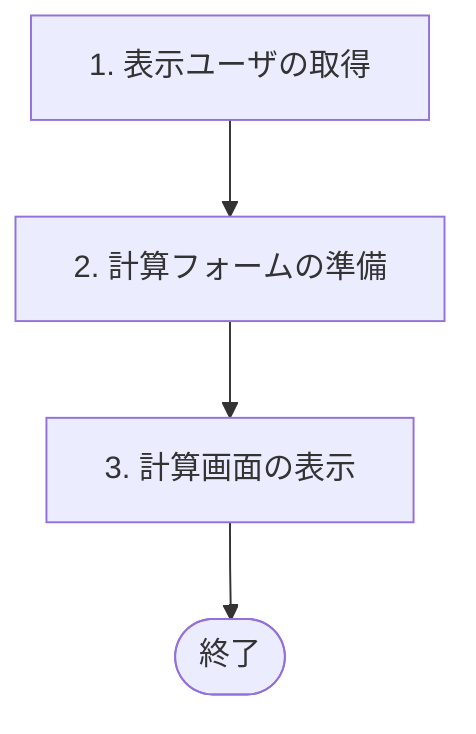
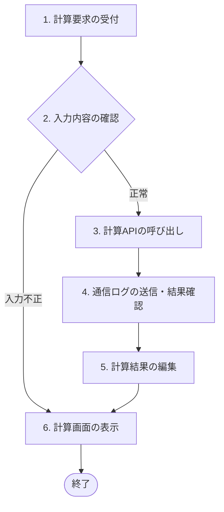

# 設計書 1.5. カロリー計算機能

## 1. 機能概要

- ログイン済みユーザの年齢・性別を初期表示し、年齢・身長・体重・生活活動代謝から基礎代謝量と1日の消費カロリーを計算する。
- 入力と結果を同じHTML画面に表示する。性別は登録情報の表示であり、計算時もユーザ情報から取得する。
- [CalorieCalcController](../../../ha-dashboard/src/main/java/jp/co/ha/dashboard/calorie/controller/CalorieCalcController.java)、[CalorieCalcForm](../../../ha-dashboard/src/main/java/jp/co/ha/dashboard/calorie/form/CalorieCalcForm.java)、[画面テンプレート](../../../ha-dashboard/src/main/resources/templates/caloriecalc/index.html)で画面を構成する。
- [CalorieApiComponent](../../../ha-business/src/main/java/jp/co/ha/business/component/CalorieApiComponent.java)は計算APIへ送る`weight`に身長を設定する。入力体重はフォームと結果DTOに保持されるが、現在の計算には使用されない。

## 2. 処理概要

### 2.1. 全体の処理概要



### 2.2. 画面一覧・画面遷移図

| 画面名 | ビュー・遷移先 | 表示契機 | 関連項番 | 備考 |
| --- | --- | --- | --- | --- |
| 計算画面 | `caloriecalc/index` | `GET /caloriecalc/index`、`POST /caloriecalc/index` | 3.1 | 入力・入力エラー・計算結果を同じ画面に表示する。 |
| ログイン画面（共通） | `/login` | 未認証・認証失効時 | 4.4 | Spring Securityによる遷移。本機能の個別画面仕様の対象外。 |
| エラー画面（共通） | `error/index` | 業務・システム例外時 | 5.1、5.2 | 例外ハンドラーが共通メッセージとコードを表示する。 |



## 3. 画面仕様

### 3.1. 計算画面

#### 3.1.1. 基本情報・表示条件

| 項目 | 内容 | 備考 |
| --- | --- | --- |
| 画面名・タイトル | カロリー計算画面 | ログイン済みユーザが使用する。認証・セッション条件は4.4。 |
| 初期表示URL | `GET /caloriecalc/index` | ユーザ検索とフォーム初期化を行い、計算APIは呼び出さない。 |
| 計算URL | `POST /caloriecalc/index` | 同じURLで入力チェックと計算を行い、同じビューを返す。 |
| ビュー・モデル | `caloriecalc/index`、`calorieCalcForm`、`calcResult`、`breadcrumbList` | [画面テンプレート](../../../ha-dashboard/src/main/resources/templates/caloriecalc/index.html)を使用する。 |
| 表示条件 | `calcResult`がない場合は入力部、ある場合は入力部と結果部 | 確認画面・完了画面への遷移はない。 |
| HTML応答 | `Content-Type: text/html` | ビュー処理で設定する。機能固有の応答ヘッダは設定しない。 |
| URLの前提 | スキーム・ホスト・ポート・コンテキストパスは実行環境に従う | 画面操作にパス変数やクエリ値は使用しない。 |

#### 3.1.2. レイアウト・画面項目

| 画面項目 | 入力・表示 | 表示条件 | 初期値 | 形式・条件 | 備考 |
| --- | --- | --- | --- | --- | --- |
| 画面見出し | 表示 | 常時 | カロリー計算 | カード上部の見出し | カード本文にエラー、入力、操作、結果の順で配置する。 |
| 入力エラー | 表示 | POST入力エラー時 | GETでは非表示 | `#fields.errors()`を`alert alert-danger`で列挙 | バインド済みフォームと`BindingResult`を使用する。 |
| 年齢 `age` | 入力・必須 | 常時 | 登録生年月日から算出 | テキスト、歳、0～150（両端含む）、`Integer`へバインド | プレースホルダー20、size=3。空欄送信は必須エラー。パラメータ自体の省略では初期化済み値が残り得る。 |
| 性別 `gender` | 表示 | 値0は男性、値1は女性 | `USER.GENDER_TYPE.toString()` | 文字表示。ラジオボタン・送信フィールドなし | フォームクラスは`String`。入力チェック注釈はなく、計算用の性別はDBの登録値を再取得する。 |
| 身長 `height` | 入力・必須 | 常時 | 未設定 | テキスト、cm、0～300（両端含む）、`BigDecimal`へバインド | プレースホルダー170.00、size=12。HTMLに`required`を設定する。小数桁数の上限注釈はない。 |
| 体重 `weight` | 入力・必須 | 常時 | 未設定 | テキスト、kg、0～300（両端含む）、`BigDecimal`へバインド | プレースホルダー50.00、size=12。HTMLに`required`を設定する。APIへはこの値ではなく身長を送る。 |
| 生活活動代謝 `lifeWorkMetabolism` | 入力・必須 | 常時 | 未設定 | テキスト、kcal、1～10000（両端含む）、整数・小数、`BigDecimal`へバインド | プレースホルダー消費カロリー。説明モーダルへのリンクを表示する。 |
| 計算・リセット | 操作 | 常時 | — | `submit`の「計 算」と`reset`の「リセット」 | 入力欄の下に並べる。リセットはHTTP要求を行わない。 |
| 入力進捗 | 表示 | 入力項目の`change`時 | 画面読込時の自動集計は行わない | 入力済み数÷4をMprogressへ設定 | 空欄かどうかを数える。入力妥当性の検査とは別の表示。 |
| 基礎代謝量 | 表示 | `calcResult`あり | GETでは非表示 | `calcResult.baseMetabolism()`＋kcal | 計算APIの`base_metabolism`。 |
| 生活活動代謝（結果） | 表示 | `calcResult`あり | GETでは非表示 | `calcResult.lifeWorkMetabolism()`＋kcal | フォーム入力値を結果DTOへ設定する。 |
| 1日の消費カロリー | 表示 | `calcResult`あり | GETでは非表示 | `calcResult.lostCaloriePerDay()`＋kcal | 計算APIの`lost_calorie_per_day`。 |
| 説明モーダル | 表示・開閉 | 説明リンクのクリック時 | 閉じた状態 | 生活活動代謝の説明、1日のカロリーの計算方法 | Bootstrapのモーダル。計算方法は基礎代謝量と生活活動代謝の合計。追加のサーバ要求はない。 |

#### 3.1.3. 初期表示

| 契機 | 表示内容 | 備考 |
| --- | --- | --- |
| GET初期表示 | `calorieCalcForm`に年齢・性別を設定し、身長・体重・生活活動代謝は未設定 | `breadcrumbList`も設定する。処理は5.1。 |
| POST入力エラー後 | バインド済みの入力値と`BindingResult`を表示 | `calcResult`を設定しない。初期化時のユーザ検索・年齢算出は入力チェック前に実行済み。 |
| POST計算成功後 | バインド済みの入力値と`calcResult`を表示 | [結果部](../../../ha-dashboard/src/main/resources/templates/caloriecalc/result.html)を同じ画面に組み込む。リダイレクトは行わない。 |

#### 3.1.4. 操作・イベント処理

| 操作 | HTTPメソッド・URL | 送信する業務項目 | サーバが採用・参照するデータ | 結果・遷移 | 関連処理 | 備考 |
| --- | --- | --- | --- | --- | --- | --- |
| 画面を開く | `GET /caloriecalc/index` | なし | セッション`seqUserId`、登録生年月日・性別 | 計算画面を初期表示 | 5.1 | 計算API・SQS送信を行わない。 |
| 計算 | `POST /caloriecalc/index` | `age`、`height`、`weight`、`lifeWorkMetabolism` | 年齢・身長・体重・生活活動代謝はフォーム、性別はDB、ユーザIDはセッション | 入力エラー・計算成功とも計算画面を再表示。例外は共通エラー画面 | 3.1.5、5.2 | `application/x-www-form-urlencoded`の標準フォーム送信。`enctype`未指定。登録性別はPOSTされた`gender`を使用しない。 |
| リセット | HTTP要求なし | なし | サーバ参照なし。ブラウザが現在のHTMLの入力初期値を使用 | 同じ計算画面内で入力値を戻す | 4.3 | HTMLの`type="reset"`。GETの再実行や結果部の削除は行わない。 |
| 入力値の変更 | HTTP要求なし | なし | サーバ参照なし。ブラウザが`age`、`height`、`weight`、`lifeWorkMetabolism`の空欄有無を参照 | Mprogressを更新 | 3.1.2 | 各項目の`change`で入力済み数を再集計する。 |
| 説明の表示・閉じる | HTTP要求なし | なし | サーバ参照なし。ブラウザが画面内の説明内容を使用 | モーダルを開閉 | 3.1.2 | Bootstrapのモーダルで処理する。 |

#### 3.1.5. 入力チェック・エラー表示

| 対象・処理 | チェック内容 | 異常時の扱い・メッセージ | 備考 |
| --- | --- | --- | --- |
| `age`必須 | nullでないこと | `年齢が未入力です` | `@Required`。 |
| `age`形式 | 半角数字 | `年齢は半角数字で入力して下さい` | `@Pattern(HALF_NUMBER)`。Integerへバインドした値を文字列化して検査する。 |
| `age`範囲 | 0以上150以下 | `年齢は0~150で入力してください` | `@Decimal`。 |
| `height`必須・範囲 | nullでなく0以上300以下 | `身長が未入力です`／`身長は0~300で入力してください` | 0も画面側検証を通る。API側は正数を要求する。小数桁数の上限注釈はない。 |
| `weight`必須・範囲 | nullでなく0以上300以下 | `体重が未入力です`／`体重は0~300で入力してください` | 体重0も画面側検証を通る。APIに送られる値は身長。小数桁数の上限注釈はない。 |
| `lifeWorkMetabolism`必須 | nullでないこと | `生活活動代謝が未入力です` | `@Required`。 |
| `lifeWorkMetabolism`形式 | 数値の文字列表現が`RegexType.DECIMAL`に適合すること | `生活活動代謝は数字で入力して下さい` | BigDecimalへバインド後に検査する。 |
| `lifeWorkMetabolism`範囲 | 1以上10000以下 | `生活活動代謝は1~10000で入力してください` | `@Decimal`。 |
| 数値の型変換 | 年齢をInteger、他の入力値をBigDecimalへ変換できること | 型変換のバインドエラーとして同画面表示 | 型変換用の独自固定メッセージは定義しない。 |
| `gender` | 機能固有の入力チェックなし | — | HTMLに送信フィールドはなく、計算時は登録値を使用する。 |
| 入力エラー後 | `BindingResult.hasErrors()` | 計算API・ログ送信を行わず入力画面を返す | `@ModelAttribute`によるユーザ検索と年齢算出は入力チェックより前に実行済み。 |

| 条件 | 表示・遷移 | 備考 |
| --- | --- | --- |
| 入力チェック・型変換エラー | 同じ計算画面の入力エラー欄へ表示 | 入力値はバインド結果を表示する。個別メッセージは上表。 |
| ユーザ検索・フォーム初期化時の例外 | `error/index`へ進む | `CE0001`・`CE0002`等の発生条件は5.1。 |
| API・SQS処理時の例外 | `error/index`へ進む | `BE0033`・`CE0041`等の発生条件は5.2。 |
| 共通エラー表示 | `errorMessage`にコード対応の共通メッセージとコードを設定 | 例外の詳細をそのまま画面へ表示しない。ハンドラー自身はHTTPステータスを設定しない。 |

## 4. 画面間のデータ管理・共通制御

### 4.1. 引き継ぐデータと保持方法

| データ | 保持場所・方法 | 備考 |
| --- | --- | --- |
| 入力フォーム | 要求モデル`calorieCalcForm` | 同じ要求の入力・エラー・結果表示へ渡す。セッションには保存しない。 |
| 計算結果 | 要求モデル`calcResult` | 正常POST時のみ設定し、結果部の表示条件にする。次の要求へ保持しない。 |
| パンくず | 要求モデル`breadcrumbList` | ビュー取得時に設定する。 |
| ログインユーザID | セッション`seqUserId`（Long） | フォーム初期化と正常POSTで読み取る。機能内で追加・更新・削除しない。 |
| static共有状態 | フォーム・計算結果を保持する機能固有のstaticフィールドなし | 画面間・ユーザ間でフォームや結果を共有しない。 |

### 4.2. データの生成・参照・更新・破棄

| 契機・対象 | 生成・参照・更新・破棄 | 備考 |
| --- | --- | --- |
| フォーム生成 | GET・POSTとも`@ModelAttribute`で新規作成 | ユーザ検索後、年齢・性別を設定する。POSTはその後に入力値をバインドする。 |
| ユーザ参照 | GET・入力エラーPOSTは1回、正常POSTは2回 | 初期化と計算用性別取得で同じ主キーを検索する。SQLは5.1。 |
| 結果生成 | 入力正常POSTでAPI応答を受け、SQS送信後に`calcResult`を作成 | 元の入力値とAPIの計算値を使用する。永続化は行わない。 |
| 要求終了 | 要求モデルのフォーム・結果・パンくずを次の要求へ保存しない | フォーム・計算結果の明示的なセッション削除処理はない。 |
| キャッシュ | ユーザ情報・計算結果を機能内でキャッシュしない | 各要求の必要な時点で再取得・再計算する。 |

### 4.3. 戻る・再読込・直接アクセス時の動作

| 操作・状況 | 動作 | 備考 |
| --- | --- | --- |
| ブラウザの戻る | ブラウザが保持する画面や入力値の復元に従う | 機能側で以前の入力・結果をセッションから復元する処理はない。再要求された場合はそのHTTPメソッドに従う。 |
| GET再読込・直接アクセス | ユーザを再検索して年齢・性別を初期設定 | 身長・体重・生活活動代謝は未設定となり、計算結果は引き継がない。 |
| POST後の再読込・同じPOSTの再送 | 再送されればフォーム初期化・入力チェック・計算を再実行 | PRGは行わない。正常入力なら計算APIと通信ログSQS送信も再実行する。 |
| POST直接アクセス | 認証済みで正常入力なら計算処理を実行 | 事前GETや専用トークンを必須とする制御はない。セッション・入力条件は4.4、3.1.5。 |
| リセット | 現在表示中のHTMLの初期値へ戻す | HTTP要求なし。計算成功後はその応答HTMLの入力初期値へ戻り、結果部は残る。 |

### 4.4. 認証・セッション切れ・多重送信制御

| 項目・条件 | 制御 | 備考 |
| --- | --- | --- |
| 認証 | Spring Securityの`authenticated()`を要求 | [DashboardConfig](../../../ha-dashboard/src/main/java/jp/co/ha/dashboard/config/DashboardConfig.java)。認証済み要求のみ処理する。 |
| Cookie | 通常は`JSESSIONID`を含むセッションCookieを送信 | ブラウザの通常の画面操作で送る。Spring Securityが認証状態を検査する。 |
| 未認証・セッション切れ | `/login`へリダイレクト | `Location`ヘッダはSpring Securityが設定する。機能固有の入力復元は行わない。 |
| `seqUserId`欠落・型不正 | 個別補完せず例外として共通エラー画面へ進む | セッションからLongとして取り出し、Optionalの`get()`を使用する。 |
| CSRF・多重送信トークン | CSRFは無効、多重送信トークン注釈なし | フォームに必須のトークン項目はない。同じ要求の再送を機能固有のトークンで抑止しない。 |

## 5. サーバ処理詳細

### 5.1. 初期表示処理



| 処理順 | 処理概要 | 処理詳細 | 関連項番 |
| --- | --- | --- | --- |
| 1 | 表示ユーザの取得 | 認証・セッションのユーザIDを確認して有効なユーザ情報を取得する。セッション不在・該当なしなどの例外は共通エラー処理へ進む。 | 4.4、5.1.1 |
| 2 | 計算フォームの準備 | 登録生年月日から年齢、登録済み性別から表示値を設定する。 | 5.1.2 |
| 3 | 計算画面の表示 | 初期状態の計算画面を表示する。計算APIの呼び出しや通信ログ送信は行わない。 | 3.1.2、3.1.3 |

#### 5.1.1. ユーザ検索

```sql
SELECT
    SEQ_USER_ID
    , PASSWORD
    , MAIL_ADDRESS
    , DELETE_FLAG
    , PASSWORD_EXPIRE
    , REMARKS
    , API_KEY
    , REG_DATE
    , UPDATE_DATE
    , GENDER_TYPE
    , BIRTH_DATE
FROM
    USER
WHERE
    SEQ_USER_ID = :seqUserId
    AND DELETE_FLAG = false;
```

| 項目 | 設定値 | 備考 |
| --- | --- | --- |
| `:seqUserId` | セッションのseqUserId | [UserSearchServiceImpl](../../../ha-business/src/main/java/jp/co/ha/business/db/crud/read/impl/UserSearchServiceImpl.java)から[UserMapper](../../../ha-db/src/main/resources/jp/co/ha/db/mapper/UserMapper.xml)の条件付きselectByExampleへ渡す。 |

#### 5.1.2. フォーム初期化

| 処理 | 設定内容 | 異常時の扱い | 備考 |
| --- | --- | --- | --- |
| 年齢初期値 | `Period.between(BIRTH_DATE, システム日付).getYears()` | 生年月日が未来なら`BusinessException(CE0001)`、エラー画面へ | [UserComponent](../../../ha-business/src/main/java/jp/co/ha/business/component/UserComponent.java)の`getAge`。メッセージは`実行時にエラーが発生しました(CE0001)`。 |
| 性別表示 | `USER.GENDER_TYPE.toString()` | 未設定等の予期しない例外は共通処理へ | 0は男性、1は女性。ラジオボタンは設けない。 |

| 処理・条件 | 内容 | 備考 |
| --- | --- | --- |
| ユーザ検索の呼出し | GET・入力エラーPOSTは1回、入力正常POSTは2回検索する | フォーム初期化と計算用性別取得で同じユーザIDと`DELETE_FLAG = false`を指定する。検索は読み取り専用トランザクション。 |
| 有効なユーザが該当なし（削除済みを含む） | Optional.get()で例外となり、共通メッセージCE0002をerror/indexへ表示する | 個別の不存在メッセージはない。 |
| ユーザ検索のDB例外 | 呼出し元から共通例外ハンドラーへ伝播する | 検索失敗を入力エラーへ変換しない。 |
| 画面要求のDB反映 | ユーザ等の更新や通信情報テーブルへの直接CRUDは行わない | トランザクションIDはUUID、通信ログはSQSへ送信する。 |

### 5.2. 計算処理



| 処理順 | 処理概要 | 処理詳細 | 関連項番 |
| --- | --- | --- | --- |
| 1 | 計算要求の受付 | 認証ユーザの情報でフォームを初期化し、要求値をバインドする。 | 4.4、5.1.1、5.1.2 |
| 2 | 入力内容の確認 | 入力項目を検証する。正常なら処理3、不正なら計算APIを呼ばず処理6へ進む。 | 3.1.5 |
| 3 | 計算APIの呼び出し | ユーザを再取得し、入力値と登録済み性別を使ってカロリー計算APIを呼び出す。要求値の編集は5.2.2に従う。 | 5.2.1、5.2.2 |
| 4 | 通信ログの送信・結果確認 | API成否を判定する前に通信ログをSQSへ送信する。送信失敗は共通エラー処理へ進み、API失敗はBE0033として終了する。 | 5.2.2 |
| 5 | 計算結果の編集 | 入力値とAPIの計算値を画面表示用の結果に設定する。 | 3.1.2、5.2.2 |
| 6 | 計算画面の表示 | 同じ画面へ入力エラーまたは計算結果を表示する。例外時は共通エラー画面へ進む。 | 3.1.2、3.1.3、4.4 |

#### 5.2.1. 入力チェック・ユーザ再検索・計算パラメータ作成

| 処理 | 内容 | 備考 |
| --- | --- | --- |
| バインド・入力チェック | 3.1.5に従う | エラー時は計算APIとログSQS送信を行わない。初期化時のDB検索・年齢算出は実行済み。 |
| ユーザ検索 | 5.1.1のユーザ主キー検索SQLを使用 | 初期化時1回に加え、入力正常時にセッションの`seqUserId`で再実行する。`DELETE_FLAG = false`の有効なユーザだけを取得する。 |
| 検索結果なし・DB例外 | 5.1.1と同じ例外処理 | 検索結果のOptionalを`get()`で取得する。個別の入力エラーへ変換しない。 |

| 処理 | 設定内容 | 異常時の扱い | 備考 |
| --- | --- | --- | --- |
| 計算パラメータ | `CalorieCalcParam(age, 登録性別, height, weight, lifeWorkMetabolism)` | 登録性別変換失敗等は共通処理へ | POSTされた`gender`の有無や値を計算用性別に使用しない。 |

#### 5.2.2. 計算API・API通信ログ

| 項目 | IF・処理内容 | 備考 |
| --- | --- | --- |
| HTTPメソッド・URL | `GET {healthinfo.node.api.url}calorie` | 接続先は`HealthInfoProperties`から取得する。API認証トークン発行は行わず、`X-NODE-TOKEN`も設定しない。 |
| 要求ヘッダ | `Accept: application/json`、`Accept-Charset: UTF-8` | [BaseApi](../../../ha-common/src/main/java/jp/co/ha/common/web/api/BaseApi.java)のGET送信。JSON要求ボディ・`Content-Type`の明示設定はない。 |
| `gender`クエリ | 登録性別の列挙値`0`／`1` | `BaseEnum.getValue()`で文字列化する。 |
| `age`クエリ | フォーム年齢 | — |
| `height`クエリ | フォーム身長 | — |
| `weight`クエリ | フォーム身長 | 現在は`request.setWeight(param.height())`。入力体重ではない。 |
| `life_work_metabolism`クエリ | フォーム生活活動代謝 | `BigDecimal.toString()`で文字列化する。 |
| API正常応答 | `result=0`、`calorie_calc_result.base_metabolism`、`calorie_calc_result.lost_calorie_per_day`、`user_data` | [計算処理](../../../ha-calc-api/lambda/calorie.py)は数値を返す。画面用DTOにはAPIの`user_data`ではなく元のパラメータを設定する。 |
| 男性の基礎代謝量 | `floor3(floor3(13.397×weight) + floor3(4.799×height) - floor3(5.677×age) + 88.362)` | `floor3(x)=floor(x×1000)/1000`。`weight`はAPIへ送られた身長の値。 |
| 女性の基礎代謝量 | `floor3(floor3(9.247×weight) + floor3(3.098×height) - floor3(4.33×age) + 447.593)` | 各積と最終結果を小数第3位まで負の無限大方向へ丸める。 |
| 1日の消費カロリー | `floor3(基礎代謝量 + life_work_metabolism)` | 生活活動代謝は係数ではなく加算するkcal値。 |
| 通信ログ | UUIDのtransactionId、API名、GET、クエリ付きURL、送受信日時、HTTPステータス、detail | [ApiLogComponent](../../../ha-business/src/main/java/jp/co/ha/business/component/ApiLogComponent.java)でPayloadを作り、`aws.sqs.queue.api_log`へ送信する。GETのbodyはnull。UUIDをSQSのmessageGroupId、別UUIDを重複排除IDに使用する。 |
| 処理順序 | API呼出し→ログSQS送信→result判定→結果DTO作成 | 正常・失敗レスポンスともSQS送信後に成否を判定する。 |

| 発生箇所・条件 | 異常時の処理 | 備考 |
| --- | --- | --- |
| APIの入力不正 | APIはHTTP400、`result=1`、項目別の`Invalid parameters...`を返す | 性別0/1、年齢0以上、身長・体重・生活活動代謝が正数であることを検証する。HTTP400はJava側の基底APIで通信失敗扱いになる。 |
| HTTP4xx・5xx、通信・応答変換例外 | BaseApiが捕捉し`result=FAILURE`、`detail=Node API:カロリー計算APIに失敗しました. 通信エラーです.`を設定する | HTTP例外では実HTTPステータス・レスポンス受信日時をconnectInfoに保存しないため、ログPayloadの値もnullになり得る。 |
| SQS送信・シリアライズ失敗 | `SystemException(CE0041)`でエラー画面へ | 表示は`SQSへキューの登録に失敗しました(CE0041)`。API成功でも画面に結果を返さず、result判定まで進まない。 |
| APIの`result`がSUCCESS以外 | `ApiException(BE0033, response.detail)`でエラー画面へ | 表示は`カロリー計算APIの通信に失敗しました(BE0033)`。詳細はログ用で、そのまま画面へ表示しない。 |
| 成功応答に計算結果がない等 | 後続の取得処理で例外となり共通ハンドラーへ | `calorie_calc_result`に対する独自のnull検証はない。 |
