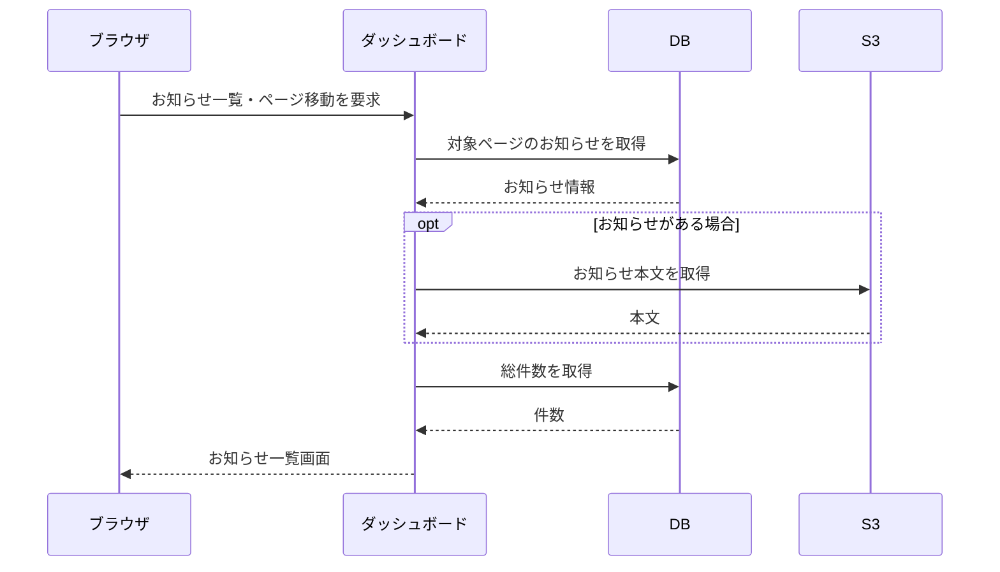
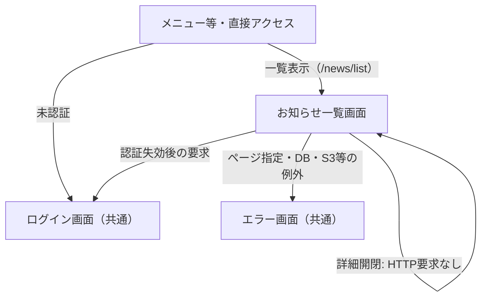
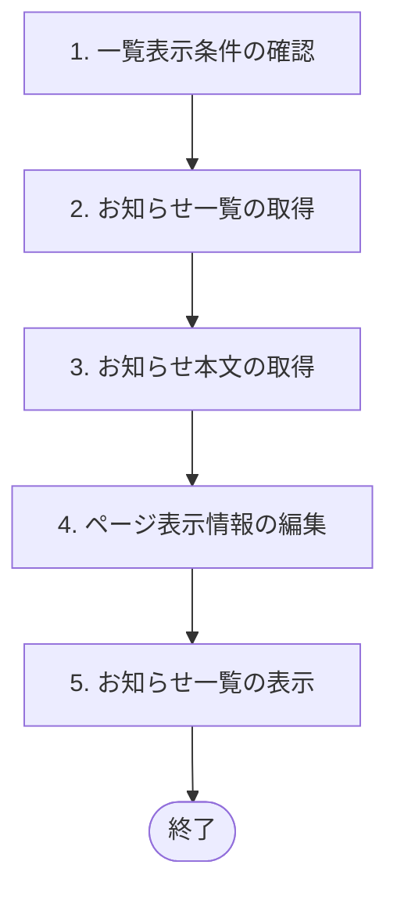

# 設計書 1.6. お知らせ一覧機能

## 1. 機能概要

- ログイン済みユーザに、削除されていないお知らせをお知らせ情報IDの降順でページ表示する。
- DBから対象ページのS3キーを取得し、各キーのお知らせJSONをS3から読み込む。タグ、日付、タイトルと開閉可能な詳細を表示する。
- [NewsController](../../../ha-dashboard/src/main/java/jp/co/ha/dashboard/news/controller/NewsController.java)、[NewsComponent](../../../ha-business/src/main/java/jp/co/ha/business/component/NewsComponent.java)、[画面テンプレート](../../../ha-dashboard/src/main/resources/templates/news/list.html)で構成する。

## 2. 処理概要

### 2.1. 全体の処理概要



### 2.2. 画面一覧・画面遷移図

| 画面名 | ビュー・遷移先 | 表示契機 | 関連項番 | 備考 |
| --- | --- | --- | --- | --- |
| 一覧画面 | `news/list` | `GET /news/list` | 3.1 | ページ移動も同じ画面。お知らせ詳細は画面内で開閉する。 |
| ログイン画面（共通） | `/login` | 未認証・認証失効時 | 4.4 | Spring Securityによる遷移。本機能の個別画面仕様の対象外。 |
| エラー画面（共通） | `error/index` | ページ指定・DB・S3等の例外時 | 5.1 | 共通例外処理でメッセージとコードを表示する。 |



## 3. 画面仕様

### 3.1. 一覧画面

#### 3.1.1. 基本情報・表示条件

| 項目 | 内容 | 備考 |
| --- | --- | --- |
| 画面名・タイトル | お知らせ一覧画面・お知らせ画面 | ログイン済みユーザが使用する。認証条件は4.4。 |
| URL・HTTPメソッド | `GET /news/list` | 初期表示・ページ移動とも同じアクションを実行する。 |
| 表示ページ | `?page={0始まりのページ番号}` | 未指定・空文字は0。画面操作にパス変数は使用しない。 |
| ビュー・モデル | `news/list`、`newsList`、`paging`、`breadcrumbList` | [画面テンプレート](../../../ha-dashboard/src/main/resources/templates/news/list.html)で表示する。 |
| 正常応答 | HTTP200のHTML、`Content-Type: text/html` | ビュー処理で設定する。機能固有の応答ヘッダは設定しない。 |
| URLの前提 | スキーム・ホスト・ポート・コンテキストパスは実行環境に従う | 詳細の開閉にはサーバ要求を行わない。 |

#### 3.1.2. レイアウト・画面項目

| 画面項目 | 入力・表示 | 表示条件 | 初期値 | 形式・条件 | 備考 |
| --- | --- | --- | --- | --- | --- |
| 画面見出し | 表示 | 常時 | お知らせ一覧 | カード上部の見出し | カード本文に一覧テーブル、件数、ページリンクの順で配置する。 |
| お知らせ一覧 | 表示 | 取得件数分 | 対象ページの`newsList` | お知らせ情報IDの降順 | DBで抽出した順でS3 JSONを読み込み、リストへ追加する。JSONの日付では再ソートしない。 |
| タグ | 表示 | `news.tag.color`がblue／red／yellow | `news.tag.name` | 青／赤／黄のバッジ、`th:text` | 他の色はバッジを表示しない。 |
| 日付・タイトル | 表示・開閉操作 | 各お知らせ | `news.date + '　' + news.title` | `th:text`による文字表示 | 日付はJSONの文字列をそのまま使い、画面側で日付変換しない。 |
| 詳細 | 表示 | 日付・タイトルのリンクで展開した場合 | Bootstrapの`collapse`で非表示 | `news.detail`を`th:utext`でHTML表示 | ブラウザ内で開閉する。HTMLタグを文字列へエスケープしない。 |
| 詳細領域ID | 表示制御 | 各お知らせ | `newsId{news.seqNewsInfoId}` | リンク先・詳細領域ID・`aria-controls`に使用 | DB行のIDではなくJSONのIDから生成する。 |
| 件数 | 表示 | 常時 | `paging`の件数範囲 | `{totalRecordNum}件中 {fromRecordNum}～{toRecordNum}件表示` | 0件・範囲外ページでは0～0件表示。総件数は別のDB検索結果。 |
| ページリンク | 操作 | 常時 | `paging`の移動可否・URL | 先頭`<<`、前`<`、次`>`、最後`>>` | `/news/list?page={番号}`。移動不可時は`disabled`クラスを付加するが、`href`自体は残す。 |
| ページ番号 `page` | リンク・URLで指定 | ページリンク選択・直接アクセス時 | 0 | 0始まりの整数を文字列で受信 | 入力欄・フォーム送信は設けない。変換・上限等の扱いは3.1.5。 |

#### 3.1.3. 初期表示

| 項目 | 初期表示内容 | 備考 |
| --- | --- | --- |
| 要求ページ決定 | `@RequestParam(defaultValue="0")`で未指定・空文字の`page`に0を設定 | ページ指定がある場合はその値で5.1を実行する。 |
| 一覧・ページ情報 | 対象ページの`newsList`と`paging`を取得・モデル設定 | 0件でも正常な空一覧と件数0～0を表示する。 |
| パンくず | `breadcrumbList`をモデル設定 | ビュー取得時に設定する。 |
| 詳細 | 各お知らせの詳細は折りたたんだ状態 | 前の要求で開いていた状態をサーバで引き継がない。 |

#### 3.1.4. 操作・イベント処理

| 操作 | HTTPメソッド・URL | 送信する業務項目 | サーバが採用・参照するデータ | 結果・遷移 | 関連処理 | 備考 |
| --- | --- | --- | --- | --- | --- | --- |
| 一覧を開く | `GET /news/list` | なし。任意に`page`を指定可能 | ページ番号、`system.paging`、未削除NEWS_INFO、各S3 JSON | 一覧画面を表示 | 5.1 | 未指定・空文字のページ番号は0。 |
| 先頭・前・次・最後 | `GET /news/list?page={番号}` | `page` | リンク先のページ番号と設定表示件数で対象を再取得 | 同じ一覧画面の対象ページを表示 | 5.1 | `disabled`時も`href`自体は残る。番号と移動条件は5.1.4。 |
| 日付・タイトルのクリック | HTTP要求なし | なし | サーバ参照なし。ブラウザが画面内のJSON由来IDと詳細HTMLを使用 | 同じ一覧画面で詳細を開閉 | 3.1.2 | Bootstrapの`collapse`。閲覧履歴・開閉状態をDBやセッションへ保存しない。 |

#### 3.1.5. 入力チェック・エラー表示

| 対象・処理 | チェック内容 | 異常時の扱い | 備考 |
| --- | --- | --- | --- |
| `page`省略・空文字 | デフォルト値0を使用 | — | コントローラの`@RequestParam`で指定する。 |
| `page`数値変換 | `Integer.parseInt`で変換できること | `NumberFormatException`を共通例外ハンドラーへ渡す | 非数値・int範囲超過をフォームエラー表示へ変換する独自処理はない。通常は`予期せぬエラーが発生しました(CE0002)`のエラー画面。 |
| `page`最小値 | `PageRequest.of`で0以上 | 負数は`IllegalArgumentException`を共通処理へ渡す | 0へ補正しない。 |
| `page`最大値 | 機能固有の最終ページ上限検査なし | 総ページ数を超える正数も検索する | 対象データなしの場合は空一覧・0～0件表示。要求ページ自体は補正しない。 |
| 表示件数設定 | `system.paging`を整数へ変換し、1以上であること | 非数値・0以下は例外として共通処理へ | 画面入力ではない。設定値がnullの場合のみFactoryは10を使用する。 |

| 条件 | 表示・遷移 | 備考 |
| --- | --- | --- |
| ページ指定・設定値の例外 | `error/index`へ進む | フォームエラーとして同画面へ表示する独自処理はない。 |
| DB・S3・JSON等の例外 | `error/index`へ進む | 発生条件とコードは5.1.1～5.1.3。JSON読込失敗ではnullが一覧に追加され、表示時に失敗し得る。 |
| 共通エラー表示 | `errorMessage`にコード対応の共通メッセージとコードを設定 | ハンドラー自身はHTTPステータスを設定しない。 |

## 4. 画面間のデータ管理・共通制御

### 4.1. 引き継ぐデータと保持方法

| データ | 保持場所・方法 | 備考 |
| --- | --- | --- |
| ページ番号 | GETクエリ`page` | リンク先URLで引き継ぐ。セッションへ保存しない。 |
| 一覧・ページ情報・パンくず | 要求モデル`newsList`、`paging`、`breadcrumbList` | 同じ要求のHTML表示に使用する。次の要求へモデルを保存しない。 |
| 詳細開閉状態 | ブラウザ内のDOM・Bootstrapの状態 | セッション・DBへ保存しない。 |
| 認証状態 | Spring Securityのセッション | コントローラで個別のセッション値を読み書きしない。 |
| static共有オブジェクト | `NewsComponent.JSON_READER`の`static final JsonReader` | JSON変換に使用する共通オブジェクト。ページ番号やユーザ別の一覧を保持しない。 |

### 4.2. データの生成・参照・更新・破棄

| 契機・対象 | 生成・参照・更新・破棄 | 備考 |
| --- | --- | --- |
| ページ要求 | `page`と`system.paging`から要求ローカルの`Pageable`を生成 | `PagingViewFactory`のstaticメソッドを使用する。入力条件は3.1.5。 |
| 一覧生成 | 要求ごとにDB行を取得し、各S3 JSONから新しい`newsList`を生成 | S3ストリームは各件の読込後に閉じる。JSON変換失敗のnullも追加する。 |
| ページ表示情報生成 | S3読込後に未削除総件数を検索し、`paging`を生成 | 一覧取得と件数取得をまとめるトランザクションは設けない。 |
| 要求終了・更新 | 要求の一覧・ページ情報をセッションやDBへ保存しない | DB更新はなく、閲覧履歴も保存しない。 |
| キャッシュ | 機能固有の一覧・S3 JSONキャッシュなし | 各GET要求で対象DB行、各S3 JSON、総件数を取得する。 |

### 4.3. 戻る・再読込・直接アクセス時の動作

| 操作・状況 | 動作 | 備考 |
| --- | --- | --- |
| ブラウザの戻る | ブラウザの履歴・画面復元に従う | サーバでページ番号や詳細開閉状態を復元しない。再要求時はURLのページ番号でGETを実行する。 |
| 再読込 | 同じURLのGETで対象ページを再取得 | DB行・S3 JSON・総件数を再取得し、サーバが返す詳細は折りたたんだ状態。 |
| ページ指定の直接アクセス | 指定ページで5.1を実行 | 範囲外の正数は空一覧・0～0件表示。要求ページ自体を補正しない。 |
| ページ指定なし・空文字 | 先頭ページ0を表示 | 事前の一覧表示やページ移動を必須とする制御はない。 |

### 4.4. 認証・セッション切れ・多重送信制御

| 項目・条件 | 制御 | 備考 |
| --- | --- | --- |
| 認証 | Spring Securityの`authenticated()`を要求 | [DashboardConfig](../../../ha-dashboard/src/main/java/jp/co/ha/dashboard/config/DashboardConfig.java)。 |
| Cookie | 通常は`JSESSIONID`を含むセッションCookieを送信 | Spring Securityが認証状態を検査する。 |
| 未認証・セッション切れ | `/login`へリダイレクト | `Location`ヘッダはSpring Securityが設定する。機能側のページ・開閉状態の復元はない。 |
| 機能固有セッション | コントローラで個別の値を読み書きしない | ページ番号・お知らせ・詳細開閉状態はセッションに保存しない。 |
| 多重送信 | 参照用GETを実行し、機能固有の多重送信トークンは使用しない | 再要求ごとに一覧を取得する。DB更新は行わない。 |

## 5. サーバ処理詳細

### 5.1. 初期表示・一覧ページング処理



| 処理順 | 処理概要 | 処理詳細 | 関連項番 |
| --- | --- | --- | --- |
| 1 | 一覧表示条件の確認 | ページ番号と設定された表示件数を確認する。不正値や認証・セッションの異常は共通エラー処理へ進む。 | 3.1.5、4.4、5.1.4 |
| 2 | お知らせ一覧の取得 | 削除されていないお知らせを対象ページ分取得する。0件なら本文取得を省略する。 | 5.1.1 |
| 3 | お知らせ本文の取得 | 対象のお知らせごとにS3から本文を読み込む。取得・変換時の失敗と後続表示への影響は5.1.2に従う。 | 5.1.2 |
| 4 | ページ表示情報の編集 | 未削除の総件数を取得し、一覧とページングを編集する。 | 5.1.3、5.1.4 |
| 5 | お知らせ一覧の表示 | 詳細を折りたたんだ一覧を表示する。ページ移動は同じ処理を再実行し、本文の開閉は画面内で行う。 | 3.1.2、3.1.4 |

#### 5.1.1. 対象ページのお知らせ検索

```sql
SELECT
    SEQ_NEWS_INFO_ID
    , S3_KEY
    , DELETE_FLAG
    , REG_DATE
    , UPDATE_DATE
FROM
    NEWS_INFO
WHERE
    DELETE_FLAG = false
ORDER BY
    SEQ_NEWS_INFO_ID DESC
LIMIT
    :offset
    , :pageSize;
```

| 項目 | 設定値 | 備考 |
| --- | --- | --- |
| `:offset` | pageable.offset＝ページ番号×表示件数 | [NewsInfoSearchServiceImpl](../../../ha-business/src/main/java/jp/co/ha/business/db/crud/read/impl/NewsInfoSearchServiceImpl.java)から[NewsInfoMapper](../../../ha-db/src/main/resources/jp/co/ha/db/mapper/NewsInfoMapper.xml)へ渡すMyBatisのバインド値。 |
| `:pageSize` | pageable.pageSize | system.pagingの値。local・devの設定は10。 |

#### 5.1.2. S3お知らせJSONの取得・表示データ生成

| 項目 | IF・処理内容 | 備考 |
| --- | --- | --- |
| バケット | 設定`aws.s3.backet` | localは`healthinfo-app-local`、devは`healthinfo-app-dev`。接続先は実行環境の設定に従う。 |
| キー | 検索した`NEWS_INFO.S3_KEY` | 取得時にファイル名を組み立てない。お知らせ登録処理の生成形式は`news/{yyyyMMddHHmmss}.json`。 |
| 取得方法 | [AwsS3Component](../../../ha-common/src/main/java/jp/co/ha/common/aws/AwsS3Component.java)の`getS3ObjectByKey` | ページ内の件数分を順番に読み込む。取得ストリームは各件の読込後に閉じる。 |
| データ形式 | UTF-8のJSONオブジェクト | [NewsDto](../../../ha-business/src/main/java/jp/co/ha/business/dto/NewsDto.java)へ変換する。未知のプロパティは無視する。 |
| 項目チェック | DTOに必須・桁数・日付書式の検証注釈なし | JSON内容とDB主キーの一致検証もない。読込後に表示データの完全性を検査しない。 |

```json
{
  "seq_news_info_id": 1,
  "title": "お知らせタイトル",
  "date": "2026/11/14",
  "detail": "<p>お知らせ詳細</p>",
  "tag": {
    "color": "blue",
    "name": "リリース情報"
  }
}
```

| JSON項目 | 型 | 設定内容 | 備考 |
| --- | --- | --- | --- |
| `seq_news_info_id` | `Long` | お知らせ情報ID | 詳細領域のHTML IDに使用する。 |
| `title` | `String` | タイトル | `th:text`で日付と結合して表示する。 |
| `date` | `String` | お知らせ日付 | `yyyy/MM/dd`形式の表示値を想定するが、読込時に書式検証しない。 |
| `detail` | `String` | 詳細HTML | `th:utext`で出力する。HTMLタグを文字列へエスケープしない。 |
| `tag` | オブジェクト | タグ情報 | テンプレートが`tag.color`と`tag.name`を参照する。 |
| `tag.color` | `String` | `blue`／`red`／`yellow` | 他の値はバッジを表示しない。列挙による入力検証はない。 |
| `tag.name` | `String` | タグ表示名 | `th:text`で表示する。 |

| 発生箇所・条件 | 異常時の処理 | 備考 |
| --- | --- | --- |
| S3クライアント作成失敗 | `CE0029`の接続例外を共通処理へ渡す | エラー画面へ進み、後続件の取得は行わない。 |
| オブジェクト取得失敗 | `SystemException(AWS_S3_DOWNLOAD_ERROR / CE0027)` | 表示は`S3からのダウンロード処理が失敗しました(CE0027)`。一部取得済みの一覧を正常応答として返さない。 |
| JSON構文・マッピング失敗 | [JsonReader](../../../ha-common/src/main/java/jp/co/ha/common/io/file/json/reader/JsonReader.java)が該当例外をログ出力しnullを返す | `NewsComponent`はnullもリストへ追加する。代替データへの置換や該当行の除外はなく、テンプレート参照時に失敗し得る。 |
| ストリームのclose等でIOException | `SystemRuntimeException`へ変換 | 共通エラー画面へ進む。コードは`CE0002`。 |
| JSON項目不足等による表示例外 | 共通のビュー・例外処理へ伝播 | 欠落項目への個別メッセージやS3再取得はない。 |

| 処理・条件 | 内容 | 備考 |
| --- | --- | --- |
| 検索結果の利用 | DBにはお知らせ本文がないため、取得行ごとにS3_KEYでS3から本文を取得する | 5.1.1の検索は読み取り専用トランザクション。0件は空リストとして扱う。 |
| 一覧検索のDB例外 | 共通例外ハンドラーへ伝播し、S3読込・件数検索・正常一覧表示を中断する | 検索失敗を空一覧に置き換えない。 |

#### 5.1.3. 未削除お知らせの総件数取得

```sql
SELECT
    COUNT(*)
FROM
    NEWS_INFO
WHERE
    DELETE_FLAG = false;
```


#### 5.1.4. ページ要求・ページング表示情報生成

| 項目 | 設定内容 | 備考 |
| --- | --- | --- |
| Factory | [PagingViewFactory](../../../ha-common/src/main/java/jp/co/ha/common/util/PagingViewFactory.java) | `getPageable`でページ要求、`getPageView`で表示情報を作る。 |
| 総ページ数 | `count / pageSize`に余りがあれば1加算 | 最終ページ番号は`max(総ページ数-1, 0)`。 |
| 先頭・前の移動可否 | `count > 0 && currentPage > 0` | 前のリンク先は`min(currentPage-1, 最終ページ番号)`。移動不可時の番号は0。 |
| 次・最後の移動可否 | `currentPage < 最終ページ番号` | 次のリンク先は移動可能なら`currentPage+1`、それ以外は最終ページ番号。 |
| リンク | `/news/list?page={番号}` | 先頭は0、最後は最終ページ番号。範囲外ページから前へ戻る場合は実在ページを指す。 |
| 表示範囲 | offsetが総件数未満なら`offset+1`～`offset+min(pageSize, count-offset)` | 0件または範囲外なら0～0。要求ページ番号を補正して一覧を再検索する処理はない。 |

| 処理 | 内容 | 備考 |
| --- | --- | --- |
| ページ要求生成 | `Integer.parseInt(page)`と`Integer.parseInt(system.paging)`から`PageRequest.of`を生成 | 未指定・空文字の`page`はコントローラで0。Factory単体ではpageがnullなら0、設定表示件数がnullなら10を使用する。 |
| ページ番号・表示件数の不正 | 3.1.5の例外処理に従う | 非数値・範囲外・負数等を機能側で補正して検索し直す処理はない。 |
| モデル設定・応答 | `newsList`、`paging`、`breadcrumbList`を設定して`news/list`を返す | 初期表示・ページ移動とも同じGETアクション。詳細開閉はサーバ処理に含めない。 |

| 処理・条件 | 内容 | 備考 |
| --- | --- | --- |
| 総件数の取得・利用 | 対象ページのS3読込完了後、countBySeqNewsInfoId(null)で取得した総件数からページング情報を作る | 一覧検索と別の読み取り専用トランザクションで実行し、両者をまとめるトランザクションはない。 |
| 件数検索のDB例外 | 共通例外ハンドラーへ伝播し、正常一覧表示を中断する | 0件として正常応答する処理はない。 |
| 表示に伴うDB反映 | 閲覧履歴・詳細開閉状態はDBへ保存しない | 表示要求で更新SQLは実行しない。 |
