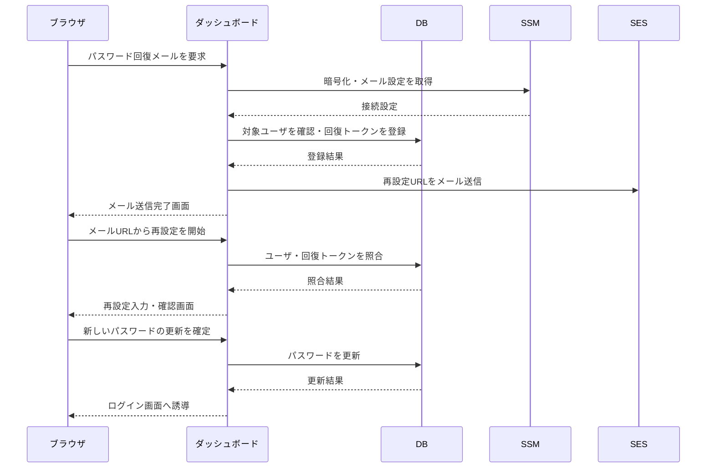
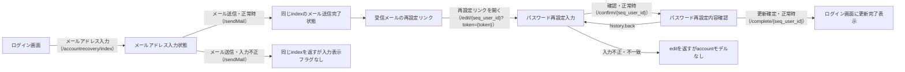
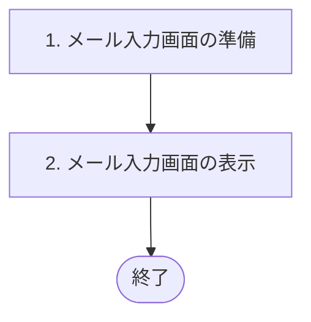
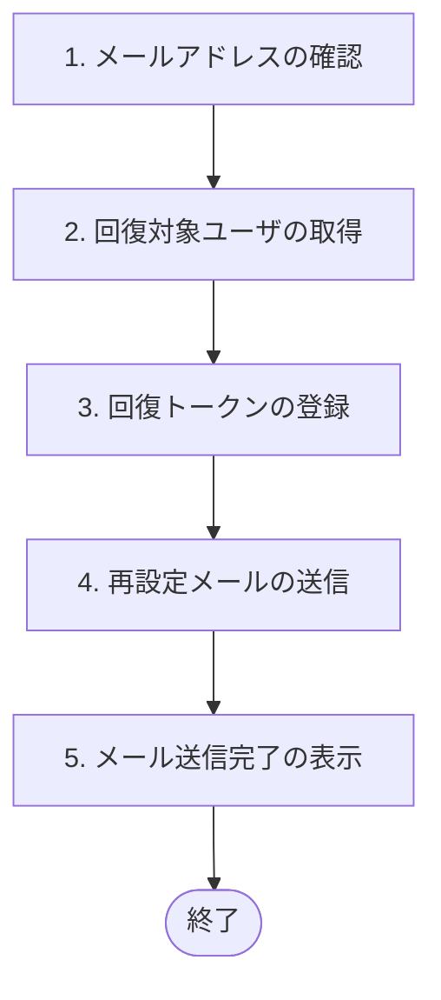
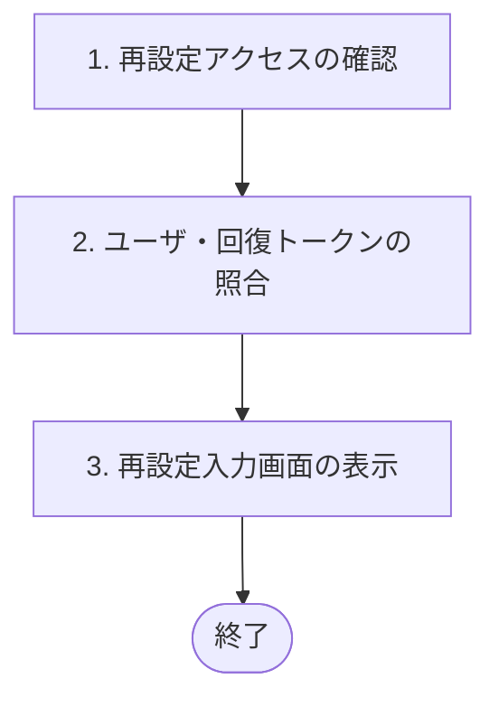
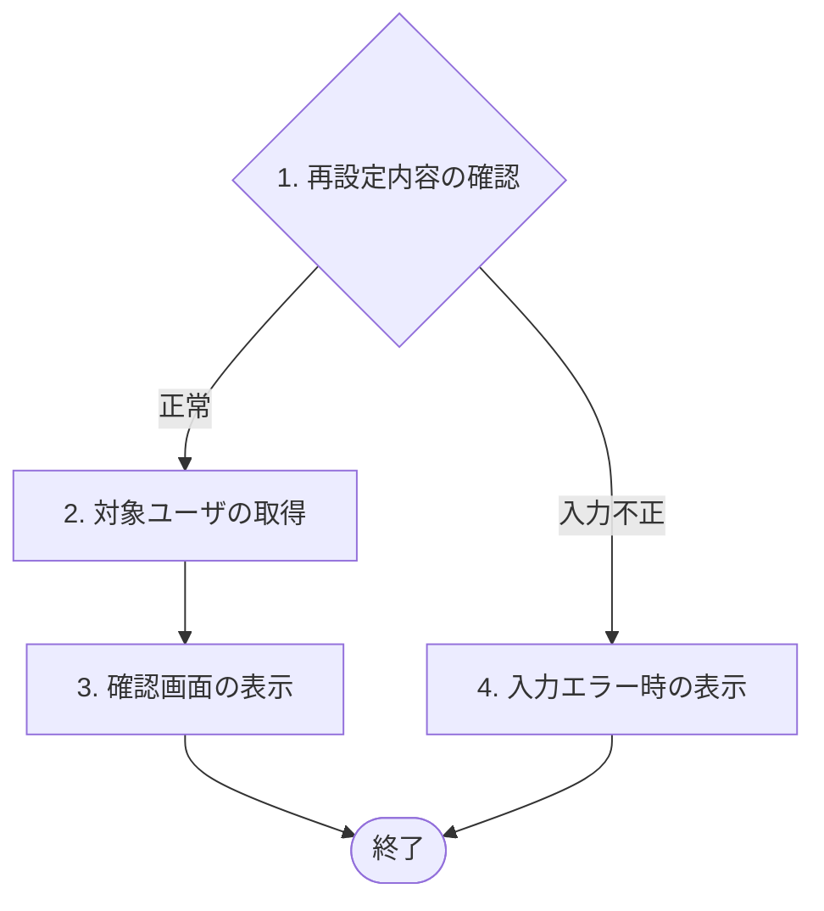
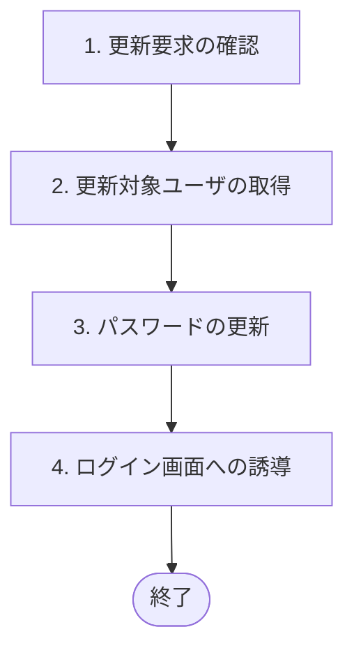

# 設計書 1.7. パスワード再設定機能

## 1. 機能概要

- 登録済みのメールアドレスへ、パスワード再設定画面のURLを送信する。
- メールのURLでユーザと発行後1時間以内のトークンを確認し、新しいパスワードの入力・確認・更新を行う。
- 全ルートを未認証で利用できる。更新完了時はログイン画面へリダイレクトする。[UserRecoveryController](../../../ha-dashboard/src/main/java/jp/co/ha/dashboard/user/controller/UserRecoveryController.java)で処理する。

## 2. 処理概要

### 2.1. 全体の処理概要



### 2.2. 画面一覧・画面遷移図

| 画面・状態 | 表示要求・条件 | テンプレート | 備考 |
| --- | --- | --- | --- |
| アカウント回復メールアドレス入力・メール送信完了 | `GET /accountrecovery/index`で入力、`POST /accountrecovery/sendMail`正常時に送信完了状態 | `accountrecovery/index` | 同じ画面をモデルの表示フラグで切り替える。3.1参照。 |
| パスワード再設定入力 | メールの`GET /accountrecovery/edit/{seq_user_id}?token={token}`が正常、またはconfirm入力エラー時 | `accountrecovery/edit` | token検証はeditのみ。3.2参照。 |
| パスワード再設定内容確認 | `POST /accountrecovery/confirm/{seq_user_id}`が正常 | `accountrecovery/confirm` | password・mailAddressをhiddenに保持する。3.3参照。 |
| ログイン画面（更新完了表示） | `POST /accountrecovery/complete/{seq_user_id}`正常後の`GET /login` | `login/index` | 回復専用の更新完了画面はなく、フラッシュ属性で完了を表示する。ログイン機能を参照。 |
| 共通エラー画面 | 業務例外・システム例外 | `error/index` | 各発生処理の5章を参照。 |



## 3. 画面仕様

### 3.1. アカウント回復メールアドレス入力・メール送信完了画面

#### 3.1.1. 基本情報・表示条件

| 項目 | 内容 | 備考 |
| --- | --- | --- |
| 表示要求 | `GET /accountrecovery/index`、または`POST /accountrecovery/sendMail`の処理結果。 | スキーム・ホスト・ポート・コンテキストパスは実行環境に従う。 |
| 表示条件 | 入力フォームはisInputMailAddress、送信完了領域はisSendMailAddressがtrueのとき表示。 | [画面テンプレート](../../../ha-dashboard/src/main/resources/templates/accountrecovery/index.html)。全ルート未認証で利用可能。 |


#### 3.1.2. レイアウト・画面項目

| 配置 | 項目 | 区分 | 内容・条件 | 備考 |
| --- | --- | --- | --- | --- |
| 中央カード・入力状態上部 | アカウント回復・説明・エラー | 表示 | 登録済みメールアドレスの入力案内とmailAddressのフィールドエラー。 | 入力フォーム内のためisInputMailAddress=true時にのみ表示する。 |
| 入力状態中央 | `mailAddress` | 入力 | 必須、64文字以下、メール形式。type=email・required・maxlength=64、jQueryの必須/メール形式。 | 64文字以下のメールアドレス。論理削除されていないユーザを検索する。 |
| mailAddress直下 | メール候補 | 表示・画面内操作 | blurでmailcheck候補を表示し、クリックでmailAddressへ反映。 | 候補ドメインはgmail.com、yahoo.co.jp、ezweb.ne.jp、au.com、docomo.ne.jp、i.softbank.jp、softbank.ne.jp、outlook.com、outlook.jp。 |
| 入力状態下部 | メール送信 | 操作 | POST submit。 | リセットボタン・業務hiddenはない。 |
| 中央カード・送信完了状態 | メール送信完了・件名・リンク案内 | 表示 | 「アカウント回復用メールを以下の件名で送信しました。」、パスワード再設定yyyyMMdd、メール内URLの案内。 | 件名の日付は画面描画時に生成する。入力項目・ボタンは表示しない。 |


#### 3.1.3. 初期表示

| 契機・条件 | 表示・処理 | 備考 |
| --- | --- | --- |
| index正常 | `accountrecovery/index` | `isInputMailAddress=true`でメールアドレス入力フォームを表示する。 |
| sendMail正常 | `accountrecovery/index` | `isSendMailAddress=true`で送信完了文言と「パスワード再設定yyyyMMdd」の件名を表示する。日付は画面描画時に生成する。 |
| sendMail入力不正 | `accountrecovery/index` | コントローラが`isInputMailAddress`を再設定しないため、現行テンプレートでは入力フォーム・フォーム内エラーも表示条件を満たさない。 |


#### 3.1.4. 操作・イベント処理

| 操作 | HTTPメソッド・URL | 送信する業務項目 | サーバが採用・参照するデータ | 結果・遷移 | 関連処理 | 備考 |
| --- | --- | --- | --- | --- | --- | --- |
| メール送信 | `POST /accountrecovery/sendMail` | `mailAddress` | 要求mailAddressを検証し、AES暗号化したメールで有効ユーザを検索する。宛先には要求mailAddressを採用。 | 正常は同じ画面の送信完了状態。入力不正は同じビュー。未登録・外部接続例外は共通エラー。 | 5.2 | 標準フォームはapplication/x-www-form-urlencoded。入力エラー時は表示フラグ未設定のためフォーム・エラーが見えない。 |
| メール候補選択 | 通信なし | なし | 表示した候補 | mailAddressを置換し候補を非表示にする。 | 本画面 | 業務サーバには送信しない。 |
| 受信メールのURL | `GET /accountrecovery/edit/{seq_user_id}?token={token}` | パスseq_user_id・クエリtoken | メールに埋めたユーザIDと回復トークン。 | 正常は3.2。 | 5.3 | 画面内ボタンではなくメールのリンクから開く。URL生成は5.2.3参照。 |


#### 3.1.5. 入力チェック・エラー表示

| 対象・処理 | チェック内容 | 発生エラー・扱い | 備考 |
| --- | --- | --- | --- |
| sendMail・confirmのmailAddress | 必須・64文字以下・メール形式 | 「メールアドレスが未入力です」「メールアドレスは64桁以下で入力してください」「メールアドレス形式ではありません」 | [UserRecoveryMailAddressInputForm](../../../ha-dashboard/src/main/java/jp/co/ha/dashboard/user/form/UserRecoveryMailAddressInputForm.java)の注釈を適用。confirmのフォームは同クラスを継承する。 |
| sendMail入力不正 | @Valid・BindingResultで検証する。 | accountrecovery/indexを返すがisInputMailAddressを再設定しない。 | 現行テンプレートではフォーム・フォーム内エラーを表示できない。5.2参照。 |
| メール未登録 | DELETE_FLAG=falseの登録ユーザが存在すること。 | DW0026、詳細「メールアドレスが未登録です」。 | 共通画面文言は「不正リクエストエラーが発生しました(DW0026)」。 |


### 3.2. パスワード再設定入力画面

#### 3.2.1. 基本情報・表示条件

| 項目 | 内容 | 備考 |
| --- | --- | --- |
| 表示要求 | `GET /accountrecovery/edit/{seq_user_id}?token={token}`でユーザ・有効回復トークンの照合成功。 | confirmの入力不正時もeditビューを返すが、account欠落に注意。 |
| URLの引数 | seq_user_idはedit・confirm・completeで必須。tokenはedit GETで必須。 | 未指定のパスはマッピングに一致しない。半角数字を確認してLongへ変換。0・不存在IDは検索不在、Long範囲外は変換例外。 |
| 表示条件 | 取得ユーザをモデルaccountへ設定し、空のuserRecoveryFormを表示。 | [入力テンプレート](../../../ha-dashboard/src/main/resources/templates/accountrecovery/edit.html)。認証不要。 |


#### 3.2.2. レイアウト・画面項目

| 配置 | 項目 | 区分 | 内容・条件 | 備考 |
| --- | --- | --- | --- | --- |
| カード上部 | パスワード再設定・エラー領域 | 表示 | errorMessageと全フィールドエラーを列挙。 | accountを参照して送信先URLとhidden mailAddressを生成する。 |
| フォーム内非表示 | `mailAddress` | hidden | editで取得したaccount.mailAddressを格納する。confirmへ送信。 | edit画面で取得したユーザのメールアドレスをhidden送信。継承元フォームにより必須・64文字以下・メール形式を検証する。パスのユーザ情報と一致するかの検証はない。 |
| フォーム1 | `password` | 入力 | 必須、半角英数字2～16文字、type=password・maxlength=16・required。 | 半角英数字2～16文字。 |
| フォーム2 | `confirmPassword` | 入力 | 必須、半角英数字2～16文字、type=password・maxlength=16・required。 | 半角英数字2～16文字。passwordとの一致も確認する。 |
| 各入力の直下 | パスワードを表示 | 入力・画面内操作 | それぞれの表示チェックでpassword入力を表示・非表示にする。 | 業務データとして送信しない。 |
| フォーム下部 | 確認・リセット | 操作 | 確認submit、HTML reset。 | 回復tokenはhiddenに持たずconfirmにも送信しない。 |


#### 3.2.3. 初期表示

| 契機・条件 | 表示・処理 | 備考 |
| --- | --- | --- |
| edit正常 | `accountrecovery/edit` | `account`に取得ユーザを設定。新パスワード・確認用パスワード・表示切替チェック・リセットボタンを表示する。 |
| confirm入力不正・パスワード不一致 | `accountrecovery/edit` | 不一致は「パスワードと確認用パスワードが一致しません」。この分岐は`account`を再設定しないため、`account.seqUserId`・`account.mailAddress`参照を持つ入力テンプレートの描画に失敗し得る。 |


#### 3.2.4. 操作・イベント処理

| 操作 | HTTPメソッド・URL | 送信する業務項目 | サーバが採用・参照するデータ | 結果・遷移 | 関連処理 | 備考 |
| --- | --- | --- | --- | --- | --- | --- |
| 確認 | `POST /accountrecovery/confirm/{seq_user_id}` | `password, confirmPassword, mailAddress(hidden)`、パスseq_user_id | 要求フォームを検証し、パスIDでユーザを検索する。tokenを再検証せず、hiddenメールと対象ユーザの一致も検証しない。 | 正常は3.3。不正・不一致はeditビューを返す。 | 5.4 | テンプレートの`~/`指定でサーバ相対URLとなり、コンテキスト相対ではない。 |
| リセット | 通信なし | なし | 現在表示中のHTML初期値 | 新パスワード2項目を初期値へ戻す。 | 4.3 | 再GET・tokenの再検証・セッション削除はしない。 |
| パスワード表示切替 | 通信なし | なし | 各チェック状態 | 対応入力を表示・非表示にする。 | 本画面 | 新規リクエストは発生しない。 |


#### 3.2.5. 入力チェック・エラー表示

| 対象・処理 | チェック内容 | 発生エラー・扱い | 備考 |
| --- | --- | --- | --- |
| sendMail・confirmのmailAddress | 必須・64文字以下・メール形式 | 「メールアドレスが未入力です」「メールアドレスは64桁以下で入力してください」「メールアドレス形式ではありません」 | [UserRecoveryMailAddressInputForm](../../../ha-dashboard/src/main/java/jp/co/ha/dashboard/user/form/UserRecoveryMailAddressInputForm.java)の注釈を適用。confirmのフォームは同クラスを継承する。 |
| confirmのpassword | 必須・半角英数字・2～16文字 | 「パスワードが未入力です」「パスワードが半角英数で入力してください」「パスワードは2桁以上で入力してください」「パスワードは16桁以下で入力してください」 | [UserRecoveryForm](../../../ha-dashboard/src/main/java/jp/co/ha/dashboard/user/form/UserRecoveryForm.java)。 |
| confirmのconfirmPassword | 必須・半角英数字・2～16文字 | 「確認用パスワードが未入力です」「確認用パスワードが半角英数で入力してください」「確認用パスワードは2桁以上で入力してください」「確認用パスワードは16桁以下で入力してください」 | — |
| confirmのパスワード一致 | フォーム検証後、password.equals(confirmPassword) | 「パスワードと確認用パスワードが一致しません」をモデルに設定しeditビューを返す | フィールド検証と不一致の場合はユーザ検索・account設定より前に戻る。 |
| editのtoken | Optionalが存在すること | `BusinessException(ILLEGAL_ACCESS_ERROR)`（DW0026）、詳細「トークンが未指定です」 | 空文字は存在とみなしDB照合に進む。 |
| edit・confirm・completeのseq_user_id | Optionalが存在し半角数字であること | DW0026、詳細「ユーザIDが未指定または半角数字以外です seq_user_id=...」 | その後Long.valueOfで変換する。桁数・Long範囲の明示検証はない。confirmはフォーム検証成功後に実行。 |


| 表示時の注意 | 内容 | 備考 |
| --- | --- | --- |
| 入力エラー・不一致 | confirmはaccountの再設定前にeditビューを返す。 | account.seqUserId・account.mailAddress参照があり描画に失敗し得る。 |
| ID・token不正 | editのID・token検証は5.3、confirmのID検証は5.4。 | 業務例外は共通エラー画面へ渡す。 |


### 3.3. パスワード再設定内容確認画面

#### 3.3.1. 基本情報・表示条件

| 項目 | 内容 | 備考 |
| --- | --- | --- |
| 表示要求 | `POST /accountrecovery/confirm/{seq_user_id}`が検証・一致確認・ユーザ検索に成功した場合。 | 表示用GETルートはない。 |
| 表示条件 | モデルaccountに取得ユーザ、userRecoveryFormに要求フォームを設定して表示する。 | [確認テンプレート](../../../ha-dashboard/src/main/resources/templates/accountrecovery/confirm.html)。新規入力欄はない。 |


#### 3.3.2. レイアウト・画面項目

| 配置 | 項目 | 区分 | 内容・条件 | 備考 |
| --- | --- | --- | --- | --- |
| カード上部 | パスワード再設定内容の確認 | 表示 | 確認見出し。 | 専用完了画面は生成しない。 |
| 中央の確認表 | メールアドレス・パスワード | 表示 | メールアドレスは要求フォーム値。パスワードは●●●●●●と「非表示」の固定表記。 | 確認用パスワードの表示行はない。 |
| フォーム内非表示 | `mailAddress` | hidden | 要求フォームのメールアドレスをcompleteへ送信。 | 確認画面のhidden。サーバ側は要求値をそのままsaltに使用し、形式・ユーザとの一致を再検証しない。 |
| フォーム内非表示 | `password` | hidden | 要求フォームのパスワードをcompleteへ送信。 | 確認画面のhidden。`@Valid`はなく、確認済みフォームのセッション保存も行わない。complete要求値を使用する。 |
| 表下部 | 確定・戻る | 操作 | 確定submit、戻るhistory.back()。 | confirmPassword・回復token・multiSubmitTokenの業務hiddenは送信しない。 |


#### 3.3.3. 初期表示

| 契機・条件 | 表示・処理 | 備考 |
| --- | --- | --- |
| confirm正常 | `accountrecovery/confirm` | `account`に取得ユーザを設定。フォームのメールアドレスと伏せたパスワードを表示する。戻る操作は`history.back()`。 |
| complete正常 | `/login`へリダイレクト | ログイン画面はフラッシュ属性`isPasswordReset`による完了文言を表示する。自動ログインは行わない。 |


#### 3.3.4. 操作・イベント処理

| 操作 | HTTPメソッド・URL | 送信する業務項目 | サーバが採用・参照するデータ | 結果・遷移 | 関連処理 | 備考 |
| --- | --- | --- | --- | --- | --- | --- |
| 確定 | `POST /accountrecovery/complete/{seq_user_id}` | `password, mailAddress`（ともにhidden）、パスseq_user_id | 対象ユーザはパスIDで毎回取得。要求password＋要求mailAddressでハッシュ化する。確認済みフォームはセッション保存しない。 | 正常は/loginへredirectし完了表示。失敗は共通エラー。 | 5.5、4.4 | 入力欄がなくてもPOSTする。`~/`指定でサーバ相対URL。セッションmultiSubmitTokenは存在・非空のみ確認。 |
| 戻る | 通信なし（history.back()） | なし | ブラウザ履歴 | 3.2へ戻る。 | 4.3 | tokenの再検証・セッション値の削除を行わない。 |


#### 3.3.5. 入力チェック・エラー表示

| 対象・処理 | チェック内容 | 発生エラー・扱い | 備考 |
| --- | --- | --- | --- |
| completeの業務フォーム | 特になし | 要求値を再検証せず更新に使用 | パスワード一致、メール形式、token有効性、メールアドレスと対象ユーザの一致を検証しない。 |
| confirmPassword | 確認画面から送信せず、completeで一致検証しない。 | 更新値はcompleteの要求password・mailAddressから決まる。 | 画面で確認済みの値をサーバ側に固定しない。 |
| 多重送信 | セッションmultiSubmitTokenの存在・非空のみ検証。 | 不在・空はDW0031。 | ユーザID・回復tokenとの対応や要求hiddenとの一致確認はない。4.4参照。 |


## 4. 画面間のデータ管理・共通制御

### 4.1. 引き継ぐデータと保持方法

| データ | 保持先・引継ぎ | 備考 |
| --- | --- | --- |
| 送信先メールアドレス | sendMail要求フォーム | DB検索の入力条件とメールのToに使用。ユーザ取得時のメールは復号する。 |
| 回復トークン | DBのUSER_RECOVERY_TOKENとメールURLのtokenクエリ | edit GETでのみ照合。取得した有効行をモデル・セッションへ保存しない。 |
| 対象ユーザID | edit・confirm・completeのパスseq_user_id | 各要求で検証・DB検索。確認済みIDとしてセッションへ保存しない。 |
| ユーザ情報 | 要求モデルaccount | edit正常・confirm正常で取得ユーザを設定。入力エラー分岐では再設定しない。 |
| 新パスワード・確認用パスワード | edit→confirmの要求フォーム | mailAddressはedit取得ユーザからhiddenで送信する。メールとパスIDの一致確認はない。 |
| 確認済みのパスワード・メール | confirm→completeのhidden（password・mailAddress） | 回復フォームをセッションに保存しない。completeは送信されたhidden要求値で更新ハッシュを作る。confirmPasswordは送信しない。 |
| 多重送信トークン | セッションmultiSubmitToken | 回復tokenとは別物。生成・検証・削除は4.4。 |
| 完了文言の表示 | RedirectAttributesのフラッシュ属性isPasswordReset=true | 正常更新後に/loginへredirectし、ログイン画面で一時属性による完了文言を表示。自動ログインなし。 |

### 4.2. データの生成・参照・更新・破棄

| 契機 | データの扱い | 備考 |
| --- | --- | --- |
| 各要求 | メール入力フォームと回復フォームを@ModelAttributeで新規生成する。 | 要求値をバインドし、確認済みフォームの復元はしない。 |
| sendMail正常 | システム日時を取得し、復号済みメール＋yyyyMMddHHmmssをSHA-256でトークン化してDB登録する。 | UTF-8・64桁小文字16進。登録はSES送信前に独立してコミットする。5.2参照。 |
| edit正常 | パスIDのユーザと、作成日時が検索時刻の1時間前より後である一致tokenを検索する。 | 上限日時は指定しない。有効tokenを取得するだけで、消費・セッション保存・期限延長は行わない。5.3参照。 |
| confirm正常 | フォーム検証・password一致確認後にパスIDでユーザ検索しaccountを設定。 | 回復tokenを再検証せずフォームはセッション保存しない。5.4参照。 |
| complete正常 | パスIDのユーザのpasswordだけを要求password＋mailAddressのハッシュに差し替え、全列UPDATEを実行する。 | 取得したメールをAES再暗号化。passwordExpireの延長・APIキー再生成・tokenの失効はしない。5.5参照。 |
| complete終了 | postHandleでmultiSubmitTokenを削除。isPasswordResetをフラッシュ属性へ設定。 | セッション全体は破棄しない。回復tokenと入力フォームの削除処理はない。 |
| メール送信失敗 | 先に登録した回復token行は残る。 | 補償削除・既存tokenの削除・失効は行わない。 |

### 4.3. 戻る・再読込・直接アクセス時の動作

| 操作・条件 | 動作 | 備考 |
| --- | --- | --- |
| 確認画面の戻る | history.back()で入力画面へ戻る。 | サーバのフォーム復元・token再検証はせずブラウザ履歴に従う。 |
| editのリセット | 表示中HTMLの初期値へ戻す。 | 再GET・セッション破棄はしない。 |
| index再GET | isInputMailAddress=trueでメール入力状態を表示。 | 送信済みメール・DB tokenを破棄しない。 |
| sendMail再送信・再読込 | 検証・ユーザ検索・token登録・メール送信を再実行する。 | 既存tokenを失効しない。多重送信トークンの検証対象ではない。 |
| editリンク再利用 | 同じtokenでも有効期限内で照合できれば再び入力画面を表示。 | PASSWORD_EXPIRE・DELETE_FLAGを主キー検索の条件にしない。更新後の消費処理もない。 |
| confirm直接POST | 要求フォームとパスIDを検証して確認画面を作る。 | edit通過・回復token・確認済みIDのセッション照合はない。正常なメソッド終了でmultiSubmitToken生成。 |
| confirm入力エラー | editビューを返すがaccountを再設定しない。 | テンプレート描画失敗の可能性がある。multiSubmitToken生成はpostHandleまでの到達状況に従う。 |
| complete直接POST | セッションmultiSubmitTokenが存在・非空ならパスIDと要求値で更新へ進む。 | 確認済みフォームや回復tokenとの対応確認なし。別機能のconfirmも同一セッションキーを使用する。 |
| complete正常後の再POST | 通常は削除済みmultiSubmitTokenの不在でDW0031。 | 正常更新後は/loginへのリダイレクトとなる。同時要求をDBで直列化するものではない。 |
| seq_user_id欠落・不正 | パス欠落はマッピング不一致、半角数字以外はDW0026。 | 0・存在しないIDは不在DW0026、Long範囲外は変換例外。token空文字はeditのDB照合へ進む。 |

### 4.4. 認証・セッション切れ・多重送信制御

| 対象 | 処理内容・発生エラー | 備考 |
| --- | --- | --- |
| 認証 | `/accountrecovery/**`はSpring Securityで`permitAll` | セッションのユーザIDやログイン状態を回復処理の前提にしない。 |
| トークン生成 | confirmのpostHandleでランダム10文字を空saltのSHA-256に変換し`multiSubmitToken`へ保存 | [DashboardAuthInterceptor](../../../ha-business/src/main/java/jp/co/ha/business/component/DashboardAuthInterceptor.java)。正常にメソッドが戻れば入力エラーで戻した場合も生成対象。描画失敗等では後段の動作に従う。 |
| トークン確認 | completeのpreHandleでセッション値が存在し空でないことを確認 | リクエスト値との照合、ユーザIDとの対応、回復トークンとの対応は確認しない。別機能のconfirmも同じセッションキーを使用する。 |
| トークン不在・空 | `SystemException(MULTI_SUBMIT_ERROR)`（DW0031） | 詳細「不正リクエストエラーです」。画面文言は「画面で複数回送信ボタンを押下したため、失敗しました(DW0031)」。 |
| トークン削除 | completeのpostHandleで`multiSubmitToken`を削除 | 例外でpostHandleへ到達しない場合の削除処理はない。 |
| 確認フォーム保持 | 特になし | 回復フォームをセッションへ保存しない。確認画面のhiddenでpasswordとmailAddressを引き継ぐ。 |
| 完了フラッシュ属性 | `RedirectAttributes.addFlashAttribute("isPasswordReset", true)` | `/login`へリダイレクトし、一時属性により更新完了を表示する。セッション全体は破棄しない。 |
| CSRF | 無効 | 回復トークン・多重送信トークンとは独立した設定。 |

| 対象 | 処理内容 | 備考 |
| --- | --- | --- |
| Cookie・継続性 | confirmからcompleteにはJSESSIONIDに対応するセッションのmultiSubmitTokenを使用する。 | セッション生成時等に実行環境がCookieを設定。ログイン認証・セッションseqUserIdは前提としない。 |
| セッション切れ | completeでmultiSubmitTokenがなければDW0031。 | editはDBの回復tokenを照合するためログインセッション切れと独立。 |
| CSRF設定 | [DashboardConfig](../../../ha-dashboard/src/main/java/jp/co/ha/dashboard/config/DashboardConfig.java)で無効化している。 | 回復token・多重送信トークンとは独立した設定。機能固有の応答ヘッダを設定しない。 |


## 5. サーバ処理詳細

### 5.1. メールアドレス入力初期表示（GET /accountrecovery/index）



| 処理順 | 処理概要 | 処理詳細 | 関連項番 |
| --- | --- | --- | --- |
| 1 | メール入力画面の準備 | 認証を要求せず空のフォームを作成し、メールアドレス入力の表示状態を設定する。 | 3.1.3 |
| 2 | メール入力画面の表示 | 初期状態の画面を表示する。DB・外部APIへの接続は行わない。例外は4.4の共通処理に従う。 | 3.1 |


### 5.2. 回復メール送信（POST /accountrecovery/sendMail）



| 処理順 | 処理概要 | 処理詳細 | 関連項番 |
| --- | --- | --- | --- |
| 1 | メールアドレスの確認 | 入力メールアドレスを検証する。不正なら同じビューを返して終了する。メール入力状態が再設定されない場合の表示は3.1.3に従う。 | 3.1.3、3.1.5 |
| 2 | 回復対象ユーザの取得 | 入力メールアドレスで有効なユーザを検索する。該当なしはDW0026として終了する。暗号化とSSM接続の扱いは5.2.3に従う。 | 5.2.1、5.2.3 |
| 3 | 回復トークンの登録 | 回復用トークンを作成してDBへ登録する。メール送信より先に確定する。 | 5.2.2 |
| 4 | 再設定メールの送信 | 入力されたメールアドレスへ再設定URLを送る。送信例外時は共通エラー処理へ進み、登録トークンを補償削除しない。スタブの戻り値は判定しない。 | 5.2.3 |
| 5 | メール送信完了の表示 | 同じ画面を送信完了状態で表示する。 | 3.1.3 |

#### 5.2.1. メールアドレスによるユーザ検索

```sql
SELECT
    SEQ_USER_ID
    , PASSWORD
    , MAIL_ADDRESS
    , DELETE_FLAG
    , PASSWORD_EXPIRE
    , REMARKS
    , API_KEY
    , REG_DATE
    , UPDATE_DATE
    , GENDER_TYPE
    , BIRTH_DATE
FROM
    USER
WHERE
    MAIL_ADDRESS = :encrypted_mail_address
    AND DELETE_FLAG = FALSE;
```

| 項目 | 設定値 | 備考 |
| --- | --- | --- |
| `:encrypted_mail_address` | 入力mailAddressをAES暗号化した値 | [UserSearchServiceImpl](../../../ha-business/src/main/java/jp/co/ha/business/db/crud/read/impl/UserSearchServiceImpl.java)・[UserMapper](../../../ha-db/src/main/resources/jp/co/ha/db/mapper/UserMapper.xml)の検索へ渡す。 |

#### 5.2.2. 回復トークン登録

```sql
INSERT INTO
    USER_RECOVERY_TOKEN (
        SEQ_USER_RECOVERY_TOKEN_ID
        , SEQ_USER_ID
        , TOKEN
        , TOKEN_CREATE_DATE
        , DELETE_FLAG
        , REG_DATE
        , UPDATE_DATE
    )
VALUES (
    :seq_user_recovery_token_id
    , :seq_user_id
    , :token
    , :token_create_date
    , FALSE
    , :reg_date
    , :update_date
);
```

| 項目 | 設定値 | 備考 |
| --- | --- | --- |
| `:seq_user_recovery_token_id` | 未設定（null） | [UserRecoveryTokenMapper](../../../ha-db/src/main/resources/jp/co/ha/db/mapper/UserRecoveryTokenMapper.xml)のINSERTでDB自動採番を使用する。 |
| `:seq_user_id` | 5.2.1で取得したユーザID | 回復対象ユーザを設定する。 |
| `:token` | SHA-256（復号したユーザmailAddress＋yyyyMMddHHmmss形式の作成日時） | UTF-8、64桁小文字16進文字列。 |
| `:token_create_date` | sendMail内で取得したシステム日時 | 件名の日付にも同じ日時を使用する。 |
| `:reg_date` | 登録直前のシステム日時 | [DataBaseCommonAspect](../../../ha-db/src/main/java/jp/co/ha/db/aspect/DataBaseCommonAspect.java)で設定する。 |
| `:update_date` | 登録直前のシステム日時 | DB共通処理で設定する。 |

#### 5.2.3. メール・外部接続と異常時の扱い

| 対象 | 設定・処理内容 | 異常時の扱い | 備考 |
| --- | --- | --- | --- |
| 宛先 | 入力mailAddress | SES送信例外を共通ハンドラーへ渡す | DB検索に使った入力値をそのままToへ渡す。 |
| 件名 | `パスワード再設定` + 作成日時の`yyyyMMdd` | — | トークン作成日時と同じsysdateを使う。 |
| 本文 | [account-recovery-template.ftl](../../../ha-business/src/main/resources/templates/mail-templates/account-recovery-template.ftl) | テンプレート取得・置換例外はSystemException | `url`・`seq_user_id`・`token`を置換してHTML本文を作る。 |
| URL設定 | `healthinfo.dashboard.url` | 未設定・不正値は設定読込み・リンク生成の動作に従う | 外部APIでURLを発行する処理はない。 |
| SES | [AwsSesComponent](../../../ha-common/src/main/java/jp/co/ha/common/aws/AwsSesComponent.java)の`sendMail` | クライアント生成失敗はCE0029。送信元ドメイン未検証はCE0034。その他送信例外は伝播 | UTF-8のHTMLメール。接続・ソケットのタイムアウトはAWS設定値を使用する。 |
| SES送信元・BCC | SSMの`/{環境}/system_mailaddress`を取得し、両方へ設定 | SSM取得例外は呼出元へ伝播 | 送信元とBCCで個別に取得する。 |
| SESスタブ | `sesStubFlag=true`なら未送信の結果`NOT_SEND`を返す | 例外なし | コントローラは送信結果を確認しないため、スタブでもトークンを登録し送信完了を表示する。 |
| メール送信後の補償 | 特になし | メール失敗時も先にコミットした回復トークンは残る | 既存トークンの削除・失効も行わない。 |
| メール暗号化・復号 | [AesCrypter](../../../ha-common/src/main/java/jp/co/ha/common/crypt/AesCrypter.java)がSSMの`crypt_key`・`crypt_mode`を参照 | AES内部例外はログ出力後nullを返す | DB検索条件の暗号化と、取得・更新時のDB共通処理で使用する。 |
| SSM・キャッシュ | [AwsSystemsManagerComponent](../../../ha-common/src/main/java/jp/co/ha/common/aws/AwsSystemsManagerComponent.java)が`/{環境}/{キー}`を都度取得 | SSMクライアント生成失敗はCE0029 | 当機能専用の設定値キャッシュ・ユーザキャッシュはない。 |
| 共通例外通知 | 共通ハンドラーからSlackのdashboard向けにメッセージとスタックトレースを送信 | 通知中の例外をハンドラー内で再捕捉しない | [SlackApiComponent](../../../ha-business/src/main/java/jp/co/ha/business/api/slack/SlackApiComponent.java)はSSMの`/{環境}/slack_token`を参照する。 |
| その他業務API | 特になし | — | ユーザ・トークンは直接DBを参照する。 |

| 対象 | 応答・例外処理 | 備考 |
| --- | --- | --- |
| メールURL | `{healthinfo.dashboard.url}accountrecovery/edit/{seq_user_id}?token={token}`を生成する。 | 設定URLの末尾区切りは設定値に従う。外部APIによるURL発行はない。 |
| 共通例外画面 | [DashboardExceptionHandler](../../../ha-dashboard/src/main/java/jp/co/ha/dashboard/exception/DashboardExceptionHandler.java)がコード対応文言を表示する。 | HTTPステータスを明示設定しない。例外詳細をそのまま画面へ返さない。 |

| 処理・条件 | 内容・発生エラー | 備考 |
| --- | --- | --- |
| DB・型変換・描画等の例外 | 共通例外ハンドラーへ渡す | 専用の回復更新エラーへの変換はない。BaseAppError以外は共通の予期しないエラーとして表示する。 |

| 処理・条件 | 内容 | 備考 |
| --- | --- | --- |
| メール検索結果の採用 | 複数件なら先頭1件を使用し、取得メールアドレスはDB共通処理で復号する | 検索は読み取り専用で、トークン登録・メール送信との一括トランザクションではない。 |
| メール未登録 | BusinessException(ILLEGAL_ACCESS_ERROR)（DW0026）を送出する | 詳細は「メールアドレスが未登録です」。削除済みユーザも不在となり、画面は「不正リクエストエラーが発生しました(DW0026)」と表示する。 |
| 回復トークンの登録確定 | 作成サービスのTransactional(rollbackFor = Exception.class)でSES送信前に登録する | メール送信失敗時も登録行の削除・ロールバックは行わない。 |
| トークン生成の失敗 | HashEncoderによるSHA-256取得失敗はALGORITH_ERROR（CE0003） | UTF-8指定例外は予期しないエラー。生成に失敗した場合は後続DB操作を行わない。 |

### 5.3. 再設定入力表示（GET /accountrecovery/edit/{seq_user_id}）



| 処理順 | 処理概要 | 処理詳細 | 関連項番 |
| --- | --- | --- | --- |
| 1 | 再設定アクセスの確認 | パスのユーザIDと回復トークンの指定を確認する。未指定・形式不正はDW0026として終了する。 | 5.3.3 |
| 2 | ユーザ・回復トークンの照合 | ユーザIDでユーザを取得し、指定トークンと有効期間を照合する。該当なし・期限超過はDW0026となる。検索条件は各SQLに従う。 | 5.3.1、5.3.2 |
| 3 | 再設定入力画面の表示 | ユーザ情報をモデルへ設定し、新しいパスワードの入力画面を表示する。取得した回復トークンはモデル・セッションに保存しない。 | 3.2.3 |

#### 5.3.1. ユーザIDによるユーザ検索

```sql
SELECT
    SEQ_USER_ID
    , PASSWORD
    , MAIL_ADDRESS
    , DELETE_FLAG
    , PASSWORD_EXPIRE
    , REMARKS
    , API_KEY
    , REG_DATE
    , UPDATE_DATE
    , GENDER_TYPE
    , BIRTH_DATE
FROM
    USER
WHERE
    SEQ_USER_ID = :seq_user_id;
```

| 項目 | 設定値 | 備考 |
| --- | --- | --- |
| `:seq_user_id` | パスseq_user_idをLong変換した値 | edit・confirm・completeの各呼出しで設定する。 |

#### 5.3.2. 有効トークン検索

```sql
SELECT
    SEQ_USER_RECOVERY_TOKEN_ID
    , SEQ_USER_ID
    , TOKEN
    , TOKEN_CREATE_DATE
    , DELETE_FLAG
    , REG_DATE
    , UPDATE_DATE
FROM
    USER_RECOVERY_TOKEN
WHERE
    SEQ_USER_ID = :seq_user_id
    AND TOKEN = :token
    AND TOKEN_CREATE_DATE > :one_hour_ago;
```

| 項目 | 設定値 | 備考 |
| --- | --- | --- |
| `:seq_user_id` | パスseq_user_idをLong変換した値 | [UserRecoveryTokenSearchServiceImpl](../../../ha-business/src/main/java/jp/co/ha/business/db/crud/read/impl/UserRecoveryTokenSearchServiceImpl.java)へ渡す。 |
| `:token` | edit GETのtoken | メールURLから渡された文字列を設定する。 |
| `:one_hour_ago` | 検索時のシステム日時から1時間前 | 有効期限の比較境界へ設定する。 |

#### 5.3.3. ID・トークン検証と異常時の扱い

| 対象・処理 | チェック内容 | 発生エラー・扱い | 備考 |
| --- | --- | --- | --- |
| editのtoken | Optionalが存在すること | `BusinessException(ILLEGAL_ACCESS_ERROR)`（DW0026）、詳細「トークンが未指定です」 | 空文字は存在とみなしDB照合に進む。 |
| edit・confirm・completeのseq_user_id | Optionalが存在し半角数字であること | DW0026、詳細「ユーザIDが未指定または半角数字以外です seq_user_id=...」 | その後Long.valueOfで変換する。桁数・Long範囲の明示検証はない。confirmはフォーム検証成功後に実行。 |

| 処理・条件 | 内容・発生エラー | 備考 |
| --- | --- | --- |
| ユーザIDに対応する行なし | DW0026 | 詳細「ユーザIDと紐づくユーザ情報がありません seq_user_id=...」。 |
| トークン不一致・有効期限外 | DW0026 | 詳細「トークンが不正または無効です」。edit GET以外では回復トークンを確認しない。 |
| DW0026の画面文言 | 「不正リクエストエラーが発生しました(DW0026)」 | 例外詳細ではなくメッセージ定義に従って表示する。 |
| 再利用 | 回復トークンの消費処理なし | 同じトークンで期限内にeditへ再アクセスできる。パスワード更新はログイン認証・削除フラグ・パスワード有効期限を再確認しない。 |

| 対象 | 扱い | 備考 |
| --- | --- | --- |
| DB・復号例外 | 専用の回復エラーへ変換せず共通例外処理へ渡す。 | AES・SSM・Slack通知とDB等の共通例外は5.2.3参照。 |

| 処理・条件 | 内容 | 備考 |
| --- | --- | --- |
| ユーザ検索結果の採用 | 取得メールアドレスをDB共通処理で復号して使用する | 読み取り専用トランザクション。ユーザ不在は既存のDW0026処理へ進む。 |
| トークン検索結果の採用 | 複数件なら先頭1件を使用する | edit GETでのみ照合し、取得行をモデル・セッションへ保存しない。ちょうど1時間前のトークンは無効となる。 |

### 5.4. 再設定内容確認（POST /accountrecovery/confirm/{seq_user_id}）



| 処理順 | 処理概要 | 処理詳細 | 関連項番 |
| --- | --- | --- | --- |
| 1 | 再設定内容の確認 | 新しいパスワードの形式と確認用パスワードとの一致を検証する。正常なら処理2、不正なら処理4へ進む。 | 3.2.5 |
| 2 | 対象ユーザの取得 | パスのユーザIDを検証してユーザを検索する。不正・該当なしはDW0026として終了し、回復トークンの再検証は行わない。 | 5.3.1、5.3.3 |
| 3 | 確認画面の表示 | ユーザと要求フォームを表示用に設定し、多重送信トークンを生成して確認画面を表示する。フォームをセッションへ保存しない。 | 3.3、4.4 |
| 4 | 入力エラー時の表示 | 再設定入力ビューを返す。正常に処理を戻した場合は多重送信トークンを生成するが、ユーザモデルの欠落で描画に失敗する場合の扱いは3.2と4.4に従う。 | 3.2.3、3.2.5、4.4 |

| 処理・条件 | 処理内容・異常時の扱い | 備考 |
| --- | --- | --- |
| フォーム検証 | 3.2.5のmailAddress、password、confirmPasswordの注釈検証と一致確認を行う。 | 不一致メッセージは「パスワードと確認用パスワードが一致しません」。 |
| エラー表示 | 入力エラーはユーザ検索・account再設定前にeditビューを返す。 | account.seqUserId/account.mailAddressを参照する入力テンプレートの描画に失敗し得る。 |
| ユーザ検索 | SQL・条件値・検索例外は5.3.1と5.3.3参照。 | token照合、要求mailAddressと対象ユーザの一致確認は行わない。 |
| 値の保持 | 要求のモデルと確認画面のhiddenで次要求へ渡す。 | 確認済みID・フォームをセッション保存しない。セッションは4.4の多重送信制御だけを使用する。 |


### 5.5. パスワード更新（POST /accountrecovery/complete/{seq_user_id}）



| 処理順 | 処理概要 | 処理詳細 | 関連項番 |
| --- | --- | --- | --- |
| 1 | 更新要求の確認 | セッションの多重送信トークンの存在と非空を確認する。不在・空はDW0031となる。パスのユーザIDを検証するが、回復トークンや要求値との対応は確認しない。 | 4.4、5.3.3 |
| 2 | 更新対象ユーザの取得 | パスのユーザIDでユーザを検索する。該当なしはDW0026として終了する。 | 5.3.1 |
| 3 | パスワードの更新 | 要求のパスワードとメールアドレスからハッシュを作成してユーザを更新する。入力再検証・パスワード期限延長・APIキー再生成は行わない。 | 5.5.1 |
| 4 | ログイン画面への誘導 | 完了メッセージ用データを設定し、多重送信トークンを削除してログイン画面へリダイレクトする。専用完了画面・自動ログイン・セッション全体の破棄は行わない。 | 3.3.3、4.1、4.4 |

#### 5.5.1. パスワード更新SQL・設定値

```sql
UPDATE
    USER
SET
    PASSWORD = :password
    , MAIL_ADDRESS = :mail_address
    , DELETE_FLAG = :delete_flag
    , PASSWORD_EXPIRE = :password_expire
    , REMARKS = :remarks
    , API_KEY = :api_key
    , REG_DATE = :reg_date
    , UPDATE_DATE = :update_date
    , GENDER_TYPE = :gender_type
    , BIRTH_DATE = :birth_date
WHERE
    SEQ_USER_ID = :seq_user_id;
```

| 項目 | 設定値 | 備考 |
| --- | --- | --- |
| `:password` | SHA-256（complete要求password＋complete要求mailAddress） | DB検索結果のメールアドレスではなく要求フォームをsaltに使用する。 |
| `:mail_address` | 取得ユーザのメールアドレスを再びAES暗号化した値 | 要求mailAddressへ書き換えはしない。 |
| `:delete_flag` | 5.3.1で取得したユーザのdeleteFlag | 取得値を維持する。 |
| `:password_expire` | 5.3.1で取得したユーザのpasswordExpire | 有効期限は延長しない。 |
| `:remarks` | 5.3.1で取得したユーザのremarks | 取得値を維持する。 |
| `:api_key` | 5.3.1で取得したユーザのapiKey | 再生成しない。 |
| `:reg_date` | 5.3.1で取得したユーザのregDate | 取得値を維持する。 |
| `:update_date` | 更新直前のシステム日時 | DB共通処理で設定する。[UserUpdateServiceImpl](../../../ha-business/src/main/java/jp/co/ha/business/db/crud/update/impl/UserUpdateServiceImpl.java)へ渡す。 |
| `:gender_type` | 5.3.1で取得したユーザのgenderType | 取得値を維持する。 |
| `:birth_date` | 5.3.1で取得したユーザのbirthDate | 取得値を維持する。 |
| `:seq_user_id` | completeのパスIDで取得したユーザの主キー | 更新対象の識別値。 |

#### 5.5.2. 更新値の採用・検証と異常時の扱い

| 処理・条件 | 内容・発生エラー | 備考 |
| --- | --- | --- |
| トークン生成・パスワードハッシュ | [HashEncoder](../../../ha-common/src/main/java/jp/co/ha/common/io/encodeanddecode/HashEncoder.java)で文字列を単純連結しSHA-256へ渡す | アルゴリズム取得失敗は`ALGORITH_ERROR`（CE0003）、UTF-8指定例外は予期しないエラー。トークン生成・更新前ハッシュ失敗時は後続DB操作を行わない。 |
| 更新対象の決定 | completeのパスIDで取得したユーザを更新 | confirm・completeにはtoken検証がなく、確認済みユーザID・フォームと照合するセッション値もない。 |
| 更新時の検証 | completeに`@Valid`なし。要求password・mailAddressをハッシュ化 | confirmで検証した値をサーバ側に固定しない。未指定値のハッシュ計算も文字列連結の動作に従う。 |
| 再利用 | 回復トークンの消費処理なし | 同じトークンで期限内にeditへ再アクセスできる。パスワード更新はログイン認証・削除フラグ・パスワード有効期限を再確認しない。 |
| DB・型変換・描画等の例外 | 共通例外ハンドラーへ渡す | 専用の回復更新エラーへの変換はない。BaseAppError以外は共通の予期しないエラーとして表示する。 |

| 対象 | 処理・異常時の扱い | 備考 |
| --- | --- | --- |
| アクセス値 | パスIDの検証と検索は5.3.1・5.3.3、多重送信トークンは4.4参照。 | completeでpassword一致・メール形式・回復token有効性・メールと対象ユーザの一致を再検証しない。 |
| 外部接続・通知 | 取得メールのAES復号・更新時のAES暗号化はSSMのcrypt_key/crypt_modeを使用する。 | 5.2.3参照。AES内部例外はログ後null、共通例外通知はSlack。専用の回復更新エラーへの変換なし。 |

| 処理・条件 | 内容 | 備考 |
| --- | --- | --- |
| パスワード更新の確定 | 更新サービスのTransactional(rollbackFor = Exception.class)で全列更新する | 回復トークンの論理削除・物理削除・消費状態更新は行わない。 |
