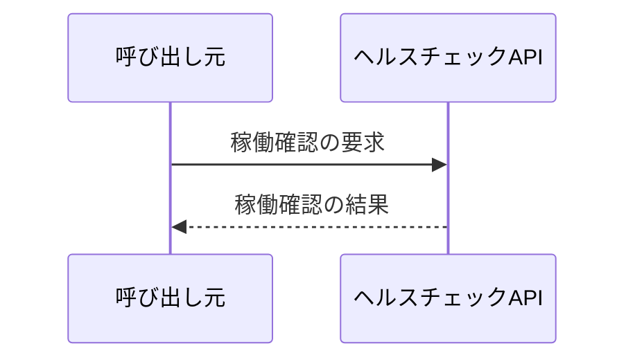
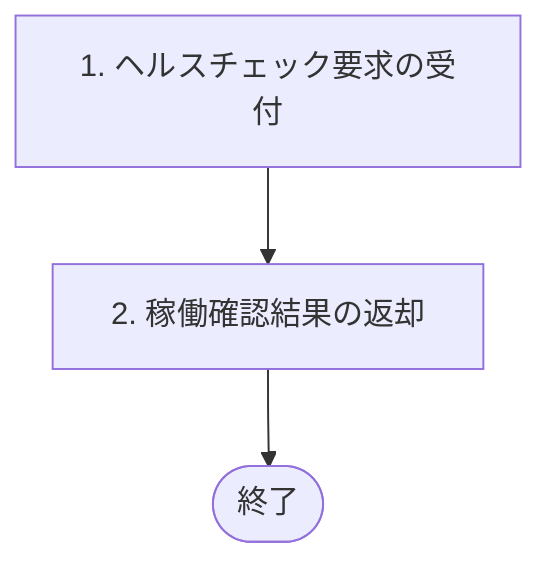

# 設計書 2.0. ヘルスチェックAPI

## 1. 機能概要

- APIサーバが正常応答を返せることを確認する。
- APIキーやBearerトークンを要求しない。
- 入出力の詳細は[OpenAPI](./openapi.yaml)の`getHealthCheck`を参照する。

## 2. 処理概要



## 3. IF仕様

### 3.1. HTTPメソッド

| HTTPメソッド | 備考 |
| --- | --- |
| `GET` | — |

### 3.2. エンドポイントURL

| エンドポイントURL | 備考 |
| --- | --- |
| `/api/healthcheck` | URLのスキーム・ホスト・ポートは実行環境に従う。 |

#### 3.2.1. パスパラメータ

特になし。

### 3.3. リクエストIF

#### 3.3.1. リクエストヘッダ

| 項目名 | 型 | 必須 | 値 | 備考 |
| --- | --- | --- | --- | --- |
| なし | — | — | — | 独自ヘッダーはなく、APIキーも不要とする。 |

#### 3.3.2. クエリパラメータ

特になし。

#### 3.3.3. JSONボディ

特になし。

### 3.4. レスポンスIF

#### 3.4.1. レスポンスヘッダ

| 項目名 | 型 | 設定条件 | 備考 |
| --- | --- | --- | --- |
| `Content-Type` | `string` | JSON応答時 | `application/json`。独自のレスポンスヘッダーは定義しない。 |

#### 3.4.2. JSONボディ

```json
{
  "result": "0"
}
```

| 項目名 | 型 | 設定条件 | 備考 |
| --- | --- | --- | --- |
| `result` | `string` | 必須 | 成功は`"0"`、失敗は`"1"`。数値ではない。 |
| `error` | `object` | 異常時 | エラーコードと詳細を格納する。正常時は省略する。 |
| `error.code` | `string` | 異常時 | 発生した処理に対応する外部エラーコード。 |
| `error.detail` | `string` | 異常時 | 詳細は該当する4.X節の発生条件に従う。 |

## 4. 処理フロー



| 処理順 | 処理概要 | 処理詳細 | 関連項番 |
| --- | --- | --- | --- |
| 1 | ヘルスチェック要求の受付 | 入力項目や認証を要求せず、稼働確認の要求を受け付ける。 | 4.1 |
| 2 | 稼働確認結果の返却 | 成功結果を設定したJSONをHTTP 200で返す。DBや外部サービスの稼働確認は行わず、応答生成時の異常は4.3.2に従う。 | 4.3 |

### 4.1. 入力チェック

特になし。

### 4.2. DB操作

特になし。

### 4.3. 正常応答の生成

#### 4.3.1. 正常応答の作成・返却

| 項目 | 処理内容 | 備考 |
| --- | --- | --- |
| 応答生成 | `result`を文字列の`"0"`にする | JSONをHTTP `200`で返す。 |
| 確認範囲 | 要求を受け付けて応答を作成できること | 依存DB・AWS・外部サービスの稼働状態は検査しない。 |

#### 4.3.2. 応答生成時の異常処理

| 発生条件 | HTTPステータス | エラーコード | 詳細・扱い | 備考 |
| --- | --- | --- | --- | --- |
| 正常応答の生成などで一般例外が発生 | 400 | `CE0002` | `予期せぬエラーが発生しました` | Slack通知後にコード・詳細を設定し、コードのログレベルでログ出力して異常応答を返す。 |
| コードが定義された異常が共通処理へ通知された | 400 | 発生元のコード | 発生元の詳細を使用する。 | Slack通知後にコード・詳細を設定し、コードのログレベルでログ出力して異常応答を返す。 |
