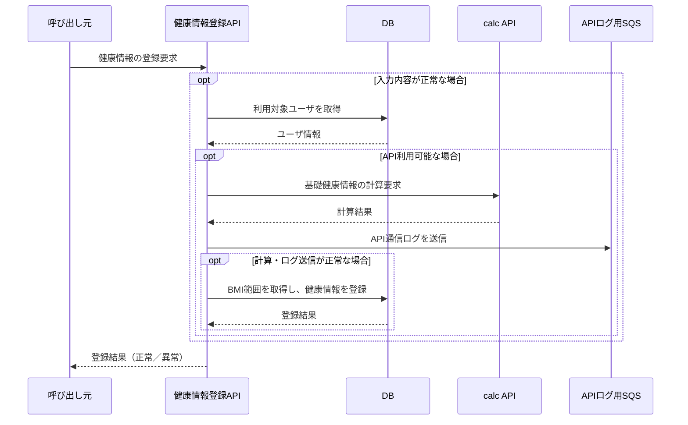
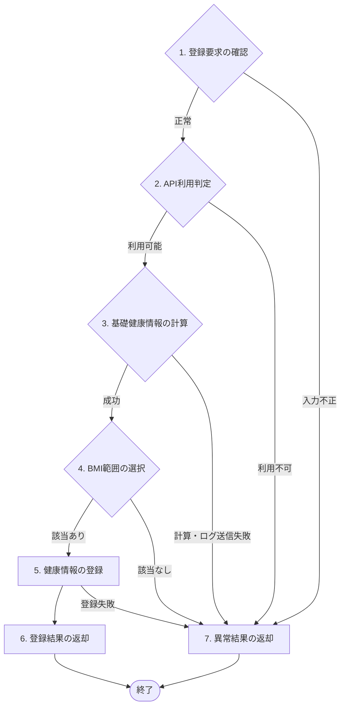
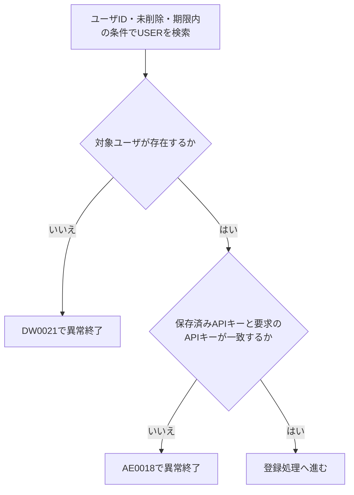
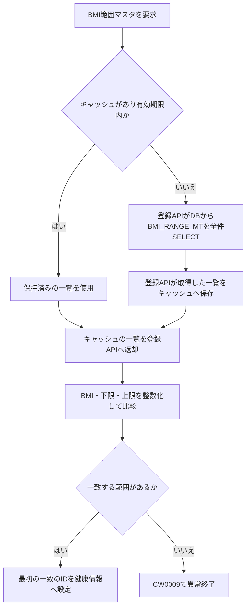

# 設計書 2.1. 健康情報登録API

## 1. 機能概要

- 身長・体重からcalc APIでBMI・標準体重を計算し、健康情報を登録する。
- APIキー照合、BMI範囲の選択とキャッシュ、API通信ログ送信を行う。
- 入出力は[OpenAPI](./openapi.yaml)の`registerHealthInfo`を参照する。

## 2. 処理概要



## 3. IF仕様

### 3.1. HTTPメソッド

| HTTPメソッド | 備考 |
| --- | --- |
| `POST` | — |

### 3.2. エンドポイントURL

| エンドポイントURL | 備考 |
| --- | --- |
| `/api/{seq_user_id}/healthinfo` | スキーム・ホスト・ポートは実行環境に従う。 |

#### 3.2.1. パスパラメータ

| 項目名 | 必須 | 備考 |
| --- | --- | --- |
| `seq_user_id` | 必須 | ユーザID。JSONボディの値は使用しない。 |

### 3.3. リクエストIF

#### 3.3.1. リクエストヘッダ

| 項目名 | 型 | 必須 | 値 | 備考 |
| --- | --- | --- | --- | --- |
| `Content-Type` | `string` | 必須 | `application/json` | リクエストボディをJSON形式で送信する。 |
| `Api-Key` | `string` | 必須 | ユーザのAPIキー | パスパラメータで指定したユーザに発行されたAPIキーを指定する。64文字（UTF-16コード単位）。JSONボディの値は使用しない。 |

#### 3.3.2. クエリパラメータ

特になし。

#### 3.3.3. JSONボディ

```json
{
  "height": 170.5,
  "weight": 65.2,
  "transaction_id": "sample-transaction-id"
}
```

| 項目名 | 型 | 必須 | 備考 |
| --- | --- | --- | --- |
| `height` | `number` | 必須 | 身長。`null`不可。形式・範囲は「4.1.2. 項目の検証」に従う。 |
| `weight` | `number` | 必須 | 体重。`null`不可。形式・範囲は「4.1.2. 項目の検証」に従う。 |
| `transaction_id` | `string` | 任意 | `null`可。省略または`null`の場合はUUIDを生成し、空文字列を含む指定済みの値はそのまま使用する。上のJSON例では任意項目も指定している。 |

### 3.4. レスポンスIF

#### 3.4.1. レスポンスヘッダ

| 項目名 | 型 | 設定条件 | 備考 |
| --- | --- | --- | --- |
| `Content-Type` | `string` | JSON応答時 | `application/json`。独自のレスポンスヘッダーは定義しない。 |

#### 3.4.2. JSONボディ

```json
{
  "result": "0",
  "account": {
    "seq_user_id": 1
  },
  "health_info": {
    "seq_health_info_id": 100,
    "height": 170.5,
    "weight": 65.2,
    "bmi": 22.428,
    "standard_weight": 63.954,
    "reg_date": "20261111120000"
  }
}
```

| 項目名 | 型 | 設定条件 | 備考 |
| --- | --- | --- | --- |
| `result` | `string` | 必須 | 成功は`"0"`、失敗は`"1"`。数値ではない。 |
| `error` | `object` | 異常時 | エラーコードと詳細を格納する。正常時は省略する。 |
| `error.code` | `string` | 異常時 | 発生した処理に対応する外部エラーコード。 |
| `error.detail` | `string` | 異常時 | 詳細は該当する4.X節の発生条件に従う。 |
| `account` | `object` | 正常時 | アカウント情報。異常時は省略する。 |
| `account.seq_user_id` | `integer`（`int64`） | 正常時 | 要求のユーザID。 |
| `health_info` | `object` | 正常時 | 登録した健康情報。異常時は省略する。 |
| `health_info.seq_health_info_id` | `integer`（`int64`） | 正常時 | 健康情報ID。 |
| `health_info.height` | `number` | 正常時 | 登録した身長。 |
| `health_info.weight` | `number` | 正常時 | 登録した体重。 |
| `health_info.bmi` | `number` | 正常時 | calc APIで計算したBMI。 |
| `health_info.standard_weight` | `number` | 正常時 | calc APIで計算した標準体重。 |
| `health_info.reg_date` | `string` | 正常時 | 登録日時。`yyyyMMddHHmmss`。 |

## 4. 処理フロー



| 処理順 | 処理概要 | 処理詳細 | 関連項番 |
| --- | --- | --- | --- |
| 1 | 登録要求の確認 | ユーザID・APIキー・身長・体重を受け付けて検証する。不正な項目があれば処理7、正常なら処理2へ進む。 | 4.1 |
| 2 | API利用判定 | 未削除・パスワード有効期限内のユーザを検索し、APIキーを照合する。利用可能なら通信識別子を確定して処理3、対象なし・不一致なら処理7へ進む。 | 4.2.1、4.3 |
| 3 | 基礎健康情報の計算 | calc APIからBMI・標準体重を取得する。API通信ログをSQSへ送信した後に計算結果を判定し、成功なら処理4、計算またはログ送信の失敗は処理7へ進む。 | 4.5 |
| 4 | BMI範囲の選択 | BMI範囲マスタの有効なキャッシュを使用し、初回・期限切れ時はDBから再取得する。該当範囲があれば登録内容へ反映して処理5、なければ処理7へ進む。 | 4.2.2、4.4 |
| 5 | 健康情報の登録 | 要求の健康値と計算結果・BMI範囲を登録し、採番IDを取得する。失敗時はDB登録をロールバックして処理7へ進む。先行した外部通信は取り消さない。 | 4.2.3、4.6.1 |
| 6 | 登録結果の返却 | ユーザIDと登録した健康情報を含むJSONをHTTP 200で返す。応答生成時の異常は4.6.2に従う。 | 4.6.2 |
| 7 | 異常結果の返却 | 発生した処理のエラーコード・詳細を設定し、共通の通知・ログ処理を通してHTTP 400で返す。各処理のエラー条件は関連項番に従う。 | 4.1.2、4.3.1、4.4.2、4.5.2、4.5.3、4.6 |

### 4.1. 入力チェック

#### 4.1.1. 要求の受け付け

| 入力情報 | 取得元 | 扱い |
| --- | --- | --- |
| ユーザID | URLのパス変数 | 符号付き64ビット整数として受け付ける。JSONボディの値は使用しない |
| APIキー | `Api-Key`ヘッダー | 必須。JSONボディの値は使用しない |
| 身長・体重・トランザクションID | JSONボディ | 登録内容とAPI通信ログの識別に使用する |
| 未定義のJSON項目 | JSONボディ | 無視する |

#### 4.1.2. 項目の検証

要求を受け付けた後、以下の項目チェックを行う。要求形式の解釈に失敗した場合の扱いは「4.1.2. 項目の検証」に従う。

| 対象 | チェック内容 | エラーコード | メッセージ |
| --- | --- | --- | --- |
| ユーザID | 必須 | `CW0017` | `seqUserIdが未指定です` |
| APIキー | 必須 | `CW0017` | `apiKeyが未指定です` |
| APIキー | 長さが64であること。長さはUTF-16コード単位で数える | `CW0017` | `apiKeyが64byteではありません` |
| 身長 | 必須 | `CW0017` | `heightが未設定です` |
| 身長 | 数値として解釈した後、符号なし10進表記であること | `CW0017` | `heightが数値でありません` |
| 体重 | 必須 | `CW0017` | `weightが未設定です` |
| 体重 | 数値として解釈した後、符号なし10進表記であること | `CW0017` | `weightが数値でありません` |

| 検証ルール | 内容 |
| --- | --- |
| 身長・体重の形式 | `0`、`170.5`などを許可する。負数、数値変換後に指数表記となる値は形式エラーとする |
| 身長・体重の範囲 | 形式チェック以外に、業務上の上限値・小数桁数・0を除外する制限は設けない |
| エラーの返却単位 | 検出した項目エラーのうち先頭の1件を返す |
| エラー詳細の形式 | 上表のメッセージに`フィールド名=値`を付加する。未設定値は空文字列として表示する |
| エラー詳細の例 | 身長未指定：`heightが未設定です height=` |

| 発生条件 | HTTPステータス | エラーコード | 詳細・扱い | 備考 |
| --- | --- | --- | --- | --- |
| パス変数を符号付き64ビット整数として解釈できない | 400 | `CW0017` | `リクエストパラメータが不正です。 パラメータ名:{名前}, 値={値}` | Slack通知後にコード・詳細を設定し、コードのログレベルでログ出力して異常応答を返す。 |
| `Api-Key`ヘッダーが欠落している | 400 | `CE0002` | `予期せぬエラーが発生しました` | Slack通知後にコード・詳細を設定し、コードのログレベルでログ出力して異常応答を返す。 |
| JSONの値・型の形式エラーが個別に識別され、直接共通エラー処理へ通知された | 400 | `CW0010` | `{不正な値}はリクエスト形式エラーです` | Slack通知後にコード・詳細を設定し、コードのログレベルでログ出力して異常応答を返す。 |
| JSONの構文解析エラーが個別に識別され、直接共通エラー処理へ通知された | 400 | `CW0012` | `JSON形式ではありません` | Slack通知後にコード・詳細を設定し、コードのログレベルでログ出力して異常応答を返す。 |
| その他のJSON処理エラーが個別に識別され、直接共通エラー処理へ通知された | 400 | `CW0012` | `JSON生成処理が失敗しました` | Slack通知後にコード・詳細を設定し、コードのログレベルでログ出力して異常応答を返す。 |
| HTTP受信時のJSON読込み失敗が、一般の受信エラーとして通知された | 400 | `CE0002` | `予期せぬエラーが発生しました` | Slack通知後にコード・詳細を設定し、コードのログレベルでログ出力して異常応答を返す。 |
| 項目の入力チェックに失敗 | 400 | `CW0017` | 項目メッセージに` フィールド名=値`を付加し、先頭の1件を返す。 | Slack通知後にコード・詳細を設定し、コードのログレベルでログ出力して異常応答を返す。 |

### 4.2. DB操作

#### 4.2.1. ユーザ検索

```sql
SELECT
    SEQ_USER_ID
    , PASSWORD
    , MAIL_ADDRESS
    , DELETE_FLAG
    , PASSWORD_EXPIRE
    , REMARKS
    , API_KEY
    , REG_DATE
    , UPDATE_DATE
    , GENDER_TYPE
    , BIRTH_DATE
FROM
    USER
WHERE
    SEQ_USER_ID = :seqUserId
    AND DELETE_FLAG = false
    AND PASSWORD_EXPIRE >= :sysDate;
```

| 項目 | 設定値 | 備考 |
| --- | --- | --- |
| `:seqUserId` | パスパラメータのユーザID | `USER.SEQ_USER_ID`との比較に使用する。 |
| `:sysDate` | 検索時の日本時間のシステム日付 | `USER.PASSWORD_EXPIRE`と比較する日付。有効期限当日を含める。 |

#### 4.2.2. BMI範囲マスタの全件検索

```sql
SELECT
    SEQ_BMI_RANGE_MT_ID
    , RANGE_MIN
    , RANGE_MAX
    , OVER_WEIGHT_STATUS
    , DELETE_FLAG
    , REG_DATE
    , UPDATE_DATE
FROM
    BMI_RANGE_MT;
```


#### 4.2.3. 健康情報の登録

```sql
INSERT INTO
    HEALTH_INFO (
        SEQ_HEALTH_INFO_ID
        , SEQ_USER_ID
        , HEIGHT
        , WEIGHT
        , BMI
        , STANDARD_WEIGHT
        , HEALTH_INFO_REG_DATE
        , SEQ_BMI_RANGE_MT_ID
        , DELETE_FLAG
        , REG_DATE
        , UPDATE_DATE
    )
VALUES (
    :seqHealthInfoId
    , :seqUserId
    , :height
    , :weight
    , :bmi
    , :standardWeight
    , :healthInfoRegDate
    , :seqBmiRangeMtId
    , :deleteFlag
    , :regDate
    , :updateDate
);
```

| 項目 | 設定値 | 備考 |
| --- | --- | --- |
| `:seqHealthInfoId` | `null` | Javaの健康情報IDは未設定。DBの自動採番で設定する。 |
| `:seqUserId` | 要求のユーザID | `SEQ_USER_ID`へ設定する。 |
| `:height` | 要求の身長 | `HEIGHT`へ設定する。 |
| `:weight` | 要求の体重 | `WEIGHT`へ設定する。 |
| `:bmi` | calc APIの計算結果のBMI | `BMI`へ設定する。 |
| `:standardWeight` | calc APIの計算結果の標準体重 | `STANDARD_WEIGHT`へ設定する。 |
| `:healthInfoRegDate` | 登録データ編集時のシステム日時 | `HEALTH_INFO_REG_DATE`へ設定する。 |
| `:seqBmiRangeMtId` | BMI範囲マスタから選択したID | `SEQ_BMI_RANGE_MT_ID`へ設定する。 |
| `:deleteFlag` | `false` | `DELETE_FLAG`へ設定する。 |
| `:regDate` | DB登録時のシステム日時 | `REG_DATE`へ設定する。 |
| `:updateDate` | DB登録時のシステム日時 | `UPDATE_DATE`へ設定する。 |


### 4.3. API利用判定

#### 4.3.1. ユーザ・APIキーの利用判定



| 判定項目 | 条件 | エラーコード |
| --- | --- | --- |
| API利用可能なユーザの存在 | ユーザIDが一致し、`DELETE_FLAG = false`かつ`PASSWORD_EXPIRE >= システム日付`のユーザが存在すること | `DW0021` |
| APIキーの一致 | 保存済みAPIキーと要求のAPIキーが一致すること | `AE0018` |

パスワード有効期限は日本時間のシステム日付と比較し、当日を含めて有効とする。削除済み・期限切れのユーザは検索対象外とし、ユーザ不存在と同じエラーを返す。

| 発生条件 | HTTPステータス | エラーコード | 詳細・扱い | 備考 |
| --- | --- | --- | --- | --- |
| ユーザが存在しない、削除済み、またはパスワード有効期限切れ | 400 | `DW0021` | `ユーザ情報が存在しません seqUserId:{ユーザID}` | Slack通知後にコード・詳細を設定し、コードのログレベルでログ出力して異常応答を返す。 |
| APIキーが一致しない | 400 | `AE0018` | `このユーザはAPIを実行できません。seq_user_id={ユーザID}` | Slack通知後にコード・詳細を設定し、コードのログレベルでログ出力して異常応答を返す。 |

#### 4.3.2. トランザクションIDの確定

| 項目 | 処理 | 備考 |
| --- | --- | --- |
| トランザクションID | 未指定または`null`ならUUIDを生成する | 指定済みの文字列は空文字列を含めてそのまま使用する。 |

### 4.4. BMI範囲の選択・キャッシュ



#### 4.4.1. BMI範囲一覧の取得・キャッシュ更新

| 項目 | ルール | エラーコード |
| --- | --- | --- |
| キャッシュ | アプリケーション内のメモリに保持し、有効期限を1時間とする | — |
| DB再検索 | 初回、またはキャッシュの有効期限超過時に、登録APIが全件SELECTする | — |
| キャッシュ更新 | DB取得成功後、登録APIが取得した一覧をキャッシュへ保存して置き換える | — |
| 有効期限内の取得 | DBを検索せず、キャッシュに保持済みの一覧を使用する | — |
| 一覧の返却 | 新規取得・保持済みのどちらの場合も、キャッシュに保持した一覧を登録APIへ返す | — |

#### 4.4.2. 該当範囲の選択・登録データへの反映

| 項目 | ルール | エラーコード |
| --- | --- | --- |
| 比較対象 | BMI・範囲下限・範囲上限の小数部を除去して整数化する | — |
| 一致条件 | 整数化した下限 ≦ BMI ＜ 上限 | — |
| 複数範囲に一致 | 一覧内で最初に一致した範囲を採用する | — |
| 一致する範囲なし | 異常終了する | `CW0009` |
| 選択結果 | 選択したIDを`HEALTH_INFO.SEQ_BMI_RANGE_MT_ID`へ設定する | — |

| 発生条件 | HTTPステータス | エラーコード | 詳細・扱い | 備考 |
| --- | --- | --- | --- | --- |
| BMIに一致する範囲がない | 400 | `CW0009` | `BMI範囲マスタが取得失敗しました。BMI範囲マスタを確認してください` | Slack通知後にコード・詳細を設定し、コードのログレベルでログ出力して異常応答を返す。 |

### 4.5. calc API接続・通信ログ送信

#### 4.5.1. 基礎健康情報の計算

| 項目 | 定義 |
| --- | --- |
| 接続先 | `healthinfo.node.api.url`をベースURLとする |
| 呼び出し方式 | 基礎健康情報計算APIを直接呼び出す |

| 呼び出し先 | HTTPメソッド・パス | 送信内容 | 使用する結果 |
| --- | --- | --- | --- |
| 基礎健康情報計算API | `GET /basic` | クエリの`height`・`weight` | BMI・標準体重 |

#### 4.5.2. 計算結果の判定

| 順序 | 処理 | 内容 | エラーコード |
| --- | --- | --- | --- |
| 1 | 外部APIを呼び出す | 通信エラーは失敗結果として扱い、詳細を`API名に失敗しました. 通信エラーです.`とする | — |
| 2 | 通信ログを送信する | 外部APIの成否判定より先にSQSへ送信する | 送信失敗：`CE0041` |
| 3 | 応答結果を判定する | 成功以外の場合は異常終了する | 計算API：`BE0032` |

HTTPの400系・500系でエラーメッセージを分けない。計算が失敗した場合は健康情報を登録しない。

| 発生条件 | HTTPステータス | エラーコード | 詳細・扱い | 備考 |
| --- | --- | --- | --- | --- |
| 計算APIが成功以外 | 400 | `BE0032` | 計算API応答の詳細を使用する。健康情報の登録へ進まない。 | Slack通知後にコード・詳細を設定し、コードのログレベルでログ出力して異常応答を返す。 |

#### 4.5.3. API通信ログのSQS送信

| メッセージの項目 | 設定内容 |
| --- | --- |
| トランザクションID | 登録要求で確定した文字列 |
| API名 | 呼び出したAPIの名称 |
| HTTPメソッド | 呼び出しメソッド |
| URL | 呼び出し先URL。GETではクエリも含める |
| リクエストBody | GETのため設定しない |
| 送信日時 | HTTP通信開始時の日時 |
| HTTPステータス | 取得できた応答ステータス。取得できなければ`null` |
| エラー詳細 | 外部API応答または通信エラーの詳細 |
| 受信日時 | HTTP応答後の日時。取得できなければ`null` |

| 送信ルール | 内容 | エラーコード |
| --- | --- | --- |
| 送信先 | `aws.sqs.queue.api_log`で指定するキュー | — |
| 送信タイミング | 外部API応答後、成否判定より先に送信する | — |
| 送信失敗 | 後続処理を中止して異常終了する | `CE0041` |
| 完了待ちの範囲 | SQSへの送信完了まで。後続のログ取込完了は待たない | — |

SQS受信後の処理は、APIログ取込バッチの設計書で扱う。

| 発生条件 | HTTPステータス | エラーコード | 詳細・扱い | 備考 |
| --- | --- | --- | --- | --- |
| APIログのSQS送信に失敗 | 400 | `CE0041` | 詳細は空文字列。後続処理を中止する。 | Slack通知後にコード・詳細を設定し、コードのログレベルでログ出力して異常応答を返す。 |

### 4.6. 正常応答の生成

#### 4.6.1. DB登録の確定・失敗時の扱い

| トランザクションの範囲 | 失敗時の扱い |
| --- | --- |
| 健康情報のDB登録 | 登録失敗時はロールバックする |
| 先行した外部API呼び出し・SQS送信 | 健康情報登録のトランザクションには含めず、DB登録失敗時も取り消さない |

| 発生条件 | HTTPステータス | エラーコード | 詳細・扱い | 備考 |
| --- | --- | --- | --- | --- |
| DB検索・登録中の一般例外 | 400 | `CE0002` | `予期せぬエラーが発生しました`。登録失敗時は登録サービスのトランザクションをロールバックする。 | Slack通知後にコード・詳細を設定し、コードのログレベルでログ出力して異常応答を返す。 |

#### 4.6.2. 正常応答の作成・返却

| 応答項目 | 設定元 | 備考 |
| --- | --- | --- |
| `account.seq_user_id` | 要求のユーザID | HTTP 200、resultは文字列0。 |
| `health_info` | 登録した健康情報 | DBの採番ID・計算結果・登録日時を含める。 |

| 発生条件 | HTTPステータス | エラーコード | 詳細・扱い | 備考 |
| --- | --- | --- | --- | --- |
| 応答編集・返却などで一般例外が発生 | 400 | `CE0002` | `予期せぬエラーが発生しました`。登録済みデータ・送信済みAPIログを取り消す処理はない。 | Slack通知後にコード・詳細を設定し、コードのログレベルでログ出力して異常応答を返す。 |
