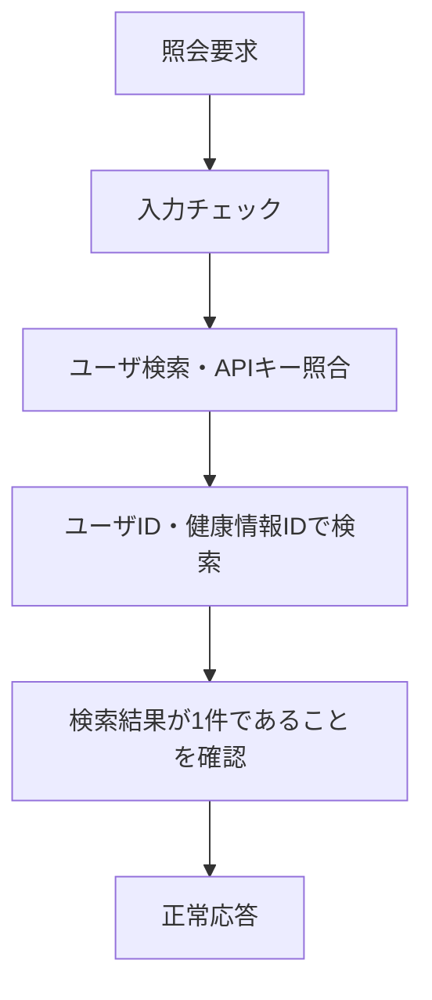
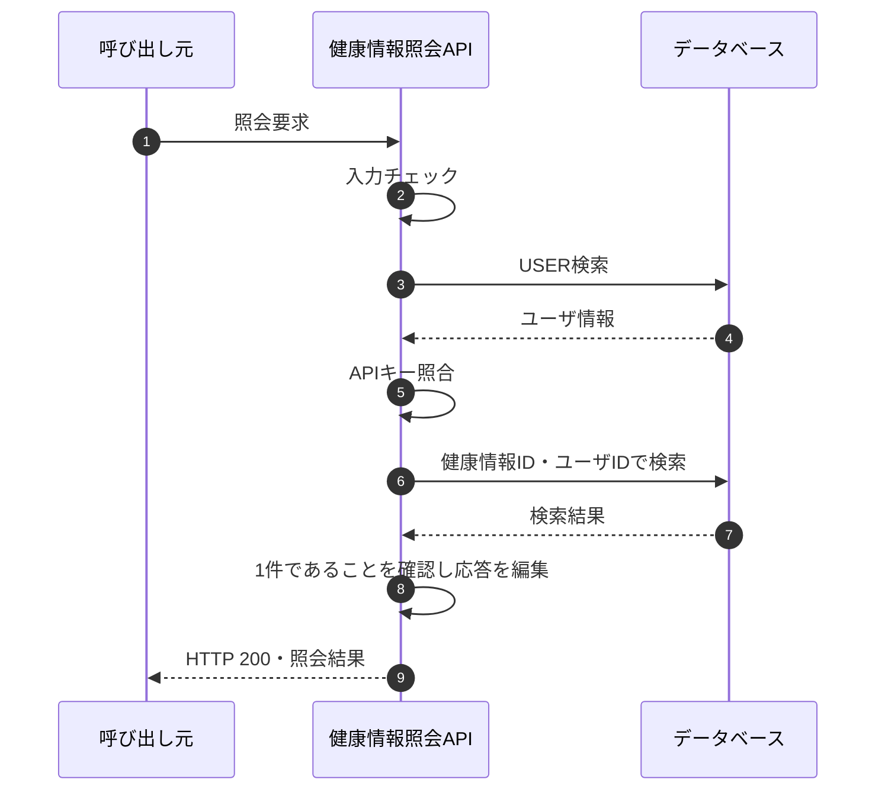
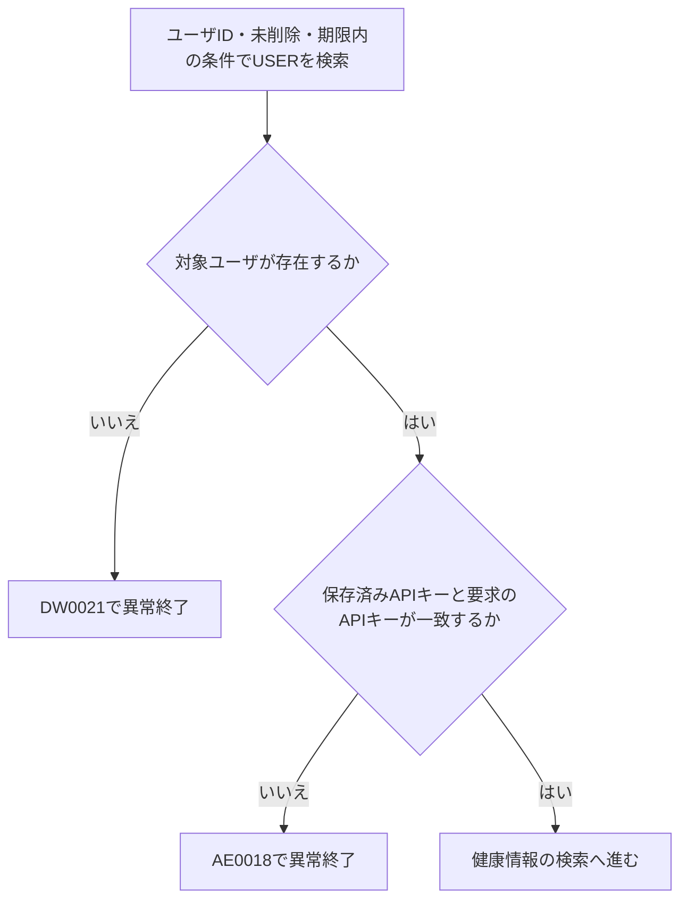

# 設計書 2.2. 健康情報照会API

## 1. 機能概要

- ユーザが保有する健康情報を1件取得する。
- APIキーを照合し、健康情報ID・ユーザIDで検索する。
- 入出力は[OpenAPI](./openapi.yaml)の`getHealthInfo`を参照する。

## 2. 処理概要



## 3. IF仕様

### 3.1. HTTPメソッド

| HTTPメソッド | 備考 |
| --- | --- |
| `GET` | — |

### 3.2. エンドポイントURL

| エンドポイントURL | 備考 |
| --- | --- |
| `/api/{seq_user_id}/healthinfo/{seq_health_info_id}` | スキーム・ホスト・ポートは実行環境に従う。 |

#### 3.2.1. パスパラメータ

| 項目名 | 必須 | 備考 |
| --- | --- | --- |
| `seq_user_id` | 必須 | ユーザID。 |
| `seq_health_info_id` | 必須 | 健康情報ID。0以上。チェック内容は「4.1.2. 項目の検証」に従う。 |

### 3.3. リクエストIF

#### 3.3.1. リクエストヘッダ

| 項目名 | 型 | 必須 | 値 | 備考 |
| --- | --- | --- | --- | --- |
| `Api-Key` | `string` | 必須 | ユーザのAPIキー | パスパラメータで指定したユーザに発行されたAPIキーを指定する。64文字（UTF-16コード単位）。 |

#### 3.3.2. クエリパラメータ

特になし。

#### 3.3.3. JSONボディ

特になし。

### 3.4. レスポンスIF

#### 3.4.1. レスポンスヘッダ

| 項目名 | 型 | 設定条件 | 備考 |
| --- | --- | --- | --- |
| `Content-Type` | `string` | JSON応答時 | `application/json`。独自のレスポンスヘッダーは定義しない。 |

#### 3.4.2. JSONボディ

```json
{
  "result": "0",
  "account": {
    "seq_user_id": 1
  },
  "health_info": {
    "seq_health_info_id": 100,
    "height": 170.5,
    "weight": 65.2,
    "bmi": 22.428,
    "standard_weight": 63.954,
    "reg_date": "20261111120000"
  }
}
```

| 項目名 | 型 | 設定条件 | 備考 |
| --- | --- | --- | --- |
| `result` | `string` | 必須 | 成功は`"0"`、失敗は`"1"`。数値ではない。 |
| `error` | `object` | 異常時 | エラーコードと詳細を格納する。正常時は省略する。 |
| `error.code` | `string` | 異常時 | 発生した処理に対応する外部エラーコード。 |
| `error.detail` | `string` | 異常時 | 詳細は該当する4.X節の発生条件に従う。 |
| `account` | `object` | 正常時 | アカウント情報。異常時は省略する。 |
| `account.seq_user_id` | `integer`（`int64`） | 正常時 | 要求のユーザID。 |
| `health_info` | `object` | 正常時 | 検索した健康情報。異常時は省略する。 |
| `health_info.seq_health_info_id` | `integer`（`int64`） | 正常時 | 健康情報ID。 |
| `health_info.height` | `number` | 正常時 | 保存済みの身長。 |
| `health_info.weight` | `number` | 正常時 | 保存済みの体重。 |
| `health_info.bmi` | `number` | 正常時 | 保存済みのBMI。 |
| `health_info.standard_weight` | `number` | 正常時 | 保存済みの標準体重。 |
| `health_info.reg_date` | `string` | 正常時 | 登録日時。`yyyyMMddHHmmss`。 |

## 4. 処理フロー



| 番号 | 処理内容 | 関連項番 | 備考 |
| --- | --- | --- | --- |
| 1 | 照会要求 | 4.1 | — |
| 2 | 入力チェック | 4.1 | — |
| 3 | USER検索 | 4.2.1 | — |
| 4 | ユーザ情報 | 4.2.1 | — |
| 5 | APIキー照合 | 4.3 | — |
| 6 | 健康情報ID・ユーザIDで検索 | 4.2.2 | — |
| 7 | 検索結果 | 4.2.2 | — |
| 8 | 1件であることを確認し応答を編集 | 4.4 / 4.5 | — |
| 9 | HTTP 200・照会結果 | 4.5 | — |

### 4.1. 入力チェック

#### 4.1.1. 要求の受け付け

| 入力情報 | 取得元 | 扱い |
| --- | --- | --- |
| ユーザID | URLのパス変数 | 符号付き64ビット整数として受け付ける |
| APIキー | `Api-Key`ヘッダー | 必須 |
| 健康情報ID | URLのパス変数 | 符号付き64ビット整数として受け付ける |

#### 4.1.2. 項目の検証

要求を受け付けた後、以下の項目チェックを行う。要求形式の解釈に失敗した場合の扱いは「4.1.2. 項目の検証」に従う。

| 対象 | チェック内容 | エラーコード | メッセージ |
| --- | --- | --- | --- |
| ユーザID | 必須 | `CW0017` | `seqUserIdが未指定です` |
| APIキー | 必須 | `CW0017` | `apiKeyが未指定です` |
| APIキー | 長さが64であること。長さはUTF-16コード単位で数える | `CW0017` | `apiKeyが64byteではありません` |
| 健康情報ID | 必須 | `CW0017` | `seq_health_info_idが未設定です` |
| 健康情報ID | 数値として受け付けた健康情報IDが0以上であること | `CW0017` | `seq_health_info_idが半角数字でありません` |

| 検証ルール | 内容 |
| --- | --- |
| エラーの返却単位 | 検出した項目エラーのうち先頭の1件を返す |
| エラー詳細の形式 | 上表のメッセージに`フィールド名=値`を付加する。未設定値は空文字列として表示する |

| 発生条件 | HTTPステータス | エラーコード | 詳細・扱い | 備考 |
| --- | --- | --- | --- | --- |
| ユーザID・健康情報IDのパス変数を符号付き64ビット整数として解釈できない | 400 | `CW0017` | `リクエストパラメータが不正です。 パラメータ名:{名前}, 値={値}` | Slack通知後にコード・詳細を設定し、コードのログレベルでログ出力して異常応答を返す。 |
| `Api-Key`ヘッダーが欠落している | 400 | `CE0002` | `予期せぬエラーが発生しました` | Slack通知後にコード・詳細を設定し、コードのログレベルでログ出力して異常応答を返す。 |
| 項目チェック失敗 | 400 | `CW0017` | 項目メッセージに` フィールド名=値`を付加し、先頭1件を返す。 | Slack通知後にコード・詳細を設定し、コードのログレベルでログ出力して異常応答を返す。 |

### 4.2. DB操作

#### 4.2.1. ユーザ検索

```sql
SELECT
    SEQ_USER_ID
    , PASSWORD
    , MAIL_ADDRESS
    , DELETE_FLAG
    , PASSWORD_EXPIRE
    , REMARKS
    , API_KEY
    , REG_DATE
    , UPDATE_DATE
    , GENDER_TYPE
    , BIRTH_DATE
FROM
    USER
WHERE
    SEQ_USER_ID = :seqUserId
    AND DELETE_FLAG = false
    AND PASSWORD_EXPIRE >= :sysDate;
```

| 対象 | 条件・設定値 | 備考 |
| --- | --- | --- |
| `USER.SEQ_USER_ID` | パスのユーザID | `:seqUserId`はバインド変数。削除フラグ・パスワード有効期限とのAND条件。 |
| `USER.DELETE_FLAG` | `false` | 削除済みユーザを除外する。 |
| `USER.PASSWORD_EXPIRE` | 日本時間のシステム日付以上 | `:sysDate`は検索時のシステム日付を表すバインド変数。有効期限当日を含める。 |

#### 4.2.2. 健康情報検索

```sql
SELECT
    SEQ_HEALTH_INFO_ID
    , SEQ_USER_ID
    , HEIGHT
    , WEIGHT
    , BMI
    , STANDARD_WEIGHT
    , HEALTH_INFO_REG_DATE
    , SEQ_BMI_RANGE_MT_ID
    , DELETE_FLAG
    , REG_DATE
    , UPDATE_DATE
FROM
    HEALTH_INFO
WHERE
    SEQ_HEALTH_INFO_ID = :seqHealthInfoId
    AND SEQ_USER_ID = :seqUserId;
```

| 対象 | 条件・設定値 | 備考 |
| --- | --- | --- |
| `HEALTH_INFO.SEQ_HEALTH_INFO_ID` | パスの健康情報ID | `:seqHealthInfoId`はバインド変数。ユーザIDとのAND条件で検索する。 |
| `HEALTH_INFO.SEQ_USER_ID` | パスのユーザID | `DELETE_FLAG`を検索条件に含めない。読み取りのみ。 |

| 発生条件 | HTTPステータス | エラーコード | 詳細・扱い | 備考 |
| --- | --- | --- | --- | --- |
| DB検索中の一般例外 | 400 | `CE0002` | `予期せぬエラーが発生しました` | Slack通知後にコード・詳細を設定し、コードのログレベルでログ出力して異常応答を返す。 |

### 4.3. API利用判定



| 判定項目 | 条件 | エラーコード |
| --- | --- | --- |
| API利用可能なユーザの存在 | ユーザIDが一致し、`DELETE_FLAG = false`かつ`PASSWORD_EXPIRE >= システム日付`のユーザが存在すること | `DW0021` |
| APIキーの一致 | 保存済みAPIキーと要求のAPIキーが一致すること | `AE0018` |

パスワード有効期限は日本時間のシステム日付と比較し、当日を含めて有効とする。削除済み・期限切れのユーザは検索対象外とし、ユーザ不存在と同じエラーを返す。

| 発生条件 | HTTPステータス | エラーコード | 詳細・扱い | 備考 |
| --- | --- | --- | --- | --- |
| ユーザが存在しない、削除済み、またはパスワード有効期限切れ | 400 | `DW0021` | `ユーザ情報が存在しません seqUserId:{ユーザID}` | Slack通知後にコード・詳細を設定し、コードのログレベルでログ出力して異常応答を返す。 |
| APIキーが一致しない | 400 | `AE0018` | `このユーザはAPIを実行できません。seq_user_id={ユーザID}` | Slack通知後にコード・詳細を設定し、コードのログレベルでログ出力して異常応答を返す。 |

### 4.4. 検索結果の件数判定

| 検索件数 | 処理 | 備考 |
| --- | --- | --- |
| 1件 | 正常応答へ進む | 取得した健康情報を使用する。 |
| 0件 | 異常終了 | 該当情報がない。 |
| 複数件 | 異常終了 | 先頭行だけで正常応答する処理にはしない。 |

| 発生条件 | HTTPステータス | エラーコード | 詳細・扱い | 備考 |
| --- | --- | --- | --- | --- |
| 検索結果が0件 | 400 | `CW0009` | `該当のレコードが見つかりません seq_health_info_id:{健康情報ID}, seq_user_id:{ユーザID}` | Slack通知後にコード・詳細を設定し、コードのログレベルでログ出力して異常応答を返す。 |
| 検索結果が複数件 | 400 | `CW0016` | `該当のデータが複数存在します seq_health_info_id:{健康情報ID}, seq_user_id:{ユーザID}` | Slack通知後にコード・詳細を設定し、コードのログレベルでログ出力して異常応答を返す。 |

### 4.5. 正常応答の生成

| 応答項目 | 設定元 | 備考 |
| --- | --- | --- |
| `account.seq_user_id` | 要求のユーザID | HTTP 200、resultは文字列0。 |
| `health_info` | 検索した健康情報 | 外部計算APIの呼び出し・SQS通信ログ送信は行わない。 |

| 発生条件 | HTTPステータス | エラーコード | 詳細・扱い | 備考 |
| --- | --- | --- | --- | --- |
| 応答編集などで一般例外 | 400 | `CE0002` | `予期せぬエラーが発生しました` | Slack通知後にコード・詳細を設定し、コードのログレベルでログ出力して異常応答を返す。 |
