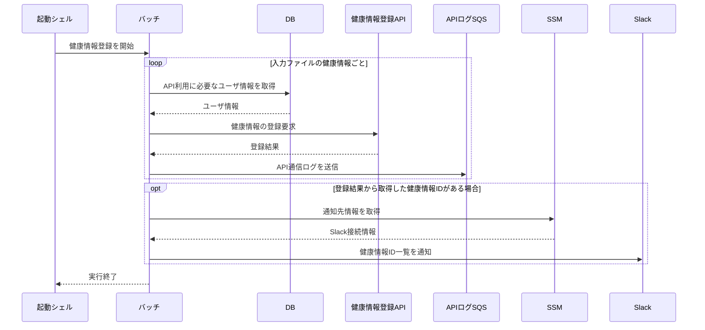
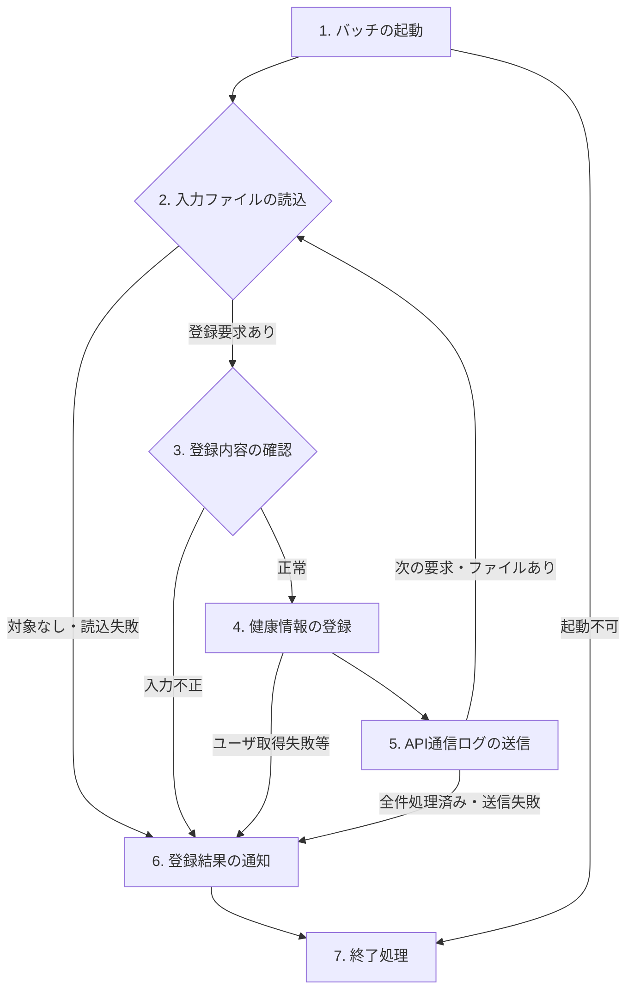

# 設計書 3.0. 健康情報登録バッチ

## 1. 機能概要

- 指定ディレクトリ配下のJSONを読み、健康情報の配列要素ごとに健康情報登録APIを呼び出す。
- ユーザ情報からAPIキーを取得し、身長・体重と各要求のトランザクションIDを送信する。
- API通信ログをSQSへ送信し、応答から取得した健康情報IDをStep終了時にSlackへ通知する。
- 入力ファイルの移動・削除・処理済み管理は行わない。

## 2. 処理概要



## 3. IF仕様

### 3.1. ジョブパラメータ

| 引数名 | キー | 必須 | 形式 | 値 | 備考 |
| --- | --- | --- | --- | --- | --- |
| 実行識別子 | `run.id` | 任意 | 年月日時分秒＋ナノ秒9桁＋`-`＋PID | バッチ実行識別子 | 標準シェルが`date "+%Y%m%d%H%M%S%N-$$"`で起動日時・ナノ秒・シェルPIDを連結して自動設定する。Job側に必須・形式チェックや省略時の自動補完はない。標準シェルでは実行ごとに生成し、新規JobInstanceとして起動する。本Jobに業務用のJobパラメータはない。 |

## 4. 処理フロー



| 処理順 | 処理概要 | 処理詳細 | 関連項番 |
| --- | --- | --- | --- |
| 1 | バッチの起動 | 共通設定・実行ID・排他を準備して登録Jobを開始する。ロック競合は終了コード50で終了し、登録処理へ進まない。 | 4.3 |
| 2 | 入力ファイルの読込 | 入力パス以下のJSONを順に読み、健康情報から登録要求を作成する。空配列は次のファイルへ進み、対象がなくなった場合や読込失敗時は処理6へ進む。 | 4.4 |
| 3 | 登録内容の確認 | ユーザID・身長・体重を検証する。正常なら処理4、不正ならStepを失敗させて処理6へ進む。 | 4.1 |
| 4 | 健康情報の登録 | ユーザ情報からAPIキーを取得し、健康情報登録APIを呼び出す。応答に健康情報があれば通知用IDを収集する。ユーザが存在しない場合は中断し、通常のAPI通信失敗は失敗応答として処理5へ渡す。 | 4.2、4.5 |
| 5 | API通信ログの送信 | 要求・応答・接続結果をSQSへ送信する。未処理の要求・ファイルがあれば処理2へ戻る。送信失敗はStepを失敗させるが、先行したAPI登録は取り消さない。 | 4.6 |
| 6 | 登録結果の通知 | Stepの成否にかかわらず収集済みIDがあればSlackへ通知し、なければ通知を省略する。通知だけの失敗では元のStep状態を変更せず、処理7へ進む。 | 4.7 |
| 7 | 終了処理 | Jobを開始した場合は、入力ファイルを保持してReader・Jobを終了し、共通の結果記録・通知を行う。プロセス終了後にロックを解放し、Job状態とシェル終了コードは区別する。 | 4.8 |

### 4.1. 入力チェック

| 対象 | チェック内容 | エラーコード | 備考 |
| --- | --- | --- | --- |
| `seqUserId` | 必須 | `CW0017` | `seqUserIdが未指定です`。要求に変換してからチェックする。 |
| `height` | 必須・符号なし10進数形式 | `CW0017` | `heightが未設定です`、`heightが数値でありません`。`BigDecimal.toString()`に対して形式チェックを行う。 |
| `weight` | 必須・符号なし10進数形式 | `CW0017` | `weightが未設定です`、`weightが数値でありません`。負数や指数表記は形式エラーとなる。 |
| `apiKey` | Processorではエラーを無視する | — | APIキーはWriterでDBから取得する。必須・64文字チェックの結果をProcessorが読み飛ばす。 |
| `transactionId` | 項目チェックなし | — | Readerが生成したUUIDを使用する。 |
| 数値範囲 | 業務上の上限・小数桁数・0の除外規定なし | — | 登録API側の検証・計算も実施される。 |

| 発生条件 | 例外・扱い | 備考 |
| --- | --- | --- |
| APIキー以外の検証エラー | `BusinessException(VALIDATE_ERROR)`でStepを失敗させる | エラー詳細は`{メッセージ}, {フィールド名}={値}`。APIキー以外の最初の1件で停止する。 |
| JSONをDTOの型に変換できない | Readerで失敗する | Processorの入力チェックへ進まない。4.4を参照する。 |

### 4.2. DB操作

#### 4.2.1. APIキー取得のためのユーザ検索

```sql
SELECT
    SEQ_USER_ID
    , PASSWORD
    , MAIL_ADDRESS
    , DELETE_FLAG
    , PASSWORD_EXPIRE
    , REMARKS
    , API_KEY
    , REG_DATE
    , UPDATE_DATE
    , GENDER_TYPE
    , BIRTH_DATE
FROM
    USER
WHERE
    SEQ_USER_ID = :seqUserId;
```

| 項目 | 設定値 | 備考 |
| --- | --- | --- |
| `:seqUserId` | 入力ファイルの`seq_user_id` | ユーザ主キー検索へ渡すID。 |


### 4.3. シェル起動・Job構成

#### 4.3.1. 共通定数の読込・実行IDの生成

| 項目 | 処理内容 | 備考 |
| --- | --- | --- |
| 起動シェル | [health_info_file_regist.sh](../../../ha-batch/docker/health_info_file_regist.sh) | `set -eu`を設定し、STARTを出力して`common.sh`を読み込む。 |
| 共通定数 | `BASE_DIR`、`DOCKER_DIR`、`LOCK_DIR`を使用 | 共通定義・Docker起動・共通listener・Spring Batchメタデータ管理は[バッチ共通処理](./設計書_3.11.バッチ共通処理.md)を参照する。 |
| 実行ID生成 | 共通シェルの`create_run_id`で起動日時・ナノ秒・シェルPIDから実行識別子を生成する | `run.id`としてJobへ渡す。標準シェルは起動ごとに生成する。 |

#### 4.3.2. 排他ロックの取得

| 項目 | 処理内容 | 備考 |
| --- | --- | --- |
| 排他 | ロックファイルを作成し、ファイル記述子9へ開いて`flock -n 9` | ロックファイルは削除しない。解放は4.8に従う。 |

#### 4.3.3. ComposeによるJob起動

| 項目 | 処理内容 | 備考 |
| --- | --- | --- |
| Docker起動 | `docker compose --project-directory "${BASE_DIR}" -f ${BASE_DIR}/${DOCKER_DIR}/docker-compose.yml run --rm ha-batch --spring.batch.job.name=healthInfoFileRegistBatchJob "run.id=${RUN_ID}"` | `cd ${BASE_DIR} &&`に続けて起動する。`cd`失敗時はComposeを呼ばずEND表示へ進む場合がある。コンテナ終了時に削除する。 |

#### 4.3.4. Job・Stepの開始と処理構成

| 項目 | 処理内容 | 備考 |
| --- | --- | --- |
| Job構成 | `healthInfoFileRegistBatchJob` → `healthInfoFileRegistBatchStep` | [HealthInfoFileRegistConfig](../../../ha-batch/src/main/java/jp/co/ha/batch/healthInfoFileRegist/HealthInfoFileRegistConfig.java)で定義する。 |
| 共通開始処理 | Jobの実行履歴を準備し、共通リスナーで開始ログを出力して登録Stepを開始する | 履歴保存と共通リスナーの詳細は[バッチ共通処理](./設計書_3.11.バッチ共通処理.md)を参照する。 |
| 処理方式 | Reader → Processor → Writer、chunkサイズ`1` | Stepのトランザクションマネージャを使用する。HTTP・SQS・Slackの副作用はDBロールバックで取り消せない。 |
| retry指定 | `RestClientException`、`retryLimit(3)` | Stepへ例外が伝播した場合の設定。通常のHTTP例外は`BaseApi`が捕捉するため、この設定による再試行は起きない。 |
| skip指定 | `HttpClientErrorException`、`skipLimit(10)` | Stepへ例外が伝播した場合の設定。APIの失敗応答そのものはスキップ扱いにならず、その要求のWriter処理が完了する。 |

#### 4.3.5. 再実行時の扱い

| 項目 | 処理内容 | 備考 |
| --- | --- | --- |
| 再実行 | シェル実行ごとに新しい`run.id`を生成する | 同じ入力を再配置しなくても、残ったファイルが再処理される。APIの重複登録を防ぐ処理はない。 |

### 4.4. Readerのファイル読込・要求編集

#### 4.4.1. 入力パス確認・ファイル一覧の準備

| 順序 | 処理内容 | 備考 |
| --- | --- | --- |
| 1 | 入力パスの存在を確認する | 存在しなければ`BusinessException(RUNTIME_ERROR)`、`CE0001`。詳細は`ディレクトリが存在しません: {パス}`。Readerの初期化例外は継承クラスで`ItemStreamException`にラップされる。 |
| 2 | `FileUtil.getFileList`で配下の全ファイルを再帰列挙する | パスが通常ファイルの場合、権限不足等で`listFiles()`が`null`の場合は列挙中に例外となり得る。 |
| 3 | `fileIndex=0`、要求bufferを空にする | 初期化は`doOpen`で行う。空ディレクトリは`read()`が`null`を返して正常に読み終える。 |

| 実装 | 役割 | 備考 |
| --- | --- | --- |
| [FileUtil](../../../ha-common/src/main/java/jp/co/ha/common/util/FileUtil.java) | 再帰ファイル列挙 | 拡張子フィルタ・ソートなし。 |

#### 4.4.2. JSONファイルの読込

| 順序 | 処理内容 | 備考 |
| --- | --- | --- |
| 4 | bufferが空なら次ファイルを`JsonReader.read`でDTOへ変換する | 一度に1ファイル全体を読み込む。DTOは[HealthInfoFileRegistDto](../../../ha-batch/src/main/java/jp/co/ha/batch/healthInfoFileRegist/HealthInfoFileRegistDto.java)を参照する。 |

| 発生条件 | 例外・扱い | 備考 |
| --- | --- | --- |
| JSON構文・マッピングの失敗 | `JsonReader`がログ出力して`null`を返す | ReaderがDTOを参照すると例外になる。専用の正常スキップ処理はない。 |

| 実装 | 役割 | 備考 |
| --- | --- | --- |
| [JsonReader](../../../ha-common/src/main/java/jp/co/ha/common/io/file/json/reader/JsonReader.java) | JSONとDTOの変換 | JSONの構文・マッピング失敗をログに記録する。 |

#### 4.4.3. 登録要求・UUIDの作成

| 順序 | 処理内容 | 備考 |
| --- | --- | --- |
| 5 | 配列要素ごとに`HealthInfoRegistApiRequest`を作成する | ユーザID・身長・体重をコピーし、`ApiLogComponent.transactionId()`でUUIDを生成する。 |
| 6 | ファイル内の全要求をbufferに格納し、先頭を1件ずつ返す | 大きな配列は配列全体と要求一覧をメモリに保持する。空配列なら再帰的に次ファイルへ進む。 |

| 発生条件 | 例外・扱い | 備考 |
| --- | --- | --- |
| 配列が`null`、要素が`null` | 要求への変換時に例外となる | 配列必須・要素必須を明示チェックする処理はない。 |

| 実装 | 役割 | 備考 |
| --- | --- | --- |
| [HealthInfoFileRegistReader](../../../ha-batch/src/main/java/jp/co/ha/batch/healthInfoFileRegist/HealthInfoFileRegistReader.java) | 入力パス確認・JSON読込・要求作成 | `AbstractItemCountingItemStreamItemReader`を継承する。 |

#### 4.4.4. 読取終端・再開時の扱い

| 順序 | 処理内容 | 備考 |
| --- | --- | --- |
| 7 | 全ファイル・bufferが終了したら`null`を返す | 読取終端を通知する。Reader終了時の扱いは4.8に従う。 |
| 8 | 同一JobInstanceの再開では継承Readerの読込件数を使用する | Reader自身はファイル名・ファイルごとの位置を保存しない。列挙順や入力内容が変わると同一位置の復元を保証できない。スキップ読込でも要求のUUIDを再生成する。 |

| 発生条件 | 例外・扱い | 備考 |
| --- | --- | --- |
| 読込・列挙のその他の例外 | Stepへ伝播する | 入力ファイルを保持し、後続ファイルを処理しない。 |

### 4.5. Processor・Writerの健康情報登録API呼出し

#### 4.5.1. API用ユーザ情報の取得

| 処理・結果 | 扱い | 備考 |
| --- | --- | --- |
| ユーザ検索の呼出し | `UserComponent.findById`からユーザ主キー検索を行う | `UserSearchServiceImpl.findById`、`UserMapper.selectByPrimaryKey`の順に呼び出す。 |
| ユーザ検索結果 | 取得した`API_KEY`を要求の`Api-Key`へ設定する | バッチ側でAPIキーの追加検証は行わず、API側がユーザの削除状態・パスワード有効期限を含め利用可否を判定する。 |
| 登録の責務 | 健康情報の登録は[健康情報登録API](../02_api/設計書_2.1.健康情報登録API.md)へ委譲する | バッチ自身は業務DBを更新しない。APIログはSQS経由で別バッチが登録する。 |

| 発生条件 | 例外・扱い | 備考 |
| --- | --- | --- |
| ユーザが存在しない | `BusinessException(DB_NO_DATA)`、`CW0009` | `ユーザ情報が存在しません. seq_user_id={ユーザID}`。APIを呼び出さずStepを失敗させる。 |
| DB検索例外 | 例外をStepへ伝播する | 個別のスキップ・再試行対象には指定されていない。 |

#### 4.5.2. 健康情報登録APIの呼出し・結果の収集

```json
{
  "height": 170.5,
  "weight": 65.2,
  "transaction_id": "123e4567-e89b-12d3-a456-426614174000"
}
```

| API項目 | 内容 | 備考 |
| --- | --- | --- |
| メソッド・URL | `POST {healthinfo.api.url}{seq_user_id}/healthinfo` | パスのユーザIDは入力ファイルから取得する。クエリパラメータはない。 |
| `Content-Type` | `application/json` | 共通基底APIが設定する。 |
| `Accept` | `application/json` | 共通基底APIが設定する。 |
| `Accept-Charset` | `UTF-8` | `ApiConnectInfo`の既定文字コード。 |
| `Api-Key` | `USER.API_KEY` | ユーザID・APIキーは要求JSONに含めない。 |
| JSONの`height`・`weight` | 配列要素の身長・体重 | `BigDecimal`をJSON数値として送信する。 |
| JSONの`transaction_id` | Readerで要求ごとに生成したUUID | APIログにも同じ値を設定する。 |
| API側の処理 | 入力検証、利用可能なユーザの検索・APIキー照合、計算API呼出し、健康情報登録 | 詳細は[健康情報登録API](../02_api/設計書_2.1.健康情報登録API.md)を参照する。 |
| 応答の使用 | 応答と`health_info`が非`null`なら`seq_health_info_id`を一覧へ追加 | `result`の値・IDの非`null`は判定しない。API登録日時はAPI側のシステム日時となる。 |

| 発生条件 | 処理・影響 | 備考 |
| --- | --- | --- |
| HTTP 4xx・5xx、接続失敗、通常の通信・変換例外 | `BaseApi`が捕捉し、`result=FAILURE`、詳細`通信エラーです.`を設定した応答を返す | Writerは失敗を例外化せず通信ログ送信へ進む。Stepのretry・skipは通常作動しない。 |
| APIが失敗結果を返した | `health_info`がなければID追加を行わず、通信ログを送信する | 後続要求を継続する。バッチ全体をAPI成功に連動させる判定はない。 |
| API応答が`null` | ID追加は省略するが、その後のログPayload生成で応答参照が失敗し得る | HTTP応答Bodyが空の場合など。 |
| 後続のSQS送信やStepが失敗 | 先行したAPI登録は取り消さない | 同じファイルの再実行で重複登録し得る。 |

| 実装 | 役割 | 備考 |
| --- | --- | --- |
| [HealthInfoFileRegistProcessor](../../../ha-batch/src/main/java/jp/co/ha/batch/healthInfoFileRegist/HealthInfoFileRegistProcessor.java) | APIキー以外の入力チェック | 検証エラーを業務例外にする。 |
| [HealthInfoFileRegistWriter](../../../ha-batch/src/main/java/jp/co/ha/batch/healthInfoFileRegist/HealthInfoFileRegistWriter.java) | ユーザ検索・API呼出し・ID保持・APIログ送信 | `StepExecutionListener`も実装する。 |
| [HealthInfoRegistApi](../../../ha-business/src/main/java/jp/co/ha/business/api/healthinfoapp/HealthInfoRegistApi.java) | POSTクライアント | [BaseApi](../../../ha-common/src/main/java/jp/co/ha/common/web/api/BaseApi.java)のHTTP通信・例外処理を使用する。 |

### 4.6. API通信ログのSQS送信

#### 4.6.1. 通信ログPayloadの編集

| Payload項目 | 設定値 | 備考 |
| --- | --- | --- |
| `transaction_id` | 要求のUUID | FIFOの`messageGroupId`にも使用する。 |
| `api_name` | `健康管理API:健康情報登録API` | APIクライアントの名称。 |
| `http_method` | `POST` | 固定。 |
| `url` | 呼び出したAPIのURL | ユーザIDを含む。 |
| `body` | 送信要求をJSON化した文字列 | 身長・体重・トランザクションID。APIキーは含まない。 |
| `request_date` | HTTP送信直前の日時 | `yyyy/MM/dd HH:mm:ss`。送信前の例外では`null`となり得る。 |
| `http_status` | 取得できたHTTPステータス | HTTP例外時は`BaseApi`の成功後代入へ到達しないため`null`となり得る。 |
| `detail` | 応答の`error.detail` | エラー情報がない場合は`null`。 |
| `response_date` | HTTPステータス取得後の日時 | 取得できなければ`null`。 |

| 処理・発生条件 | 内容 | 備考 |
| --- | --- | --- |
| 送信タイミング | API呼出し・ID一覧追加後、同じ要求のWriter内で送信する | [ApiLogComponent](../../../ha-business/src/main/java/jp/co/ha/business/component/ApiLogComponent.java)の`getPayload4AppApi`・`registQueue`を使用する。 |

#### 4.6.2. SQS送信と完了待ち

| 処理・発生条件 | 内容 | 備考 |
| --- | --- | --- |
| キュー送信 | キュー名からURLを取得し、PayloadをJSON化して`sendMessage`する | `messageDeduplicationId`は送信ごとのUUID。送信済みAPIログの重複を排除する仕組みではない。 |
| 後続処理 | APIログ取込バッチが別途DB登録する | 本バッチはキュー送信完了まで待つ。DB登録の完了待ち・SQSの削除は行わない。 |

#### 4.6.3. ログ生成・送信失敗時の扱い

| 処理・発生条件 | 内容 | 備考 |
| --- | --- | --- |
| SQS送信失敗 | `SystemException(AWS_SQS_ENQUEUE_ERROR)`、`CE0041`をStepへ伝播する | その要求のAPI登録やID一覧追加は取り消さない。後続要求を中止する。 |
| JSON文字列化失敗 | 変換例外をStepへ伝播する | SQS送信前に失敗し、API登録は取り消されない。 |

### 4.7. Step終了時のID通知

#### 4.7.1. 通知対象・通知時点の確認

| 処理・発生条件 | 内容 | 備考 |
| --- | --- | --- |
| ID一覧が空 | 固有Slack通知を省略する | 入力0件・全API失敗の場合など。 |
| 通知時点 | Writerの`afterStep`。Readerの`close`より前に呼び出す | Stepの成否を条件にしていないため、途中失敗までに集めたIDも通知する。返却値は元のStep終了ステータス。 |
| メール・S3 | 固有処理なし | 健康情報登録完了メールの送信、S3への結果保存は行わない。 |

#### 4.7.2. Slack接続情報の取得

| 処理・発生条件 | 内容 | 備考 |
| --- | --- | --- |
| Slack接続 | SSMの`/{環境}/slack_token`からJSONのトークン・`batch`通知先を取得する | `POST https://slack.com/api/chat.postMessage`へ`Authorization: Bearer {token}`と`channel`・`text`を送る。 |

#### 4.7.3. ID一覧の通知・通知失敗時の扱い

| 処理・発生条件 | 内容 | 備考 |
| --- | --- | --- |
| ID一覧がある | IDを`StringUtil.NEW_LINE`で連結し、`SlackApiComponent.send(ContentType.BATCH, 一覧)`を実行する | IDはAPI応答の取得順で、重複排除はしない。 |
| SlackのHTTP非成功 | 警告ログを記録する | それだけでは例外にしない。HTTP成功時のJSON内`ok`値を検証する処理はない。 |
| SSM取得・接続情報変換・Slack I/O失敗 | 実行時例外になり、Spring Batchが`afterStep`の例外として捕捉・エラーログ出力する | この通知例外だけで元のStep状態を`FAILED`へ変更する処理はない。成功済み登録の取消し・入力ファイルの削除は行わない。 |
| IDが`null` | `toString()`による通知本文作成時に例外となる | `health_info`が存在してもIDが未設定の応答を除外する処理はない。 |

### 4.8. Reader・Jobの終了とロック解放

#### 4.8.1. Readerの終了

| 処理 | 内容 | 備考 |
| --- | --- | --- |
| Readerの終了 | `doClose`はデバッグログのみを出力する | 入力ファイルの削除・移動・処理済みマークは付けない。 |

#### 4.8.2. Jobの共通終了処理

| 処理 | 内容 | 備考 |
| --- | --- | --- |
| 共通終了 | Jobの終了状態を記録し、共通ログ・通知を実行する | [バッチ共通処理](設計書_3.11.バッチ共通処理.md)に従う。 |

#### 4.8.3. プロセス終了・ロック解放

| 処理 | 内容 | 備考 |
| --- | --- | --- |
| プロセス終了 | Java・コンテナの終了後に起動シェルを終了する | JobのFAILEDとOSプロセスの非0終了は同義ではない。5.4の終了判定を参照する。 |
| ロック解放 | シェルの終了に伴いファイル記述子のロックを解放する | ロックファイル自体は削除しない。`set -e`による途中終了ではEND表示へ到達しない場合がある。 |

## 5. 実行仕様

### 5.1. 起動方法

```bash
bash ha-batch/docker/health_info_file_regist.sh
```

```bash
java -jar ha-batch/target/batch-1.0.0.jar \
  --spring.batch.job.name=healthInfoFileRegistBatchJob \
  "run.id=20261114010000000000000-1234"
```

| 項目 | 指定内容 | 必須 | 備考 |
| --- | --- | --- | --- |
| シェル位置引数 | なし | — | スクリプトは位置引数を参照せず、Javaへ転送しない。 |
| `--spring.batch.job.name` | `healthInfoFileRegistBatchJob` | 必須 | シェル内で指定する。 |
| `--ha-batch.health-info-file-regist.file-path` | 入力ディレクトリ | 任意 | Javaを直接起動する場合の設定上書き。既定値は5.2に記載する。 |

### 5.2. 設定・実行条件

| 項目 | 設定・条件 | 備考 |
| --- | --- | --- |
| 入力パス | `ha-batch.health-info-file-regist.file-path=/home/admin/data/health_info_file_regist/` | `application.yml`の既定値。存在確認のみでディレクトリ種別・読取権限を事前検証しない。 |
| API基底URL | `healthinfo.api.url` | localの既定値は`http://localhost:8081/api/`。`HEALTHINFO_API_URL`で上書き可能。末尾の`/`を含める。 |
| Docker内API基底URL | `http://ha-api:8081/api/` | Composeの`HEALTHINFO_API_URL`。 |
| 入力ファイル配置 | バッチ実行環境から入力パスを参照できること | Composeには既定入力パスへの専用volume定義がないため、コンテナ内への配置または設定上書きが必要。 |
| 実行環境 | Bash・`flock`・Docker Composeを利用できること | `const.txt`の`BASE_DIR`、`DOCKER_DIR`、`LOCK_DIR`が実行環境に合っていること。 |
| 排他単位 | `${LOCK_DIR}/health_info_file_regist.sh.lock` | スクリプトのbasename単位。同名スクリプトの二重起動を防ぐ。Java直接起動には適用されない。 |
| APIログSQS | `aws.sqs.queue.api_log` | localの既定キュー名は`local_api_log.fifo`。AWS認証・SQS送信権限が必要。 |
| Slack接続情報 | SSMの`/{環境}/slack_token` | `batch`に対応する通知先が必要。SSM参照・Slack接続が必要。 |
| 実行タイミング | 外部スケジューラまたは手動起動 | スクリプト内に時刻・周期の指定はない。 |
| 共通設定 | Springプロファイル、DB接続、AWS接続、共通listener | [バッチ共通処理](./設計書_3.11.バッチ共通処理.md)を参照する。 |

### 5.3. 入力ファイル

```json
{
  "seq_user_id": 1,
  "health_info_request_data_list": [
    {
      "height": 170.5,
      "weight": 65.2
    },
    {
      "height": 170.5,
      "weight": 65.0
    }
  ]
}
```

| 項目 | 型・形式 | 必須 | 備考 |
| --- | --- | --- | --- |
| ファイル形式・文字コード | JSON・UTF-8 | 必須 | ファイル名の指定はなく、ヘッダ・フッタはない。 |
| 対象ファイル | 入力ディレクトリ以下の全ファイル | — | サブディレクトリも再帰走査する。拡張子・名前のフィルタ、ソート指定はない。JSON以外を置くと読込失敗になり得る。 |
| `seq_user_id` | `integer`（Javaの`Long`） | 要求がある場合必須 | ファイル内すべての配列要素に同じユーザIDを設定する。 |
| `health_info_request_data_list` | `array<object>` | 登録対象がある場合必須 | 省略時は初期値の空配列。空配列のファイルは要求を生成せず次のファイルへ進む。明示的な`null`は列挙時に例外となる。 |
| `health_info_request_data_list[].height` | `number`（Javaの`BigDecimal`） | 必須 | 身長。項目チェックは4.1を参照する。 |
| `health_info_request_data_list[].weight` | `number`（Javaの`BigDecimal`） | 必須 | 体重。項目チェックは4.1を参照する。 |
| `transaction_id` | 入力項目なし | — | バッチが要求ごとにUUIDを生成する。日時やAPIキーは入力ファイルから取得しない。 |
| 未定義JSON項目 | DTOに定義なし | — | 使用するJackson 3の既定値では未知項目を無視する。項目型等によるマッピング失敗時の扱いは4.4を参照する。 |

### 5.4. 終了コード・出力

| 出力 | 内容・条件 | 備考 |
| --- | --- | --- |
| シェル終了コード`50` | 排他ロックを取得できない場合 | `healthInfoFileRegistBatchJob is already running.`を標準出力へ出力する。 |
| シェル終了コード`0` | Docker Composeコマンドを含むシェルが正常終了した場合 | Jobの業務結果とプロセス終了コードの関係は[バッチ共通処理](./設計書_3.11.バッチ共通処理.md)を参照する。 |
| その他のシェル終了コード | `set -eu`により未設定変数・Compose等の非0終了を扱う | `cd ... && docker compose ...`の`cd`失敗は後続END表示へ進み、0終了する場合がある。固有の業務エラーを数値終了コードへ変換する処理はない。 |
| Job・Step結果 | `healthInfoFileRegistBatchJob`、`healthInfoFileRegistBatchStep`の実行状態 | APIの失敗応答をWriterが例外化しないため、全件がAPI失敗でもStepが正常終了し得る。 |
| DB反映 | API呼出し成功時に健康情報を登録 | バッチ自身の業務DB操作は`USER`の参照。登録は健康情報登録APIの責務。 |
| API通信ログ | 各API呼出し後にSQSへ送信 | APIログ取込完了までは待たない。4.6を参照する。 |
| Slack | 応答から取得した健康情報IDを改行区切りで送信 | `ContentType.BATCH`。ID一覧が空なら固有通知を行わない。共通listenerの通知は別途行う。 |
| ファイル・S3 | 新規出力なし | 入力JSONを残す。CSV・JSONの結果ファイル作成、S3送信、入力ファイルの移動・削除は行わない。 |
