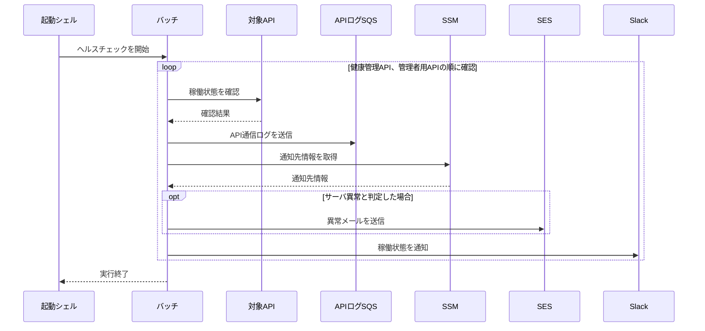
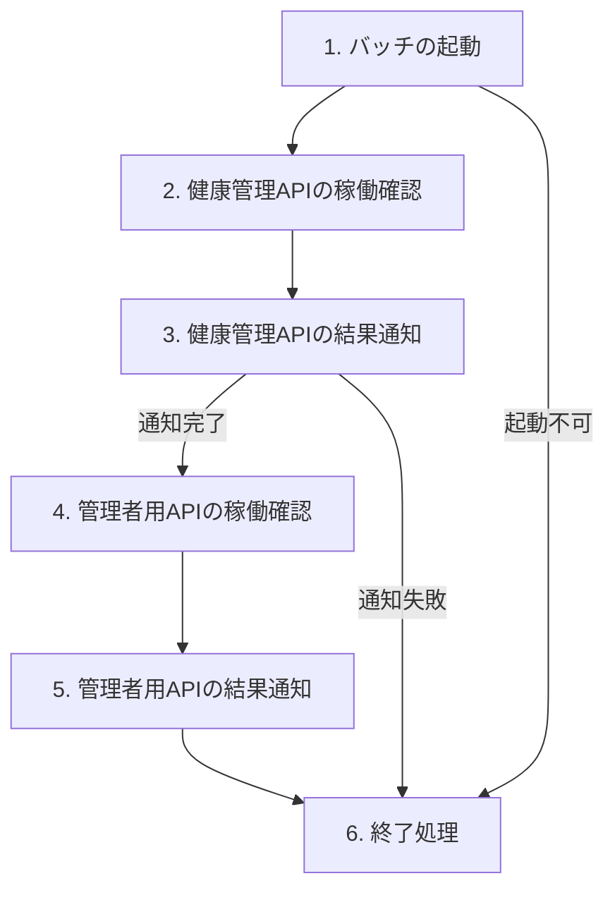

# 設計書 3.1. ヘルスチェックバッチ

## 1. 機能概要

- 健康管理API・管理者用APIのヘルスチェックAPIを順番に呼び出し、APIからの応答結果を確認する。
- API通信ログをSQSへ送信し、正常時はSlack、異常時はSESメールとSlackで通知する。
- 1回のJob実行内でトランザクションIDを共有し、各APIの結果を共通の通知Stepへ渡す。
- 検査対象は健康管理APIと管理者用APIの2つとする。計算APIのヘルスチェックは実行しない。

## 2. 処理概要



## 3. IF仕様

### 3.1. ジョブパラメータ

| 引数名 | キー | 必須 | 形式 | 値 | 備考 |
| --- | --- | --- | --- | --- | --- |
| 実行識別子 | `run.id` | 任意 | 年月日時分秒＋ナノ秒9桁＋`-`＋PID | バッチ実行識別子 | 標準シェルが`date "+%Y%m%d%H%M%S%N-$$"`で起動日時・ナノ秒・シェルPIDを連結して自動設定する。Job側に必須・形式チェックや省略時の自動補完はない。標準シェルでは実行ごとに生成し、新規JobInstanceとして起動する。本Jobに業務用のJobパラメータはない。 |

## 4. 処理フロー



| 処理順 | 処理概要 | 処理詳細 | 関連項番 |
| --- | --- | --- | --- |
| 1 | バッチの起動 | 共通設定・実行ID・排他を準備し、2つのAPIを順に確認するJobを開始する。ロック競合は終了コード50で終了する。 | 4.3 |
| 2 | 健康管理APIの稼働確認 | 健康管理APIを呼び出し、API通信ログをSQSへ送信して通知用の結果を保持する。確認Stepが失敗した場合も処理3へ進む。 | 4.4、4.5 |
| 3 | 健康管理APIの結果通知 | 成功はSlack、成功以外はメールとSlackへ通知する。結果未設定等で通知処理自体が失敗した場合は終了処理へ進み、後続APIの確認は保証しない。 | 4.6 |
| 4 | 管理者用APIの稼働確認 | 管理者用APIを呼び出し、API通信ログをSQSへ送信して通知用の結果を更新する。確認Stepが失敗した場合も処理5へ進む。 | 4.4、4.5 |
| 5 | 管理者用APIの結果通知 | 保持した結果に応じてメール・Slackへ通知する。結果更新前に失敗した場合は先行APIの情報が残り得る。通知完了・通知失敗とも処理6へ進む。 | 4.6 |
| 6 | 終了処理 | Jobを開始した場合は、その実行状態を記録し、共通の終了ログ・通知を行う。プロセス終了後にロックを解放し、Job状態とシェル終了コードは区別する。 | 4.7 |

### 4.1. 入力チェック

| 対象 | チェック内容 | 備考 |
| --- | --- | --- |
| バッチ引数・ファイル | 固有の入力チェックなし | ヘルスチェックの対象URLは設定値から作成する。 |
| 外向API要求 | BeanValidatorは呼び出さない | 空の要求オブジェクトを作成する。健康管理API要求の基底クラスにあるユーザID・APIキーは設定しない。 |
| 実行コンテキスト | 通知に必要なキーの事前検証なし | 未設定・不正値の場合の扱いは4.6に記載する。 |

### 4.2. DB操作

| 操作 | 内容 | 備考 |
| --- | --- | --- |
| 業務DBの検索・更新 | 特になし | トランザクションIDのDB採番、API通信ログの直接INSERT・UPDATEは行わない。 |
| API通信ログ | SQSへ送信する | DB登録はAPIログ取込バッチの責務。4.5を参照する。 |
| Spring Batch管理情報 | Job・Step・ExecutionContext等を管理する | [バッチ共通処理](./設計書_3.11.バッチ共通処理.md)を参照する。 |

### 4.3. シェル起動・JobとFlowの構成

#### 4.3.1. 共通設定・実行IDの準備

| 項目 | 処理内容 | 備考 |
| --- | --- | --- |
| シェル | [health_check.sh](../../../ha-batch/docker/health_check.sh) | START出力後に`common.sh`を読み、`run.id`を生成する。 |

#### 4.3.2. 排他ロックの取得

| 項目 | 処理内容 | 備考 |
| --- | --- | --- |
| 排他 | basenameに`.lock`を付けて記述子9へ開き、`flock -n 9`する | 取得失敗はコード50。終了時にロックを解放し、ファイルは残す。 |

#### 4.3.3. ComposeによるJob起動

| 項目 | 処理内容 | 備考 |
| --- | --- | --- |
| Docker起動 | `docker compose --project-directory "${BASE_DIR}" -f ${BASE_DIR}/${DOCKER_DIR}/docker-compose.yml run --rm ha-batch --spring.batch.job.name=healthCheckBatchJob "run.id=${RUN_ID}"` | `cd ${BASE_DIR} &&`に続けて起動する。`cd`失敗時はComposeを呼ばずEND表示へ進む場合がある。 |
| Job名 | `healthCheckBatchJob` | [HealthCheckConfig](../../../ha-batch/src/main/java/jp/co/ha/batch/healthcheck/HealthCheckConfig.java)で定義する。 |

#### 4.3.4. Job・Flowの開始と実行構成

| 項目 | 処理内容 | 備考 |
| --- | --- | --- |
| 第1 Flow | `appApiHealthCheckFlow` | `appApiHealthCheckStep` → `healthCheckNotifyStep`。 |
| 第2 Flow | `rootApiHealthCheckFlow` | `rootApihealthCheckStep` → `healthCheckNotifyStep`。Step名の`health`は小文字で定義されている。 |
| Flow実行順 | 健康管理APIのFlow完了後に管理者用APIのFlowを実行 | 並列実行ではない。 |
| 通知への遷移 | 各API Stepから`.on("*").to(healthCheckNotifyStep)` | API Stepが失敗しても通知Stepへの遷移を試みる。通知が成功すればFlowが完了となり得る。通知用データが揃っているとは限らない。 |
| 通知Stepの共有 | 同一`healthCheckNotifyStep`を両Flowで使用する | 同じJobExecution内の2回目の到達時も実行する。Job内の重複StepとしてSpring Batchがログを出力する。 |
| Tasklet | APIごとのTasklet、共通通知Taskletを使用 | chunk処理・skip・Spring Batchのretry設定はない。各Stepのトランザクションマネージャを使用する。 |
| 通信失敗とJob結果 | 通信失敗応答を保存した後、通知が完了すれば通常の処理終了となる | サーバ異常だけでAPI Taskletを失敗させる処理はない。 |
| 途中失敗 | 通知Step自体が失敗すると、そのFlowは正常完了せず後続Flowへ進めない場合がある | 健康管理APIの通知失敗時に管理者用APIの検査を必ず実行する構成ではない。 |
| 共通起動・終了 | Springプロファイル、起動、listener、JobRepository管理を使用 | [バッチ共通処理](./設計書_3.11.バッチ共通処理.md)を参照する。 |

#### 4.3.5. 再実行時の扱い

| 項目 | 処理内容 | 備考 |
| --- | --- | --- |
| 再実行 | シェルが新しい`run.id`を付けて再実行する | 2つのAPI呼出し・SQS送信・通知を再度行う。同一JobInstanceの再開では保存済みStep状態・ExecutionContextも影響する。 |

### 4.4. API呼出し・実行コンテキストの更新

#### 4.4.1. 外向APIのIF

| 対象 | HTTPメソッド・URL | 備考 |
| --- | --- | --- |
| 健康管理API | `GET {healthinfo.api.url}healthcheck` | [ヘルスチェックAPI](../02_api/設計書_2.0.ヘルスチェックAPI.md)を参照する。 |
| 管理者用API | `GET {root.api.url}healthcheck` | [管理者用ヘルスチェックAPI](../05_rootapi/設計書_5.0.ヘルスチェックAPI.md)を参照する。 |

| 要求項目 | 設定内容 | 備考 |
| --- | --- | --- |
| `Accept` | `application/json` | `BaseApi`が付与する。 |
| `Accept-Charset` | `UTF-8` | `ApiConnectInfo`の既定文字コード。 |
| 認証ヘッダ | なし | `Api-Key`・Bearerトークンを設定しない。 |
| クエリパラメータ | なし | 各要求クラスに宣言された項目がなく、クエリ文字列は生成されない。 |
| JSONボディ | なし | GET要求として送信する。 |

```json
{
  "result": "0"
}
```

| 応答項目 | 使用方法 | 備考 |
| --- | --- | --- |
| `result` | `"0"`を`SUCCESS`、`"1"`を`FAILURE`として受け取る | TaskletはEnumの`toString()`を`response_type`へ格納する。通知では文字列`SUCCESS`と比較する。 |
| 健康管理APIの`error.detail` | APIログPayloadの`detail`へ設定 | `error`がなければ`null`。 |
| 管理者用APIの異常詳細 | APIログPayloadへ設定しない | Root用Payload生成は`detail=null`とする。 |
| ヘルスチェック範囲 | APIの要求受付・応答作成 | 接続先のDB・AWS・他API等の依存先状態まで検査する要求ではない。 |

#### 4.4.2. Taskletの処理順

| 順序 | 処理内容 | 備考 |
| --- | --- | --- |
| 1 | JobのExecutionContextに`transactionId`があれば使用し、なければUUIDを生成する | [BaseHealthCheckApiTasklet](../../../ha-batch/src/main/java/jp/co/ha/batch/healthcheck/BaseHealthCheckApiTasklet.java)の`getTransactionId`を使用する。 |
| 2 | `transactionId`を同じExecutionContextへ格納する | 次APIでも同じ値を使用する。HTTP要求のパラメータ・ヘッダには設定しない。 |
| 3 | 空の要求とURLを設定した`ApiConnectInfo`を作り、APIを呼び出す | 通信処理は[BaseApi](../../../ha-common/src/main/java/jp/co/ha/common/web/api/BaseApi.java)を使用する。明示的なHTTP再試行・API用タイムアウト設定はない。 |
| 4 | API通信ログのPayloadを生成しSQSへ送信する | 結果のコンテキスト格納より前に実行する。 |
| 5 | `response_type`・`apiName`・`titleText`を格納する | 2つのAPIで同じキーを上書きする。APIごとの独立した結果一覧は保持しない。 |
| 6 | `RepeatStatus.FINISHED`を返す | API結果が`FAILURE`でも例外にせず終了する。 |

#### 4.4.3. 通知用実行コンテキストの設定

| コンテキストキー | 健康管理APIでの値 | 管理者用APIでの値 | 備考 |
| --- | --- | --- | --- |
| `transactionId` | UUID | 既存UUID | JobのExecutionContextで共有する。 |
| `response_type` | 応答`ResultType.toString()` | 応答`Result.toString()` | 通常は`SUCCESS`または`FAILURE`。 |
| `apiName` | `healthinfo api` | `root api` | ログ・Slackの本文に使用する。 |
| `titleText` | `健康管理API ヘルスチェックAPI結果` | `管理者用API.ヘルスチェックAPI結果` | SESの件名に使用する。 |

| 発生条件 | 処理・影響 | 備考 |
| --- | --- | --- |
| HTTP 4xx・5xx、接続失敗等 | `BaseApi`が例外を捕捉して失敗応答を返す | 健康管理APIは`FAILURE`と詳細`通信エラーです.`、Root APIは`FAILURE`を設定する。通常はSQS送信・異常通知へ進む。 |
| HTTP正常応答のBodyが`null` | 応答参照時に例外となり得る | 結果格納より前に失敗し、通知用キーが設定されない場合がある。 |
| 管理者用APIの`result`が`null` | `toString()`で例外となる | SQS送信済みで、コンテキストの結果は前APIの値のままとなり得る。 |
| 健康管理APIの応答で`result`が省略された | 応答クラスの初期値`SUCCESS`が残る | 空オブジェクトの応答を結果欠落として拒否する処理はない。明示的な`null`は`toString()`で例外となり得る。 |
| API Stepが結果格納より前に失敗 | `.on("*")`により通知への遷移を試みる | 未設定のキー、または前APIのキーを使用し得る。4.6を参照する。 |

| 実装 | 役割 | 備考 |
| --- | --- | --- |
| [AppApiHealthCheckTasklet](../../../ha-batch/src/main/java/jp/co/ha/batch/healthcheck/AppApiHealthCheckTasklet.java) | 健康管理API呼出し・SQS送信・コンテキスト設定 | 最初のFlowで使用する。 |
| [RootApiHealthCheckTasklet](../../../ha-batch/src/main/java/jp/co/ha/batch/healthcheck/RootApiHealthCheckTasklet.java) | 管理者用API呼出し・SQS送信・コンテキスト設定 | 2番目のFlowで使用する。 |
| [健康管理APIクライアント](../../../ha-business/src/main/java/jp/co/ha/business/api/healthinfoapp/HealthCheckApi.java) | GET・失敗結果の設定 | API名は`健康管理API:ヘルスチェックAPI`。 |
| [管理者用APIクライアント](../../../ha-business/src/main/java/jp/co/ha/business/api/root/HealthCheckApi.java) | GET・失敗結果の設定 | API名は`Root API:ヘルスチェックAPI`。 |

### 4.5. API通信ログのSQS送信

#### 4.5.1. API通信ログPayloadの編集

| Payload項目 | 設定値 | 備考 |
| --- | --- | --- |
| `transaction_id` | JobのExecutionContextのUUID | 2つのAPIで共有し、FIFOの`messageGroupId`にも使用する。 |
| `api_name` | 呼び出したAPIクライアントの名称 | 4.4の実装表を参照する。 |
| `http_method` | `GET` | 固定。 |
| `url` | 呼び出したヘルスチェックAPIのURL | クエリはない。 |
| `body` | `null` | GETのため設定しない。 |
| `request_date` | HTTP送信直前の日時 | `yyyy/MM/dd HH:mm:ss`。送信前例外では`null`となり得る。 |
| `http_status` | 取得できたHTTPステータス | `BaseApi`がHTTP例外を捕捉した場合は`null`となり得る。 |
| `detail` | 健康管理APIは応答のエラー詳細、Root APIは`null` | 通信失敗時のHTTPエラーボディをそのまま保管する処理ではない。 |
| `response_date` | HTTPステータス取得後の日時 | 取得できなければ`null`。 |

| 処理・発生条件 | 内容 | 備考 |
| --- | --- | --- |
| Payload生成 | 健康管理APIは`getPayload4AppApi`、Root APIは`getPayload4RootApi` | [ApiLogComponent](../../../ha-business/src/main/java/jp/co/ha/business/component/ApiLogComponent.java)を使用する。 |

#### 4.5.2. SQS送信・完了待ち

| 処理・発生条件 | 内容 | 備考 |
| --- | --- | --- |
| 送信 | `aws.sqs.queue.api_log`からキューURLを取得し、PayloadをJSON化して`sendMessage` | `messageDeduplicationId`は送信ごとに別UUIDを生成する。 |
| 完了待ち | SQSへの送信完了まで | APIログ取込バッチによるDB登録完了までは待たない。 |
| 取消し・再試行 | バッチ固有の再試行・取消しなし | 後続通知に失敗しても送信済みSQSメッセージを削除しない。SDK内部の再試行は使用SDKの設定に従う。 |

#### 4.5.3. ログ生成・送信失敗時の扱い

| 処理・発生条件 | 内容 | 備考 |
| --- | --- | --- |
| SQS送信例外 | `SystemException(AWS_SQS_ENQUEUE_ERROR)`、`CE0041`をTaskletへ伝播する | そのAPIの結果・名前・件名をコンテキストへ格納する前に失敗する。 |
| JSON変換・Payload生成例外 | Taskletへ伝播する | 通知への遷移を試みるが、コンテキストは未設定または前APIの値になり得る。 |

### 4.6. 共通通知Tasklet・メール・Slack

#### 4.6.1. 結果の分岐と途中失敗

| 条件 | 処理順 | 備考 |
| --- | --- | --- |
| `response_type="SUCCESS"` | `{apiName} server up`をデバッグログ出力 → Slack送信 | メール送信なし。 |
| `SUCCESS`以外 | `{apiName}  server down`をエラーログ出力 → SSMから宛先取得 → SESメール送信 → Slack送信 | Slackは`{apiName} server down`。結果文字列の`FAILURE`だけに限定せずdefault分岐で扱う。 |
| 通知正常終了 | `RepeatStatus.FINISHED`を返す | サーバ異常を検出したことによる例外は投げない。 |
| 初回APIで結果格納前に失敗 | `response_type`等が未設定のまま通知され得る | 通知Taskletは欠落を補完しない。`getString`による型・値取得等で失敗し、通知そのものが失敗し得る。 |
| 2回目APIで結果格納前に失敗 | 1回目APIの結果・API名・件名が残り得る | 1回目の`server up`や`server down`を再通知する場合がある。失敗したAPI名への自動差替えはない。 |
| メール・Slack等の通知処理例外 | 通知Stepへ伝播する | 後続API Flowの実行・通知を保証しない。先行したSQS送信を取り消さない。 |
| 再開時 | 保存済みコンテキストとStep状態を使用する | コンテキストのクリアや全APIの再検査を保証する独自処理はない。シェルは新しい`run.id`で起動する。 |

#### 4.6.2. SESメール

```html
<!DOCTYPE html>
<html>
<body>
  <p>問い合わせ情報が登録されました</p>
</body>
</html>
```

| メール項目 | 設定内容 | 備考 |
| --- | --- | --- |
| To | SSMの`/{環境}/system_mailaddress` | `HealthCheckNotifyTasklet`が取得して`sendMail`へ渡す。 |
| BCC | 同じシステムメールアドレス | `AwsSesComponent`内でSSMを参照する。 |
| From | 同じシステムメールアドレス | `AwsSesComponent`内でSSMを参照する。 |
| 件名 | コンテキストの`titleText` | APIごとの値は4.4.2を参照する。UTF-8。 |
| 本文 | `HEALTHINFO_CHECK_TEMPLATE` → `health-check-template.ftl` | 実装テンプレートの本文は上記HTML。サーバ名・エラー内容を本文へ埋め込む処理はない。 |
| 本文形式 | UTF-8・HTML | FreeMarkerへ空の置換Mapを渡す。テキスト本文は設定しない。 |
| stub時 | `aws.ses.stubflag=true`なら送信せず`NOT_SEND` | Taskletでの宛先SSM取得は実行済みとなる。メール結果を判定せずSlackへ進む。 |
| 送信時 | SES `sendEmail` | Message IDをデバッグログに出力し、`SUCCESS`を返す。 |

| 発生条件 | 例外・扱い | 備考 |
| --- | --- | --- |
| SES送信元が未認証として拒否 | `SystemException(AWS_SES_MAIL_ADDRESS_VERRIFIED_ERROR)`、`CE0034` | `メールアドレスがSESに認証されていません.管理画面から認証してください`。Slack送信へ進まない。 |
| AWSクライアント作成失敗 | `SystemException(AWS_CLIENT_CONNECT_ERROR)`、`CE0029` | 通知Stepへ伝播する。 |
| テンプレート読込・生成失敗 | システム例外として伝播する | メールは送信されず、後続Slack送信へ進まない。 |
| SSM・SESのその他の失敗 | 例外を通知Stepへ伝播する | 固有の再試行や、失敗メールを別経路で再送する処理はない。 |

#### 4.6.3. Slack通知

| 項目 | 設定内容 | 備考 |
| --- | --- | --- |
| 接続情報 | SSMの`/{環境}/slack_token` | JSONのトークンと`ContentType.BATCH`に対応する接続先を取得する。 |
| HTTPメソッド・URL | `POST https://slack.com/api/chat.postMessage` | [SlackApiComponent](../../../ha-business/src/main/java/jp/co/ha/business/api/slack/SlackApiComponent.java)の`send`を使用する。 |
| `Authorization` | `Bearer {token}` | SSMから取得する。 |
| `Content-type` | `application/json; charset=utf-8` | JSONボディに`channel`と`text`を設定する。 |
| `channel` | 接続情報の`batch`に対応するチャンネルID | APIの通知先チャンネルとは区別する。 |
| `text` | `{apiName} server up`または`{apiName} server down` | API名は`healthinfo api`・`root api`。 |
| HTTP非成功 | 警告ログを出力する | HTTP非成功だけでは例外を投げない。 |
| HTTP成功応答 | レスポンスをデバッグログへ出力 | JSON内の`ok`値を判定する処理はない。 |
| I/O・SSM参照・接続情報変換失敗 | 実行時例外として伝播する | 通知Step失敗になり得る。 |

| 実装 | 役割 | 備考 |
| --- | --- | --- |
| [HealthCheckNotifyTasklet](../../../ha-batch/src/main/java/jp/co/ha/batch/healthcheck/HealthCheckNotifyTasklet.java) | 結果分岐・ログ・メール・Slack通知 | JobのExecutionContextを参照する。 |
| [AwsSesComponent](../../../ha-common/src/main/java/jp/co/ha/common/aws/AwsSesComponent.java) | FreeMarker本文生成・SES送信 | To・BCC・FromとHTMLの組立てを行う。 |
| [ヘルスチェックメールテンプレート](../../../ha-business/src/main/resources/templates/mail-templates/health-check-template.ftl) | 固定HTML本文 | 現在の本文を4.6.2に示す。 |
| [AwsSystemsManagerComponent](../../../ha-common/src/main/java/jp/co/ha/common/aws/AwsSystemsManagerComponent.java) | 環境別SSMパラメータ取得 | 本通知で使用する`getValue(key)`は`withDecryption(false)`を指定する。 |

### 4.7. Job・シェルの終了

#### 4.7.1. 共通終了処理

| 処理 | 内容 | 備考 |
| --- | --- | --- |
| 共通終了 | Jobの終了状態を記録し、共通ログ・通知を実行する | [バッチ共通処理](設計書_3.11.バッチ共通処理.md)に従う。 |

#### 4.7.2. プロセス終了・ロック解放

| 処理 | 内容 | 備考 |
| --- | --- | --- |
| プロセス終了 | Java・コンテナの終了後に起動シェルを終了する | JobのFAILEDとOSプロセスの非0終了は同義ではない。5.4の終了判定を参照する。 |
| ロック解放 | シェルの終了に伴いファイル記述子のロックを解放する | ロックファイル自体は削除しない。`set -e`による途中終了ではEND表示へ到達しない場合がある。 |

## 5. 実行仕様

### 5.1. 起動方法

```bash
bash ha-batch/docker/health_check.sh
```

```bash
java -jar ha-batch/target/batch-1.0.0.jar \
  --spring.batch.job.name=healthCheckBatchJob \
  "run.id=20261114010000000000000-1234"
```

| 項目 | 指定内容 | 必須 | 備考 |
| --- | --- | --- | --- |
| シェル位置引数 | なし | — | スクリプトは位置引数を参照せずJavaへ転送しない。 |
| `--spring.batch.job.name` | `healthCheckBatchJob` | 必須 | シェルで固定指定する。 |
| トランザクションID | コマンドライン引数なし | — | TaskletがJobのExecutionContextを確認し、未設定ならUUIDを生成する。Jobパラメータからは取得しない。 |

### 5.2. 設定・実行条件

| 項目 | 設定・条件 | 備考 |
| --- | --- | --- |
| 健康管理API基底URL | `healthinfo.api.url` | local既定値は`http://localhost:8081/api/`。`HEALTHINFO_API_URL`で上書き可能。末尾の`/`を含める。 |
| 管理者用API基底URL | `root.api.url` | local既定値は`http://localhost:8082/api/root/`。`ROOT_API_URL`で上書き可能。末尾の`/`を含める。 |
| Docker内API基底URL | 健康管理APIは`http://ha-api:8081/api/`、管理者用APIは`http://ha-root-api:8082/api/root/` | Composeの環境変数で指定する。 |
| API認証 | ヘルスチェックAPIにAPIキー・Bearerトークンを付けない | 接続先がヘルスチェックAPIを受け付けられること。 |
| 排他ロック | `${LOCK_DIR}/health_check.sh.lock` | Java直接起動には適用されない。 |
| API通信ログSQS | `aws.sqs.queue.api_log` | local既定キュー名は`local_api_log.fifo`。キュー参照・送信権限が必要。 |
| SSM環境名 | `system.env` | パラメータ名を`/{環境}/{キー}`として参照する。 |
| SSMシステムメール | `/{環境}/system_mailaddress` | 異常通知のTo・BCC・Fromとして使用する。 |
| SSM Slack接続情報 | `/{環境}/slack_token` | JSONのトークンと`batch`の通知先を使用する。 |
| メール送信設定 | `aws.ses.stubflag` | `true`はSES送信を省略して`NOT_SEND`を返す。通知Taskletはその戻り値を判定しない。 |
| SES接続 | リージョン・認証情報、`aws.ses.connection.timeout`、`aws.ses.socket.timeout` | local・devのタイムアウト既定値は各10000ミリ秒。SESで送信元を認証しておくこと。 |
| メールテンプレート | `health-check-template.ftl` | クラスパスの`templates/mail-templates/`からUTF-8で読み込む。本文は4.6を参照する。 |
| 起動条件 | Bash・`flock`・Docker Compose、DB・AWS接続設定が利用可能 | `const.txt`の環境別定数とプロファイルは[バッチ共通処理](./設計書_3.11.バッチ共通処理.md)を参照する。 |
| 実行タイミング | 外部スケジューラまたは手動起動 | スクリプト内に周期・時刻の指定はない。 |

### 5.3. 入力ファイル

特になし。

### 5.4. 終了コード・出力

| 出力 | 内容・条件 | 備考 |
| --- | --- | --- |
| シェル終了コード`50` | 排他ロックを取得できない場合 | `healthCheckBatchJob is already running.`を標準出力へ出力する。 |
| シェル終了コード`0` | Composeを含むシェル処理が正常終了 | サーバ異常を検出しても通知が正常に完了すればTaskletは`FINISHED`となる。 |
| その他のシェル終了コード | `set -eu`により未設定変数・Compose等の非0終了を扱う | `cd ... && docker compose ...`の`cd`失敗はEND表示へ進み、0終了する場合がある。固有の数値終了コードへの業務エラー変換は行わない。Job失敗とプロセス終了コードの関係は[バッチ共通処理](./設計書_3.11.バッチ共通処理.md)を参照する。 |
| Spring Batch実行状態 | Job・Step・Flowの実行結果 | APIの結果`FAILURE`をTasklet例外へ変換する処理はない。API異常とJob失敗は同義ではない。 |
| API通信ログ | API呼出しごとのSQS Payload | DBへ直接登録しない。4.5を参照する。 |
| 正常通知 | `{API名} server up`をSlackへ送信 | API名は`healthinfo api`または`root api`。 |
| 異常通知 | SESメール、その後`{API名} server down`をSlackへ送信 | メール送信の例外時はSlack送信へ進まない。 |
| ログ | 正常はデバッグ、異常はエラーログ | 異常ログの書式は`{API名}  server down`で、API名の後に半角空白が2個ある。Slack本文は1個。 |
| ファイル・S3 | 出力なし | CSV・JSONの生成、S3保存、入力ファイルの後処理はない。 |
