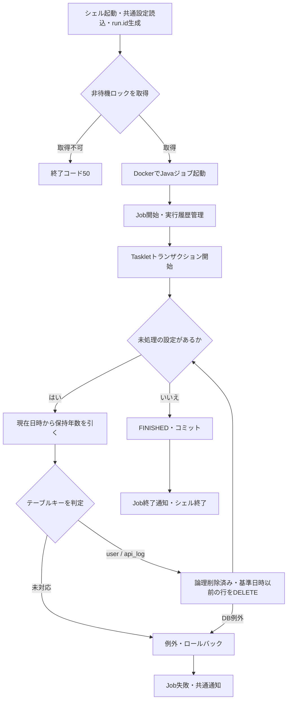
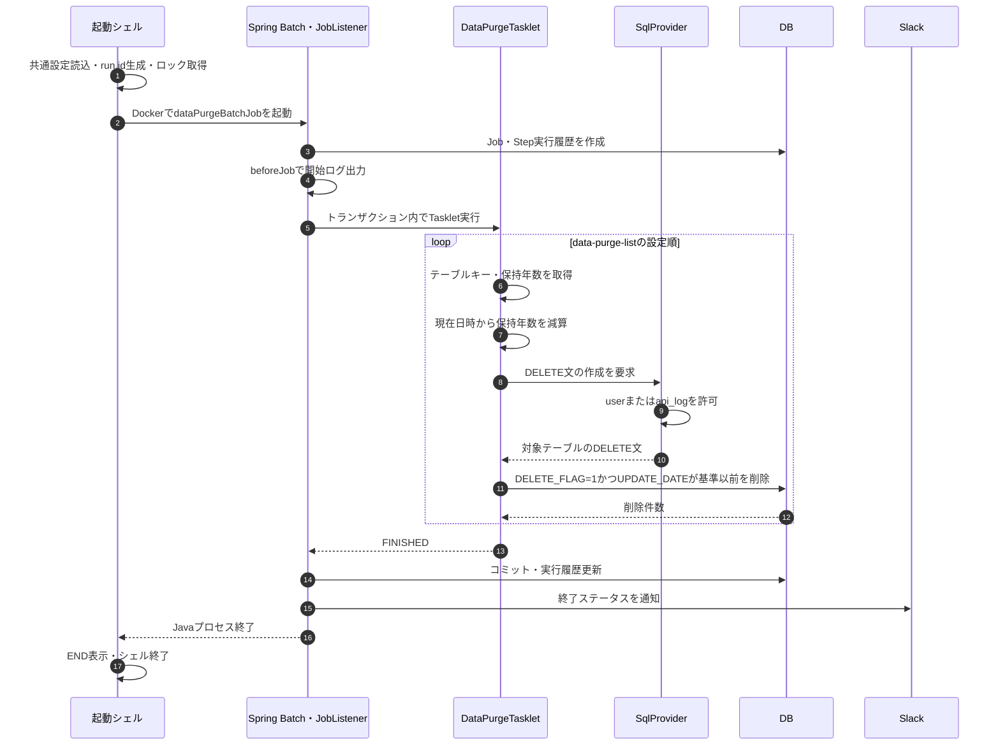

# 設計書 3.10. データパージバッチ

## 1. 機能概要

- 設定されたテーブルから、論理削除済みかつ更新日時が保持期間の基準日時以前の行を物理削除する。
- 対象テーブルキーは`user`と`api_log`。既定設定では`USER`を10年保持し、`API_LOG`は対象に含めない。
- [DataPurgeConfig](../../../ha-batch/src/main/java/jp/co/ha/batch/datapurge/DataPurgeConfig.java)で1つのTasklet Stepを実行し、[DataPurgeTasklet](../../../ha-batch/src/main/java/jp/co/ha/batch/datapurge/DataPurgeTasklet.java)が設定順にDELETEを呼び出す。
- 起動・実行履歴・終了通知は[バッチ共通処理](./設計書_3.11.バッチ共通処理.md)に従う。

## 2. 処理概要



## 3. IF仕様

### 3.1. ジョブパラメータ

| 引数名 | キー | 必須 | 形式 | 値 | 備考 |
| --- | --- | --- | --- | --- | --- |
| 実行識別子 | `run.id` | 任意 | 年月日時分秒＋ナノ秒9桁＋`-`＋PID | バッチ実行識別子 | 標準シェルが`date "+%Y%m%d%H%M%S%N-$$"`で起動日時・ナノ秒・シェルPIDを連結して自動設定する。Job側に必須・形式チェックや省略時の自動補完はない。標準シェルでは実行ごとに生成し、新規JobInstanceとして起動する。本Jobに業務用のJobパラメータはない。 |

## 4. 処理フロー



| 番号 | 処理内容 | 関連項番 | 備考 |
| --- | --- | --- | --- |
| 1 | 起動準備・排他 | 4.3 | ロック失敗なら50で終了する。 |
| 2 | Job起動 | 4.3 | `run.id`をJob引数へ渡す。 |
| 3 | メタデータ作成 | 4.2 | 共通設計のSQLを使用する。 |
| 4 | 開始ログ | 4.5 | Job名・ID・引数を記録する。 |
| 5 | Tasklet呼出し | 4.4 | 全設定を1回のTaskletで処理する。 |
| 6 | 設定値取得 | 4.1 | null・不正キーの個別入力画面はない。 |
| 7 | 基準日時作成 | 4.4 | 設定ごとに現在日時を取得する。 |
| 8 | SQL生成要求 | 4.2 | テーブル名を直接入力から連結しない。 |
| 9 | 許可テーブル判定 | 4.1 | 未対応キーなら例外。 |
| 10 | SQL返却 | 4.2 | 日時はバインド変数。 |
| 11 | 物理削除 | 4.2 | 論理削除フラグと更新日時をAND判定する。 |
| 12 | 件数返却 | 4.4 | Taskletでは利用しない。 |
| 13 | Tasklet終了 | 4.4 | 例外がなければ`RepeatStatus.FINISHED`。 |
| 14 | DB確定・履歴更新 | 4.4 | 例外時はTaskletトランザクションをロールバックする。 |
| 15 | 終了通知 | 4.5 | 失敗時は例外ごとの通知も行う。 |
| 16 | Java終了 | 4.3 | JobStatusとOS終了コードは区別する。 |
| 17 | シェル終了 | 4.3 | OSプロセス終了に伴いロックを解放する。 |

### 4.1. 入力チェック

| 対象 | チェック内容 | 異常時の処理・コード | 備考 |
| --- | --- | --- | --- |
| Job引数 | 独自の`JobParametersValidator`は設定しない | 特になし | 日付引数は不要。 |
| `table-name` | SqlProviderで`user`・`api_log`のみ許可する | `IllegalArgumentException("invalid tableKey: " + key)` | MyBatis等でラップされた例外を含め、固有の業務エラーコードは付けない。JobListenerの一般例外表示は`CE0002`。 |
| `expired` | 範囲・正数チェックは行わない | 数値への設定バインド失敗や日時計算例外は後続処理へ伝播 | 保持年数が0・負数でも値をそのまま`minusYears`へ渡す。 |
| 設定配列・要素 | nullの事前検証はない | null参照等でStep失敗 | Job開始後の一般例外は共通通知で`CE0002`として扱う。起動時の設定バインド失敗はJobListener到達前に終了し得る。 |

### 4.2. DB操作

#### 4.2.1. ユーザ情報の物理削除

```sql
DELETE FROM
    USER
WHERE
    DELETE_FLAG = 1
    AND UPDATE_DATE <= :updateDate;
```

| 対象 | 条件・設定値 | 備考 |
| --- | --- | --- |
| `USER` | `table-name=user` | [DataPurgeMapper.SqlProvider](../../../ha-db/src/main/java/jp/co/ha/db/mapper/custom/DataPurgeMapper.java)がテーブルを選択する。既定設定の対象。 |
| `DELETE_FLAG` | `1` | 論理削除済みの行のみ。未削除のユーザは更新日時が古くても対象外。 |
| `UPDATE_DATE` | `LocalDateTime.now().minusYears(expired)`以下 | `:updateDate`はMapperの`#{updateDate}`へ対応する。境界日時を含めて物理削除する。 |
| 関連テーブル | 明示的な削除処理なし | 外部キー等の制約違反が発生した場合はDB例外として伝播する。 |

#### 4.2.2. API通信ログの物理削除

```sql
DELETE FROM
    API_LOG
WHERE
    DELETE_FLAG = 1
    AND UPDATE_DATE <= :updateDate;
```

| 対象 | 条件・設定値 | 備考 |
| --- | --- | --- |
| `API_LOG` | `table-name=api_log` | 設定へ追加した場合に実行する。既定配列には含めない。 |
| `DELETE_FLAG` | `1` | 未削除の通信ログは対象外。 |
| `UPDATE_DATE` | 各設定の処理時の現在日時から保持年数を引いた値以下 | SQLの条件はUSERと同じ。`REQUEST_DATE`・`REG_DATE`を基準にしない。 |

#### 4.2.3. 実行履歴

| 対象 | 処理 | 備考 |
| --- | --- | --- |
| `BATCH_JOB_*`・`BATCH_STEP_*` | JobRepositoryが実行履歴を管理する | SQLと各列の意味は[共通設計の4.2](./設計書_3.11.バッチ共通処理.md#42-db操作)に記載する。パージ対象には含めない。 |

### 4.3. 起動・排他・終了判定

| 処理 | 内容・異常時の扱い | 備考 |
| --- | --- | --- |
| 共通設定 | スクリプト自身の場所から`common.sh`と`const.txt`を読み込む | `BASE_DIR`・`LOCK_DIR`・`DOCKER_DIR`を利用する。 |
| ロック | ファイル記述子9で`flock -n`を行う | 取得できない場合は50。ロックファイル自体は削除せず、プロセス終了でロックを解放する。 |
| Docker起動 | `docker compose run --rm ha-batch`へJob名と`run.id`を渡す | Compose起動を利用しないJava直接起動には、このシェルの排他は適用されない。 |
| 終了コード | `set -eu`でシェルの未設定変数・コマンド失敗を扱う | アプリの`Application.main`は`SpringApplication.run`のみであり、JobのFAILEDを終了コードへ変換する`System.exit`等の呼出しはない。詳細は共通設計。 |

### 4.4. 保持期間の計算・トランザクション

| 処理 | 内容・異常時の扱い | 備考 |
| --- | --- | --- |
| 保持期間 | 設定ごとに`LocalDateTime.now().minusYears(expired)`を作成する | 1回だけ取得した共通基準日ではない。年月日だけでなく時分秒を含む。 |
| 削除順序 | 設定配列の順に1つずつDELETEする | 全対象行を分割するページング、件数上限、チャンクは設けない。 |
| トランザクション | Tasklet Stepに設定されたDBトランザクションで全設定の削除を行う | 途中のキー不正・DB例外では後続設定へ進まず、それ以前の同一トランザクションの変更もロールバックする。明示的なリトライ・スキップ設定はない。 |
| 処理結果 | Mapperの戻り値を使用せず、全設定の終了後に`FINISHED`を返す | 削除0件でも正常。 |

### 4.5. 実行ログ・通知

| 処理 | 内容・異常時の扱い | 備考 |
| --- | --- | --- |
| Taskletログ | `table_name`・`expired`をDEBUGへ出力する | 削除件数の独自集計は行わない。 |
| 開始・終了 | `BatchJobListener`を利用する | 失敗例外の専用コードがなければ通知メッセージは`CE0002`。終了通知の詳細は[共通設計の4.5](./設計書_3.11.バッチ共通処理.md#45-ジョブ実行ログ通知)。 |
| 外部接続 | 共通のSlack・SSM接続 | パージ本体からS3・SQS・業務APIへ接続しない。通知失敗を理由にパージ処理を補償する独自処理はない。 |

## 5. 実行仕様

### 5.1. 起動方法

```bash
bash ha-batch/docker/data_purge.sh
```

```bash
java -jar ha-batch/target/batch-1.0.0.jar \
  --spring.batch.job.name=dataPurgeBatchJob \
  run.id=20261114120000000000000-1234
```

| 項目名 | 型 | 必須 | 備考 |
| --- | --- | --- | --- |
| シェル位置引数 | — | 不要 | [data_purge.sh](../../../ha-batch/docker/data_purge.sh)は位置引数を参照しない。 |
| `--spring.batch.job.name` | `string` | 起動対象の選択に必要 | シェルが`dataPurgeBatchJob`を指定する。Step名は`dataPurgeBatchStep`。 |

### 5.2. 設定・実行条件

| 項目名 | 型 | 必須 | 備考 |
| --- | --- | --- | --- |
| `ha-batch.data-purge-list` | `array` | 処理実行に必要 | [application.yml](../../../ha-batch/src/main/resources/application.yml)。配列順に処理する。未設定のnullはTaskletで例外となり、空配列は削除せず正常終了する。 |
| `[].table-name` | `string` | 各要素で必要 | `user`または`api_log`。大文字・別名への自動変換はない。既定値は`user`。 |
| `[].expired` | `integer` | 設定値を使用 | 保持年数。既定設定は`10`。0・負数の業務検証はない。省略した要素のJavaフィールド初期値は0。 |
| 実行日時 | 実行環境のローカル日時 | 自動取得 | `LocalDateTime.now()`を各設定の処理時に呼ぶ。共通の日付ユーティリティで東京日付へ固定する処理はない。Composeの`TZ`設定は`Asia/Tokyo`。 |
| DB接続 | 環境設定 | 必要 | 接続先・認証情報は共通設定に従う。対象レコードを読込用に全件取得する処理はない。 |

### 5.3. 入力ファイル

特になし。

### 5.4. 終了コード・出力

| 出力 | 内容 | 備考 |
| --- | --- | --- |
| ロック競合 | シェル終了コード`50` | Javaジョブを起動しない。ロック対象は`/var/lock/data_purge.sh.lock`。 |
| シェル正常終了 | 終了コード`0` | Dockerコマンドが成功して末尾のEND表示へ到達した場合。Jobの`FAILED`をOS終了コードへ変換する独自実装はない。 |
| 起動コマンド失敗 | 非0で中断 | `set -eu`に従う。詳細は共通設計の終了判定を参照する。 |
| DB | `USER`または`API_LOG`から物理削除 | Mapperが返す削除件数は使用せず、集計ファイルや結果JSONは作成しない。 |
| 実行記録・通知 | Spring Batchメタデータ、ログ、Slack | `BatchJobListener`による終了通知。アプリ独自の`BATCH_LOG`テーブルへのINSERTはない。 |
