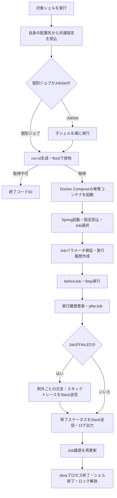
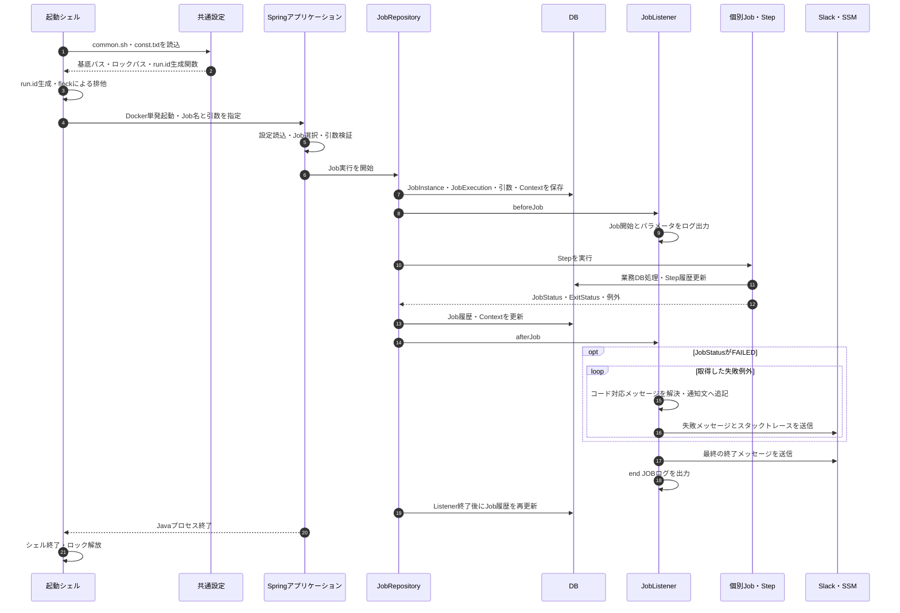

# 設計書 3.11. バッチ共通処理

## 1. 機能概要

- 各バッチのシェル起動、Job選択、実行パラメータ、排他制御、Spring Batchの実行履歴、ログ・Slack通知の共通動作を定義する。
- Javaジョブ10本は[Application](../../../ha-batch/src/main/java/jp/co/ha/batch/Application.java)から起動し、個別のJob Configが処理を構成する。日次JobSetは子シェルを呼ぶシェル処理であり、独立したJava Jobではない。
- シェルは[common.sh](../../../ha-batch/docker/common.sh)・[const.txt](../../../ha-batch/docker/const.txt)、Javaは[BatchConfig](../../../ha-batch/src/main/java/jp/co/ha/batch/base/BatchConfig.java)・[BatchJobListener](../../../ha-batch/src/main/java/jp/co/ha/batch/listener/BatchJobListener.java)を共用する。
- 業務テーブルのSQL、ファイル形式、APIの要求・結果判定、リトライ等は個別バッチの設計に記載する。

## 2. 処理概要



## 3. IF仕様

### 3.1. ジョブパラメータ

| 引数名 | キー | 必須 | 形式 | 値 | 備考 |
| --- | --- | --- | --- | --- | --- |
| 処理対象日 | `d` | 任意 | `YYYYMMDD` | 日次分析・健康情報連携の処理対象日 | 対象Jobでのみ使用する。未指定・空文字の場合は使用するReader・Writerがそれぞれ東京の当日で補完する。ユーザ情報は日付抽出せずS3キーにのみ使用する。標準シェルは第1位置引数を`d=値`として渡すため、位置引数自体の省略は不可（空文字の指定は可）。 |
| 処理対象年月 | `m` | 任意 | `YYYYMM` | 月次健康情報集計の処理対象年月 | 月次健康情報集計Jobでのみ使用する。未指定・空文字の場合、ReaderとWriterがそれぞれ東京の現在年月で補完する。標準シェルは第1位置引数を`m=値`として渡すため、位置引数自体の省略は不可（空文字の指定は可）。 |
| 実行識別子 | `run.id` | 任意 | 年月日時分秒＋ナノ秒9桁＋`-`＋PID | バッチ実行識別子 | 標準シェルが`date "+%Y%m%d%H%M%S%N-$$"`で起動日時・ナノ秒・シェルPIDを連結して自動設定する。Job側に必須・形式チェックや省略時の自動補完はない。標準シェルでは実行ごとに生成し、新規JobInstanceとして起動する。JobSet自体は生成せず、各子シェルが個別に設定する。 |

## 4. 処理フロー



| 番号 | 処理内容 | 関連項番 | 備考 |
| --- | --- | --- | --- |
| 1 | 共通ファイル読込 | 4.3 | 実行時カレントディレクトリからの相対参照ではない。 |
| 2 | 共通設定取得 | 4.3 | const.txtの設定を使用する。 |
| 3 | 実行ID生成・排他 | 4.3 | 競合時は50で中断する。 |
| 4 | コンテナ起動 | 4.3 | Java直接起動・ECSではシェル処理を経由しない。 |
| 5 | Job選択・引数検証 | 4.1 | Validatorの有無は各Job定義による。 |
| 6 | Job実行要求 | 4.4 | 同一Job名・識別引数の実行履歴を考慮する。 |
| 7 | Job開始時の履歴作成 | 4.2 | Spring Batchが管理する。 |
| 8 | Job開始Listener | 4.5 | 検証等で起動前に失敗した場合には到達しないことがある。 |
| 9 | 開始ログ出力 | 4.5 | 業務DBへ独自の実行ログをINSERTしない。 |
| 10 | Step呼出し | 4.4 | Tasklet・Chunkは個別設計に従う。 |
| 11 | Step中のDB処理 | 4.2 | 業務SQLは各設計、履歴SQLは本設計。 |
| 12 | Step処理結果 | 4.4 | 握りつぶされた例外は自動でJob失敗にならない。 |
| 13 | Job履歴更新 | 4.2 | 実行ステータス・日時・Context等を保存する。 |
| 14 | Job終了Listener | 4.5 | 最終ステータスを参照する。 |
| 15 | 失敗文言生成 | 4.5 | BaseAppError以外はCE0002を使用する。 |
| 16 | 例外別通知 | 4.5 | 通知文は例外ごとに追記される。 |
| 17 | 最終通知 | 4.5 | 正常時も送る。FAILED時は追加通知となる。 |
| 18 | 終了ログ出力 | 4.5 | Slack送信後にDEBUG出力する。 |
| 19 | Listener後の履歴更新 | 4.2 | Listener終了後にもJobRepositoryが更新する。 |
| 20 | Javaプロセス終了 | 4.3 | OS終了コードの独自変換はない。 |
| 21 | シェル終了 | 4.3 | ロックファイルは残り、ロックは解放される。 |

### 4.1. 入力チェック

| 対象 | チェック内容 | 異常時の扱い | 備考 |
| --- | --- | --- | --- |
| シェル | `set -eu`による未設定変数・コマンドの失敗検出 | シェル中断 | JobSetの子シェル失敗時も後続へ進まない。シェルの構文・日付形式を一律に事前検証する共通関数はない。 |
| Job選択 | コマンド引数のJob名で対象を指定する | Spring起動・Job選択時の例外 | Job定義のない名前等の起動失敗は業務エラーコードを付ける共通処理を通らない場合がある。 |
| 必須日付 | `DateFormatParameterValidator`に渡したrequiredがtrueかつ値が空なら拒否 | `InvalidJobParametersException`、`job parameter required {key}` | [Validator](../../../ha-batch/src/main/java/jp/co/ha/batch/base/DateFormatParameterValidator.java)。nullは空文字へ変換する。 |
| 日付形式 | 値が空でなければ指定フォーマットを`DateTimeUtil.isDate`で検査する | `InvalidJobParametersException`、`job parameter invalid {key}={value}` | 月次は`m`、日次分析・連携は`d`。Validatorとその後のReaderが使用する日時変換は個別実装に従う。 |
| その他引数・設定 | Jobごとの実装に従う | 個別の処理へ伝播 | 共通のrun.id必須検証・全設定値の範囲検証は定義しない。 |

### 4.2. DB操作

#### 4.2.1. JobInstance作成

```sql
INSERT INTO
    BATCH_JOB_INSTANCE (
        JOB_INSTANCE_ID
        , JOB_NAME
        , JOB_KEY
        , VERSION
    )
VALUES (
    :job_instance_id
    , :job_name
    , :job_key
    , :version
);
```

| 列 | 設定値・用途 | 備考 |
| --- | --- | --- |
| `JOB_INSTANCE_ID` | JobRepositoryの採番ID | 採番用の`BATCH_JOB_SEQ`等もDB初期化の対象。 |
| `JOB_NAME` | 選択されたJob名 | 各ConfigのJobBuilderへ渡した名前。 |
| `JOB_KEY` | 識別用Jobパラメータから生成したキー | 通常のシェル起動では新しいrun.idを渡し、別JobInstanceとして実行する。 |
| `VERSION` | 初期バージョン | 実行履歴はSpring BatchのJDBC実装が管理する。SQLのプレースホルダーは説明用の名前で、実行時はJDBCバインドとなる。 |

#### 4.2.2. JobExecution作成・更新

```sql
INSERT INTO
    BATCH_JOB_EXECUTION (
        JOB_EXECUTION_ID
        , JOB_INSTANCE_ID
        , START_TIME
        , END_TIME
        , STATUS
        , EXIT_CODE
        , EXIT_MESSAGE
        , VERSION
        , CREATE_TIME
        , LAST_UPDATED
    )
VALUES (
    :job_execution_id
    , :job_instance_id
    , :start_time
    , :end_time
    , :status
    , :exit_code
    , :exit_message
    , :version
    , :create_time
    , :last_updated
);

UPDATE
    BATCH_JOB_EXECUTION
SET
    START_TIME = :start_time
    , END_TIME = :end_time
    , STATUS = :status
    , EXIT_CODE = :exit_code
    , EXIT_MESSAGE = :exit_message
    , VERSION = VERSION + 1
    , CREATE_TIME = :create_time
    , LAST_UPDATED = :last_updated
WHERE
    JOB_EXECUTION_ID = :job_execution_id
    AND VERSION = :version;
```

| 列 | 設定値・用途 | 備考 |
| --- | --- | --- |
| `JOB_EXECUTION_ID`・`JOB_INSTANCE_ID` | 実行ID・所属JobInstanceのID | 1つのJobInstanceに再実行の履歴を持ち得る。 |
| `CREATE_TIME`・`START_TIME`・`END_TIME`・`LAST_UPDATED` | 作成・開始・終了・最終更新時刻 | 実行状態に応じて設定する。 |
| `STATUS` | JobのBatchStatus | `COMPLETED`・`FAILED`等。 |
| `EXIT_CODE`・`EXIT_MESSAGE` | ExitStatusと詳細 | OSプロセスの終了コードを格納する列ではない。 |
| `VERSION` | 楽観ロック用バージョン | 更新時はIDとバージョンで絞り込み、バージョンを加算する。競合・DBアクセス例外はフレームワークへ伝播する。 |

#### 4.2.3. Job引数の保存

```sql
INSERT INTO
    BATCH_JOB_EXECUTION_PARAMS (
        JOB_EXECUTION_ID
        , PARAMETER_NAME
        , PARAMETER_TYPE
        , PARAMETER_VALUE
        , IDENTIFYING
    )
VALUES (
    :job_execution_id
    , :parameter_name
    , :parameter_type
    , :parameter_value
    , :identifying
);
```

| 列 | 設定値・用途 | 備考 |
| --- | --- | --- |
| `JOB_EXECUTION_ID` | 所属する実行ID | `run.id`・`d`・`m`等を引数ごとに保存する。 |
| `PARAMETER_NAME`・`PARAMETER_TYPE`・`PARAMETER_VALUE` | 引数名・型名・文字列表現 | Spring Batchのパラメータ変換結果。 |
| `IDENTIFYING` | JobInstanceの識別に使うか | `Y`または`N`。シェルは非識別指定を付けずJob引数を渡す。 |

#### 4.2.4. StepExecution作成・更新

```sql
INSERT INTO
    BATCH_STEP_EXECUTION (
        STEP_EXECUTION_ID
        , VERSION
        , STEP_NAME
        , JOB_EXECUTION_ID
        , START_TIME
        , END_TIME
        , STATUS
        , COMMIT_COUNT
        , READ_COUNT
        , FILTER_COUNT
        , WRITE_COUNT
        , EXIT_CODE
        , EXIT_MESSAGE
        , READ_SKIP_COUNT
        , WRITE_SKIP_COUNT
        , PROCESS_SKIP_COUNT
        , ROLLBACK_COUNT
        , LAST_UPDATED
        , CREATE_TIME
    )
VALUES (
    :step_execution_id
    , :version
    , :step_name
    , :job_execution_id
    , :start_time
    , :end_time
    , :status
    , :commit_count
    , :read_count
    , :filter_count
    , :write_count
    , :exit_code
    , :exit_message
    , :read_skip_count
    , :write_skip_count
    , :process_skip_count
    , :rollback_count
    , :last_updated
    , :create_time
);

UPDATE
    BATCH_STEP_EXECUTION
SET
    START_TIME = :start_time
    , END_TIME = :end_time
    , STATUS = :status
    , COMMIT_COUNT = :commit_count
    , READ_COUNT = :read_count
    , FILTER_COUNT = :filter_count
    , WRITE_COUNT = :write_count
    , EXIT_CODE = :exit_code
    , EXIT_MESSAGE = :exit_message
    , VERSION = VERSION + 1
    , READ_SKIP_COUNT = :read_skip_count
    , PROCESS_SKIP_COUNT = :process_skip_count
    , WRITE_SKIP_COUNT = :write_skip_count
    , ROLLBACK_COUNT = :rollback_count
    , LAST_UPDATED = :last_updated
WHERE
    STEP_EXECUTION_ID = :step_execution_id
    AND VERSION = :version;
```

| 列 | 設定値・用途 | 備考 |
| --- | --- | --- |
| `STEP_EXECUTION_ID`・`STEP_NAME`・`JOB_EXECUTION_ID` | Step実行ID・Step名・所属Job実行ID | 同じStep名を同一JobExecution内で複数回実行する場合も別のStepExecutionを作る。 |
| 日時・`STATUS`・`EXIT_CODE`・`EXIT_MESSAGE` | Stepの実行状態 | Job全体の状態とは別に管理する。 |
| `READ_COUNT`・`WRITE_COUNT`・`FILTER_COUNT` | 読込・書込・フィルター件数 | 処理形態やProcessorの戻り値に応じて加算する。 |
| `COMMIT_COUNT`・`ROLLBACK_COUNT`・各`SKIP_COUNT` | トランザクション・スキップの件数 | 各Jobのchunk数・retry/skip方針に依存する。 |
| `VERSION` | 楽観ロック | IDとバージョンで更新する。 |

#### 4.2.5. 実行Context保存・更新

```sql
INSERT INTO
    BATCH_JOB_EXECUTION_CONTEXT (
        SHORT_CONTEXT
        , SERIALIZED_CONTEXT
        , JOB_EXECUTION_ID
    )
VALUES (
    :short_context
    , :serialized_context
    , :job_execution_id
);

UPDATE
    BATCH_JOB_EXECUTION_CONTEXT
SET
    SHORT_CONTEXT = :short_context
    , SERIALIZED_CONTEXT = :serialized_context
WHERE
    JOB_EXECUTION_ID = :job_execution_id;

INSERT INTO
    BATCH_STEP_EXECUTION_CONTEXT (
        SHORT_CONTEXT
        , SERIALIZED_CONTEXT
        , STEP_EXECUTION_ID
    )
VALUES (
    :short_context
    , :serialized_context
    , :step_execution_id
);

UPDATE
    BATCH_STEP_EXECUTION_CONTEXT
SET
    SHORT_CONTEXT = :short_context
    , SERIALIZED_CONTEXT = :serialized_context
WHERE
    STEP_EXECUTION_ID = :step_execution_id;
```

| 列・対象 | 設定値・用途 | 備考 |
| --- | --- | --- |
| Job側・Step側の実行ID | 保存対象の履歴ID | Contextの管理単位を分ける。 |
| `SHORT_CONTEXT`・`SERIALIZED_CONTEXT` | ExecutionContextのシリアライズ結果 | Readerの再開位置等を保存する場合に使用する。実際にContextへ保存する値は各実装による。 |
| 業務テーブル | 共通Listenerからの独自INSERTなし | API通信ログは対応する機能・SQS取込、その他業務更新は各バッチのSQLに従う。 |

### 4.3. シェル・Java起動・終了判定

| 処理 | 内容・異常時の扱い | 備考 |
| --- | --- | --- |
| 共通ファイルの解決 | `BASH_SOURCE[0]`からcommon.shの配置先を求めconst.txtを読む | 個別シェルも自身の配置先からcommon.shを読む。読み込み失敗等は`set -e`で中断する。 |
| 実行ID | `date`とPIDでrun.idを作成する | Java側でRunIdIncrementerを呼ぶ共通実装ではない。ECS起動コマンドのrun.id生成形式はシェル版と別。 |
| 排他 | 個別シェルが`exec 9>lockfile`、`flock -n 9`を実行する | ファイル名単位の排他であり、別名シェル・別ホスト・Java直接起動の全実行を一括制御するものではない。取得不可は50。 |
| Compose | `BASE_DIR`へ移動後、プロジェクトディレクトリとComposeファイルを指定する | `cd ... && docker compose ...`というANDリストを使用する。`cd`失敗の場合に後続のEND表示でシェルが0終了し得るため、全ての準備失敗が確実に非0となる構造ではない。 |
| JobSet | 健康情報→ユーザ→API通信ログ→バッチ実行ログの子シェルを順次呼ぶ | `set -e`により子シェルの非0終了時は通常その直後の`result=$?`・`check_result`へ進まず終了する。 |
| Java起動 | `SpringApplication.run(Application.class, args)` | 独自のJobStatus→プロセス終了コード変換はない。Spring起動自体の未処理例外等と、処理結果として保持されるJobのFAILEDは区別する。 |
| 終了時の排他 | シェルとファイル記述子の終了により解放する | ロックファイルを削除するtrapはない。 |

### 4.4. Job・Step・トランザクション

| 処理 | 内容・異常時の扱い | 備考 |
| --- | --- | --- |
| インスタンス識別 | Job名と識別パラメータによりJobInstanceを区別する | 新しいrun.idによる通常起動は別インスタンス。完了済みの同一パラメータをそのまま指定した場合は再実行制限を受ける。 |
| Tasklet | Stepに渡したTransactionManagerで実行する | 例外が伝播すればStepのDB変更をロールバックする。S3・SQS・HTTP等への外部操作までDBと原子的に取り消す機能はない。 |
| Chunk | 読込・変換・書込を指定chunkサイズ単位で実行する | ページサイズとchunkサイズは別。個別の設定値・例外方針を参照する。 |
| 同一Job内の同名Step | 同一JobExecutionに属する直前のStepExecutionは重複実行として扱い、再実行する | ヘルスチェックの共通通知Stepが該当する。別JobExecutionからの再開時の完了Stepスキップとは区別する。 |
| Chunkログ | `BatchChunkListener`を登録したStepのみ、前後・エラー時にログを出力する | [実装](../../../ha-batch/src/main/java/jp/co/ha/batch/listener/BatchChunkListener.java)。このListenerはDB更新やSlack通知を行わない。 |
| 例外の捕捉 | 個別処理がcatchして再送出しない例外は、共通処理が自動で失敗へ変換しない | APIの失敗応答やWriter.close内の例外等の扱いは各設計を参照する。 |

### 4.5. ジョブ実行ログ・通知

| 処理 | 内容・異常時の扱い | 備考 |
| --- | --- | --- |
| beforeJob | Job実行ID・Job名・開始時ステータス・各パラメータ名と値をDEBUGへ出力 | 独自のDB実行ログ登録はない。 |
| 正常終了等 | `id=..., name=..., status=...`をSlackへ送り、その後DEBUGログへ出力する | `BatchStatus.FAILED`以外も最終メッセージを送信する。 |
| FAILED | `getAllFailureExceptions()`の各例外について、コードのメッセージを解決して通知文へ追記し、メッセージとスタックトレースファイルを送信する | 例外ごとの送信後、ループ外でも最終メッセージを送るため通知は1回とは限らない。 |
| コード解決 | 例外が`BaseAppError`ならそのコード、その他は`CE0002` | 文言はMessageSourceからロケールに従って取得し、`文言(外部コード)`を組み込む。元例外が別の一般例外でラップされている場合、causeを再帰的に探す処理はない。 |
| SSM | [SlackApiComponent](../../../ha-business/src/main/java/jp/co/ha/business/api/slack/SlackApiComponent.java)が`/{環境}/slack_token`を取得してJSONを読込む | 取得・変換失敗は同Componentで一般のシステム実行時例外として送出する。設定値を再利用する独自キャッシュはない。 |
| メッセージ送信 | `POST https://slack.com/api/chat.postMessage` | Authorizationは取得したBearerトークン。JSONでchannel・textを送る。HTTP非成功はWARN出力し、本文の`ok=false`を独自に判定しない。IOExceptionはシステム実行時例外となる。 |
| スタックトレース | UTF-8で`stacktrace`ファイルを作成し、Slackの外部アップロードAPIで送る | アップロードURL取得→バイト列送信→完了APIの順。URL取得の`ok=false`は`CW0013`。その他の失敗処理はSlackComponentの実装に従う。 |
| 通知例外 | JobListener内では追加のcatchを設けず、Spring Batchの`AbstractJob`がafterJobの例外を捕捉してログへ出力する | 通知失敗後の残り通知・終了ログは実行されない。通知例外だけで必ずJobStatusをFAILEDへ変える処理ではなく、フレームワークはListener呼出し前後にJob履歴を保存する。コミット済み業務変更を戻す独自補償処理はない。 |

## 5. 実行仕様

### 5.1. 起動方法

```bash
bash ha-batch/docker/health_check.sh
```

```bash
java -jar ha-batch/target/batch-1.0.0.jar \
  --spring.batch.job.name=healthCheckBatchJob \
  run.id=20261114120000000000000-1234
```

| 項目名 | 型 | 必須 | 備考 |
| --- | --- | --- | --- |
| 起動シェル | ファイルパス | シェル起動時 | 個別シェルはJob名を固定する。JobSetは4つの子シェルを順次呼び出す。一覧は[バッチ設計一覧](../機能一覧.md#03_batch)。 |
| `--spring.batch.job.name` | `string` | 実行Jobの選択に必要 | Springの設定引数。Job名は[BatchConfigConst](../../../ha-batch/src/main/java/jp/co/ha/batch/base/BatchConfigConst.java)と各Job定義に従う。 |
| Java直接起動 | コマンドライン | 任意 | シェルのロック・自動run.id生成は通らない。引数と排他は起動元の指定に従う。 |
| ECS単発起動 | コンテナコマンド上書き | ECS利用時 | [Terraformのbatch_run_command](../../../ha-build/aws/IaC/modules/outputs.tf)はJob名とrun.idを渡す。日付の必要なJobでは`d`または`m`を追加する。アプリ内の定期起動スケジューラは定義していない。 |

### 5.2. 設定・実行条件

| 設定・対象 | 値・用途 | 備考 |
| --- | --- | --- |
| `BASE_DIR` | 既定`/mnt/c/app/git/work-3g` | `const.txt`のリポジトリ基底。シェル内でこのディレクトリへ移動する。 |
| `LOCK_DIR` | 既定`/var/lock` | 個別シェル名に`.lock`を付けて使用する。JobSet自身にはロック処理を定義しない。 |
| `DOCKER_DIR` | `ha-build/docker` | `docker-compose.yml`の格納先。`--project-directory`へ`BASE_DIR`を指定する。 |
| コンテナ | Composeサービス`ha-batch` | [Dockerfile](../../../Dockerfile.ha-batch)のENTRYPOINTは`java -jar /work/batch-1.0.0.jar`。シェルは`docker compose run --rm`を使用する。 |
| Web起動 | `spring.main.web-application-type=none` | [application.yml](../../../ha-batch/src/main/resources/application.yml)。HTTP受付を行わない。 |
| プロファイル | 既定・activeは`local`、実行時設定で上書き可能 | [application-local.yml](../../../ha-batch/src/main/resources/application-local.yml)・[application-dev.yml](../../../ha-batch/src/main/resources/application-dev.yml)が対応するDB・システム・AWS・API設定を読み込む。 |
| 業務設定 | `ha-batch.*` | [BatchProperties](../../../ha-batch/src/main/java/jp/co/ha/batch/base/BatchProperties.java)へバインドする。保持期間・一時ディレクトリ・ページサイズ等の値は各設計に記載する。 |
| DB接続 | `jdbc.*`等の環境設定 | [DbConfig](../../../ha-db/src/main/java/jp/co/ha/db/config/DbConfig.java)がDataSource・TransactionManager・MyBatisを構成する。接続認証情報は環境設定から読み込む。 |
| 実行履歴の初期化 | `spring.batch.jdbc.initialize-schema=never` | Spring Batchの起動時自動DDLは無効。[Flyway初期化SQL](../../../ha-db/src/main/resources/db/migration/V1.0.0__init.sql)に履歴テーブルがあり、[schema-all.sql](../../../ha-batch/schema-all.sql)にもDDLを保持する。毎回実行して履歴を作り直す処理ではない。 |
| Slack接続 | SSM `/{環境}/slack_token` | `ContentType.BATCH`に対応するチャネルとトークンを取得する。業務機能から別のチャネルへ追加通知する場合は個別設計に従う。 |

### 5.3. 入力ファイル

特になし。

### 5.4. 終了コード・出力

| 出力 | 内容 | 備考 |
| --- | --- | --- |
| 個別シェルのロック競合 | 終了コード`50` | `flock -n 9`が失敗した場合。競合側はJavaを起動しない。 |
| シェルの正常終了 | `0` | 末尾のEND表示まで到達した場合。JavaのJobStatusそのものを戻す機能はない。 |
| シェルの異常終了 | 対象コマンドの非0・未設定変数エラー等 | `set -eu`を使用する。日付シェルは`$1`を直接参照するため、引数未指定はJava起動前に中断する。 |
| JobStatus・ExitStatus | Spring Batchの実行履歴 | OSの終了コードとは別。`Application.main`に`SpringApplication.exit`・`System.exit`の呼出しがなく、JobのFAILEDを必ず非0のOSコードへ変換する独自実装はない。 |
| 開始ログ | `start JOB. id=..., name=..., status=...`とJob引数 | `beforeJob`でDEBUG出力する。 |
| 終了ログ・Slack | `id=..., name=..., status=...` | FAILEDでは例外別のメッセージとスタックトレースを追加送信し、最後にも終了メッセージを送る。 |
| ログファイル | `/var/app/log/batch-{debug,info,warn,error}.log` | [logback-spring.xml](../../../ha-batch/src/main/resources/logback-spring.xml)。UTF-8。各レベルを別ファイルへ出力し、日次ZIPローテーション、`maxHistory=180`。localはDEBUG、devはINFO以上。 |
| 業務出力 | API呼出し、CSV、S3、SQS等 | 対象・形式・成否の扱いは各バッチ設計に従う。共通Listenerは業務出力の完了検査を追加しない。 |
