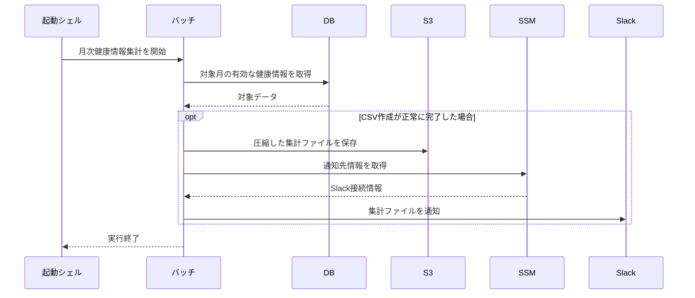
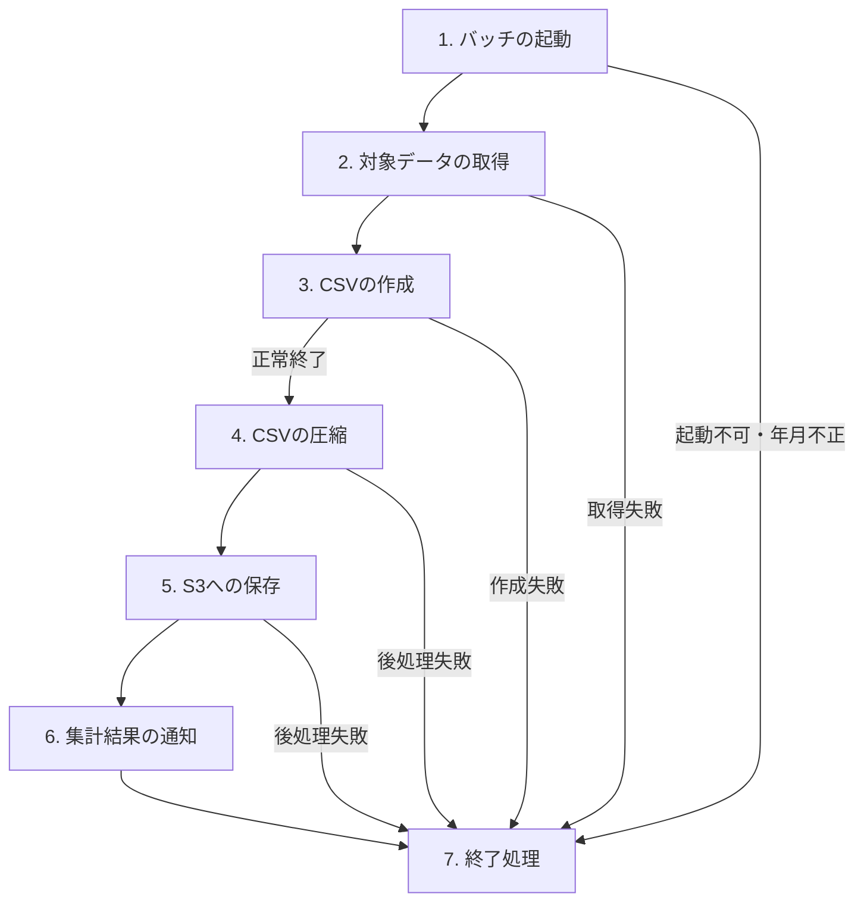

# 設計書 3.2. 月次健康情報集計バッチ

## 1. 機能概要

- 指定年月の有効な健康情報（`DELETE_FLAG = false`）をMySQLの`HEALTH_INFO`から取得し、1レコードを1行としてCSVへ出力する。
- CSVをgzip圧縮し、S3の`monthly/healthinfo/year=YYYY/YYYYMM.csv.gz`へアップロードする。
- 圧縮ファイルをSlackのバッチ用チャンネルへ送信し、外部送信が完了した場合はローカルのCSVとgzipファイルを削除する。
- 合計・平均などの集約計算は行わない。有効な対象データが0件でも、削除済みデータを含めずヘッダのみのCSVを作成して転送する。

## 2. 処理概要



## 3. IF仕様

### 3.1. ジョブパラメータ

| 引数名 | キー | 必須 | 形式 | 値 | 備考 |
| --- | --- | --- | --- | --- | --- |
| 処理対象年月 | `m` | 任意 | `YYYYMM` | 健康情報の集計対象年月 | 未指定・空文字の場合、ReaderとWriterがそれぞれ初期化時の東京の現在年月で補完する。月替わりをまたぐ場合は両者の年月が異なることがある。標準シェルは第1位置引数を`m=値`として渡すため、位置引数自体の省略は不可（空文字の指定は可）。 |
| 実行識別子 | `run.id` | 任意 | 年月日時分秒＋ナノ秒9桁＋`-`＋PID | バッチ実行識別子 | 標準シェルが`date "+%Y%m%d%H%M%S%N-$$"`で起動日時・ナノ秒・シェルPIDを連結して自動設定する。Job側に必須・形式チェックや省略時の自動補完はない。標準シェルでは実行ごとに生成し、新規JobInstanceとして起動する。 |

## 4. 処理フロー



| 処理順 | 処理概要 | 処理詳細 | 関連項番 |
| --- | --- | --- | --- |
| 1 | バッチの起動 | 共通設定・実行ID・排他を準備し、対象年月を検証してJobを開始する。省略時はシステム年月を使用し、ロック競合や検証失敗では対象データを処理しない。 | 4.1、4.3 |
| 2 | 対象データの取得 | 対象月の有効な健康情報だけをDBからページ単位で取得する。処理2・3は取得結果がなくなるまで繰り返し、取得例外はStepへ伝播する。 | 4.2、4.4 |
| 3 | CSVの作成 | 取得した健康情報をCSV項目へ変換して出力する。対象0件でもヘッダを作成する。CSVを閉じた後、正常なStepだけ処理4へ進み、異常時はCSVを残して終了処理へ進む。 | 4.5、4.6、4.7.1 |
| 4 | CSVの圧縮 | 正常終了したCSVをgzipへ圧縮する。圧縮失敗はログに記録して後続の保存・通知を省略し、例外を再送出せず終了処理へ進む。 | 4.7.2、4.7.3 |
| 5 | S3への保存 | 対象年月に対応するS3キーへgzipファイルを保存する。失敗時はログに記録して通知を省略し、残存ファイルを保持したまま終了処理へ進む。 | 4.7.2、4.7.3 |
| 6 | 集計結果の通知 | gzipファイルをSlackへ送り、送信完了後にCSV・gzipを削除する。通知・削除の失敗はログに記録し、完了済みのS3保存を取り消さず終了処理へ進む。 | 4.8、4.7.3 |
| 7 | 終了処理 | Jobを開始した場合は、その実行状態を記録して共通の終了ログ・通知を行い、プロセス終了後にロックを解放する。後処理で捕捉した失敗は、Jobの成功状態だけでは検出できない。 | 4.9 |

### 4.1. 入力チェック

| 対象 | チェック・補完内容 | 異常時の動作 | 備考 |
| --- | --- | --- | --- |
| シェル引数1 | `$1`を参照 | 未指定は`set -u`でシェル終了 | シェル独自の文字数・日付検証はない。 |
| Jobパラメータ`m` | 空文字・未指定は許容。値があれば`DateTimeUtil.isDate(value, YYYYMM_NOSEP)`で検証 | `InvalidJobParametersException`、メッセージ`job parameter invalid m={値}` | [DateFormatParameterValidator](../../../ha-batch/src/main/java/jp/co/ha/batch/base/DateFormatParameterValidator.java)を使用する。業務エラーコードは指定しない。 |
| 日付書式判定 | `SimpleDateFormat("yyyyMM")`、`setLenient(false)` | 解析失敗時は検証NG | 正規表現による6桁固定確認・文字列全体の消費確認は行わない。 |
| Readerの年月分解 | 先頭4文字を年、残りを月として整数化し`LocalDateTime.of`で範囲を生成 | 数値・日時生成例外でStep失敗 | 書式判定を通った文字列でもReaderで失敗する場合がある。 |
| 未指定年月 | ReaderとWriterでそれぞれ`getSysDate()`を`yyyyMM`へ変換 | 特になし | 対象月の開始・終了時刻は4.4を参照。 |

### 4.2. DB操作

```sql
SELECT
    SEQ_HEALTH_INFO_ID
    , SEQ_USER_ID
    , HEIGHT
    , WEIGHT
    , BMI
    , STANDARD_WEIGHT
    , HEALTH_INFO_REG_DATE
    , SEQ_BMI_RANGE_MT_ID
    , UPDATE_DATE
    , REG_DATE
FROM
    HEALTH_INFO
WHERE
    HEALTH_INFO_REG_DATE BETWEEN #{from} AND #{to}
    AND DELETE_FLAG = false
ORDER BY
    SEQ_HEALTH_INFO_ID ASC
LIMIT
    #{_skiprows}
    , #{_pagesize}
```

| 項目 | 設定値 | 備考 |
| --- | --- | --- |
| `#{from}` | 対象月1日の`00:00:00` | Readerが作成する`LocalDateTime`。検索範囲の下限を含む。 |
| `#{to}` | 対象月末日の`23:59:59` | Readerが作成する`LocalDateTime`。検索範囲の上限を含む。 |
| `#{_skiprows}` | ページ番号（0始まり）×ページ件数 | MyBatisPagingItemReaderが設定するオフセット。 |
| `#{_pagesize}` | `ha-batch.monthly-health-info-summary.exec-perpage-count` | ページ件数。既定1000。 |

### 4.3. シェル・Job開始

#### 4.3.1. 共通設定・排他の準備

| 処理 | 内容 | 備考 |
| --- | --- | --- |
| 起動 | `common.sh`を読み込み、排他用ファイルをFD9で開き`flock -n 9`する | シェルは処理対象月によらず1本のロックを使う。 |

#### 4.3.2. Job・Stepの開始

| 処理 | 内容 | 備考 |
| --- | --- | --- |
| Job構成 | `monthlyHealthInfoSummaryBatchJob`→`monthlyHealthInfoSummaryBatchStep` | BatchJobListenerを登録する。 |
| 共通基盤 | [バッチ共通処理](設計書_3.11.バッチ共通処理.md) | shellの共通変数、実行ID、JobListener、メタデータ、終了コードの詳細を参照。 |

#### 4.3.3. Stepのトランザクション・異常時方針

| 処理 | 内容 | 備考 |
| --- | --- | --- |
| トランザクション | `PlatformTransactionManager`を使用、`chunk(1)` | CSV書込みはFlatFileItemWriterのトランザクション対応に従う。外部送信はchunk確定後のcloseで実行する。 |
| retry・skip | 設定なし | 処理・出力例外を回復して次レコードへ進める実装はない。 |

### 4.4. Reader・ページング

#### 4.4.1. 検索範囲・ページ条件の準備

| 処理 | 内容 | 備考 |
| --- | --- | --- |
| 実装 | [MonthlyHealthInfoSummaryReader](../../../ha-batch/src/main/java/jp/co/ha/batch/monthlyHealthInfoSummary/MonthlyHealthInfoSummaryReader.java) | StepScopeのMyBatisPagingItemReader。 |
| 範囲生成 | `LocalDateTime.of(year, month, 1, 0, 0, 0)`から月末`23:59:59` | タイムゾーン変換や前月への補正は行わない。 |

#### 4.4.2. ページ読取と状態保存

| 処理・結果 | 扱い | 備考 |
| --- | --- | --- |
| 読取SQLの呼出し | [PagingHealthInfoMapper.xml](../../../ha-db/src/main/resources/jp/co/ha/db/mapper/custom/PagingHealthInfoMapper.xml)の`selectByHealthInfoRegDate`を使用する | 対象月の登録日時範囲に加え、`DELETE_FLAG = false`の健康情報だけを取得する。ReaderのqueryIdは完全修飾Mapper名にメソッド名を付けた値。 |
| 業務DB更新 | Readerは検索結果を後続処理へ渡す | 業務データの更新は行わず、Spring Batchメタデータは[共通処理](設計書_3.11.バッチ共通処理.md)が管理する。 |
| DB検索失敗 | 例外を上位へ伝播する | retry・skipの設定がなくStep失敗となる。 |


| 処理 | 内容 | 備考 |
| --- | --- | --- |
| ページ処理 | オフセット方式で複数回SELECTし、各ページ内の1件ずつをreadする | 全件を一度に読み込まない。実行中の追加・削除でページ境界が動くことを防ぐ独自スナップショット処理はない。 |
| 状態保存 | `setSaveState(true)` | 同一JobInstanceの再開に使うExecutionContext保存を有効化する。毎回新規run.idを付けるシェル再実行では新しい処理となる。 |
| キャッシュ | ページ内保持のみ | 業務データの別キャッシュを参照・更新しない。 |

### 4.5. Processor・CSV変換

#### 4.5.1. CSV項目の編集

| 処理 | 内容 | 備考 |
| --- | --- | --- |
| 実装 | [MonthlyHealthInfoSummaryProcessor](../../../ha-batch/src/main/java/jp/co/ha/batch/monthlyHealthInfoSummary/MonthlyHealthInfoSummaryProcessor.java) | `HealthInfo`を[MonthlyHealthInfoSummaryModel](../../../ha-business/src/main/java/jp/co/ha/business/io/file/csv/model/MonthlyHealthInfoSummaryModel.java)へ変換する。 |
| 値の転記 | ユーザID、身長、体重、BMI、標準体重、BMI範囲マスタIDを転記 | 健康情報ID・削除フラグはCSVに含めない。 |
| フィルタ・再計算 | 特になし | 必須チェック、丸め、集約、マスク処理は行わない。 |

#### 4.5.2. 日時項目の整形・異常時の扱い

| 処理 | 内容 | 備考 |
| --- | --- | --- |
| 日時 | 健康情報作成日時・登録日時・更新日時を`yyyy/MM/dd HH:mm:ss`へ変換 | 定数`YYYYMMDDHHMMSS`の実際のフォーマットを使用する。 |
| 日時のnull | 3つの日時項目をnull補完せずDateTimeUtil.toStringへ渡す | nullの場合はLocalDateTime.format参照で例外となり、Step失敗。CSVの空欄として出力する処理ではない。 |

### 4.6. Writer・CSV生成

#### 4.6.1. CSVの準備・ヘッダ出力

| 処理 | 内容 | 備考 |
| --- | --- | --- |
| 実装 | [MonthlyHealthInfoSummaryWriter](../../../ha-batch/src/main/java/jp/co/ha/batch/monthlyHealthInfoSummary/MonthlyHealthInfoSummaryWriter.java) | FlatFileItemWriterとStepExecutionListenerを実装する。 |
| 初期設定 | `appendAllowed=false`、`shouldDeleteIfExists=true`、`shouldDeleteIfEmpty=false`、`saveState=true` | 通常の新規実行では同名の既存CSVを作り直す。空ファイル削除を有効にしていない。 |
| オープン | 一時ディレクトリを作成し、`{対象年月}.csv`をFileSystemResourceへ設定 | ディレクトリ作成のBaseExceptionはItemStreamExceptionに包んで送出する。 |
| ヘッダ | COLUMN_NAME_ARRAYをカンマで結合して先頭へ出力 | 明細が0件でもヘッダを残す。 |

#### 4.6.2. CSV明細の出力

| 処理 | 内容 | 備考 |
| --- | --- | --- |
| 列定義 | BeanWrapperFieldExtractorの9項目をカンマで結合 | 列順・形式は5.4のCSV表を参照。 |
| 書込み失敗 | 上位へ送出しStep失敗 | closeでは失敗状態を判定し、gzip・S3・Slack送信を省略する。 |
| 明細書込み | CSVモデルを所定の9列の明細として書き込む | 1件のchunkごとに処理し、列順・値の形式は5.4に従う。 |

### 4.7. gzip・S3転送・ファイル削除

#### 4.7.1. CSV終了・転送要否の判定

| 処理 | 内容 | 備考 |
| --- | --- | --- |
| 実施判定 | `super.close()`後、StepExecutionがnullまたは`isUnsuccessful()`ならreturn | 失敗CSVは送信しない。super.close自体の例外は後続のcatch対象外。 |

#### 4.7.2. gzip生成・S3保存

| 処理 | 内容 | 備考 |
| --- | --- | --- |
| gzip | [FileUtil.compressGZip](../../../ha-common/src/main/java/jp/co/ha/common/util/FileUtil.java)でCSVを圧縮 | 1MiBのバッファでストリームをコピーする。 |
| キー生成 | `monthly/healthinfo` / `year={gzipファイル名の先頭4文字}` / `{gzipファイル名}`を`/`で結合 | 例：`monthly/healthinfo/year=2026/202601.csv.gz`。 |
| S3 PUT | [AwsS3Component.putFile](../../../ha-common/src/main/java/jp/co/ha/common/aws/AwsS3Component.java) | 設定バケットへgzip全体をアップロード。ACLは`BUCKET_OWNER_FULL_CONTROL`。失敗は`AWS_S3_UPLOAD_ERROR (CE0028)`等となる。 |

#### 4.7.3. 通知後の削除・後処理失敗

| 処理 | 内容 | 備考 |
| --- | --- | --- |
| 通知後削除 | Slack送信から正常に戻った後、`Files.deleteIfExists`をCSV→gzipの順で呼ぶ | 削除対象の未存在は失敗としない。 |
| 後処理の失敗 | 圧縮・PUT・Slack・削除の例外を同一catchで捕捉 | `gzip圧縮/S3アップロードに失敗しました`をログ出力し、例外を再送出しない。失敗箇所以降は実行されない。 |
| 部分完了 | S3成功後のSlack失敗ではS3オブジェクトと両ローカルファイルが残る。CSV削除後のgzip削除失敗ではgzipだけが残る | S3削除やロールバック、外部送信の再試行は実装しない。Jobの成功状態だけでは転送完了を保証しない。 |

### 4.8. Slackファイル送信

#### 4.8.1. Slack接続情報の取得

| 順序 | 接続先・操作 | 入力・出力 | 備考 |
| --- | --- | --- | --- |
| 1 | SSM `GetParameter` | `/{環境}/slack_token`からSlack接続JSONを取得 | [AwsSystemsManagerComponent](../../../ha-common/src/main/java/jp/co/ha/common/aws/AwsSystemsManagerComponent.java)経由。BATCHに一致するチャンネルを選ぶ。 |

#### 4.8.2. ファイルアップロード先の取得

| 順序 | 接続先・操作 | 入力・出力 | 備考 |
| --- | --- | --- | --- |
| 2 | `POST https://slack.com/api/files.getUploadURLExternal` | Bearer認証、フォーム`filename=YYYYMM.csv.gz`、`length=ファイルバイト数`。応答から`upload_url`と`file_id`を取得 | [SlackApiComponent](../../../ha-business/src/main/java/jp/co/ha/business/api/slack/SlackApiComponent.java)がgzip全体をbyte配列へ読み込む。`ok=false`は例外。 |

#### 4.8.3. gzipファイルの送信

| 順序 | 接続先・操作 | 入力・出力 | 備考 |
| --- | --- | --- | --- |
| 3 | `POST {upload_url}` | `application/octet-stream`でgzipバイト列送信、Content-Lengthを付与 | トークン付与なし。HTTPが成功でなければ例外。 |

#### 4.8.4. ファイル送信完了の通知

| 順序 | 接続先・操作 | 入力・出力 | 備考 |
| --- | --- | --- | --- |
| 4 | `POST https://slack.com/api/files.completeUploadExternal` | Bearer認証、JSONで`channel_id`、空の`initial_comment`、`files[0].id`、`files[0].title`を送信 | `ok=false`は`FILE_UPLOAD_ERROR (CW0013)`。IOExceptionはSystemRuntimeException。月次Writer側で捕捉するため、これだけではJob失敗にしない。 |

### 4.9. 共通終了処理

#### 4.9.1. 共通終了処理

| 処理 | 内容 | 備考 |
| --- | --- | --- |
| 共通終了 | Jobの終了状態を記録し、共通ログ・通知を実行する | [バッチ共通処理](設計書_3.11.バッチ共通処理.md)に従う。 |

#### 4.9.2. プロセス終了・ロック解放

| 処理 | 内容 | 備考 |
| --- | --- | --- |
| プロセス終了 | Java・コンテナの終了後に起動シェルを終了する | JobのFAILEDとOSプロセスの非0終了は同義ではない。5.4の終了判定を参照する。 |
| ロック解放 | シェルの終了に伴いファイル記述子のロックを解放する | ロックファイル自体は削除しない。`set -e`による途中終了ではEND表示へ到達しない場合がある。 |

## 5. 実行仕様

### 5.1. 起動方法

```bash
bash ha-batch/docker/monthly_health_info_summary.sh 202601
```

```bash
docker compose --project-directory "${BASE_DIR}" \
  -f "${BASE_DIR}/${DOCKER_DIR}/docker-compose.yml" \
  run --rm ha-batch --spring.batch.job.name=monthlyHealthInfoSummaryBatchJob \
  "m=202601" "run.id=${RUN_ID}"
```

| 項目 | 指定方法・値 | 必須 | 備考 |
| --- | --- | --- | --- |
| シェル引数1 | 対象年月、例：`202601` | 必須 | シェルが`$1`を直接参照する。`set -u`のため引数なしではJava起動前に終了する。 |
| Job名 | `monthlyHealthInfoSummaryBatchJob` | 必須 | `--spring.batch.job.name`に指定する。 |
| 作業ディレクトリ | `BASE_DIR` | 必須 | 変数定義・Docker起動共通仕様は[バッチ共通処理](設計書_3.11.バッチ共通処理.md)を参照。 |

### 5.2. 設定・実行条件

| 設定・条件 | 値・内容 | 備考 |
| --- | --- | --- |
| 実装 | [Config](../../../ha-batch/src/main/java/jp/co/ha/batch/monthlyHealthInfoSummary/MonthlyHealthInfoSummaryConfig.java)、[シェル](../../../ha-batch/docker/monthly_health_info_summary.sh) | Jobは単一Stepのchunk処理。Webサーバは起動しない。 |
| Step名 | `monthlyHealthInfoSummaryBatchStep` | `chunk(1)`で1件単位に処理する。 |
| `ha-batch.monthly-health-info-summary.exec-perpage-count` | `1000` | [application.yml](../../../ha-batch/src/main/resources/application.yml)の初期値。SQLの1ページ件数であり、chunkサイズとは異なる。 |
| `ha-batch.monthly-health-info-summary.temp-dir-path` | `/home/admin/data/monthly/health_info/` | CSVとgzipの一時配置先。実行ユーザに作成・書込み・削除権限が必要。 |
| `aws.s3.backet` | 環境別のS3バケット名 | 綴りは設定キーに合わせる。バケット名をプログラム内で固定しない。 |
| `aws.region` | AWSリージョン | S3・SSMクライアントに適用する。 |
| `aws.s3.connection.timeout` / `aws.s3.socket.timeout` | ミリ秒 | S3の接続・ソケットタイムアウト。 |
| `aws.ssm.connection.timeout` / `aws.ssm.socket.timeout` | ミリ秒 | Slack接続情報を取得するSSMのタイムアウト。 |
| AWS認証 | `LOCAL`はProfileCredentialsProvider、`DEV`はDefaultCredentialsProvider | [AwsAuthComponent](../../../ha-common/src/main/java/jp/co/ha/common/aws/AwsAuthComponent.java)を使用する。 |
| Slack接続情報 | SSMパラメータ`/{環境}/slack_token` | JSON内のトークンと`contentType=BATCH`のチャンネルを利用する。秘密値は起動引数へ指定しない。 |
| 排他 | `${LOCK_DIR}/monthly_health_info_summary.sh.lock` | `flock -n`失敗時は`50`で終了する。同じロックファイルを使うシェル起動間の排他であり、別ホストやJava直接起動を排他する実装はない。 |
| 起動時刻 | スケジューラの指定に従う | シェル・Job内に月次起動時刻を設定する実装はない。 |
| 共通処理 | BatchJobListener、Spring Batchメタデータ | 詳細は[バッチ共通処理](設計書_3.11.バッチ共通処理.md)を参照。業務DBの更新は行わない。 |

### 5.3. 入力ファイル

特になし。

### 5.4. 終了コード・出力

| 出力・終了条件 | 値・形式 | 備考 |
| --- | --- | --- |
| ローカルCSV | `{temp-dir-path}/{対象年月}.csv` | UTF-8、カンマ区切り、ヘッダあり。囲み文字・エスケープの設定はなく、nullのフィールドは空欄。行区切りはFlatFileItemWriterの既定値である実行OSの改行。 |
| ローカルgzip | `{temp-dir-path}/{対象年月}.csv.gz` | CSV全体をgzip圧縮する。S3・Slack送信後、CSV→gzipの順に削除する。 |
| S3 | `s3://{aws.s3.backet}/monthly/healthinfo/year=YYYY/YYYYMM.csv.gz` | 同年月の再実行は同じオブジェクトキーへPUTする。バケットのバージョニング等の設定はバケット側に従う。 |
| Slackファイル | `YYYYMM.csv.gz` | `BATCH`向け接続を利用し、タイトルは`S3ファイルアップロード完了. key={S3キー}`、初期コメントは空文字。 |
| Step ExitStatus | 正常時`COMPLETED`、異常時`FAILED` | Writerの`afterStep`はStepの`isUnsuccessful()`で判定する。 |
| 圧縮・S3・Slack・削除失敗 | エラーログ | Writerの`close`内で例外を捕捉し再送出しないため、この失敗だけではStep/Jobを`FAILED`へ変更しない。出力先・残存ファイルの確認が必要。 |
| シェル排他失敗 | `50` | Docker/Java起動前に終了する。 |
| シェル正常終了 | `0` | Dockerコマンドの非0終了では`set -e`で中断する。`cd ... && docker compose ...`のcd失敗ではEND表示へ進み0終了し得る。JobStatusとOS終了コードの扱いは[バッチ共通処理](設計書_3.11.バッチ共通処理.md)を参照。 |
| Job終了ログ・通知 | 共通Job終了処理 | CSVファイル通知とは別の処理。業務用`API_LOG`や`BATCH_LOG`へ本Job独自にINSERTする実装はない。 |

| 列順 | ヘッダ名 | 型・形式 | 出力元 | 備考 |
| --- | --- | --- | --- | --- |
| 1 | `seqUserId` | 整数 | `HEALTH_INFO.SEQ_USER_ID` | ユーザID。 |
| 2 | `height` | 小数 | `HEALTH_INFO.HEIGHT` | 身長。再計算やマスクをせず出力する。 |
| 3 | `weight` | 小数 | `HEALTH_INFO.WEIGHT` | 体重。 |
| 4 | `bmi` | 小数 | `HEALTH_INFO.BMI` | BMI。 |
| 5 | `standardWeight` | 小数 | `HEALTH_INFO.STANDARD_WEIGHT` | 標準体重。 |
| 6 | `healthInfoRegDate` | `yyyy/MM/dd HH:mm:ss` | `HEALTH_INFO.HEALTH_INFO_REG_DATE` | 健康情報作成日時。 |
| 7 | `seqBmiRangeMtId` | 整数 | `HEALTH_INFO.SEQ_BMI_RANGE_MT_ID` | BMI範囲マスタID。 |
| 8 | `regDate` | `yyyy/MM/dd HH:mm:ss` | `HEALTH_INFO.REG_DATE` | DB登録日時。 |
| 9 | `updateDate` | `yyyy/MM/dd HH:mm:ss` | `HEALTH_INFO.UPDATE_DATE` | DB更新日時。 |

```csv
seqUserId,height,weight,bmi,standardWeight,healthInfoRegDate,seqBmiRangeMtId,regDate,updateDate
1,170.000,65.000,22.491,63.580,2026/01/15 08:00:00,2,2026/01/15 08:00:01,2026/01/15 08:00:01
```
