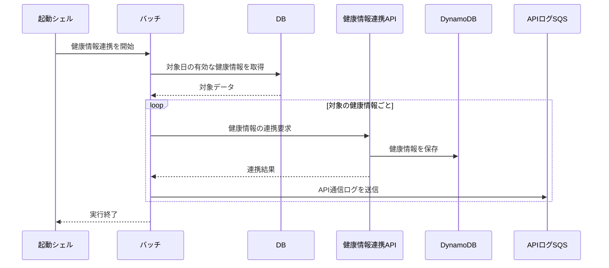
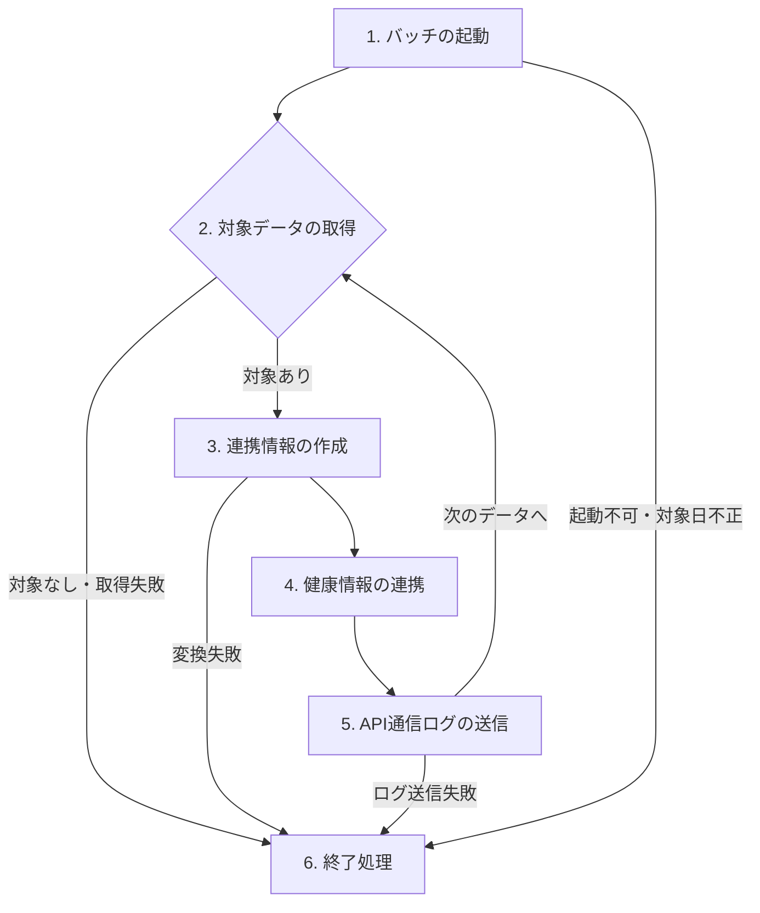

# 設計書 3.3. 健康情報連携バッチ

## 1. 機能概要

- 指定日の有効な健康情報（`DELETE_FLAG = false`）をMySQLの`HEALTH_INFO`からページ取得し、1レコードずつ健康情報蓄積API（ha-track）へ連携する。
- 連携先APIは健康情報をDynamoDBへ保存する。バッチからDynamoDBを直接操作しない。
- API呼出し後、要求情報・接続結果をAPI通信ログのSQSキューへ送信する。`API_LOG`へのDB登録は[AWS SQS取込バッチ](設計書_3.4.AWS%20SQS取込バッチ.md)が行う。
- 連携済みフラグの更新・送信済み判定は行わない。同じ対象日を再実行すると対象レコードを再送する。

## 2. 処理概要



## 3. IF仕様

### 3.1. ジョブパラメータ

| 引数名 | キー | 必須 | 形式 | 値 | 備考 |
| --- | --- | --- | --- | --- | --- |
| 処理対象日 | `d` | 任意 | `YYYYMMDD` | 連携対象の健康情報登録日 | 未指定・空文字の場合、Readerが初期化時の東京の当日で補完する。標準シェルは第1位置引数を`d=値`として渡すため、位置引数自体の省略は不可（空文字の指定は可）。 |
| 実行識別子 | `run.id` | 任意 | 年月日時分秒＋ナノ秒9桁＋`-`＋PID | バッチ実行識別子 | 標準シェルが`date "+%Y%m%d%H%M%S%N-$$"`で起動日時・ナノ秒・シェルPIDを連結して自動設定する。Job側に必須・形式チェックや省略時の自動補完はない。標準シェルでは実行ごとに生成し、新規JobInstanceとして起動する。 |

## 4. 処理フロー



| 処理順 | 処理概要 | 処理詳細 | 関連項番 |
| --- | --- | --- | --- |
| 1 | バッチの起動 | 共通設定・実行ID・排他を準備し、対象日を検証して連携Jobを開始する。不正な対象日やロック競合では対象データを処理しない。 | 4.1、4.3 |
| 2 | 対象データの取得 | 対象日の有効な健康情報だけをDBからページ単位で取得し、順に後続処理へ渡す。対象がなければ連携せず終了し、取得失敗はStepへ伝播する。 | 4.2、4.4 |
| 3 | 連携情報の作成 | 取得した健康情報から、ユーザIDと1件の明細を持つ連携要求を作成する。変換失敗はStepへ伝播する。 | 4.5 |
| 4 | 健康情報の連携 | 健康情報連携APIへ要求し、API側でDynamoDBへ保存する。バッチはAPI結果の成功判定をせず、通常のHTTP・通信例外もAPIクライアントで捕捉した後、処理5へ進む。 | 4.6、4.8 |
| 5 | API通信ログの送信 | 要求・応答・接続情報をSQSへ送信し、処理位置を保存して次のデータへ進む。ログ編集・送信失敗はStepを失敗させるが、連携先の保存は取り消せない。 | 4.7、4.3.2 |
| 6 | 終了処理 | Jobを開始した場合は、その実行状態を記録して共通の終了ログ・通知を行い、プロセス終了後にロックを解放する。Job完了と連携先の保存成功は同じ条件ではない。 | 4.9 |

### 4.1. 入力チェック

| 対象 | チェック・補完内容 | 異常時の動作 | 備考 |
| --- | --- | --- | --- |
| シェル引数1 | `$1`を参照 | 未指定は`set -u`によりシェル終了 | シェル内の日付形式チェックはない。 |
| Jobパラメータ`d` | 非空の場合、`DateTimeUtil.isDate(value, YYYYMMDD_NOSEP)` | `InvalidJobParametersException`、`job parameter invalid d={値}` | [DateFormatParameterValidator](../../../ha-batch/src/main/java/jp/co/ha/batch/base/DateFormatParameterValidator.java)を使用。必須指定はfalse。 |
| 日付書式判定 | `SimpleDateFormat("yyyyMMdd")`、`setLenient(false)` | 解析失敗時は検証NG | 8桁の正規表現検証・末尾までの完全一致検証は行わない。 |
| Readerでの日時生成 | 年は先頭4桁、月は5～6桁、日は7～8桁を整数化 | 数値・日時生成例外でStep失敗 | 先頭8文字より後ろの文字をReaderは使用しない。 |
| 未指定・空文字 | システム日付を`yyyyMMdd`に変換 | 特になし | 前日への補正はない。 |
| 健康情報明細 | バッチ側の追加検証なし | API側での検証は4.8参照 | DB値からそのままリクエストを構築する。 |

### 4.2. DB操作

```sql
SELECT
    SEQ_HEALTH_INFO_ID
    , SEQ_USER_ID
    , HEIGHT
    , WEIGHT
    , BMI
    , STANDARD_WEIGHT
    , HEALTH_INFO_REG_DATE
    , SEQ_BMI_RANGE_MT_ID
    , UPDATE_DATE
    , REG_DATE
FROM
    HEALTH_INFO
WHERE
    HEALTH_INFO_REG_DATE BETWEEN #{from} AND #{to}
    AND DELETE_FLAG = false
ORDER BY
    SEQ_HEALTH_INFO_ID ASC
LIMIT
    #{_skiprows}
    , #{_pagesize}
```

| 項目 | 設定値 | 備考 |
| --- | --- | --- |
| `#{from}` | 対象日の`00:00:00` | Readerが作成する`LocalDateTime`。検索範囲の下限を含む。 |
| `#{to}` | 対象日の`23:59:59` | Readerが作成する`LocalDateTime`。検索範囲の上限を含む。 |
| `#{_skiprows}` | ページ番号（0始まり）×ページ件数 | MyBatisPagingItemReaderが設定するオフセット。 |
| `#{_pagesize}` | `ha-batch.health-info-migrate.exec-perpage-count` | ページ件数。既定100。 |

### 4.3. シェル・Job・トランザクション

#### 4.3.1. シェル起動・Job開始

| 処理 | 内容 | 備考 |
| --- | --- | --- |
| Job構成 | `healthInfoMigrateBatchJob`→`healthInfoMigrateBatchStep` | [Config](../../../ha-batch/src/main/java/jp/co/ha/batch/healthInfoMigrate/HealthInfoMigrateConfig.java)でReader、Processor、Writerを設定。 |
| 排他 | FD9のflockを保持してDocker実行 | 同じシェルの同時起動を抑止する。対象日ごとにロックを分離しない。 |
| 共通基盤 | [バッチ共通処理](設計書_3.11.バッチ共通処理.md) | シェル基盤、メタデータ、BatchJobListener、プロセス終了の扱いを参照。 |

#### 4.3.2. chunkの確定・再実行

| 処理 | 内容 | 備考 |
| --- | --- | --- |
| chunk | `chunk(1)`、PlatformTransactionManagerを指定 | 1件のAPI呼出しとSQS送信後にchunkが完了する。 |
| 外部副作用 | ha-track/DynamoDB・SQSはDBトランザクションと一体ではない | chunkの失敗・再実行で外部送信を取り消さない。API成功後のSQS失敗では健康情報だけが保存済みとなる可能性がある。 |
| リスタート | Readerの`saveState=true` | 同一JobInstanceの再開時はExecutionContextを利用する。新規run.idの再実行は対象日を再度先頭から送信する。 |
| 重複抑止 | バッチ側の送信履歴・重複確認なし | API送信後～chunk確定前の失敗でも再送され得る。SQSの重複排除IDも送信ごとに新規UUIDを採番する。 |

### 4.4. Reader・ページング

#### 4.4.1. 検索範囲・ページ条件の準備

| 処理 | 内容 | 備考 |
| --- | --- | --- |
| 実装 | [HealthInfoMigrateReader](../../../ha-batch/src/main/java/jp/co/ha/batch/healthInfoMigrate/HealthInfoMigrateReader.java) | StepScopeのMyBatisPagingItemReader。 |
| 対象日 | Jobパラメータ`d`、空の場合はシステム日付 | 日単位の0時～23時59分59秒。 |

#### 4.4.2. ページ読取・取得結果の扱い

| 処理・結果 | 扱い | 備考 |
| --- | --- | --- |
| 読取SQLの呼出し | [PagingHealthInfoMapper.xml](../../../ha-db/src/main/resources/jp/co/ha/db/mapper/custom/PagingHealthInfoMapper.xml)の`selectByHealthInfoRegDate`を使用する | 対象日の登録日時範囲に加え、`DELETE_FLAG = false`の健康情報だけを取得する。ReaderのqueryIdは完全修飾Mapper名にメソッド名を付けた値。 |
| 業務DB更新 | Readerは検索結果を後続処理へ渡す | 業務データの更新は行わず、Spring Batchメタデータは[共通処理](設計書_3.11.バッチ共通処理.md)が管理する。 |
| DB検索失敗 | 例外を上位へ伝播する | HTTP接続例外を対象とするretry・skipの対象にはならない。 |
| 並行更新 | 取得したページを順に処理する | ページ間の読取りを固定する独自ロックはない。 |


| 処理 | 内容 | 備考 |
| --- | --- | --- |
| ページング | LIMITオフセット方式 | ページ内のリストから1件ずつ返し、ページを消費すると次のSELECTを行う。 |
| 同時変更 | 独自のスナップショット固定なし | 処理中に対象データが増減するとオフセット境界が変わる可能性がある。 |
| 終端 | read結果がnull | 有効な健康情報が0件の場合は、削除済みデータだけが存在する場合もAPI・SQS送信を行わず完了する。 |
| 状態保存・キャッシュ | `setSaveState(true)`、ページ内保持 | 業務キャッシュを別途参照・更新しない。 |

### 4.5. Processor・API要求変換

#### 4.5.1. 連携要求の基本項目の編集

| 処理 | 内容 | 備考 |
| --- | --- | --- |
| 実装 | [HealthInfoMigrateProcessor](../../../ha-batch/src/main/java/jp/co/ha/batch/healthInfoMigrate/HealthInfoMigrateProcessor.java) | HealthInfoからHealthInfoMigrateApiRequestを作る。 |
| ユーザID | `SEQ_USER_ID`を`seq_user_id`へ設定 | ユーザごとの複数行をまとめる処理はない。 |
| 移行フラグ | `healthinfo.track.api.db.migrate.flg`を`migrate_flg`へ設定 | ha-trackの現在の保存処理はこの値で分岐しない。 |

#### 4.5.2. 健康情報明細の編集

| 処理 | 内容 | 備考 |
| --- | --- | --- |
| 健康情報 | 健康情報ID・身長・体重・BMI・標準体重・健康情報作成日時を転記 | `List.of(bean)`により1件だけの`health_infos`を作る。 |
| 変換のみ | 集約、数値再計算、マスク、nullフィルタは行わない | 日時はAPIのJSONアノテーションによって書式変換する。 |

### 4.6. Writer・健康情報連携API

#### 4.6.1. 送信設定・通信識別子の準備

| IF・処理 | 内容 | 備考 |
| --- | --- | --- |
| Writer | [HealthInfoMigrateWriter](../../../ha-batch/src/main/java/jp/co/ha/batch/healthInfoMigrate/HealthInfoMigrateWriter.java) | writeごとにtransactionIdとApiConnectInfoを作成し、chunk内リストを順番に送る。実際のchunkサイズは1。 |

#### 4.6.2. 健康情報連携APIの呼出し・応答処理

| IF・処理 | 内容 | 備考 |
| --- | --- | --- |
| API実装 | [HealthInfoMigrateApi](../../../ha-business/src/main/java/jp/co/ha/business/api/track/HealthInfoMigrateApi.java) | API名は`Track API:健康情報連携API`。 |
| メソッド・URL | `POST {healthinfo.track.api.url}healthinfo/` | ha-track側パスは`/api/healthinfo/`。 |
| リクエストヘッダ | `Content-Type: application/json`、`Accept: application/json`、`Accept-Charset: UTF-8` | ApiConnectInfoの追加ヘッダMapは空。APIキーやBearerトークンを追加する処理はない。 |
| クエリ | 特になし | POSTボディを使用する。 |
| 応答の利用 | API通信ログ生成のみ | `result`、`id`、`synced_at`で成功・失敗判定しない。 |
| 通信実装 | [BaseApi](../../../ha-common/src/main/java/jp/co/ha/common/web/api/BaseApi.java) | LoggingInterceptorを設定し、送受信情報をログへ出す。 |
| 接続時刻 | exchange直前にrequestDateを設定。exchangeが正常返却した場合にhttpStatusとresponseDateを設定 | HTTP 4xx/5xxなどexchangeが例外となった場合、httpStatus・responseDateは初期値nullのまま。 |
| 通信失敗 | BaseApiがExceptionを捕捉し`通信エラーです.`をログ出力する | `bindErrorInfo`は空実装で、エラー詳細を応答へ設定しない。例外を再送出せず既定の応答モデルを返すため、WriterはSQS登録へ進む。 |
| retry・skip | Stepへ伝播するRestClientExceptionにretryLimit=3、HttpClientErrorExceptionにskipLimit=10を設定 | BaseApiで握りつぶされた通常の通信例外には適用されない。API応答が失敗内容でも自動再試行しない。 |
| Writer側の失敗 | Payload生成・URI再生成・SQS送信等の例外は上位へ伝播 | retry・skip対象に該当しない例外ではStep失敗。APIやDynamoDBの副作用は取り消せない。 |


| リクエスト項目 | JSON型 | 設定値 | 備考 |
| --- | --- | --- | --- |
| `seq_user_id` | number | `HEALTH_INFO.SEQ_USER_ID` | Java型Long。 |
| `migrate_flg` | boolean | `healthinfo.track.api.db.migrate.flg` | 現行ha-trackのSerializerでは宣言しない追加項目。 |
| `health_infos` | array | 1件の健康情報 | Java側はList。 |
| `health_infos[].seq_health_info_id` | number | `HEALTH_INFO.SEQ_HEALTH_INFO_ID` | Java型Long。 |
| `health_infos[].height` | number | `HEALTH_INFO.HEIGHT` | BigDecimal。 |
| `health_infos[].weight` | number | `HEALTH_INFO.WEIGHT` | BigDecimal。 |
| `health_infos[].bmi` | number | `HEALTH_INFO.BMI` | BigDecimal。 |
| `health_infos[].standard_weight` | number | `HEALTH_INFO.STANDARD_WEIGHT` | BigDecimal。 |
| `health_infos[].created_at` | string | `HEALTH_INFO.HEALTH_INFO_REG_DATE` | `yyyy/MM/dd HH:mm:ss`、JSONアノテーションはAsia/Tokyo。 |


```json
{
  "seq_user_id": 1,
  "migrate_flg": false,
  "health_infos": [
    {
      "seq_health_info_id": 100,
      "height": 170.000,
      "weight": 65.000,
      "bmi": 22.491,
      "standard_weight": 63.580,
      "created_at": "2026/01/15 08:00:00"
    }
  ]
}
```

| 応答項目・状態 | 内容 | 備考 |
| --- | --- | --- |
| HTTP 200 | `result: 0`、`synced_at` | ha-trackは`id`を返さない。Javaの[HealthInfoMigrateApiResponse](../../../ha-business/src/main/java/jp/co/ha/business/api/track/response/HealthInfoMigrateApiResponse.java)にはnullableなidフィールドが存在する。 |
| `result` | Java側はTrackApiResult（SUCCESS=`0`、FAILURE=`1`） | BaseTrackApiResponseの宣言。バッチは値を検査しない。 |
| `synced_at` | `yyyy/MM/dd HH:mm:ss` | Java型LocalDateTime。 |
| HTTP 400 | `result: 1`、`error_message` | 検証エラーまたはDynamoDB保存エラー。BaseApiではHTTPエラーをcatchする。error_messageを取り込むJavaフィールドはない。 |
| 応答の追加項目 | 無視 | 未知プロパティで失敗させない設定。 |


```json
{
  "result": 0,
  "synced_at": "2026/01/15 09:00:00"
}
```

### 4.7. API通信ログ・SQS送信

#### 4.7.1. 通信ログPayloadの編集

| 処理・項目 | 内容 | 備考 |
| --- | --- | --- |
| 実装 | [ApiLogComponent](../../../ha-business/src/main/java/jp/co/ha/business/component/ApiLogComponent.java)の`getPayload4TrackApi`→`registQueue` | 応答本文をDB向けPayloadへ含めない。Track API用のdetailは常にnull。 |
| `transaction_id` | writeごとに生成するUUID | [ApiLogQueuePayload](../../../ha-business/src/main/java/jp/co/ha/business/dto/ApiLogQueuePayload.java)のJSON項目。 |
| `api_name` | `Track API:健康情報連携API` | ApiNameTypeの定義値。 |
| `http_method` | `POST` | APIから取得する。 |
| `url` | 実行時に生成したURI文字列 | Payload作成時に再度getUriを呼ぶ。 |
| `body` | 要求JSONを文字列化したもの | JSONオブジェクトではなくJSON文字列。POST/PUTのみ設定する。 |
| `request_date` | 接続情報の要求時刻 | `yyyy/MM/dd HH:mm:ss`。exchange前の失敗ではnullとなり得る。 |
| `http_status` | 正常返却したexchangeのHTTPステータス値 | 通信失敗・HTTPエラー捕捉時はnullとなり得る。 |
| `detail` | null | APIエラー内容の取り込みはない。 |
| `response_date` | 接続情報の応答時刻 | 正常返却時のみ設定。 |

#### 4.7.2. SQS送信・後続取込

| 処理・項目 | 内容 | 備考 |
| --- | --- | --- |
| 送信 | [AwsSqsComponent.enqueue](../../../ha-common/src/main/java/jp/co/ha/common/aws/AwsSqsComponent.java) | `GetQueueUrl`で名前を解決し、PayloadをJSON化して`SendMessage`する。 |
| FIFO属性 | `messageGroupId=transaction_id`、`messageDeduplicationId=送信時に新規生成するUUID` | 同じ健康情報の再送を同じIDで重複排除する処理はない。 |
| 登録順 | API呼出しが戻った後にSQS送信 | API呼出しが成功したかどうかは判定しない。API前の予約登録・送信失敗時の補償処理はない。 |
| 後続取込 | [AWS SQS取込バッチ](設計書_3.4.AWS%20SQS取込バッチ.md) | request_date等がnullのPayloadも送信し得るが、API_LOGのNOT NULL制約で取込に失敗する場合がある。 |

#### 4.7.3. SQS送信失敗時の扱い

| 処理・項目 | 内容 | 備考 |
| --- | --- | --- |
| SQS失敗 | `SystemException(AWS_SQS_ENQUEUE_ERROR / CE0041)` | 例外を上位へ送出する。RestClientException向けのretry、HttpClientErrorException向けskipには該当しない。 |

### 4.8. ha-track・DynamoDB保存

#### 4.8.1. 連携APIの受付・入力検証

| 処理 | 内容 | 備考 |
| --- | --- | --- |
| API実装 | [views.py](../../../ha_track/api/views.py)、[serializers.py](../../../ha_track/api/serializers.py) | `POST /api/healthinfo/`を受ける。 |
| 入力検証 | ユーザID・健康情報IDは整数、身長・体重・BMI・標準体重は数値、created_atは文字列として検証 | created_atは`%Y/%m/%d %H:%M:%S`で解析し、Asia/Tokyoのタイムゾーン付き日時に変換する。 |
| 検証NG | HTTP 400、`{"result":1,"error_message":検証エラー}` | DynamoDBへの保存前に返却する。Java側ではHTTP例外をBaseApi内で捕捉する。 |
| migrate_flg | 保存分岐に使用しない | Serializerの検証対象にも含めず、常に現行のDynamoDB保存経路を使う。 |

#### 4.8.2. DynamoDB保存用データの編集・保存

| 処理 | 内容 | 備考 |
| --- | --- | --- |
| 保存先テーブル | localは`health_info_local`、dev/prdは`HEALTH_INFO_DYNAMODB_TABLE_NAME` | [settings.py](../../../ha_track/ha_track/settings.py)で環境に対応する`health_info_dev` / `health_info_prd`を検証する。 |
| DynamoDB呼出し | [dynamo_util.py](../../../ha_track/api/util/dynamo_util.py)の`put_dynamo_db` | `ap-northeast-1`のboto3 resourceを作り、`Table(...).put_item(Item=item)`を実行する。条件付き書込みやトランザクションAPIは使用しない。 |
| 日時加工 | 作成日時をUTCへ変換しepoch秒を作成 | `created_at`がNoneなら現在日時を使う。 |
| 数値加工 | 浮動小数値を`Decimal(str(value))`へ変換 | バッチ側のBigDecimal値はAPIのSerializerでFloatFieldとして受ける。 |

| DynamoDB属性 | 値 | 備考 |
| --- | --- | --- |
| `seq_health_info_id` | 要求の健康情報ID | put_itemのItemへ設定。 |
| `created_at_epoch` | 作成日時のUTC epoch秒 | 秒未満は整数化で切り捨てる。 |
| `seq_user_id` | 要求のユーザID | 全明細共通。 |
| `height` / `weight` / `bmi` / `standard_weight` | 各要求数値をDecimal化 | 連携先の保存処理による。 |
| `created_at` | UTC日時のISO 8601文字列 | 例：`2026-01-14T23:00:00+00:00`。 |

#### 4.8.3. 保存結果の返却・バッチ側の扱い

| 処理 | 内容 | 備考 |
| --- | --- | --- |
| 保存成功 | 全健康情報の処理後HTTP 200 | result=0、応答時点のローカル日時synced_atを返す。 |
| 保存失敗 | 明細ごとのExceptionを捕捉しerrorsへ追加、最後にHTTP 400 | errorsにはindex・error=`unexpected`・detailを格納する。他明細を処理し続け、成功済み保存をロールバックしない。本バッチは1要求1明細。 |
| API結果とJob結果 | 保存失敗をバッチが直接判定しない | BaseApiのcatch後にSQS送信が成功すれば、保存失敗がJob失敗にならない場合がある。 |

### 4.9. Job・プロセスの終了

#### 4.9.1. 共通終了処理

| 処理 | 内容 | 備考 |
| --- | --- | --- |
| 共通終了 | Jobの終了状態を記録し、共通ログ・通知を実行する | [バッチ共通処理](設計書_3.11.バッチ共通処理.md)に従う。 |

#### 4.9.2. プロセス終了・ロック解放

| 処理 | 内容 | 備考 |
| --- | --- | --- |
| プロセス終了 | Java・コンテナの終了後に起動シェルを終了する | JobのFAILEDとOSプロセスの非0終了は同義ではない。5.4の終了判定を参照する。 |
| ロック解放 | シェルの終了に伴いファイル記述子のロックを解放する | ロックファイル自体は削除しない。`set -e`による途中終了ではEND表示へ到達しない場合がある。 |

## 5. 実行仕様

### 5.1. 起動方法

```bash
bash ha-batch/docker/health_info_migrate.sh 20260115
```

```bash
docker compose --project-directory "${BASE_DIR}" \
  -f "${BASE_DIR}/${DOCKER_DIR}/docker-compose.yml" \
  run --rm ha-batch --spring.batch.job.name=healthInfoMigrateBatchJob \
  "d=20260115" "run.id=${RUN_ID}"
```

| 項目 | 指定方法・値 | 必須 | 備考 |
| --- | --- | --- | --- |
| シェル引数1 | 対象日、例：`20260115` | 必須 | シェルが`$1`を直接参照する。省略すると`set -u`でJava起動前に終了する。 |
| Job名 | `healthInfoMigrateBatchJob` | 必須 | `--spring.batch.job.name`に指定する。 |
| 共通変数 | `BASE_DIR`、`DOCKER_DIR`等 | 共通定義に従う | [バッチ共通処理](設計書_3.11.バッチ共通処理.md)を参照。 |

### 5.2. 設定・実行条件

| 設定・条件 | 値・内容 | 備考 |
| --- | --- | --- |
| 実装 | [HealthInfoMigrateConfig](../../../ha-batch/src/main/java/jp/co/ha/batch/healthInfoMigrate/HealthInfoMigrateConfig.java)、[シェル](../../../ha-batch/docker/health_info_migrate.sh) | 単一Stepのchunk処理。バッチ自身はHTTPを受信しない。 |
| Step名 | `healthInfoMigrateBatchStep` | `chunk(1)`で1件単位に処理する。 |
| `ha-batch.health-info-migrate.exec-perpage-count` | `100` | [application.yml](../../../ha-batch/src/main/resources/application.yml)の初期値。SQLのページ件数。 |
| `healthinfo.track.api.url` | ha-trackの基底URL | 末尾へ`healthinfo/`を文字列連結する。末尾の`/`を補完する実装はない。 |
| `healthinfo.track.api.db.migrate.flg` | boolean | リクエストの`migrate_flg`に設定する。現在のha-trackのSerializer/Viewはこの値を処理条件に使用しない。 |
| `aws.sqs.queue.api_log` | API通信ログのキュー名 | FIFOキューを前提にmessageGroupId・messageDeduplicationIdを付けて送る。 |
| `aws.region` | AWSリージョン | SQSクライアントのリージョン。 |
| `aws.sqs.connection.timeout` / `aws.sqs.socket.timeout` | ミリ秒 | SQS接続・ソケットタイムアウト。ha-trackへのHTTPタイムアウトとは別。 |
| HTTP接続 | BaseApiが呼出しごとにRestTemplateを生成 | 本呼出しで接続・読取りタイムアウトを明示設定しない。 |
| AWS認証 | `LOCAL`はProfileCredentialsProvider、`DEV`はDefaultCredentialsProvider | [AwsAuthComponent](../../../ha-common/src/main/java/jp/co/ha/common/aws/AwsAuthComponent.java)を使用する。 |
| retry設定 | `RestClientException`、`retryLimit(3)` | 設定値は3。BaseApi内で捕捉され外へ出ないHTTP例外には適用されない。 |
| skip設定 | `HttpClientErrorException`、`skipLimit(10)` | Stepへ到達する当該例外が対象。通常のHTTP 4xxはBaseApi内で捕捉される。 |
| 排他 | `${LOCK_DIR}/health_info_migrate.sh.lock` | `flock -n`失敗時`50`。同一ロックファイルを使用するシェル間の排他。別ホスト・Java直接起動は対象外。 |
| 実行時刻 | 起動元スケジューラの設定に従う | シェル・Jobに定期実行時刻は定義しない。 |
| 共通処理 | BatchJobListener、Spring Batchメタデータ | [バッチ共通処理](設計書_3.11.バッチ共通処理.md)を参照。 |

### 5.3. 入力ファイル

特になし。

### 5.4. 終了コード・出力

| 出力・終了条件 | 値・形式 | 備考 |
| --- | --- | --- |
| ha-track呼出し | `POST {healthinfo.track.api.url}healthinfo/` | 1健康情報につき1回。要求は4.6参照。 |
| DynamoDB | ha-trackが環境別の健康情報テーブルへ`put_item` | バッチのトランザクションでロールバックできない。保存内容は4.8参照。 |
| API通信ログ | SQSへApiLogQueuePayloadを1件送信 | バッチ内で`API_LOG`へ直接INSERTしない。4.7参照。 |
| MySQL業務更新 | 特になし | `HEALTH_INFO`を読み取るだけで、送信完了の印は付けない。 |
| ファイル出力 | 特になし | CSV等の中間ファイルを作成しない。 |
| 正常時JobStatus | `COMPLETED` | API結果の`result`や`id`等を判定しない。API通信例外がBaseApi内で捕捉され、その後のSQS送信が成功した場合も正常終了し得る。 |
| 上位へ伝播した処理例外 | 原則Step/Job失敗 | retry・skip対象と上限は5.2と4.6を参照。SQS送信のBaseExceptionはその設定の対象外。 |
| シェル排他失敗 | `50` | Java起動前に終了する。 |
| シェル正常終了 | `0` | Dockerコマンドの非0終了では`set -e`で中断する。`cd ... && docker compose ...`のcd失敗ではEND表示へ進み0終了し得る。JobStatusとOS終了コードの扱いは[バッチ共通処理](設計書_3.11.バッチ共通処理.md)を参照。 |
| Job終了ログ・Slack通知 | 共通Job終了処理 | 本バッチ独自の`BATCH_LOG`登録処理はない。 |
