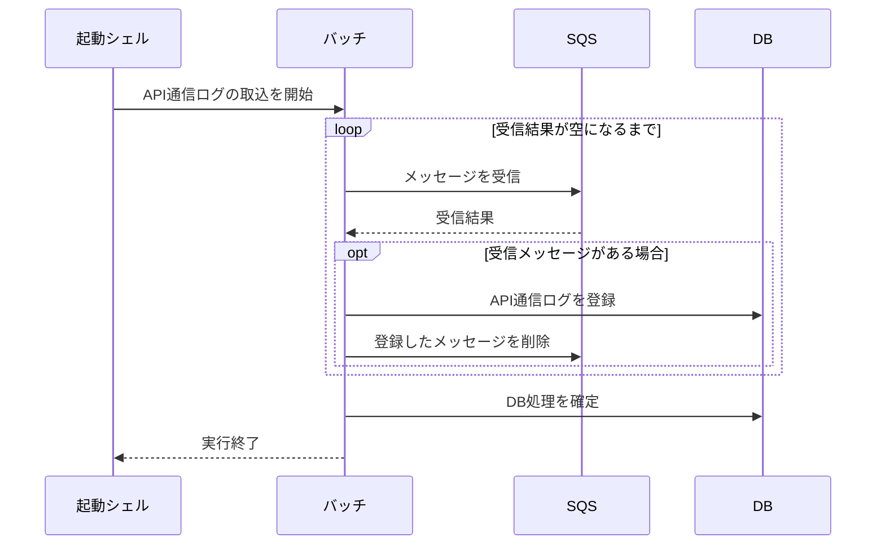
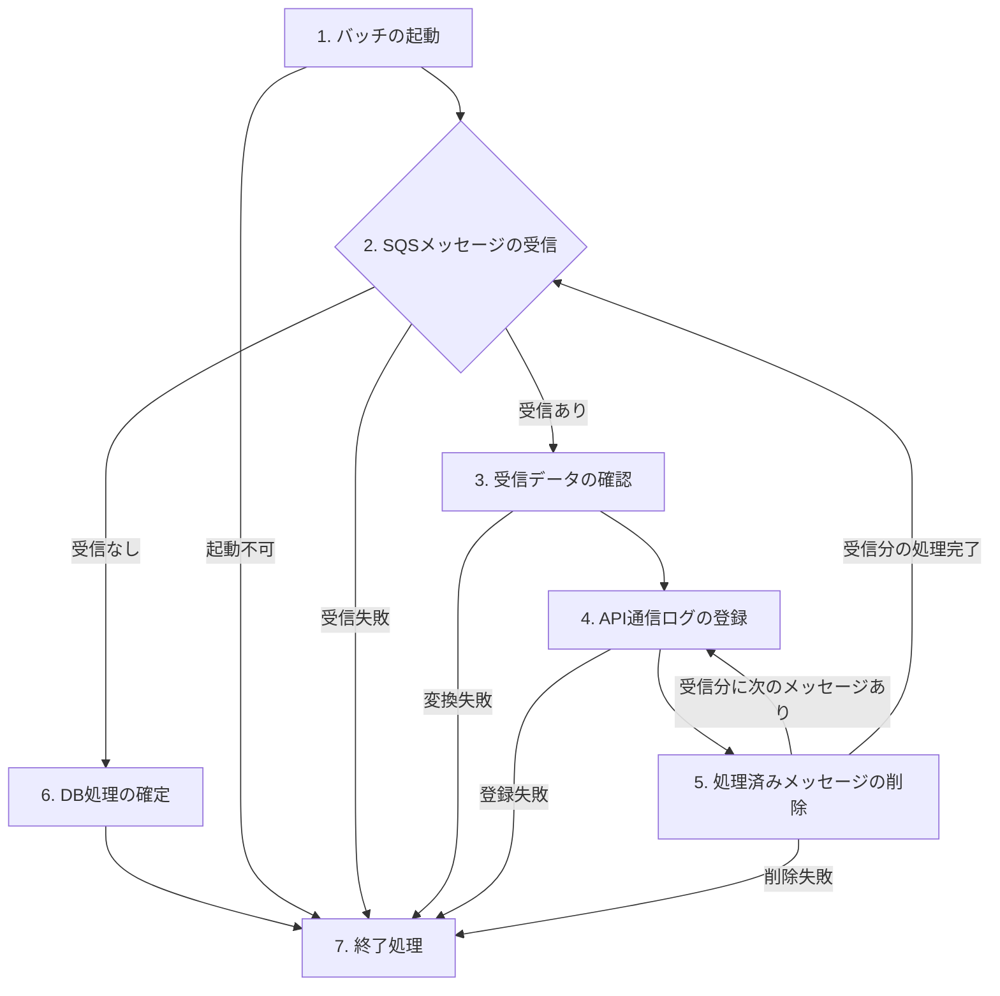

# 設計書 3.4. AWS SQS取込バッチ

## 1. 機能概要

- API通信ログ用SQSキューからメッセージを取得し、MySQLの`API_LOG`へ登録する。
- 1回の受信は最大10件とし、取得したメッセージごとにDB登録→SQS削除の順に処理する。
- 受信結果が空になるまで同じTasklet実行内で取得を繰り返す。空の受信結果を1回得た時点で終了する。
- DB登録とSQS削除を同一の分散トランザクションとして扱う実装はない。受信・登録・削除の例外は処理を中断して上位へ送出する。

## 2. 処理概要



## 3. IF仕様

### 3.1. ジョブパラメータ

| 引数名 | キー | 必須 | 形式 | 値 | 備考 |
| --- | --- | --- | --- | --- | --- |
| 実行識別子 | `run.id` | 任意 | 年月日時分秒＋ナノ秒9桁＋`-`＋PID | バッチ実行識別子 | 標準シェルが`date "+%Y%m%d%H%M%S%N-$$"`で起動日時・ナノ秒・シェルPIDを連結して自動設定する。Job側に必須・形式チェックや省略時の自動補完はない。標準シェルでは実行ごとに生成し、新規JobInstanceとして起動する。本Jobに業務用のJobパラメータはない。 |

## 4. 処理フロー



| 処理順 | 処理概要 | 処理詳細 | 関連項番 |
| --- | --- | --- | --- |
| 1 | バッチの起動 | 共通設定・実行ID・排他を準備し、取込JobとStepのトランザクションを開始する。ロック競合は終了コード50で終了する。 | 4.3 |
| 2 | SQSメッセージの受信 | 設定されたAPIログキューから最大10件を受信する。受信があれば処理3、空なら処理6へ進む。受信失敗は取込処理を中断する。 | 4.4 |
| 3 | 受信データの確認 | 受信分の全メッセージをJSONからPayloadへ変換してから登録を始める。変換失敗時はその受信分を登録・削除せず終了処理へ進む。 | 4.5 |
| 4 | API通信ログの登録 | Payloadから登録データを作成し、受信順に1件ずつAPI_LOGへ登録する。この時点ではDBをコミットせず、登録失敗は取込処理を中断する。 | 4.2、4.6 |
| 5 | 処理済みメッセージの削除 | 登録呼出しが成功したメッセージをSQSから削除する。受信分の残りがあれば処理4、すべて終えたら処理2へ戻る。削除失敗は取込処理を中断する。 | 4.7.1 |
| 6 | DB処理の確定 | 空受信までの取込処理が完了した後、DBのトランザクションを確定する。途中例外でDBがロールバックしても、先行したSQS削除は取り消せない。 | 4.7.2 |
| 7 | 終了処理 | Jobを開始した場合は、正常時・異常時の状態を記録し、共通の終了ログ・通知を行う。異常時はDBロールバックの対象となるが削除済みメッセージは戻らない。プロセス終了後にロックを解放する。 | 4.7.2、4.8 |

### 4.1. 入力チェック

| 対象 | 検証・取扱い | 異常時の動作 | 備考 |
| --- | --- | --- | --- |
| Jobパラメータ | 独自JobParametersValidatorなし | 特になし | 対象年月日・ファイル名等を必要としない。 |
| キュー名 | AwsPropertiesから取得 | GetQueueUrl等が失敗すると受信例外または削除例外 | 空文字・存在確認を行う独立したバリデーションはない。 |
| メッセージBody | JsonMapperでApiLogQueuePayloadへ変換 | 変換に失敗すると受信全体を`AWS_SQS_POLL_ERROR`として送出 | Bean Validationや独自の項目別エラーメッセージはない。 |
| 日時 | `yyyy/MM/dd HH:mm:ss`、Asia/Tokyo指定 | 解析不能な日時はJSON変換失敗 | nullable値の可否とDB制約は別。 |
| 必須・桁数 | Payloadに必須・長さの検証アノテーションなし | 不正値がDB制約に違反すればINSERT失敗 | 4.5の表は主にDB保存条件を示す。 |
| HTTPメソッド | `HttpMethod.valueOf`で判定 | null等で処理例外が発生すればTasklet中断 | POST/PUTだけをBODY保存対象とし、それ以外のBODYは保存しない。 |

### 4.2. DB操作

```sql
insert into
    API_LOG (
        SEQ_API_LOG_ID
        , TRANSACTION_ID
        , API_NAME
        , HTTP_METHOD
        , URL
        , BODY
        , HTTP_STATUS
        , DETAIL
        , REQUEST_DATE
        , RESPONSE_DATE
        , DELETE_FLAG
        , REG_DATE
        , UPDATE_DATE
    )
values (
    #{seqApiLogId,jdbcType=BIGINT}
    , #{transactionId,jdbcType=VARCHAR}
    , #{apiName,jdbcType=VARCHAR}
    , #{httpMethod,jdbcType=VARCHAR}
    , #{url,jdbcType=VARCHAR}
    , #{body,jdbcType=VARCHAR}
    , #{httpStatus,jdbcType=INTEGER}
    , #{detail,jdbcType=VARCHAR}
    , #{requestDate,jdbcType=TIMESTAMP}
    , #{responseDate,jdbcType=TIMESTAMP}
    , #{deleteFlag,jdbcType=BIT}
    , #{regDate,jdbcType=TIMESTAMP}
    , #{updateDate,jdbcType=TIMESTAMP}
)
```

| 項目 | 設定値 | 備考 |
| --- | --- | --- |
| `#{seqApiLogId}` | `null` | DBのAUTO_INCREMENTで採番する。受信MessageIdは使用しない。 |
| `#{transactionId}` | `payload.transactionId()` | 送信元が採番したトランザクションID。 |
| `#{apiName}` | `payload.apiName()` | 受信したAPI名。 |
| `#{httpMethod}` | `payload.httpMethod()` | 受信したHTTPメソッド。 |
| `#{url}` | `payload.url()` | 受信したURL。 |
| `#{body}` | POST・PUTは`payload.body()`、それ以外は`null` | HTTPメソッドによる選別後の本文。 |
| `#{httpStatus}` | `payload.httpStatus()` | 受信したHTTPステータス。nullも保存対象。 |
| `#{detail}` | `payload.detail()` | 受信した詳細。null可。 |
| `#{requestDate}` | `payload.requestDate()` | 送信元の要求日時。 |
| `#{responseDate}` | `payload.responseDate()` | 送信元の応答日時。null可。 |
| `#{deleteFlag}` | `false` | 初期状態は未削除。 |
| `#{regDate}` | INSERT直前のシステム日時 | `@Insert`の共通処理で設定する。 |
| `#{updateDate}` | INSERT直前のシステム日時 | `@Insert`の共通処理で設定する。 |

### 4.3. シェル・Job・Tasklet

#### 4.3.1. 共通設定・実行ID・排他の準備

| 処理 | 内容 | 備考 |
| --- | --- | --- |
| シェル | [aws_sqs_import.sh](../../../ha-batch/docker/aws_sqs_import.sh) | 共通設定を読み、run.id生成後に`/var/lock/aws_sqs_import.lock`をFD9で開き排他する。 |
| 共通基盤 | [バッチ共通処理](設計書_3.11.バッチ共通処理.md) | Shell変数、実行ID、メタデータ、JobListener、終了コードを参照。 |

#### 4.3.2. 取込Job・Stepの開始

| 処理 | 内容 | 備考 |
| --- | --- | --- |
| Job | `awsSqsImportBatchJob`→`awsSqsImportBatchStep` | BatchJobListenerを登録し、1つのStepを開始する。 |
| Step | `tasklet(apiLogSqsImportTasklet, transactionManager)` | Reader/Processor/Writer構成・chunk件数設定はない。 |

#### 4.3.3. 取込Taskletの実行範囲

| 処理 | 内容 | 備考 |
| --- | --- | --- |
| Tasklet | [ApiLogSqsImportTasklet](../../../ha-batch/src/main/java/jp/co/ha/batch/sqsImport/ApiLogSqsImportTasklet.java) | execute内のwhile(true)でキューを取り続ける。1受信ごとにFINISHEDを返す処理ではない。 |
| トランザクション範囲 | 1回のexecute全体 | 全受信・全INSERT・全ack後、空受信でループを抜けFINISHEDを返してからコミットする。 |
| 終了 | 受信リストが空でbreak→FINISHED | 実行時間・総件数の独自上限はない。継続的にメッセージが到着すると処理が長時間継続する場合がある。 |
| 例外 | executeから上位へ送出 | Tasklet内の個別catch、retry/skip、失敗メッセージの隔離・継続処理はない。 |

### 4.4. SQS受信・繰返し条件

#### 4.4.1. SQS受信

| 処理 | 内容 | 備考 |
| --- | --- | --- |
| 呼出し | `pollQueueBatchWithHandle(queueName, ApiLogQueuePayload.class, 3, 60, 10)` | [AwsSqsComponent](../../../ha-common/src/main/java/jp/co/ha/common/aws/AwsSqsComponent.java)を使用する。 |
| クライアント | SqsClientを生成し、リージョン・認証Provider・ApacheHttpClientを設定 | 受信間のキューURL・クライアントの独自キャッシュはない。 |
| URL解決 | `GetQueueUrl(queueName)` | 失敗時は受信例外となる。 |
| 受信 | `ReceiveMessage`へwaitTimeSeconds=3、visibilityTimeout=60、maxNumberOfMessages=10を指定 | 実際の受信件数は0～10件。独自ページ番号・継続トークンは使用しない。 |
| 可視性 | 受信から60秒は再配信抑止の対象 | ChangeMessageVisibilityによる延長を行わない。待機・DB処理が長引くと未削除メッセージが再び受信可能となる。 |
| 受信失敗 | 例外を`SystemException(AWS_SQS_POLL_ERROR / CE0042)`へ包む | 接続・URL解決・receiveMessage・JSON変換の例外を含む。独自再試行・バックオフはない。 |
| キャッシュ・状態保存 | 業務キャッシュ・メッセージ単位のExecutionContext保存なし | 再実行対象はSQSに残っているメッセージで決まる。 |

#### 4.4.2. 受信結果による継続・終了判定

| 処理 | 内容 | 備考 |
| --- | --- | --- |
| 空受信 | 空リストを返す | Taskletで`queue record not exist.`をDEBUG出力し、その場で終了する。非表示中のメッセージが存在しないことまで確認する処理ではない。 |
| 非空受信 | 全件JSON変換後、受信リスト順に登録・削除 | 全件処理したら次の受信へ進む。 |

### 4.5. SQSメッセージIF・JSON変換

#### 4.5.1. 受信メッセージの形式

| 入力項目 | JSON型・形式 | DB保存条件 | 備考 |
| --- | --- | --- | --- |
| `transaction_id` | string | NOT NULL、VARCHAR(36) | 送信元のトランザクションID。UUID形式を確認する独自チェックはない。 |
| `api_name` | string | NOT NULL、VARCHAR(64) | API名。 |
| `http_method` | string | NOT NULL、VARCHAR(16) | POST/PUTのみbodyをDBへ保存。 |
| `url` | string | NOT NULL、VARCHAR(256) | URL書式の独自チェックはない。 |
| `body` | string または null | VARCHAR(2048)、NULL可 | 要求JSONをJSON文字列として格納する。オブジェクトを直接入れる形式ではない。 |
| `request_date` | string、`yyyy/MM/dd HH:mm:ss` | NOT NULL、DATETIME | Payloadに値がなければDB登録時に制約違反となる場合がある。 |
| `http_status` | number または null | INT、NULL可 | PayloadのJava型はInteger。 |
| `detail` | string または null | VARCHAR(256)、NULL可 | APIエラーの詳細等。 |
| `response_date` | string または null、`yyyy/MM/dd HH:mm:ss` | DATETIME、NULL可 | 日時のJSONアノテーションはAsia/Tokyo。 |

```json
{
  "transaction_id": "123e4567-e89b-12d3-a456-426614174000",
  "api_name": "Track API:健康情報連携API",
  "http_method": "POST",
  "url": "http://ha-track:8086/api/healthinfo/",
  "body": "{\"seq_user_id\":1,\"health_infos\":[{\"seq_health_info_id\":100,\"height\":170,\"weight\":65,\"bmi\":22.491,\"standard_weight\":63.58,\"created_at\":\"2026/01/15 08:00:00\"}],\"migrate_flg\":false}",
  "request_date": "2026/01/15 09:00:00",
  "http_status": 200,
  "detail": null,
  "response_date": "2026/01/15 09:00:01"
}
```

#### 4.5.2. 受信分のJSON変換

| 処理・SQS属性 | 内容 | 備考 |
| --- | --- | --- |
| Payload型 | [ApiLogQueuePayload](../../../ha-business/src/main/java/jp/co/ha/business/dto/ApiLogQueuePayload.java) | JsonMapperでmessage.body()をrecordへ変換する。 |
| 変換の単位 | 1回の受信結果の全件 | 1件でも変換例外が発生するとメソッド全体から例外を送出し、その受信結果をTaskletへ返さない。先に変換済みのメッセージも、この受信単位ではDB登録・ackされない。 |
| Bodyログ | JSON変換前にBodyをDEBUG出力 | SQSのBodyにはAPI要求本文が含まれる。 |

#### 4.5.3. 変換結果・受信ハンドルの引継ぎ

| 処理・SQS属性 | 内容 | 備考 |
| --- | --- | --- |
| 受信結果 | `DequeueResult(payload, receiptHandle, messageId)` | Body以外の2項目はSQSの受信応答から取得する。 |
| `receiptHandle` | ackOneの入力 | メッセージIDではなく受信ハンドルを削除に使用する。 |
| `messageId` | 受信結果に保持 | TaskletでDB保存・重複確認・削除キーに使用しない。 |

#### 4.5.4. 不正メッセージの扱い

| 処理・SQS属性 | 内容 | 備考 |
| --- | --- | --- |
| 不正メッセージ | その受信結果をackせずTasklet失敗 | 独自のDLQ転送・破棄・部分成功の返却はない。可視性タイムアウト後に再受信され得る。 |

### 4.6. API_LOGエンティティ生成・登録

#### 4.6.1. APIログ登録データの編集

| 処理・結果 | 扱い | 備考 |
| --- | --- | --- |
| 登録日時の編集 | [DataBaseCommonAspect](../../../ha-db/src/main/java/jp/co/ha/db/aspect/DataBaseCommonAspect.java)が登録・更新日時を設定する | SQS送信元の要求・応答日時とは別。 |

| 設定先 | 設定内容 | 備考 |
| --- | --- | --- |
| 実装 | [ApiLogComponent.create](../../../ha-business/src/main/java/jp/co/ha/business/component/ApiLogComponent.java) | 受信Payloadから新しいApiLogを生成する。 |
| `TRANSACTION_ID` | `payload.transactionId()` | 送信元採番値をそのまま使用する。 |
| `API_NAME` | `payload.apiName()` | 固定値への置換なし。 |
| `HTTP_METHOD` | `payload.httpMethod()` | HttpMethod.valueOfでBODY保存対象を判定する。 |
| `URL` | `payload.url()` | 正規化しない。 |
| `BODY` | POSTまたはPUTなら`payload.body()` | GET/DELETE等はnullのまま。 |
| `REQUEST_DATE` | `payload.requestDate()` | 取込時刻ではなく送信元の要求日時。 |
| `HTTP_STATUS` | `payload.httpStatus()` | nullもそのまま保存対象。 |
| `DETAIL` | `payload.detail()` | null可。 |
| `RESPONSE_DATE` | `payload.responseDate()` | null可。 |
| `DELETE_FLAG` | false | 初期状態は未削除。 |
| `REG_DATE` / `UPDATE_DATE` | @Insert共通処理で現在日時を設定 | 送信日時とは別。 |

#### 4.6.2. DB登録の実行・実行履歴の管理

| 処理・結果 | 扱い | 備考 |
| --- | --- | --- |
| INSERTの呼出し | [ApiLogMapper.xml](../../../ha-db/src/main/resources/jp/co/ha/db/mapper/ApiLogMapper.xml)の`insert`で全列を登録する | insertSelectiveではない。[ApiLogCreateServiceImpl](../../../ha-business/src/main/java/jp/co/ha/business/db/crud/create/impl/ApiLogCreateServiceImpl.java)は`@Insert`・`@Transactional(rollbackFor=Exception.class)`を持ち、Taskletのトランザクションへ参加する。 |
| 実行履歴 | Spring Batchメタデータは[バッチ共通処理](設計書_3.11.バッチ共通処理.md)で管理する | API_LOGの登録とは用途が異なる。 |

| 設定先 | 設定内容 | 備考 |
| --- | --- | --- |
| DB呼出し | ApiLogCreateService.create→ApiLogMapper.insert | Serviceが復帰した後にTaskletがSQS削除へ進む。 |

#### 4.6.3. 重複受信・登録失敗時の扱い

| 処理・結果 | 扱い | 備考 |
| --- | --- | --- |
| 重複受信 | 受信データをそのまま登録する | MessageId・transaction_idによるSELECT・更新・重複抑止はなく、TRANSACTION_IDの一意制約もない。 |
| 登録失敗 | 例外を上位へ伝播し、当該メッセージの削除には進まない | DB操作はロールバック対象だが、以前のSQS削除は戻らない。 |

| 設定先 | 設定内容 | 備考 |
| --- | --- | --- |
| 登録失敗 | 制約違反・DB障害・変換処理例外を上位へ送出 | 当該メッセージと受信リスト内の後続メッセージは削除しない。以前のack済みメッセージへの補償は行わない。 |

### 4.7. SQS削除・トランザクションと途中失敗

#### 4.7.1. 処理済みメッセージの削除

| 処理・発生箇所 | 動作 | 備考 |
| --- | --- | --- |
| ackの順序 | `component.create(payload)`→`sqs.ackOne(queueName, receiptHandle)` | 1件のINSERT呼出し直後にSQS削除する。DBコミット後の削除ではない。 |
| ack実装 | SqsClient生成→GetQueueUrl→DeleteMessage | 単一メッセージ削除。DeleteMessageBatchの部分成功応答は使用しない。 |
| 削除成功 | DEBUGログ`delete queue, queueUrl={URL}` | その後に次メッセージ、全件終了後に次受信へ進む。 |
| 削除失敗 | `SystemException(AWS_SQS_ACK_ERROR / CE0043)`を送出 | 失敗を捕捉して後続を続ける処理はない。DBトランザクションはロールバック対象。 |

#### 4.7.2. DB確定・部分失敗の扱い

| 処理・発生箇所 | 動作 | 備考 |
| --- | --- | --- |
| DBコミット | 空の受信結果を得てexecuteがFINISHEDを返した後 | ApiLogCreateServiceは外側のトランザクションに参加するため、各create復帰時には確定しない。 |
| 受信・JSON変換失敗 | その受信リストの全件をDBへ渡さず終了 | 既に前の受信で削除したSQSメッセージは復元しない。 |
| 途中のDB登録失敗 | 当該メッセージは未ack、後続も処理せず終了 | 同じTaskletでそれまでに行ったINSERTもロールバック対象。SQS削除済みの先行メッセージはDBに残らなくなる可能性がある。 |
| ack成功後の失敗 | SQS削除はロールバックできない | 後続処理または最終コミットが失敗すると、削除済みメッセージのログが失われる可能性がある。 |
| 可視性切れ・再配信 | 未削除メッセージは再受信され得る | messageIdやtransaction_idでの登録重複抑止はないため、重複行ができる場合がある。 |
| 再実行 | SQSに残るメッセージを再度取得 | 削除済みメッセージをExecutionContextやDBから再構築する処理はない。 |
| 保証範囲 | DBとSQSの一体確定・exactly-once処理は実装しない | 受信単位の部分失敗応答、可視性延長、独自DLQ退避、補償INSERT・再送はない。 |

### 4.8. Job・プロセスの終了

#### 4.8.1. 共通終了処理

| 処理 | 内容 | 備考 |
| --- | --- | --- |
| 共通終了 | Jobの終了状態を記録し、共通ログ・通知を実行する | [バッチ共通処理](設計書_3.11.バッチ共通処理.md)に従う。 |

#### 4.8.2. プロセス終了・ロック解放

| 処理 | 内容 | 備考 |
| --- | --- | --- |
| プロセス終了 | Java・コンテナの終了後に起動シェルを終了する | JobのFAILEDとOSプロセスの非0終了は同義ではない。5.4の終了判定を参照する。 |
| ロック解放 | シェルの終了に伴いファイル記述子のロックを解放する | ロックファイル自体は削除しない。`set -e`による途中終了ではEND表示へ到達しない場合がある。 |

## 5. 実行仕様

### 5.1. 起動方法

```bash
bash ha-batch/docker/aws_sqs_import.sh
```

```bash
docker compose --project-directory "${BASE_DIR}" \
  -f "${BASE_DIR}/${DOCKER_DIR}/docker-compose.yml" \
  run --rm ha-batch --spring.batch.job.name=awsSqsImportBatchJob \
  "run.id=${RUN_ID}"
```

| 項目 | 指定方法・値 | 必須 | 備考 |
| --- | --- | --- | --- |
| シェル引数 | 特になし | ― | シェルは業務引数を読み取らない。 |
| Job名 | `awsSqsImportBatchJob` | 必須 | `--spring.batch.job.name`で指定する。 |
| 対象キュー | `aws.sqs.queue.api_log`から取得 | 設定必須 | 引数でキュー名・処理件数・対象日時を指定する機能はない。 |
| 共通変数 | `BASE_DIR`、`DOCKER_DIR`等 | 共通定義に従う | [バッチ共通処理](設計書_3.11.バッチ共通処理.md)を参照。 |

### 5.2. 設定・実行条件

| 設定・条件 | 値・内容 | 備考 |
| --- | --- | --- |
| 実装 | [AwsSqsImportConfig](../../../ha-batch/src/main/java/jp/co/ha/batch/sqsImport/AwsSqsImportConfig.java)、[シェル](../../../ha-batch/docker/aws_sqs_import.sh) | バッチ自身のHTTP受信はない。 |
| Step名 | `awsSqsImportBatchStep` | 単一TaskletをPlatformTransactionManager付きで実行する。chunk方式ではない。 |
| `aws.sqs.queue.api_log` | API通信ログ用キュー名 | 受信・削除のたびにGetQueueUrlでURLへ変換する。[local設定](../../../ha-business/src/main/resources/local/aws.properties)は`local_api_log.fifo`、[dev設定](../../../ha-business/src/main/resources/dev/aws.properties)は`${API_LOG_QUEUE_NAME:dev_api_log.fifo}`。 |
| `aws.region` | AWSリージョン | SQSクライアントへ設定する。 |
| `aws.sqs.connection.timeout` | 接続タイムアウト、ミリ秒 | ApacheHttpClientへ設定する。 |
| `aws.sqs.socket.timeout` | ソケットタイムアウト、ミリ秒 | 受信のwaitTimeSecondsとは別の設定。 |
| AWS認証 | `LOCAL`はProfileCredentialsProvider、`DEV`はDefaultCredentialsProvider | [AwsAuthComponent](../../../ha-common/src/main/java/jp/co/ha/common/aws/AwsAuthComponent.java)を使用する。 |
| 受信待ち時間 | `3`秒 | Tasklet内の固定値。ジョブパラメータで変更しない。 |
| 可視性タイムアウト | `60`秒 | 受信時に設定する。実行途中の延長処理はない。 |
| 1回の最大受信件数 | `10`件 | 1回のreceiveMessageの最大件数。Job全体の処理上限ではない。 |
| DB接続・権限 | MySQLへの接続と`API_LOG`のINSERT権限 | Spring Batchメタデータを利用できることも必要。 |
| 排他ファイル | `/var/lock/aws_sqs_import.lock` | 他のシェルと異なり固定パスを使用する。`flock -n 9`失敗時は`50`。 |
| 排他範囲 | 同じロックファイルを使うシェル起動間 | 別ホスト・Java直接起動を排他する実装はない。 |
| 共通設定 | `common.sh`で`set -eu`が有効 | このシェル先頭にはset指定がないが、共通ファイル読込み後はエラー中断・未定義変数検出が有効。 |
| 実行時刻 | 起動元の設定に従う | シェル・Jobに定期実行間隔の定義はない。 |
| 共通終了処理 | BatchJobListener、Spring Batchメタデータ | [バッチ共通処理](設計書_3.11.バッチ共通処理.md)を参照。 |

### 5.3. 入力ファイル

特になし。

### 5.4. 終了コード・出力

| 出力・終了条件 | 値・形式 | 備考 |
| --- | --- | --- |
| 業務DB出力 | MySQL `API_LOG`へINSERT | マッピングとSQLは4.2、4.6を参照。 |
| SQS出力 | 正常にINSERT呼出しを終えたメッセージをDeleteMessageで削除 | DBコミットはTasklet終了時のため、削除時点ではDB未確定。 |
| ファイル・S3・DynamoDB出力 | 特になし | 本バッチからは操作しない。 |
| 正常終了 | Taskletが`RepeatStatus.FINISHED`、JobStatusは`COMPLETED` | 受信結果が空の場合も正常終了する。 |
| 中断・失敗 | 受信、JSON変換、DB登録、SQS削除の例外でStep/Job失敗 | retry・skip設定や、失敗した1件を隔離して続行する独自処理はない。 |
| キューが空のログ | `queue record not exist.` | DEBUGレベル。1回の空受信で終了するため、その後に追加されたメッセージは次回以降の実行対象。 |
| シェル排他失敗 | `50` | Docker/Java起動前に終了する。 |
| シェル正常終了 | `0` | 共通set -eによりDockerコマンドの非0終了では中断する。`cd ... && docker compose ...`のcd失敗ではEND表示へ進み0終了し得る。JobStatusとOS終了コードの扱いは[バッチ共通処理](設計書_3.11.バッチ共通処理.md)を参照。 |
| 共通Jobログ・Slack通知 | 共通Job終了処理 | 本Taskletは`API_LOG`を登録するが、独自の`BATCH_LOG`登録は行わない。 |
