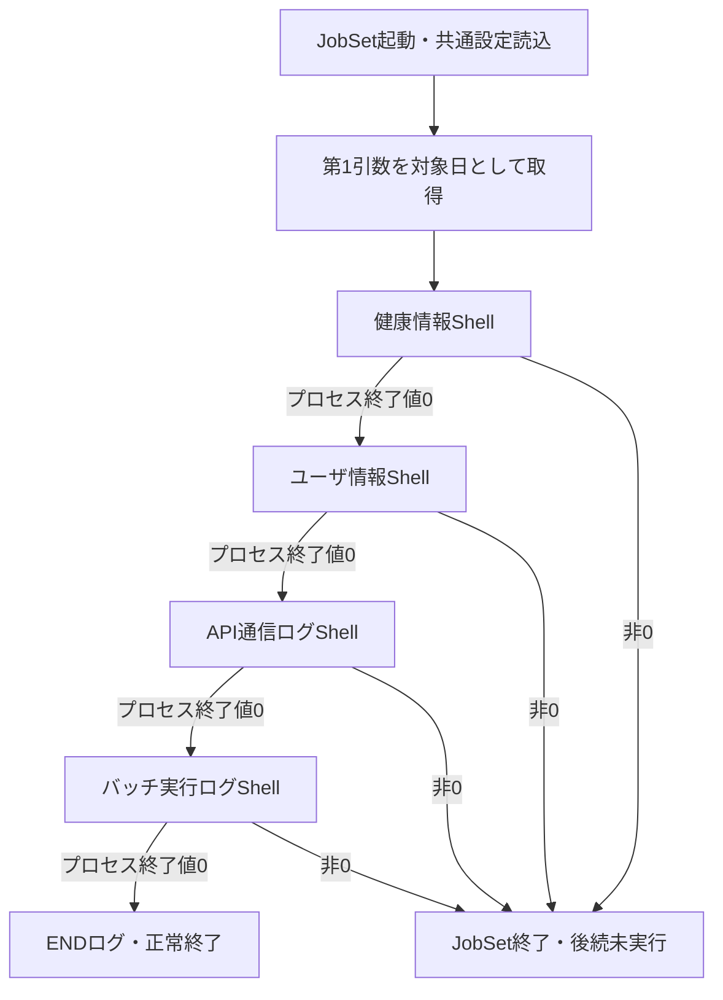
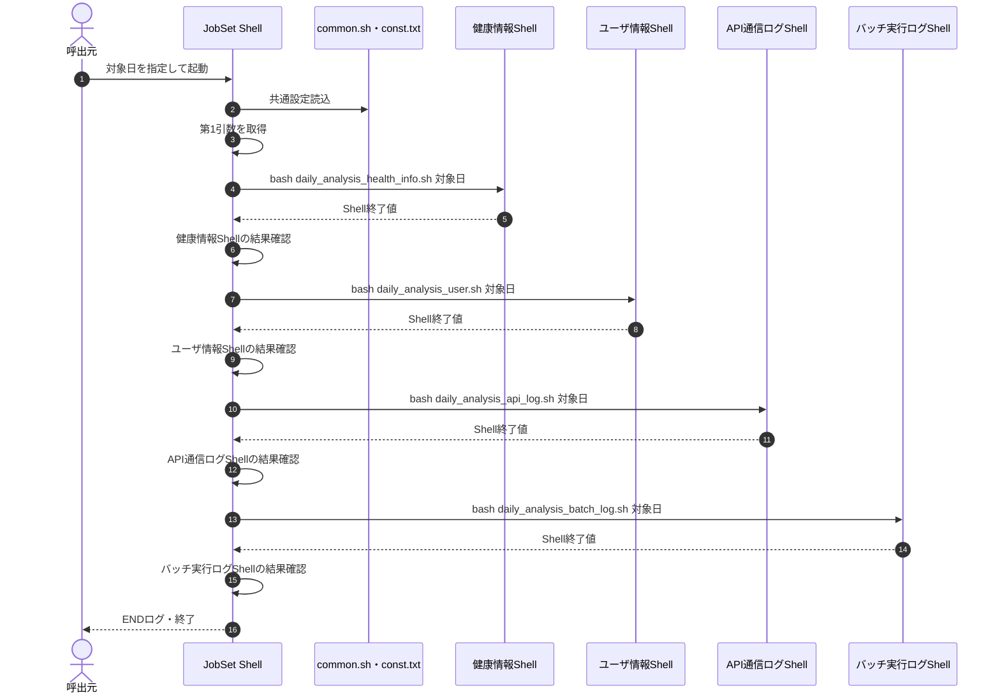

# 設計書 3.5.日次データ分析連携JobSet

## 1. 機能概要

- 指定した対象日を4本の子Shellへ渡し、健康情報・ユーザ情報・API通信ログ・バッチ実行履歴の分析連携を順番に実行する。
- 各子JobでCSV作成・GZIP圧縮・S3配置・Slack送信を行う。JobSet自身はデータ抽出・CSV出力を行わない。
- JobSetはBashスクリプトであり、JobSet用のSpring Batch Job・Step・JobRepositoryレコードは作成しない。

## 2. 処理概要



## 3. IF仕様

### 3.1. HTTPメソッド

特になし。

### 3.2. エンドポイントURL

特になし。

### 3.3. リクエストIF

#### 3.3.1. リクエストヘッダ

特になし。

#### 3.3.2. クエリパラメータ

特になし。

#### 3.3.3. JSONボディ

特になし。

#### 3.3.4. 起動方法・引数

```bash
bash ha-batch/docker/daily_analysis_jobset.sh 20261114
```

| 項目 | 指定内容 | 必須 | 備考 |
| --- | --- | --- | --- |
| Shell第1引数 | 処理対象日 `YYYYMMDD`（例: `20261114`） | 位置引数として必要 | `DATE_OPTION_VALUE=$1` をそのまま各子Shellの第1引数へ渡す。未指定はset -uで停止。 |
| 空文字引数 | `""` | 任意 | 各Jobのd検証では空値を許容し、各Reader/Writerが東京の当日を採用する。ユーザReaderは日付による抽出を行わない。 |
| run.id | JobSetでは指定・生成しない | 不要 | 各子Shellがそれぞれ独立してcreate_run_idを呼び、Job起動時に付与する。 |
| その他の位置引数 | 参照しない | 不要 | 引数個数・余剰引数の検証はない。 |

#### 3.3.5. 設定・実行条件

| 項目 | 設定・条件 | 備考 |
| --- | --- | --- |
| 実装 | [daily_analysis_jobset.sh](../../../ha-batch/docker/daily_analysis_jobset.sh) | Bashのset -euを使用する。 |
| 共通設定 | `BASE_DIR=/mnt/c/app/git/work-3g`、`DOCKER_DIR=ha-build/docker`、`LOCK_DIR=/var/lock` | [common.sh](../../../ha-batch/docker/common.sh)、[const.txt](../../../ha-batch/docker/const.txt)。[バッチ共通処理](設計書_3.11.バッチ共通処理.md) を参照。 |
| 実行環境 | Bash、flock、Docker Compose、対象DB、AWS、Slackが利用可能であること | Docker Compose起動は各子Shellで行う。実際の接続・一時出力設定は各子バッチの3.3.5。 |
| 起動順 | 健康情報→ユーザ情報→API通信ログ→バッチ実行ログ | 並列起動は行わず、各子Shellの終了を待つ。 |
| 排他 | JobSet自身のflockはない。子Shellが自身のスクリプト名でflockする。 | 複数JobSet全体を一括して排他する仕組みはない。異なる子処理同士は同時実行され得る。 |
| 実行時刻 | このShell内にスケジュール設定はない。 | 外部の呼出元が対象日と実行時刻を決める。 |

#### 3.3.6. 入力ファイル

特になし。

### 3.4. レスポンスIF

#### 3.4.1. レスポンスヘッダ

特になし。

#### 3.4.2. JSONボディ

特になし。

#### 3.4.3. 終了コード・出力

| 項目 | 値・出力 | 備考 |
| --- | --- | --- |
| 正常終了 | `0` | 4本の子Shellがすべて0で終了し、ENDログまで実行した場合。JobSet独自の終了結果ファイルはない。 |
| 子Shell異常 | 子Shellの非0終了値 | set -eによりJobSetを終了し、後続子Shellを起動しない。二重起動拒否の場合は50。 |
| 引数・共通設定異常 | Bashコマンドの非0終了値 | 引数省略、設定ファイル読込失敗など。終了値の独自統一はない。 |
| 標準出力 | `START $0` / `END $0` と区切り線、各子Shell・Javaプロセスのログ | 途中異常時はJobSetのENDまで到達しない。 |
| JobSetの実行状態 | 専用のSpring Batch Job/Step statusは特になし。 | 個々の子JobについてBatchStatus・ExitStatus・メタデータ・Slack・ログを確認する。 |
| 終了値の制約 | Java側ではJobのExitStatusからOS終了値への明示変換がない。 | [Application.java](../../../ha-batch/src/main/java/jp/co/ha/batch/Application.java) はSpringApplication.runのみ。子Shellが0の場合でも、子JobのFAILEDや圧縮/S3/Slack後処理の失敗を除外できない。 |
| 生成ファイルの主体 | 各子バッチ | JobSet自身はCSV・圧縮ファイルを作成・削除しない。各CSVの全カラム・型・NULL・文字コード・ヘッダ仕様は対応する子設計書の3.4.3。 |

| 順序 | 子Job | 入力DB | S3キー | 備考 |
| --- | --- | --- | --- | --- |
| 1 | `dailyHealthInfoJob` | `HEALTH_INFO` | `analysis/{対象日YYYYMMDD}/health_info.csv.gz` | [日次健康情報データ分析連携バッチ](設計書_3.6.日次健康情報データ分析連携バッチ.md) の3.4.3に全CSV列を定義。UTF-8、ヘッダあり、単体gzip。tar処理なし。 |
| 2 | `dailyUserJob` | `USER・HEALTH_INFO_FILE_SETTING・USER_HEALTH_GOAL` | `analysis/{対象日YYYYMMDD}/user.csv.gz` | [日次ユーザ情報データ分析連携バッチ](設計書_3.7.日次ユーザ情報データ分析連携バッチ.md) の3.4.3に全CSV列を定義。UTF-8、ヘッダあり、単体gzip。tar処理なし。 |
| 3 | `dailyApiLogJob` | `API_LOG` | `analysis/{対象日YYYYMMDD}/api_log.csv.gz` | [日次API通信ログデータ分析連携バッチ](設計書_3.8.日次API通信ログデータ分析連携バッチ.md) の3.4.3に全CSV列を定義。UTF-8、ヘッダあり、単体gzip。tar処理なし。 |
| 4 | `dailyBatchLogJob` | `BATCH_JOB_EXECUTION・BATCH_JOB_INSTANCE` | `analysis/{対象日YYYYMMDD}/batch_log.csv.gz` | [日次バッチ実行ログデータ分析連携バッチ](設計書_3.9.日次バッチ実行ログデータ分析連携バッチ.md) の3.4.3に全CSV列を定義。UTF-8、ヘッダあり、単体gzip。tar処理なし。 |

| ファイル | CSV列名（出力順） | 備考 |
| --- | --- | --- |
| health_info.csv | `seqHealthInfoId`、`seqUserId`、`height`、`weight`、`bmi`、`standardWeight`、`healthInfoRegDate` | 各列の型・取得元・NULL時の扱いは [日次健康情報データ分析連携バッチ](設計書_3.6.日次健康情報データ分析連携バッチ.md) の3.4.3を参照。 |
| user.csv | `seqUserId`、`genderType`、`birthDate`、`deleteFlag`、`passwordExpire`、`remarks`、`goalWeight`、`regDate`、`updateDate`、`headerFlag`、`footerFlag`、`maskFlag`、`enclosureCharFlag` | 各列の型・取得元・NULL時の扱いは [日次ユーザ情報データ分析連携バッチ](設計書_3.7.日次ユーザ情報データ分析連携バッチ.md) の3.4.3を参照。 |
| api_log.csv | `transactionId`、`httpMethod`、`url`、`body`、`requestDate`、`httpStatus`、`responseDate` | 各列の型・取得元・NULL時の扱いは [日次API通信ログデータ分析連携バッチ](設計書_3.8.日次API通信ログデータ分析連携バッチ.md) の3.4.3を参照。 |
| batch_log.csv | `jobInstanceId`、`jobName`、`startDate`、`endDate` | 各列の型・取得元・NULL時の扱いは [日次バッチ実行ログデータ分析連携バッチ](設計書_3.9.日次バッチ実行ログデータ分析連携バッチ.md) の3.4.3を参照。 |

## 4. 処理フロー



| 番号 | 処理内容 | 関連項番 | 備考 |
| --- | --- | --- | --- |
| 1 | JobSetを対象日付きで起動する。 | 3.3.4 | STARTログを出力する。 |
| 2 | スクリプトのディレクトリからcommon.shを読み込む。 | 3.3.5・4.3 | const.txtを経由して共通設定を取得。 |
| 3 | 第1引数をDATE_OPTION_VALUEへ代入する。 | 4.1 | JobSetでは日付形式を検証しない。 |
| 4 | 健康情報の子Shellを実行する。 | 4.4 | [日次健康情報データ分析連携バッチ](設計書_3.6.日次健康情報データ分析連携バッチ.md) |
| 5 | 健康情報Shellの終了を待つ。 | 4.4・4.5 | 非0の場合はset -eで即時終了。 |
| 6 | result=$?を取得しcheck_resultを呼ぶ。 | 4.5 | 通常、非0ではこの位置へ到達しない。 |
| 7 | ユーザ情報の子Shellを実行する。 | 4.4 | [日次ユーザ情報データ分析連携バッチ](設計書_3.7.日次ユーザ情報データ分析連携バッチ.md) |
| 8 | ユーザ情報Shellの終了を待つ。 | 4.4・4.5 | 非0の場合は後続を起動しない。 |
| 9 | result=$?を取得しcheck_resultを呼ぶ。 | 4.5 | 確認するのはShell終了値。 |
| 10 | API通信ログの子Shellを実行する。 | 4.4 | [日次API通信ログデータ分析連携バッチ](設計書_3.8.日次API通信ログデータ分析連携バッチ.md) |
| 11 | API通信ログShellの終了を待つ。 | 4.4・4.5 | 非0の場合は後続を起動しない。 |
| 12 | result=$?を取得しcheck_resultを呼ぶ。 | 4.5 | 確認するのはShell終了値。 |
| 13 | バッチ実行ログの子Shellを実行する。 | 4.4 | [日次バッチ実行ログデータ分析連携バッチ](設計書_3.9.日次バッチ実行ログデータ分析連携バッチ.md) |
| 14 | バッチ実行ログShellの終了を待つ。 | 4.4・4.5 | JobSet内の最終処理。 |
| 15 | result=$?を取得しcheck_resultを呼ぶ。 | 4.5 | 確認するのはShell終了値。 |
| 16 | ENDログを出して呼出元へ戻る。 | 4.5 | JobSet全体を示すJavaのBatchStatusは作成しない。 |

### 4.1. 入力チェック

| チェック対象 | チェック内容 | 異常時の処理 | 備考 |
| --- | --- | --- | --- |
| 第1引数 | `$1` を参照する。必須位置引数の独自検証はない。 | 省略するとset -uにより未定義変数エラーで終了する。 | 子Shellは起動しない。 |
| 日付形式 | JobSet自身はチェックしない。値を引用してそのまま子Shellへ渡す。 | 子Job側のDateFormatParameterValidatorへ委譲する。 | 各子設計書の4.1。ユーザJobもd形式検証を持つ。 |
| 空文字 | JobSetでは拒否しない。 | 各子JobのReader/Writerが当日を補完する。 | 各Jobで別々の時点に東京の当日を取得する。日付跨ぎ時に全出力日付が一致する保証はない。 |

### 4.2. DB操作

| 項目 | 処理内容 | 備考 |
| --- | --- | --- |
| JobSetからのSQL | 特になし。 | 業務テーブル参照・更新、件数取得、最大ID取得、メタデータ登録をJobSet自身では行わない。 |
| 子バッチのSQL | 健康情報・有効ユーザ・API通信ログ・終了済みJob実行履歴を取得する。 | 各子設計書の4.2に実SQL・条件値を定義。 |
| 履歴保存 | 各子JobのSpring Batch JobRepositoryがJob/Stepの実行履歴を保存する。 | [バッチ共通処理](設計書_3.11.バッチ共通処理.md)。JobSetを一括して表すJobInstanceは作成しない。 |

### 4.3. 共通設定・二重起動制御

| 処理 | 内容 | 備考 |
| --- | --- | --- |
| 共通設定読込 | BASH_SOURCE[0]からSCRIPT_DIRを求め、common.shをsourceする。common.shが同じディレクトリのconst.txtをsourceする。 | [daily_analysis_jobset.sh](../../../ha-batch/docker/daily_analysis_jobset.sh)、[バッチ共通処理](設計書_3.11.バッチ共通処理.md) |
| JobSetの排他 | JobSet自身にはロックファイル作成・flock・終了時trapはない。 | 複数のJobSet起動が子Shell単位で競合する場合がある。 |
| 子Shellの排他 | 各子Shellは `${{LOCK_DIR}}/${{スクリプト名}}.lock` をFD9で開き、flock -n 9を取得する。 | 対象日別ではなくShell名別。競合時50、子プロセス終了で解放、ロックファイル自体は残る。 |
| run.id | 各子Shellがdateで生成し、対象日dとともにDocker Composeへ渡す。 | 同一対象日の再実行も別JobInstance。JobSet共通のrun.idではない。 |

### 4.4. 子バッチの順次実行

| 順序 | 子Shell呼出し | 子Job・処理 | 備考 |
| --- | --- | --- | --- |
| 1 | `bash "${SCRIPT_DIR}/daily_analysis_health_info.sh" "${DATE_OPTION_VALUE}"` | `dailyHealthInfoJob`。入力: `HEALTH_INFO`。 | [daily_analysis_health_info.sh](../../../ha-batch/docker/daily_analysis_health_info.sh)、[日次健康情報データ分析連携バッチ](設計書_3.6.日次健康情報データ分析連携バッチ.md) |
| 2 | `bash "${SCRIPT_DIR}/daily_analysis_user.sh" "${DATE_OPTION_VALUE}"` | `dailyUserJob`。入力: `USER・HEALTH_INFO_FILE_SETTING・USER_HEALTH_GOAL`。 | [daily_analysis_user.sh](../../../ha-batch/docker/daily_analysis_user.sh)、[日次ユーザ情報データ分析連携バッチ](設計書_3.7.日次ユーザ情報データ分析連携バッチ.md) |
| 3 | `bash "${SCRIPT_DIR}/daily_analysis_api_log.sh" "${DATE_OPTION_VALUE}"` | `dailyApiLogJob`。入力: `API_LOG`。 | [daily_analysis_api_log.sh](../../../ha-batch/docker/daily_analysis_api_log.sh)、[日次API通信ログデータ分析連携バッチ](設計書_3.8.日次API通信ログデータ分析連携バッチ.md) |
| 4 | `bash "${SCRIPT_DIR}/daily_analysis_batch_log.sh" "${DATE_OPTION_VALUE}"` | `dailyBatchLogJob`。入力: `BATCH_JOB_EXECUTION・BATCH_JOB_INSTANCE`。 | [daily_analysis_batch_log.sh](../../../ha-batch/docker/daily_analysis_batch_log.sh)、[日次バッチ実行ログデータ分析連携バッチ](設計書_3.9.日次バッチ実行ログデータ分析連携バッチ.md) |

| 項目 | 動作 | 備考 |
| --- | --- | --- |
| 日付条件 | 健康情報はHEALTH_INFO_REG_DATE、APIログはREG_DATE、実行履歴はCREATE_TIMEの対象日区間。ユーザは全有効ユーザ。 | JobSetはデータ取得条件を上書きしない。 |
| ページング | 各ReaderはOFFSET/LIMITを用いる。事前COUNTやMAX ID取得は行わない。 | 標準ページサイズ1000・chunkサイズ1。 |
| 履歴の読取順 | 日次バッチ実行ログを最後に実行する。 | 同じ対象日に作成されて先に終了した3Jobは取得対象になり得る。実行ログJob自身はEND_TIME未設定のため除外される。 |
| 圧縮・S3・Slack | 各子Writerが単体gzipをS3へputし、Slackへ送信後にローカルCSV・gzipを削除する。 | 0件でも正常StepではヘッダのみCSVを圧縮する。各子設計書4.5・4.6。 |

### 4.5. 子Shell異常・終了処理

| 発生箇所 | 処理 | 備考 |
| --- | --- | --- |
| 子Shellの非0終了 | set -eによりJobSetをその終了値で中断する。後続の子Shellを実行しない。 | この呼出形ではresult=$?とcheck_resultに到達する前に停止する。 |
| check_result | 受け取った終了値が非0なら `${{job_name}} failed with exit code ${{result_code}}` を出力し、その値でexitする。 | 各子Shellの直後に定義上呼び出しているが、通常の非0は先にset -eで捕捉される。 |
| 先行処理の成功後 | 後続で失敗しても、先行JobのS3配置・Slack送信・DBメタデータを取り消さない。 | JobSet単位のトランザクション・ロールバック・再開位置保存はない。再起動時は先頭から実行する。 |
| 子JobのFAILED | Java mainはJobのExitStatusを明示的にOS終了値へ変換しない。 | [Application.java](../../../ha-batch/src/main/java/jp/co/ha/batch/Application.java)。Docker Composeが0で戻る場合、JobSetは後続を継続する可能性がある。 |
| 子Writerの後処理失敗 | 圧縮・S3・Slack・削除のExceptionはWriterでログ出力し、再throwしない。 | この失敗だけではJobをFAILEDへ変更しない。JobSetの0終了のみではファイル連携完了を保証しない。 |
| ファイルの残存 | JobSetは残存CSV・gzip・ロックファイルを削除しない。 | 子Writerの処理位置に応じて残存する。各子設計書4.5・4.6。 |
| 全子Shellの終了値0 | ENDログを出力し、末尾のechoの正常終了値0で終了する。 | 明示exit文やJobSet全体のSlack結果通知はない。子Jobごとの通知を使用する。 |
