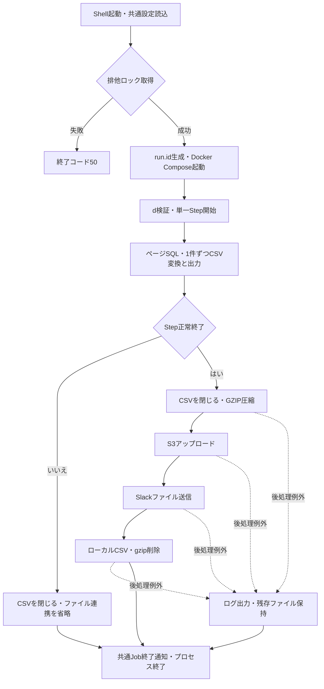
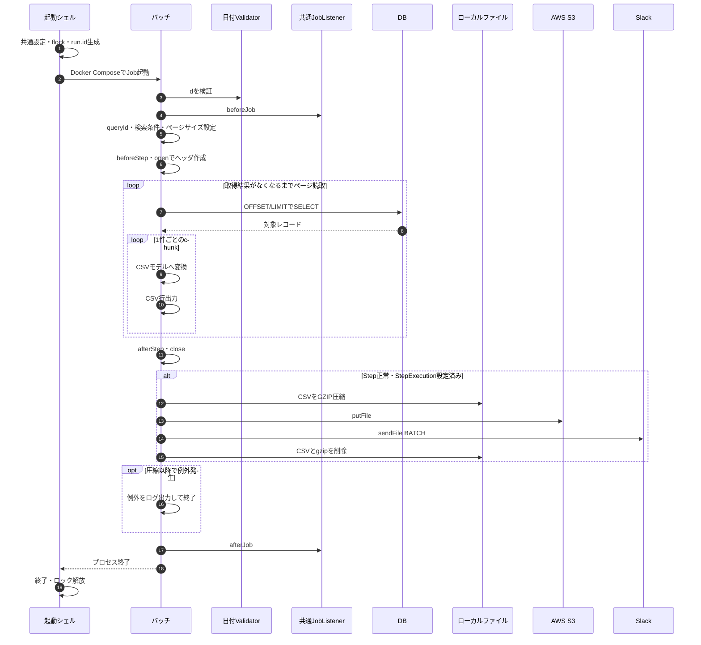

# 設計書 3.6.日次健康情報データ分析連携バッチ

## 1. 機能概要

- 対象日の健康情報登録日時に該当する健康情報をCSVに出力する。
- CSVをGZIP形式で圧縮してS3に配置し、同じ圧縮ファイルをSlackへ送信する。
- Job名は `dailyHealthInfoJob`、Step名は `dailyHealthInfoStep`。データの取得条件・出力列・処理結果は以下の実装仕様に従う。

## 2. 処理概要



## 3. IF仕様

### 3.1. ジョブパラメータ

| 引数名 | キー | 必須 | 形式 | 値 | 備考 |
| --- | --- | --- | --- | --- | --- |
| 処理対象日 | `d` | 任意 | `YYYYMMDD` | 健康情報の抽出対象日・S3キーに使用する日付 | 未指定・空文字の場合、ReaderとWriterがそれぞれ初期化時の東京の当日で補完する。日替わりをまたぐ場合は両者の日付が異なることがある。標準シェルは第1位置引数を`d=値`として渡すため、位置引数自体の省略は不可（空文字の指定は可）。 |
| 実行識別子 | `run.id` | 任意 | 年月日時分秒＋ナノ秒9桁＋`-`＋PID | バッチ実行識別子 | 標準シェルが`date "+%Y%m%d%H%M%S%N-$$"`で起動日時・ナノ秒・シェルPIDを連結して自動設定する。Job側に必須・形式チェックや省略時の自動補完はない。標準シェルでは実行ごとに生成し、新規JobInstanceとして起動する。 |

## 4. 処理フロー



| 番号 | 処理内容 | 関連項番 | 備考 |
| --- | --- | --- | --- |
| 1 | 共通設定読込、排他ロック取得、run.id生成を行う。 | 4.3 | ロック失敗時は50で終了。 |
| 2 | Docker Compose経由で対象Jobを起動する。 | 5.1・4.3 | `dailyHealthInfoJob` を指定する。 |
| 3 | 任意パラメータdの日付形式を検証する。 | 4.1 | 空値は許容する。 |
| 4 | 共通Job開始リスナーを実行する。 | 4.3 | [バッチ共通処理](設計書_3.11.バッチ共通処理.md) |
| 5 | Readerの検索条件・queryId・ページサイズを準備する。 | 4.2・4.4 | 対象日の両端を生成する。 |
| 6 | WriterへStepExecutionを渡し、CSVを開いてヘッダを書く。 | 4.5 | 一時ディレクトリを作成する。 |
| 7 | OFFSET/LIMITによるページSQLを実行する。 | 4.2 | `PagingHealthInfoMapper.selectByHealthInfoRegDate`。 |
| 8 | DB検索結果をReaderへ返す。 | 4.2 | 取得結果がなくなるまでページを進める。 |
| 9 | 1レコードをCSVモデルへ変換する。 | 4.4 | chunkサイズ1。 |
| 10 | 1件分のCSV行を出力する。 | 5.4・4.5 | 処理済み位置を保存する。 |
| 11 | Step結果に対応するExitStatusを返し、CSVをcloseする。 | 4.5 | 異常Stepでは後続ファイル連携を行わない。 |
| 12 | 正常StepのCSVをgzipへ圧縮する。 | 4.6 | 0件時はヘッダのみを圧縮。 |
| 13 | gzipをS3へアップロードする。 | 4.6 | 固定の対象日キー。 |
| 14 | gzipと完了件名をSlackのBATCH宛てに送信する。 | 4.6 | S3アップロード完了後に実行。 |
| 15 | ローカルCSV・gzipを順に削除する。 | 4.6 | Slack送信完了後に実行。 |
| 16 | 圧縮以降の例外をログ出力する。 | 4.6 | catchにより再throwせず、残ったファイルの一括削除もしない。 |
| 17 | 共通Job終了リスナーで結果をログ・Slackに通知する。 | 4.7 | [バッチ共通処理](設計書_3.11.バッチ共通処理.md) |
| 18 | Java / Docker Composeプロセスの結果をShellへ返す。 | 4.7 | Job結果専用のOS終了コード変換なし。 |
| 19 | Shell終了によりロックを解放する。 | 4.3・4.7 | ロックファイル自体は残る。 |

### 4.1. 入力チェック

| チェック対象 | チェック内容 | 異常時の処理 | 備考 |
| --- | --- | --- | --- |
| Shell第1引数 | `$1` を参照する。形式・実在日・個数の検証は行わない。 | 省略時はBashの未定義変数エラーで終了。 | 空文字を渡した場合はJobへ空のdを渡す。 |
| d | `DateFormatParameterValidator("d", YYYYMMDD_NOSEP, false)` | 空以外で日付変換できない場合、`InvalidJobParametersException("job parameter invalid d=" + 値)`。Stepを開始しない。 | [DateFormatParameterValidator.java](../../../ha-batch/src/main/java/jp/co/ha/batch/base/DateFormatParameterValidator.java) |
| 日付検証の方式 | `SimpleDateFormat("yyyyMMdd")` に `setLenient(false)` を設定してparseする。 | parseがParseExceptionとなった場合に不正とする。 | 8桁の正規表現検証や文字列末尾まで消費したことの検証は実装していない。[DateTimeUtil.java](../../../ha-common/src/main/java/jp/co/ha/common/util/DateTimeUtil.java) |
| Readerの日付生成 | dの先頭4文字・次の2文字・残りを整数化しLocalDateTimeを生成する。 | 文字列分割・数値化・日時生成に失敗するとStepの初期化/実行が失敗する。 | [BaseDailyAnalysisMySQLReader.java](../../../ha-batch/src/main/java/jp/co/ha/batch/analysis/BaseDailyAnalysisMySQLReader.java) |
| ページサイズ・ファイル設定 | 日次バッチ固有の追加Validatorはない。 | 不正な設定や権限不足はReader/Writer初期化・open等の例外となる。 | 設定キーは5.2。 |

### 4.2. DB操作

```sql
SELECT
    SEQ_HEALTH_INFO_ID
    , SEQ_USER_ID
    , HEIGHT
    , WEIGHT
    , BMI
    , STANDARD_WEIGHT
    , HEALTH_INFO_REG_DATE
    , SEQ_BMI_RANGE_MT_ID
    , UPDATE_DATE
    , REG_DATE
FROM
    HEALTH_INFO
WHERE
    HEALTH_INFO_REG_DATE BETWEEN #{from} AND #{to}
ORDER BY
    SEQ_HEALTH_INFO_ID ASC
LIMIT
    #{_skiprows}
    , #{_pagesize}
```

| 条件値 | 設定内容 | 備考 |
| --- | --- | --- |
| from | 対象日の `00:00:00` | LocalDateTime。BETWEENの下限を含む。 |
| to | 対象日の `23:59:59` | LocalDateTime。BETWEENの上限を含む。23:59:59より後の秒未満時刻は含まない。 |
| _skiprows | ページ番号（0始まり）×ページサイズ | 初回0。標準設定では0、1000、2000…と進む。 |
| _pagesize | `ha-batch.daily-health-info-analysis.exec-perpage-count` | 標準値1000。MyBatisPagingItemReaderが設定する。 |

| 項目 | 処理内容 | 備考 |
| --- | --- | --- |
| 参照SQL | `jp.co.ha.db.mapper.custom.PagingHealthInfoMapper.selectByHealthInfoRegDate` | [PagingHealthInfoMapper.xml](../../../ha-db/src/main/resources/jp/co/ha/db/mapper/custom/PagingHealthInfoMapper.xml) |
| 対象 | `HEALTH_INFO_REG_DATE` が対象日の `00:00:00` 以上 `23:59:59` 以下。 | `SEQ_HEALTH_INFO_ID ASC`。削除フラグやユーザ状態による除外は行わない。 |
| ページング | 取得結果がなくなるまでOFFSET/LIMITを繰り返す。事前COUNT・最大ID取得・ID上限固定は行わない。 | 並行更新に対するスナップショット固定やページ全体のロックは実装していない。 |
| 更新系SQL | 業務データへのINSERT・UPDATE・DELETEは特になし。 | Job/Stepのメタデータ保存は [バッチ共通処理](設計書_3.11.バッチ共通処理.md) に従う。 |
| 読取時の復号 | MyBatisPagingItemReaderがqueryIdを指定しSqlSessionTemplate.selectListを直接呼び出す。 | Mapperメソッドに対する `@Select` のAspect経路を通さず、このReader・Processorにも復号呼出しはない。[DataBaseCommonAspect.java](../../../ha-db/src/main/java/jp/co/ha/db/aspect/DataBaseCommonAspect.java) |
| 追加取得項目 | `SEQ_BMI_RANGE_MT_ID`・`UPDATE_DATE`・`REG_DATE` もSELECTするがCSVには出力しない。 | 更新・登録日時は対象日選別に用いない。 |

### 4.3. Shell・Job起動

| 処理 | 内容 | 備考 |
| --- | --- | --- |
| 共通設定 | set -euを有効にし、スクリプト自身のディレクトリからcommon.sh・const.txtを読み込む。 | [daily_analysis_health_info.sh](../../../ha-batch/docker/daily_analysis_health_info.sh)、[バッチ共通処理](設計書_3.11.バッチ共通処理.md) |
| ロック | `${LOCK_DIR}/daily_analysis_health_info.sh.lock` を作成し、FD9に対して `flock -n 9` を実行する。 | 対象日はロック名に含まない。同一Shell名の同時実行を拒否する。 |
| ロック異常 | `[ERROR] dailyHealthInfoJob is already running.` を出力し50で終了する。 | ロックディレクトリやファイルの作成自体に失敗した場合はBashコマンドの非0終了。 |
| 起動 | 対象日と生成したrun.idを渡してdocker compose run --rmを実行する。 | Java側に追加の二重起動ロックは定義しない。直接起動はShellロックの対象外。 |
| 異常伝播 | docker composeの非0終了はset -eによりShellを停止する。 | 非0の場合は直後のresult=$?・check_resultへ到達する前に終了する。check_resultは取得した非0をexitする実装だが、この通常の呼出形では先にset -eが働く。 |
| Job構成 | 日付Validator・BatchJobListenerを付与し、単一Step `dailyHealthInfoStep` を実行する。 | [DailyHealthInfoConfig.java](../../../ha-batch/src/main/java/jp/co/ha/batch/analysis/DailyHealthInfoConfig.java)。独自skip・retry・fault-tolerant設定はない。 |

### 4.4. ページ読取・CSVモデル変換

| 処理 | 内容 | 備考 |
| --- | --- | --- |
| Reader初期化 | dが空なら東京の当日を取得し、from/toを生成する。 SqlSessionFactory・queryId・pageSizeを設定し、saveStateをtrueにする。 | [DailyHealthInfoReader.java](../../../ha-batch/src/main/java/jp/co/ha/batch/analysis/DailyHealthInfoReader.java)、[BaseDailyAnalysisMySQLReader.java](../../../ha-batch/src/main/java/jp/co/ha/batch/analysis/BaseDailyAnalysisMySQLReader.java) |
| ページ読取 | MyBatisPagingItemReaderがSQL結果をページ単位で保持し、1件ずつ返す。 | 初期ページ0、標準ページサイズ1000。COUNT・MAX IDは取得しない。 |
| chunk | 1件読取→Processor→Writerを1chunkとしてtransactionManagerに関連付ける。 | ページ1000件とcommit単位1件を区別する。DB業務データの更新はない。 |
| 変換 | `HealthInfo` の7項目を `DailyHealthInfoCsvModel` へ転記する。登録日時だけを `DateTimeUtil.toString(..., YYYYMMDDHHMMSS)` で整形し、数値の再計算・丸め・CSV用マスクは行わない。 | [DailyHealthInfoProcessor.java](../../../ha-batch/src/main/java/jp/co/ha/batch/analysis/DailyHealthInfoProcessor.java) |
| 変換異常 | `HEALTH_INFO_REG_DATE` がNULLの場合、日時変換で例外となる。その他のNULL項目はCSV集約時に空欄になる。 | 例外は握りつぶさずStepへ伝播する。skip・retryせず、Step/Jobの失敗処理と共通終了通知へ進む。 |
| 読取異常 | 接続・SQL実行等の例外はReaderからStepへ伝播する。 | 正常後処理の圧縮・S3送信は省略し、すでに作成したCSVを一括削除しない。 |

### 4.5. CSV作成・Step終了

| 処理 | 内容 | 備考 |
| --- | --- | --- |
| open | FileUtil.mkdirで一時ディレクトリを作成し、固定パスをFileSystemResourceに設定してsuper.openする。 | [BaseDailyAnalysisWriter.java](../../../ha-batch/src/main/java/jp/co/ha/batch/analysis/BaseDailyAnalysisWriter.java)。BaseExceptionはItemStreamExceptionに包む。 |
| 出力設定 | appendAllowed=false・shouldDeleteIfExists=true・saveState=true。ヘッダはWriter列配列のカンマ連結。 | [DailyHealthInfoWriter.java](../../../ha-batch/src/main/java/jp/co/ha/batch/analysis/DailyHealthInfoWriter.java)。CSV列は5.4の順序。 |
| 行生成 | BeanWrapperFieldExtractorで列を抽出し、DelimitedLineAggregatorで連結する。 | 専用CsvWriterや各ユーザのファイル設定による囲み・マスク処理は使用しない。 |
| 0件 | open時にヘッダを書き、正常なclose後は同じ圧縮・送信処理に進む。 | データ行0件を業務エラーにはしない。 |
| afterStep | Stepのstatus.isUnsuccessful()ならExitStatus.FAILED、それ以外はCOMPLETEDを返す。 | WriterはStepExecutionListenerとしてStepExecutionを保持する。 |
| close | super.closeでCSVを閉じた後、保持したStepExecutionを確認する。 | StepExecutionがNULLまたは異常statusならエラーログ `stepExecutionが失敗しました。` を出してreturnする。 |
| 出力異常 | CSVのopen・行出力・super.closeは後処理用catchの外側である。 | ファイル出力例外はSpring Batchの失敗/リソース終了処理へ渡り、残存ファイルの一括清掃は行わない。 |

### 4.6. GZIP圧縮・S3連携・Slack送信・後始末

| 順序 | 処理 | 内容 | 備考 |
| --- | --- | --- | --- |
| 1 | 圧縮 | 正常Stepの場合に `health_info.csv` を `health_info.csv.gz` へ圧縮する。 | [FileUtil.java](../../../ha-common/src/main/java/jp/co/ha/common/util/FileUtil.java) のcompressGZip。GZIPOutputStreamへ1MiBバッファで転送する。tar処理はない。 |
| 2 | S3キー生成 | `analysis/{対象日YYYYMMDD}/health_info.csv.gz` を生成する。 | Writer生成時のd、空の場合は東京の当日を用いる。run.idはキーに含まない。 |
| 3 | S3送信 | AwsS3Component.putFile(key, gzFile)を呼び出す。 | [AwsS3Component.java](../../../ha-common/src/main/java/jp/co/ha/common/aws/AwsS3Component.java)。SDKのputObjectで設定バケット・キー・BUCKET_OWNER_FULL_CONTROL ACLを指定し、ファイル長とInputStreamを渡す。 |
| 4 | Slack送信 | SlackApiComponent.sendFile(BATCH, gzFile, 完了件名)を呼び出す。 | [SlackApiComponent.java](../../../ha-business/src/main/java/jp/co/ha/business/api/slack/SlackApiComponent.java)。SSMから接続情報を取得し、外部アップロードURL取得→ファイルPOST→完了通知を実行する。 |
| 5 | 削除 | Slackファイル送信が正常に返った後、CSV、gzipの順でFiles.deleteIfExistsを呼ぶ。 | ディレクトリは残す。ロックはShell終了時に解放し、ロックファイル自体は残す。 |
| 異常 | 圧縮・S3・Slack・削除 | この範囲のExceptionは `gzip圧縮/S3アップロードに失敗しました` とログ出力し、再throwしない。 | JobをFAILEDへ変更する処理はない。S3成功後にSlackが失敗した場合もS3オブジェクトは取り消さない。 |
| 異常 | 残存物 | 失敗した位置で処理を止め、それ以降の削除を行わない。 | 圧縮失敗時はCSVと作成途中のgzipが残る場合がある。S3/Slack失敗時はCSV・gzipが残り、gzip削除失敗時はCSVだけが先に消えている場合がある。 |
| 再実行 | 既存物 | 新しいrun.idによる実行は固定CSVを作り直し、圧縮ファイル・同一S3キーへ再出力する。 | ファイル連携の成否はログ・S3オブジェクト・Slack送信結果で確認する。圧縮以降の例外はBatchStatusだけでは判定できない。 |

### 4.7. Job終了・結果通知

| 処理 | 内容 | 備考 |
| --- | --- | --- |
| 共通終了通知 | BatchJobListener.afterJobがJobのid・name・statusをログとSlackへ出力する。FAILED時は失敗例外の情報も通知する。 | [バッチ共通処理](設計書_3.11.バッチ共通処理.md) |
| プロセス終了 | Application.mainはSpringApplication.runを呼ぶ。JobのExitStatusをOS終了値へ明示的に変換しない。 | [Application.java](../../../ha-batch/src/main/java/jp/co/ha/batch/Application.java)。業務失敗や後処理失敗の判定には5.4・4.6の条件を用いる。 |
| Shell終了 | Docker Composeが0で戻った場合、ENDログを出力して正常終了する。非0ならset -eで終了する。 | Shellプロセスの終了でFD9が閉じ、flockを解放する。 |

## 5. 実行仕様

### 5.1. 起動方法

```bash
bash ha-batch/docker/daily_analysis_health_info.sh 20261114
```

| 項目 | 指定内容 | 必須 | 備考 |
| --- | --- | --- | --- |
| Shell第1引数 | 対象日 `YYYYMMDD`（例: `20261114`） | 位置引数として必要 | `DATE_OPTION_VALUE=$1` で取得する。空文字引数は渡せるが、省略するとset -uで停止する。 |
| spring.batch.job.name | `dailyHealthInfoJob` | Shellが固定指定 | [daily_analysis_health_info.sh](../../../ha-batch/docker/daily_analysis_health_info.sh) |
| その他の位置引数 | 参照しない | 不要 | 引数個数・余剰引数の検証はない。 |

```bash
cd ${BASE_DIR} && docker compose \
  --project-directory "${BASE_DIR}" \
  -f ${BASE_DIR}/${DOCKER_DIR}/docker-compose.yml \
  run --rm ha-batch --spring.batch.job.name=dailyHealthInfoJob \
    "d=${DATE_OPTION_VALUE}" "run.id=${RUN_ID}"
```

### 5.2. 設定・実行条件

| 項目 | 設定・条件 | 備考 |
| --- | --- | --- |
| Job / Step | `dailyHealthInfoJob` / `dailyHealthInfoStep` | [DailyHealthInfoConfig.java](../../../ha-batch/src/main/java/jp/co/ha/batch/analysis/DailyHealthInfoConfig.java) |
| ページサイズ | `ha-batch.daily-health-info-analysis.exec-perpage-count = 1000` | DB読取ページの件数。chunkサイズは別設定で1。 |
| 一時ディレクトリ | `ha-batch.daily-health-info-analysis.temp-dir-path = /home/admin/data/daily/health_info/` | コンテナ内のパス。ディレクトリを作成でき、CSVを読み書き・削除できること。 |
| 出力ベース名 | `ha-batch.daily-health-info-analysis.file-name = health_info` | 固定ファイル名のため対象日が異なる実行も同じローカルファイルを使用する。 |
| Spring設定 | `spring.main.web-application-type = none`、`spring.batch.jdbc.initialize-schema = never` | HTTPサーバを起動しない。メタデータ表は事前に利用可能であること。 |
| 環境 | `spring.profiles.active = local`、`spring.profiles.default = local` | 環境変数等の上書きを優先する。local/devの設定読込は各application設定による。 |
| S3 | `aws.s3.backet` の設定値を使用する | local: `healthinfo-app-local`、dev: `healthinfo-app-dev`。AWS認証・ネットワークが利用可能であること。 |
| Shell共通 | `BASE_DIR=/mnt/c/app/git/work-3g`、`DOCKER_DIR=ha-build/docker`、`LOCK_DIR=/var/lock` | [const.txt](../../../ha-batch/docker/const.txt)。Bash・flock・Docker Composeが利用可能であること。 |
| 共通処理 | JobRepository・BatchJobListener・run.id生成 | [バッチ共通処理](設計書_3.11.バッチ共通処理.md) を参照。 |

### 5.3. 入力ファイル

特になし。

### 5.4. 終了コード・出力

| 項目 | 値・形式 | 備考 |
| --- | --- | --- |
| Shell終了コード | `0` | Docker Compose実行と後続コマンドが成功した場合。JobのCOMPLETEDを保証する専用変換はない。 |
| 二重起動 | `50` | `daily_analysis_health_info.sh.lock` の排他取得失敗。Jobを起動しない。 |
| その他の異常 | Bash / Docker Compose / Javaプロセスの非0 | `set -eu` により停止する。具体値を独自に統一していない。 |
| Job結果 | `BatchStatus`・`ExitStatus`・Spring Batchメタデータ・ログ・Slack通知 | [Application.java](../../../ha-batch/src/main/java/jp/co/ha/batch/Application.java) は `SpringApplication.run` のみで、`System.exit(SpringApplication.exit(...))` を実行しない。JobのFAILEDとShell非0を同一視しない。 |
| CSV | `/home/admin/data/daily/health_info/health_info.csv` | 新規実行では既存ファイルを削除して作成する。追記しない。再開用の状態は保存する。 |
| CSV形式 | UTF-8、カンマ区切り、先頭ヘッダあり、フッタなし | 改行はOS既定値。LinuxコンテナではLF。BOMは付加しない。ヘッダは下表のCSV列名を順番に連結する。 |
| CSV値 | 数値は文字列表現、Booleanは `true` / `false`、NULLは空欄 | Processorで先に文字列化・日時変換する項目の例外は下表・4.4を参照。囲み文字・カンマや改行のエスケープは設定しない。 |
| 0件時 | ヘッダだけのCSVを作成する | Stepが正常なら圧縮・S3アップロード・Slack送信を行う。空ファイル削除の設定は有効にしていない。 |
| 圧縮ファイル | `/home/admin/data/daily/health_info/health_info.csv.gz` | CSV単体をGZIP形式で圧縮する。tarによる格納は行わず、拡張子は `.tar.gz` ではない。 |
| S3キー | `analysis/{対象日YYYYMMDD}/health_info.csv.gz` | run.idを含まない。同じ対象日で再実行すると同じキーにputObjectする。 |
| Slackファイル | `health_info.csv.gz` | 通知種別 `BATCH`、件名 `S3ファイルアップロード完了. key=analysis/{対象日YYYYMMDD}/health_info.csv.gz`。 |
| 正常時の後始末 | Slack送信後、CSVとgzipを順に `Files.deleteIfExists` で削除する | 一時ディレクトリとロックファイルは削除しない。異常時の残存条件は4.5・4.6を参照。 |

| 順序 | CSV列名 | Java型 | 取得元 | 備考 |
| --- | --- | --- | --- | --- |
| 1 | `seqHealthInfoId` | Long | `HEALTH_INFO.SEQ_HEALTH_INFO_ID` | 健康情報ID。 |
| 2 | `seqUserId` | Long | `HEALTH_INFO.SEQ_USER_ID` | ユーザID。 |
| 3 | `height` | BigDecimal | `HEALTH_INFO.HEIGHT` | 身長。モデルのログ用 `@Mask` はCSV出力値を変換しない。 |
| 4 | `weight` | BigDecimal | `HEALTH_INFO.WEIGHT` | 体重。CSVではマスクしない。 |
| 5 | `bmi` | BigDecimal | `HEALTH_INFO.BMI` | BMI。CSVではマスクしない。 |
| 6 | `standardWeight` | BigDecimal | `HEALTH_INFO.STANDARD_WEIGHT` | 標準体重。CSVではマスクしない。 |
| 7 | `healthInfoRegDate` | String | `HEALTH_INFO.HEALTH_INFO_REG_DATE` | `yyyy/MM/dd HH:mm:ss`。NULL時は日時変換で例外。 |
