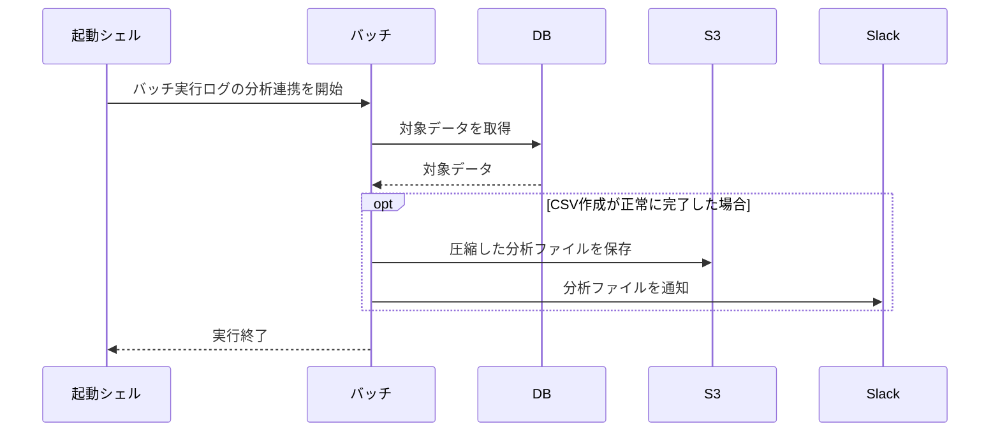
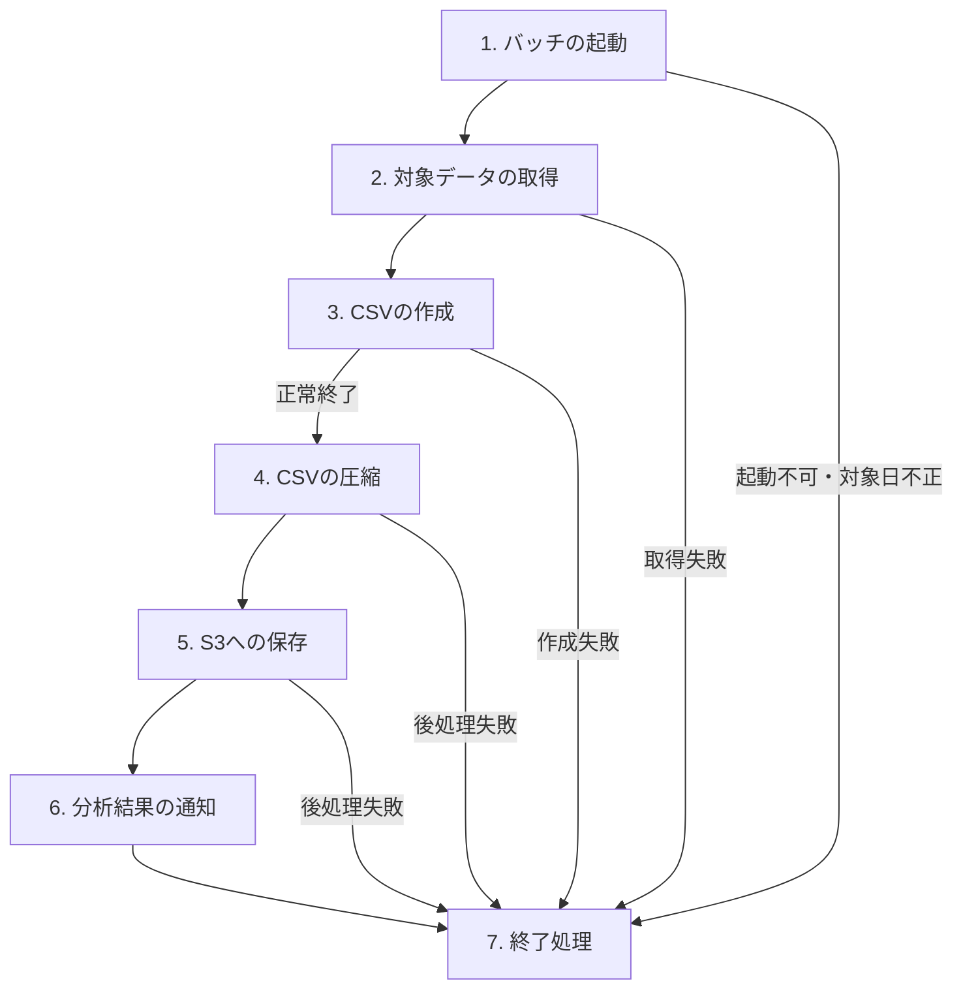

# 設計書 3.9.日次バッチ実行ログデータ分析連携バッチ

## 1. 機能概要

- 対象日に作成され、終了日時が設定されたSpring BatchのJob実行履歴をCSVに出力する。
- CSVをGZIP形式で圧縮してS3に配置し、同じ圧縮ファイルをSlackへ送信する。
- Job名は `dailyBatchLogJob`、Step名は `dailyBatchLogStep`。データの取得条件・出力列・処理結果は以下の実装仕様に従う。

## 2. 処理概要



## 3. IF仕様

### 3.1. ジョブパラメータ

| 引数名 | キー | 必須 | 形式 | 値 | 備考 |
| --- | --- | --- | --- | --- | --- |
| 処理対象日 | `d` | 任意 | `YYYYMMDD` | バッチ実行ログの抽出対象日・S3キーに使用する日付 | 未指定・空文字の場合、ReaderとWriterがそれぞれ初期化時の東京の当日で補完する。日替わりをまたぐ場合は両者の日付が異なることがある。標準シェルは第1位置引数を`d=値`として渡すため、位置引数自体の省略は不可（空文字の指定は可）。 |
| 実行識別子 | `run.id` | 任意 | 年月日時分秒＋ナノ秒9桁＋`-`＋PID | バッチ実行識別子 | 標準シェルが`date "+%Y%m%d%H%M%S%N-$$"`で起動日時・ナノ秒・シェルPIDを連結して自動設定する。Job側に必須・形式チェックや省略時の自動補完はない。標準シェルでは実行ごとに生成し、新規JobInstanceとして起動する。 |

## 4. 処理フロー



| 処理順 | 処理概要 | 処理詳細 | 関連項番 |
| --- | --- | --- | --- |
| 1 | バッチの起動 | 対象日・実行ID・排他を準備し、対象日を検証してバッチ実行ログの日次Jobを開始する。ロック競合や引数不正では対象データを処理しない。 | 4.1、4.3 |
| 2 | 対象データの取得 | 対象日のバッチ実行ログをDBからページ単位で取得する。処理2・3は取得結果がなくなるまで繰り返し、取得失敗はStepへ伝播する。 | 4.2、4.4 |
| 3 | CSVの作成 | 取得レコードを出力用に変換してCSVへ書き込む。対象0件でもヘッダを作成する。CSVを閉じ、正常なStepだけ処理4へ進む。異常時はファイル連携を省略してCSVを残す。 | 4.4.2、4.5 |
| 4 | CSVの圧縮 | 正常終了したCSVをgzipへ圧縮する。圧縮失敗はログに記録して以降の後処理を省略し、例外を再送出せず終了処理へ進む。 | 4.6.1、4.6.4 |
| 5 | S3への保存 | 対象日を含むS3キーへgzipファイルを保存する。保存失敗はログに記録し、Slack送信と一時ファイル削除を省略して終了処理へ進む。 | 4.6.1、4.6.4 |
| 6 | 分析結果の通知 | gzipファイルと完了件名をSlackへ送り、送信完了後にCSV・gzipを削除する。通知・削除の失敗はログに記録し、完了済みの外部処理を取り消さず終了処理へ進む。 | 4.6.2、4.6.3、4.6.4 |
| 7 | 終了処理 | Jobを開始した場合は、その実行状態を記録して共通の終了ログ・通知を行い、プロセス終了後にロックを解放する。後処理で捕捉した失敗は、Jobの成功状態だけでは検出できない。 | 4.7 |

### 4.1. 入力チェック

| チェック対象 | チェック内容 | 異常時の処理 | 備考 |
| --- | --- | --- | --- |
| Shell第1引数 | `$1` を参照する。形式・実在日・個数の検証は行わない。 | 省略時はBashの未定義変数エラーで終了。 | 空文字を渡した場合はJobへ空のdを渡す。 |
| d | `DateFormatParameterValidator("d", YYYYMMDD_NOSEP, false)` | 空以外で日付変換できない場合、`InvalidJobParametersException("job parameter invalid d=" + 値)`。Stepを開始しない。 | [DateFormatParameterValidator.java](../../../ha-batch/src/main/java/jp/co/ha/batch/base/DateFormatParameterValidator.java) |
| 日付検証の方式 | `SimpleDateFormat("yyyyMMdd")` に `setLenient(false)` を設定してparseする。 | parseがParseExceptionとなった場合に不正とする。 | 8桁の正規表現検証や文字列末尾まで消費したことの検証は実装していない。[DateTimeUtil.java](../../../ha-common/src/main/java/jp/co/ha/common/util/DateTimeUtil.java) |
| Readerの日付生成 | dの先頭4文字・次の2文字・残りを整数化しLocalDateTimeを生成する。 | 文字列分割・数値化・日時生成に失敗するとStepの初期化/実行が失敗する。 | [BaseDailyAnalysisMySQLReader.java](../../../ha-batch/src/main/java/jp/co/ha/batch/analysis/BaseDailyAnalysisMySQLReader.java) |
| ページサイズ・ファイル設定 | 日次バッチ固有の追加Validatorはない。 | 不正な設定や権限不足はReader/Writer初期化・open等の例外となる。 | 設定キーは5.2。 |

### 4.2. DB操作

```sql
SELECT
    BJE.JOB_INSTANCE_ID
    , BJE.START_TIME
    , BJE.END_TIME
    , BJE.STATUS
    , BJI.JOB_NAME
FROM
    BATCH_JOB_EXECUTION BJE
    LEFT OUTER JOIN BATCH_JOB_INSTANCE BJI
        ON BJE.JOB_INSTANCE_ID = BJI.JOB_INSTANCE_ID
WHERE
    BJE.CREATE_TIME BETWEEN #{from} AND #{to}
    AND BJE.END_TIME IS NOT NULL
ORDER BY
    BJE.JOB_INSTANCE_ID
LIMIT
    #{_skiprows}
    , #{_pagesize}
```

| 項目 | 設定値 | 備考 |
| --- | --- | --- |
| `#{from}` | 対象日の`00:00:00` | Readerが設定するLocalDateTime。下限を含む。 |
| `#{to}` | 対象日の`23:59:59` | Readerが設定するLocalDateTime。上限を含み、23:59:59より後の秒未満時刻は含まない。 |
| `#{_skiprows}` | ページ番号（0始まり）×ページサイズ | MyBatisPagingItemReaderが設定するオフセット。初回0。 |
| `#{_pagesize}` | `ha-batch.daily-batch-log-analysis.exec-perpage-count` | MyBatisPagingItemReaderが設定するページ件数。既定1000。 |


### 4.3. Shell・Job起動

#### 4.3.1. シェル起動・排他

| 処理 | 内容 | 備考 |
| --- | --- | --- |
| 共通設定 | set -euを有効にし、スクリプト自身のディレクトリからcommon.sh・const.txtを読み込む。 | [daily_analysis_batch_log.sh](../../../ha-batch/docker/daily_analysis_batch_log.sh)、[バッチ共通処理](設計書_3.11.バッチ共通処理.md) |
| ロック | `${LOCK_DIR}/daily_analysis_batch_log.sh.lock` を作成し、FD9に対して `flock -n 9` を実行する。 | 対象日はロック名に含まない。同一Shell名の同時実行を拒否する。 |
| ロック異常 | `[ERROR] dailyBatchLogJob is already running.` を出力し50で終了する。 | ロックディレクトリやファイルの作成自体に失敗した場合はBashコマンドの非0終了。 |
| 起動 | 対象日と生成したrun.idを渡してdocker compose run --rmを実行する。 | Java側に追加の二重起動ロックは定義しない。直接起動はShellロックの対象外。 |
| 異常伝播 | docker composeの非0終了はset -eによりShellを停止する。 | 非0の場合は直後のresult=$?・check_resultへ到達する前に終了する。check_resultは取得した非0をexitする実装だが、この通常の呼出形では先にset -eが働く。 |

#### 4.3.2. Jobの共通開始処理

| 処理 | 内容 | 備考 |
| --- | --- | --- |
| Job構成 | 日付Validator・BatchJobListenerを付与し、単一Step `dailyBatchLogStep` を実行する。 | [DailyBatchLogConfig.java](../../../ha-batch/src/main/java/jp/co/ha/batch/analysis/DailyBatchLogConfig.java)。独自skip・retry・fault-tolerant設定はない。 |
| 共通開始 | Jobの開始ログを記録してStepを開始する | 開始時の共通JobListener処理は[バッチ共通処理](設計書_3.11.バッチ共通処理.md)に従う。 |

### 4.4. ページ読取・CSVモデル変換

#### 4.4.1. 読取条件の準備

| 処理 | 内容 | 備考 |
| --- | --- | --- |
| Reader初期化 | dが空なら東京の当日を取得し、from/toを生成する。 SqlSessionFactory・queryId・pageSizeを設定し、saveStateをtrueにする。 | [DailyBatchLogReader.java](../../../ha-batch/src/main/java/jp/co/ha/batch/analysis/DailyBatchLogReader.java)、[BaseDailyAnalysisMySQLReader.java](../../../ha-batch/src/main/java/jp/co/ha/batch/analysis/BaseDailyAnalysisMySQLReader.java) |

#### 4.4.2. ページ読取・CSVモデル変換

| 項目 | 処理内容 | 備考 |
| --- | --- | --- |
| 参照SQL | `jp.co.ha.db.mapper.custom.CustomJobMapper.selectByCreateTime` | [CustomJobMapper.xml](../../../ha-db/src/main/resources/jp/co/ha/db/mapper/custom/CustomJobMapper.xml) |
| ページング | 取得結果がなくなるまでOFFSET/LIMITを繰り返す。事前COUNT・最大ID取得・ID上限固定は行わない。 | 並行更新に対するスナップショット固定やページ全体のロックは実装していない。 |
| 更新系SQL | 業務データへのINSERT・UPDATE・DELETEは特になし。 | Job/Stepのメタデータ保存は [バッチ共通処理](設計書_3.11.バッチ共通処理.md) に従う。 |
| 読取時の復号 | MyBatisPagingItemReaderがqueryIdを指定しSqlSessionTemplate.selectListを直接呼び出す。 | Mapperメソッドに対する `@Select` のAspect経路を通さず、このReader・Processorにも復号呼出しはない。[DataBaseCommonAspect.java](../../../ha-db/src/main/java/jp/co/ha/db/aspect/DataBaseCommonAspect.java) |
| 実行履歴の単位 | `BATCH_JOB_EXECUTION` の実行ごとに取得する。`BATCH_JOB_EXECUTION_PARAMS` との結合は行わない。 | Mapper内の別クエリ `selectPageable`・`count` はこのバッチでは使用しない。 |
| 集計対象外 | この日次バッチ自身は読取時点で `END_TIME` が未設定のため対象外。 | JobSet内で先に終了した3ジョブは、CREATE_TIMEが対象日内なら取得対象になり得る。 |
| テーブル名 | `batch_log` は出力ファイル名・一時ディレクトリ名。`BATCH_LOG` テーブルのSELECT・INSERTは行わない。 | 実体はSpring Batchメタデータを参照する。 |
| メタデータの準備 | BATCH_JOB_INSTANCE・BATCH_JOB_EXECUTION等のDDLを事前適用したDBを使用する。 | [V1.0.0__init.sql](../../../ha-db/src/main/resources/db/migration/V1.0.0__init.sql) と [schema-all.sql](../../../ha-batch/schema-all.sql)。実行時自動初期化はneverで、この日次バッチ自体はDDLを実行しない。 |


| 処理 | 内容 | 備考 |
| --- | --- | --- |
| ページ読取 | MyBatisPagingItemReaderがSQL結果をページ単位で保持し、1件ずつ返す。 | 初期ページ0、標準ページサイズ1000。COUNT・MAX IDは取得しない。 |
| chunk | 1件読取→Processor→Writerを1chunkとしてtransactionManagerに関連付ける。 | ページ1000件とcommit単位1件を区別する。DB業務データの更新はない。 |
| 変換 | `CustomJobData` のJobインスタンスID・Job名・開始日時・終了日時を `DailyBatchLogCsvModel` へ転記する。開始・終了日時は `YYYYMMDDHHMMSS` で整形する。 | [DailyBatchLogProcessor.java](../../../ha-batch/src/main/java/jp/co/ha/batch/analysis/DailyBatchLogProcessor.java) |
| 変換異常 | `START_TIME` がNULLの場合、日時変換で例外となる。`END_TIME` はSQLでNULLを除外する。`STATUS` やパラメータはCSVへ出力しない。 | 例外は握りつぶさずStepへ伝播する。skip・retryせず、Step/Jobの失敗処理と共通終了通知へ進む。 |
| 読取異常 | 接続・SQL実行等の例外はReaderからStepへ伝播する。 | 正常後処理の圧縮・S3送信は省略し、すでに作成したCSVを一括削除しない。 |

### 4.5. CSV作成・Step終了

#### 4.5.1. CSVの準備・ヘッダ出力

| 処理 | 内容 | 備考 |
| --- | --- | --- |
| open | FileUtil.mkdirで一時ディレクトリを作成し、固定パスをFileSystemResourceに設定してsuper.openする。 | [BaseDailyAnalysisWriter.java](../../../ha-batch/src/main/java/jp/co/ha/batch/analysis/BaseDailyAnalysisWriter.java)。BaseExceptionはItemStreamExceptionに包む。 |
| 出力設定 | appendAllowed=false・shouldDeleteIfExists=true・saveState=true。ヘッダはWriter列配列のカンマ連結。 | [DailyBatchLogWriter.java](../../../ha-batch/src/main/java/jp/co/ha/batch/analysis/DailyBatchLogWriter.java)。CSV列は5.4の順序。 |
| 0件 | open時にヘッダを書き、正常なclose後は同じ圧縮・送信処理に進む。 | データ行0件を業務エラーにはしない。 |

#### 4.5.2. CSV明細の出力

| 処理 | 内容 | 備考 |
| --- | --- | --- |
| 行生成 | BeanWrapperFieldExtractorで列を抽出し、DelimitedLineAggregatorで連結する。 | 専用CsvWriterや各ユーザのファイル設定による囲み・マスク処理は使用しない。 |
| 明細書込み | 変換したモデルをCSVの1行として出力する | 正常なら次のレコードへ進む。出力形式は5.4、終了時の判定は4.5.3に従う。 |

#### 4.5.3. CSV終了・後処理の判定

| 処理 | 内容 | 備考 |
| --- | --- | --- |
| afterStep | Stepのstatus.isUnsuccessful()ならExitStatus.FAILED、それ以外はCOMPLETEDを返す。 | WriterはStepExecutionListenerとしてStepExecutionを保持する。 |
| close | super.closeでCSVを閉じた後、保持したStepExecutionを確認する。 | StepExecutionがNULLまたは異常statusならエラーログ `stepExecutionが失敗しました。` を出してreturnする。 |
| 出力異常 | CSVのopen・行出力・super.closeは後処理用catchの外側である。 | ファイル出力例外はSpring Batchの失敗/リソース終了処理へ渡り、残存ファイルの一括清掃は行わない。 |

### 4.6. GZIP圧縮・S3連携・Slack送信・後始末

#### 4.6.1. gzip作成・S3への保存

| 順序 | 処理 | 内容 | 備考 |
| --- | --- | --- | --- |
| 1 | 圧縮 | 正常Stepの場合に `batch_log.csv` を `batch_log.csv.gz` へ圧縮する。 | [FileUtil.java](../../../ha-common/src/main/java/jp/co/ha/common/util/FileUtil.java) のcompressGZip。GZIPOutputStreamへ1MiBバッファで転送する。tar処理はない。 |
| 2 | S3キー生成 | `analysis/{対象日YYYYMMDD}/batch_log.csv.gz` を生成する。 | Writer生成時のd、空の場合は東京の当日を用いる。run.idはキーに含まない。 |
| 3 | S3送信 | AwsS3Component.putFile(key, gzFile)を呼び出す。 | [AwsS3Component.java](../../../ha-common/src/main/java/jp/co/ha/common/aws/AwsS3Component.java)。SDKのputObjectで設定バケット・キー・BUCKET_OWNER_FULL_CONTROL ACLを指定し、ファイル長とInputStreamを渡す。 |

#### 4.6.2. 結果ファイルのSlack通知

| 順序 | 処理 | 内容 | 備考 |
| --- | --- | --- | --- |
| 4 | Slack送信 | SlackApiComponent.sendFile(BATCH, gzFile, 完了件名)を呼び出す。 | [SlackApiComponent.java](../../../ha-business/src/main/java/jp/co/ha/business/api/slack/SlackApiComponent.java)。SSMから接続情報を取得し、外部アップロードURL取得→ファイルPOST→完了通知を実行する。 |

#### 4.6.3. 一時ファイルの削除

| 順序 | 処理 | 内容 | 備考 |
| --- | --- | --- | --- |
| 5 | 削除 | Slackファイル送信が正常に返った後、CSV、gzipの順でFiles.deleteIfExistsを呼ぶ。 | ディレクトリは残す。ロックはShell終了時に解放し、ロックファイル自体は残す。 |

#### 4.6.4. 後処理失敗・再実行時の扱い

| 順序 | 処理 | 内容 | 備考 |
| --- | --- | --- | --- |
| 異常 | 圧縮・S3・Slack・削除 | この範囲のExceptionは `gzip圧縮/S3アップロードに失敗しました` とログ出力し、再throwしない。 | JobをFAILEDへ変更する処理はない。S3成功後にSlackが失敗した場合もS3オブジェクトは取り消さない。 |
| 異常 | 残存物 | 失敗した位置で処理を止め、それ以降の削除を行わない。 | 圧縮失敗時はCSVと作成途中のgzipが残る場合がある。S3/Slack失敗時はCSV・gzipが残り、gzip削除失敗時はCSVだけが先に消えている場合がある。 |
| 再実行 | 既存物 | 新しいrun.idによる実行は固定CSVを作り直し、圧縮ファイル・同一S3キーへ再出力する。 | ファイル連携の成否はログ・S3オブジェクト・Slack送信結果で確認する。圧縮以降の例外はBatchStatusだけでは判定できない。 |

### 4.7. Job終了・結果通知

#### 4.7.1. 共通終了処理

| 処理 | 内容 | 備考 |
| --- | --- | --- |
| 共通終了通知 | BatchJobListener.afterJobがJobのid・name・statusをログとSlackへ出力する。FAILED時は失敗例外の情報も通知する。 | [バッチ共通処理](設計書_3.11.バッチ共通処理.md) |

#### 4.7.2. プロセス終了・ロック解放

| 処理 | 内容 | 備考 |
| --- | --- | --- |
| プロセス終了 | Application.mainはSpringApplication.runを呼ぶ。JobのExitStatusをOS終了値へ明示的に変換しない。 | [Application.java](../../../ha-batch/src/main/java/jp/co/ha/batch/Application.java)。業務失敗や後処理失敗の判定には5.4・4.6の条件を用いる。 |
| Shell終了 | Docker Composeが0で戻った場合、ENDログを出力して正常終了する。非0ならset -eで終了する。 | Shellプロセスの終了でFD9が閉じ、flockを解放する。 |

## 5. 実行仕様

### 5.1. 起動方法

```bash
bash ha-batch/docker/daily_analysis_batch_log.sh 20261114
```

| 項目 | 指定内容 | 必須 | 備考 |
| --- | --- | --- | --- |
| Shell第1引数 | 対象日 `YYYYMMDD`（例: `20261114`） | 位置引数として必要 | `DATE_OPTION_VALUE=$1` で取得する。空文字引数は渡せるが、省略するとset -uで停止する。 |
| spring.batch.job.name | `dailyBatchLogJob` | Shellが固定指定 | [daily_analysis_batch_log.sh](../../../ha-batch/docker/daily_analysis_batch_log.sh) |
| その他の位置引数 | 参照しない | 不要 | 引数個数・余剰引数の検証はない。 |

```bash
cd ${BASE_DIR} && docker compose \
  --project-directory "${BASE_DIR}" \
  -f ${BASE_DIR}/${DOCKER_DIR}/docker-compose.yml \
  run --rm ha-batch --spring.batch.job.name=dailyBatchLogJob \
    "d=${DATE_OPTION_VALUE}" "run.id=${RUN_ID}"
```

### 5.2. 設定・実行条件

| 項目 | 設定・条件 | 備考 |
| --- | --- | --- |
| Job / Step | `dailyBatchLogJob` / `dailyBatchLogStep` | [DailyBatchLogConfig.java](../../../ha-batch/src/main/java/jp/co/ha/batch/analysis/DailyBatchLogConfig.java) |
| ページサイズ | `ha-batch.daily-batch-log-analysis.exec-perpage-count = 1000` | DB読取ページの件数。chunkサイズは別設定で1。 |
| 一時ディレクトリ | `ha-batch.daily-batch-log-analysis.temp-dir-path = /home/admin/data/daily/batch_log/` | コンテナ内のパス。ディレクトリを作成でき、CSVを読み書き・削除できること。 |
| 出力ベース名 | `ha-batch.daily-batch-log-analysis.file-name = batch_log` | 固定ファイル名のため対象日が異なる実行も同じローカルファイルを使用する。 |
| Spring設定 | `spring.main.web-application-type = none`、`spring.batch.jdbc.initialize-schema = never` | HTTPサーバを起動しない。メタデータ表は事前に利用可能であること。 |
| 環境 | `spring.profiles.active = local`、`spring.profiles.default = local` | 環境変数等の上書きを優先する。local/devの設定読込は各application設定による。 |
| S3 | `aws.s3.backet` の設定値を使用する | local: `healthinfo-app-local`、dev: `healthinfo-app-dev`。AWS認証・ネットワークが利用可能であること。 |
| Shell共通 | `BASE_DIR=/mnt/c/app/git/work-3g`、`DOCKER_DIR=ha-build/docker`、`LOCK_DIR=/var/lock` | [const.txt](../../../ha-batch/docker/const.txt)。Bash・flock・Docker Composeが利用可能であること。 |
| 共通処理 | JobRepository・BatchJobListener・run.id生成 | [バッチ共通処理](設計書_3.11.バッチ共通処理.md) を参照。 |

### 5.3. 入力ファイル

特になし。

### 5.4. 終了コード・出力

| 項目 | 値・形式 | 備考 |
| --- | --- | --- |
| Shell終了コード | `0` | Docker Compose実行と後続コマンドが成功した場合。JobのCOMPLETEDを保証する専用変換はない。 |
| 二重起動 | `50` | `daily_analysis_batch_log.sh.lock` の排他取得失敗。Jobを起動しない。 |
| その他の異常 | Bash / Docker Compose / Javaプロセスの非0 | `set -eu` により停止する。具体値を独自に統一していない。 |
| Job結果 | `BatchStatus`・`ExitStatus`・Spring Batchメタデータ・ログ・Slack通知 | [Application.java](../../../ha-batch/src/main/java/jp/co/ha/batch/Application.java) は `SpringApplication.run` のみで、`System.exit(SpringApplication.exit(...))` を実行しない。JobのFAILEDとShell非0を同一視しない。 |
| CSV | `/home/admin/data/daily/batch_log/batch_log.csv` | 新規実行では既存ファイルを削除して作成する。追記しない。再開用の状態は保存する。 |
| CSV形式 | UTF-8、カンマ区切り、先頭ヘッダあり、フッタなし | 改行はOS既定値。LinuxコンテナではLF。BOMは付加しない。ヘッダは下表のCSV列名を順番に連結する。 |
| CSV値 | 数値は文字列表現、Booleanは `true` / `false`、NULLは空欄 | Processorで先に文字列化・日時変換する項目の例外は下表・4.4を参照。囲み文字・カンマや改行のエスケープは設定しない。 |
| 0件時 | ヘッダだけのCSVを作成する | Stepが正常なら圧縮・S3アップロード・Slack送信を行う。空ファイル削除の設定は有効にしていない。 |
| 圧縮ファイル | `/home/admin/data/daily/batch_log/batch_log.csv.gz` | CSV単体をGZIP形式で圧縮する。tarによる格納は行わず、拡張子は `.tar.gz` ではない。 |
| S3キー | `analysis/{対象日YYYYMMDD}/batch_log.csv.gz` | run.idを含まない。同じ対象日で再実行すると同じキーにputObjectする。 |
| Slackファイル | `batch_log.csv.gz` | 通知種別 `BATCH`、件名 `S3ファイルアップロード完了. key=analysis/{対象日YYYYMMDD}/batch_log.csv.gz`。 |
| 正常時の後始末 | Slack送信後、CSVとgzipを順に `Files.deleteIfExists` で削除する | 一時ディレクトリとロックファイルは削除しない。異常時の残存条件は4.5・4.6を参照。 |

| 順序 | CSV列名 | Java型 | 取得元 | 備考 |
| --- | --- | --- | --- | --- |
| 1 | `jobInstanceId` | long | `BJE.JOB_INSTANCE_ID` | JobインスタンスID。同一インスタンスに複数実行がある場合、同じ値が複数行に現れる。 |
| 2 | `jobName` | String | `BJI.JOB_NAME` | Job名。LEFT OUTER JOINの結果がNULLの場合は空欄。 |
| 3 | `startDate` | String | `BJE.START_TIME` | `yyyy/MM/dd HH:mm:ss`。SQLでは非NULLを条件にしていないため、NULL時は変換で例外。 |
| 4 | `endDate` | String | `BJE.END_TIME` | `yyyy/MM/dd HH:mm:ss`。SQLで非NULLに限定する。 |
