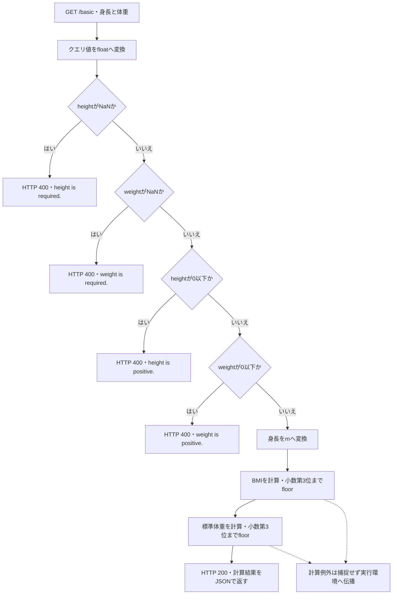
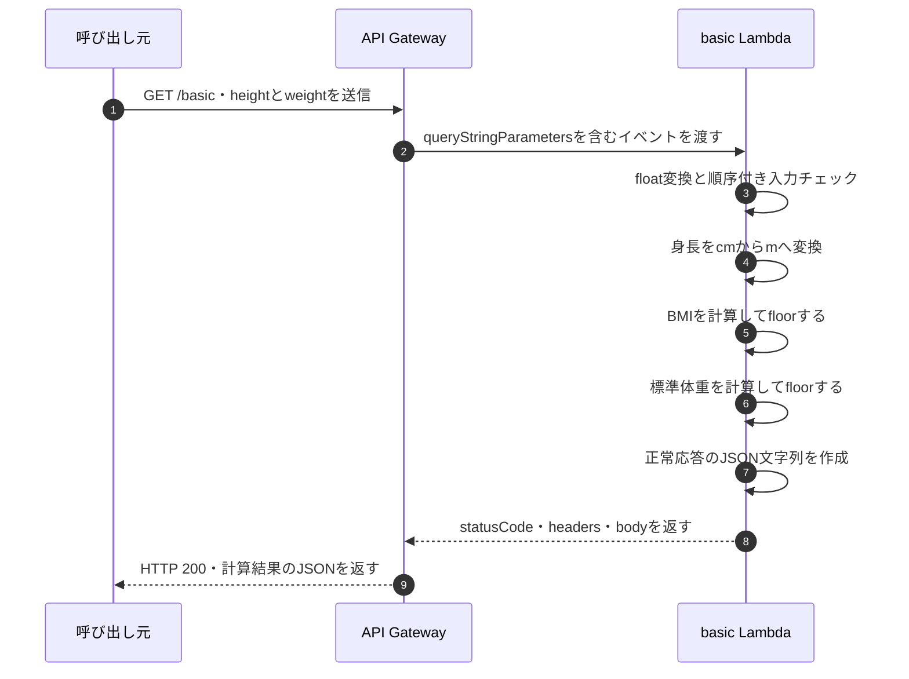

# 設計書 4.2. 基礎健康情報計算API

## 1. 機能概要

- 身長（cm）と体重（kg）からBMI・標準体重を計算して返す。DBへの保存や外部API呼び出しは行わない。
- 計算・応答処理は[basic.py](../../../ha-calc-api/lambda/basic.py)を参照する。
- 公開ルート・ステージ・CORS・Lambda設定は[template.yaml](../../../ha-calc-api/template.yaml)を参照する。

## 2. 処理概要



## 3. IF仕様

### 3.1. HTTPメソッド

| HTTPメソッド | 備考 |
| --- | --- |
| `GET` | API Gatewayの`BasicRoute`は`GET /basic`を公開する。 |

### 3.2. エンドポイントURL

| エンドポイントURL | 備考 |
| --- | --- |
| `/basic` | `template.yaml`の出力`ApiUrl`を基底URLとし、その末尾へ`basic`を付ける。スキーム・ホスト・ポート・ステージは配置環境に従う。`StageName`の既定値は`dev`で、既定ステージでは基底URLに`/dev/`を含む。 |

#### 3.2.1. パスパラメータ

特になし。

### 3.3. リクエストIF

#### 3.3.1. リクエストヘッダ

| 項目名 | 型 | 必須 | 値 | 備考 |
| --- | --- | --- | --- | --- |
| なし | — | — | — | Lambdaは要求ヘッダーを参照しない。トークン照合・発行API呼び出しは行わない。`Content-Type`・`Accept-Charset`の独自必須検証も設けない。テンプレートに認可用AuthorizerやAPIキー必須設定はない。 |

#### 3.3.2. クエリパラメータ

| 項目名 | 型 | 必須 | 備考 |
| --- | --- | --- | --- |
| `height` | `number` | 必須 | 身長（cm）。クエリ文字列をPythonの`float`へ変換する。変換後のNaNを拒否し、0より大きい値を要求する。空文字・変換不能値は未指定と同じメッセージで拒否する。有限性の検証はなく、計算上の制約は4.3項に従う。例：`170.5`。 |
| `weight` | `number` | 必須 | 体重（kg）。`height`と同じ数値変換・入力判定を行う。例：`65.2`。両項目のエラー判定順序は4.1項に従う。 |

#### 3.3.3. JSONボディ

特になし。

### 3.4. レスポンスIF

#### 3.4.1. レスポンスヘッダ

| 項目名 | 型 | 設定条件 | 備考 |
| --- | --- | --- | --- |
| `Content-Type` | `string` | Lambdaが正常・入力エラー応答を生成した場合 | `application/json`。 |
| `Access-Control-Allow-Origin` | `string` | Lambdaが正常・入力エラー応答を生成した場合 | `*`。API GatewayのCORS設定も`AllowOrigins: ["*"]`、`AllowMethods: [GET]`とする。 |

#### 3.4.2. JSONボディ

```json
{
  "result": 0,
  "basic_health_info": {
    "height": 170.5,
    "weight": 65.2,
    "bmi": 22.428,
    "standard_weight": 63.954
  }
}
```

```json
{
  "result": 1,
  "detail": "Invalid parameters. height is required."
}
```

| 項目名 | 型 | 設定条件 | 備考 |
| --- | --- | --- | --- |
| `result` | `integer` | 必須 | HTTP 200では数値`0`、入力エラーのHTTP 400では数値`1`。最初のJSONは正常例、2つ目は身長の未指定・変換不能・NaN時の例。 |
| `detail` | `string` | 入力エラー時 | 4.1項の判定で選ばれたメッセージ。正常時は出力しない。外部エラーコード項目は設けない。 |
| `basic_health_info` | `object` | 正常時 | 身長・体重・計算結果。入力エラー時は出力しない。 |
| `basic_health_info.height` | `number` | 正常時 | `float`へ変換した身長（cm）。クエリの元の文字列表現ではない。 |
| `basic_health_info.weight` | `number` | 正常時 | `float`へ変換した体重（kg）。 |
| `basic_health_info.bmi` | `number` | 正常時 | BMI。4.3項の式で計算し、小数第3位までfloorする。 |
| `basic_health_info.standard_weight` | `number` | 正常時 | 標準体重（kg）。4.3項の式で計算し、小数第3位までfloorする。小数3桁固定の文字列にはしない。 |

## 4. 処理フロー



| 番号 | 処理内容 | 関連項番 | 備考 |
| --- | --- | --- | --- |
| 1 | GET /basic・heightとweightを送信 | 3.1 / 3.3.2 | パスやJSONボディから身長・体重を受け取らない。 |
| 2 | queryStringParametersを含むイベントを渡す | 4.1 | `basic.lambda_handler`を実行する。 |
| 3 | float変換と順序付き入力チェック | 4.1 | 図は全項目が正常な経路。入力エラーなら計算せずHTTP 400で返す。 |
| 4 | 身長をcmからmへ変換 | 4.3 | `meter_height = height / 100`。 |
| 5 | BMIを計算してfloorする | 4.3 | 体重を身長（m）の2乗で割る。 |
| 6 | 標準体重を計算してfloorする | 4.3 | 身長（m）の2乗に22を掛ける。 |
| 7 | 正常応答のJSON文字列を作成 | 4.4 | `result`は数値0。 |
| 8 | statusCode・headers・bodyを返す | 4.4 | LambdaのAPI Gateway向け返却形式。 |
| 9 | HTTP 200・計算結果のJSONを返す | 3.4 / 4.4 | API利用者へ返す本文は3.4.2項のJSON。 |

### 4.1. 入力チェック

| 順序 | 対象・処理 | 内容 | 備考 |
| --- | --- | --- | --- |
| 1 | クエリの取得 | `event.get("queryStringParameters") or {}`で取得する | 未設定・`null`・空のクエリは空の辞書として扱う。`height`・`weight`以外の項目は参照しない。 |
| 2 | heightの数値変換 | `float(params.get("height"))`を実行する | `TypeError`・`ValueError`ならNaNを設定する。 |
| 3 | weightの数値変換 | `float(params.get("weight"))`を実行する | `TypeError`・`ValueError`ならNaNを設定する。 |
| 4 | 入力判定 | 次表の順序で判定し、最初に一致したエラーだけを返す | メッセージを複数件まとめて返す処理はない。 |

| 判定順序 | 発生条件 | HTTPステータス | result | detail |
| --- | --- | --- | --- | --- |
| 1 | `math.isnan(height)`。未指定、空文字、変換不能、文字列NaNなど | 400 | 数値1 | `Invalid parameters. height is required.` |
| 2 | `math.isnan(weight)`。未指定、空文字、変換不能、文字列NaNなど | 400 | 数値1 | `Invalid parameters. weight is required.` |
| 3 | `height <= 0` | 400 | 数値1 | `Invalid parameters. height is positive.` |
| 4 | `weight <= 0` | 400 | 数値1 | `Invalid parameters. weight is positive.` |

両方の数値変換を行ってからNaN・正数の判定をする。例えば`height=0`で`weight`が未指定なら、身長の正数エラーより先に`weight is required.`を返す。前後の空白、符号、指数表記などの数値表現はPythonの`float`の解釈に従い、符号なし10進表記だけに限定する正規表現検査は行わない。

ヘッダー・トークン・移行フラグによる分岐、ユーザIDの照合は設けない。公開ルートの選択などLambdaへ到達する前のエラーはAPI Gatewayの共通処理に従い、本Lambdaの`result`・`detail`形式を保証しない。

### 4.2. DB操作

特になし。

### 4.3. BMI・標準体重の計算

| 項目 | 計算式 | 丸め・型 | 備考 |
| --- | --- | --- | --- |
| 身長の単位変換 | `meter_height = height / 100` | Pythonの`float` | 入力cmをmへ変換する。 |
| BMI | `_floor_3(weight / (meter_height * meter_height))` | 小数第3位までfloorした`float` | BMIの計算を先に行う。 |
| 標準体重 | `_floor_3(22 * (meter_height * meter_height))` | 小数第3位までfloorした`float` | 係数は22、単位はkg。 |
| 共通丸め | `_floor_3(value) = math.floor(value * 1000) / 1000` | 負の無限大方向へ丸める | 例：`1.2349`は`1.234`になる。 |

身長170.5cm・体重65.2kgでは、`meter_height=1.705`、`bmi=22.428`、`standard_weight=63.954`となる。計算は浮動小数点数で行い、任意精度の10進演算や表示用の小数3桁固定整形は行わない。

| 発生条件・制約 | 処理への影響 | 扱い |
| --- | --- | --- |
| 正の無限大など、NaNでも0以下でもない非有限値 | 入力判定を通過し、計算中の`math.floor`などで例外となり得る | 有限性や業務上の上限値の事前検証は設けない。 |
| 非常に小さい正の身長 | mへの変換や2乗が浮動小数点数の下限を下回り、除数が0となり得る | `ZeroDivisionError`などをLambda内で捕捉しない。 |
| 非常に大きい値や非有限の中間結果 | `OverflowError`・`ValueError`などが発生し得る | 計算全体を囲む例外ハンドラーはなく、実行環境へ伝播する。独自HTTP 400の`result`・`detail`形式は保証しない。 |

### 4.4. 応答生成・返却

| 項目・処理 | 設定内容 | 備考 |
| --- | --- | --- |
| 正常応答 | `_response(200, body)`で計算結果を返す | `result`は数値0。入力を変換した身長・体重と、BMI・標準体重を含める。 |
| 入力エラー応答 | `_response(400, body)`で最初の入力エラーを返す | `result`は数値1。`detail`を設定し、`basic_health_info`は含めない。 |
| JSON文字列 | `json.dumps(body, ensure_ascii=False)` | UnicodeをASCIIエスケープしない設定。 |
| Lambdaの返却形式 | `statusCode`、`headers`、JSON文字列の`body` | API GatewayがHTTPステータス・ヘッダー・本文へ対応させる。これらのラッパー項目をAPI本文へ追加しない。 |
| API Gateway連携 | `AWS_PROXY`、`PayloadFormatVersion: "2.0"` | 公開ルートは`GET /basic`。LambdaのHandlerは`basic.lambda_handler`。 |
| 実行設定 | Runtimeの既定値`python3.14`、Timeoutの既定値10秒 | `FunctionRuntime`・`FunctionTimeout`で設定する。 |
| 要求・応答ログ | 本Lambdaに明示的な`print`・ロガー呼び出しはない | 実行基盤のログは配置設定に従う。 |

正常応答・入力エラー応答は共通の`HEADERS`を設定する。計算以外にDBアクセス、S3・SQS・外部APIへの通信、トークン発行・検証を行う処理はない。
