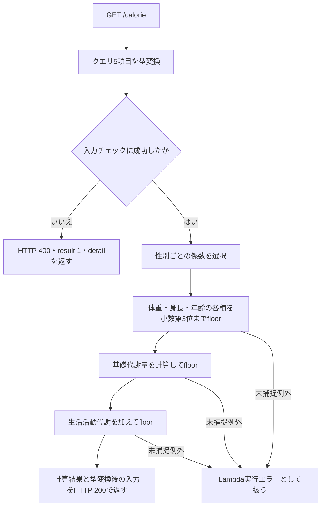
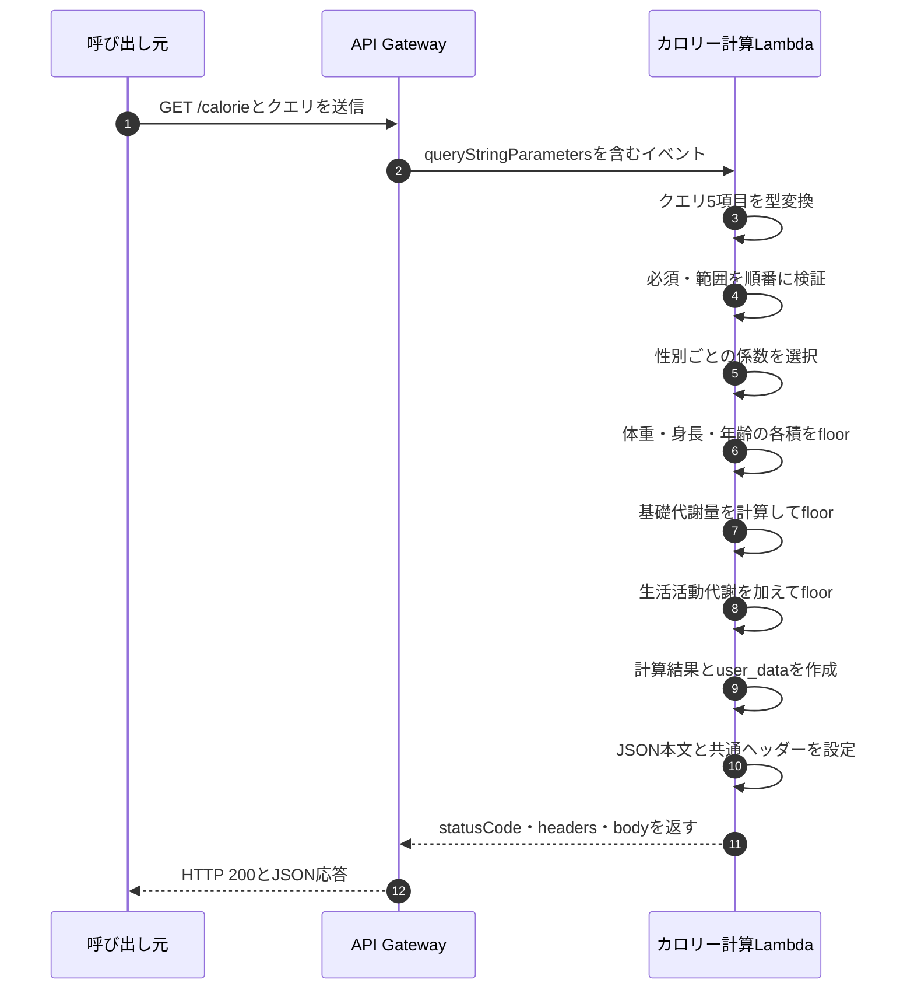

# 設計書 4.3. カロリー計算API

## 1. 機能概要

- 性別・年齢・身長・体重から基礎代謝量を計算し、生活活動代謝を加えた1日の消費カロリーを返す。
- 現行の処理は[Lambda実装](../../../ha-calc-api/lambda/calorie.py)と[API Gateway・Lambda定義](../../../ha-calc-api/template.yaml)に従う。DB操作・トークン発行・トークン検証は行わない。
- 同梱の[OpenAPI](./openapi.yaml)は基礎健康情報計算APIの呼び出し側契約を記載する。
- Java側の呼び出しは[CalorieApiComponent](../../../ha-business/src/main/java/jp/co/ha/business/component/CalorieApiComponent.java)・[CalorieCalcApi](../../../ha-business/src/main/java/jp/co/ha/business/api/node/CalorieCalcApi.java)を参照する。

## 2. 処理概要



## 3. IF仕様

### 3.1. HTTPメソッド

| HTTPメソッド | 備考 |
| --- | --- |
| `GET` | API Gatewayの公開ルートは`GET /calorie`。Lambda呼び出し用の統合メソッド`POST`は、利用者向けのHTTPメソッドではない |

### 3.2. エンドポイントURL

| エンドポイントURL | 備考 |
| --- | --- |
| `/calorie` | API Gatewayのステージ基底URLに続けて指定する。スキーム・ホスト・リージョン・ステージ名は配置環境に従う。テンプレートの既定ステージ名は`dev` |

#### 3.2.1. パスパラメータ

特になし。

### 3.3. リクエストIF

#### 3.3.1. リクエストヘッダ

| 項目名 | 型 | 必須 | 値 | 備考 |
| --- | --- | --- | --- | --- |
| なし | — | — | — | 専用の認証ヘッダーはない。現行Lambdaは`X-NODE-TOKEN`、`Content-Type`、`Accept-Charset`を検証しない。API Gatewayにも認証方式の指定はない |

#### 3.3.2. クエリパラメータ

| 項目名 | 型 | 必須 | 備考 |
| --- | --- | --- | --- |
| `gender` | `integer` | 必須 | 性別。クエリの文字列を`int()`で変換し、`0`：男性、`1`：女性として扱う |
| `age` | `integer` | 必須 | 年齢（歳）。`int()`で変換し、0以上とする。API独自の上限値は設けない |
| `height` | `number` | 必須 | 身長（cm）。`float()`で変換し、0より大きい値とする |
| `weight` | `number` | 必須 | 体重（kg）。`float()`で変換し、0より大きい値とする |
| `life_work_metabolism` | `number` | 必須 | 生活活動代謝（kcal）。`float()`で変換し、0より大きい値とする |
| 未定義項目 | — | — | 計算・応答には使用しない |

#### 3.3.3. JSONボディ

特になし。

### 3.4. レスポンスIF

#### 3.4.1. レスポンスヘッダ

| 項目名 | 型 | 設定条件 | 備考 |
| --- | --- | --- | --- |
| `Content-Type` | `string` | Lambdaが正常応答・入力エラー応答を生成した場合 | `application/json` |
| `Access-Control-Allow-Origin` | `string` | Lambdaが正常応答・入力エラー応答を生成した場合 | `*`。API GatewayのCORS設定も任意のOriginとGETを許可する |

#### 3.4.2. JSONボディ

| 応答例 | HTTPステータス | 備考 |
| --- | --- | --- |
| 正常応答 | `200` | 以下の1つ目のJSONは`gender=0&age=30&height=170&weight=65&life_work_metabolism=500`の実行結果 |
| 入力エラー | `400` | 以下の2つ目のJSONは`gender`の省略例。検出順序・全メッセージは「4.1. 入力チェック」に従う |

```json
{
  "result": 0,
  "calorie_calc_result": {
    "base_metabolism": 1604.687,
    "lost_calorie_per_day": 2104.687
  },
  "user_data": {
    "gender": 0,
    "age": 30,
    "height": 170.0,
    "weight": 65.0,
    "life_work_metabolism": 500.0
  }
}
```

```json
{
  "result": 1,
  "detail": "Invalid parameters. gender is required."
}
```

| 項目名 | 型 | 設定条件 | 備考 |
| --- | --- | --- | --- |
| `result` | `integer` | 必須 | 正常は数値`0`、入力エラーは数値`1`。文字列ではない |
| `detail` | `string` | 入力エラー時 | 検出したエラーの説明。正常時は項目を出力しない |
| `calorie_calc_result` | `object` | 正常時 | カロリー計算結果。入力エラー時は出力しない |
| `calorie_calc_result.base_metabolism` | `number` | 正常時 | 基礎代謝量（kcal）。「4.3. カロリー計算」に従う |
| `calorie_calc_result.lost_calorie_per_day` | `number` | 正常時 | 1日の消費カロリー（kcal）。基礎代謝量に要求の生活活動代謝を加えた値 |
| `user_data` | `object` | 正常時 | 型変換後の入力値。入力エラー時は出力しない |
| `user_data.gender` | `integer` | 正常時 | `int()`で変換した性別 |
| `user_data.age` | `integer` | 正常時 | `int()`で変換した年齢 |
| `user_data.height` | `number` | 正常時 | `float()`で変換した身長 |
| `user_data.weight` | `number` | 正常時 | `float()`で変換した体重 |
| `user_data.life_work_metabolism` | `number` | 正常時 | `float()`で変換した生活活動代謝 |

## 4. 処理フロー



| 番号 | 処理内容 | 関連項番 | 備考 |
| --- | --- | --- | --- |
| 1 | GET /calorieとクエリを送信 | 3.3.2 | クエリ5項目を指定する |
| 2 | queryStringParametersを含むイベント | 4.1 | API Gatewayのペイロード形式は2.0 |
| 3 | クエリ5項目を型変換 | 4.1 | 性別・年齢は`int()`、その他3項目は`float()` |
| 4 | 必須・範囲を順番に検証 | 4.1 | 入力エラー時は400応答を返し、計算を行わない |
| 5 | 性別ごとの係数を選択 | 4.3 | 男性・女性の係数を使用する |
| 6 | 体重・身長・年齢の各積をfloor | 4.3 | 各項を個別に小数第3位まで処理する |
| 7 | 基礎代謝量を計算してfloor | 4.3 | 体重項＋身長項－年齢項＋補正値 |
| 8 | 生活活動代謝を加えてfloor | 4.3 | 基礎代謝量＋要求の生活活動代謝 |
| 9 | 計算結果とuser_dataを作成 | 4.4 | `user_data`は変換後の入力値を使用する |
| 10 | JSON本文と共通ヘッダーを設定 | 4.4 | `json.dumps(..., ensure_ascii=False)`でJSON文字列を生成する |
| 11 | statusCode・headers・bodyを返す | 4.4 | 正常経路の応答を示す。入力異常は「4.1. 入力チェック」に従う |
| 12 | HTTP 200とJSON応答 | 4.4 | 外部向け本文は`body`内のJSON。Lambdaの応答ラッパー自体を本文にはしない |

### 4.1. 入力チェック

| 処理 | 仕様 |
| --- | --- |
| クエリ取得 | `event.get("queryStringParameters") or {}`を使用する。項目がない場合は空の辞書として扱う |
| 整数変換 | `gender`・`age`を`int()`で変換する。`TypeError`・`ValueError`は`None`へ置き換える |
| 小数変換 | `height`・`weight`・`life_work_metabolism`を`float()`で変換する。`TypeError`・`ValueError`はNaNへ置き換える |
| 変換対象 | 5項目すべての変換後に、下表の順番で検証する |
| エラー返却 | 最初に一致した条件だけを返す。必須エラーのメッセージは、省略だけでなく型変換失敗にも使用する |
| 表記の扱い | 正規表現による半角数字・小数表記の検証は行わず、Pythonの型変換に従う。例として小数項目の指数表記は`float()`で受け付けるが、整数項目の`"30.0"`は`int()`で変換できない |

| 順序 | 発生条件 | HTTPステータス | `result` | `detail` |
| --- | --- | --- | --- | --- |
| 1 | `gender`が省略・整数変換不可 | `400` | 数値`1` | `Invalid parameters. gender is required.` |
| 2 | `age`が省略・整数変換不可 | `400` | 数値`1` | `Invalid parameters. age is required.` |
| 3 | `height`が省略・小数変換不可・NaN | `400` | 数値`1` | `Invalid parameters. height is required.` |
| 4 | `weight`が省略・小数変換不可・NaN | `400` | 数値`1` | `Invalid parameters. weight is required.` |
| 5 | `life_work_metabolism`が省略・小数変換不可・NaN | `400` | 数値`1` | `Invalid parameters. life_work_metabolism is required.` |
| 6 | `gender`が`0`・`1`以外 | `400` | 数値`1` | `Invalid parameters. gender is 0 or 1.` |
| 7 | `age`が0未満 | `400` | 数値`1` | `Invalid parameters. age is positive.` |
| 8 | `height`が0以下 | `400` | 数値`1` | `Invalid parameters. height is positive.` |
| 9 | `weight`が0以下 | `400` | 数値`1` | `Invalid parameters. weight is positive.` |
| 10 | `life_work_metabolism`が0以下 | `400` | 数値`1` | `Invalid parameters. life_work_metabolism is positive.` |

| 境界・検証範囲 | 仕様 |
| --- | --- |
| 年齢0 | 許可する。`age is positive.`という文言でも0は異常としない |
| 複数エラー | 例えば`gender=2`かつ`age`省略の場合は、性別の範囲エラーより先に年齢の必須エラーを返す |
| 有限性 | 小数項目に`math.isfinite()`による検証はない。NaNは必須エラーとなるが、正の無限大はここでは除外しない。計算時の扱いは「4.3. カロリー計算」に従う |

### 4.2. DB操作

特になし。

### 4.3. カロリー計算

| 性別 | 体重係数 | 身長係数 | 年齢係数 | 補正値 |
| --- | --- | --- | --- | --- |
| 男性（`gender=0`） | `13.397` | `4.799` | `5.677` | `88.362` |
| 女性（`gender=1`） | `9.247` | `3.098` | `4.33` | `447.593` |

| 計算順序 | 計算内容 | 備考 |
| --- | --- | --- |
| 1 | `calc_weight = floor_3(体重係数 * weight)` | 体重項を個別に処理する |
| 2 | `calc_height = floor_3(身長係数 * height)` | 身長項を個別に処理する |
| 3 | `calc_age = floor_3(年齢係数 * age)` | 年齢項を個別に処理する |
| 4 | `base_metabolism = floor_3(calc_weight + calc_height - calc_age + 補正値)` | 基礎代謝量を求める |
| 5 | `lost_calorie_per_day = floor_3(base_metabolism + life_work_metabolism)` | 1日の消費カロリーを求める |

```python
def floor_3(value):
    return math.floor(value * 1000) / 1000
```

| 丸め・数値の扱い | 仕様 |
| --- | --- |
| 丸め方向 | 小数第3位まで残し、負の無限大方向へ丸める。四捨五入ではない |
| 適用箇所 | 各積・基礎代謝量・1日の消費カロリーの各段階に適用する。最後だけを丸める処理ではない |
| 演算型 | Pythonの`float`を使用する。2進浮動小数点の誤差を含み、10進数として厳密に計算した値との一致は保証しない |
| JSON表記 | 数値として出力し、小数部を必ず3桁にゼロ埋めする処理はない |
| 計算結果の値域 | 基礎代謝量・1日の消費カロリーを0以上に補正する処理はない |
| 実行例・男性 | 性別0・年齢30・身長170・体重65・生活活動代謝500で、基礎代謝量`1604.687`、1日の消費カロリー`2104.687` |
| 実行例・女性 | 性別1・年齢30・身長160・体重50・生活活動代謝400で、基礎代謝量`1275.722`、1日の消費カロリー`1675.722` |

| 発生条件 | HTTPステータス | `result`・`detail`の扱い |
| --- | --- | --- |
| 正の無限大・演算の桁あふれなどにより`math.floor()`等が例外を送出 | Lambda内では設定しない | 計算全体を囲む例外処理はないため、通常の400応答に変換しない。API Gateway等の実行エラー処理に従い、本文形式・HTTPステータスを本関数では保証しない |

### 4.4. 応答生成

| 処理 | 仕様 |
| --- | --- |
| 正常本文 | 数値`result=0`、2種類の計算結果、変換後の5項目を含む`user_data`を設定する。`detail`は設定しない |
| 入力エラー本文 | 数値`result=1`と固定メッセージの`detail`だけを設定する。計算結果・`user_data`は設定しない |
| JSON変換 | `json.dumps(body, ensure_ascii=False)`で本文を文字列化する |
| Lambda戻り値 | `statusCode`、共通の`headers`、JSON文字列の`body`を返す |
| その他の実行時例外 | 応答生成時を含め、捕捉して独自の`result`・`detail`へ変換する共通処理はない |
| 実行コンテキスト | 引数`context`は処理に使用しない |
| 要求・応答ログ | 本Lambdaには要求・応答の明示的なログ出力処理がない |

### 4.5. Javaクライアントからの呼び出し

| 処理 | 内容 |
| --- | --- |
| Javaクライアント | 基底URL`healthinfo.node.api.url`に`calorie`を連結し、GETで直接呼び出す。トークンヘッダーは設定しない |
| Java側の送信値 | 現在の`CalorieApiComponent`は`request.setWeight(param.height())`により身長値を`weight`へ設定している。本APIは受け取った`weight`をそのまま計算に使用する |
| Java側の通信ログ・例外 | 呼び出し側がAPIログをSQSへ送信した後、失敗結果に対して`CALORIE_API_CONNECT_ERROR`を発生させる。これらはLambda自身の処理・エラーコードではない |
