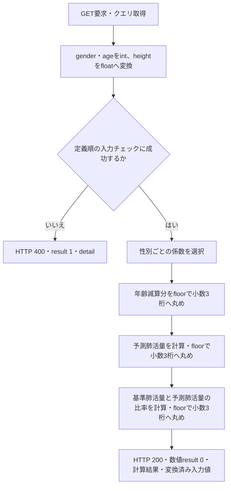
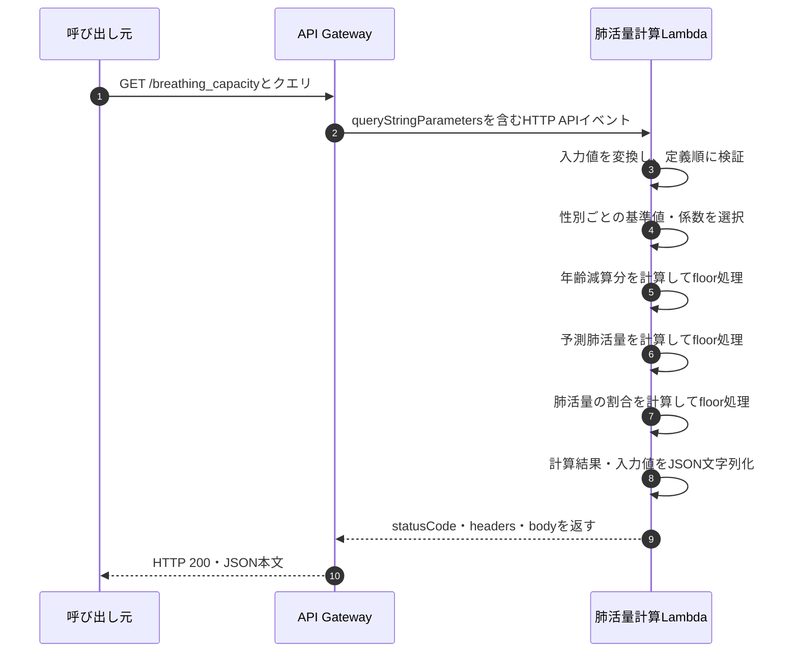

# 設計書 4.4. 肺活量計算API

## 1. 機能概要

- 年齢・性別・身長から予測肺活量と、性別ごとの基準肺活量が予測肺活量に占める割合を計算する。
- 現行のcalc APIはAPI Gateway HTTP APIからLambdaを呼び出す。入力・計算・応答は[breathing_capacity.py](../../../ha-calc-api/lambda/breathing_capacity.py)と[template.yaml](../../../ha-calc-api/template.yaml)を基準とする。

## 2. 処理概要



## 3. IF仕様

### 3.1. HTTPメソッド

| 項目 | 内容 | 備考 |
| --- | --- | --- |
| HTTPメソッド | `GET` | `template.yaml`の公開ルートは`GET /breathing_capacity`。 |

### 3.2. エンドポイントURL

| 項目 | 内容 | 備考 |
| --- | --- | --- |
| エンドポイントURL | `/breathing_capacity` | `template.yaml`の`ApiUrl`など、ステージを含むAPI基底URLへ`breathing_capacity`を追加する。スキーム・ホスト・ポート・ステージ名は実行環境に従う。 |
| ステージ | `StageName` | テンプレートの既定値は`dev`。既定のAPI Gateway URLは`https://{API ID}.execute-api.{リージョン}.{URL suffix}/{StageName}/breathing_capacity`。 |
| パス変数 | なし | 年齢・性別・身長はクエリパラメータから取得する。 |

### 3.3. リクエストIF

#### 3.3.1. リクエストヘッダ

| 項目名 | 型 | 必須 | 値 | 備考 |
| --- | --- | --- | --- | --- |
| なし | — | — | — | 現行Lambdaは認証ヘッダーを参照せず、テンプレートにもAuthorizerの設定はない。`X-NODE-TOKEN`・APIキー・トークン発行APIの事前呼び出しは要求しない。`Content-Type`や`Accept-Charset`の独自必須検証もない。 |

#### 3.3.2. クエリパラメータ

| 項目名 | 型 | 必須 | 備考 |
| --- | --- | --- | --- |
| `gender` | `integer` | 必須 | HTTPクエリの文字列をPythonの`int`へ変換する。`0`は男性、`1`は女性。それ以外の値・変換できない値は「4.1. 入力チェック」に従う。 |
| `age` | `integer` | 必須 | 年齢（歳）。`int`へ変換し、0以上を許可する。上限の独自チェックはない。`30.0`のような整数へ変換できない文字列は必須エラーとして扱う。 |
| `height` | `number` | 必須 | 身長（cm）。`float`へ変換し、0より大きいことを確認する。`NaN`は必須エラー。正の無限大を拒否するチェックはなく、計算時の扱いは「4.3. 肺活量の計算」に従う。 |
| 未定義の項目 | — | 任意 | 取得・計算・応答への転記に使用しない。実測肺活量を指定する項目はない。 |

#### 3.3.3. JSONボディ

特になし。

### 3.4. レスポンスIF

#### 3.4.1. レスポンスヘッダ

| 項目名 | 型 | 設定条件 | 備考 |
| --- | --- | --- | --- |
| `Content-Type` | `string` | Lambdaが生成する200・400応答 | `application/json`。本文は`json.dumps(..., ensure_ascii=False)`で作成する。 |
| `Access-Control-Allow-Origin` | `string` | Lambdaが生成する200・400応答 | `*`。API Gateway側にも全Originを対象とするCORSとGET許可を設定している。 |

#### 3.4.2. JSONボディ

##### 正常応答例（HTTP 200）

```json
{
  "result": 0,
  "breathing_capacity_calc_result": {
    "predict_breathing_capacity": 4074.899,
    "breathing_capacity_percentage": 85.891
  },
  "user_data": {
    "gender": 0,
    "age": 30,
    "height": 170.0
  }
}
```

##### 入力エラー応答例（HTTP 400）

```json
{
  "result": 1,
  "detail": "Invalid parameters. gender is 0 or 1."
}
```

| 項目名 | 型 | 設定条件 | 備考 |
| --- | --- | --- | --- |
| `result` | `integer` | Lambdaが生成する200・400応答で必須 | 正常は数値の`0`、入力エラーは数値の`1`。文字列の`"0"`・`"1"`ではない。 |
| `detail` | `string` | 入力エラー時に必須 | 最初に一致した検証条件のメッセージ。正常時は項目自体を出力しない。 |
| `breathing_capacity_calc_result` | `object` | 正常時に必須 | 入力エラー時は出力しない。 |
| `breathing_capacity_calc_result.predict_breathing_capacity` | `number` | 正常時に必須 | 予測肺活量（mL）。小数3桁を残すfloor処理後の値。固定3桁の文字列ではない。 |
| `breathing_capacity_calc_result.breathing_capacity_percentage` | `number` | 正常時に必須 | 基準肺活量÷予測肺活量×100（%）。小数3桁を残すfloor処理後の値。 |
| `user_data` | `object` | 正常時に必須 | クエリの元文字列ではなく、型変換後の入力値。入力エラー時は出力しない。 |
| `user_data.gender` | `integer` | 正常時に必須 | `int`へ変換した性別。 |
| `user_data.age` | `integer` | 正常時に必須 | `int`へ変換した年齢。 |
| `user_data.height` | `number` | 正常時に必須 | `float`へ変換した身長。正常応答例は男性・30歳・170cmを指定した結果。 |

## 4. 処理フロー



| 番号 | 処理内容 | 関連項番 | 備考 |
| --- | --- | --- | --- |
| 1 | 公開GETルートで要求を受け付ける | 3.1 | 認証トークンの事前発行は行わない。 |
| 2 | API GatewayのイベントをLambdaへ渡す | 4.4 | PayloadFormatVersionは2.0。 |
| 3 | gender・age・heightを変換して検証する | 4.1 | 最初に一致したエラーを400で返す。以降の図は入力正常・計算成功の経路。 |
| 4 | 性別ごとの定数を選択する | 4.3.1 | 男性0・女性1で分岐する。 |
| 5 | 年齢係数と年齢の積をfloor処理する | 4.3.2 | ここでも小数3桁を残す。 |
| 6 | 予測肺活量をfloor処理する | 4.3.2 | 男性の年齢係数は0.122。 |
| 7 | 基準肺活量と予測値の割合をfloor処理する | 4.3.2 | 予測値が0の場合は例外となる。 |
| 8 | 正常応答の本文を作成する | 4.4 | 数値result、計算結果、変換済み入力値を設定する。 |
| 9 | Lambdaプロキシ応答を返す | 4.4 | bodyはJSON文字列。独自に生成するステータスは200と入力エラーの400。 |
| 10 | HTTP応答を返す | 3.4.2 | statusCode・headers・bodyの外枠自体をHTTP JSON本文へ含めない。 |

### 4.1. 入力チェック

| 順序 | 対象・条件 | HTTPステータス | result / detail | 備考 |
| --- | --- | --- | --- | --- |
| 1 | `gender`が未指定、または`int`変換でTypeError・ValueError | 400 | `1` / `Invalid parameters. gender is required.` | 変換失敗時は内部値を`None`とする。 |
| 2 | `age`が未指定、または`int`変換でTypeError・ValueError | 400 | `1` / `Invalid parameters. age is required.` | `gender`の必須チェック通過後に判定する。変換失敗時は内部値を`None`とする。 |
| 3 | `height`が未指定、`float`変換でTypeError・ValueError、または変換後がNaN | 400 | `1` / `Invalid parameters. height is required.` | 変換失敗時はNaNを設定する。 |
| 4 | `gender`が0・1以外 | 400 | `1` / `Invalid parameters. gender is 0 or 1.` | 各入力の必須チェックを先に行う。 |
| 5 | `age < 0` | 400 | `1` / `Invalid parameters. age is positive.` | メッセージはpositiveだが、0歳は許可する。 |
| 6 | `height <= 0` | 400 | `1` / `Invalid parameters. height is positive.` | 身長0は許可しない。負の無限大もこの条件に一致する。 |

| 変換・検証の仕様 | 内容 | 備考 |
| --- | --- | --- |
| 取得元 | `event.get("queryStringParameters") or {}` | 未指定・null・空のクエリは空の辞書として扱う。JSONボディは読み込まない。 |
| 数値変換 | `int`と`float`の変換規則を使用する | 半角数字だけの正規表現チェックは行わず、空白などの許容範囲も各変換処理に従う。 |
| 検証順序 | 上表の順序で最初の1件を返す | 例：gender=2でもheightが未指定なら、heightの必須エラーを返す。 |
| 上限・有限性 | 年齢・身長の独自上限、予測値が正数になること、正の無限大の除外は検証しない | 計算段階での例外・負数結果は「4.3. 肺活量の計算」に従う。 |

### 4.2. DB操作

特になし。

| 対象 | 仕様 | 備考 |
| --- | --- | --- |
| Lambda内のDB・外部データ検索 | なし | 入力値とコード内の定数で計算する。Java呼び出し側のAPI通信ログ送信は「4.5. Javaクライアントからの呼び出し」に示す。 |

### 4.3. 肺活量の計算

#### 4.3.1. 性別ごとの定数

| gender | 性別 | 基準肺活量（mL） | 基礎係数 | 年齢係数 | 備考 |
| --- | --- | --- | --- | --- | --- |
| 0 | 男性 | 3500 | 27.63 | 0.122 | 実装の`base_breathing_capacity_def`・`base_val_def`・`minus_def`。 |
| 1 | 女性 | 2500 | 21.78 | 0.101 | 女性側の定数。 |

#### 4.3.2. 式・丸め・計算上の境界

| 計算段階 | 実装の式 | 備考 |
| --- | --- | --- |
| 丸め関数F3 | `math.floor(x * 1000) / 1000` | 小数第3位まで残して負の無限大方向に丸める。四捨五入や、負数を0方向へ丸める処理ではない。例：F3(-1.2341)=-1.235。 |
| 年齢減算分 | `calc_age = F3(年齢係数 * age)` | この中間結果にもfloor処理を行う。 |
| 予測肺活量 | `predict_breathing_capacity = F3((基礎係数 - calc_age) * height)` | 男性は基礎係数27.63・年齢係数0.122、女性は21.78・0.101。 |
| 肺活量の割合 | `breathing_capacity_percentage = F3(基準肺活量 / predict_breathing_capacity * 100)` | 男性の分子は3500、女性は2500。実測肺活量の入力値ではない。 |
| 計算の数値型 | Pythonの`float`による二進浮動小数点演算 | 数学的な十進計算とfloorの境界が一致するとは限らない。男性30歳170cmは予測4074.899、割合85.891になる。 |

| 発生する値・例外 | 現行動作 | HTTP / result / detail | 備考 |
| --- | --- | --- | --- |
| 予測肺活量が負数 | 負数の予測値と割合を返す | 200 / `0` / detailなし | 例：男性227歳170cmは予測-10.881、割合-32166.162。計算結果の正数チェックはない。 |
| floor後の予測肺活量が0 | 割合の除算で`ZeroDivisionError` | 本関数の独自JSON応答は生成しない | 例：男性30歳・身長0.000001cmは入力チェックを通るが、計算中に例外となる。 |
| 正の無限大や演算のオーバーフロー | floorなどで`OverflowError`等が発生し得る | 本関数の独自JSON応答は生成しない | `height=inf`は入力チェックを通過し、floorで例外となる。 |
| 計算中の想定外例外 | 呼び出し元へ伝播する | API Gatewayなどの共通処理に従う | 計算全体を捕捉して400やresult=1へ変換する処理はない。HTTPステータス・本文を本実装だけから固定しない。 |

### 4.4. 受付・応答生成

| 項目 | 実装 | 備考 |
| --- | --- | --- |
| Lambdaハンドラー | `breathing_capacity.lambda_handler` | テンプレートのRuntime既定値は`python3.14`、Timeout既定値は10秒。contextは使用しない。 |
| API Gateway連携 | HTTP API、LambdaのAWS_PROXY、PayloadFormatVersion 2.0 | 公開ルートのGETと、内部のLambda呼び出し用IntegrationMethod POSTを区別する。 |
| 正常本文 | `result=0`、2つの計算結果、変換済みの`user_data` | detailは設定しない。 |
| 入力エラー本文 | `result=1`と`detail`のみ | 計算結果・user_dataは設定しない。 |
| Lambdaの戻り値 | `statusCode`・共通`headers`・JSON文字列の`body` | HTTP本文にはbody内のJSONを返す。 |
| JSON生成 | `json.dumps(body, ensure_ascii=False)` | 数値は数値のまま出力する。小数末尾を3桁へゼロ埋めしない。 |
| 受付・応答生成の想定外例外 | 本関数では包括的に捕捉しない | 検証表に記載したTypeError・ValueErrorの捕捉以外は、独自のresult/detail応答を保証しない。 |
| 明示的なログ出力 | なし | 現行Pythonソースに要求・応答を出力するloggerやprintはない。 |

### 4.5. Javaクライアントからの呼び出し

| 処理 | 現行動作 | 備考 |
| --- | --- | --- |
| URL・要求作成 | `healthinfo.node.api.url`へ`breathing_capacity`を追加し、GETのクエリにage・gender・heightを設定する | Java側は年齢Integer・性別GenderType・身長BigDecimal。性別は列挙値のコードを送信する。 |
| 呼び出し方式 | トークンを付けずに計算APIを直接呼ぶ | 呼び出し方式を切り替える設定はなく、この経路を使用する。 |
| 正常応答の利用 | 予測肺活量と割合を結果DTOへ設定する | JavaレスポンスDTOの数値項目はBigDecimal。LambdaのHTTP本文のresultは数値0・1である。 |
| 通信エラー | `BaseApi`が捕捉した場合は失敗DTOを生成する | detailは`Node API:肺活量計算APIに失敗しました. 通信エラーです.`。既定のHTTPエラー処理を通るため、Lambdaの400本文detailをそのまま引き継ぐことは保証しない。 |
| 通信ログ | トランザクションIDを採番し、呼び出し後にAPI通信ログをSQSへ送信する | 計算APIのresult判定より先に送信する。Lambda自体がSQSへ送信する処理ではない。 |
| Java側の失敗判定 | 成功以外なら`BREATHING_API_CONNECT_ERROR`（`BE0037`）のApiException | Javaクライアント側の例外であり、LambdaのHTTP本文へBEコードを設定する仕様ではない。 |
| SQS送信失敗 | Java側のキュー送信処理で`CE0041` | 後続のresult判定へ進まない。Lambdaの入力エラーとは別の処理。 |

### 4.6. 参照実装

| 対象 | 参照先 | 備考 |
| --- | --- | --- |
| 計算・検証・応答 | [breathing_capacity.py](../../../ha-calc-api/lambda/breathing_capacity.py) | 現行の計算仕様の根拠。 |
| 公開ルート・実行設定 | [template.yaml](../../../ha-calc-api/template.yaml) | GETルートとLambdaハンドラー・HTTP APIの設定。 |
| Javaの通信・判定 | [BreathingCapacityApiComponent.java](../../../ha-business/src/main/java/jp/co/ha/business/component/BreathingCapacityApiComponent.java) | トークンなしのAPI呼び出しと通信ログ・失敗判定。 |
| JavaのAPI・要求 | [BreathingCapacityCalcApi.java](../../../ha-business/src/main/java/jp/co/ha/business/api/node/BreathingCapacityCalcApi.java)、[BreathingCapacityCalcApiRequest.java](../../../ha-business/src/main/java/jp/co/ha/business/api/node/request/BreathingCapacityCalcApiRequest.java) | GETの要求情報。 |
| Javaの応答 | [BreathingCapacityCalcApiResponse.java](../../../ha-business/src/main/java/jp/co/ha/business/api/node/response/BreathingCapacityCalcApiResponse.java) | 計算結果と入力情報のDTO。 |
| HTTP通信の共通処理 | [BaseApi.java](../../../ha-common/src/main/java/jp/co/ha/common/web/api/BaseApi.java) | HTTPエラー捕捉と失敗DTOの生成。 |
