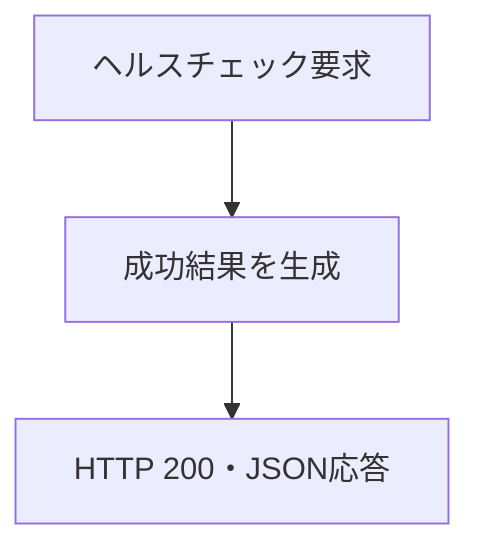
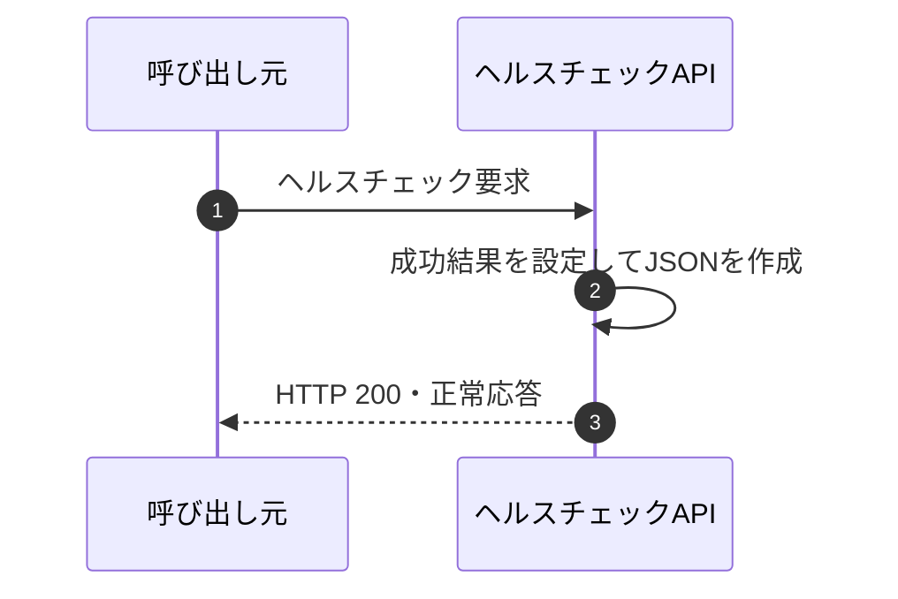

# 設計書 5.0. ヘルスチェックAPI

## 1. 機能概要

- APIサーバが正常応答を返せることを確認する。
- APIキーやBearerトークンを要求しない。
- 入出力の詳細は[OpenAPI](./openapi.yaml)の`rootHealthCheck`を参照する。

## 2. 処理概要



## 3. IF仕様

### 3.1. HTTPメソッド

| HTTPメソッド | 備考 |
| --- | --- |
| `GET` | — |

### 3.2. エンドポイントURL

| エンドポイントURL | 備考 |
| --- | --- |
| `/api/root/healthcheck` | スキーム・ホスト・ポートは実行環境に従う。 |

#### 3.2.1. パスパラメータ

特になし。

### 3.3. リクエストIF

#### 3.3.1. リクエストヘッダ

| 項目名 | 型 | 必須 | 値 | 備考 |
| --- | --- | --- | --- | --- |
| なし | — | — | — | 認証不要URLとして許可され、Bearerトークンを要求しない。 |

#### 3.3.2. クエリパラメータ

特になし。

#### 3.3.3. JSONボディ

特になし。

### 3.4. レスポンスIF

#### 3.4.1. レスポンスヘッダ

| 項目名 | 型 | 設定条件 | 備考 |
| --- | --- | --- | --- |
| `Content-Type` | `string` | JSON応答時 | `application/json`。独自のレスポンスヘッダーは定義しない。 |

#### 3.4.2. JSONボディ

```json
{
  "result": "0"
}
```

| 項目名 | 型 | 設定条件 | 備考 |
| --- | --- | --- | --- |
| `result` | `string` | 必須 | 成功は`"0"`、失敗は`"1"`。 |
| `errors[]` | `array<object>` | 異常時 | コントローラのエラーを格納する。正常時は省略する。 |
| `errors[].message` | `string` | 異常時 | 発生した処理のメッセージ。フィルターの応答形式は別扱い。 |

## 4. 処理フロー



| 番号 | 処理内容 | 関連項番 | 備考 |
| --- | --- | --- | --- |
| 1 | ヘルスチェック要求 | 4.1 | 入力項目なし。認証不要。 |
| 2 | 成功結果を設定してJSONを作成 | 4.3 | — |
| 3 | HTTP 200・正常応答 | 4.3 | resultは文字列の0。 |

### 4.1. 入力チェック

特になし。

### 4.2. DB操作

特になし。

### 4.3. 正常応答の生成

| 項目 | 処理内容 | 備考 |
| --- | --- | --- |
| 応答生成 | `result`を文字列の`"0"`にする | `HealthCheckApiController`・`BaseRootApiController`が応答を生成し、`RootApiResultSerializer`で結果を文字列化する。JSONをHTTP `200`で返す。 |
| 認証除外 | Bearerトークンを要求しない | `WebSecurityConfig`で認証不要URLとして設定する。 |
| 確認範囲 | 要求を受け付けて応答を作成できること | 依存DB・AWS・外部サービスの稼働状態は検査しない。 |

| 発生条件 | HTTPステータス | 応答・扱い | 備考 |
| --- | --- | --- | --- |
| コントローラ内のBaseExceptionが基底ハンドラーへ渡った | 500 | `result="1"`、`application error.` | Root用Slackへ通知する。 |
| 応答生成などで一般例外が基底ハンドラーへ渡った | 500 | `result="1"`、`unexpected error.` | Root用Slackへ通知する。 |
| MVCに到達する前のフィルターなどの異常 | 共通処理による | フィルター・実行環境の応答に従う | ControllerのJSON形式を保証しない。 |
