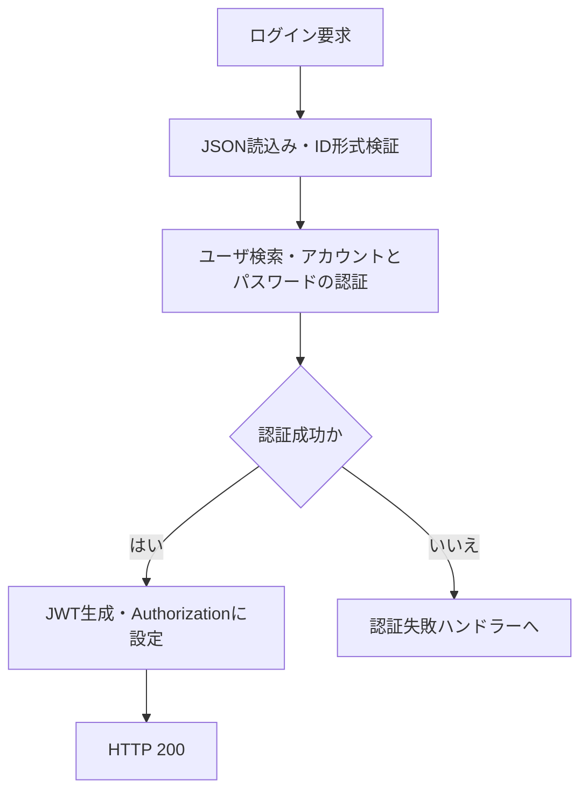
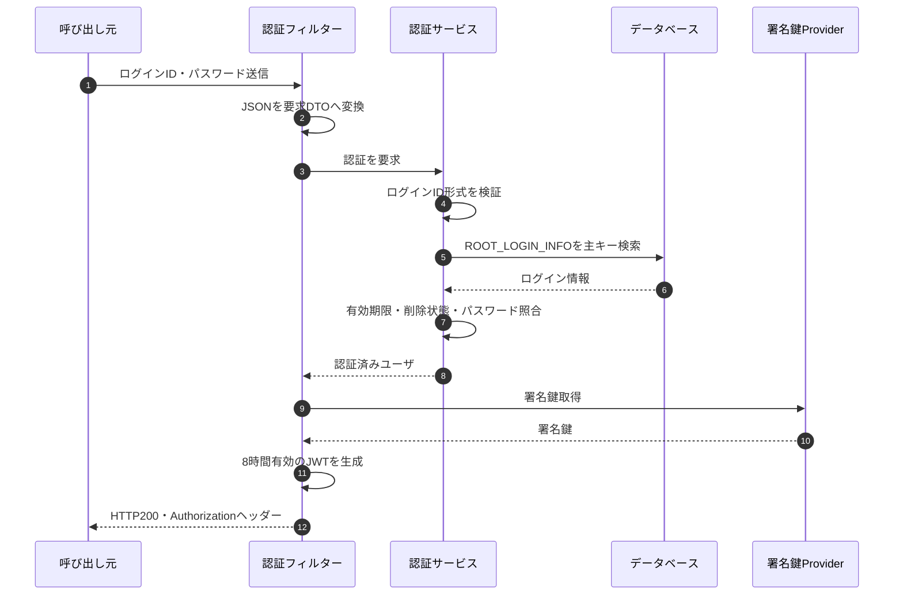

# 設計書 5.1. ログインAPI

## 1. 機能概要

- 管理者のログインID・パスワードを照合し、後続Root API用のJWTを発行する。
- コントローラではなくJWTAuthenticationFilterが要求を処理する。
- 入出力は[OpenAPI](./openapi.yaml)の`rootLogin`を参照する。

## 2. 処理概要



## 3. IF仕様

### 3.1. HTTPメソッド

| HTTPメソッド | 備考 |
| --- | --- |
| `POST` | 当該メソッドとパスの組み合わせで認証フィルターを起動する。 |

### 3.2. エンドポイントURL

| エンドポイントURL | 備考 |
| --- | --- |
| `/api/root/login` | スキーム・ホスト・ポートは実行環境に従う。 |

#### 3.2.1. パスパラメータ

特になし。

### 3.3. リクエストIF

#### 3.3.1. リクエストヘッダ

| 項目名 | 型 | 必須 | 値 | 備考 |
| --- | --- | --- | --- | --- |
| `Content-Type` | `string` | 標準JSON送信で指定 | `application/json` | リクエストボディをJSON形式で送信する。認証フィルターは要求の入力ストリームを直接JSONとして読み込む。 |

#### 3.3.2. クエリパラメータ

特になし。

#### 3.3.3. JSONボディ

```json
{
  "seq_login_id": 1,
  "password": "sample-password"
}
```

| 項目名 | 型 | 必須 | 備考 |
| --- | --- | --- | --- |
| `seq_login_id` | `integer`（`int64`） | 認証成功に必要 | JSONを`Long`へ変換後、認証サービスが未指定・半角数字の形式を確認する。Bean Validationによる検証ではない。 |
| `password` | `string` | 認証成功に必要 | 登録済みパスワードとの照合に使用する。リクエストDTOには桁数・文字種の検証注釈を設けていない。 |

### 3.4. レスポンスIF

#### 3.4.1. レスポンスヘッダ

| 項目名 | 型 | 設定条件 | 備考 |
| --- | --- | --- | --- |
| `Authorization` | `string` | 正常時 | `Bearer {JWT}`。発行時点から8時間有効。JSONボディは返さない。 |

#### 3.4.2. JSONボディ

特になし。

## 4. 処理フロー



| 番号 | 処理内容 | 関連項番 | 備考 |
| --- | --- | --- | --- |
| 1 | ログインID・パスワード送信 | 4.1 | — |
| 2 | JSONを要求DTOへ変換 | 4.1 | — |
| 3 | 認証を要求 | 4.3 | — |
| 4 | ログインID形式を検証 | 4.1 | — |
| 5 | ROOT_LOGIN_INFOを主キー検索 | 4.2 | — |
| 6 | ログイン情報 | 4.2 | — |
| 7 | 有効期限・削除状態・パスワード照合 | 4.3 | — |
| 8 | 認証済みユーザ | 4.3 | — |
| 9 | 署名鍵取得 | 4.4 | — |
| 10 | 署名鍵 | 4.4 | 初回はSSM、以後は保持済み鍵。 |
| 11 | 8時間有効のJWTを生成 | 4.4 | — |
| 12 | HTTP200・Authorizationヘッダー | 4.4 | JSONボディなし。 |

### 4.1. 入力チェック

| 対象・処理 | チェック内容 | 異常時の扱い | 備考 |
| --- | --- | --- | --- |
| JSON読込み | 入力ストリームをLoginApiRequestへ変換する | 捕捉したIOExceptionをログへ出力しRuntimeExceptionとして再送出 | MVCの基底コントローラは経由しない。 |
| seq_login_id | 未指定でなく半角数字として扱えること | `UsernameNotFoundException`として既定ハンドラーがHTTP401を返す | Bean Validationによる400の項目検証ではない。 |
| password | 認証で照合できる値であること | 未指定や照合不一致は認証失敗 | 桁数・文字種の検証注釈はない。 |

### 4.2. DB操作

```sql
SELECT
    SEQ_ROOT_LOGIN_INFO_ID
    , PASSWORD
    , PASSWORD_EXPIRE
    , SEQ_ROOT_USER_ROLE_MNG_MT_ID
    , REMARKS
    , DELETE_FLAG
    , REG_DATE
    , UPDATE_DATE
FROM
    ROOT_LOGIN_INFO
WHERE
    SEQ_ROOT_LOGIN_INFO_ID = :seq_login_id;
```

| 対象 | 条件・設定値 | 備考 |
| --- | --- | --- |
| ROOT_LOGIN_INFO | SEQ_ROOT_LOGIN_INFO_ID=:seq_login_idで主キー検索 | `AuthServiceImpl`から`RootLoginInfoSearchServiceImpl.findById`・`RootLoginInfoMapper`を呼び出す。削除状態・有効期限は取得後に判定する。読み取り専用トランザクション。 |
| DB更新 | 特になし | ログイン日時・ログイン履歴の書き込みは設けない。 |
| 検索結果なし | 認証失敗として処理する | 標準認証失敗ハンドラーによる401。JSONのresult/errorsは生成しない。 |
| ユーザ検索で認証処理に渡る例外 | Spring Securityの認証処理へ渡す | フィルター段階で処理し、MVCのapplication errorへ一律変換しない。 |

### 4.3. アカウント・パスワードの認証

| 対象 | 成功条件 | 不成立・例外時の扱い | 備考 |
| --- | --- | --- | --- |
| 有効期限 | PASSWORD_EXPIREがシステム日付以降 | 認証失敗で401 | 当日は有効。AuthInfo.isAccountNonExpiredで日付比較する。 |
| 削除状態 | DELETE_FLAGがfalse | 認証失敗で401 | アカウントロック判定は常に非ロック、資格情報期限判定は常に有効を返す。 |
| パスワード | 入力を空saltでSHA-256ハッシュ化した結果が保存値と一致 | 不一致は認証失敗で401 | PasswordEncoderImpl.matchesを使用する。 |
| ハッシュ処理等の予期しない例外 | — | フィルター・実行環境の共通処理へ伝播 | MVCのresult/errors形式を保証しない。 |

### 4.4. JWT発行・応答ヘッダー設定

| 項目 | 設定内容 | 備考 |
| --- | --- | --- |
| subject | 取得した管理者サイトユーザのログインID | 文字列として設定する。 |
| issuedAt | 認証成功処理時のシステム日時 | — |
| expiration | issuedAtの8時間後 | `plusHours(8)`で算出する。 |
| 署名鍵 | SSMの`root_jwt_secret` | `JwtSigningKeyProvider`で復号して取得し、UTF-8のバイト列からHMAC鍵を作る。取得後はProvider内に保持する。 |
| セッション | 作成しない | `WebSecurityConfig`は`STATELESS`。後続APIはAuthorizationヘッダーのBearer JWTを使用する。 |

| 処理・条件 | 処理内容 | 異常時の扱い | 備考 |
| --- | --- | --- | --- |
| 署名鍵取得 | 初回はSSMから復号取得し、その後はProvider内の鍵を返す | 取得例外はIllegalStateExceptionとして送出 | 実パスは環境を付加するSSMコンポーネントに従う。 |
| JWT生成 | subject/issuedAt/expirationを設定し署名する | 予期しない例外はフィルターの共通処理へ伝播 | Root APIのJSONエラー形式を保証しない。 |
| 正常応答 | Authorization: Bearer {JWT}を追加する | — | HTTP200。JSONボディなし。CORS設定でAuthorizationを公開ヘッダーに含める。 |
