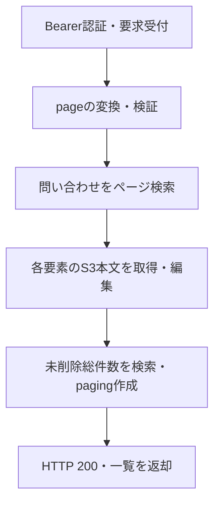
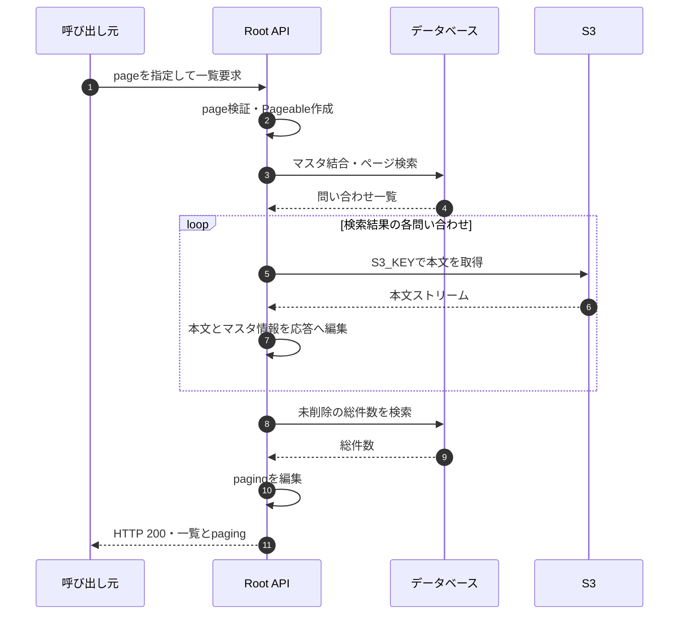

# 設計書 5.10.1. 問い合わせ情報一覧取得API

## 1. 機能概要

- 問い合わせ管理情報と関連マスタを検索し、S3に保存した本文を加えてページ単位に返す。
- 入出力の定義は同じフォルダの[OpenAPI](./openapi.yaml)の`rootGetInquiries`を参照する。

## 2. 処理概要



## 3. IF仕様

### 3.1. HTTPメソッド

| 項目 | 内容 | 備考 |
| --- | --- | --- |
| HTTPメソッド | `GET` | — |

### 3.2. エンドポイントURL

| 項目 | 内容 | 備考 |
| --- | --- | --- |
| エンドポイントURL | `/api/root/inquiry` | スキーム・ホスト・ポートは実行環境に従う。パス変数はなし。 |

### 3.3. リクエストIF

#### 3.3.1. リクエストヘッダ

| 項目名 | 型 | 必須 | 値 | 備考 |
| --- | --- | --- | --- | --- |
| `Authorization` | `string` | 必須 | Bearer形式のJWT | `Bearer {JWT}`の形式で、ログインAPIのトークンを指定する。認証失敗はフィルターで処理され、本APIの共通エラー形式を保証しない。 |

#### 3.3.2. クエリパラメータ

| 項目名 | 型 | 必須 | 備考 |
| --- | --- | --- | --- |
| `page` | `integer`（`int32`） | 任意 | 未指定・空文字は0。0始まり。0以上999999999以下。 |

#### 3.3.3. JSONボディ

特になし。

### 3.4. レスポンスIF

#### 3.4.1. レスポンスヘッダ

| 項目名 | 型 | 設定条件 | 備考 |
| --- | --- | --- | --- |
| `Content-Type` | `string` | 正常なJSON応答時 | `application/json`。本API固有の追加レスポンスヘッダーはない。 |

#### 3.4.2. JSONボディ

```json
{
  "result": "0",
  "inquiry_list": [
    {
      "seq_inquiry_mng_id": 200,
      "seq_user_id": 100,
      "responder_login_id": null,
      "status": {
        "label": "未対応",
        "value": "00"
      },
      "type": {
        "label": "その他",
        "value": "00"
      },
      "title": "操作について",
      "body": "問い合わせ本文",
      "reg_date": "2026/11/01 12:00:00",
      "update_date": "2026/11/01 12:00:00"
    }
  ],
  "paging": {
    "total_record_num": 1,
    "from_record_num": 1,
    "to_record_num": 1,
    "total_page": 1,
    "current_page_num": 0,
    "record_per_page": 10,
    "can_go_next": false,
    "next_href": "inquiry?page=0",
    "can_go_previous": false,
    "previous_href": "inquiry?page=0",
    "can_go_last": false,
    "last_href": "inquiry?page=0",
    "can_go_first": false,
    "first_href": "inquiry?page=0"
  }
}
```

| 項目名 | 型 | 設定条件 | 備考 |
| --- | --- | --- | --- |
| `result` | `string` | 必須 | 成功は`"0"`、失敗は`"1"`。数値ではない。 |
| `errors[]` | `array<object>` | 異常時 | 各要素の`message`にエラー詳細を設定する。正常時は省略する。 |
| `inquiry_list[]` | `array<object>` | 正常時 | 0件なら空配列。 |
| `inquiry_list[].seq_inquiry_mng_id` | `integer`（`int64`） | 正常時 | DBの問い合わせ管理ID。レスポンス名は`inquiry`の綴り。 |
| `inquiry_list[].seq_user_id` | `integer`（`int64`） | 正常時 | 問い合わせユーザID。 |
| `inquiry_list[].responder_login_id` | `integer`（`int64`）/`null` | 正常時 | 対応者ログインID。 |
| `inquiry_list[].status`・`type` | `object` | 正常時 | 各オブジェクトの`label`はマスタ表示名、`value`はコード。各値がnullなら当該項目は省略。 |
| `inquiry_list[].title` | `string`/`null` | 正常時 | 問い合わせ件名。 |
| `inquiry_list[].body` | `string` | 正常時 | S3から読み込んだ本文。 |
| `inquiry_list[].reg_date`・`update_date` | `string`/`null` | 正常時 | `yyyy/MM/dd HH:mm:ss`。 |
| `paging` | `object` | 正常時 | ページング情報。下記の各属性を設定する。 |
| `paging.total_record_num` | `integer` | 正常時 | 未削除の総件数。 |
| `paging.from_record_num` | `integer` | 正常時 | 表示開始番号。 |
| `paging.to_record_num` | `integer` | 正常時 | 表示終了番号。 |
| `paging.total_page` | `integer` | 正常時 | 総ページ数。 |
| `paging.current_page_num` | `integer` | 正常時 | 0始まりの要求ページ。 |
| `paging.record_per_page` | `integer` | 正常時 | 1ページの設定件数。 |
| `paging.can_go_next` | `boolean` | 正常時 | ページ遷移可否。 |
| `paging.can_go_previous` | `boolean` | 正常時 | ページ遷移可否。 |
| `paging.can_go_last` | `boolean` | 正常時 | ページ遷移可否。 |
| `paging.can_go_first` | `boolean` | 正常時 | ページ遷移可否。 |
| `paging.next_href` | `string` | 正常時 | ページリンク。 |
| `paging.previous_href` | `string` | 正常時 | ページリンク。 |
| `paging.last_href` | `string` | 正常時 | ページリンク。 |
| `paging.first_href` | `string` | 正常時 | ページリンク。 |

## 4. 処理フロー



| 番号 | 処理内容 | 関連項番 | 備考 |
| --- | --- | --- | --- |
| 1 | Bearer認証後に要求を受け付ける | 4.3 | pageは省略時0。 |
| 2 | 設定件数と要求ページから検索条件を作る | 4.1 | front.inquiry.pageを使用。 |
| 3 | 問い合わせ一覧を検索する | 4.2.1 | REG_DATE昇順。 |
| 4 | 検索結果を受け取る | 4.2.1 | 管理情報自身の削除フラグ条件なし。 |
| 5 | 各問い合わせの本文を取得する | 4.4 | aws.s3.backetのバケット。 |
| 6 | S3の内容を読み込む | 4.4 | 失敗時は後続処理を中止。 |
| 7 | 本文の行を改行なしで連結する | 4.4 | JSONとして解析しない。 |
| 8 | paging用の総件数を取得する | 4.2.2 | 一覧と削除条件が異なる。 |
| 9 | 未削除の件数を受け取る | 4.2.2 | 0件も許可。 |
| 10 | 要求ページ・設定件数・総件数から作成する | 4.5 | 要求ページは範囲内へ補正しない。 |
| 11 | 正常応答を返す | 3.4.2 | 取得済み要素のみの部分成功は返さない。 |

### 4.1. 入力チェック

| 対象 | チェック | メッセージ |
| --- | --- | --- |
| `page` | 整数に変換できること | `page is type error. value={値}` |
| `page` | 0以上999999999以下 | `page is positive` |

| 発生条件 | HTTPステータス | errors[].message | 備考 |
| --- | --- | --- | --- |
| 引数・パスの型変換失敗 | 400 | `{引数名} is type error. value={値}` | `result="1"`と`errors`を返す。 |

### 4.2. DB操作

#### 4.2.1. 一覧検索

```sql
SELECT
    IM.SEQ_INQUIRY_MNG_ID
    , IM.SEQ_USER_ID
    , IM.RESPONDER_LOGIN_ID
    , IM.INQUIRY_STATUS
    , SM.NAME AS INQUIRY_STATUS_NAME
    , IM.INQUIRY_TYPE
    , TM.NAME AS INQUIRY_TYPE_NAME
    , IM.TITLE
    , IM.S3_KEY
    , IM.REG_DATE
    , IM.UPDATE_DATE
FROM
    INQUIRY_MANAGEMENT IM
    LEFT OUTER JOIN INQUIRY_STATUS_MT SM
        ON IM.INQUIRY_STATUS = SM.INQUIRY_STATUS
        AND SM.DELETE_FLAG = FALSE
    LEFT OUTER JOIN INQUIRY_TYPE_MT TM
        ON IM.INQUIRY_TYPE = TM.INQUIRY_TYPE
        AND TM.DELETE_FLAG = FALSE
ORDER BY
    REG_DATE ASC
LIMIT
    :offset
    , :pageSize;
```

| 条件・項目 | 内容 | 備考 |
| --- | --- | --- |
| 対象 | INQUIRY_MANAGEMENTと2マスタのLEFT OUTER JOIN | 問い合わせ管理情報自身のDELETE_FLAG条件なし。 |
| 結合条件 | ステータス・種別コード一致かつ各マスタのDELETE_FLAG=false | マスタ側のみ削除状態で絞り込む。 |
| 順序・範囲 | REG_DATE昇順、LIMIT :offset, :pageSize | offsetはpage×pageSize。 |

#### 4.2.2. ページング総件数

```sql
SELECT
    COUNT(*)
FROM
    INQUIRY_MANAGEMENT
WHERE
    DELETE_FLAG = FALSE;
```

| 条件・項目 | 内容 | 備考 |
| --- | --- | --- |
| 対象 | INQUIRY_MANAGEMENT | DELETE_FLAG=falseのみ数える。 |
| 一覧との違い | 一覧は管理情報自身の削除条件なし | 総件数と一覧の対象が一致しない場合がある。 |

| 発生条件 | HTTPステータス | errors[].message | 備考 |
| --- | --- | --- | --- |
| 業務・外部連携のBaseException | 500 | `application error.` | `result="1"`と`errors`を返す。 |
| DB検索・更新中のその他の例外 | 500 | `unexpected error.` | `result="1"`と`errors`を返す。 |

### 4.3. 認証・共通処理

| 処理 | 内容 | 備考 |
| --- | --- | --- |
| Bearer認証 | 共通フィルターで署名付きJWTを処理する | コントローラ内で権限コードの照合や追加のユーザ検索は行わない。 |
| フィルター段階の失敗 | フィルター・実行環境の処理に従う | コントローラが返す`result`・`errors`形式の対象外。 |
| コントローラ側の異常応答 | `result="1"`と`errors`を設定する | 各要素の`message`は、入力・DB・外部処理の各節に示す文言。 |
| 例外通知・ログ | 基底コントローラの例外ハンドラーはRoot用Slackへ通知し、サーバログへ出力する | コントローラが直接返す業務判定の400応答では、その例外ハンドラーを経由しない。 |

### 4.4. S3本文の取得・編集

| 処理 | 内容 | 備考 |
| --- | --- | --- |
| 取得 | 各検索結果のS3_KEYでS3オブジェクトを読む | バケットはaws.s3.backet。 |
| 文字コード | システム既定の文字コード | InputStreamReaderで読み込む。 |
| 本文編集 | 行単位に読み込み、改行を挿入せず連結する | JSONとしての解析は行わない。 |
| 途中の失敗 | 後続の問い合わせ処理を中止する | 取得済み要素だけの成功応答は返さない。 |

| 発生条件 | HTTPステータス | errors[].message | 備考 |
| --- | --- | --- | --- |
| 業務・外部連携のBaseException | 500 | `application error.` | `result="1"`と`errors`を返す。 |
| その他の例外 | 500 | `unexpected error.` | `result="1"`と`errors`を返す。 |

### 4.5. 応答編集・ページング

| 順序 | 処理 | 内容 |
| --- | --- | --- |
| 1 | ページング作成 | 要求ページと`front.inquiry.page`でPageableを作成する。設定値はlocalで10、devで20 |
| 2 | 問い合わせ検索 | 「4.2.1. 一覧検索」を実行する。問い合わせ管理情報自身の削除フラグでは絞り込まない |
| 3 | 本文取得 | 各検索結果の`S3_KEY`を使用し、`aws.s3.backet`のS3オブジェクトを取得する |
| 4 | 本文編集 | システム既定の文字コードで行単位に読み込み、改行を挿入せず連結する。JSONとしての解析は行わない |
| 5 | 応答編集 | DBのID・件名・日時、マスタの表示名/値、S3本文を設定する |
| 6 | 総件数取得 | `DELETE_FLAG=false`の問い合わせ管理情報を数える |
| 7 | ページ情報編集 | 0始まりの要求ページ・設定件数・総件数から`paging`を作り、一覧とともに返す |

| 項目 | 仕様 |
| --- | --- |
| 一覧と総件数の条件 | 一覧は管理情報自身の削除条件なし、総件数は未削除のみ。両者の対象が一致しない場合がある |
| 表示範囲 | 0件・範囲外ページは`from_record_num=0`、`to_record_num=0`。要求ページ番号は補正しない |
| 総ページ数 | 総件数をページ件数で切り上げる。0件は0ページ |
| リンク | `inquiry?page={0始まりのページ番号}`を設定する |
| S3取得途中の失敗 | 後続要素の処理を中止して例外へ進む。取得済み要素だけの成功応答は返さない |

| 発生条件 | HTTPステータス | errors[].message | 備考 |
| --- | --- | --- | --- |
| その他の例外 | 500 | `unexpected error.` | `result="1"`と`errors`を返す。 |
