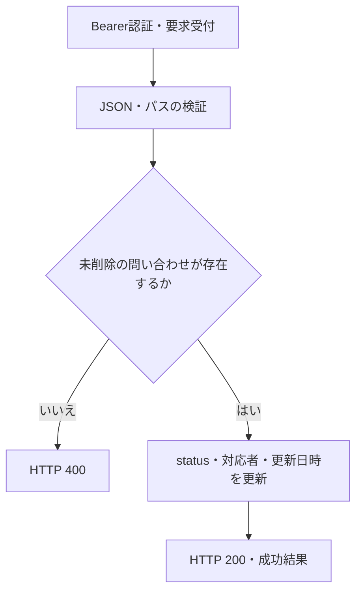
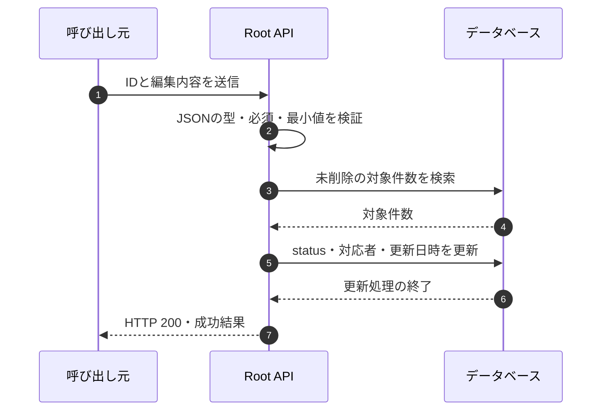

# 設計書 5.10.2. 問い合わせ情報編集API

## 1. 機能概要

- 指定した未削除の問い合わせ管理情報のステータスと対応者ログインIDを更新する。
- 入出力の定義は同じフォルダの[OpenAPI](./openapi.yaml)の`rootEditInquiry`を参照する。

## 2. 処理概要



## 3. IF仕様

### 3.1. HTTPメソッド

| 項目 | 内容 | 備考 |
| --- | --- | --- |
| HTTPメソッド | `PUT` | — |

### 3.2. エンドポイントURL

| 項目 | 内容 | 備考 |
| --- | --- | --- |
| エンドポイントURL | `/api/root/inquiry/{seq_inquriy_mng_id}` | スキーム・ホスト・ポートは実行環境に従う。 |

| 項目名 | 必須 | 備考 |
| --- | --- | --- |
| `seq_inquriy_mng_id` | 必須 | 実装上のパス名の綴りを維持する。正数限定の追加チェックなし。 |

### 3.3. リクエストIF

#### 3.3.1. リクエストヘッダ

| 項目名 | 型 | 必須 | 値 | 備考 |
| --- | --- | --- | --- | --- |
| `Authorization` | `string` | 必須 | Bearer形式のJWT | `Bearer {JWT}`の形式で、ログインAPIのトークンを指定する。認証失敗はフィルターで処理され、本APIの共通エラー形式を保証しない。 |
| `Content-Type` | `string` | 必須 | `application/json` | リクエストボディをJSON形式で送信する。 |

#### 3.3.2. クエリパラメータ

特になし。

#### 3.3.3. JSONボディ

```json
{
  "status": "01",
  "seq_login_id": 1
}
```

| 項目名 | 型 | 必須 | 備考 |
| --- | --- | --- | --- |
| `status` | `string` | 必須 | `00`未対応、`01`対応中、`02`完了。未知値は必須エラー。 |
| `seq_login_id` | `integer`（`int64`） | 必須 | 0以上。`null`不可。対応者として保存する。 |

### 3.4. レスポンスIF

#### 3.4.1. レスポンスヘッダ

| 項目名 | 型 | 設定条件 | 備考 |
| --- | --- | --- | --- |
| `Content-Type` | `string` | 正常なJSON応答時 | `application/json`。本API固有の追加レスポンスヘッダーはない。 |

#### 3.4.2. JSONボディ

```json
{
  "result": "0"
}
```

| 項目名 | 型 | 設定条件 | 備考 |
| --- | --- | --- | --- |
| `result` | `string` | 必須 | 成功は`"0"`、失敗は`"1"`。数値ではない。 |
| `errors[]` | `array<object>` | 異常時 | 各要素の`message`にエラー詳細を設定する。正常時は省略する。 |

## 4. 処理フロー



| 番号 | 処理内容 | 関連項番 | 備考 |
| --- | --- | --- | --- |
| 1 | Bearer認証後に要求を受け付ける | 4.3 | パス名はseq_inquriy_mng_id。 |
| 2 | statusとseq_login_idを検証する | 4.1 | 状態遷移や対応者の実在確認はしない。 |
| 3 | 更新対象の存在を判定する | 4.2.1 | 0件なら400で終了。 |
| 4 | 存在確認結果を受け取る | 4.2.1 | 以降は1件以上の正常経路。 |
| 5 | 主キーによる選択更新を実行する | 4.2.2 | 存在判定とは別のDB操作。 |
| 6 | 更新サービスから制御を戻す | 4.2.2 | 更新件数による判定なし。 |
| 7 | 更新後レコードは再取得せず返す | 4.4 | resultは文字列の0。 |

### 4.1. 入力チェック

| 対象 | チェック・ルール | メッセージ |
| --- | --- | --- |
| `status` | 必須。未知コードはenum変換でnullになる | `status is required` |
| `seq_login_id` | 必須・0以上 | `seq_login_id is required`／`seq_login_id is positive` |
| 状態遷移 | 現在のステータスによる遷移制限は行わない | — |
| 対応者 | ログインIDの存在確認や認証トークンとの一致確認は行わない | — |

| 発生条件 | HTTPステータス | errors[].message | 備考 |
| --- | --- | --- | --- |
| JSONの必須・最小値チェック失敗 | 400 | `status is required`／`seq_login_id is required`／`seq_login_id is positive` | `result="1"`と`errors`を返す。 |
| JSONの数値変換失敗として識別された | 400 | `number format error. Please use numeric value.` | `result="1"`と`errors`を返す。 |
| その他のJSON読込み失敗 | 500 | `unexpected error.` | `result="1"`と`errors`を返す。 |
| 引数・パスの型変換失敗 | 400 | `{引数名} is type error. value={値}` | `result="1"`と`errors`を返す。 |

### 4.2. DB操作

#### 4.2.1. 存在判定

```sql
SELECT
    COUNT(*)
FROM
    INQUIRY_MANAGEMENT
WHERE
    SEQ_INQUIRY_MNG_ID = :seq_inquriy_mng_id
    AND DELETE_FLAG = FALSE;
```

| 条件・判定 | 内容 | 備考 |
| --- | --- | --- |
| 検索条件 | 主キー一致かつDELETE_FLAG=false | 0件なら未登録または削除済みとして400。 |
| 1件以上 | 更新へ進む | 存在判定は更新と別の検索。 |

| 発生条件 | HTTPステータス | errors[].message | 備考 |
| --- | --- | --- | --- |
| 問い合わせが未登録または削除済み | 400 | `inquriy_management is not found. seq_inquriy_mng_id={ID}` | `result="1"`と`errors`を返す。 |

#### 4.2.2. 更新

```sql
UPDATE
    INQUIRY_MANAGEMENT
SET
    INQUIRY_STATUS = :status
    , RESPONDER_LOGIN_ID = :seq_login_id
    , UPDATE_DATE = :now
WHERE
    SEQ_INQUIRY_MNG_ID = :seq_inquriy_mng_id;
```

| カラム | 設定値 |
| --- | --- |
| `INQUIRY_STATUS` | 要求の`status`のコード |
| `RESPONDER_LOGIN_ID` | 要求の`seq_login_id` |
| `UPDATE_DATE` | DB共通更新処理で設定するシステム日時 |

| 項目 | 仕様 |
| --- | --- |
| 更新方式 | 主キー指定の選択更新。存在判定は別の検索で行う |
| トランザクション | 更新サービスは例外発生時にロールバックする |
| 更新件数 | Mapperの更新件数を使った判定は行わない |
| 正常応答 | 更新後のレコードを再取得せず、成功結果を返す |

| 発生条件 | HTTPステータス | errors[].message | 備考 |
| --- | --- | --- | --- |
| 業務・外部連携のBaseException | 500 | `application error.` | `result="1"`と`errors`を返す。 |
| DB検索・更新中のその他の例外 | 500 | `unexpected error.` | `result="1"`と`errors`を返す。 |

### 4.3. 認証・共通処理

| 処理 | 内容 | 備考 |
| --- | --- | --- |
| Bearer認証 | 共通フィルターで署名付きJWTを処理する | コントローラ内で権限コードの照合や追加のユーザ検索は行わない。 |
| フィルター段階の失敗 | フィルター・実行環境の処理に従う | コントローラが返す`result`・`errors`形式の対象外。 |
| コントローラ側の異常応答 | `result="1"`と`errors`を設定する | 各要素の`message`は、入力・DB・外部処理の各節に示す文言。 |
| 例外通知・ログ | 基底コントローラの例外ハンドラーはRoot用Slackへ通知し、サーバログへ出力する | コントローラが直接返す業務判定の400応答では、その例外ハンドラーを経由しない。 |

### 4.4. 更新結果の返却

| 処理 | 内容 | 備考 |
| --- | --- | --- |
| 正常応答 | 更新後レコードを再取得せず成功結果を返す | resultは文字列の0。 |
| 更新件数 | Mapperの更新件数で判定しない | 存在確認後の再検索も行わない。 |

| 発生条件 | HTTPステータス | errors[].message | 備考 |
| --- | --- | --- | --- |
| その他の例外 | 500 | `unexpected error.` | `result="1"`と`errors`を返す。 |
