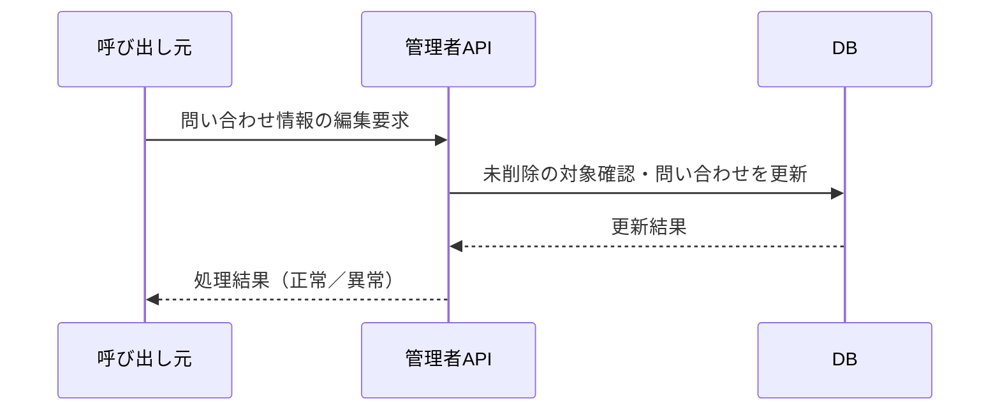
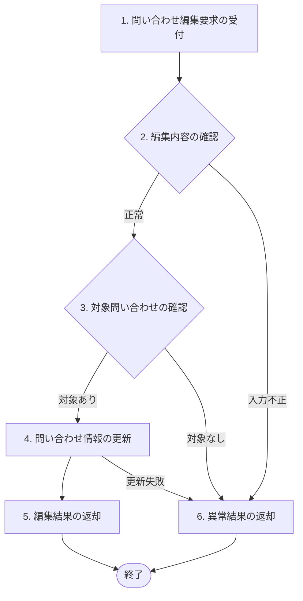

# 設計書 5.10.2. 問い合わせ情報編集API

## 1. 機能概要

- 指定した未削除の問い合わせ管理情報のステータスと対応者ログインIDを更新する。
- 入出力の定義は同じフォルダの[OpenAPI](./openapi.yaml)の`rootEditInquiry`を参照する。

## 2. 処理概要



## 3. IF仕様

### 3.1. HTTPメソッド

| 項目 | 内容 | 備考 |
| --- | --- | --- |
| HTTPメソッド | `PUT` | — |

### 3.2. エンドポイントURL

| 項目 | 内容 | 備考 |
| --- | --- | --- |
| エンドポイントURL | `/api/root/inquiry/{seq_inquriy_mng_id}` | スキーム・ホスト・ポートは実行環境に従う。 |

| 項目名 | 必須 | 備考 |
| --- | --- | --- |
| `seq_inquriy_mng_id` | 必須 | 実装上のパス名の綴りを維持する。正数限定の追加チェックなし。 |

### 3.3. リクエストIF

#### 3.3.1. リクエストヘッダ

| 項目名 | 型 | 必須 | 値 | 備考 |
| --- | --- | --- | --- | --- |
| `Authorization` | `string` | 必須 | Bearer形式のJWT | `Bearer {JWT}`の形式で、ログインAPIのトークンを指定する。認証失敗はフィルターで処理され、本APIの共通エラー形式を保証しない。 |
| `Content-Type` | `string` | 必須 | `application/json` | リクエストボディをJSON形式で送信する。 |

#### 3.3.2. クエリパラメータ

特になし。

#### 3.3.3. JSONボディ

```json
{
  "status": "01",
  "seq_login_id": 1
}
```

| 項目名 | 型 | 必須 | 備考 |
| --- | --- | --- | --- |
| `status` | `string` | 必須 | `00`未対応、`01`対応中、`02`完了。未知値は必須エラー。 |
| `seq_login_id` | `integer`（`int64`） | 必須 | 0以上。`null`不可。対応者として保存する。 |

### 3.4. レスポンスIF

#### 3.4.1. レスポンスヘッダ

| 項目名 | 型 | 設定条件 | 備考 |
| --- | --- | --- | --- |
| `Content-Type` | `string` | 正常なJSON応答時 | `application/json`。本API固有の追加レスポンスヘッダーはない。 |

#### 3.4.2. JSONボディ

```json
{
  "result": "0"
}
```

| 項目名 | 型 | 設定条件 | 備考 |
| --- | --- | --- | --- |
| `result` | `string` | 必須 | 成功は`"0"`、失敗は`"1"`。数値ではない。 |
| `errors[]` | `array<object>` | 異常時 | 各要素の`message`にエラー詳細を設定する。正常時は省略する。 |

## 4. 処理フロー



| 処理順 | 処理概要 | 処理詳細 | 関連項番 |
| --- | --- | --- | --- |
| 1 | 問い合わせ編集要求の受付 | Bearer認証を経て問い合わせIDと編集内容を受け付ける。認証失敗は共通処理で終了する。 | 4.3.1 |
| 2 | 編集内容の確認 | JSONの型・必須・最小値を検証する。状態遷移や対応者の実在は検証せず、入力不正は更新前に終了する。 | 4.1.1 |
| 3 | 対象問い合わせの確認 | 問い合わせIDと未削除条件で存在を確認する。0件なら400で終了する。 | 4.2.1、4.4 |
| 4 | 問い合わせ情報の更新 | status・対応者・更新日時を主キー指定で更新する。更新件数による再判定や更新後レコードの再取得は行わない。 | 4.2.2、4.4 |
| 5 | 編集結果の返却 | 成功結果をHTTP 200で返す。 | 4.4 |
| 6 | 異常結果の返却 | 入力不正・対象なしは更新せず終了する。更新等の例外は共通処理の異常応答で終了する。 | 4.1.2、4.3.2、4.4 |

### 4.1. 入力チェック

#### 4.1.1. 入力項目・補完条件の確認

| 対象 | チェック・ルール | メッセージ |
| --- | --- | --- |
| `status` | 必須。未知コードはenum変換でnullになる | `status is required` |
| `seq_login_id` | 必須・0以上 | `seq_login_id is required`／`seq_login_id is positive` |
| 状態遷移 | 現在のステータスによる遷移制限は行わない | — |
| 対応者 | ログインIDの存在確認や認証トークンとの一致確認は行わない | — |

#### 4.1.2. 入力異常時の扱い

| 発生条件 | HTTPステータス | errors[].message | 備考 |
| --- | --- | --- | --- |
| JSONの必須・最小値チェック失敗 | 400 | `status is required`／`seq_login_id is required`／`seq_login_id is positive` | `result="1"`と`errors`を返す。 |
| JSONの数値変換失敗として識別された | 400 | `number format error. Please use numeric value.` | `result="1"`と`errors`を返す。 |
| その他のJSON読込み失敗 | 500 | `unexpected error.` | `result="1"`と`errors`を返す。 |
| 引数・パスの型変換失敗 | 400 | `{引数名} is type error. value={値}` | `result="1"`と`errors`を返す。 |

### 4.2. DB操作
#### 4.2.1. 存在判定

```sql
SELECT
    COUNT(*)
FROM
    INQUIRY_MANAGEMENT
WHERE
    SEQ_INQUIRY_MNG_ID = :seq_inquriy_mng_id
    AND DELETE_FLAG = FALSE;
```

| 項目 | 設定値 | 備考 |
| --- | --- | --- |
| `:seq_inquriy_mng_id` | パスの`seq_inquriy_mng_id` | 存在確認対象の問い合わせ管理ID。 |

#### 4.2.2. 更新

```sql
UPDATE
    INQUIRY_MANAGEMENT
SET
    INQUIRY_STATUS = :status
    , RESPONDER_LOGIN_ID = :seq_login_id
    , UPDATE_DATE = :now
WHERE
    SEQ_INQUIRY_MNG_ID = :seq_inquriy_mng_id;
```

| 項目 | 設定値 | 備考 |
| --- | --- | --- |
| `:status` | 要求JSONの`status`のコード | `INQUIRY_STATUS`の更新値。 |
| `:seq_login_id` | 要求JSONの`seq_login_id` | 対応者ログインIDとして設定する。 |
| `:now` | 各CRUD呼び出し時のシステム日時 | DB共通処理で登録日時・更新日時を設定する。 |
| `:seq_inquriy_mng_id` | パスの`seq_inquriy_mng_id` | 更新対象の問い合わせ管理ID。 |

### 4.3. 認証・共通処理

#### 4.3.1. 認証・利用範囲の確認

| 処理 | 内容 | 備考 |
| --- | --- | --- |
| Bearer認証 | 共通フィルターで署名付きJWTを処理する | コントローラ内で権限コードの照合や追加のユーザ検索は行わない。 |
| フィルター段階の失敗 | フィルター・実行環境の処理に従う | コントローラが返す`result`・`errors`形式の対象外。 |

#### 4.3.2. 共通異常応答・通知

| 処理 | 内容 | 備考 |
| --- | --- | --- |
| コントローラ側の異常応答 | `result="1"`と`errors`を設定する | 各要素の`message`は、入力・DB・外部処理の各節に示す文言。 |
| 例外通知・ログ | 基底コントローラの例外ハンドラーはRoot用Slackへ通知し、サーバログへ出力する | コントローラが直接返す業務判定の400応答では、その例外ハンドラーを経由しない。 |

### 4.4. 更新結果の返却

| 処理 | 内容 | 備考 |
| --- | --- | --- |
| 正常応答 | 更新後レコードを再取得せず成功結果を返す | resultは文字列の0。 |
| 更新件数 | Mapperの更新件数で判定しない | 存在確認後の再検索も行わない。 |

| 発生条件 | HTTPステータス | errors[].message | 備考 |
| --- | --- | --- | --- |
| その他の例外 | 500 | `unexpected error.` | `result="1"`と`errors`を返す。 |

**SQL呼び出し時の結果・例外の扱い**

| 検索結果 | 処理 | 備考 |
| --- | --- | --- |
| 存在確認が0件 | 未登録または削除済みとして400を返す | 更新は行わない。エラーメッセージは下表のとおり。 |
| 存在確認が1件以上 | 更新へ進む | 存在確認は更新とは別の検索で行う。 |

| 発生条件 | HTTPステータス | errors[].message | 備考 |
| --- | --- | --- | --- |
| 問い合わせが未登録または削除済み | 400 | `inquriy_management is not found. seq_inquriy_mng_id={ID}` | `result="1"`と`errors`を返す。 |

| 項目 | 仕様 |
| --- | --- |
| 更新方式 | 主キー指定の選択更新。存在判定は別の検索で行う |
| トランザクション | 更新サービスは例外発生時にロールバックする |
| 更新件数 | Mapperの更新件数を使った判定は行わない |
| 正常応答 | 更新後のレコードを再取得せず、成功結果を返す |

| 発生条件 | HTTPステータス | errors[].message | 備考 |
| --- | --- | --- | --- |
| 業務・外部連携のBaseException | 500 | `application error.` | `result="1"`と`errors`を返す。 |
| DB検索・更新中のその他の例外 | 500 | `unexpected error.` | `result="1"`と`errors`を返す。 |
