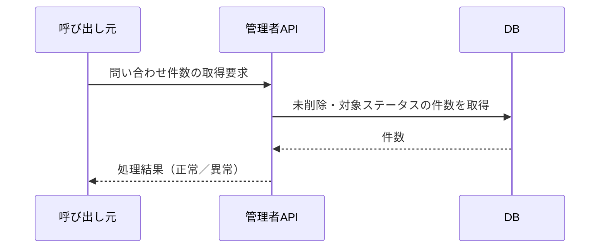
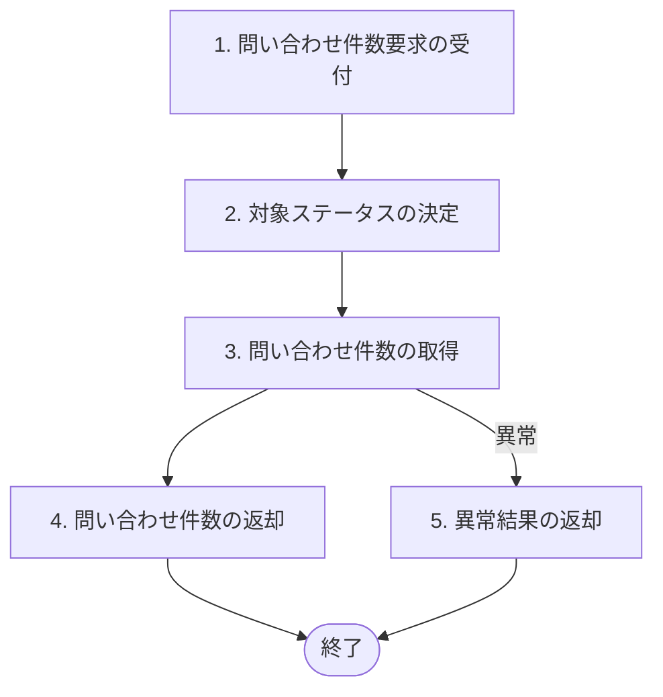

# 設計書 5.10.3. 問い合わせ情報通知API

## 1. 機能概要

- 指定した問い合わせステータスの未削除件数を返す。
- 入出力の定義は同じフォルダの[OpenAPI](./openapi.yaml)の`rootGetInquiryNotice`を参照する。

## 2. 処理概要



## 3. IF仕様

### 3.1. HTTPメソッド

| 項目 | 内容 | 備考 |
| --- | --- | --- |
| HTTPメソッド | `GET` | — |

### 3.2. エンドポイントURL

| 項目 | 内容 | 備考 |
| --- | --- | --- |
| エンドポイントURL | `/api/root/inquiry/notice` | スキーム・ホスト・ポートは実行環境に従う。パス変数はなし。 |

### 3.3. リクエストIF

#### 3.3.1. リクエストヘッダ

| 項目名 | 型 | 必須 | 値 | 備考 |
| --- | --- | --- | --- | --- |
| `Authorization` | `string` | 必須 | Bearer形式のJWT | `Bearer {JWT}`の形式で、ログインAPIのトークンを指定する。認証失敗はフィルターで処理され、本APIの共通エラー形式を保証しない。 |

#### 3.3.2. クエリパラメータ

| 項目名 | 型 | 必須 | 備考 |
| --- | --- | --- | --- |
| `status` | `string` | 任意 | 未指定・空文字は`00`。未知値も`00`へ置換する。 |

#### 3.3.3. JSONボディ

特になし。

### 3.4. レスポンスIF

#### 3.4.1. レスポンスヘッダ

| 項目名 | 型 | 設定条件 | 備考 |
| --- | --- | --- | --- |
| `Content-Type` | `string` | 正常なJSON応答時 | `application/json`。本API固有の追加レスポンスヘッダーはない。 |

#### 3.4.2. JSONボディ

```json
{
  "result": "0",
  "count": 0
}
```

| 項目名 | 型 | 設定条件 | 備考 |
| --- | --- | --- | --- |
| `result` | `string` | 必須 | 成功は`"0"`、失敗は`"1"`。数値ではない。 |
| `errors[]` | `array<object>` | 異常時 | 各要素の`message`にエラー詳細を設定する。正常時は省略する。 |
| `count` | `integer`（`int64`） | 正常時 | 指定ステータスの未削除件数。DTOがprimitive longのため異常応答でも初期値0が出力される。 |

## 4. 処理フロー



| 処理順 | 処理概要 | 処理詳細 | 関連項番 |
| --- | --- | --- | --- |
| 1 | 問い合わせ件数要求の受付 | Bearer認証を経て件数要求を受け付ける。認証失敗はフィルター側で終了する。 | 4.3.1 |
| 2 | 対象ステータスの決定 | 指定したstatusを確認し、未指定・空文字・未知値は00へ補正する。 | 4.1.1 |
| 3 | 問い合わせ件数の取得 | 決定したstatusと未削除条件で件数を検索する。0件も正常な結果として扱う。 | 4.2 |
| 4 | 問い合わせ件数の返却 | countを設定してHTTP 200で返す。メールやSlackへの業務通知は行わない。 | 4.4 |
| 5 | 異常結果の返却 | 件数取得等の失敗は共通処理の異常応答で終了する。 | 4.3.2 |

### 4.1. 入力チェック

#### 4.1.1. 入力項目・補完条件の確認

ステータスは文字列として受け付ける。未知コードの拒否・数値形式チェックは行わず、`00`へフォールバックする。

| 項目 | 仕様 |
| --- | --- |
| 使用可能コード | `00`未対応、`01`対応中、`02`完了 |
| 未指定・空文字 | クエリの既定値`00`を使用する |
| その他の値 | enumが得られなければ`00`へ置き換える。入力エラーにはしない |
| 応答 | 件数を`count`へ設定する。0件でも成功 |
| 通知の意味 | 件数を返す操作であり、メールやSlackへの業務通知は行わない |

#### 4.1.2. 入力異常時の扱い

| 発生条件 | HTTPステータス | errors[].message | 備考 |
| --- | --- | --- | --- |
| 引数・パスの型変換失敗 | 400 | `{引数名} is type error. value={値}` | `result="1"`と`errors`を返す。 |

### 4.2. DB操作
```sql
SELECT
    COUNT(*)
FROM
    INQUIRY_MANAGEMENT
WHERE
    INQUIRY_STATUS IN (:resolved_status)
    AND DELETE_FLAG = FALSE;
```

| 項目 | 設定値 | 備考 |
| --- | --- | --- |
| `:resolved_status` | クエリ`status`をステータス列挙へ変換したコード | 未指定・空文字・未知コードは未対応`00`に補完する。IN条件へ単一の値を渡す。 |

### 4.3. 認証・共通処理

#### 4.3.1. 認証・利用範囲の確認

| 処理 | 内容 | 備考 |
| --- | --- | --- |
| Bearer認証 | 共通フィルターで署名付きJWTを処理する | コントローラ内で権限コードの照合や追加のユーザ検索は行わない。 |
| フィルター段階の失敗 | フィルター・実行環境の処理に従う | コントローラが返す`result`・`errors`形式の対象外。 |

#### 4.3.2. 共通異常応答・通知

| 処理 | 内容 | 備考 |
| --- | --- | --- |
| コントローラ側の異常応答 | `result="1"`と`errors`を設定する | 各要素の`message`は、入力・DB・外部処理の各節に示す文言。 |
| 例外通知・ログ | 基底コントローラの例外ハンドラーはRoot用Slackへ通知し、サーバログへ出力する | コントローラが直接返す業務判定の400応答では、その例外ハンドラーを経由しない。 |

### 4.4. 件数の返却

| 項目 | 内容 | 備考 |
| --- | --- | --- |
| 正常応答 | 件数をcountへ設定する | 0件でも成功。 |
| 通知の意味 | 件数を返す操作 | メールやSlackへの業務通知は行わない。 |
| 異常応答のcount | DTOのprimitive long初期値0が出力される | resultとerrorsで異常を表す。認証フィルター段階は対象外。 |

| 発生条件 | HTTPステータス | errors[].message | 備考 |
| --- | --- | --- | --- |
| その他の例外 | 500 | `unexpected error.` | `result="1"`と`errors`を返す。 |

**SQL呼び出し時の結果・例外の扱い**

| 発生条件 | HTTPステータス | errors[].message | 備考 |
| --- | --- | --- | --- |
| 業務・外部連携のBaseException | 500 | `application error.` | `result="1"`と`errors`を返す。 |
| DB検索・更新中のその他の例外 | 500 | `unexpected error.` | `result="1"`と`errors`を返す。 |
