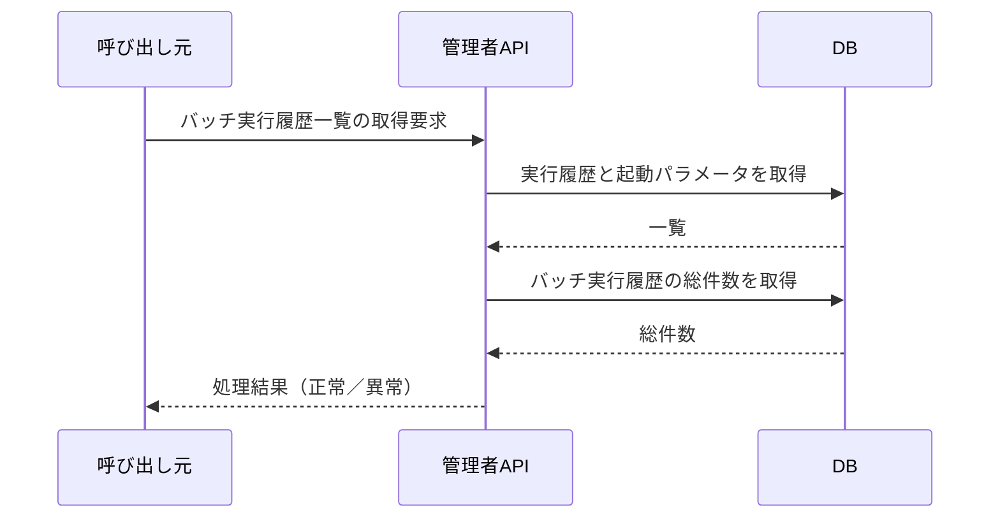
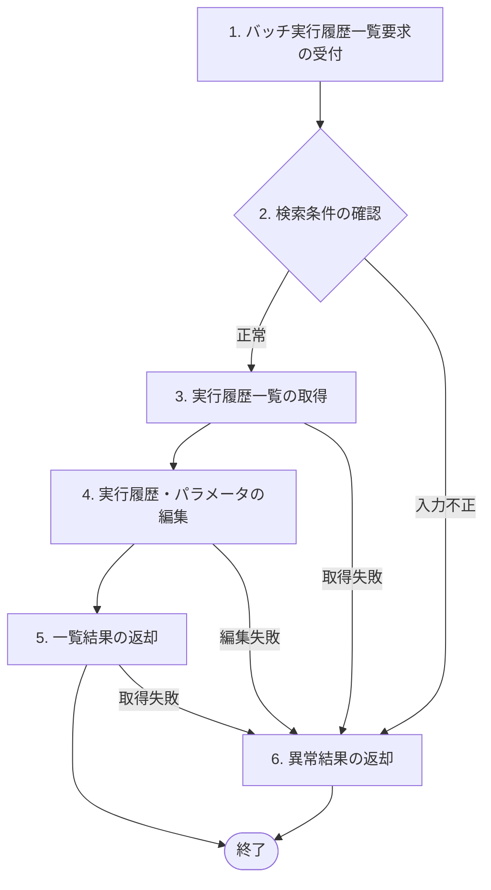

# 設計書 5.11. バッチ実行履歴一覧取得API

## 1. 機能概要

- バッチ実行履歴と起動パラメータをページ単位で取得し、Jobインスタンスごとにまとめた一覧とページング情報を返す。
- 起動パラメータのうち`run.id`は返却対象から除外する。

## 2. 処理概要



## 3. IF仕様

### 3.1. HTTPメソッド

| 項目 | 内容 | 備考 |
| --- | --- | --- |
| HTTPメソッド | `GET` | — |

### 3.2. エンドポイントURL

| 項目 | 内容 | 備考 |
| --- | --- | --- |
| エンドポイントURL | `/api/root/job` | スキーム・ホスト・ポートは実行環境に従う。パス変数はなし。 |

### 3.3. リクエストIF

#### 3.3.1. リクエストヘッダ

| 項目名 | 型 | 必須 | 値 | 備考 |
| --- | --- | --- | --- | --- |
| `Authorization` | `string` | 必須 | Bearer形式のJWT | `Bearer {JWT}`の形式で、ログインAPIのトークンを指定する。認証失敗はフィルターで処理され、本APIの共通エラー形式を保証しない。 |

#### 3.3.2. クエリパラメータ

| 項目名 | 型 | 必須 | 備考 |
| --- | --- | --- | --- |
| `page` | `integer`（`int32`） | 任意 | 未指定・空文字は0。0始まり。0以上999999999以下。 |

#### 3.3.3. JSONボディ

特になし。

### 3.4. レスポンスIF

#### 3.4.1. レスポンスヘッダ

| 項目名 | 型 | 設定条件 | 備考 |
| --- | --- | --- | --- |
| `Content-Type` | `string` | 正常なJSON応答時 | `application/json`。本API固有の追加レスポンスヘッダーはない。 |

#### 3.4.2. JSONボディ

| 応答例 | HTTPステータス | 備考 |
| --- | --- | --- |
| 正常応答 | `200` | 以下の1つ目のJSON例。実行履歴1件、起動パラメータに`d`を持つ場合。 |
| 異常応答 | `400`または`500` | 以下の2つ目のJSONは400の例。条件・メッセージは「4. 処理フロー」の各詳細節に従う。 |

```json
{
  "result": "0",
  "job_list": [
    {
      "job_instance_id": 1,
      "start_time": "2026/11/21 01:00:00",
      "end_time": "2026/11/21 01:00:10",
      "status": "COMPLETED",
      "job_name": "dailyHealthInfoJob",
      "parameter_list": [
        {
          "name": "d",
          "value": "20261120"
        }
      ]
    }
  ],
  "paging": {
    "total_record_num": 1,
    "from_record_num": 1,
    "to_record_num": 1,
    "total_page": 1,
    "current_page_num": 0,
    "record_per_page": 30,
    "can_go_next": false,
    "next_href": "job?page=0",
    "can_go_previous": false,
    "previous_href": "job?page=0",
    "can_go_last": false,
    "last_href": "job?page=0",
    "can_go_first": false,
    "first_href": "job?page=0"
  }
}
```

```json
{
  "result": "1",
  "errors": [
    {
      "message": "page is positive"
    }
  ]
}
```

| 項目名 | 型 | 設定条件 | 備考 |
| --- | --- | --- | --- |
| `result` | `string` | 必須 | 成功は`"0"`、失敗は`"1"`。数値ではない。 |
| `errors` | `array<object>` | 異常時 | エラー情報の配列。正常時は省略する。 |
| `errors[].message` | `string` | 各エラー要素 | エラー詳細。内部エラーコードは付与しない。 |
| `job_list` | `array<object>` | 正常時 | Jobインスタンスごとの一覧。0件なら空配列。 |
| `job_list[].job_instance_id` | `integer`（`int64`） | 各履歴要素 | JobインスタンスID。 |
| `job_list[].start_time`・`end_time` | `string`/`null` | 各履歴要素 | 開始・終了日時。`yyyy/MM/dd HH:mm:ss`。未設定時はnull。 |
| `job_list[].status` | `string`/`null` | 各履歴要素 | DBの実行状態。例: `COMPLETED`、`FAILED`。 |
| `job_list[].job_name` | `string`/`null` | 各履歴要素 | Job名。 |
| `job_list[].parameter_list` | `array<object>` | パラメータがある場合 | `run.id`以外の起動パラメータ。対象がなければ項目自体を省略する。 |
| `job_list[].parameter_list[].name` | `string`/`null` | 各パラメータ要素 | パラメータ名。 |
| `job_list[].parameter_list[].value` | `string`/`null` | 各パラメータ要素 | DBに保存された値。数値・日付への型変換は行わない。 |
| `paging` | `object` | 正常時 | 実行履歴の総件数から作成するページング情報。 |
| `paging.total_record_num` | `integer`（`int64`） | 正常時 | 実行履歴の総件数。 |
| `paging.from_record_num` | `integer`（`int64`） | 正常時 | 表示開始番号。 |
| `paging.to_record_num` | `integer`（`int64`） | 正常時 | 表示終了番号。 |
| `paging.total_page` | `integer`（`int64`） | 正常時 | 総ページ数。 |
| `paging.current_page_num` | `integer`（`int32`） | 正常時 | 0始まりの要求ページ。 |
| `paging.record_per_page` | `integer`（`int32`） | 正常時 | 1ページの設定件数。 |
| `paging.can_go_next` | `boolean` | 正常時 | 次ページへの遷移可否。 |
| `paging.can_go_previous` | `boolean` | 正常時 | 前ページへの遷移可否。 |
| `paging.can_go_last` | `boolean` | 正常時 | 最終ページへの遷移可否。 |
| `paging.can_go_first` | `boolean` | 正常時 | 先頭ページへの遷移可否。 |
| `paging.next_href` | `string` | 正常時 | 次ページのリンク。 |
| `paging.previous_href` | `string` | 正常時 | 前ページのリンク。 |
| `paging.last_href` | `string` | 正常時 | 最終ページのリンク。 |
| `paging.first_href` | `string` | 正常時 | 先頭ページのリンク。 |

## 4. 処理フロー



| 処理順 | 処理概要 | 処理詳細 | 関連項番 |
| --- | --- | --- | --- |
| 1 | バッチ実行履歴一覧要求の受付 | Bearer認証を経て一覧要求を受け付ける。認証失敗はフィルター側で終了する。 | 4.3.1 |
| 2 | 検索条件の確認 | pageを検証してページ条件を作成する。省略時は0とし、不正なら検索へ進まない。 | 4.1.1、4.5.1 |
| 3 | 実行履歴一覧の取得 | Job名・起動パラメータと結合して要求ページを検索する。0件も正常な空一覧として扱う。 | 4.2.1、4.5.1 |
| 4 | 実行履歴・パラメータの編集 | ページ内の同じJobインスタンスIDをまとめ、履歴情報とrun.id以外の起動パラメータを応答へ設定する。 | 4.4.1、4.4.2、4.5.2 |
| 5 | 一覧結果の返却 | 実行履歴の総件数からページングを作成し、一覧とともにHTTP 200で返す。要求ページ番号は補正しない。 | 4.2.2、4.5.3 |
| 6 | 異常結果の返却 | 入力不正や検索・編集の失敗は各処理の異常応答で終了する。取得済み行だけの部分成功は返さない。 | 4.1.2、4.3.2、4.4.3、4.5.3 |

### 4.1. 入力チェック

#### 4.1.1. 入力項目・補完条件の確認

| 対象 | チェック | メッセージ |
| --- | --- | --- |
| `page` | 整数に変換できること | `page is type error. value={値}` |
| `page` | 0以上999999999以下 | `page is positive` |

#### 4.1.2. 入力異常時の扱い

| 発生条件 | HTTPステータス | errors[].message | 備考 |
| --- | --- | --- | --- |
| クエリの数値変換失敗 | 400 | `page is type error. value={値}` | `result="1"`と`errors`を返す。Integerの範囲を超える値も対象。 |
| pageが0未満または999999999超過 | 400 | `page is positive` | 検索へ進まず、`result="1"`と`errors`を返す。 |

### 4.2. DB操作

#### 4.2.1. 一覧検索

```sql
SELECT
    BJE.JOB_INSTANCE_ID
    , BJE.START_TIME
    , BJE.END_TIME
    , BJE.STATUS
    , BJI.JOB_NAME
    , BJEP.PARAMETER_NAME
    , BJEP.PARAMETER_VALUE
FROM
    BATCH_JOB_EXECUTION BJE
    LEFT OUTER JOIN BATCH_JOB_INSTANCE BJI
        ON BJE.JOB_INSTANCE_ID = BJI.JOB_INSTANCE_ID
    LEFT OUTER JOIN BATCH_JOB_EXECUTION_PARAMS BJEP
        ON (
            BJE.JOB_EXECUTION_ID = BJEP.JOB_EXECUTION_ID
            AND BJEP.PARAMETER_NAME <> 'run.id'
        )
ORDER BY
    BJE.START_TIME DESC
    , BJE.JOB_INSTANCE_ID ASC
LIMIT
    :offset
    , :pageSize;
```

| 項目 | 設定値 | 備考 |
| --- | --- | --- |
| `:offset` | 要求の`page` × `front.job.page` | 0始まりの要求ページから`Pageable.getOffset()`を算出する。 |
| `:pageSize` | 設定`front.job.page`の1ページ件数 | `Pageable.getPageSize()`を取得し、LIMITへ設定する。 |

#### 4.2.2. ページング総件数

```sql
SELECT
    COUNT(*)
FROM
    BATCH_JOB_EXECUTION;
```

### 4.3. 認証・共通処理

#### 4.3.1. 認証・利用範囲の確認

| 処理 | 内容 | 備考 |
| --- | --- | --- |
| Bearer認証 | 共通フィルターで署名付きJWTを処理する | API固有のロール別権限検査や対象ユーザによる絞り込みは行わない。 |
| フィルター段階の失敗 | フィルター・実行環境の処理に従う | コントローラが返す`result`・`errors`形式の対象外。 |

#### 4.3.2. 共通異常応答・通知

| 処理 | 内容 | 備考 |
| --- | --- | --- |
| コントローラ側の異常応答 | `result="1"`と`errors`を設定する | 各要素の`message`は、入力・DB・編集処理の各節に示す文言。 |
| 例外通知・ログ | 基底コントローラの例外ハンドラーはRoot用Slackへ通知し、サーバログへ出力する | 内部エラーコード・詳細はJSONへ出力しない。 |

### 4.4. 実行履歴・起動パラメータの編集

#### 4.4.1. 実行履歴の集約

| 処理 | 内容 | 備考 |
| --- | --- | --- |
| 集約 | 取得ページ内の同じJobインスタンスIDを1要素へまとめる | 一覧の順序は検索結果の初出順とする。 |
| 履歴情報 | 最初に取得した行のJob名・開始日時・終了日時・状態を設定する | 同じインスタンスの複数実行を取得した場合も、後続行で上書きしない。 |

#### 4.4.2. 起動パラメータの編集

| 処理 | 内容 | 備考 |
| --- | --- | --- |
| パラメータ追加 | 名前・値の少なくとも一方が非nullなら、同じJobインスタンスのparameter_listへ追加する | 後続の実行履歴のパラメータも追加し、重複排除は行わない。 |
| 対象外 | run.idは一覧検索時に除外する | run.idしかない実行やパラメータのない実行も、履歴自体は取得する。 |
| パラメータなし | parameter_listを省略する | 空配列は設定しない。 |

#### 4.4.3. 取得・編集失敗時の扱い

| 処理 | 内容 | 備考 |
| --- | --- | --- |
| 途中の失敗 | 一覧全体を異常終了する | 取得済み要素だけの成功応答は返さない。 |

| 発生条件 | HTTPステータス | errors[].message | 備考 |
| --- | --- | --- | --- |
| パラメータ編集等の例外 | 500 | `unexpected error.` | 最初の行にパラメータがなく、同じインスタンスの後続行にパラメータがある場合は、未初期化の一覧への追加で例外となり得る。 |

### 4.5. 応答編集・ページング

#### 4.5.1. 一覧検索条件の準備

| 順序 | 処理 | 内容 |
| --- | --- | --- |
| 1 | ページ条件作成 | 要求ページと`front.job.page`でPageableを作成する。設定値はlocal・devとも30件。 |
| 2 | 実行履歴検索 | 「4.2.1. 一覧検索」を実行する。開始日時降順・JobインスタンスID昇順とし、実行状態・対象日・Job名では絞り込まない。 |

#### 4.5.2. 実行履歴・応答項目の編集

| 順序 | 処理 | 内容 |
| --- | --- | --- |
| 3 | 履歴集約 | 取得した結合行をJobインスタンスIDごとにまとめる。 |
| 4 | 応答編集 | JobインスタンスID・Job名・開始日時・終了日時・状態・起動パラメータを設定する。日時は`yyyy/MM/dd HH:mm:ss`形式で返す。 |

#### 4.5.3. 総件数・ページングの返却

| 順序 | 処理 | 内容 |
| --- | --- | --- |
| 5 | 総件数取得 | BATCH_JOB_EXECUTIONの全件数を取得する。パラメータとの結合やJobインスタンス単位の集約は行わない。 |
| 6 | ページ情報編集 | 0始まりの要求ページ・設定件数・総件数から`paging`を作成する。 |
| 7 | 応答 | HTTP 200、`result="0"`、`job_list`、`paging`を返す。取得結果0件は空配列を返す。 |

| 項目 | 仕様 |
| --- | --- |
| 一覧と総件数の単位 | 一覧SQLのLIMITは結合行へ適用し、応答はJobインスタンス単位で集約する。総件数は実行履歴の件数のため、一覧の要素数とは一致しない場合がある。 |
| ページ境界 | 同じJobインスタンスが複数ページに現れる場合や、1ページでは起動パラメータが揃わない場合がある。 |
| 表示範囲 | 総件数0またはOFFSETが総件数以上なら表示範囲は0〜0。結合行が増える場合は、この範囲でも一覧が空とは限らない。 |
| ページ番号 | 要求ページを実在範囲へ補正しない。OFFSETが結合結果の行数以上なら空の一覧となる。 |
| 総ページ数 | 実行履歴の総件数をページ件数で切り上げる。0件は0ページ。結合行が多い場合、移動リンクだけでは全行をたどれない場合がある。 |
| リンク | `job?page={0始まりのページ番号}`を設定する。移動不可でもリンク値を設定し、0件時はすべて`job?page=0`とする。 |

**SQL呼び出し時の結果・例外の扱い**

| 発生条件 | HTTPステータス | errors[].message | 備考 |
| --- | --- | --- | --- |
| DB検索等のBaseException | 500 | `application error.` | `result="1"`と`errors`を返す。 |
| DB検索・件数取得等のその他の例外 | 500 | `unexpected error.` | `result="1"`と`errors`を返す。 |
