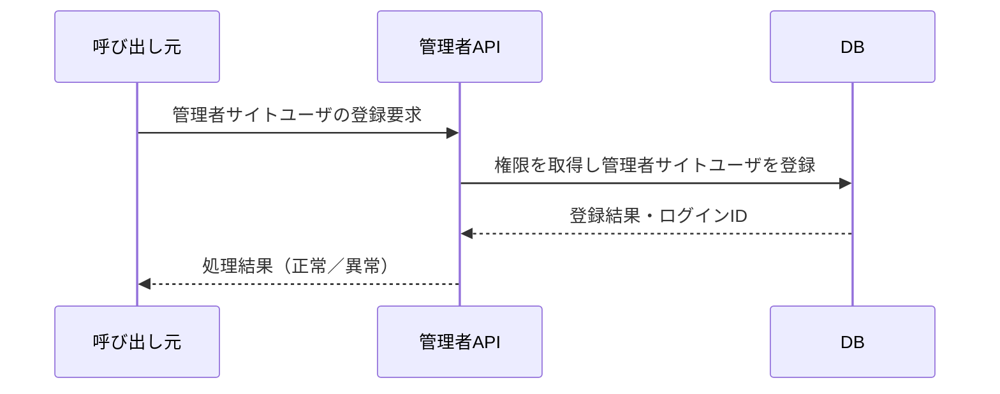
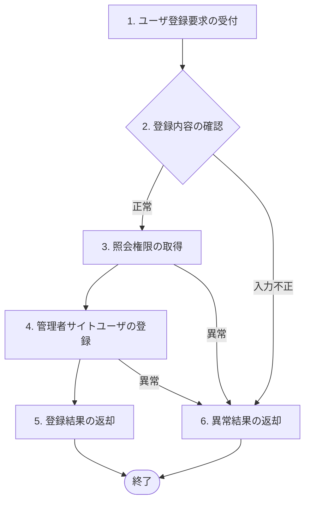

# 設計書 5.2.1. 管理者サイトユーザ登録API

## 1. 機能概要

- 管理者サイト用のログイン情報と権限管理情報を登録し、採番したログインIDを返す。
- 入出力の定義は[OpenAPI入出力仕様](./openapi.yaml)の`rootRegisterAdminUser`を参照する。

## 2. 処理概要



## 3. IF仕様

### 3.1. HTTPメソッド

| 項目 | 内容 | 備考 |
| --- | --- | --- |
| HTTPメソッド | `POST` | — |

### 3.2. エンドポイントURL

| 項目 | 内容 | 備考 |
| --- | --- | --- |
| エンドポイントURL | `/api/root/user` | スキーム・ホスト・ポートは実行環境に従う |
| 認証 | 不要 | セキュリティ設定の公開URLに該当する |
| パス変数 | なし | — |

### 3.3. リクエストIF

#### 3.3.1. リクエストヘッダ

| 項目名 | 型 | 必須 | 値 | 備考 |
| --- | --- | --- | --- | --- |
| `Content-Type` | `string` | 必須 | `application/json` | リクエストボディをJSON形式で送信する。 |
| `Authorization` | `string` | 任意 | Bearer形式のJWT | 指定する場合は、ログインAPIで発行されたJWTを`Bearer {JWT}`の形式で指定する。Bearerトークンの指定は必須ではない。 |

#### 3.3.2. クエリパラメータ

特になし。

#### 3.3.3. JSONボディ

```json
{
  "password": "example-password",
  "conf_password": "example-password"
}
```

| 項目名 | 型 | 必須 | 備考 |
| --- | --- | --- | --- |
| `password` | `string` | 必須 | `null`・空文字・空白のみは不可。文字種・長さの独自制限はない |
| `conf_password` | `string` | 必須 | `password`と完全一致すること |
| 未定義項目 | — | — | 無視する |

### 3.4. レスポンスIF

#### 3.4.1. レスポンスヘッダ

| 項目名 | 型 | 必須 | 備考 |
| --- | --- | --- | --- |
| `Content-Type` | `string` | JSON応答時 | `application/json`。認証フィルターなどの応答は同一形式を保証しない |

#### 3.4.2. JSONボディ

| 応答例 | HTTPステータス | 備考 |
| --- | --- | --- |
| 正常応答 | `200` | 以下の1つ目のJSON例 |
| 異常応答 | `400`または`500` | 以下の2つ目のJSONは400の例。条件・メッセージは「4. 処理フロー」の各詳細節に従う |

```json
{
  "result": "0",
  "seq_login_id": 100
}
```

```json
{
  "result": "1",
  "errors": [
    {
      "message": "password and conf_password is not match"
    }
  ]
}
```

| 項目名 | 型 | 必須 | 備考 |
| --- | --- | --- | --- |
| `result` | `string` | 必須 | 正常は文字列`"0"`、異常は文字列`"1"`。数値ではない |
| `errors` | `array<object>` | 異常時 | エラー情報の配列。正常時は設定しない |
| `errors[].message` | `string`・`null` | 各エラー要素 | メッセージを設定する。外部エラーコードは付与しない |
| `seq_login_id` | `integer`（`int64`） | 正常時 | DBが採番したログインID。異常時は省略する |

## 4. 処理フロー



| 処理順 | 処理概要 | 処理詳細 | 関連項番 |
| --- | --- | --- | --- |
| 1 | ユーザ登録要求の受付 | 公開URLへの登録要求を受け付ける。本APIの呼び出しにBearer認証は必須としない。 | 4.5.1 |
| 2 | 登録内容の確認 | 必須項目とパスワードの一致を確認する。入力不正なら登録を開始しない。 | 4.1.1 |
| 3 | 照会権限の取得 | 有効な権限マスタのキャッシュ、またはDBの`DELETE_FLAG = false`の権限一覧から照会権限を取得し、登録する権限を決定する。 | 4.2.1、4.3.1 |
| 4 | 管理者サイトユーザの登録 | 権限管理・権限詳細・ログイン情報を同一トランザクションで登録し、ログインIDを採番する。成功時は確定し、途中例外は全登録を取り消す。 | 4.2.2、4.3.2、4.4 |
| 5 | 登録結果の返却 | 成功結果と採番したログインIDをHTTP 200で返す。 | 4.3.3 |
| 6 | 異常結果の返却 | 入力不正は400で終了する。登録処理中の例外はロールバックして400を返し、その他の例外は共通処理に従う。 | 4.1.2、4.4、4.5.2 |

### 4.1. 入力チェック

#### 4.1.1. 入力項目・補完条件の確認

| 順序 | 処理 | 内容・失敗時の扱い |
| --- | --- | --- |
| 1 | 必須チェック | パスワード未設定は`password is required`、確認用未設定は`conf_password is required`。HTTP `400`で検出した項目エラーを返す |
| 2 | 一致確認 | 不一致はHTTP `400`、`password and conf_password is not match`を返す |

#### 4.1.2. 入力異常時の扱い

| 発生条件 | HTTPステータス | `errors[].message`・扱い |
| --- | --- | --- |
| 項目検証エラー | `400` | 「4.1. 入力チェック」のメッセージを返す |
| パスワード不一致 | `400` | `password and conf_password is not match` |
| 上記で処理しないJSON読み込みエラー | `500` | `unexpected error.` |

### 4.2. DB操作
#### 4.2.1. 権限マスタ検索

```sql
SELECT
    *
FROM
    ROOT_ROLE_MT
WHERE
    DELETE_FLAG = false;
```


#### 4.2.2. 登録値

```sql
INSERT INTO
    ROOT_USER_ROLE_MNG_MT (
        SEQ_ROOT_USER_ROLE_MNG_MT_ID
        , REG_DATE
        , UPDATE_DATE
    )
VALUES (
    NULL
    , :now
    , :now
);

INSERT INTO
    ROOT_USER_ROLE_DETAIL_MT (
        SEQ_ROOT_USER_ROLE_DETAIL_MT_ID
        , SEQ_ROOT_USER_ROLE_MNG_MT_ID
        , SEQ_ROOT_ROLE_MT_ID
        , REG_DATE
        , UPDATE_DATE
    )
VALUES (
    NULL
    , :roleManagementId
    , :referenceRoleId
    , :now
    , :now
);

INSERT INTO
    ROOT_LOGIN_INFO (
        SEQ_ROOT_LOGIN_INFO_ID
        , PASSWORD
        , PASSWORD_EXPIRE
        , SEQ_ROOT_USER_ROLE_MNG_MT_ID
        , REMARKS
        , DELETE_FLAG
        , REG_DATE
        , UPDATE_DATE
    )
VALUES (
    NULL
    , :passwordHash
    , :passwordExpire
    , :roleManagementId
    , NULL
    , FALSE
    , :now
    , :now
);
```

| 項目 | 設定値 | 備考 |
| --- | --- | --- |
| `:now` | 各CRUD呼び出し時のシステム日時 | DB共通処理で登録日時・更新日時を設定する。 |
| `:roleManagementId` | 今回登録した権限管理EntityのID | 権限詳細とログイン情報の権限管理IDに設定する。 |
| `:referenceRoleId` | 権限マスタ一覧から選択した照会権限のID | `ROLE=01`に該当する先頭行の権限マスタID。 |
| `:passwordHash` | 要求の`password`を空saltでSHA-256ハッシュ化した値 | `PASSWORD`に設定する。 |
| `:passwordExpire` | 登録処理時のシステム日付の6か月後 | `DateTimeUtil.addMonth(..., 6)`で算出する。 |

### 4.3. 業務処理・応答生成

#### 4.3.1. 登録準備・照会権限の選択

| 順序 | 処理 | 内容・失敗時の扱い |
| --- | --- | --- |
| 1 | トランザクション開始 | 権限管理・権限詳細・ログイン情報の登録をまとめる |
| 2 | 照会権限取得 | 削除されていない権限マスタ一覧から`ROLE='01'`を選び、先頭の1件を使用する。該当なしも登録処理の例外として扱う |

| 処理 | 内容 | 備考 |
| --- | --- | --- |
| 権限マスタ一覧取得 | アプリケーション内に1時間保持する | 初回・期限切れ時にDBから`DELETE_FLAG = false`の行を再検索し、一覧から`ROLE='01'`を選ぶ。 |

#### 4.3.2. 権限・ログイン情報の登録

| 順序 | 処理 | 内容・失敗時の扱い |
| --- | --- | --- |
| 1 | 権限管理登録 | `ROOT_USER_ROLE_MNG_MT`を登録し、採番したIDを取得する |
| 2 | 権限詳細登録 | 権限管理IDと照会権限のマスタIDを関連付ける |
| 3 | ログイン情報登録 | パスワードを空のソルトでSHA-256ハッシュ化し、有効期限をシステム日付の6か月後、削除フラグを`false`に設定する |

| 発生条件 | HTTPステータス | `errors[].message`・扱い |
| --- | --- | --- |
| 権限検索・登録中の例外 | `400` | `data regist error`。「4.4. トランザクション」に従ってロールバックする |

#### 4.3.3. 登録結果の返却

| 順序 | 処理 | 内容・失敗時の扱い |
| --- | --- | --- |
| 1 | 完了 | コミット後、HTTP `200`、`result="0"`と`seq_login_id`を返す |

| 発生条件 | HTTPステータス | `errors[].message`・扱い |
| --- | --- | --- |
| 共通処理へ到達した業務例外 | `500` | `application error.` |
| その他の例外 | `500` | `unexpected error.` |

### 4.4. トランザクション

| トランザクション | 仕様 |
| --- | --- |
| 正常終了 | 3テーブルの登録完了後にコミットする |
| 登録処理中の例外 | ログ出力・Slack通知後にロールバックし、HTTP `400`の`data regist error`を返す |

| 発生条件 | HTTPステータス | `errors[].message`・扱い |
| --- | --- | --- |
| トランザクション内の登録例外 | `400` | `data regist error` |

### 4.5. 認証・通知

#### 4.5.1. 認証・利用範囲の確認

| 認証・通知 | 仕様 |
| --- | --- |
| 認証 | 本APIは公開URLのためBearer認証を必須としない。セッションは作成しない |
| 実行権限 | 認証フィルター内でロール別実行制限や、要求の対象IDとJWT主体の一致確認は行わない |

#### 4.5.2. 共通異常応答・通知

| 認証・通知 | 仕様 |
| --- | --- |
| 例外通知 | 共通例外は基底コントローラでログ出力・Slack通知を行う。HTTPとメッセージは各処理の詳細表に従う |

| 共通応答 | 仕様 |
| --- | --- |
| 結果 | 正常は文字列`"0"`、異常は文字列`"1"` |
| 異常詳細 | `errors`配列の各要素に`message`を設定する。外部エラーコードは付与しない |
| 共通例外 | 基底コントローラでログ出力・Slack通知を行う |
| 認証フィルター | フィルター内の異常はコントローラのJSON応答と同一形式になることを保証しない |
