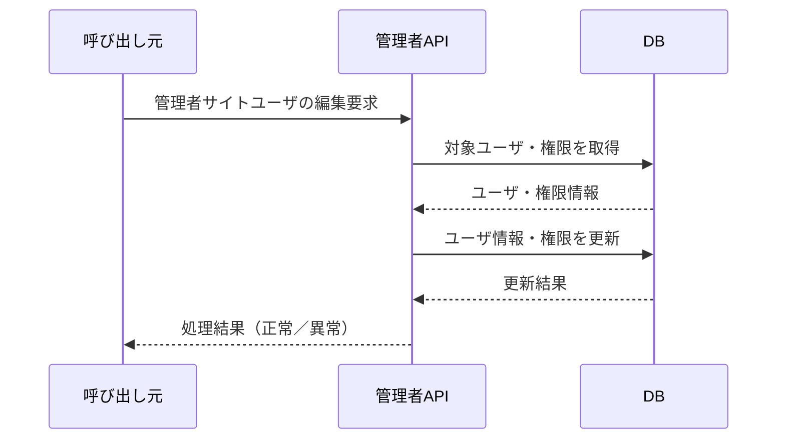
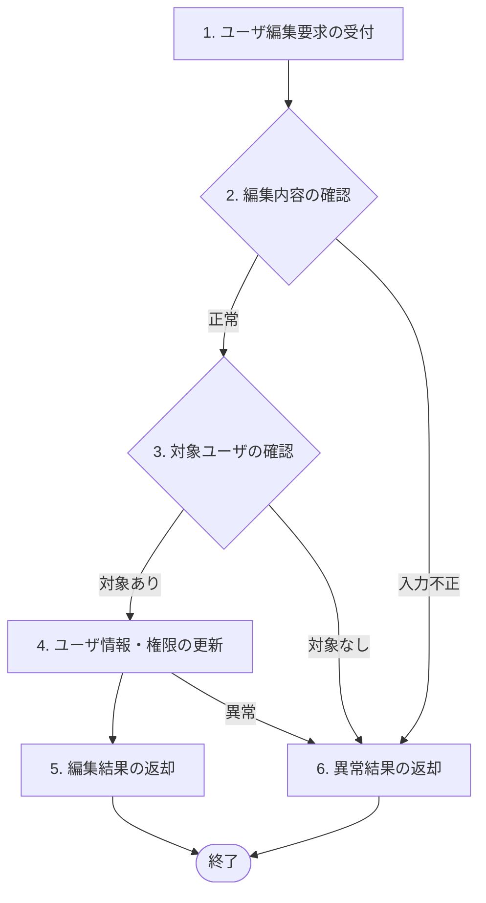

# 設計書 5.2.2. 管理者サイトユーザ編集API

## 1. 機能概要

- 指定した有効な管理者サイトユーザの権限・削除状態・パスワード有効期限・備考を更新する。値のあるパスワードが指定された場合はパスワードも更新する。
- 入出力の定義は[OpenAPI入出力仕様](./openapi.yaml)の`rootEditAdminUser`を参照する。

## 2. 処理概要



## 3. IF仕様

### 3.1. HTTPメソッド

| 項目 | 内容 | 備考 |
| --- | --- | --- |
| HTTPメソッド | `PUT` | — |

### 3.2. エンドポイントURL

| 項目 | 内容 | 備考 |
| --- | --- | --- |
| エンドポイントURL | `/api/root/user/{seq_login_id}` | スキーム・ホスト・ポートは実行環境に従う |

| 項目名 | 必須 | 備考 |
| --- | --- | --- |
| `seq_login_id` | 必須 | 編集するログインID。正数限定の検証はない |

### 3.3. リクエストIF

#### 3.3.1. リクエストヘッダ

| 項目名 | 型 | 必須 | 値 | 備考 |
| --- | --- | --- | --- | --- |
| `Authorization` | `string` | 必須 | Bearer形式のJWT | `Bearer {JWT}`の形式で、ログインAPIで発行されたトークンを指定する |
| `Content-Type` | `string` | 必須 | `application/json` | リクエストボディをJSON形式で送信する。 |

#### 3.3.2. クエリパラメータ

特になし。

#### 3.3.3. JSONボディ

```json
{
  "roles": ["01", "02"],
  "delete_flag": false,
  "password": "new-password",
  "password_expire": "2099/12/31",
  "remarks": "管理担当"
}
```

| 項目名 | 型 | 必須 | 備考 |
| --- | --- | --- | --- |
| `roles` | `array<string>` | 必須 | 非空配列。通常値は`00`：管理者、`01`：照会、`02`：作成。重複値はマスタ一覧の絞り込み時に1件となる。未知コード・`null`要素は権限変換後の処理で失敗する |
| `delete_flag` | `boolean` | 任意 | Javaのプリミティブ型のため、省略時は`false`。`true`は削除状態、`false`は非削除状態へ更新する |
| `password` | `string`・`null` | 任意 | 未指定・`null`・trim後に空の場合は既存パスワードを保持する |
| `password_expire` | `string` | 必須 | `yyyy/MM/dd`形式。サーバの現在日付より後の日付とする |
| `remarks` | `string`・`null` | 任意 | 256文字以下。未指定・`null`は既存値を保持し、空文字は空文字で更新する |
| 未定義項目 | — | — | 無視する |

### 3.4. レスポンスIF

#### 3.4.1. レスポンスヘッダ

| 項目名 | 型 | 必須 | 備考 |
| --- | --- | --- | --- |
| `Content-Type` | `string` | JSON応答時 | `application/json`。認証フィルターなどの応答は同一形式を保証しない |

#### 3.4.2. JSONボディ

| 応答例 | HTTPステータス | 備考 |
| --- | --- | --- |
| 正常応答 | `200` | 以下の1つ目のJSON例 |
| 異常応答 | `400`または`500` | 以下の2つ目のJSONは400の例。条件・メッセージは「4. 処理フロー」の各詳細節に従う |

```json
{
  "result": "0"
}
```

```json
{
  "result": "1",
  "errors": [
    {
      "message": "data illegal error"
    }
  ]
}
```

| 項目名 | 型 | 必須 | 備考 |
| --- | --- | --- | --- |
| `result` | `string` | 必須 | 正常は文字列`"0"`、異常は文字列`"1"`。数値ではない |
| `errors` | `array<object>` | 異常時 | エラー情報の配列。正常時は設定しない |
| `errors[].message` | `string`・`null` | 各エラー要素 | メッセージを設定する。外部エラーコードは付与しない |

## 4. 処理フロー



| 処理順 | 処理概要 | 処理詳細 | 関連項番 |
| --- | --- | --- | --- |
| 1 | ユーザ編集要求の受付 | Bearer認証を経て対象ログインIDと編集内容を受け付ける。認証不成立は共通処理の応答で終了する。 | 4.5.1 |
| 2 | 編集内容の確認 | 権限・有効期限・備考等を検証し、不正な場合は更新しない。 | 4.1.1 |
| 3 | 対象ユーザの確認 | 削除されていないユーザと有効な権限を結合検索する。対象がなければ400で終了する。削除済みユーザの復元は行わない。 | 4.2.1、4.3.1 |
| 4 | ユーザ情報・権限の更新 | 要求に従って権限詳細を置き換え、ログイン情報を同一トランザクションで更新する。途中失敗は変更を取り消す。パスワードは指定時のみ変更する。 | 4.2.2、4.2.3、4.3.2、4.3.3、4.4 |
| 5 | 編集結果の返却 | 更新を確定し、HTTP 200と成功結果を返す。 | 4.3.4、4.4 |
| 6 | 異常結果の返却 | 入力不正・対象なしは更新せず終了する。更新中の例外はロールバックし、各処理に定める異常応答を返す。 | 4.1.2、4.3.1、4.4、4.5.2 |

### 4.1. 入力チェック

#### 4.1.1. 入力項目・補完条件の確認

| 対象・処理 | 条件 | エラーメッセージ・扱い |
| --- | --- | --- |
| `roles` | `null`・空配列ではないこと | `roles is required` |
| `delete_flag` | `@Required`を付与しているがプリミティブ型は常に値を持つ | 省略を必須エラーとして検出しない |
| `password_expire` | 必須 | `password_expire is required` |
| `password_expire` | 現在日付より後 | `password_expire is must be future`。当日は許可しない |
| `remarks` | 256文字以下 | `remarks is less equal 256 byte`。長さはUTF-16コード単位で判定する |

#### 4.1.2. 入力異常時の扱い

| 発生条件 | HTTPステータス | `errors[].message`・扱い |
| --- | --- | --- |
| 項目検証失敗 | `400` | 「4.1. 入力チェック」のメッセージを検出分返す |
| 日付文字列の解釈に失敗し、共通処理で日付形式エラーと識別 | `400` | `date format error. Please use yyyy/MM/dd.` |
| パス変数の数値変換失敗 | `400` | `seq_login_id is type error. value={値}` |
| 上記で識別しないJSON読み込み失敗 | `500` | `unexpected error.` |

### 4.2. DB操作
#### 4.2.1. 対象ユーザ検索

```sql
SELECT
    LI.*
    , URM.SEQ_ROOT_USER_ROLE_MNG_MT_ID
    , URD.SEQ_ROOT_USER_ROLE_DETAIL_MT_ID
    , RM.ROLE_NAME
    , RM.ROLE
FROM
    ROOT_LOGIN_INFO LI
    JOIN ROOT_USER_ROLE_MNG_MT URM
        ON URM.SEQ_ROOT_USER_ROLE_MNG_MT_ID = LI.SEQ_ROOT_USER_ROLE_MNG_MT_ID
    JOIN ROOT_USER_ROLE_DETAIL_MT URD
        ON URD.SEQ_ROOT_USER_ROLE_MNG_MT_ID = URM.SEQ_ROOT_USER_ROLE_MNG_MT_ID
    JOIN ROOT_ROLE_MT RM
        ON RM.SEQ_ROOT_ROLE_MT_ID = URD.SEQ_ROOT_ROLE_MT_ID
WHERE
    LI.SEQ_ROOT_LOGIN_INFO_ID = :seqLoginId
    AND LI.DELETE_FLAG = false
    AND RM.DELETE_FLAG = false
ORDER BY
    RM.SEQ_ROOT_ROLE_MT_ID;
```

| 項目 | 設定値 | 備考 |
| --- | --- | --- |
| `:seqLoginId` | パスの`seq_login_id` | 対象ログイン情報と権限の結合検索へ渡す。 |

#### 4.2.2. 権限置き換え・ログイン情報更新

```sql
DELETE FROM
    ROOT_USER_ROLE_DETAIL_MT
WHERE
    SEQ_ROOT_USER_ROLE_MNG_MT_ID = :roleManagementId;
```

| 項目 | 設定値 | 備考 |
| --- | --- | --- |
| `:roleManagementId` | 対象検索の先頭行から取得した権限管理ID | 既存の権限詳細を削除する対象ID。 |

#### 4.2.3. ログイン情報の更新文

```sql
UPDATE
    ROOT_LOGIN_INFO
SET
    SEQ_ROOT_LOGIN_INFO_ID = :seqLoginId
    , SEQ_ROOT_USER_ROLE_MNG_MT_ID = :roleManagementId
    , PASSWORD_EXPIRE = :passwordExpire
    , DELETE_FLAG = :deleteFlag
    , UPDATE_DATE = :now
WHERE
    SEQ_ROOT_LOGIN_INFO_ID = :seqLoginId;
```

| 項目 | 設定値 | 備考 |
| --- | --- | --- |
| `:seqLoginId` | 対象検索の先頭行から取得したログインID | 更新EntityのIDと更新条件に設定する。 |
| `:roleManagementId` | 対象検索の先頭行から取得した権限管理ID | ログイン情報が保持する既存の権限管理ID。 |
| `:passwordExpire` | 要求JSONの`password_expire` | 要求を日付型に変換した値。 |
| `:deleteFlag` | 要求JSONの`delete_flag`に対応する真偽値 | 省略時は要求DTOの初期値`false`を使用する。 |
| `:now` | 各CRUD呼び出し時のシステム日時 | DB共通処理で登録日時・更新日時を設定する。 |

### 4.3. 業務処理・応答生成

#### 4.3.1. 対象ユーザ・権限の確認

| 順序 | 処理 | 内容 |
| --- | --- | --- |
| 1 | 対象検索 | ログイン情報・権限マスタの双方を`DELETE_FLAG = false`で結合検索し、先頭行のログイン情報・権限管理IDを使用する |

| 対象・処理 | 条件 | エラーメッセージ・扱い |
| --- | --- | --- |
| 対象検索 | 有効なログイン情報・有効な権限の結合検索結果が1件以上 | 0件はHTTP `400`、`data illegal error` |

| 発生条件 | HTTPステータス | `errors[].message`・扱い |
| --- | --- | --- |
| 対象結合データなし（削除済みユーザ・有効な権限なしを含む） | `400` | `data illegal error` |
| トランザクション開始前の検索で業務例外 | `500` | `application error.` |
| トランザクション開始前の検索でその他の例外 | `500` | `unexpected error.` |

#### 4.3.2. 権限詳細の置き換え

| 順序 | 処理 | 内容 |
| --- | --- | --- |
| 1 | トランザクション開始 | 権限詳細の置き換えとログイン情報の更新をまとめる |
| 2 | 権限詳細削除 | 対象の権限管理IDに属する権限詳細を物理削除する |
| 3 | 権限マスタ取得 | `DELETE_FLAG = false`の権限を1時間キャッシュするマスタ一覧から、要求の`roles`に含まれる行を選ぶ |
| 4 | 権限詳細登録 | 取得した有効なマスタ行ごとに権限詳細を作成する。要求した権限がすべて削除済みまたは該当なしで取得結果が0件の場合も独自のエラー判定は行わず、権限詳細を空のまま後続のログイン情報更新へ進む |

| テーブル・項目 | 更新内容 |
| --- | --- |
| `ROOT_USER_ROLE_DETAIL_MT` | 権限管理IDと要求に対応する権限マスタIDで再登録する。登録日時・更新日時はシステム日時 |
| 原子性 | 権限詳細削除・登録とログイン情報更新を同一トランザクションで実施する |

| 発生条件 | HTTPステータス | `errors[].message`・扱い |
| --- | --- | --- |
| 権限詳細の削除・登録、ログイン情報の更新中の例外 | `400` | `data update error`。「4.4. トランザクション」に従ってロールバックする |

#### 4.3.3. ログイン情報の更新

| 順序 | 処理 | 内容 |
| --- | --- | --- |
| 1 | ログイン情報更新 | 有効期限・備考・削除状態を設定し、値のあるパスワードは空のソルトでSHA-256ハッシュ化する |

| テーブル・項目 | 更新内容 |
| --- | --- |
| `ROOT_LOGIN_INFO.PASSWORD` | パスワードに値がある場合だけ更新する |
| `ROOT_LOGIN_INFO.PASSWORD_EXPIRE` | 要求の有効期限 |
| `ROOT_LOGIN_INFO.DELETE_FLAG` | 要求の真偽値。省略時も`false`へ更新する |
| `ROOT_LOGIN_INFO.REMARKS` | 非`null`の場合だけ更新する |
| `ROOT_LOGIN_INFO.SEQ_ROOT_USER_ROLE_MNG_MT_ID` | 検索した既存の権限管理ID |
| `ROOT_LOGIN_INFO.UPDATE_DATE` | DB共通更新処理でシステム日時を設定する |
| 更新条件 | `SEQ_ROOT_LOGIN_INFO_ID=:seqLoginId`。非`null`項目だけを更新する |

| 設定項目 | 値・条件 |
| --- | --- |
| `PASSWORD` | 値のあるパスワードが指定された場合、ハッシュ値を更新句へ追加する |
| `REMARKS` | 要求値が非nullの場合、更新句へ追加する |
| その他の項目 | 上記SQLは必ず値を持つ項目の代表例。元の登録日時は更新しない |

#### 4.3.4. 編集結果の返却

| 順序 | 処理 | 内容 |
| --- | --- | --- |
| 1 | 完了 | コミット後、HTTP `200`、`result="0"`を返す |

| 発生条件 | HTTPステータス | `errors[].message`・扱い |
| --- | --- | --- |
| 共通処理へ到達した業務例外 | `500` | `application error.` |
| その他の例外 | `500` | `unexpected error.` |

### 4.4. トランザクション

| 項目 | 仕様 |
| --- | --- |
| 処理単位 | 権限詳細の削除・再登録とログイン情報更新を同一トランザクションで行う |
| 対象検索 | トランザクション開始前に行う |
| 権限値の変換 | 未知コードはnullへ変換され、後続のgetValue呼び出し時に例外となるためロールバックする |

| 対象・処理 | 条件 | エラーメッセージ・扱い |
| --- | --- | --- |
| `roles`の要素 | 既知の権限コードへ変換できること | 未知コードは`null`へ変換され、後続の権限値取得時に例外となる。HTTP `400`、`data update error`でロールバックする |

| 発生条件 | HTTPステータス | `errors[].message`・扱い |
| --- | --- | --- |
| トランザクション内の例外 | `400` | ログ・Slack通知後にロールバックし、`data update error` |

### 4.5. 認証・通知

#### 4.5.1. 認証・利用範囲の確認

| 認証・通知 | 仕様 |
| --- | --- |
| 認証 | 本APIはBearer認証を行う。セッションは作成しない |
| 実行権限 | 認証フィルター内でロール別実行制限や、要求の対象IDとJWT主体の一致確認は行わない |

| 共通仕様 | 内容 |
| --- | --- |
| フィルターの異常 | 認証フィルター内の異常は上記JSON形式を保証しない |

#### 4.5.2. 共通異常応答・通知

| 認証・通知 | 仕様 |
| --- | --- |
| 例外通知 | 共通例外は基底コントローラでログ出力・Slack通知を行う。HTTPとメッセージは各処理の詳細表に従う |

| 共通仕様 | 内容 |
| --- | --- |
| 応答 | 正常は文字列`result="0"`。異常は文字列`result="1"`と`errors`配列の`message` |
| 通知 | 共通例外は基底コントローラでログ出力・Slack通知を行う |
