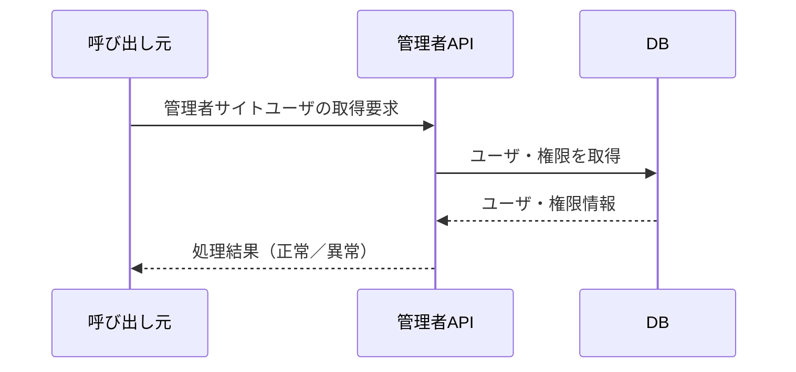
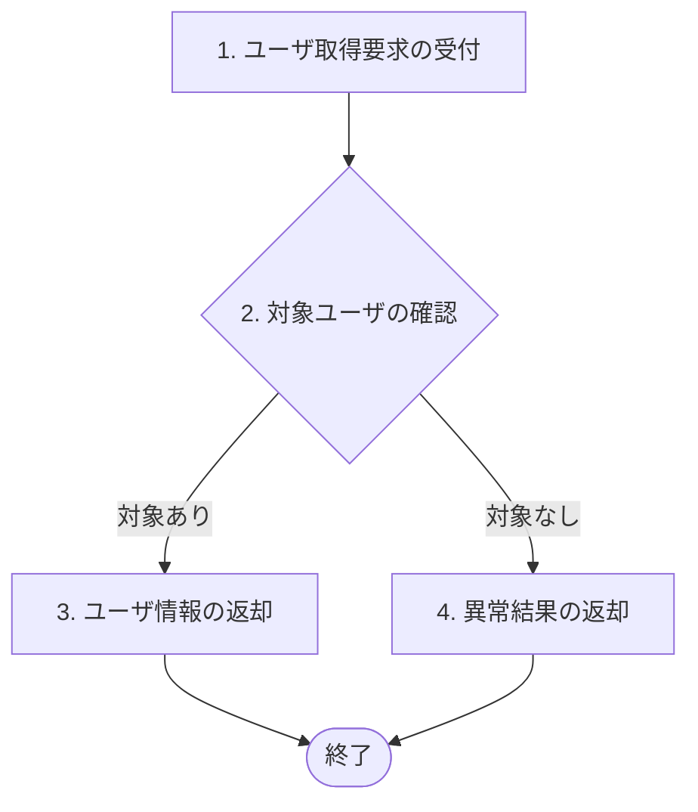

# 設計書 5.2.3. 管理者サイトユーザ取得API

## 1. 機能概要

- ログインIDに対応する管理者サイトユーザ情報と権限一覧を取得する。
- 入出力の定義は[OpenAPI入出力仕様](./openapi.yaml)の`rootGetAdminUser`を参照する。

## 2. 処理概要



## 3. IF仕様

### 3.1. HTTPメソッド

| 項目 | 内容 | 備考 |
| --- | --- | --- |
| HTTPメソッド | `GET` | — |

### 3.2. エンドポイントURL

| 項目 | 内容 | 備考 |
| --- | --- | --- |
| エンドポイントURL | `/api/root/user/{seq_login_id}` | スキーム・ホスト・ポートは実行環境に従う |

| 項目名 | 必須 | 備考 |
| --- | --- | --- |
| `seq_login_id` | 必須 | 取得するログインID。正数限定の検証はない |

### 3.3. リクエストIF

#### 3.3.1. リクエストヘッダ

| 項目名 | 型 | 必須 | 値 | 備考 |
| --- | --- | --- | --- | --- |
| `Authorization` | `string` | 必須 | Bearer形式のJWT | `Bearer {JWT}`の形式で、ログインAPIで発行されたトークンを指定する |

#### 3.3.2. クエリパラメータ

特になし。

#### 3.3.3. JSONボディ

特になし。

### 3.4. レスポンスIF

#### 3.4.1. レスポンスヘッダ

| 項目名 | 型 | 必須 | 備考 |
| --- | --- | --- | --- |
| `Content-Type` | `string` | JSON応答時 | `application/json`。認証フィルターなどの応答は同一形式を保証しない |

#### 3.4.2. JSONボディ

| 応答例 | HTTPステータス | 備考 |
| --- | --- | --- |
| 正常応答 | `200` | 以下の1つ目のJSON例 |
| 異常応答 | `400`または`500` | 以下の2つ目のJSONは400の例。条件・メッセージは「4. 処理フロー」の各詳細節に従う |

```json
{
  "result": "0",
  "seq_login_id": 100,
  "roles": [
    {
      "label": "照会権限",
      "value": "01"
    }
  ],
  "delete_flag": "0",
  "password_expire": "2099/12/31",
  "remarks": "管理担当"
}
```

```json
{
  "result": "1",
  "errors": [
    {
      "message": "user data is not found"
    }
  ]
}
```

| 項目名 | 型 | 必須 | 備考 |
| --- | --- | --- | --- |
| `result` | `string` | 必須 | 正常は文字列`"0"`、異常は文字列`"1"`。数値ではない |
| `errors` | `array<object>` | 異常時 | エラー情報の配列。正常時は設定しない |
| `errors[].message` | `string`・`null` | 各エラー要素 | メッセージを設定する。外部エラーコードは付与しない |
| `seq_login_id` | `integer`（`int64`） | 正常時 | パスのログインID |
| `roles` | `array<object>` | 正常時 | 権限マスタIDの昇順 |
| `roles[].label` | `string` | 任意 | 権限名。値が`null`なら項目を省略する |
| `roles[].value` | `string` | 任意 | 権限コード。値が`null`なら項目を省略する |
| `delete_flag` | `string` | 正常時 | 非削除は`"0"`、削除済みは`"1"`。JSON真偽値ではない |
| `password_expire` | `string` | 任意 | `yyyy/MM/dd`形式。DB値が`null`なら省略する |
| `remarks` | `string` | 任意 | DB値が`null`なら省略する。パスワードは応答に含めない |

## 4. 処理フロー



| 処理順 | 処理概要 | 処理詳細 | 関連項番 |
| --- | --- | --- | --- |
| 1 | ユーザ取得要求の受付 | Bearer認証後、パスのログインIDを受け付ける。認証失敗やID不正は検索へ進めない。 | 4.1、4.4.1 |
| 2 | 対象ユーザの確認 | ユーザと権限を結合検索する。削除状態で除外せず、対象なしの場合は400で終了する。 | 4.2.1、4.3.1 |
| 3 | ユーザ情報の返却 | ユーザ情報と権限選択肢を編集し、HTTP 200で返す。パスワードは含めない。 | 4.3.2、4.3.3 |
| 4 | 異常結果の返却 | 対象がない場合は400を返す。その他の例外は共通処理に従う。 | 4.3.3、4.4.2 |

### 4.1. 入力チェック

追加の項目検証は特になし。パス変数は符号付き64ビット整数として受け付ける。

| 発生条件 | HTTPステータス | `errors[].message`・扱い |
| --- | --- | --- |
| パス変数の数値変換失敗 | `400` | `seq_login_id is type error. value={値}` |

### 4.2. DB操作
#### 4.2.1. ユーザ情報検索

```sql
SELECT
    LI.*
    , URM.SEQ_ROOT_USER_ROLE_MNG_MT_ID
    , URD.SEQ_ROOT_USER_ROLE_DETAIL_MT_ID
    , RM.ROLE_NAME
    , RM.ROLE
FROM
    ROOT_LOGIN_INFO LI
    JOIN ROOT_USER_ROLE_MNG_MT URM
        ON URM.SEQ_ROOT_USER_ROLE_MNG_MT_ID = LI.SEQ_ROOT_USER_ROLE_MNG_MT_ID
    JOIN ROOT_USER_ROLE_DETAIL_MT URD
        ON URD.SEQ_ROOT_USER_ROLE_MNG_MT_ID = URM.SEQ_ROOT_USER_ROLE_MNG_MT_ID
    JOIN ROOT_ROLE_MT RM
        ON RM.SEQ_ROOT_ROLE_MT_ID = URD.SEQ_ROOT_ROLE_MT_ID
WHERE
    LI.SEQ_ROOT_LOGIN_INFO_ID = :seqLoginId
ORDER BY
    RM.SEQ_ROOT_ROLE_MT_ID;
```

| 項目 | 設定値 | 備考 |
| --- | --- | --- |
| `:seqLoginId` | パスの`seq_login_id` | 取得対象のログインID。 |

### 4.3. 業務処理・応答生成

#### 4.3.1. 要求受付・対象ユーザの確認

| 順序 | 処理 | 内容 |
| --- | --- | --- |
| 1 | 要求受付 | パスのログインIDを符号付き64ビット整数として受け付ける |
| 2 | 結合検索 | 「4.2. DB操作」の条件でユーザ情報と権限を取得する |
| 3 | 存在判定 | 0件の場合はHTTP `400`、`user data is not found`を返す |

#### 4.3.2. ユーザ・権限の応答編集

| 順序 | 処理 | 内容 |
| --- | --- | --- |
| 4 | 応答編集 | 先頭行の有効期限・備考を使用し、削除フラグを文字列`"0"`または`"1"`へ変換する |
| 5 | 権限編集 | 結合した全行から`label`に権限名、`value`に権限コードを設定する |

#### 4.3.3. 取得結果の返却・異常時の扱い

| 順序 | 処理 | 内容 |
| --- | --- | --- |
| 6 | 正常応答 | HTTP `200`、`result="0"`と取得情報を返す |

| 応答項目 | 設定内容 |
| --- | --- |
| `seq_login_id` | 要求のログインID |
| `roles` | 権限名と権限コードの配列。権限コードは`00`・`01`・`02`等のマスタ値 |
| `delete_flag` | 非削除は`"0"`、削除済みは`"1"` |
| `password_expire` | `yyyy/MM/dd`形式。値が`null`なら項目を省略する |
| `remarks` | 既存の備考。値が`null`なら項目を省略する |
| パスワード | 応答には含めない |

| 発生条件 | HTTPステータス | `errors[].message`・扱い |
| --- | --- | --- |
| 共通処理へ到達した業務例外 | `500` | `application error.` |
| その他の例外 | `500` | `unexpected error.` |

**SQL呼び出し時の結果・例外の扱い**

| 発生条件 | HTTPステータス | `errors[].message`・扱い |
| --- | --- | --- |
| 結合検索結果が0件 | `400` | `user data is not found` |
| DB検索で業務例外 | `500` | `application error.` |
| DB検索でその他の例外 | `500` | `unexpected error.` |

### 4.4. 認証・通知

#### 4.4.1. 認証・利用範囲の確認

| 認証・通知 | 仕様 |
| --- | --- |
| 認証 | 本APIはBearer認証を行う。セッションは作成しない |
| 実行権限 | 認証フィルター内でロール別実行制限や、要求の対象IDとJWT主体の一致確認は行わない |

| 共通仕様 | 内容 |
| --- | --- |
| フィルターの異常 | 認証フィルター内の異常は上記JSON形式を保証しない |

#### 4.4.2. 共通異常応答・通知

| 認証・通知 | 仕様 |
| --- | --- |
| 例外通知 | 共通例外は基底コントローラでログ出力・Slack通知を行う。HTTPとメッセージは各処理の詳細表に従う |

| 共通仕様 | 内容 |
| --- | --- |
| 応答 | 異常は文字列`result="1"`と`errors`配列の`message`。正常時に`errors`は設定しない |
| 通知 | 共通例外は基底コントローラでログ出力・Slack通知を行う |
