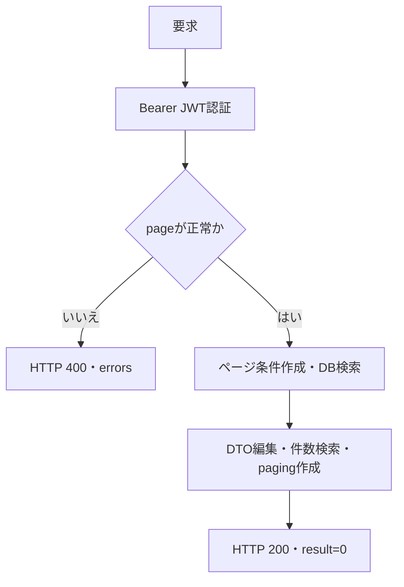
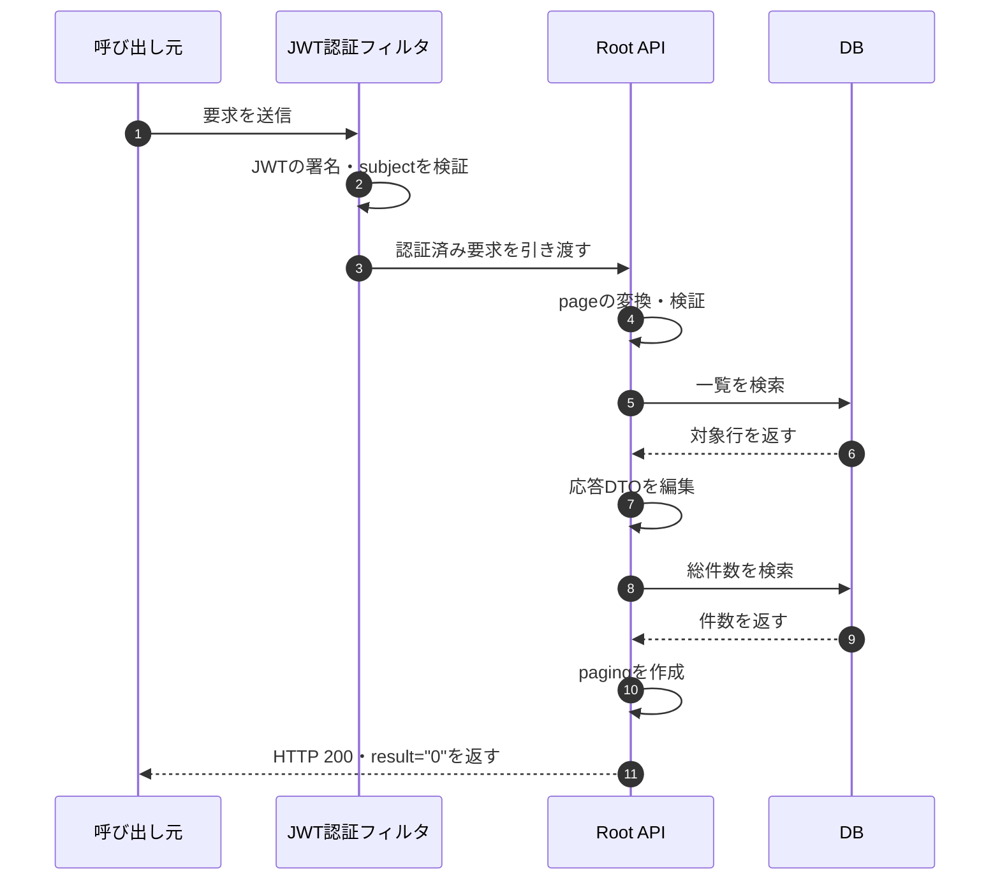

# 設計書 5.3.1. アカウント情報一覧取得API

## 1. 機能概要

- 削除されていない健康管理アプリのユーザと、健康情報ファイル設定をページ単位で取得する。管理者サイト用のログインユーザを扱うAPIとは別である。
- 入出力の機械可読定義は[OpenAPI入出力仕様](./openapi.yaml)の`rootListAppUsers`を参照する。


- [AppUserListApiController.java](../../../ha-root/src/main/java/jp/co/ha/root/contents/appuser/controller/AppUserListApiController.java)
- [AppUserListApiRequest.java](../../../ha-root/src/main/java/jp/co/ha/root/contents/appuser/request/AppUserListApiRequest.java)
- [AppUserListApiResponse.java](../../../ha-root/src/main/java/jp/co/ha/root/contents/appuser/response/AppUserListApiResponse.java)
- [AppUserServiceImpl.java](../../../ha-root/src/main/java/jp/co/ha/root/contents/appuser/service/AppUserServiceImpl.java)
- [UserSearchServiceImpl.java](../../../ha-business/src/main/java/jp/co/ha/business/db/crud/read/impl/UserSearchServiceImpl.java)
- [CompositeUserMapper.xml](../../../ha-db/src/main/resources/jp/co/ha/db/mapper/custom/CompositeUserMapper.xml)
- [DataBaseCommonAspect.java](../../../ha-db/src/main/java/jp/co/ha/db/aspect/DataBaseCommonAspect.java)
- [BaseRootApiController.java](../../../ha-root/src/main/java/jp/co/ha/root/base/BaseRootApiController.java)
- [WebSecurityConfig.java](../../../ha-root/src/main/java/jp/co/ha/root/config/WebSecurityConfig.java)
- [JWTAuthorizationFilter.java](../../../ha-root/src/main/java/jp/co/ha/root/config/JWTAuthorizationFilter.java)

## 2. 処理概要



## 3. IF仕様

### 3.1. HTTPメソッド

| 項目 | 内容 | 備考 |
| --- | --- | --- |
| HTTPメソッド | `GET` | 正常時はHTTP 200でJSONを返す。 |

### 3.2. エンドポイントURL

| 項目 | 内容 | 備考 |
| --- | --- | --- |
| エンドポイントURL | `/api/root/account` | スキーム・ホスト・ポートは実行環境に従う。 |

### 3.3. リクエストIF

#### 3.3.1. リクエストヘッダ

| 項目名 | 型 | 必須 | 値 | 備考 |
| --- | --- | --- | --- | --- |
| `Authorization` | `string` | 必須 | Bearer形式のJWT | `Bearer {JWT}`の形式で、ログインAPIで発行された署名付きJWTを使用する。 |

#### 3.3.2. クエリパラメータ

| 項目名 | 型 | 必須 | 備考 |
| --- | --- | --- | --- |
| `page` | `integer` | 任意 | 省略時0。0始まり。Integerへ変換後、@Decimalで0以上999999999以下（両端含む）を検証する。 |

#### 3.3.3. JSONボディ

特になし。

### 3.4. レスポンスIF

#### 3.4.1. レスポンスヘッダ

| 項目名 | 型 | 必須 | 備考 |
| --- | --- | --- | --- |
| `Content-Type` | `string` | 必須 | 正常JSON応答では`application/json`。このAPIでは新規JWTを発行するAuthorization応答ヘッダーを設定しない。 |

#### 3.4.2. JSONボディ

```json
{
  "result": "0",
  "account_list": [
    {
      "seq_user_id": 1,
      "mail_address": "user@example.com",
      "delete_flag": "0",
      "password_expire": "2030/12/31",
      "remarks": null,
      "api_key": "sample-api-key",
      "reg_date": "2026/11/11 12:34:56",
      "update_date": "2026/11/11 12:34:56",
      "header_flag": "1",
      "footer_flag": "0",
      "mask_flag": "1",
      "enclosure_char_flag": "0"
    }
  ],
  "paging": {
    "total_record_num": 1,
    "from_record_num": 1,
    "to_record_num": 1,
    "total_page": 1,
    "current_page_num": 0,
    "record_per_page": 10,
    "can_go_next": false,
    "next_href": "account?page=0",
    "can_go_previous": false,
    "previous_href": "account?page=0",
    "can_go_last": false,
    "last_href": "account?page=0",
    "can_go_first": false,
    "first_href": "account?page=0"
  }
}
```

| 項目名 | 型 | 必須 | 備考 |
| --- | --- | --- | --- |
| `result` | `string` | 必須 | 正常は`"0"`、異常は`"1"`。数値ではなく文字列。 |
| `errors` | `array` | 条件付き | エラー情報を設定した場合に出力する。各要素は`message`を持つ。内部エラーコード項目はない。 |
| `errors[].message` | `string` | 条件付き | エラー詳細。入力・DB・外部処理ごとの項で示すメッセージを設定する。 |
| `account_list` | `array` | 正常時 | 取得結果。0件なら空配列。 |
| `paging` | `object` | 正常時 | 総件数・表示範囲・総ページ数・現在ページ・表示件数・移動可否・移動リンク。`current_page_num`は0始まり。 |
| `account_list[].seq_user_id` | `integer` | 要素項目 | ユーザID（int64）。 |
| `account_list[].mail_address` | `string` | 要素項目 | DB共通処理で復号したメールアドレス。 |
| `account_list[].delete_flag` | `string` | 要素項目 | "0"/"1"。一覧の検索条件は未削除のみ。 |
| `account_list[].password_expire` | `string` | 要素項目 | yyyy/MM/dd。 |
| `account_list[].remarks` | `string` | 要素項目 | 備考。nullの場合がある。 |
| `account_list[].api_key` | `string` | 要素項目 | APIキー。マスク処理を行わず応答DTOへコピーする。 |
| `account_list[].reg_date` | `string` | 要素項目 | yyyy/MM/dd HH:mm:ss。 |
| `account_list[].update_date` | `string` | 要素項目 | yyyy/MM/dd HH:mm:ss。 |
| `account_list[].header_flag` | `string` | 要素項目 | "0"/"1"。 |
| `account_list[].footer_flag` | `string` | 要素項目 | "0"/"1"。 |
| `account_list[].mask_flag` | `string` | 要素項目 | "0"/"1"。 |
| `account_list[].enclosure_char_flag` | `string` | 要素項目 | "0"/"1"。 |
| 項目名 | 型 | 必須 | 備考 |
| --- | --- | --- | --- |
| `paging.total_record_num` | `integer` | 正常時 | 総件数。 |
| `paging.from_record_num` | `integer` | 正常時 | 表示開始番号。0件・範囲外は0。 |
| `paging.to_record_num` | `integer` | 正常時 | 表示終了番号。0件・範囲外は0。 |
| `paging.total_page` | `integer` | 正常時 | 総ページ数。 |
| `paging.current_page_num` | `integer` | 正常時 | 0始まりの要求ページ。 |
| `paging.record_per_page` | `integer` | 正常時 | 1ページあたりの設定件数。 |
| `paging.can_go_next` | `boolean` | 正常時 | 次ページへ移動できるか。 |
| `paging.next_href` | `string` | 正常時 | 次ページリンク。移動不可でも値を設定する。 |
| `paging.can_go_previous` | `boolean` | 正常時 | 前ページへ移動できるか。 |
| `paging.previous_href` | `string` | 正常時 | 前ページリンク。移動不可でも値を設定する。 |
| `paging.can_go_last` | `boolean` | 正常時 | 最終ページへ移動できるか。 |
| `paging.last_href` | `string` | 正常時 | 最終ページリンク。 |
| `paging.can_go_first` | `boolean` | 正常時 | 先頭ページへ移動できるか。 |
| `paging.first_href` | `string` | 正常時 | 先頭ページリンク。 |


## 4. 処理フロー



| 番号 | 処理内容 | 関連項番 | 備考 |
| --- | --- | --- | --- |
| 1 | 要求を送信 | `3.3.1` | Authorization付き。 |
| 2 | JWTの署名・subjectを検証 | `4.1` | 成功する認証経路。 |
| 3 | 認証済み要求を引き渡す | `4.1` | 操作固有のロール・対象ユーザ照合なし。 |
| 4 | pageの変換・検証 | `4.1` | 正常入力の経路。 |
| 5 | 一覧を検索 | `4.2` | ページ範囲・ソートを指定。 |
| 6 | 対象行を返す | `4.2` | 0件なら空結果。 |
| 7 | 応答DTOを編集 | `4.3` | 値・ステータス等を変換。 |
| 8 | 総件数を検索 | `4.2` | 一覧とは別のクエリ。 |
| 9 | 件数を返す | `4.2` | 各APIの件数条件。 |
| 10 | pagingを作成 | `4.3` | 要求ページは補正しない。 |
| 11 | HTTP 200・result="0"を返す | `3.4.2` | 一覧とpagingを含む。 |

### 4.1. 入力チェック

| 対象 | ルール | 検証メッセージ・失敗時 |
| --- | --- | --- |
| 認証 | Authorization: Bearer <JWT>で署名とsubjectを検証する。除外URLではないため認証が必要。 | フィルタの共通処理。コントローラのerrors形式は保証しない。 |
| 利用対象 | JWT認証後にこの操作固有のロール別権限検査や、JWTのsubjectと対象ユーザIDを照合する処理は設けない。 | - |
| page | 省略時0。0始まり。Integerへ変換後、@Decimalで0以上999999999以下（両端含む）を検証する。 | page is positive |

要求DTOに追加の検索項目はない。

| 発生条件 | HTTPステータス | 扱い |
| --- | --- | --- |
| Bean Validation | 400 | errors配列に各検証メッセージを設定する。 |
| パス・クエリの型変換 | 400 | <項目名> is type error. value=<入力値>。 |
| JSONの数値・日付変換 | 400または500 | HttpMessageNotReadableExceptionの原因が対象のInvalidFormatExceptionなら400。日付はdate format error. Please use yyyy/MM/dd.、数値はnumber format error. Please use numeric value.。その他は500・unexpected error.。 |
| 認証フィルタ・共通HTTP処理 | 共通処理に従う | 上記のresult/errors形式とは別に扱う。401と固定JSONへ一律に統一する実装はない。 |

入力・認証の例外がコントローラの例外ハンドラーに到達した場合は、ログ出力とROOT向けSlackエラー通知を行う。認証フィルタの例外は同じJSON形式に統一されない。

### 4.2. DB操作

#### 4.2.1. 一覧・件数検索

```sql
SELECT
    U.SEQ_USER_ID
    , U.PASSWORD
    , U.MAIL_ADDRESS
    , U.DELETE_FLAG
    , U.PASSWORD_EXPIRE
    , U.REMARKS
    , U.API_KEY
    , U.REG_DATE
    , U.UPDATE_DATE
    , U.GENDER_TYPE
    , U.BIRTH_DATE
    , HF.HEADER_FLAG
    , HF.FOOTER_FLAG
    , HF.MASK_FLAG
    , HF.ENCLOSURE_CHAR_FLAG
FROM
    USER U
    LEFT OUTER JOIN HEALTH_INFO_FILE_SETTING HF
        ON U.SEQ_USER_ID = HF.SEQ_USER_ID
WHERE
    U.DELETE_FLAG = FALSE
ORDER BY
    SEQ_USER_ID DESC
LIMIT
    :offset
    , :page_size;

SELECT
    COUNT(*)
FROM
    USER;
```

| 対象カラム・制御 | 設定値・条件 | 備考 |
| --- | --- | --- |
| 取得列 | `U.SEQ_USER_ID, U.PASSWORD, U.MAIL_ADDRESS, U.DELETE_FLAG, U.PASSWORD_EXPIRE, U.REMARKS, U.API_KEY, U.REG_DATE, U.UPDATE_DATE, U.GENDER_TYPE, U.BIRTH_DATE, HF.HEADER_FLAG, HF.FOOTER_FLAG, HF.MASK_FLAG, HF.ENCLOSURE_CHAR_FLAG` | SQL1 |
| 検索条件 | `U.DELETE_FLAG = FALSE` | SQL1 |
| ソート | `SEQ_USER_ID DESC` | SQL1 |
| 取得範囲 | `:offset, :page_size` | SQL1・offset=page×page_size |
| 取得列 | `COUNT(*)` | SQL2 |
| 検索条件 | 絞り込みなし | SQL2 |

一覧は`CompositeUserMapper.selectAll`で取得する。件数は`UserSearchService.countBySeqUserId(null)`のため削除済みユーザも含み、一覧の絞り込み条件とは一致しない。ファイル設定が存在せずBooleanフラグがnullとなる場合の補完はなく、応答作成時のアンボクシングで例外となり得る。検索専用でDBを更新しない。

| 発生条件 | HTTPステータス | 扱い |
| --- | --- | --- |
| BaseException | 500 | application error.。内部のBE/CE等のコードや詳細をそのままJSONへ出力しない。 |

DB検索・更新で予期しない例外が発生した場合はHTTP 500、`unexpected error.`とする。例外ハンドラーはログとROOT向けSlackエラー通知を行う。

### 4.3. 業務処理・応答編集

#### 4.3.1. 処理手順

| 順序 | 処理 | 内容 |
| --- | --- | --- |
| 1 | ページ条件作成 | pageとfront.account.pageからPageableを作成する。 |
| 2 | 一覧検索 | USERとHEALTH_INFO_FILE_SETTINGを結合し、未削除ユーザをSEQ_USER_ID降順で取得する。 |
| 3 | 応答編集 | メールアドレスはDB共通処理で復号した値を設定する。Booleanの5フラグは文字列"0"/"1"へ変換し、パスワードは返さない。 |
| 4 | 総件数検索・返却 | USER全件を数え、account?pageを基準とするpagingとaccount_listを設定し、HTTP 200を返す。 |

#### 4.3.2. ページング

1ページ件数は`front.account.page`から取得する。SQLのOFFSETは`page × page_size`とし、要求ページを実在範囲へ補正しない。範囲外なら一覧は空になる。`PagingViewFactory`は`account?page=<page>`のリンクを作成する。総件数0または範囲外では表示範囲を0〜0とする。

| 項目群 | 型 | 内容 |
| --- | --- | --- |
| total_record_num/from_record_num/to_record_num/total_page | integer | 総件数・先頭/末尾の表示番号・総ページ数。 |
| current_page_num/record_per_page | integer | 0始まりの要求ページと1ページ件数。 |
| can_go_next/can_go_previous/can_go_last/can_go_first | boolean | 各方向へ移動できるかを示す。 |
| next_href/previous_href/last_href/first_href | string | 対応ページへのリンク。移動不可時も値は設定する。 |

| 発生条件 | HTTPステータス | 扱い |
| --- | --- | --- |
| 予期しない例外 | 500 | unexpected error.。不正JSONを常に400へ変換する実装ではない。 |

異常応答の基本形は`{"result":"1","errors":[{"message":"..."}]}`とする。正常応答はHTTP 200。例外ハンドラーはログ出力とROOT向けSlackエラー通知を行う。DB検索・更新や外部サービスの詳細はサーバ側の例外として扱う。エラー応答には内部エラーコードを設定しない。
