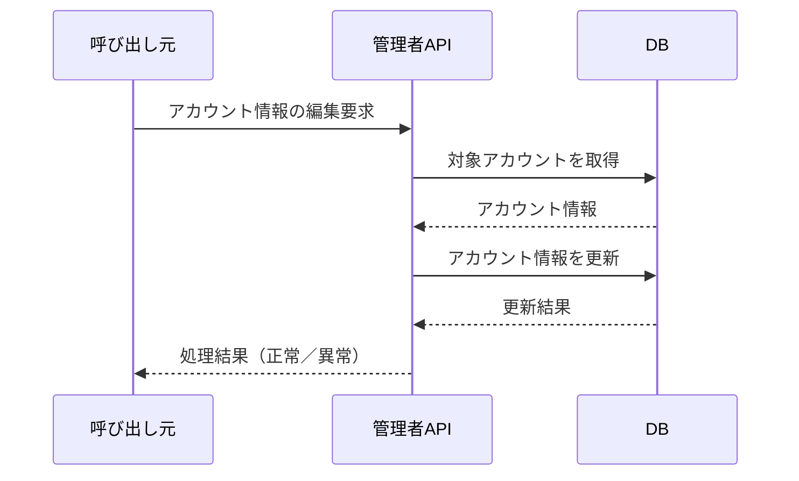
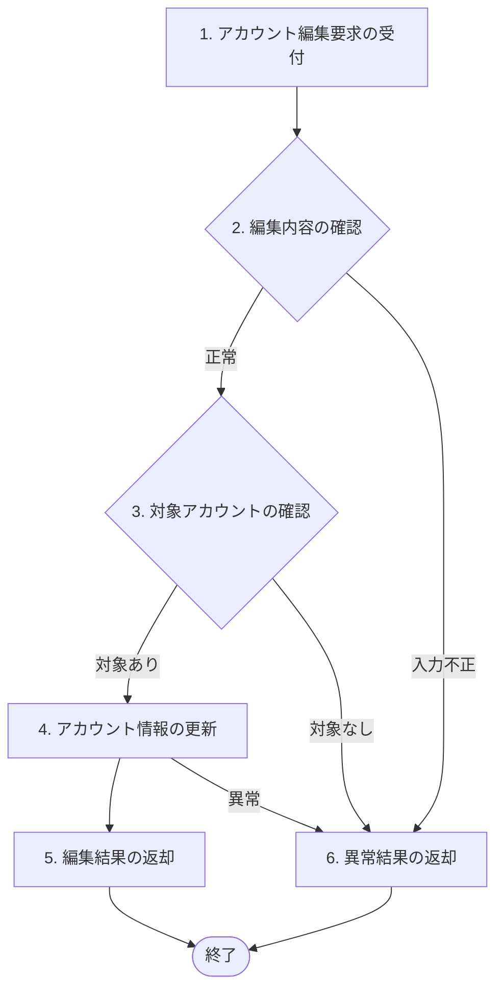

# 設計書 5.3.2. アカウント情報編集API

## 1. 機能概要

- 指定したユーザのメールアドレスとパスワード有効期限を更新する。
- 入出力の機械可読定義は[OpenAPI入出力仕様](./openapi.yaml)の`rootEditAppUser`を参照する。


- [AppUserEditApiController.java](../../../ha-root/src/main/java/jp/co/ha/root/contents/appuser/controller/AppUserEditApiController.java)
- [AppUserEditApiRequest.java](../../../ha-root/src/main/java/jp/co/ha/root/contents/appuser/request/AppUserEditApiRequest.java)
- [AppUserEditApiResponse.java](../../../ha-root/src/main/java/jp/co/ha/root/contents/appuser/response/AppUserEditApiResponse.java)
- [UserSearchServiceImpl.java](../../../ha-business/src/main/java/jp/co/ha/business/db/crud/read/impl/UserSearchServiceImpl.java)
- [UserUpdateServiceImpl.java](../../../ha-business/src/main/java/jp/co/ha/business/db/crud/update/impl/UserUpdateServiceImpl.java)
- [UserMapper.xml](../../../ha-db/src/main/resources/jp/co/ha/db/mapper/UserMapper.xml)
- [DataBaseCommonAspect.java](../../../ha-db/src/main/java/jp/co/ha/db/aspect/DataBaseCommonAspect.java)
- [BaseRootApiController.java](../../../ha-root/src/main/java/jp/co/ha/root/base/BaseRootApiController.java)
- [WebSecurityConfig.java](../../../ha-root/src/main/java/jp/co/ha/root/config/WebSecurityConfig.java)
- [JWTAuthorizationFilter.java](../../../ha-root/src/main/java/jp/co/ha/root/config/JWTAuthorizationFilter.java)

## 2. 処理概要



## 3. IF仕様

### 3.1. HTTPメソッド

| 項目 | 内容 | 備考 |
| --- | --- | --- |
| HTTPメソッド | `PUT` | 正常時はHTTP 200でJSONを返す。 |

### 3.2. エンドポイントURL

| 項目 | 内容 | 備考 |
| --- | --- | --- |
| エンドポイントURL | `/api/root/account/{seq_user_id}` | スキーム・ホスト・ポートは実行環境に従う。 |

| 項目名 | 必須 | 備考 |
| --- | --- | --- |
| `seq_user_id` | 必須 | 正数限定の制約は設けない。 |

### 3.3. リクエストIF

#### 3.3.1. リクエストヘッダ

| 項目名 | 型 | 必須 | 値 | 備考 |
| --- | --- | --- | --- | --- |
| `Authorization` | `string` | 必須 | Bearer形式のJWT | `Bearer {JWT}`の形式で、ログインAPIで発行された署名付きJWTを使用する。 |
| `Content-Type` | `string` | 必須 | `application/json` | リクエストボディをJSON形式で送信する。Accept-Charsetの独自必須検証は設けない。 |

#### 3.3.2. クエリパラメータ

特になし。

#### 3.3.3. JSONボディ

```json
{
  "mail_address": "user@example.com",
  "password_expire": "2030/12/31"
}
```

| 項目名 | 型 | 必須 | 備考 |
| --- | --- | --- | --- |
| `mail_address` | `string` | 必須 | null・空文字・空白のみ不可。MailAddressValidatorの形式検証を行う。 |
| `password_expire` | `string` | 必須 | null不可。yyyy/MM/ddでLocalDateへ変換し、サーバの当日より後の日付を指定する。当日は不可。 |

### 3.4. レスポンスIF

#### 3.4.1. レスポンスヘッダ

| 項目名 | 型 | 必須 | 備考 |
| --- | --- | --- | --- |
| `Content-Type` | `string` | 必須 | 正常JSON応答では`application/json`。このAPIでは新規JWTを発行するAuthorization応答ヘッダーを設定しない。 |

#### 3.4.2. JSONボディ

```json
{
  "result": "0"
}
```

| 項目名 | 型 | 必須 | 備考 |
| --- | --- | --- | --- |
| `result` | `string` | 必須 | 正常は`"0"`、異常は`"1"`。数値ではなく文字列。 |
| `errors` | `array` | 条件付き | エラー情報を設定した場合に出力する。各要素は`message`を持つ。内部エラーコード項目はない。 |

## 4. 処理フロー



| 処理順 | 処理概要 | 処理詳細 | 関連項番 |
| --- | --- | --- | --- |
| 1 | アカウント編集要求の受付 | Bearer認証を経てユーザIDと編集内容を受け付ける。認証不成立はフィルター側で終了する。 | 4.1.1 |
| 2 | 編集内容の確認 | パスIDと要求JSONを確認し、不正なら更新せず終了する。 | 4.1.2 |
| 3 | 対象アカウントの確認 | ユーザIDを指定して対象を検索する。対象なしは400で終了し、存在する場合は更新へ進む。 | 4.2.1、4.3.1 |
| 4 | アカウント情報の更新 | 要求のメールアドレス・有効期限等を更新内容へ設定して保存する。更新件数の再判定や更新後情報の取得は行わない。 | 4.2.2、4.3.1 |
| 5 | 編集結果の返却 | HTTP 200と成功結果を返す。更新後の情報やIDは含めない。 | 3.4.2 |
| 6 | 異常結果の返却 | 入力不正・対象なしは更新せず終了する。更新時の例外は共通処理の異常応答で終了する。 | 4.1.3、4.3.1 |

### 4.1. 入力チェック

#### 4.1.1. 認証・利用範囲の確認

| 対象 | ルール | 検証メッセージ・失敗時 |
| --- | --- | --- |
| 認証 | Authorization: Bearer <JWT>で署名とsubjectを検証する。除外URLではないため認証が必要。 | フィルタの共通処理。コントローラのerrors形式は保証しない。 |
| 利用対象 | JWT認証後にこの操作固有のロール別権限検査や、JWTのsubjectと対象ユーザIDを照合する処理は設けない。 | - |

#### 4.1.2. 入力項目・補完条件の確認

| 対象 | ルール | 検証メッセージ・失敗時 |
| --- | --- | --- |
| mail_address | @Requiredと@MailAddress。 | mail_address is required / invalid mail_address format |
| password_expire | @Requiredと@Future。LocalDate.now()より後であること。 | password_expire is required / password_expire is must be future |

#### 4.1.3. 入力異常時の扱い

要求DTOは`BaseRootApiRequest`を継承し、未定義のJSON項目は無視する。文字列の必須検証は`RequiredValidator`に従い、null・空文字・空白のみを拒否する。

| 発生条件 | HTTPステータス | 扱い |
| --- | --- | --- |
| Bean Validation | 400 | errors配列に各検証メッセージを設定する。 |
| パス・クエリの型変換 | 400 | <項目名> is type error. value=<入力値>。 |
| JSONの数値・日付変換 | 400または500 | HttpMessageNotReadableExceptionの原因が対象のInvalidFormatExceptionなら400。日付はdate format error. Please use yyyy/MM/dd.、数値はnumber format error. Please use numeric value.。その他は500・unexpected error.。 |
| 認証フィルタ・共通HTTP処理 | 共通処理に従う | 上記のresult/errors形式とは別に扱う。401と固定JSONへ一律に統一する実装はない。 |

入力・認証の例外がコントローラの例外ハンドラーに到達した場合は、ログ出力とROOT向けSlackエラー通知を行う。認証フィルタの例外は同じJSON形式に統一されない。

### 4.2. DB操作
#### 4.2.1. 存在確認

```sql
SELECT
    *
FROM
    USER
WHERE
    SEQ_USER_ID = :seq_user_id;
```

| 項目 | 設定値 | 備考 |
| --- | --- | --- |
| `:seq_user_id` | パスの`seq_user_id` | 存在確認対象のユーザID。 |

#### 4.2.2. 更新値・条件

```sql
UPDATE
    USER
SET
    MAIL_ADDRESS = :encrypted_mail_address
    , PASSWORD_EXPIRE = :password_expire
    , UPDATE_DATE = :system_datetime
WHERE
    SEQ_USER_ID = :seq_user_id;
```

| 項目 | 設定値 | 備考 |
| --- | --- | --- |
| `:encrypted_mail_address` | 要求の`mail_address`をAES暗号化した値 | DB共通の`@Crypt`処理で`aesCrypter`を使用する。 |
| `:password_expire` | 要求の`password_expire` | ユーザEntityへ設定したパスワード有効期限。 |
| `:system_datetime` | 各CRUD呼び出し時のシステム日時 | DB共通処理で登録日時・更新日時を設定する。 |
| `:seq_user_id` | パスの`seq_user_id` | 更新対象のユーザID。 |

### 4.3. 業務処理・応答編集

#### 4.3.1. 処理手順

| 順序 | 処理 | 内容 |
| --- | --- | --- |
| 1 | 存在確認 | USERをパスのseq_user_idで主キー検索する。削除フラグを検索条件に含めない。 |
| 2 | 不在時 | HTTP 400、errors[].message=user is not foundを返す。 |
| 3 | 更新 | 新しいUserへ要求2項目とseq_user_idを設定し、UserComponent.updateUserByIdを呼ぶ。 |
| 4 | 返却 | 更新後の情報や更新件数は返さず、HTTP 200、result="0"を返す。 |

| 発生条件 | HTTPステータス | 扱い |
| --- | --- | --- |
| 予期しない例外 | 500 | unexpected error.。不正JSONを常に400へ変換する実装ではない。 |

異常応答の基本形は`{"result":"1","errors":[{"message":"..."}]}`とする。正常応答はHTTP 200。例外ハンドラーはログ出力とROOT向けSlackエラー通知を行う。DB検索・更新や外部サービスの詳細はサーバ側の例外として扱う。エラー応答には内部エラーコードを設定しない。

**SQL呼び出し時の結果・例外の扱い**

`UserUpdateService.updateById`から`updateByPrimaryKeySelective`を呼び、非null項目だけを更新する。DB共通処理が更新日時を設定し、`@Crypt`のメールアドレスを`aesCrypter`でAES暗号化する。メールアドレスの重複確認、パスワードの変更・再ハッシュ、削除状態の解除、ファイル設定の変更は行わない。事前検索後にレコードが変化した場合の再検査や更新件数の検査は行わない。

| 発生条件 | HTTPステータス | 扱い |
| --- | --- | --- |
| 対象ユーザなし | 400 | user is not found |
| BaseException | 500 | application error.。内部のBE/CE等のコードや詳細をそのままJSONへ出力しない。 |

DB検索・更新で予期しない例外が発生した場合はHTTP 500、`unexpected error.`とする。例外ハンドラーはログとROOT向けSlackエラー通知を行う。
