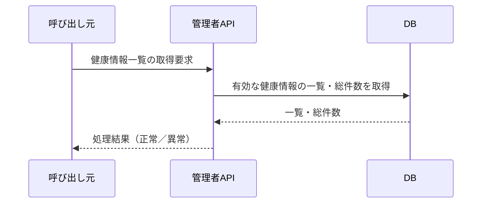
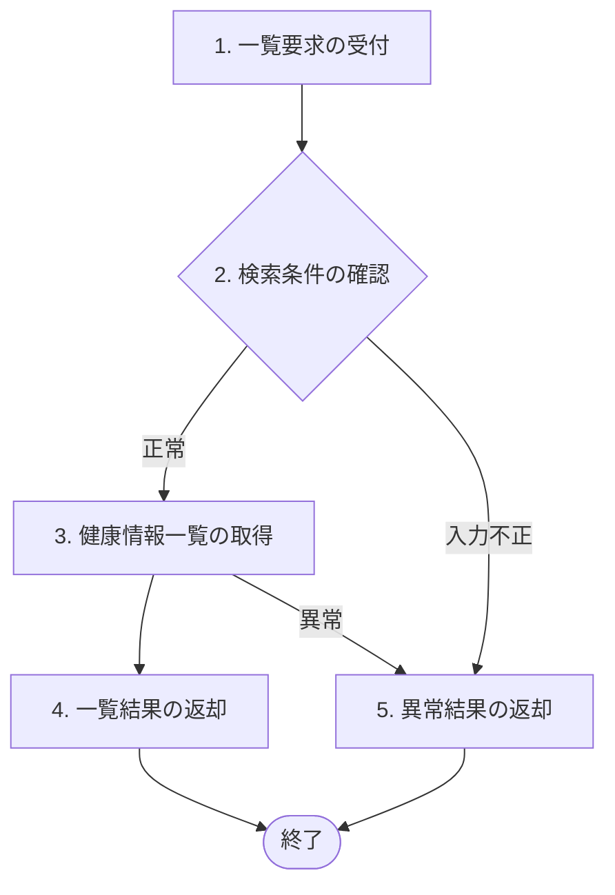

# 設計書 5.5.1. 健康情報一覧取得API

## 1. 機能概要

- 全ユーザの有効な健康情報（`DELETE_FLAG = false`）とBMI範囲マスタの肥満度ステータスをページ単位で取得する。
- 入出力の機械可読定義は[OpenAPI入出力仕様](./openapi.yaml)の`rootListHealthInfos`を参照する。


- [HealthInfoListApiController.java](../../../ha-root/src/main/java/jp/co/ha/root/contents/healthinfo/controller/HealthInfoListApiController.java)
- [HealthInfoListApiRequest.java](../../../ha-root/src/main/java/jp/co/ha/root/contents/healthinfo/request/HealthInfoListApiRequest.java)
- [HealthInfoListApiResponse.java](../../../ha-root/src/main/java/jp/co/ha/root/contents/healthinfo/response/HealthInfoListApiResponse.java)
- [HealthInfoServiceImpl.java](../../../ha-root/src/main/java/jp/co/ha/root/contents/healthinfo/service/HealthInfoServiceImpl.java)
- [HealthInfoSearchServiceImpl.java](../../../ha-business/src/main/java/jp/co/ha/business/db/crud/read/impl/HealthInfoSearchServiceImpl.java)
- [CompositeHealthInfoMapper.xml](../../../ha-db/src/main/resources/jp/co/ha/db/mapper/custom/CompositeHealthInfoMapper.xml)
- [BaseRootApiController.java](../../../ha-root/src/main/java/jp/co/ha/root/base/BaseRootApiController.java)
- [WebSecurityConfig.java](../../../ha-root/src/main/java/jp/co/ha/root/config/WebSecurityConfig.java)
- [JWTAuthorizationFilter.java](../../../ha-root/src/main/java/jp/co/ha/root/config/JWTAuthorizationFilter.java)

## 2. 処理概要



## 3. IF仕様

### 3.1. HTTPメソッド

| 項目 | 内容 | 備考 |
| --- | --- | --- |
| HTTPメソッド | `GET` | 正常時はHTTP 200でJSONを返す。 |

### 3.2. エンドポイントURL

| 項目 | 内容 | 備考 |
| --- | --- | --- |
| エンドポイントURL | `/api/root/healthinfo` | スキーム・ホスト・ポートは実行環境に従う。 |

### 3.3. リクエストIF

#### 3.3.1. リクエストヘッダ

| 項目名 | 型 | 必須 | 値 | 備考 |
| --- | --- | --- | --- | --- |
| `Authorization` | `string` | 必須 | Bearer形式のJWT | `Bearer {JWT}`の形式で、ログインAPIで発行された署名付きJWTを使用する。 |

#### 3.3.2. クエリパラメータ

| 項目名 | 型 | 必須 | 備考 |
| --- | --- | --- | --- |
| `page` | `integer` | 任意 | 省略時0。0始まり。Integerへ変換後、@Decimalで0以上999999999以下（両端含む）を検証する。 |

#### 3.3.3. JSONボディ

特になし。

### 3.4. レスポンスIF

#### 3.4.1. レスポンスヘッダ

| 項目名 | 型 | 必須 | 備考 |
| --- | --- | --- | --- |
| `Content-Type` | `string` | 必須 | 正常JSON応答では`application/json`。このAPIでは新規JWTを発行するAuthorization応答ヘッダーを設定しない。 |

#### 3.4.2. JSONボディ

```json
{
  "result": "0",
  "health_info_list": [
    {
      "seq_health_info_id": 1,
      "seq_user_id": 1,
      "height": 170.5,
      "weight": 65.2,
      "bmi": 22.428,
      "standard_weight": 63.954,
      "bmi_status": {
        "status": "11",
        "message": "普通体重"
      },
      "health_info_reg_date": "2026/11/11 12:34:56"
    }
  ],
  "paging": {
    "total_record_num": 1,
    "from_record_num": 1,
    "to_record_num": 1,
    "total_page": 1,
    "current_page_num": 0,
    "record_per_page": 30,
    "can_go_next": false,
    "next_href": "healthinfo?page=0",
    "can_go_previous": false,
    "previous_href": "healthinfo?page=0",
    "can_go_last": false,
    "last_href": "healthinfo?page=0",
    "can_go_first": false,
    "first_href": "healthinfo?page=0"
  }
}
```

| 項目名 | 型 | 必須 | 備考 |
| --- | --- | --- | --- |
| `result` | `string` | 必須 | 正常は`"0"`、異常は`"1"`。数値ではなく文字列。 |
| `errors` | `array` | 条件付き | エラー情報を設定した場合に出力する。各要素は`message`を持つ。内部エラーコード項目はない。 |
| `errors[].message` | `string` | 条件付き | エラー詳細。入力・DB・外部処理ごとの項で示すメッセージを設定する。 |
| `health_info_list` | `array` | 正常時 | 有効な健康情報の取得結果。0件なら空配列。 |
| `paging` | `object` | 正常時 | 総件数・表示範囲・総ページ数・現在ページ・表示件数・移動可否・移動リンク。`current_page_num`は0始まり。 |
| `health_info_list[].seq_health_info_id` | `integer` | 要素項目 | 健康情報ID（int64）。 |
| `health_info_list[].seq_user_id` | `integer` | 要素項目 | ユーザID（int64）。 |
| `health_info_list[].height` | `number` | 要素項目 | 身長。 |
| `health_info_list[].weight` | `number` | 要素項目 | 体重。 |
| `health_info_list[].bmi` | `number` | 要素項目 | BMI。 |
| `health_info_list[].standard_weight` | `number` | 要素項目 | 標準体重。 |
| `health_info_list[].bmi_status` | `object` | 要素項目 | statusとmessageのオブジェクト。 |
| `health_info_list[].bmi_status.status` | `string` | 要素項目 | マスタのOVER_WEIGHT_STATUS。マスタ未結合ならnull。 |
| `health_info_list[].bmi_status.message` | `string` | 要素項目 | 10〜15の表示文言。未対応ステータスではnull。 |
| `health_info_list[].health_info_reg_date` | `string` | 要素項目 | yyyy/MM/dd HH:mm:ss。 |
| 項目名 | 型 | 必須 | 備考 |
| --- | --- | --- | --- |
| `paging.total_record_num` | `integer` | 正常時 | 有効な健康情報の総件数。 |
| `paging.from_record_num` | `integer` | 正常時 | 表示開始番号。0件・範囲外は0。 |
| `paging.to_record_num` | `integer` | 正常時 | 表示終了番号。0件・範囲外は0。 |
| `paging.total_page` | `integer` | 正常時 | 総ページ数。 |
| `paging.current_page_num` | `integer` | 正常時 | 0始まりの要求ページ。 |
| `paging.record_per_page` | `integer` | 正常時 | 1ページあたりの設定件数。 |
| `paging.can_go_next` | `boolean` | 正常時 | 次ページへ移動できるか。 |
| `paging.next_href` | `string` | 正常時 | 次ページリンク。移動不可でも値を設定する。 |
| `paging.can_go_previous` | `boolean` | 正常時 | 前ページへ移動できるか。 |
| `paging.previous_href` | `string` | 正常時 | 前ページリンク。移動不可でも値を設定する。 |
| `paging.can_go_last` | `boolean` | 正常時 | 最終ページへ移動できるか。 |
| `paging.last_href` | `string` | 正常時 | 最終ページリンク。 |
| `paging.can_go_first` | `boolean` | 正常時 | 先頭ページへ移動できるか。 |
| `paging.first_href` | `string` | 正常時 | 先頭ページリンク。 |


## 4. 処理フロー



| 処理順 | 処理概要 | 処理詳細 | 関連項番 |
| --- | --- | --- | --- |
| 1 | 一覧要求の受付 | Bearer認証を経て一覧要求を受け付ける。認証不成立はフィルター側の応答で終了する。 | 4.1.1 |
| 2 | 検索条件の確認 | pageを変換・検証し、ページ条件を作成する。不正なら一覧検索へ進まない。 | 4.1.2、4.3.1 |
| 3 | 健康情報一覧の取得 | 要求されたページの一覧を検索する。BMI範囲マスタと結合した有効な健康情報だけを健康情報ID降順で取得する。0件・範囲外ページは空一覧として扱う。 | 4.2.1、4.3.1 |
| 4 | 一覧結果の返却 | BMIステータスと表示メッセージを含めて応答項目を編集する。有効な健康情報の総件数からページングを作成し、health_info_listとともにHTTP 200で返す。要求ページを実在範囲へ補正しない。 | 4.3.1、4.3.2 |
| 5 | 異常結果の返却 | 入力不正の場合は検索せず、取得・応答編集時の例外は共通処理の異常応答で終了する。 | 4.1.3、4.3 |

### 4.1. 入力チェック

#### 4.1.1. 認証・利用範囲の確認

| 対象 | ルール | 検証メッセージ・失敗時 |
| --- | --- | --- |
| 認証 | Authorization: Bearer <JWT>で署名とsubjectを検証する。除外URLではないため認証が必要。 | フィルタの共通処理。コントローラのerrors形式は保証しない。 |
| 利用対象 | JWT認証後にこの操作固有のロール別権限検査や、JWTのsubjectと対象ユーザIDを照合する処理は設けない。 | - |

#### 4.1.2. 入力項目・補完条件の確認

| 対象 | ルール | 検証メッセージ・失敗時 |
| --- | --- | --- |
| page | 省略時0。0始まり。Integerへ変換後、@Decimalで0以上999999999以下（両端含む）を検証する。 | page is positive |

#### 4.1.3. 入力異常時の扱い

要求DTOに追加の検索項目はない。

| 発生条件 | HTTPステータス | 扱い |
| --- | --- | --- |
| Bean Validation | 400 | errors配列に各検証メッセージを設定する。 |
| パス・クエリの型変換 | 400 | <項目名> is type error. value=<入力値>。 |
| JSONの数値・日付変換 | 400または500 | HttpMessageNotReadableExceptionの原因が対象のInvalidFormatExceptionなら400。日付はdate format error. Please use yyyy/MM/dd.、数値はnumber format error. Please use numeric value.。その他は500・unexpected error.。 |
| 認証フィルタ・共通HTTP処理 | 共通処理に従う | 上記のresult/errors形式とは別に扱う。401と固定JSONへ一律に統一する実装はない。 |

入力・認証の例外がコントローラの例外ハンドラーに到達した場合は、ログ出力とROOT向けSlackエラー通知を行う。認証フィルタの例外は同じJSON形式に統一されない。

### 4.2. DB操作
#### 4.2.1. 一覧・件数検索

```sql
SELECT
    HI.SEQ_HEALTH_INFO_ID
    , HI.SEQ_USER_ID
    , HI.HEIGHT
    , HI.WEIGHT
    , HI.BMI
    , HI.STANDARD_WEIGHT
    , HI.HEALTH_INFO_REG_DATE
    , HI.SEQ_BMI_RANGE_MT_ID
    , BRM.RANGE_MIN
    , BRM.RANGE_MAX
    , BRM.OVER_WEIGHT_STATUS
FROM
    HEALTH_INFO HI
    LEFT OUTER JOIN BMI_RANGE_MT BRM
        ON HI.SEQ_BMI_RANGE_MT_ID = BRM.SEQ_BMI_RANGE_MT_ID
WHERE
    HI.DELETE_FLAG = false
ORDER BY
    SEQ_HEALTH_INFO_ID DESC
LIMIT
    :offset
    , :page_size;

SELECT
    COUNT(*)
FROM
    HEALTH_INFO
WHERE
    DELETE_FLAG = false;
```

| 項目 | 設定値 | 備考 |
| --- | --- | --- |
| `:offset` | 要求の`page` × `front.healthinfo.page` | 0始まりの要求ページから`Pageable.getOffset()`を算出する。 |
| `:page_size` | 設定`front.healthinfo.page`の1ページ件数 | `Pageable.getPageSize()`を取得し、LIMITへ設定する。 |

### 4.3. 業務処理・応答編集

#### 4.3.1. 一覧の取得・応答項目の編集

| 順序 | 処理 | 内容 |
| --- | --- | --- |
| 1 | ページ条件作成 | pageとfront.healthinfo.pageからPageableを作成する。 |
| 2 | 健康情報検索 | HEALTH_INFOをBMI_RANGE_MTへ左外部結合し、`HI.DELETE_FLAG = false`の行をSEQ_HEALTH_INFO_ID降順で取得する。ユーザによる絞り込みは行わない。 |
| 3 | BMI表示編集 | OVER_WEIGHT_STATUSをbmi_status.statusへ設定し、10:低体重、11:普通体重、12:肥満(1)、13:肥満(2)、14:肥満(3)、15:肥満(4)のメッセージを設定する。その他の値に対応するメッセージは設定しない。 |

#### 4.3.2. 総件数取得・ページング・返却

| 順序 | 処理 | 内容 |
| --- | --- | --- |
| 1 | 件数・応答 | `DELETE_FLAG = false`のHEALTH_INFOを数え、health_info_listとhealthinfo?pageを基準とするpagingを返す。一覧と総件数の削除条件を揃える。 |

1ページ件数は`front.healthinfo.page`から取得する。SQLのOFFSETは`page × page_size`とし、要求ページを実在範囲へ補正しない。範囲外なら一覧は空になる。`PagingViewFactory`は`healthinfo?page=<page>`のリンクを作成する。総件数0または範囲外では表示範囲を0〜0とする。

| 項目群 | 型 | 内容 |
| --- | --- | --- |
| total_record_num/from_record_num/to_record_num/total_page | integer | 総件数・先頭/末尾の表示番号・総ページ数。 |
| current_page_num/record_per_page | integer | 0始まりの要求ページと1ページ件数。 |
| can_go_next/can_go_previous/can_go_last/can_go_first | boolean | 各方向へ移動できるかを示す。 |
| next_href/previous_href/last_href/first_href | string | 対応ページへのリンク。移動不可時も値は設定する。 |

| 発生条件 | HTTPステータス | 扱い |
| --- | --- | --- |
| 予期しない例外 | 500 | unexpected error.。不正JSONを常に400へ変換する実装ではない。 |

異常応答の基本形は`{"result":"1","errors":[{"message":"..."}]}`とする。正常応答はHTTP 200。例外ハンドラーはログ出力とROOT向けSlackエラー通知を行う。DB検索・更新や外部サービスの詳細はサーバ側の例外として扱う。エラー応答には内部エラーコードを設定しない。

**SQL呼び出し時の結果・例外の扱い**

一覧は`CompositeHealthInfoMapper.selectAll`を、件数は`HealthInfoSearchService.countByHealthInfoIdAndSeqUserId(null, null)`を使用する。いずれも`DELETE_FLAG = false`の有効な健康情報だけを対象とし、ログイン中の管理者に紐付くユーザだけに限定しない。検索専用で再計算・DB更新を行わない。

| 発生条件 | HTTPステータス | 扱い |
| --- | --- | --- |
| BaseException | 500 | application error.。内部のBE/CE等のコードや詳細をそのままJSONへ出力しない。 |

DB検索・更新で予期しない例外が発生した場合はHTTP 500、`unexpected error.`とする。例外ハンドラーはログとROOT向けSlackエラー通知を行う。
