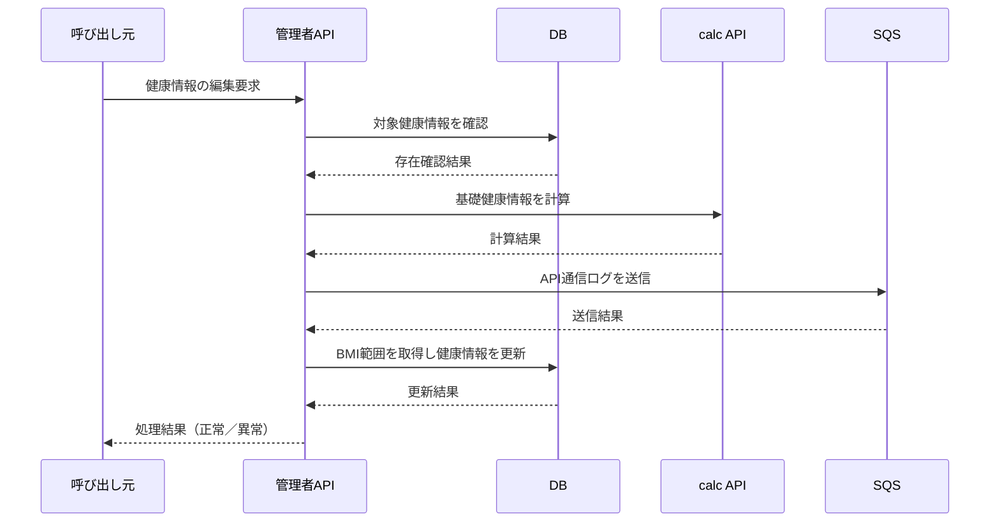
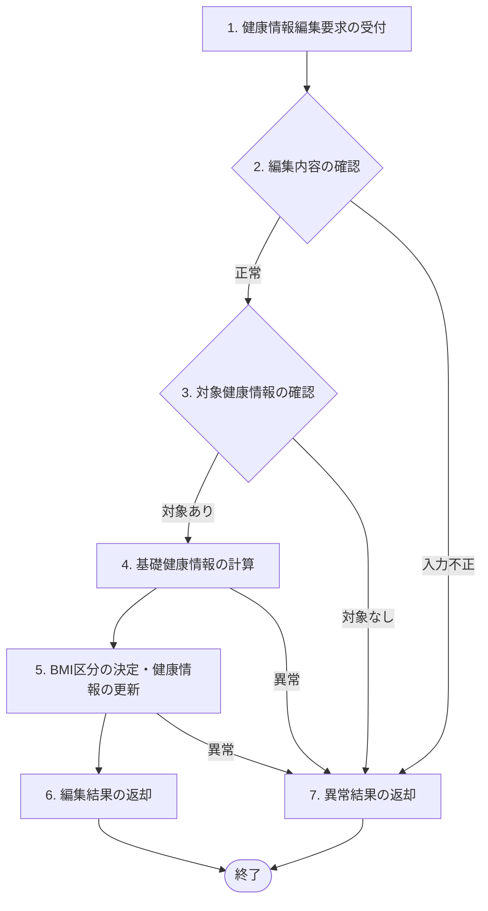

# 設計書 5.5.2. 健康情報編集API

## 1. 機能概要

- 指定した有効な健康情報（`DELETE_FLAG = false`）の身長・体重を基に基礎健康情報計算APIを呼び出し、計算結果とBMI範囲マスタIDを更新する。
- 入出力の機械可読定義は[OpenAPI入出力仕様](./openapi.yaml)の`rootEditHealthInfo`を参照する。


- [HealthInfoEditApiController.java](../../../ha-root/src/main/java/jp/co/ha/root/contents/healthinfo/controller/HealthInfoEditApiController.java)
- [HealthInfoEditApiRequest.java](../../../ha-root/src/main/java/jp/co/ha/root/contents/healthinfo/request/HealthInfoEditApiRequest.java)
- [HealthInfoEditApiResponse.java](../../../ha-root/src/main/java/jp/co/ha/root/contents/healthinfo/response/HealthInfoEditApiResponse.java)
- [HealthInfoSearchServiceImpl.java](../../../ha-business/src/main/java/jp/co/ha/business/db/crud/read/impl/HealthInfoSearchServiceImpl.java)
- [HealthInfoUpdateServiceImpl.java](../../../ha-business/src/main/java/jp/co/ha/business/db/crud/update/impl/HealthInfoUpdateServiceImpl.java)
- [BmiRangeMtSearchServiceImpl.java](../../../ha-business/src/main/java/jp/co/ha/business/db/crud/read/impl/BmiRangeMtSearchServiceImpl.java)
- [HealthInfoMapper.xml](../../../ha-db/src/main/resources/jp/co/ha/db/mapper/HealthInfoMapper.xml)
- [BasicHealthInfoCalcApiComponent.java](../../../ha-business/src/main/java/jp/co/ha/business/component/BasicHealthInfoCalcApiComponent.java)
- [ApiLogComponent.java](../../../ha-business/src/main/java/jp/co/ha/business/component/ApiLogComponent.java)
- [BaseRootApiController.java](../../../ha-root/src/main/java/jp/co/ha/root/base/BaseRootApiController.java)
- [WebSecurityConfig.java](../../../ha-root/src/main/java/jp/co/ha/root/config/WebSecurityConfig.java)
- [JWTAuthorizationFilter.java](../../../ha-root/src/main/java/jp/co/ha/root/config/JWTAuthorizationFilter.java)

## 2. 処理概要



## 3. IF仕様

### 3.1. HTTPメソッド

| 項目 | 内容 | 備考 |
| --- | --- | --- |
| HTTPメソッド | `PUT` | 正常時はHTTP 200でJSONを返す。 |

### 3.2. エンドポイントURL

| 項目 | 内容 | 備考 |
| --- | --- | --- |
| エンドポイントURL | `/api/root/healthinfo/{seq_health_info_id}` | スキーム・ホスト・ポートは実行環境に従う。 |

| 項目名 | 必須 | 備考 |
| --- | --- | --- |
| `seq_health_info_id` | 必須 | 正数限定の制約は設けない。 |

### 3.3. リクエストIF

#### 3.3.1. リクエストヘッダ

| 項目名 | 型 | 必須 | 値 | 備考 |
| --- | --- | --- | --- | --- |
| `Authorization` | `string` | 必須 | Bearer形式のJWT | `Bearer {JWT}`の形式で、ログインAPIで発行された署名付きJWTを使用する。 |
| `Content-Type` | `string` | 必須 | `application/json` | リクエストボディをJSON形式で送信する。Accept-Charsetの独自必須検証は設けない。 |

#### 3.3.2. クエリパラメータ

特になし。

#### 3.3.3. JSONボディ

```json
{
  "seq_user_id": 1,
  "height": 170.5,
  "weight": 65.2
}
```

| 項目名 | 型 | 必須 | 備考 |
| --- | --- | --- | --- |
| `seq_user_id` | `integer` | 必須 | null不可。int64。対象の健康情報IDとの組み合わせで有効な健康情報の存在を確認する。正数限定の検証はない。 |
| `height` | `number` | 必須 | null不可。BigDecimal。0以上999999999以下。 |
| `weight` | `number` | 必須 | null不可。BigDecimal。0以上999999999以下。 |

### 3.4. レスポンスIF

#### 3.4.1. レスポンスヘッダ

| 項目名 | 型 | 必須 | 備考 |
| --- | --- | --- | --- |
| `Content-Type` | `string` | 必須 | 正常JSON応答では`application/json`。このAPIでは新規JWTを発行するAuthorization応答ヘッダーを設定しない。 |

#### 3.4.2. JSONボディ

```json
{
  "result": "0"
}
```

| 項目名 | 型 | 必須 | 備考 |
| --- | --- | --- | --- |
| `result` | `string` | 必須 | 正常は`"0"`、異常は`"1"`。数値ではなく文字列。 |
| `errors` | `array` | 条件付き | エラー情報を設定した場合に出力する。各要素は`message`を持つ。内部エラーコード項目はない。 |

## 4. 処理フロー



| 処理順 | 処理概要 | 処理詳細 | 関連項番 |
| --- | --- | --- | --- |
| 1 | 健康情報編集要求の受付 | Bearer認証を経て対象IDと編集内容を受け付ける。認証不成立はフィルター側で終了する。 | 4.1.1 |
| 2 | 編集内容の確認 | パスIDと要求JSONを確認し、不正なら更新せず終了する。 | 4.1.2 |
| 3 | 対象健康情報の確認 | 健康情報IDとユーザIDの組み合わせで有効な健康情報の存在を確認する。該当なし・削除済みは400で終了し、計算・更新は行わない。 | 4.2.1、4.3.1 |
| 4 | 基礎健康情報の計算 | calc APIでBMI・標準体重を計算し、成否判定の前にAPI通信ログを送信する。計算・ログ送信失敗は更新せず終了する。 | 4.4 |
| 5 | BMI区分の決定・健康情報の更新 | キャッシュまたはDBからBMI範囲を取得して区分を選び、計算値とともに健康情報を更新する。該当範囲なしは異常終了する。 | 4.5、4.2.2、4.3.1 |
| 6 | 編集結果の返却 | 成功結果をHTTP 200で返す。先行した計算API・通信ログ処理を更新と一括して取り消さない。 | 4.3.1、3.4.2 |
| 7 | 異常結果の返却 | 入力不正・対象なしや、計算・ログ送信・BMI区分判定・更新の失敗は、発生した処理の異常応答で終了する。 | 4.1.3、4.3.1、4.4.2、4.5.2 |

### 4.1. 入力チェック

#### 4.1.1. 認証・利用範囲の確認

| 対象 | ルール | 検証メッセージ・失敗時 |
| --- | --- | --- |
| 認証 | Authorization: Bearer <JWT>で署名とsubjectを検証する。除外URLではないため認証が必要。 | フィルタの共通処理。コントローラのerrors形式は保証しない。 |
| 利用対象 | JWT認証後にこの操作固有のロール別権限検査や、JWTのsubjectと対象ユーザIDを照合する処理は設けない。 | - |

#### 4.1.2. 入力項目・補完条件の確認

| 対象 | ルール | 検証メッセージ・失敗時 |
| --- | --- | --- |
| seq_user_id | @Required。Longへ変換する。 | seq_user_id is required |
| height | @Requiredと@Decimal(min="0")。上限は既定値999999999、両端を含む。 | height is required / height is positive |
| weight | @Requiredと@Decimal(min="0")。上限は既定値999999999、両端を含む。 | weight is required / weight is positive |

#### 4.1.3. 入力異常時の扱い

要求DTOは`BaseRootApiRequest`を継承し、未定義のJSON項目は無視する。文字列の必須検証は`RequiredValidator`に従い、null・空文字・空白のみを拒否する。

| 発生条件 | HTTPステータス | 扱い |
| --- | --- | --- |
| Bean Validation | 400 | errors配列に各検証メッセージを設定する。 |
| パス・クエリの型変換 | 400 | <項目名> is type error. value=<入力値>。 |
| JSONの数値・日付変換 | 400または500 | HttpMessageNotReadableExceptionの原因が対象のInvalidFormatExceptionなら400。日付はdate format error. Please use yyyy/MM/dd.、数値はnumber format error. Please use numeric value.。その他は500・unexpected error.。 |
| 認証フィルタ・共通HTTP処理 | 共通処理に従う | 上記のresult/errors形式とは別に扱う。401と固定JSONへ一律に統一する実装はない。 |

入力・認証の例外がコントローラの例外ハンドラーに到達した場合は、ログ出力とROOT向けSlackエラー通知を行う。認証フィルタの例外は同じJSON形式に統一されない。

### 4.2. DB操作
#### 4.2.1. 存在確認・マスタ取得

```sql
SELECT
    COUNT(*)
FROM
    HEALTH_INFO
WHERE
    SEQ_HEALTH_INFO_ID = :seq_health_info_id
    AND SEQ_USER_ID = :seq_user_id
    AND DELETE_FLAG = false;

SELECT
    *
FROM
    BMI_RANGE_MT
WHERE
    DELETE_FLAG = false;
```

| 項目 | 設定値 | 備考 |
| --- | --- | --- |
| `:seq_health_info_id` | パスの`seq_health_info_id` | 存在確認対象の健康情報ID。 |
| `:seq_user_id` | 要求JSONの`seq_user_id` | 健康情報IDとの組み合わせを検査する。 |

#### 4.2.2. 更新値・条件

```sql
UPDATE
    HEALTH_INFO
SET
    HEIGHT = :api_height
    , WEIGHT = :api_weight
    , BMI = :api_bmi
    , STANDARD_WEIGHT = :api_standard_weight
    , SEQ_BMI_RANGE_MT_ID = :selected_bmi_range_id
    , UPDATE_DATE = :system_datetime
WHERE
    SEQ_HEALTH_INFO_ID = :seq_health_info_id;
```

| 項目 | 設定値 | 備考 |
| --- | --- | --- |
| `:api_height` | 基礎健康情報計算API応答の身長 | 要求値を直接保存せず、API応答から更新Entityへ設定する。 |
| `:api_weight` | 基礎健康情報計算API応答の体重 | 要求値を直接保存せず、API応答から更新Entityへ設定する。 |
| `:api_bmi` | 基礎健康情報計算API応答のBMI | 更新EntityのBMI。 |
| `:api_standard_weight` | 基礎健康情報計算API応答の標準体重 | 更新Entityの標準体重。 |
| `:selected_bmi_range_id` | 計算後のBMIで選択したBMI範囲マスタID | キャッシュを含むマスタ一覧から選択する。 |
| `:system_datetime` | 各CRUD呼び出し時のシステム日時 | DB共通処理で登録日時・更新日時を設定する。 |
| `:seq_health_info_id` | パスの`seq_health_info_id` | 健康情報の更新対象ID。 |

### 4.3. 業務処理・応答編集

#### 4.3.1. 処理手順

| 順序 | 処理 | 内容 |
| --- | --- | --- |
| 1 | 存在確認 | 健康情報IDと要求seq_user_idの組み合わせで`DELETE_FLAG = false`の件数を検索する。0件（該当なし・削除済み）ならHTTP 400でhealth_info is not foundを返す。 |
| 2 | トランザクションID | ApiLogComponent.transactionIdでUUID文字列を生成する。 |
| 3 | 基礎健康情報計算 | 要求をBasicHealthInfoCalcApiRequestへコピーし、設定NodeAPI URLのbasicをGETで呼び出す。トークン発行APIやX-NODE-TOKENは使用しない。 |
| 4 | APIログ | 計算APIの要求・応答から通信ログのキューペイロードを作成し、SQSへ登録する。API結果が成功以外ならApiExceptionを送出する。 |
| 5 | BMI範囲決定 | キャッシュ経由で`DELETE_FLAG = false`のBMI_RANGE_MT全件を取得し、RANGE_MIN <= BMI < RANGE_MAXの先頭1件を選択する。該当なしはBusinessException。 |
| 6 | 更新・返却 | APIのbasic_health_infoをHealthInfoへコピーし、パスの健康情報IDと選択したBMI範囲マスタIDを設定して更新する。HTTP 200、result="0"を返す。 |

| 発生条件 | HTTPステータス | 扱い |
| --- | --- | --- |
| 予期しない例外 | 500 | unexpected error.。不正JSONを常に400へ変換する実装ではない。 |

異常応答の基本形は`{"result":"1","errors":[{"message":"..."}]}`とする。正常応答はHTTP 200。例外ハンドラーはログ出力とROOT向けSlackエラー通知を行う。DB検索・更新や外部サービスの詳細はサーバ側の例外として扱う。エラー応答には内部エラーコードを設定しない。

**SQL呼び出し時の結果・例外の扱い**

マスタは`BmiRangeMtSearchService`のキャッシュが利用可能な場合はキャッシュ値を使う。健康情報の存在確認は`DELETE_FLAG = false`を条件とし、削除済みの健康情報は編集対象にしない。

`HealthInfoUpdateService.update`は`updateByExampleSelective`を使用し、非null値を更新する。身長・体重も要求値を直接保存せずAPI応答から設定する。ユーザID、健康情報登録日時、登録日時、削除フラグは新しい更新Entityへ設定しない。更新条件は健康情報IDのみで、事前存在確認のユーザID条件は更新SQLには含めない。更新件数の再検査や、API呼び出し・SQS登録・DB更新をまとめたトランザクションは設けない。直前の健康情報の検索や体重増減ステータスの再計算は行わない。

| 発生条件 | HTTPステータス | 扱い |
| --- | --- | --- |
| 有効な健康情報に健康情報IDとユーザIDの組み合わせなし（削除済みを含む） | 400 | health_info is not found |
| BaseException | 500 | application error.。内部のBE/CE等のコードや詳細をそのままJSONへ出力しない。 |

DB検索・更新で予期しない例外が発生した場合はHTTP 500、`unexpected error.`とする。例外ハンドラーはログとROOT向けSlackエラー通知を行う。

### 4.4. 基礎健康情報計算API・通信ログ

#### 4.4.1. 基礎健康情報計算APIの呼び出し

UUID文字列のトランザクションIDを生成し、設定NodeAPI URLの`basic`をGETで呼び出す。トークン発行API、移行フラグ、`X-NODE-TOKEN`を使用しない。

#### 4.4.2. 通信ログ送信・計算結果の判定

通信ログのペイロードをSQSへ登録した後、API応答の結果を判定する。結果が成功以外なら`ApiException`を送出し、健康情報の更新には進まない。API呼び出しやSQS登録はDB更新と同じトランザクションにまとめない。

| 発生条件 | HTTPステータス | 扱い |
| --- | --- | --- |
| 計算API結果が成功以外のApiException | 500 | application error. |
| BaseException | 500 | application error.。内部のBE/CE等のコードや詳細をそのままJSONへ出力しない。 |

API・キュー処理のBaseExceptionはHTTP 500、`application error.`、それ以外の予期しない例外はHTTP 500、`unexpected error.`とする。例外ハンドラーはログとROOT向けSlackエラー通知を行う。内部BE/CEコードをJSONへ設定しない。

### 4.5. BMI範囲マスタ・キャッシュ

#### 4.5.1. BMI範囲マスタの取得

`BmiRangeMtSearchService.findAll`はキャッシュを経由し、有効なキャッシュがない場合は4.2項の`DELETE_FLAG = false`を指定した全件検索SQLを実行する。

#### 4.5.2. BMI範囲の選択・異常時の扱い

計算APIのBMIを使い、`RANGE_MIN <= BMI < RANGE_MAX`の先頭1件を採用する。該当なしなら`BusinessException(DB_NO_DATA)`を送出する。HTTP 500、`application error.`として扱い、内部のDB_NO_DATAや詳細文言をJSONへそのまま出力しない。失敗時は健康情報を更新しない。例外ハンドラーはログとROOT向けSlackエラー通知を行う。

| 発生条件 | HTTPステータス | 扱い |
| --- | --- | --- |
| BMI範囲に該当するマスタなしのBusinessException | 500 | application error.。内部のDB_NO_DATAや詳細文言をJSONへそのまま出力しない。 |
