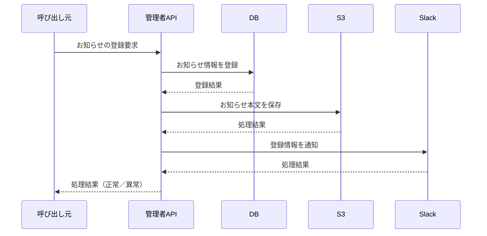
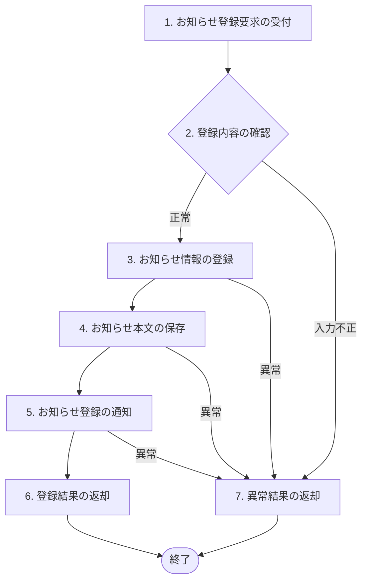

# 設計書 5.6.2. お知らせ情報登録API

## 1. 機能概要

- お知らせのメタデータをDBへ登録し、本文をS3 JSONとして保存してSlackへ通知する。
- 入出力の機械可読定義は[OpenAPI入出力仕様](./openapi.yaml)の`rootCreateNews`を参照する。


- [NewsEntryApiController.java](../../../ha-root/src/main/java/jp/co/ha/root/contents/news/controller/NewsEntryApiController.java)
- [NewsEntryApiRequest.java](../../../ha-root/src/main/java/jp/co/ha/root/contents/news/request/NewsEntryApiRequest.java)
- [NewsEntryApiResponse.java](../../../ha-root/src/main/java/jp/co/ha/root/contents/news/response/NewsEntryApiResponse.java)
- [NewsServiceImpl.java](../../../ha-root/src/main/java/jp/co/ha/root/contents/news/service/NewsServiceImpl.java)
- [NewsInfoCreateServiceImpl.java](../../../ha-business/src/main/java/jp/co/ha/business/db/crud/create/impl/NewsInfoCreateServiceImpl.java)
- [NewsInfoMapper.xml](../../../ha-db/src/main/resources/jp/co/ha/db/mapper/NewsInfoMapper.xml)
- [NewsComponent.java](../../../ha-business/src/main/java/jp/co/ha/business/component/NewsComponent.java)
- [BeanUtil.java](../../../ha-common/src/main/java/jp/co/ha/common/util/BeanUtil.java)
- [BaseRootApiController.java](../../../ha-root/src/main/java/jp/co/ha/root/base/BaseRootApiController.java)
- [WebSecurityConfig.java](../../../ha-root/src/main/java/jp/co/ha/root/config/WebSecurityConfig.java)
- [JWTAuthorizationFilter.java](../../../ha-root/src/main/java/jp/co/ha/root/config/JWTAuthorizationFilter.java)

## 2. 処理概要



## 3. IF仕様

### 3.1. HTTPメソッド

| 項目 | 内容 | 備考 |
| --- | --- | --- |
| HTTPメソッド | `POST` | 正常時はHTTP 200でJSONを返す。 |

### 3.2. エンドポイントURL

| 項目 | 内容 | 備考 |
| --- | --- | --- |
| エンドポイントURL | `/api/root/news` | スキーム・ホスト・ポートは実行環境に従う。 |

### 3.3. リクエストIF

#### 3.3.1. リクエストヘッダ

| 項目名 | 型 | 必須 | 値 | 備考 |
| --- | --- | --- | --- | --- |
| `Authorization` | `string` | 必須 | Bearer形式のJWT | `Bearer {JWT}`の形式で、ログインAPIで発行された署名付きJWTを使用する。 |
| `Content-Type` | `string` | 必須 | `application/json` | リクエストボディをJSON形式で送信する。Accept-Charsetの独自必須検証は設けない。 |

#### 3.3.2. クエリパラメータ

特になし。

#### 3.3.3. JSONボディ

```json
{
  "title": "お知らせ",
  "date": "2026/11/11",
  "detail": "健康管理アプリのお知らせです。",
  "tag": {
    "color": "blue",
    "name": "お知らせ"
  }
}
```

| 項目名 | 型 | 必須 | 備考 |
| --- | --- | --- | --- |
| `title` | `string` | 必須 | null・空文字・空白のみ不可。長さの独自上限なし。 |
| `date` | `string` | 必須 | null・空文字・空白のみ不可。日付の書式・実在性は検証しない。 |
| `detail` | `string` | 必須 | null・空文字・空白のみ不可。 |
| `tag` | `object` | 必須 | null不可。@Validで子項目を検証する。 |
| `tag.color` | `string` | 必須 | null・空文字・空白のみ不可。色の列挙や英字限定の検証はない。 |
| `tag.name` | `string` | 必須 | null・空文字・空白のみ不可。 |

### 3.4. レスポンスIF

#### 3.4.1. レスポンスヘッダ

| 項目名 | 型 | 必須 | 備考 |
| --- | --- | --- | --- |
| `Content-Type` | `string` | 必須 | 正常JSON応答では`application/json`。このAPIでは新規JWTを発行するAuthorization応答ヘッダーを設定しない。 |

#### 3.4.2. JSONボディ

```json
{
  "result": "0"
}
```

| 項目名 | 型 | 必須 | 備考 |
| --- | --- | --- | --- |
| `result` | `string` | 必須 | 正常は`"0"`、異常は`"1"`。数値ではなく文字列。 |
| `errors` | `array` | 条件付き | エラー情報を設定した場合に出力する。各要素は`message`を持つ。内部エラーコード項目はない。 |

## 4. 処理フロー



| 処理順 | 処理概要 | 処理詳細 | 関連項番 |
| --- | --- | --- | --- |
| 1 | お知らせ登録要求の受付 | Bearer認証を経て登録内容を受け付ける。認証不成立はフィルター側で終了する。 | 4.1.1 |
| 2 | 登録内容の確認 | 要求JSONを検証し、不正なら登録を開始しない。 | 4.1.2 |
| 3 | お知らせ情報の登録 | 本文・タグ・S3キーを準備し、S3キーを含む管理情報をDBへ登録する。同一秒の登録で同じキーになる場合がある。 | 4.2.1、4.3.1 |
| 4 | お知らせ本文の保存 | 登録後の情報を含む本文JSONをS3へ保存する。保存失敗は通知せず終了し、確定済みのDB登録を取り消さない。 | 4.4.1、4.4.3 |
| 5 | お知らせ登録の通知 | 保存したJSONファイルをROOT向けSlackへ通知する。通知失敗でもDB登録・S3保存を一体として取り消さない。 | 4.4.2、4.4.3 |
| 6 | 登録結果の返却 | 成功結果をHTTP 200で返す。採番IDや登録情報は含めない。 | 3.4.2 |
| 7 | 異常結果の返却 | 入力不正や登録・本文保存・通知の失敗は、発生した処理の異常応答で終了する。DB・S3・通知の一括取り消しは行わない。 | 4.1.3、4.3.1、4.4.3 |

### 4.1. 入力チェック

#### 4.1.1. 認証・利用範囲の確認

| 対象 | ルール | 検証メッセージ・失敗時 |
| --- | --- | --- |
| 認証 | Authorization: Bearer <JWT>で署名とsubjectを検証する。除外URLではないため認証が必要。 | フィルタの共通処理。コントローラのerrors形式は保証しない。 |
| 利用対象 | JWT認証後にこの操作固有のロール別権限検査や、JWTのsubjectと対象ユーザIDを照合する処理は設けない。 | - |

#### 4.1.2. 入力項目・補完条件の確認

| 対象 | ルール | 検証メッセージ・失敗時 |
| --- | --- | --- |
| title/date/detail/tag | 各項目の@Required。文字列は空・空白のみも拒否する。 | title/date/detail/tag is required（各項目名） |
| tag.color/tag.name | @Validで子項目の@Requiredを検査する。 | color is required / name is required |
| date・color | dateはString、colorはString。日時型や色名への変換・検証は設けない。 | - |

#### 4.1.3. 入力異常時の扱い

要求DTOは`BaseRootApiRequest`を継承し、未定義のJSON項目は無視する。文字列の必須検証は`RequiredValidator`に従い、null・空文字・空白のみを拒否する。

| 発生条件 | HTTPステータス | 扱い |
| --- | --- | --- |
| Bean Validation | 400 | errors配列に各検証メッセージを設定する。 |
| パス・クエリの型変換 | 400 | <項目名> is type error. value=<入力値>。 |
| JSONの数値・日付変換 | 400または500 | HttpMessageNotReadableExceptionの原因が対象のInvalidFormatExceptionなら400。日付はdate format error. Please use yyyy/MM/dd.、数値はnumber format error. Please use numeric value.。その他は500・unexpected error.。 |
| 認証フィルタ・共通HTTP処理 | 共通処理に従う | 上記のresult/errors形式とは別に扱う。401と固定JSONへ一律に統一する実装はない。 |

入力・認証の例外がコントローラの例外ハンドラーに到達した場合は、ログ出力とROOT向けSlackエラー通知を行う。認証フィルタの例外は同じJSON形式に統一されない。

### 4.2. DB操作
#### 4.2.1. DB登録

```sql
INSERT INTO
    NEWS_INFO (
        SEQ_NEWS_INFO_ID
        , S3_KEY
        , DELETE_FLAG
        , REG_DATE
        , UPDATE_DATE
    )
VALUES (
    NULL
    , :s3_key
    , FALSE
    , :system_datetime
    , :system_datetime
);
```

| 項目 | 設定値 | 備考 |
| --- | --- | --- |
| `:s3_key` | 登録処理で生成したお知らせ本文用S3キー | お知らせEntityの`S3_KEY`に設定する。 |
| `:system_datetime` | 各CRUD呼び出し時のシステム日時 | DB共通処理で登録日時・更新日時を設定する。 |

### 4.3. 業務処理・応答編集

#### 4.3.1. 処理手順

| 順序 | 処理 | 内容 |
| --- | --- | --- |
| 1 | DTO編集 | 要求のtitle/date/detailをNewsDtoへコピーし、tagはNewsDto.Tagを新しく作り色・名前を明示コピーする。 |
| 2 | S3キー作成 | システム日時からnews/yyyyMMddHHmmss.jsonを生成する。 |
| 3 | DB登録 | S3キーとDELETE_FLAG=falseを設定したNewsInfoを登録する。DB共通処理で登録日時・更新日時を設定する。 |
| 4 | JSONアップロード | 登録後Entityのseq_news_info_idをDTOへ設定し、UTF-8 JSONを設定S3バケットへアップロードする。 |
| 5 | Slack通知・返却 | アップロード後、同JSONファイルをROOT通知先へ「お知らせ登録/編集」として送信する。HTTP 200、result="0"を返し、IDは返さない。 |

| 発生条件 | HTTPステータス | 扱い |
| --- | --- | --- |
| 予期しない例外 | 500 | unexpected error.。不正JSONを常に400へ変換する実装ではない。 |

異常応答の基本形は`{"result":"1","errors":[{"message":"..."}]}`とする。正常応答はHTTP 200。例外ハンドラーはログ出力とROOT向けSlackエラー通知を行う。DB検索・更新や外部サービスの詳細はサーバ側の例外として扱う。エラー応答には内部エラーコードを設定しない。

**SQL呼び出し時の結果・例外の扱い**

`NewsInfoCreateService.create`から`NewsInfoMapper.insert`を実行する。IDはDBのAUTO_INCREMENT列で採番する。現Mapperには生成キーをEntityへ返す`useGeneratedKeys`・`selectKey`の指定がなく、S3 JSON内IDに登録後Entityの値を使うコードだけでは非nullを保証できない。APIは作成IDを応答しない。

| 発生条件 | HTTPステータス | 扱い |
| --- | --- | --- |
| BaseException | 500 | application error.。内部のBE/CE等のコードや詳細をそのままJSONへ出力しない。 |

DB検索・更新で予期しない例外が発生した場合はHTTP 500、`unexpected error.`とする。例外ハンドラーはログとROOT向けSlackエラー通知を行う。

### 4.4. S3・Slackとの整合性

#### 4.4.1. お知らせJSONのS3保存

S3 JSONは`seq_news_info_id/title/date/detail/tag.color/tag.name`を持つ。`tag.color`には入力のcolorを設定する。S3キーは秒単位のため、同じ秒に生成するとキーが重複する可能性がある。DB登録後の情報でUTF-8 JSONを作成し、設定されたS3バケットへ保存する。保存に失敗した場合は通知へ進まない。

#### 4.4.2. Slackへの登録通知

S3保存が完了した後、同じJSONファイルをROOT用のSlack通知先へ「お知らせ登録/編集」として送信する。通知後に正常応答を返す。

#### 4.4.3. 失敗時の整合性

DB登録のトランザクションはCRUD呼び出し単位であり、その後のS3アップロードやSlack送信までまとめてロールバックする処理はない。S3で失敗するとDB行だけ残る可能性がある。

| 発生条件 | HTTPステータス | 扱い |
| --- | --- | --- |
| BaseException | 500 | application error.。内部のBE/CE等のコードや詳細をそのままJSONへ出力しない。 |

S3取得・JSON変換・アップロード・削除などで発生したBaseExceptionはHTTP 500、`application error.`、それ以外の予期しない例外はHTTP 500、`unexpected error.`とする。例外ハンドラーへ到達した場合はログとROOT向けSlackエラー通知を行う。
