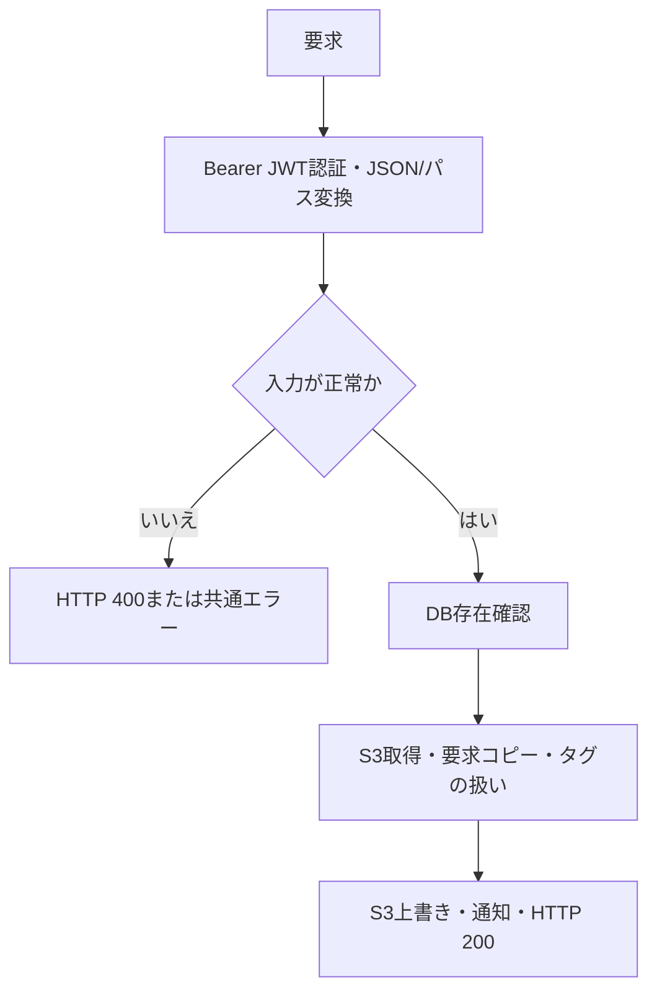
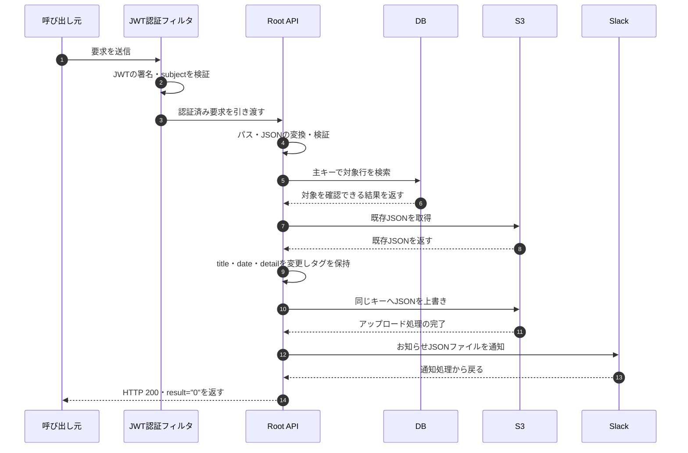

# 設計書 5.6.3. お知らせ情報編集API

## 1. 機能概要

- 既存お知らせのS3 JSONを読み込み、タイトル・日付文字列・本文を変更して同じキーへ保存する。
- 入出力の機械可読定義は[OpenAPI入出力仕様](./openapi.yaml)の`rootEditNews`を参照する。


- [NewsEditApiController.java](../../../ha-root/src/main/java/jp/co/ha/root/contents/news/controller/NewsEditApiController.java)
- [NewsEditApiRequest.java](../../../ha-root/src/main/java/jp/co/ha/root/contents/news/request/NewsEditApiRequest.java)
- [NewsEditApiResponse.java](../../../ha-root/src/main/java/jp/co/ha/root/contents/news/response/NewsEditApiResponse.java)
- [NewsServiceImpl.java](../../../ha-root/src/main/java/jp/co/ha/root/contents/news/service/NewsServiceImpl.java)
- [NewsInfoSearchServiceImpl.java](../../../ha-business/src/main/java/jp/co/ha/business/db/crud/read/impl/NewsInfoSearchServiceImpl.java)
- [NewsInfoMapper.xml](../../../ha-db/src/main/resources/jp/co/ha/db/mapper/NewsInfoMapper.xml)
- [NewsComponent.java](../../../ha-business/src/main/java/jp/co/ha/business/component/NewsComponent.java)
- [BeanUtil.java](../../../ha-common/src/main/java/jp/co/ha/common/util/BeanUtil.java)
- [BaseRootApiController.java](../../../ha-root/src/main/java/jp/co/ha/root/base/BaseRootApiController.java)
- [WebSecurityConfig.java](../../../ha-root/src/main/java/jp/co/ha/root/config/WebSecurityConfig.java)
- [JWTAuthorizationFilter.java](../../../ha-root/src/main/java/jp/co/ha/root/config/JWTAuthorizationFilter.java)

## 2. 処理概要



## 3. IF仕様

### 3.1. HTTPメソッド

| 項目 | 内容 | 備考 |
| --- | --- | --- |
| HTTPメソッド | `PUT` | 正常時はHTTP 200でJSONを返す。 |

### 3.2. エンドポイントURL

| 項目 | 内容 | 備考 |
| --- | --- | --- |
| エンドポイントURL | `/api/root/news/{seq_news_info_id}` | スキーム・ホスト・ポートは実行環境に従う。 |

| 項目名 | 必須 | 備考 |
| --- | --- | --- |
| `seq_news_info_id` | 必須 | 正数限定の制約は設けない。 |

### 3.3. リクエストIF

#### 3.3.1. リクエストヘッダ

| 項目名 | 型 | 必須 | 値 | 備考 |
| --- | --- | --- | --- | --- |
| `Authorization` | `string` | 必須 | Bearer形式のJWT | `Bearer {JWT}`の形式で、ログインAPIで発行された署名付きJWTを使用する。 |
| `Content-Type` | `string` | 必須 | `application/json` | リクエストボディをJSON形式で送信する。Accept-Charsetの独自必須検証は設けない。 |

#### 3.3.2. クエリパラメータ

特になし。

#### 3.3.3. JSONボディ

```json
{
  "title": "更新したお知らせ",
  "date": "2026/11/11",
  "detail": "本文を更新します。",
  "tag": {
    "color": "green",
    "name": "更新"
  }
}
```

| 項目名 | 型 | 必須 | 備考 |
| --- | --- | --- | --- |
| `title` | `string` | 必須 | null・空文字・空白のみ不可。 |
| `date` | `string` | 必須 | null・空文字・空白のみ不可。日付形式の検証はない。 |
| `detail` | `string` | 必須 | null・空文字・空白のみ不可。 |
| `tag` | `object` | 必須 | null不可。ただし現実装は既存タグを保持し、要求タグを保存しない。 |
| `tag.color` | `string` | 任意 | null・省略可。編集DTOには@Requiredや形式制約がない。保存値には反映されない。 |
| `tag.name` | `string` | 任意 | null・省略可。編集DTOには@Requiredがない。保存値には反映されない。 |

### 3.4. レスポンスIF

#### 3.4.1. レスポンスヘッダ

| 項目名 | 型 | 必須 | 備考 |
| --- | --- | --- | --- |
| `Content-Type` | `string` | 必須 | 正常JSON応答では`application/json`。このAPIでは新規JWTを発行するAuthorization応答ヘッダーを設定しない。 |

#### 3.4.2. JSONボディ

```json
{
  "result": "0"
}
```

| 項目名 | 型 | 必須 | 備考 |
| --- | --- | --- | --- |
| `result` | `string` | 必須 | 正常は`"0"`、異常は`"1"`。数値ではなく文字列。 |
| `errors` | `array` | 条件付き | エラー情報を設定した場合に出力する。各要素は`message`を持つ。内部エラーコード項目はない。 |

## 4. 処理フロー



| 番号 | 処理内容 | 関連項番 | 備考 |
| --- | --- | --- | --- |
| 1 | 要求を送信 | `3.3.1` | Authorization付き。 |
| 2 | JWTの署名・subjectを検証 | `4.1` | 成功する認証経路。 |
| 3 | 認証済み要求を引き渡す | `4.1` | 操作固有のロール・対象ユーザ照合なし。 |
| 4 | パス・JSONの変換・検証 | `4.1` | 正常入力の経路。 |
| 5 | 主キーで対象行を検索 | `4.2` | 削除フラグ条件なし。 |
| 6 | 対象を確認できる結果を返す | `4.2` | 対象が存在する経路。 |
| 7 | 既存JSONを取得 | `4.4` | DB行のS3_KEY。 |
| 8 | 既存JSONを返す | `4.4` | NewsDtoへ変換。 |
| 9 | title・date・detailを変更しタグを保持 | `4.3` | Tagは型不一致でコピーされない。 |
| 10 | 同じキーへJSONを上書き | `4.4` | DB更新日時は変更しない。 |
| 11 | アップロード処理の完了 | `4.4` | 既存キーを使う。 |
| 12 | お知らせJSONファイルを通知 | `4.4` | ROOTへ「お知らせ登録/編集」。 |
| 13 | 通知処理から戻る | `4.4` | S3保存後に実行。 |
| 14 | HTTP 200・result="0"を返す | `3.4.2` | IDや更新情報は返さない。 |

### 4.1. 入力チェック

| 対象 | ルール | 検証メッセージ・失敗時 |
| --- | --- | --- |
| 認証 | Authorization: Bearer <JWT>で署名とsubjectを検証する。除外URLではないため認証が必要。 | フィルタの共通処理。コントローラのerrors形式は保証しない。 |
| 利用対象 | JWT認証後にこの操作固有のロール別権限検査や、JWTのsubjectと対象ユーザIDを照合する処理は設けない。 | - |
| title/date/detail | @Required。null・空文字・空白のみを拒否する。 | title/date/detail is required（各項目名） |
| tag | @Requiredと@Valid。tag自体は必須。color/nameには必須制約がないためtag={}も入力検証を通る。 | tag is required |
| date | Stringの必須検証のみ。日付形式・実在性を検証しない。 | - |

要求DTOは`BaseRootApiRequest`を継承し、未定義のJSON項目は無視する。文字列の必須検証は`RequiredValidator`に従い、null・空文字・空白のみを拒否する。

| 発生条件 | HTTPステータス | 扱い |
| --- | --- | --- |
| Bean Validation | 400 | errors配列に各検証メッセージを設定する。 |
| パス・クエリの型変換 | 400 | <項目名> is type error. value=<入力値>。 |
| JSONの数値・日付変換 | 400または500 | HttpMessageNotReadableExceptionの原因が対象のInvalidFormatExceptionなら400。日付はdate format error. Please use yyyy/MM/dd.、数値はnumber format error. Please use numeric value.。その他は500・unexpected error.。 |
| 認証フィルタ・共通HTTP処理 | 共通処理に従う | 上記のresult/errors形式とは別に扱う。401と固定JSONへ一律に統一する実装はない。 |

入力・認証の例外がコントローラの例外ハンドラーに到達した場合は、ログ出力とROOT向けSlackエラー通知を行う。認証フィルタの例外は同じJSON形式に統一されない。

### 4.2. DB操作

#### 4.2.1. DB検索

```sql
SELECT
    *
FROM
    NEWS_INFO
WHERE
    SEQ_NEWS_INFO_ID = :seq_news_info_id;
```

| 対象カラム・制御 | 設定値・条件 | 備考 |
| --- | --- | --- |
| 取得列 | `*` | SQL1 |
| 検索条件 | `SEQ_NEWS_INFO_ID = :seq_news_info_id` | SQL1 |

主キー検索は削除フラグを条件にしないため、論理削除済みでもDB行があれば存在確認を通る。DB行の更新SQLは呼び出さないため、S3内容を変更してもDBの`UPDATE_DATE`は更新しない。

| 発生条件 | HTTPステータス | 扱い |
| --- | --- | --- |
| 対象のお知らせDB行なし | 400 | news_info is not found |
| BaseException | 500 | application error.。内部のBE/CE等のコードや詳細をそのままJSONへ出力しない。 |

DB検索・更新で予期しない例外が発生した場合はHTTP 500、`unexpected error.`とする。例外ハンドラーはログとROOT向けSlackエラー通知を行う。

### 4.3. 業務処理・応答編集

#### 4.3.1. 処理手順

| 順序 | 処理 | 内容 |
| --- | --- | --- |
| 1 | DB存在確認 | NEWS_INFOをseq_news_info_idで主キー検索する。削除フラグは条件に含めない。不在なら400でnews_info is not foundを返す。 |
| 2 | S3取得 | DBのS3_KEYで既存JSONを取得し、NewsDtoへ読み込む。 |
| 3 | 要求コピー | BeanUtil.copy(request,dto)で同名かつ同型フィールドをコピーする。title/date/detailを変更し、seq_news_info_idは既存JSONの値を保持する。 |
| 4 | タグの扱い | NewsEditApiRequest.TagとNewsDto.Tagは別型のためBeanUtilのコピー対象にならず、既存のtagを保持する。要求に色・名前を指定しても更新されない。 |
| 5 | S3上書き・通知 | 既存S3_KEYへUTF-8 JSONをアップロードし、同ファイルをSlackへ「お知らせ登録/編集」として送信する。HTTP 200、result="0"を返す。 |

| 発生条件 | HTTPステータス | 扱い |
| --- | --- | --- |
| 予期しない例外 | 500 | unexpected error.。不正JSONを常に400へ変換する実装ではない。 |

異常応答の基本形は`{"result":"1","errors":[{"message":"..."}]}`とする。正常応答はHTTP 200。例外ハンドラーはログ出力とROOT向けSlackエラー通知を行う。DB検索・更新や外部サービスの詳細はサーバ側の例外として扱う。エラー応答には内部エラーコードを設定しない。

### 4.4. S3上書き

既存JSONへtitle/date/detailをコピーし、同じS3キーへ保存する。`BeanUtil.isCopyTarget`がフィールド名と型の完全一致を要求するため、要求tagを`NewsDto.Tag`へコピーする処理は実行されない。登録処理にあるTagの明示変換は編集にはない。S3取得に失敗して新規JSONを作り直す処理や、S3保存とSlack通知を一体で取り消す処理はない。

| 発生条件 | HTTPステータス | 扱い |
| --- | --- | --- |
| BaseException | 500 | application error.。内部のBE/CE等のコードや詳細をそのままJSONへ出力しない。 |

S3取得・JSON変換・アップロード・削除などで発生したBaseExceptionはHTTP 500、`application error.`、それ以外の予期しない例外はHTTP 500、`unexpected error.`とする。例外ハンドラーへ到達した場合はログとROOT向けSlackエラー通知を行う。
