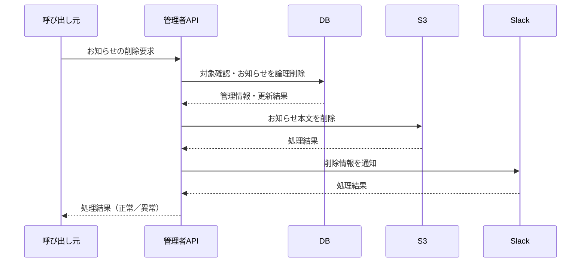
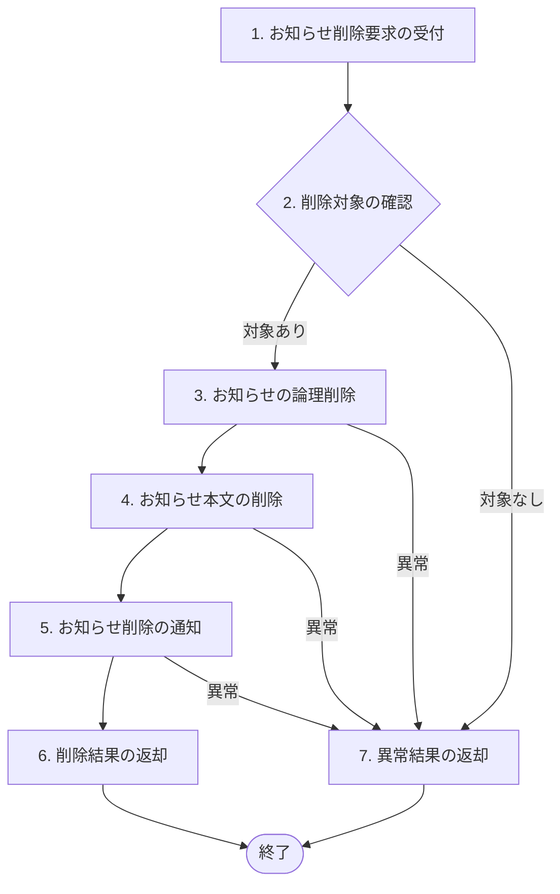

# 設計書 5.6.4. お知らせ情報削除API

## 1. 機能概要

- お知らせ情報をDBで論理削除した後、対応するS3 JSONを削除してSlackへ通知する。
- 入出力の機械可読定義は[OpenAPI入出力仕様](./openapi.yaml)の`rootDeleteNews`を参照する。


- [NewsDeleteApiController.java](../../../ha-root/src/main/java/jp/co/ha/root/contents/news/controller/NewsDeleteApiController.java)
- [NewsDeleteApiRequest.java](../../../ha-root/src/main/java/jp/co/ha/root/contents/news/request/NewsDeleteApiRequest.java)
- [NewsDeleteApiResponse.java](../../../ha-root/src/main/java/jp/co/ha/root/contents/news/response/NewsDeleteApiResponse.java)
- [NewsServiceImpl.java](../../../ha-root/src/main/java/jp/co/ha/root/contents/news/service/NewsServiceImpl.java)
- [NewsInfoSearchServiceImpl.java](../../../ha-business/src/main/java/jp/co/ha/business/db/crud/read/impl/NewsInfoSearchServiceImpl.java)
- [NewsInfoUpdateServiceImpl.java](../../../ha-business/src/main/java/jp/co/ha/business/db/crud/update/impl/NewsInfoUpdateServiceImpl.java)
- [NewsInfoMapper.xml](../../../ha-db/src/main/resources/jp/co/ha/db/mapper/NewsInfoMapper.xml)
- [NewsComponent.java](../../../ha-business/src/main/java/jp/co/ha/business/component/NewsComponent.java)
- [BeanUtil.java](../../../ha-common/src/main/java/jp/co/ha/common/util/BeanUtil.java)
- [BaseRootApiController.java](../../../ha-root/src/main/java/jp/co/ha/root/base/BaseRootApiController.java)
- [WebSecurityConfig.java](../../../ha-root/src/main/java/jp/co/ha/root/config/WebSecurityConfig.java)
- [JWTAuthorizationFilter.java](../../../ha-root/src/main/java/jp/co/ha/root/config/JWTAuthorizationFilter.java)

## 2. 処理概要



## 3. IF仕様

### 3.1. HTTPメソッド

| 項目 | 内容 | 備考 |
| --- | --- | --- |
| HTTPメソッド | `DELETE` | 正常時はHTTP 200でJSONを返す。 |

### 3.2. エンドポイントURL

| 項目 | 内容 | 備考 |
| --- | --- | --- |
| エンドポイントURL | `/api/root/news/{seq_news_info_id}` | スキーム・ホスト・ポートは実行環境に従う。 |

| 項目名 | 必須 | 備考 |
| --- | --- | --- |
| `seq_news_info_id` | 必須 | 正数限定の制約は設けない。 |

### 3.3. リクエストIF

#### 3.3.1. リクエストヘッダ

| 項目名 | 型 | 必須 | 値 | 備考 |
| --- | --- | --- | --- | --- |
| `Authorization` | `string` | 必須 | Bearer形式のJWT | `Bearer {JWT}`の形式で、ログインAPIで発行された署名付きJWTを使用する。 |

#### 3.3.2. クエリパラメータ

特になし。

#### 3.3.3. JSONボディ

特になし。

### 3.4. レスポンスIF

#### 3.4.1. レスポンスヘッダ

| 項目名 | 型 | 必須 | 備考 |
| --- | --- | --- | --- |
| `Content-Type` | `string` | 必須 | 正常JSON応答では`application/json`。このAPIでは新規JWTを発行するAuthorization応答ヘッダーを設定しない。 |

#### 3.4.2. JSONボディ

```json
{
  "result": "0"
}
```

| 項目名 | 型 | 必須 | 備考 |
| --- | --- | --- | --- |
| `result` | `string` | 必須 | 正常は`"0"`、異常は`"1"`。数値ではなく文字列。 |
| `errors` | `array` | 条件付き | エラー情報を設定した場合に出力する。各要素は`message`を持つ。内部エラーコード項目はない。 |

## 4. 処理フロー



| 処理順 | 処理概要 | 処理詳細 | 関連項番 |
| --- | --- | --- | --- |
| 1 | お知らせ削除要求の受付 | Bearer認証を経てパスのお知らせIDを受け付ける。認証不成立・ID不正は検索へ進めない。 | 4.1 |
| 2 | 削除対象の確認 | DBから対象とS3キーを取得する。該当なし・削除済みは400で終了し、有効なお知らせだけを処理する。 | 4.2.1、4.3.1 |
| 3 | お知らせの論理削除 | 削除フラグと更新日時をDBへ保存する。物理削除は行わない。 | 4.3.2 |
| 4 | お知らせ本文の削除 | 取得したS3キーの本文JSONを削除する。後続失敗でも確定済みのDB更新は元に戻さない。 | 4.4.1、4.4.3 |
| 5 | お知らせ削除の通知 | お知らせIDを含む削除情報をROOT向けSlackへ通知する。DB・S3・通知の一括取り消しは行わない。 | 4.4.2、4.4.3 |
| 6 | 削除結果の返却 | 成功結果をHTTP 200で返す。削除済みへの再実行は対象なしとして400で終了する。 | 3.4.2、4.3.1 |
| 7 | 異常結果の返却 | 対象なしやDB更新・本文削除・通知の失敗は、発生した処理の異常応答で終了する。 | 4.1.2、4.3.1、4.4.3 |

### 4.1. 入力チェック

#### 4.1.1. 認証・利用範囲の確認

| 対象 | ルール | 検証メッセージ・失敗時 |
| --- | --- | --- |
| 認証 | Authorization: Bearer <JWT>で署名とsubjectを検証する。除外URLではないため認証が必要。 | フィルタの共通処理。コントローラのerrors形式は保証しない。 |
| 利用対象 | JWT認証後にこの操作固有のロール別権限検査や、JWTのsubjectと対象ユーザIDを照合する処理は設けない。 | - |

#### 4.1.2. 入力異常時の扱い

要求DTOに追加の検索項目はない。

| 発生条件 | HTTPステータス | 扱い |
| --- | --- | --- |
| Bean Validation | 400 | errors配列に各検証メッセージを設定する。 |
| パス・クエリの型変換 | 400 | <項目名> is type error. value=<入力値>。 |
| JSONの数値・日付変換 | 400または500 | HttpMessageNotReadableExceptionの原因が対象のInvalidFormatExceptionなら400。日付はdate format error. Please use yyyy/MM/dd.、数値はnumber format error. Please use numeric value.。その他は500・unexpected error.。 |
| 認証フィルタ・共通HTTP処理 | 共通処理に従う | 上記のresult/errors形式とは別に扱う。401と固定JSONへ一律に統一する実装はない。 |

入力・認証の例外がコントローラの例外ハンドラーに到達した場合は、ログ出力とROOT向けSlackエラー通知を行う。認証フィルタの例外は同じJSON形式に統一されない。

### 4.2. DB操作
#### 4.2.1. 検索・更新

```sql
SELECT
    *
FROM
    NEWS_INFO
WHERE
    SEQ_NEWS_INFO_ID = :seq_news_info_id
    AND DELETE_FLAG = false;

UPDATE
    NEWS_INFO
SET
    DELETE_FLAG = TRUE
    , UPDATE_DATE = :system_datetime
WHERE
    SEQ_NEWS_INFO_ID = :seq_news_info_id;
```

| 項目 | 設定値 | 備考 |
| --- | --- | --- |
| `:seq_news_info_id` | パスの`seq_news_info_id` | 主キー検索と論理削除の更新条件に使用する。 |
| `:system_datetime` | 各CRUD呼び出し時のシステム日時 | DB共通処理で登録日時・更新日時を設定する。 |

### 4.3. 業務処理・応答編集

#### 4.3.1. 削除対象の確認

| 順序 | 処理 | 内容 |
| --- | --- | --- |
| 1 | 存在確認 | NEWS_INFOをseq_news_info_idと`DELETE_FLAG = false`で検索する。有効な行が存在すれば処理を続け、該当なし・削除済みは400でnews_info is not foundを返す。 |

#### 4.3.2. 論理削除の保存

| 順序 | 処理 | 内容 |
| --- | --- | --- |
| 1 | 論理削除 | 取得EntityのDELETE_FLAGをtrueにしてNewsInfoUpdateService.updateを呼ぶ。DB共通処理が更新日時を設定する。 |


| 発生条件 | HTTPステータス | 扱い |
| --- | --- | --- |
| 予期しない例外 | 500 | unexpected error.。不正JSONを常に400へ変換する実装ではない。 |

異常応答の基本形は`{"result":"1","errors":[{"message":"..."}]}`とする。正常応答はHTTP 200。例外ハンドラーはログ出力とROOT向けSlackエラー通知を行う。DB検索・更新や外部サービスの詳細はサーバ側の例外として扱う。エラー応答には内部エラーコードを設定しない。

**SQL呼び出し時の結果・例外の扱い**

実際の更新は取得Entityの非null列を`updateByExampleSelective`で書き戻すため、S3_KEYや登録日時も同じ値で更新対象となる。物理DELETEを実行しない。削除済み行は検索時点で除外し、再削除やS3本文の削除・通知は行わない。

| 発生条件 | HTTPステータス | 扱い |
| --- | --- | --- |
| 対象の有効なお知らせDB行なし（削除済みを含む） | 400 | news_info is not found |
| BaseException | 500 | application error.。内部のBE/CE等のコードや詳細をそのままJSONへ出力しない。 |

DB検索・更新で予期しない例外が発生した場合はHTTP 500、`unexpected error.`とする。例外ハンドラーはログとROOT向けSlackエラー通知を行う。

### 4.4. 外部処理と失敗時の状態

#### 4.4.1. S3本文の削除

| 順序 | 処理 | 内容 |
| --- | --- | --- |
| 1 | S3削除 | 取得したS3_KEYを使ってAwsS3Component.removeS3ObjectByKeysを実行する。 |

DBの論理削除が完了した後、取得済みのS3キーに対応するお知らせJSONを削除する。削除に失敗した場合はSlack通知へ進まない。

#### 4.4.2. Slackへの削除通知

| 順序 | 処理 | 内容 |
| --- | --- | --- |
| 1 | Slack通知・返却 | ROOT通知先へ「お知らせ情報ID=<ID>を削除.」を送信し、HTTP 200、result="0"を返す。 |

S3削除後、ROOT用通知先へ「お知らせ情報ID=<ID>を削除.」を送信する。通知後に正常応答を返す。

#### 4.4.3. 後続失敗時の状態

DB更新が完了してからS3オブジェクトを削除し、その後にSlackへ通知する。S3削除や後続処理が失敗した場合に、DBの論理削除を元に戻す処理はない。S3とDBの変更全体を原子的に実行するAPIではない。

| 発生条件 | HTTPステータス | 扱い |
| --- | --- | --- |
| BaseException | 500 | application error.。内部のBE/CE等のコードや詳細をそのままJSONへ出力しない。 |

S3取得・JSON変換・アップロード・削除などで発生したBaseExceptionはHTTP 500、`application error.`、それ以外の予期しない例外はHTTP 500、`unexpected error.`とする。例外ハンドラーへ到達した場合はログとROOT向けSlackエラー通知を行う。
