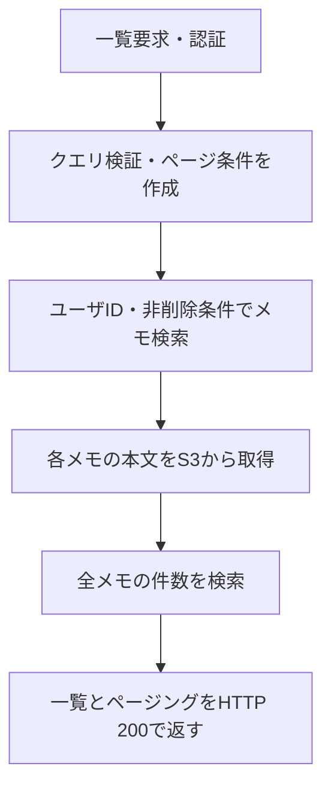
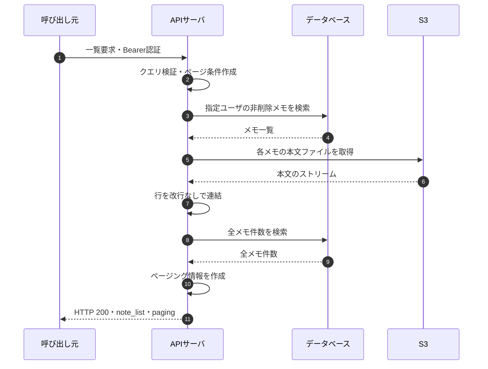

# 設計書 5.7.1. メモ情報一覧取得API

## 1. 機能概要

- 指定した管理者サイトユーザの非削除メモをページ単位で取得し、S3から読み込んだ本文とページング情報を返す。
- 入出力の定義は[OpenAPI入出力仕様](./openapi.yaml)の`rootListNotes`を参照する。

## 2. 処理概要



## 3. IF仕様

### 3.1. HTTPメソッド

| 項目 | 内容 | 備考 |
| --- | --- | --- |
| HTTPメソッド | `GET` | — |

### 3.2. エンドポイントURL

| 項目 | 内容 | 備考 |
| --- | --- | --- |
| エンドポイントURL | `/api/root/note` | スキーム・ホスト・ポートは実行環境に従う |
| パス変数 | なし | — |

### 3.3. リクエストIF

#### 3.3.1. リクエストヘッダ

| 項目名 | 型 | 必須 | 値 | 備考 |
| --- | --- | --- | --- | --- |
| `Authorization` | `string` | 必須 | Bearer形式のJWT | `Bearer {JWT}`の形式で、ログインAPIで発行されたトークンを指定する |

#### 3.3.2. クエリパラメータ

| 項目名 | 型 | 必須 | 備考 |
| --- | --- | --- | --- |
| `seq_login_id` | `integer`（`int64`） | 必須 | メモを検索する管理者サイトログインID。正数限定・ユーザ存在の個別チェックはない |
| `page` | `integer`（`int32`） | 任意 | 0始まり、0以上。省略・空文字の場合は`0` |

#### 3.3.3. JSONボディ

特になし。

### 3.4. レスポンスIF

#### 3.4.1. レスポンスヘッダ

| 項目名 | 型 | 必須 | 備考 |
| --- | --- | --- | --- |
| `Content-Type` | `string` | JSON応答時 | `application/json`。認証フィルターなどの応答は同一形式を保証しない |

#### 3.4.2. JSONボディ

| 応答例 | HTTPステータス | 備考 |
| --- | --- | --- |
| 正常応答 | `200` | 以下の1つ目のJSON例 |
| 異常応答 | `400`または`500` | 以下の2つ目のJSONは400の例。条件・メッセージは「4. 処理フロー」の各詳細節に従う |

```json
{
  "result": "0",
  "note_list": [
    {
      "seq_root_user_note_info_id": 200,
      "title": "作業メモ",
      "detail": "一行目二行目",
      "reg_date": "2026/11/11 10:00:00",
      "update_date": "2026/11/11 10:00:00"
    }
  ],
  "paging": {
    "total_record_num": 1,
    "from_record_num": 1,
    "to_record_num": 1,
    "total_page": 1,
    "current_page_num": 0,
    "record_per_page": 10,
    "can_go_next": false,
    "can_go_previous": false,
    "can_go_last": false,
    "can_go_first": false,
    "next_href": "apidata?page=0",
    "previous_href": "apidata?page=0",
    "last_href": "apidata?page=0",
    "first_href": "apidata?page=0"
  }
}
```

```json
{
  "result": "1",
  "errors": [
    {
      "message": "page is positive"
    }
  ]
}
```

| 項目名 | 型 | 必須 | 備考 |
| --- | --- | --- | --- |
| `result` | `string` | 必須 | 正常は文字列`"0"`、異常は文字列`"1"`。数値ではない |
| `errors` | `array<object>` | 異常時 | エラー情報の配列。正常時は設定しない |
| `errors[].message` | `string`・`null` | 各エラー要素 | メッセージを設定する。外部エラーコードは付与しない |
| `note_list` | `array<object>` | 正常時 | 指定ユーザの非削除メモ。対象なしは空配列 |
| `note_list[].seq_root_user_note_info_id` | `integer`（`int64`）・`null` | 各メモ要素 | DBのメモID。項目自体は省略しない |
| `note_list[].title` | `string`・`null` | 各メモ要素 | DBの件名。項目自体は省略しない |
| `note_list[].detail` | `string` | 各メモ要素 | S3本文を行単位で読み、改行を除いて連結した文字列 |
| `note_list[].reg_date` | `string`・`null` | 各メモ要素 | `yyyy/MM/dd HH:mm:ss`形式。項目自体は省略しない |
| `note_list[].update_date` | `string`・`null` | 各メモ要素 | `yyyy/MM/dd HH:mm:ss`形式。項目自体は省略しない |
| `paging` | `object` | 正常時 | 全ユーザ・削除済みを含む全メモ件数から作成する |
| `paging.total_record_num` | `integer`（`int64`） | 正常時 | ページング計算に使用した全メモ件数 |
| `paging.from_record_num` | `integer`（`int64`） | 正常時 | 表示開始位置。ページング上の対象なしは0 |
| `paging.to_record_num` | `integer`（`int64`） | 正常時 | 表示終了位置。ページング上の対象なしは0 |
| `paging.total_page` | `integer`（`int64`） | 正常時 | 総ページ数 |
| `paging.current_page_num` | `integer`（`int32`） | 正常時 | 要求された0始まりのページ番号 |
| `paging.record_per_page` | `integer`（`int32`） | 正常時 | 設定された1ページの件数 |
| `paging.can_go_next` | `boolean` | 正常時 | 次ページへ移動できる場合`true` |
| `paging.can_go_previous` | `boolean` | 正常時 | 前ページへ移動できる場合`true` |
| `paging.can_go_last` | `boolean` | 正常時 | 最終ページへ移動できる場合`true` |
| `paging.can_go_first` | `boolean` | 正常時 | 先頭ページへ移動できる場合`true` |
| `paging.next_href` | `string`・`null` | 正常時 | 次ページのリンク文字列。基底は`apidata?page` |
| `paging.previous_href` | `string`・`null` | 正常時 | 前ページのリンク文字列 |
| `paging.last_href` | `string`・`null` | 正常時 | 最終ページのリンク文字列 |
| `paging.first_href` | `string`・`null` | 正常時 | 先頭ページのリンク文字列 |

## 4. 処理フロー



| 番号 | 処理内容 | 関連項番 | 備考 |
| --- | --- | --- | --- |
| 1 | 一覧要求・Bearer認証 | 4.5 | seq_login_idとpageを受け付ける |
| 2 | クエリ検証・ページ条件作成 | 4.1 | pageは0始まり、既定値0 |
| 3 | 指定ユーザの非削除メモを検索 | 4.2.1 | メモID降順、ページ単位で取得する |
| 4 | メモ一覧 | 4.2.1 | 0件も正常終了する |
| 5 | 各メモの本文ファイルを取得 | 4.4 | メモが0件の場合はS3取得を行わない |
| 6 | 本文のストリーム | 4.4 | DBのS3_KEYを使用する |
| 7 | 行を改行なしで連結 | 4.4 | JVM既定文字コードで読み込む |
| 8 | 全メモ件数を検索 | 4.2.2 | ユーザID・削除状態では絞り込まない |
| 9 | 全メモ件数 | 4.2.2 | 一覧検索の絞り込み範囲とは異なる |
| 10 | ページング情報を作成 | 4.4 | リンク基底はapidata?page |
| 11 | HTTP 200・note_list・paging | 4.3 | 本文取得失敗時は一覧全体が異常終了する |

### 4.1. 入力チェック

| 対象 | 条件 | 備考 |
| --- | --- | --- |
| `seq_login_id` | 必須 | 符号付き64ビット整数として受け付ける |
| `page` | 0以上 | 省略・空文字は0。0始まり |

| 発生条件 | HTTPステータス | `errors[].message`・扱い |
| --- | --- | --- |
| 必須クエリが欠落 | `400` | 共通処理が引数情報ごとに`{引数情報} is required`を設定する |
| クエリの数値変換失敗 | `400` | `{項目名} is type error. value={値}` |
| `page`が負数 | `400` | `page is positive` |

### 4.2. DB操作

#### 4.2.1. 一覧検索

```sql
SELECT
    SEQ_ROOT_USER_NOTE_INFO_ID
    , SEQ_ROOT_LOGIN_INFO_ID
    , TITLE
    , S3_KEY
    , DELETE_FLAG
    , REG_DATE
    , UPDATE_DATE
FROM
    ROOT_USER_NOTE_INFO
WHERE
    SEQ_ROOT_LOGIN_INFO_ID = :seqLoginId
    AND DELETE_FLAG = FALSE
ORDER BY
    SEQ_ROOT_USER_NOTE_INFO_ID DESC
LIMIT
    :pageSize
OFFSET
    :offset;
```

| パラメータ | 設定値 |
| --- | --- |
| `pageSize` | `front.note.page` |
| `offset` | `page * pageSize` |

#### 4.2.2. ページング用件数検索

```sql
SELECT
    COUNT(*)
FROM
    ROOT_USER_NOTE_INFO;
```

| 集計条件 | 設定内容 |
| --- | --- |
| 対象テーブル | `ROOT_USER_NOTE_INFO`の全行 |
| ログインID | `countBySeqLoginId(null)`のため絞り込まない |
| 削除状態 | 絞り込まない。削除済みの行も件数に含める |

| 応答項目 | 設定内容 |
| --- | --- |
| `note_list[].seq_root_user_note_info_id` | DBのメモID |
| `note_list[].title` | DBの件名 |
| `note_list[].detail` | S3本文を行単位で読み、改行を除いて連結した文字列 |
| `note_list[].reg_date`・`update_date` | DBの日時を`yyyy/MM/dd HH:mm:ss`形式で返す |
| `paging` | 全メモ件数・要求ページ・設定表示件数から作成する |

| 発生条件 | HTTPステータス | `errors[].message`・扱い |
| --- | --- | --- |
| 一覧・件数のDB検索で業務例外 | `500` | `application error.` |
| 一覧・件数のDB検索でその他の例外 | `500` | `unexpected error.` |

### 4.3. 業務処理・応答生成

| 順序 | 処理 | 内容 |
| --- | --- | --- |
| 1 | クエリ受付 | `seq_login_id`を必須で受け付け、`page`が0以上であることを検証する |
| 2 | ページ条件作成 | 件数は`front.note.page`を使用する。現在のlocal/dev設定値は10件 |
| 3 | メモ検索 | 指定したログインIDかつ非削除の行を、メモIDの降順で取得する |
| 4 | 本文取得 | 行ごとの`S3_KEY`でファイルを読み、JVM既定文字コードのReaderで解釈する。各行を改行文字なしで連結して`detail`へ設定する |
| 5 | 件数取得 | `countBySeqLoginId(null)`を呼び出し、ログインID・削除フラグで絞らない全メモ件数を取得する |
| 6 | ページング編集 | 上記全件数でページングを作成する。リンクの基底文字列は`apidata?page` |
| 7 | 応答 | HTTP `200`、`result="0"`、`note_list`、`paging`を返す。対象なしの場合は空配列を返す |

| 項目 | 仕様 |
| --- | --- |
| 一覧と件数の範囲 | 一覧は指定ユーザの非削除行、ページング件数は全ユーザ・削除済みを含む行数となる |
| ページ番号 | 検索時に範囲内へ補正しないため、範囲外ページは空の一覧となる |
| 本文取得失敗 | 一覧全体を異常終了し、本文を取得できた行だけの成功応答は返さない |
| 認証と対象ID | Bearer認証は行うが、クエリのログインIDとJWTの主体の一致検証は本処理にない |

| 発生条件 | HTTPステータス | `errors[].message`・扱い |
| --- | --- | --- |
| その他の例外 | `500` | `unexpected error.` |

### 4.4. S3本文取得・ページング

| 処理 | 内容 |
| --- | --- |
| S3本文取得 | DBのS3_KEYで取得し、JVM既定文字コードのReaderで行単位に読み込む。改行は挿入せず連結する |
| ページング | front.note.pageと全メモ件数から作成する。リンク基底はapidata?page |
| 失敗時 | 本文取得が失敗した場合、取得済みの行だけで成功応答を返す処理はない |

| 発生条件 | HTTPステータス | `errors[].message`・扱い |
| --- | --- | --- |
| S3ダウンロード・読み込み等の業務例外 | `500` | `application error.` |

### 4.5. 認証・通知

| 認証・通知 | 仕様 |
| --- | --- |
| 認証 | 本APIはBearer認証を行う。セッションは作成しない |
| 実行権限 | 認証フィルター内でロール別実行制限や、要求の対象IDとJWT主体の一致確認は行わない |
| 例外通知 | 共通例外は基底コントローラでログ出力・Slack通知を行う。HTTPとメッセージは各処理の詳細表に従う |

| 共通仕様 | 内容 |
| --- | --- |
| 結果 | 正常は文字列`"0"`、異常は文字列`"1"` |
| 異常応答 | `errors`配列の各要素に`message`を設定する |
| 共通例外 | 基底コントローラでログ出力・Slack通知を行う |
| フィルターの異常 | 認証フィルター内の異常は上記JSON形式を保証しない |
