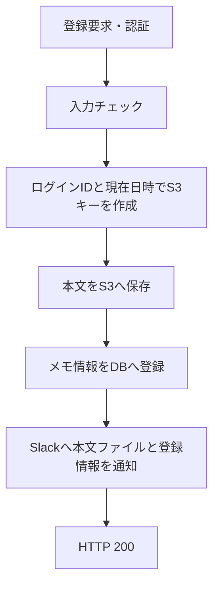
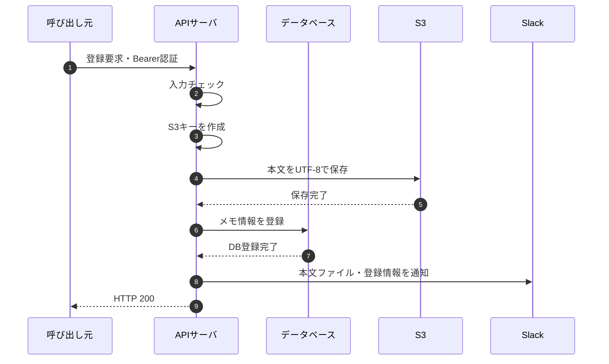

# 設計書 5.7.2. メモ情報登録API

## 1. 機能概要

- メモ本文をS3へ保存し、管理者サイトユーザのメモ情報をDBへ登録する。
- 入出力の定義は[OpenAPI入出力仕様](./openapi.yaml)の`rootRegisterNote`を参照する。

## 2. 処理概要



## 3. IF仕様

### 3.1. HTTPメソッド

| 項目 | 内容 | 備考 |
| --- | --- | --- |
| HTTPメソッド | `POST` | — |

### 3.2. エンドポイントURL

| 項目 | 内容 | 備考 |
| --- | --- | --- |
| エンドポイントURL | `/api/root/note` | スキーム・ホスト・ポートは実行環境に従う |
| パス変数 | なし | — |

### 3.3. リクエストIF

#### 3.3.1. リクエストヘッダ

| 項目名 | 型 | 必須 | 値 | 備考 |
| --- | --- | --- | --- | --- |
| `Authorization` | `string` | 必須 | Bearer形式のJWT | `Bearer {JWT}`の形式で、ログインAPIで発行されたトークンを指定する |
| `Content-Type` | `string` | 必須 | `application/json` | リクエストボディをJSON形式で送信する。 |

#### 3.3.2. クエリパラメータ

特になし。

#### 3.3.3. JSONボディ

```json
{
  "seq_login_id": 100,
  "title": "作業メモ",
  "detail": "確認事項を記録する。\n次回作業で確認する。"
}
```

| 項目名 | 型 | 必須 | 備考 |
| --- | --- | --- | --- |
| `seq_login_id` | `integer`（`int64`） | 必須 | 0以上。ユーザ存在・JWT主体との一致を本処理で確認しない |
| `title` | `string` | 必須 | `null`・空文字・空白のみ不可。30文字以下 |
| `detail` | `string` | 必須 | `null`・空文字・空白のみ不可。独自の最大長制限はない |
| 未定義項目 | — | — | 無視する |

### 3.4. レスポンスIF

#### 3.4.1. レスポンスヘッダ

| 項目名 | 型 | 必須 | 備考 |
| --- | --- | --- | --- |
| `Content-Type` | `string` | JSON応答時 | `application/json`。認証フィルターなどの応答は同一形式を保証しない |

#### 3.4.2. JSONボディ

| 応答例 | HTTPステータス | 備考 |
| --- | --- | --- |
| 正常応答 | `200` | 以下の1つ目のJSON例 |
| 異常応答 | `400`または`500` | 以下の2つ目のJSONは400の例。条件・メッセージは「4. 処理フロー」の各詳細節に従う |

```json
{
  "result": "0"
}
```

```json
{
  "result": "1",
  "errors": [
    {
      "message": "title is required"
    }
  ]
}
```

| 項目名 | 型 | 必須 | 備考 |
| --- | --- | --- | --- |
| `result` | `string` | 必須 | 正常は文字列`"0"`、異常は文字列`"1"`。数値ではない |
| `errors` | `array<object>` | 異常時 | エラー情報の配列。正常時は設定しない |
| `errors[].message` | `string`・`null` | 各エラー要素 | メッセージを設定する。外部エラーコードは付与しない |

## 4. 処理フロー



| 番号 | 処理内容 | 関連項番 | 備考 |
| --- | --- | --- | --- |
| 1 | 登録要求・Bearer認証 | 4.5 | ログインID・件名・本文を受け付ける |
| 2 | 入力チェック | 4.1 | 失敗時は400で終了する |
| 3 | S3キーを作成 | 4.4 | ログインIDと秒単位のシステム日時を使用する |
| 4 | 本文をUTF-8で保存 | 4.4 | 同一キーがあれば上書きとなる |
| 5 | 保存完了 | 4.4 | 保存後にDB登録する |
| 6 | メモ情報を登録 | 4.2.1 | 件名・ログインID・S3キー・非削除状態 |
| 7 | DB登録完了 | 4.2.1 | CRUDサービスのトランザクションで確定する |
| 8 | 本文ファイル・登録情報を通知 | 4.4 | ROOT用の通知先へ送信する |
| 9 | HTTP 200 | 4.3 | resultは文字列0。採番IDは応答に含めない |

### 4.1. 入力チェック

| 対象 | 条件 | エラーメッセージ |
| --- | --- | --- |
| `seq_login_id` | 必須 | `seq_login_id is required` |
| `seq_login_id` | 0以上 | `seq_login_id is positive`。0も許可する |
| `title` | 必須 | `title is required` |
| `title` | 30文字以下 | `title is less equal 30 byte`。実際の長さはUTF-16コード単位で判定する |
| `detail` | 必須 | `detail is required` |

| 発生条件 | HTTPステータス | `errors[].message`・扱い |
| --- | --- | --- |
| 項目検証失敗 | `400` | 「4.1. 入力チェック」のメッセージを検出分返す |
| ボディ数値の変換失敗を共通処理で識別 | `400` | `number format error. Please use numeric value.` |
| その他のJSON読み込み失敗 | `500` | `unexpected error.` |

### 4.2. DB操作

#### 4.2.1. メモ情報登録

```sql
INSERT INTO
    ROOT_USER_NOTE_INFO (
        SEQ_ROOT_USER_NOTE_INFO_ID
        , SEQ_ROOT_LOGIN_INFO_ID
        , TITLE
        , S3_KEY
        , DELETE_FLAG
        , REG_DATE
        , UPDATE_DATE
    )
VALUES (
    NULL
    , :seqLoginId
    , :title
    , :s3Key
    , FALSE
    , :now
    , :now
);
```

| カラム | 設定内容 |
| --- | --- |
| `SEQ_ROOT_USER_NOTE_INFO_ID` | DBで採番する |
| `SEQ_ROOT_LOGIN_INFO_ID` | 要求の`seq_login_id` |
| `TITLE` | 要求の`title` |
| `S3_KEY` | 作成したS3キー |
| `DELETE_FLAG` | `false` |
| `REG_DATE`・`UPDATE_DATE` | DB共通登録処理でシステム日時を設定する |
| 本文 | DBには保存せず、S3へ保存する |

| 発生条件 | HTTPステータス | `errors[].message`・扱い |
| --- | --- | --- |
| DB登録で業務例外 | `500` | `application error.`。登録サービスのトランザクションをロールバックする |
| DB登録でその他の例外 | `500` | `unexpected error.`。登録サービスのトランザクションをロールバックする |

### 4.3. 業務処理・応答生成

| 順序 | 処理 | 内容 |
| --- | --- | --- |
| 1 | 入力チェック | 全項目の検証を行い、失敗時はHTTP `400`で終了する |
| 2 | S3キー作成 | `note/{seq_login_id}/{yyyyMMddHHmmss}.txt`をシステム日時で作成する |
| 3 | 本文保存 | AWS設定のバケットへ、要求本文をUTF-8でアップロードする |
| 4 | DB登録 | ログインID・件名・S3キー・非削除状態を登録する |
| 5 | Slack通知 | 本文ファイルと、メモID・S3キーをROOT用の通知先へ送信する |
| 6 | 正常応答 | HTTP `200`、`result="0"`を返す。採番IDは応答に含めない |

| 発生条件 | HTTPステータス | `errors[].message`・扱い |
| --- | --- | --- |
| その他の例外 | `500` | `unexpected error.` |

### 4.4. S3保存・Slack通知

| 外部保存 | 仕様 |
| --- | --- |
| S3キーの精度 | 秒単位。同一ログインID・同一秒の登録は同じキーへの書き込みとなる |
| トランザクション | DB登録はCRUDサービスのトランザクションで行う。S3・DB・Slackをまとめたトランザクションはない |
| 後続失敗 | S3保存後にDB登録が失敗しても、S3ファイルを削除する補償処理はない |

| 処理 | 内容 |
| --- | --- |
| S3保存 | note/{seq_login_id}/{yyyyMMddHHmmss}.txtへ要求本文をUTF-8で保存する |
| 通知 | DB登録後、本文ファイルとメモID・S3キーをROOT用のSlack通知先へ送信する |

| 発生条件 | HTTPステータス | `errors[].message`・扱い |
| --- | --- | --- |
| S3保存等の業務例外 | `500` | `application error.` |

### 4.5. 認証・通知

| 認証・通知 | 仕様 |
| --- | --- |
| 認証 | 本APIはBearer認証を行う。セッションは作成しない |
| 実行権限 | 認証フィルター内でロール別実行制限や、要求の対象IDとJWT主体の一致確認は行わない |
| 例外通知 | 共通例外は基底コントローラでログ出力・Slack通知を行う。HTTPとメッセージは各処理の詳細表に従う |

| 共通仕様 | 内容 |
| --- | --- |
| 応答 | 正常は文字列`result="0"`。異常は文字列`result="1"`と`errors`配列の`message` |
| 通知 | 共通例外は基底コントローラでログ出力・Slack通知を行う |
| フィルターの異常 | 認証フィルター内の異常は上記JSON形式を保証しない |
