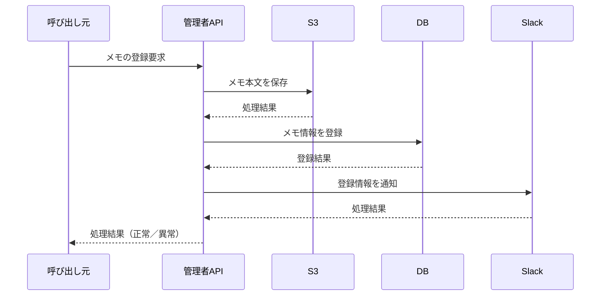
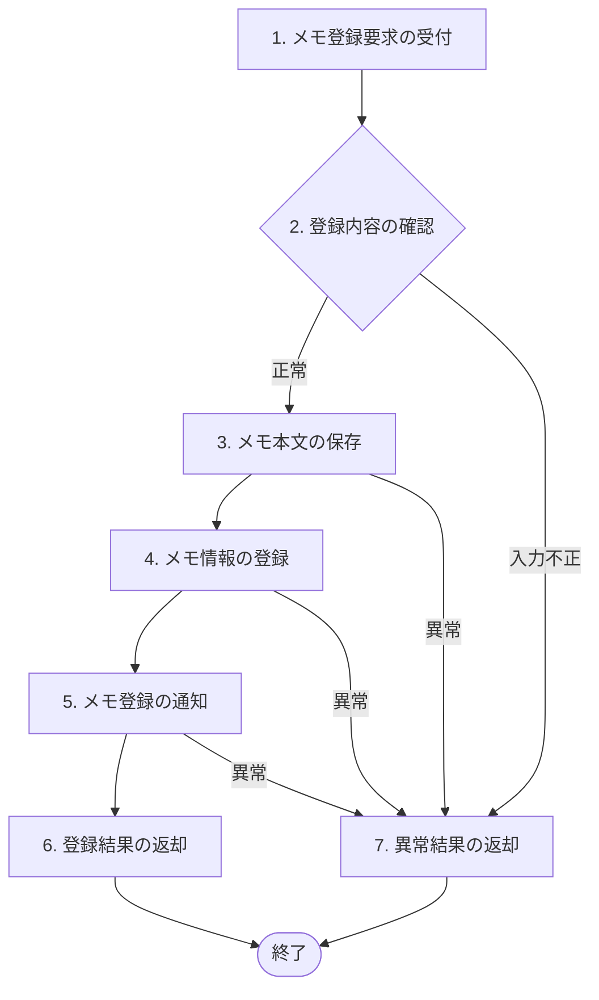

# 設計書 5.7.2. メモ情報登録API

## 1. 機能概要

- メモ本文をS3へ保存し、管理者サイトユーザのメモ情報をDBへ登録する。
- 入出力の定義は[OpenAPI入出力仕様](./openapi.yaml)の`rootRegisterNote`を参照する。

## 2. 処理概要



## 3. IF仕様

### 3.1. HTTPメソッド

| 項目 | 内容 | 備考 |
| --- | --- | --- |
| HTTPメソッド | `POST` | — |

### 3.2. エンドポイントURL

| 項目 | 内容 | 備考 |
| --- | --- | --- |
| エンドポイントURL | `/api/root/note` | スキーム・ホスト・ポートは実行環境に従う |
| パス変数 | なし | — |

### 3.3. リクエストIF

#### 3.3.1. リクエストヘッダ

| 項目名 | 型 | 必須 | 値 | 備考 |
| --- | --- | --- | --- | --- |
| `Authorization` | `string` | 必須 | Bearer形式のJWT | `Bearer {JWT}`の形式で、ログインAPIで発行されたトークンを指定する |
| `Content-Type` | `string` | 必須 | `application/json` | リクエストボディをJSON形式で送信する。 |

#### 3.3.2. クエリパラメータ

特になし。

#### 3.3.3. JSONボディ

```json
{
  "seq_login_id": 100,
  "title": "作業メモ",
  "detail": "確認事項を記録する。\n次回作業で確認する。"
}
```

| 項目名 | 型 | 必須 | 備考 |
| --- | --- | --- | --- |
| `seq_login_id` | `integer`（`int64`） | 必須 | 0以上。ユーザ存在・JWT主体との一致を本処理で確認しない |
| `title` | `string` | 必須 | `null`・空文字・空白のみ不可。30文字以下 |
| `detail` | `string` | 必須 | `null`・空文字・空白のみ不可。独自の最大長制限はない |
| 未定義項目 | — | — | 無視する |

### 3.4. レスポンスIF

#### 3.4.1. レスポンスヘッダ

| 項目名 | 型 | 必須 | 備考 |
| --- | --- | --- | --- |
| `Content-Type` | `string` | JSON応答時 | `application/json`。認証フィルターなどの応答は同一形式を保証しない |

#### 3.4.2. JSONボディ

| 応答例 | HTTPステータス | 備考 |
| --- | --- | --- |
| 正常応答 | `200` | 以下の1つ目のJSON例 |
| 異常応答 | `400`または`500` | 以下の2つ目のJSONは400の例。条件・メッセージは「4. 処理フロー」の各詳細節に従う |

```json
{
  "result": "0"
}
```

```json
{
  "result": "1",
  "errors": [
    {
      "message": "title is required"
    }
  ]
}
```

| 項目名 | 型 | 必須 | 備考 |
| --- | --- | --- | --- |
| `result` | `string` | 必須 | 正常は文字列`"0"`、異常は文字列`"1"`。数値ではない |
| `errors` | `array<object>` | 異常時 | エラー情報の配列。正常時は設定しない |
| `errors[].message` | `string`・`null` | 各エラー要素 | メッセージを設定する。外部エラーコードは付与しない |

## 4. 処理フロー



| 処理順 | 処理概要 | 処理詳細 | 関連項番 |
| --- | --- | --- | --- |
| 1 | メモ登録要求の受付 | Bearer認証を経て登録内容を受け付ける。認証不成立は共通処理で終了する。 | 4.5.1 |
| 2 | 登録内容の確認 | 件名・本文等を確認する。不正なら400で終了する。 | 4.1.1 |
| 3 | メモ本文の保存 | ログインIDと現在日時から保存先キーを作成し、本文をUTF-8でS3へ保存する。同一秒の同じキーは上書きとなる。 | 4.3.1、4.4.1 |
| 4 | メモ情報の登録 | 件名・ログインID・S3キー等をDBへ登録する。DB失敗時は登録を取り消すが、先行するS3保存は取り消さない。 | 4.2.1、4.3.2、4.4.3 |
| 5 | メモ登録の通知 | 本文ファイルとメモID・S3キーをROOT向けSlackへ送信する。 | 4.4.2 |
| 6 | 登録結果の返却 | 成功結果をHTTP 200で返す。採番IDは応答に含めない。 | 4.3.3 |
| 7 | 異常結果の返却 | 入力不正や本文保存・DB登録・通知の失敗は、各処理の異常応答で終了する。DB・S3・通知の一括取り消しは行わない。 | 4.1.2、4.4.3、4.5.2 |

### 4.1. 入力チェック

#### 4.1.1. 入力項目・補完条件の確認

| 対象 | 条件 | エラーメッセージ |
| --- | --- | --- |
| `seq_login_id` | 必須 | `seq_login_id is required` |
| `seq_login_id` | 0以上 | `seq_login_id is positive`。0も許可する |
| `title` | 必須 | `title is required` |
| `title` | 30文字以下 | `title is less equal 30 byte`。実際の長さはUTF-16コード単位で判定する |
| `detail` | 必須 | `detail is required` |

#### 4.1.2. 入力異常時の扱い

| 発生条件 | HTTPステータス | `errors[].message`・扱い |
| --- | --- | --- |
| 項目検証失敗 | `400` | 「4.1. 入力チェック」のメッセージを検出分返す |
| ボディ数値の変換失敗を共通処理で識別 | `400` | `number format error. Please use numeric value.` |
| その他のJSON読み込み失敗 | `500` | `unexpected error.` |

### 4.2. DB操作
#### 4.2.1. メモ情報登録

```sql
INSERT INTO
    ROOT_USER_NOTE_INFO (
        SEQ_ROOT_USER_NOTE_INFO_ID
        , SEQ_ROOT_LOGIN_INFO_ID
        , TITLE
        , S3_KEY
        , DELETE_FLAG
        , REG_DATE
        , UPDATE_DATE
    )
VALUES (
    NULL
    , :seqLoginId
    , :title
    , :s3Key
    , FALSE
    , :now
    , :now
);
```

| 項目 | 設定値 | 備考 |
| --- | --- | --- |
| `:seqLoginId` | 要求JSONの`seq_login_id` | 登録先の管理者サイトユーザID。 |
| `:title` | 要求JSONの`title` | メモの件名。 |
| `:s3Key` | 登録処理で生成したS3キー | `note/{seq_login_id}/{yyyyMMddHHmmss}.txt`。 |
| `:now` | 各CRUD呼び出し時のシステム日時 | DB共通処理で登録日時・更新日時を設定する。 |

### 4.3. 業務処理・応答生成

#### 4.3.1. 登録内容・保存先キーの準備

| 順序 | 処理 | 内容 |
| --- | --- | --- |
| 1 | 入力チェック | 全項目の検証を行い、失敗時はHTTP `400`で終了する |
| 2 | S3キー作成 | `note/{seq_login_id}/{yyyyMMddHHmmss}.txt`をシステム日時で作成する |

#### 4.3.2. 本文・メモ情報の保存

| 順序 | 処理 | 内容 |
| --- | --- | --- |
| 3 | 本文保存 | AWS設定のバケットへ、要求本文をUTF-8でアップロードする |
| 4 | DB登録 | ログインID・件名・S3キー・非削除状態を登録する |

#### 4.3.3. 登録通知・結果の返却

| 順序 | 処理 | 内容 |
| --- | --- | --- |
| 5 | Slack通知 | 本文ファイルと、メモID・S3キーをROOT用の通知先へ送信する |
| 6 | 正常応答 | HTTP `200`、`result="0"`を返す。採番IDは応答に含めない |

| 発生条件 | HTTPステータス | `errors[].message`・扱い |
| --- | --- | --- |
| その他の例外 | `500` | `unexpected error.` |

**SQL呼び出し時の結果・例外の扱い**

| 発生条件 | HTTPステータス | `errors[].message`・扱い |
| --- | --- | --- |
| DB登録で業務例外 | `500` | `application error.`。登録サービスのトランザクションをロールバックする |
| DB登録でその他の例外 | `500` | `unexpected error.`。登録サービスのトランザクションをロールバックする |

### 4.4. S3保存・Slack通知

#### 4.4.1. 本文のS3保存

| 外部保存 | 仕様 |
| --- | --- |
| S3キーの精度 | 秒単位。同一ログインID・同一秒の登録は同じキーへの書き込みとなる |

| 処理 | 内容 |
| --- | --- |
| S3保存 | note/{seq_login_id}/{yyyyMMddHHmmss}.txtへ要求本文をUTF-8で保存する |

| 発生条件 | HTTPステータス | `errors[].message`・扱い |
| --- | --- | --- |
| S3保存等の業務例外 | `500` | `application error.` |

#### 4.4.2. Slackへの登録通知

| 処理 | 内容 |
| --- | --- |
| 通知 | DB登録後、本文ファイルとメモID・S3キーをROOT用のSlack通知先へ送信する |

#### 4.4.3. 失敗時の整合性

| 外部保存 | 仕様 |
| --- | --- |
| トランザクション | DB登録はCRUDサービスのトランザクションで行う。S3・DB・Slackをまとめたトランザクションはない |
| 後続失敗 | S3保存後にDB登録が失敗しても、S3ファイルを削除する補償処理はない |

### 4.5. 認証・通知

#### 4.5.1. 認証・利用範囲の確認

| 認証・通知 | 仕様 |
| --- | --- |
| 認証 | 本APIはBearer認証を行う。セッションは作成しない |
| 実行権限 | 認証フィルター内でロール別実行制限や、要求の対象IDとJWT主体の一致確認は行わない |

| 共通仕様 | 内容 |
| --- | --- |
| フィルターの異常 | 認証フィルター内の異常は上記JSON形式を保証しない |

#### 4.5.2. 共通異常応答・通知

| 認証・通知 | 仕様 |
| --- | --- |
| 例外通知 | 共通例外は基底コントローラでログ出力・Slack通知を行う。HTTPとメッセージは各処理の詳細表に従う |

| 共通仕様 | 内容 |
| --- | --- |
| 応答 | 正常は文字列`result="0"`。異常は文字列`result="1"`と`errors`配列の`message` |
| 通知 | 共通例外は基底コントローラでログ出力・Slack通知を行う |
