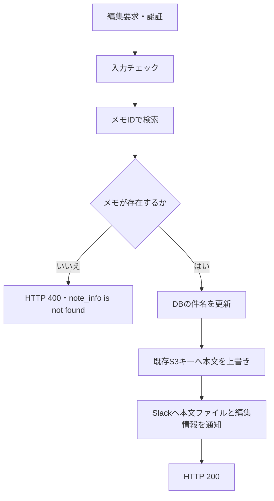
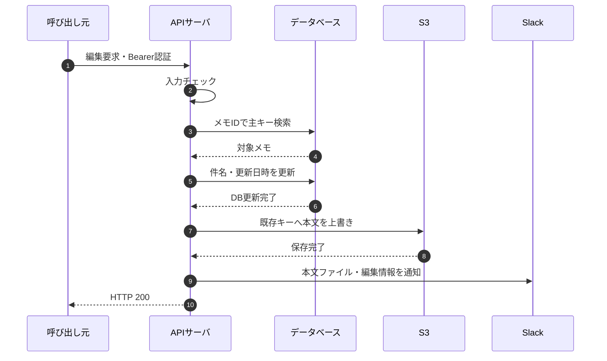

# 設計書 5.7.3. メモ情報編集API

## 1. 機能概要

- 指定したメモの件名をDBで更新し、本文を既存のS3キーへ上書きする。
- 入出力の定義は[OpenAPI入出力仕様](./openapi.yaml)の`rootEditNote`を参照する。

## 2. 処理概要



## 3. IF仕様

### 3.1. HTTPメソッド

| 項目 | 内容 | 備考 |
| --- | --- | --- |
| HTTPメソッド | `PUT` | — |

### 3.2. エンドポイントURL

| 項目 | 内容 | 備考 |
| --- | --- | --- |
| エンドポイントURL | `/api/root/note/{seq_root_user_note_info_id}` | スキーム・ホスト・ポートは実行環境に従う |

| 項目名 | 必須 | 備考 |
| --- | --- | --- |
| `seq_root_user_note_info_id` | 必須 | 編集するメモID。正数限定の検証はない |

### 3.3. リクエストIF

#### 3.3.1. リクエストヘッダ

| 項目名 | 型 | 必須 | 値 | 備考 |
| --- | --- | --- | --- | --- |
| `Authorization` | `string` | 必須 | Bearer形式のJWT | `Bearer {JWT}`の形式で、ログインAPIで発行されたトークンを指定する |
| `Content-Type` | `string` | 必須 | `application/json` | リクエストボディをJSON形式で送信する。 |

#### 3.3.2. クエリパラメータ

特になし。

#### 3.3.3. JSONボディ

```json
{
  "title": "更新後の作業メモ",
  "detail": "更新した本文。"
}
```

| 項目名 | 型 | 必須 | 備考 |
| --- | --- | --- | --- |
| `title` | `string` | 必須 | `null`・空文字・空白のみ不可。30文字以下 |
| `detail` | `string` | 必須 | `null`・空文字・空白のみ不可。独自の最大長制限はない |
| 未定義項目 | — | — | 無視する |

### 3.4. レスポンスIF

#### 3.4.1. レスポンスヘッダ

| 項目名 | 型 | 必須 | 備考 |
| --- | --- | --- | --- |
| `Content-Type` | `string` | JSON応答時 | `application/json`。認証フィルターなどの応答は同一形式を保証しない |

#### 3.4.2. JSONボディ

| 応答例 | HTTPステータス | 備考 |
| --- | --- | --- |
| 正常応答 | `200` | 以下の1つ目のJSON例 |
| 異常応答 | `400`または`500` | 以下の2つ目のJSONは400の例。条件・メッセージは「4. 処理フロー」の各詳細節に従う |

```json
{
  "result": "0"
}
```

```json
{
  "result": "1",
  "errors": [
    {
      "message": "note_info is not found"
    }
  ]
}
```

| 項目名 | 型 | 必須 | 備考 |
| --- | --- | --- | --- |
| `result` | `string` | 必須 | 正常は文字列`"0"`、異常は文字列`"1"`。数値ではない |
| `errors` | `array<object>` | 異常時 | エラー情報の配列。正常時は設定しない |
| `errors[].message` | `string`・`null` | 各エラー要素 | メッセージを設定する。外部エラーコードは付与しない |

## 4. 処理フロー



| 番号 | 処理内容 | 関連項番 | 備考 |
| --- | --- | --- | --- |
| 1 | 編集要求・Bearer認証 | 4.5 | パスのメモID・件名・本文を受け付ける |
| 2 | 入力チェック | 4.1 | 失敗時は400で終了する |
| 3 | メモIDで主キー検索 | 4.2.1 | 削除状態・所有ユーザで絞らない |
| 4 | 対象メモ | 4.2.1 | 0件の場合は400 note_info is not found |
| 5 | 件名・更新日時を更新 | 4.2.1 | その他の項目は保持する |
| 6 | DB更新完了 | 4.2.1 | S3更新より先に確定する |
| 7 | 既存キーへ本文を上書き | 4.4 | UTF-8で保存する |
| 8 | 保存完了 | 4.4 | 失敗してもDB更新を取り消さない |
| 9 | 本文ファイル・編集情報を通知 | 4.4 | ROOT用の通知先へ送信する |
| 10 | HTTP 200 | 4.3 | resultは文字列0 |

### 4.1. 入力チェック

| 対象 | 条件 | エラーメッセージ |
| --- | --- | --- |
| `title` | 必須 | `title is required` |
| `title` | 30文字以下 | `title is less than 30 byte`。30文字を許可し、長さはUTF-16コード単位で判定する |
| `detail` | 必須 | `detail is required` |

| 発生条件 | HTTPステータス | `errors[].message`・扱い |
| --- | --- | --- |
| 項目検証失敗 | `400` | 「4.1. 入力チェック」のメッセージを検出分返す |
| パス変数の数値変換失敗 | `400` | `seq_root_user_note_info_id is type error. value={値}` |
| JSON読み込み失敗 | `500` | `unexpected error.` |

### 4.2. DB操作

#### 4.2.1. 対象検索・更新

```sql
SELECT
    SEQ_ROOT_USER_NOTE_INFO_ID
    , SEQ_ROOT_LOGIN_INFO_ID
    , TITLE
    , S3_KEY
    , DELETE_FLAG
    , REG_DATE
    , UPDATE_DATE
FROM
    ROOT_USER_NOTE_INFO
WHERE
    SEQ_ROOT_USER_NOTE_INFO_ID = :noteId;
```

| 検索条件 | 設定値 |
| --- | --- |
| メモID | パスのseq_root_user_note_info_id |
| 削除状態・所有者 | 条件に含めない |

```sql
UPDATE
    ROOT_USER_NOTE_INFO
SET
    TITLE = :title
    , UPDATE_DATE = :now
WHERE
    SEQ_ROOT_USER_NOTE_INFO_ID = :noteId;
```

| 項目 | 仕様 |
| --- | --- |
| DB更新単位 | CRUDサービスのトランザクションで件名・更新日時を更新する |
| 更新日時 | DB共通更新処理でシステム日時を設定する |
| S3キー | 対象行の既存キーを使用し、キーを再採番しない |
| 本文 | S3だけに保存し、DBには保存しない |

| 発生条件 | HTTPステータス | `errors[].message`・扱い |
| --- | --- | --- |
| メモが存在しない | `400` | `note_info is not found` |
| DB検索・更新で業務例外 | `500` | `application error.` |
| DB検索・更新でその他の例外 | `500` | `unexpected error.` |

### 4.3. 業務処理・応答生成

| 順序 | 処理 | 内容 |
| --- | --- | --- |
| 1 | 対象検索 | メモIDだけで主キー検索する。対象なしはHTTP `400`、`note_info is not found` |
| 2 | DB更新 | 新規EntityにメモIDと要求の件名を設定し、非`null`項目だけを更新する |
| 3 | 本文更新 | 検索時に取得した`S3_KEY`へ、要求の本文をUTF-8で上書きする |
| 4 | Slack通知 | 本文ファイルと、メモID・S3キーをROOT用通知先へ送信する |
| 5 | 完了 | HTTP `200`、`result="0"`を返す |

| 更新ルール | 仕様 |
| --- | --- |
| 対象制限 | 検索に削除フラグ・所有ユーザIDを含めない。削除済みメモも存在すれば更新する |
| 保持する項目 | ログインID・S3キー・削除フラグ・登録日時は既存値を維持する |
| 実行順序 | DB更新を先に確定し、その後S3更新・Slack通知を行う |
| 後続失敗 | S3更新が失敗しても、完了済みのDB更新を取り消す処理はない |

| 発生条件 | HTTPステータス | `errors[].message`・扱い |
| --- | --- | --- |
| その他の例外 | `500` | `unexpected error.` |

### 4.4. S3更新・Slack通知

| 処理 | 内容 |
| --- | --- |
| S3更新 | DB検索時の既存S3キーへ、要求本文をUTF-8で上書きする |
| 処理順序 | DB更新確定後にS3更新・Slack通知を行う。後続失敗でもDB更新を取り消さない |
| 通知 | 本文ファイルとメモID・S3キーをROOT用のSlack通知先へ送信する |

| 発生条件 | HTTPステータス | `errors[].message`・扱い |
| --- | --- | --- |
| S3更新等の業務例外 | `500` | `application error.` |

### 4.5. 認証・通知

| 認証・通知 | 仕様 |
| --- | --- |
| 認証 | 本APIはBearer認証を行う。セッションは作成しない |
| 実行権限 | 認証フィルター内でロール別実行制限や、要求の対象IDとJWT主体の一致確認は行わない |
| 例外通知 | 共通例外は基底コントローラでログ出力・Slack通知を行う。HTTPとメッセージは各処理の詳細表に従う |

| 共通仕様 | 内容 |
| --- | --- |
| 応答 | 正常は文字列`result="0"`。異常は文字列`result="1"`と`errors`配列の`message` |
| 通知 | 共通例外は基底コントローラでログ出力・Slack通知を行う |
| フィルターの異常 | 認証フィルター内の異常は上記JSON形式を保証しない |
