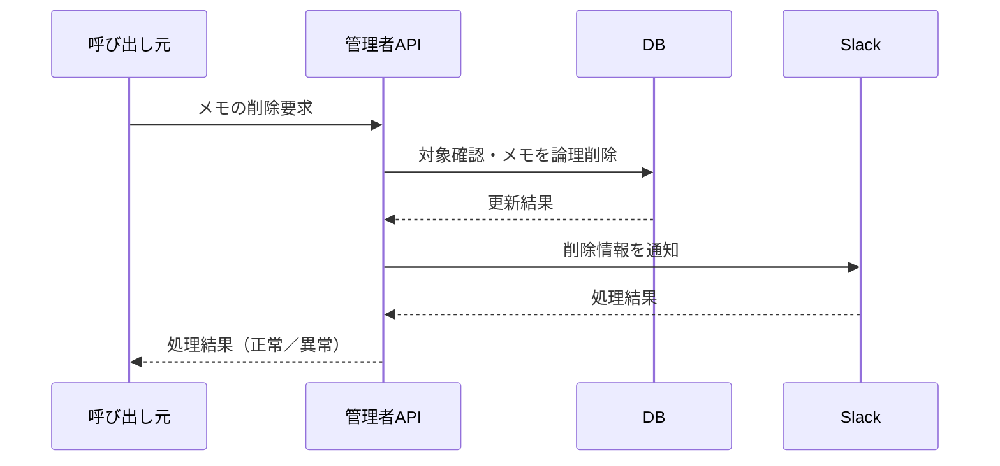
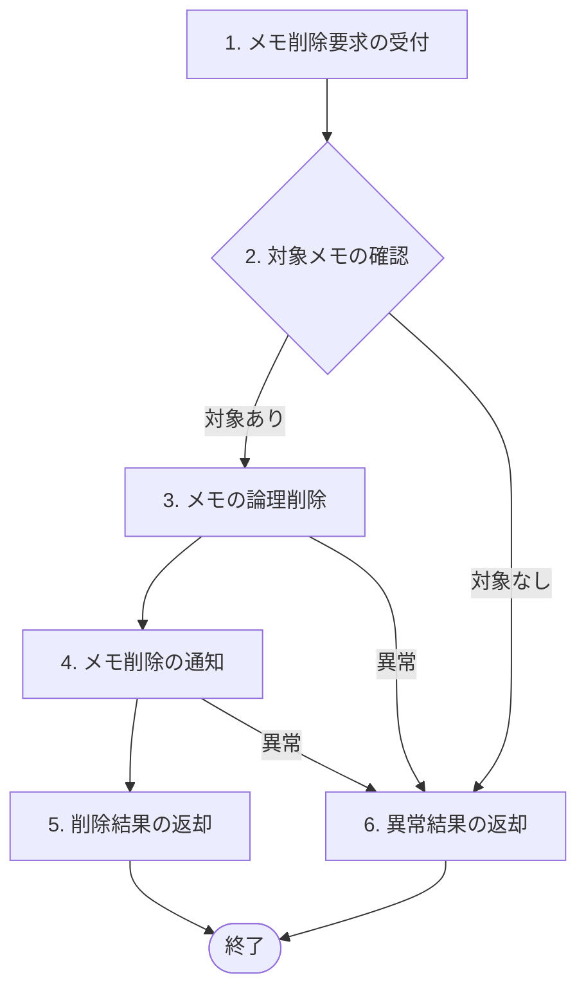

# 設計書 5.7.4. メモ情報削除API

## 1. 機能概要

- 指定したメモを論理削除し、削除情報をSlackへ通知する。
- 入出力の定義は[OpenAPI入出力仕様](./openapi.yaml)の`rootDeleteNote`を参照する。

## 2. 処理概要



## 3. IF仕様

### 3.1. HTTPメソッド

| 項目 | 内容 | 備考 |
| --- | --- | --- |
| HTTPメソッド | `DELETE` | — |

### 3.2. エンドポイントURL

| 項目 | 内容 | 備考 |
| --- | --- | --- |
| エンドポイントURL | `/api/root/note/{seq_root_user_note_info_id}` | スキーム・ホスト・ポートは実行環境に従う |

| 項目名 | 必須 | 備考 |
| --- | --- | --- |
| `seq_root_user_note_info_id` | 必須 | 削除するメモID。正数限定の検証はない |

### 3.3. リクエストIF

#### 3.3.1. リクエストヘッダ

| 項目名 | 型 | 必須 | 値 | 備考 |
| --- | --- | --- | --- | --- |
| `Authorization` | `string` | 必須 | Bearer形式のJWT | `Bearer {JWT}`の形式で、ログインAPIで発行されたトークンを指定する |

#### 3.3.2. クエリパラメータ

特になし。

#### 3.3.3. JSONボディ

特になし。

### 3.4. レスポンスIF

#### 3.4.1. レスポンスヘッダ

| 項目名 | 型 | 必須 | 備考 |
| --- | --- | --- | --- |
| `Content-Type` | `string` | JSON応答時 | `application/json`。認証フィルターなどの応答は同一形式を保証しない |

#### 3.4.2. JSONボディ

| 応答例 | HTTPステータス | 備考 |
| --- | --- | --- |
| 正常応答 | `200` | 以下の1つ目のJSON例 |
| 異常応答 | `400`または`500` | 以下の2つ目のJSONは400の例。条件・メッセージは「4. 処理フロー」の各詳細節に従う |

```json
{
  "result": "0"
}
```

```json
{
  "result": "1",
  "errors": [
    {
      "message": "note_info is not found"
    }
  ]
}
```

| 項目名 | 型 | 必須 | 備考 |
| --- | --- | --- | --- |
| `result` | `string` | 必須 | 正常は文字列`"0"`、異常は文字列`"1"`。数値ではない |
| `errors` | `array<object>` | 異常時 | エラー情報の配列。正常時は設定しない |
| `errors[].message` | `string`・`null` | 各エラー要素 | メッセージを設定する。外部エラーコードは付与しない |

## 4. 処理フロー



| 処理順 | 処理概要 | 処理詳細 | 関連項番 |
| --- | --- | --- | --- |
| 1 | メモ削除要求の受付 | Bearer認証後、パスのメモIDを受け付ける。認証失敗・ID不正は検索へ進めない。 | 4.1、4.5.1 |
| 2 | 対象メモの確認 | メモIDで対象を検索する。対象なしは400で終了し、削除済みでも存在すれば処理する。 | 4.2.1、4.3.1 |
| 3 | メモの論理削除 | 削除フラグをtrueへ更新する。物理削除やS3本文の削除は行わない。 | 4.2.2、4.3.2、4.4.1 |
| 4 | メモ削除の通知 | メモID・S3キーを含む削除情報をSlackへ送信する。DB更新と通知を一体として取り消さない。 | 4.4.2 |
| 5 | 削除結果の返却 | 成功結果をHTTP 200で返す。削除済みでも対象があれば正常終了する。 | 4.3.3 |
| 6 | 異常結果の返却 | 対象なしやDB更新・通知の失敗は各処理の異常応答で終了する。 | 4.3.1、4.5.2 |

### 4.1. 入力チェック

追加の項目検証は特になし。パス変数は符号付き64ビット整数として受け付ける。

| 発生条件 | HTTPステータス | `errors[].message`・扱い |
| --- | --- | --- |
| パス変数の数値変換失敗 | `400` | `seq_root_user_note_info_id is type error. value={値}` |

### 4.2. DB操作
#### 4.2.1. 対象検索

```sql
SELECT
    SEQ_ROOT_USER_NOTE_INFO_ID
    , SEQ_ROOT_LOGIN_INFO_ID
    , TITLE
    , S3_KEY
    , DELETE_FLAG
    , REG_DATE
    , UPDATE_DATE
FROM
    ROOT_USER_NOTE_INFO
WHERE
    SEQ_ROOT_USER_NOTE_INFO_ID = :noteId;
```

| 項目 | 設定値 | 備考 |
| --- | --- | --- |
| `:noteId` | パスの`seq_root_user_note_info_id` | 削除対象のメモID。 |

#### 4.2.2. 更新

```sql
UPDATE
    ROOT_USER_NOTE_INFO
SET
    DELETE_FLAG = TRUE
    , UPDATE_DATE = :now
    , SEQ_ROOT_LOGIN_INFO_ID = :existingLoginId
    , TITLE = :existingTitle
    , S3_KEY = :existingS3Key
    , REG_DATE = :existingRegDate
WHERE
    SEQ_ROOT_USER_NOTE_INFO_ID = :noteId;
```

| 項目 | 設定値 | 備考 |
| --- | --- | --- |
| `:now` | 各CRUD呼び出し時のシステム日時 | DB共通処理で登録日時・更新日時を設定する。 |
| `:existingLoginId` | 検索したメモEntityのログインID | 非`null`の取得値を更新Entityから引き継ぐ。 |
| `:existingTitle` | 検索したメモEntityの件名 | 非`null`の取得値を更新Entityから引き継ぐ。 |
| `:existingS3Key` | 検索したメモEntityのS3キー | 非`null`の取得値を更新Entityから引き継ぐ。 |
| `:existingRegDate` | 検索したメモEntityの登録日時 | 非`null`の取得値を更新Entityから引き継ぐ。 |
| `:noteId` | パスの`seq_root_user_note_info_id` | 更新対象のメモID。 |

### 4.3. 業務処理・応答生成

#### 4.3.1. 要求受付・対象メモの確認

| 順序 | 処理 | 内容 |
| --- | --- | --- |
| 1 | 要求受付 | パスのメモIDを符号付き64ビット整数として受け付ける |
| 2 | 対象検索 | メモIDだけで主キー検索する |
| 3 | 存在判定 | 対象なしはHTTP `400`、`note_info is not found`を返す |

#### 4.3.2. メモの論理削除

| 順序 | 処理 | 内容 |
| --- | --- | --- |
| 4 | 論理削除 | 取得したEntityの削除フラグを`true`にしてDBを更新する |

#### 4.3.3. 削除通知・結果の返却

| 順序 | 処理 | 内容 |
| --- | --- | --- |
| 5 | Slack通知 | メモID・S3キーを含む削除情報をROOT用通知先へ送信する |
| 6 | 完了 | HTTP `200`、`result="0"`を返す |

| 削除ルール | 仕様 |
| --- | --- |
| 削除方式 | DB行の削除フラグだけを更新する。物理削除は行わない |
| S3本文 | 削除しない |
| 再実行 | 削除済みの行も検索対象となり、存在すれば再び更新して正常終了する |
| 対象ユーザ | 所有ユーザIDやJWT主体との一致検証は本処理で行わない |
| 更新単位 | DB更新はCRUDサービスのトランザクションで確定し、Slack通知とまとめたトランザクションはない |

| 発生条件 | HTTPステータス | `errors[].message`・扱い |
| --- | --- | --- |
| 共通処理へ到達した業務例外 | `500` | `application error.` |
| その他の例外 | `500` | `unexpected error.` |

**SQL呼び出し時の結果・例外の扱い**

| SQLの扱い | 仕様 |
| --- | --- |
| 更新文 | 非`null`項目だけを設定する代表例。取得値が`null`の項目は更新句から除外する |

| 更新対象 | 設定内容 |
| --- | --- |
| `DELETE_FLAG` | `true` |
| `UPDATE_DATE` | DB共通更新処理でシステム日時を設定する |
| その他の非`null`項目 | 取得済みEntityの値をそのまま設定する |
| 更新条件 | `SEQ_ROOT_USER_NOTE_INFO_ID=:noteId`。削除フラグは条件に含めない |

| 発生条件 | HTTPステータス | `errors[].message`・扱い |
| --- | --- | --- |
| メモが存在しない | `400` | `note_info is not found` |
| DB検索・更新で業務例外 | `500` | `application error.` |
| DB検索・更新でその他の例外 | `500` | `unexpected error.` |

### 4.4. 削除方式・Slack通知

#### 4.4.1. 削除方式の確認

| 処理 | 内容 |
| --- | --- |
| 削除方式 | DBの削除フラグをtrueへ更新する。物理削除・S3ファイル削除は行わない |

#### 4.4.2. Slackへの削除通知

| 処理 | 内容 |
| --- | --- |
| 通知 | メモIDとS3キーを含む削除情報をROOT用のSlack通知先へ送信する |

### 4.5. 認証・通知

#### 4.5.1. 認証・利用範囲の確認

| 認証・通知 | 仕様 |
| --- | --- |
| 認証 | 本APIはBearer認証を行う。セッションは作成しない |
| 実行権限 | 認証フィルター内でロール別実行制限や、要求の対象IDとJWT主体の一致確認は行わない |

| 共通仕様 | 内容 |
| --- | --- |
| フィルターの異常 | 認証フィルター内の異常は上記JSON形式を保証しない |

#### 4.5.2. 共通異常応答・通知

| 認証・通知 | 仕様 |
| --- | --- |
| 例外通知 | 共通例外は基底コントローラでログ出力・Slack通知を行う。HTTPとメッセージは各処理の詳細表に従う |

| 共通仕様 | 内容 |
| --- | --- |
| 応答 | 正常は文字列`result="0"`。異常は文字列`result="1"`と`errors`配列の`message` |
| 通知 | 共通例外は基底コントローラでログ出力・Slack通知を行う |
