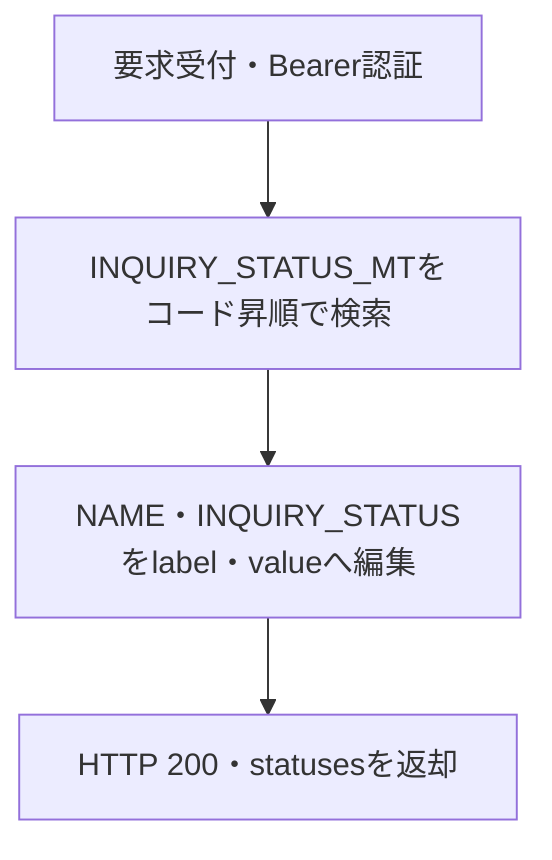
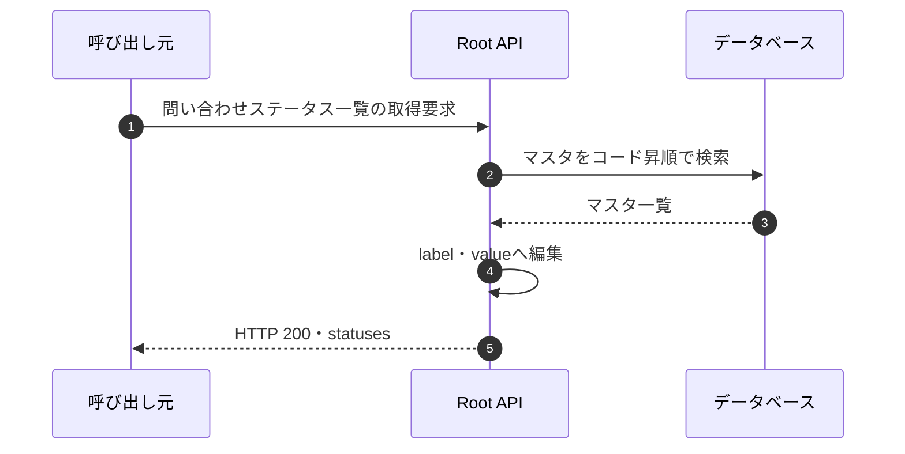

# 設計書 5.8.2. 問い合わせステータスマスタ一覧取得API

## 1. 機能概要

- 問い合わせステータスマスタをコード順の選択肢として返す。
- 入出力の定義は同じフォルダの[OpenAPI](./openapi.yaml)の`rootGetInquiryStatuses`を参照する。

## 2. 処理概要



## 3. IF仕様

### 3.1. HTTPメソッド

| 項目 | 内容 | 備考 |
| --- | --- | --- |
| HTTPメソッド | `GET` | — |

### 3.2. エンドポイントURL

| 項目 | 内容 | 備考 |
| --- | --- | --- |
| エンドポイントURL | `/api/root/inquiry/status` | スキーム・ホスト・ポートは実行環境に従う。パス変数はなし。 |

### 3.3. リクエストIF

#### 3.3.1. リクエストヘッダ

| 項目名 | 型 | 必須 | 値 | 備考 |
| --- | --- | --- | --- | --- |
| `Authorization` | `string` | 必須 | Bearer形式のJWT | `Bearer {JWT}`の形式で、ログインAPIのトークンを指定する。認証失敗はフィルターで処理され、本APIの共通エラー形式を保証しない。 |

#### 3.3.2. クエリパラメータ

特になし。

#### 3.3.3. JSONボディ

特になし。

### 3.4. レスポンスIF

#### 3.4.1. レスポンスヘッダ

| 項目名 | 型 | 設定条件 | 備考 |
| --- | --- | --- | --- |
| `Content-Type` | `string` | 正常なJSON応答時 | `application/json`。本API固有の追加レスポンスヘッダーはない。 |

#### 3.4.2. JSONボディ

```json
{
  "result": "0",
  "statuses": [
    {
      "label": "未対応",
      "value": "00"
    },
    {
      "label": "対応中",
      "value": "01"
    },
    {
      "label": "完了",
      "value": "02"
    }
  ]
}
```

| 項目名 | 型 | 設定条件 | 備考 |
| --- | --- | --- | --- |
| `result` | `string` | 必須 | 成功は`"0"`、失敗は`"1"`。数値ではない。 |
| `errors[]` | `array<object>` | 異常時 | 各要素の`message`にエラー詳細を設定する。正常時は省略する。 |
| `statuses[]` | `array<object>` | 正常時 | 0件なら空配列。 |
| `statuses[].label` | `string` | 値がある場合 | `INQUIRY_STATUS_MT.NAME`。 |
| `statuses[].value` | `string` | 値がある場合 | `INQUIRY_STATUS_MT.INQUIRY_STATUS`。 |

## 4. 処理フロー



| 番号 | 処理内容 | 関連項番 | 備考 |
| --- | --- | --- | --- |
| 1 | Bearer認証後に要求を受け付ける | 4.3 | 個別の入力項目はない。 |
| 2 | INQUIRY_STATUS_MTを全件取得する | 4.2 | キャッシュは使用しない。 |
| 3 | 検索結果を受け取る | 4.2 | 0件も許可。 |
| 4 | NAMEとINQUIRY_STATUSを設定する | 4.4 | null値は対応属性を省略。 |
| 5 | 正常応答を返す | 3.4.2 | resultは文字列の0。 |

### 4.1. 入力チェック

特になし。本API固有の入力チェックはない。0件でも正常終了する。

| 発生条件 | HTTPステータス | errors[].message | 備考 |
| --- | --- | --- | --- |
| 引数・パスの型変換失敗 | 400 | `{引数名} is type error. value={値}` | `result="1"`と`errors`を返す。 |

### 4.2. DB操作

```sql
SELECT
    *
FROM
    INQUIRY_STATUS_MT
ORDER BY
    INQUIRY_STATUS ASC;
```

| 項目 | 仕様 |
| --- | --- |
| 検索条件 | 削除フラグによる絞り込みは指定しない |
| 並び順 | `INQUIRY_STATUS`の昇順 |
| キャッシュ | この検索では使用しない |
| 応答編集 | `NAME`を`label`、`INQUIRY_STATUS`を`value`へ設定する |

| 発生条件 | HTTPステータス | errors[].message | 備考 |
| --- | --- | --- | --- |
| 業務・外部連携のBaseException | 500 | `application error.` | `result="1"`と`errors`を返す。 |
| DB検索・更新中のその他の例外 | 500 | `unexpected error.` | `result="1"`と`errors`を返す。 |

### 4.3. 認証・共通処理

| 処理 | 内容 | 備考 |
| --- | --- | --- |
| Bearer認証 | 共通フィルターで署名付きJWTを処理する | コントローラ内で権限コードの照合や追加のユーザ検索は行わない。 |
| フィルター段階の失敗 | フィルター・実行環境の処理に従う | コントローラが返す`result`・`errors`形式の対象外。 |
| コントローラ側の異常応答 | `result="1"`と`errors`を設定する | 各要素の`message`は、入力・DB・外部処理の各節に示す文言。 |
| 例外通知・ログ | 基底コントローラの例外ハンドラーはRoot用Slackへ通知し、サーバログへ出力する | コントローラが直接返す業務判定の400応答では、その例外ハンドラーを経由しない。 |

### 4.4. 応答編集

| 項目 | 編集仕様 | 備考 |
| --- | --- | --- |
| `statuses[]` | 検索順に作成する | 0件なら空配列。 |
| `label`・`value` | NAMEとINQUIRY_STATUSをコピー | 値がnullの場合は対応項目を省略する。 |

| 発生条件 | HTTPステータス | errors[].message | 備考 |
| --- | --- | --- | --- |
| その他の例外 | 500 | `unexpected error.` | `result="1"`と`errors`を返す。 |
