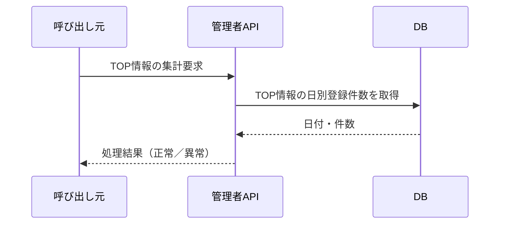
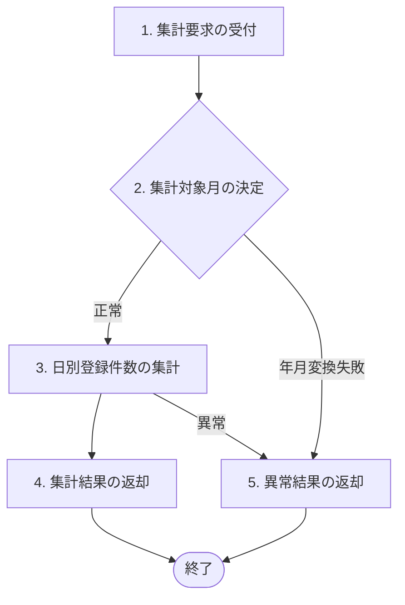

# 設計書 5.9.1. Top情報取得API

## 1. 機能概要

- 対象月の有効なユーザ・健康情報の日別登録件数を取得し、Top画面のグラフ情報として返す。
- 入出力の定義は同じフォルダの[OpenAPI](./openapi.yaml)の`rootGetTop`を参照する。

## 2. 処理概要



## 3. IF仕様

### 3.1. HTTPメソッド

| 項目 | 内容 | 備考 |
| --- | --- | --- |
| HTTPメソッド | `GET` | — |

### 3.2. エンドポイントURL

| 項目 | 内容 | 備考 |
| --- | --- | --- |
| エンドポイントURL | `/api/root/top` | スキーム・ホスト・ポートは実行環境に従う。パス変数はなし。 |

### 3.3. リクエストIF

#### 3.3.1. リクエストヘッダ

| 項目名 | 型 | 必須 | 値 | 備考 |
| --- | --- | --- | --- | --- |
| `Authorization` | `string` | 必須 | Bearer形式のJWT | `Bearer {JWT}`の形式で、ログインAPIのトークンを指定する。認証失敗はフィルターで処理され、本APIの共通エラー形式を保証しない。 |

#### 3.3.2. クエリパラメータ

| 項目名 | 型 | 必須 | 備考 |
| --- | --- | --- | --- |
| `date` | `string` | 任意 | 基準形式は`yyyyMM`。未指定・空文字・空白のみはシステム日付の月。 |

#### 3.3.3. JSONボディ

特になし。

### 3.4. レスポンスIF

#### 3.4.1. レスポンスヘッダ

| 項目名 | 型 | 設定条件 | 備考 |
| --- | --- | --- | --- |
| `Content-Type` | `string` | 正常なJSON応答時 | `application/json`。本API固有の追加レスポンスヘッダーはない。 |

#### 3.4.2. JSONボディ

```json
{
  "result": "0",
  "account_reg_graph_list": [
    {
      "count": 1,
      "date": "2026/11/01"
    }
  ],
  "health_info_reg_graph_list": [
    {
      "count": 2,
      "date": "2026/11/01"
    }
  ]
}
```

| 項目名 | 型 | 設定条件 | 備考 |
| --- | --- | --- | --- |
| `result` | `string` | 必須 | 成功は`"0"`、失敗は`"1"`。数値ではない。 |
| `errors[]` | `array<object>` | 異常時 | 各要素の`message`にエラー詳細を設定する。正常時は省略する。 |
| `account_reg_graph_list[]` | `array<object>` | 正常時 | 日別登録件数。0件なら空配列。 |
| `account_reg_graph_list[].count` | `integer`（`int32`） | 正常時 | 登録件数。 |
| `account_reg_graph_list[].date` | `string` | 正常時 | `yyyy/MM/dd`。 |
| `health_info_reg_graph_list[]` | `array<object>` | 正常時 | 有効な健康情報の日別登録件数。0件なら空配列。 |
| `health_info_reg_graph_list[].count` | `integer`（`int32`） | 正常時 | 登録件数。 |
| `health_info_reg_graph_list[].date` | `string` | 正常時 | `yyyy/MM/dd`。 |

## 4. 処理フロー



| 処理順 | 処理概要 | 処理詳細 | 関連項番 |
| --- | --- | --- | --- |
| 1 | 集計要求の受付 | Bearer認証を経て対象年月を指定した要求を受け付ける。認証失敗はフィルター側で終了する。 | 4.3.1 |
| 2 | 集計対象月の決定 | 対象年月から検索範囲を決定する。未指定・空白は現在月とし、日付を解釈できない場合は400で終了する。 | 4.1.1 |
| 3 | 日別登録件数の集計 | 有効なUSERとHEALTH_INFOの登録日時を基準に、対象月の日別登録件数を検索する。双方を`DELETE_FLAG = false`に限定し、対象なしも正常な空結果として扱う。 | 4.2.1、4.2.2、4.4.1 |
| 4 | 集計結果の返却 | 日別件数と日付をグラフへ設定し、HTTP 200で返す。データのない日の0補完は行わず、空結果は空配列とする。 | 4.4.2 |
| 5 | 異常結果の返却 | 対象年月の変換不正や集計・応答編集の失敗は、各処理の異常応答で終了する。 | 4.1.2、4.3.2、4.4.2 |

### 4.1. 入力チェック

#### 4.1.1. 入力項目・補完条件の確認

| 対象 | ルール | 異常時 |
| --- | --- | --- |
| `date`未指定・空文字・空白のみ | システム日付の月を使用する | — |
| 非空の`date` | 末尾に`01`を付け、`uuuuMMdd`の厳密な日付として解釈する。非空値の前後空白は除去しない | 400・`date format error. date is yyyymm` |
| 検索開始・終了 | 対象月1日00:00:00から月末23:59:59まで。両端を含む | — |

#### 4.1.2. 入力異常時の扱い

| 発生条件 | HTTPステータス | errors[].message | 備考 |
| --- | --- | --- | --- |
| 対象年月の変換失敗 | 400 | `date format error. date is yyyymm` | WARNログとRoot用Slack通知後、`result="1"`と`errors`を返す。 |
| 引数・パスの型変換失敗 | 400 | `{引数名} is type error. value={値}` | `result="1"`と`errors`を返す。 |

### 4.2. DB操作
#### 4.2.1. USERの集計

```sql
SELECT
    DISTINCT DATE_FORMAT(U.REG_DATE, '%Y-%m-%d') AS DATE
    , CNT.COUNT AS COUNT
FROM
    USER U
    , (
        SELECT
            COUNT(REG_DATE) AS COUNT
            , DATE_FORMAT(REG_DATE, '%Y%m%d') AS REG_DATE
        FROM
            USER
        WHERE
            DELETE_FLAG = false
        GROUP BY
            DATE_FORMAT(REG_DATE, '%Y%m%d')
    ) AS CNT
WHERE
    U.REG_DATE BETWEEN :from AND :to
    AND U.DELETE_FLAG = false
    AND DATE_FORMAT(CNT.REG_DATE, '%Y%m%d') = DATE_FORMAT(U.REG_DATE, '%Y%m%d')
ORDER BY
    DATE_FORMAT(U.REG_DATE, '%Y-%m-%d');
```

| 項目 | 設定値 | 備考 |
| --- | --- | --- |
| `:from` | 要求の`date`に対応する月初の00:00:00 | `getFrom(date)`で作成する。date未指定・空文字の場合はシステム日付の当月を使用する。 |
| `:to` | 要求の`date`に対応する月末の23:59:59 | `getTo(date)`で作成する。検索範囲の両端を含む。 |

#### 4.2.2. HEALTH_INFOの集計

```sql
SELECT
    DISTINCT DATE_FORMAT(HI.HEALTH_INFO_REG_DATE, '%Y-%m-%d') AS DATE
    , CNT.COUNT AS COUNT
FROM
    HEALTH_INFO HI
    , (
        SELECT
            COUNT(HEALTH_INFO_REG_DATE) AS COUNT
            , DATE_FORMAT(HEALTH_INFO_REG_DATE, '%Y%m%d') AS REG_DATE
        FROM
            HEALTH_INFO
        WHERE
            DELETE_FLAG = false
        GROUP BY
            DATE_FORMAT(HEALTH_INFO_REG_DATE, '%Y%m%d')
    ) AS CNT
WHERE
    HI.HEALTH_INFO_REG_DATE BETWEEN :from AND :to
    AND HI.DELETE_FLAG = false
    AND DATE_FORMAT(CNT.REG_DATE, '%Y%m%d') = DATE_FORMAT(HI.HEALTH_INFO_REG_DATE, '%Y%m%d')
ORDER BY
    DATE_FORMAT(HI.HEALTH_INFO_REG_DATE, '%Y-%m-%d');
```

| 項目 | 設定値 | 備考 |
| --- | --- | --- |
| `:from` | 要求の`date`に対応する月初の00:00:00 | `getFrom(date)`で作成する。date未指定・空文字の場合はシステム日付の当月を使用する。 |
| `:to` | 要求の`date`に対応する月末の23:59:59 | `getTo(date)`で作成する。検索範囲の両端を含む。 |

### 4.3. 認証・共通処理

#### 4.3.1. 認証・利用範囲の確認

| 処理 | 内容 | 備考 |
| --- | --- | --- |
| Bearer認証 | 共通フィルターで署名付きJWTを処理する | コントローラ内で権限コードの照合や追加のユーザ検索は行わない。 |
| フィルター段階の失敗 | フィルター・実行環境の処理に従う | コントローラが返す`result`・`errors`形式の対象外。 |

#### 4.3.2. 共通異常応答・通知

| 処理 | 内容 | 備考 |
| --- | --- | --- |
| コントローラ側の異常応答 | `result="1"`と`errors`を設定する | 各要素の`message`は、入力・DB・外部処理の各節に示す文言。 |
| 例外通知・ログ | 基底コントローラの例外ハンドラーはRoot用Slackへ通知し、サーバログへ出力する | コントローラが直接返す業務判定の400応答では、その例外ハンドラーを経由しない。 |

### 4.4. 集計結果・応答編集

#### 4.4.1. 日別集計結果の扱い

| 項目 | 仕様 |
| --- | --- |
| 集計単位 | 各登録日時の日付ごとの件数 |
| 対象 | 検索範囲内の全ユーザ分。ログイン中のユーザによる絞り込みは行わない |
| 削除状態 | USER・HEALTH_INFOとも日別COUNTの内側と対象期間を選ぶ外側の両方で`DELETE_FLAG = false`を指定する |
| 並び順 | 登録日の昇順 |
| データのない日 | 0件の日を補完する処理はない。検索結果がなければ空配列 |

#### 4.4.2. グラフ応答の生成・異常時の扱い

| 項目 | 仕様 |
| --- | --- |
| 応答編集 | 検索結果の`COUNT`と`DATE`を`count`と`date`へコピーする |
| 対象外のグラフ | この操作で検索しないグラフ項目は設定せず、応答から省略する |

| 発生条件 | HTTPステータス | errors[].message | 備考 |
| --- | --- | --- | --- |
| その他の例外 | 500 | `unexpected error.` | `result="1"`と`errors`を返す。 |

**SQL呼び出し時の結果・例外の扱い**

| 発生条件 | HTTPステータス | errors[].message | 備考 |
| --- | --- | --- | --- |
| 業務・外部連携のBaseException | 500 | `application error.` | `result="1"`と`errors`を返す。 |
| DB検索・更新中のその他の例外 | 500 | `unexpected error.` | `result="1"`と`errors`を返す。 |
